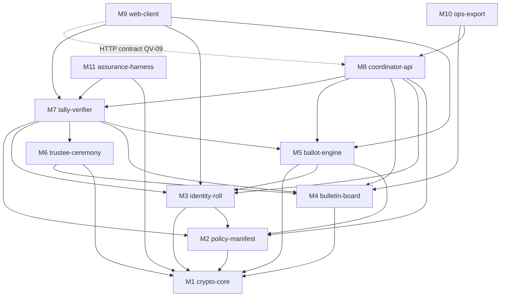

# QV-01 — Capability Map

**Module ID:** `capability-map` (cross-cutting)
**Status:** Draft
**Owner:** Architecture lead (project owner until appointed)
**Last reviewed:** 2026-10-21
**Related specs:** QV-00, QV-02…QV-09, QV-16 (crypto protocol), QV-20 (voting methods); baseline ADR-002/003/004/005/007

## 1. Objective

Fix the **final module set**, who owns which data, the interfaces between modules, and a **one-way (acyclic) dependency graph**, so that specs and code can be built in parallel without hidden coupling. This replaces the eight framework "proposed modules" with eleven implementation modules; the framework names are mapped in §3.

## 2. Scope

**In scope:** module boundaries, data ownership, interface contracts (summary; schemas in QV-09), trust placement, dependency DAG, build order, change/compat rules.
**Out of scope:** internal design of each module (QV-03…QV-16), deployment topology (QV-08).

## 3. Final modules

| ID | Module | Responsibility | Specs | Runs where | Framework name |
|---|---|---|---|---|---|
| M1 | `crypto-core` | Typed wrappers over `@noble/curves`/`hashes`: ristretto255, Ed25519, hashing with domain separation, Merkle tree (RFC 9162 style), exponential ElGamal, CDS/Chaum–Pedersen proofs, Feldman/Pedersen DKG math, canonical encodings | QV-16 | lib (browser, Node) | `ballot-engine` (part), `security-privacy` (part) |
| M2 | `policy-manifest` | Group rule schema, proposal objects, election manifest build/validate/sign, lifecycle state machine, rule-transition guards | QV-03 | lib + server | `product-policy` |
| M3 | `identity-roll` | Voter keys (client), invitations, enrollment, roll/leaf commitment, snapshots, rotation/recovery certificates, (P2) blind-token issuer, (P3) membership proofs | QV-04 | lib + client + server | `identity-eligibility` |
| M4 | `bulletin-board` | Append-only Merkle log, signed tree heads (STH), inclusion/consistency proofs, witness cosign hooks, mirror protocol | QV-05 §6, QV-09 | server + lib | `platform-interfaces` (part) |
| M5 | `ballot-engine` | Ballot encoding per method, client-side encrypt+prove+sign, Benaloh audit, server-side/verifier-side ballot validation, revote resolution | QV-05, QV-20 | lib (browser, Node) | `ballot-engine` |
| M6 | `trustee-ceremony` | DKG rounds, share storage format, partial decryption + proofs, key destruction attestation, trustee CLI | QV-16, QV-12 | CLI (trustee machines) | `ballot-engine` (part), `operations-assurance` (part) |
| M7 | `tally-verifier` | Homomorphic aggregation, decryption verification, outcome computation (quorum/threshold/tie-break), standalone verifier (CLI + offline page) | QV-05, QV-11 | lib + CLI + static page | `ballot-engine` (part) |
| M8 | `coordinator-api` | HTTP API, SQLite storage, auth of requests by signature, rate limiting, scheduler (open/close), notification hooks | QV-08, QV-09 | server (untrusted for secrecy/integrity) | `platform-interfaces` |
| M9 | `web-client` | Voter/steward/auditor UI, local key management, accessibility, localization | QV-10, QV-13 | browser | `experience-accessibility` |
| M10 | `ops-export` | Deploy artifacts (container/systemd), backup/restore, export/import bundle, retention jobs, health/metrics | QV-12, QV-06, QV-14 | server tooling | `operations-assurance` |
| M11 | `assurance-harness` | Test vectors, property/fuzz tests, reproducible-build tooling, release-manifest signing | QV-11 | CI | `operations-assurance` |

`security-privacy` (QV-06, QV-07) remains **cross-cutting policy**, not a module: every module carries a threat-model review checkbox and its own privacy data rows (QV-06 §3).

## 4. Dependency DAG

An arrow `A --> B` means "A depends on B" (A imports B's contract). The graph is acyclic; builds proceed bottom-up.

Rules enforced by lint in CI (M11): (1) no import cycles; (2) M1 imports nothing in-repo; (3) M7 (verifier) must not import M8 or any server code — it consumes an export bundle or HTTP-fetched log only, so the verifier is independent of the coordinator; (4) M9 never imports M8 code (talks HTTP via QV-09 schema types only); (5) no module outside M1 imports `@noble/*` directly.

## 5. Data ownership

"Owns" = sole writer and source of truth. "Must not receive" = data the module is forbidden to see (enforced by types/tests).

| Module | Owns | Must not receive |
|---|---|---|
| M1 | nothing persistent | any key material beyond call duration |
| M2 | Group rule document (versions), proposals and amendments, election manifest, lifecycle state, steward set | voter ballots, voter secret keys |
| M3 | Invitation records, enrollment records (voter pubkey, label, status), roll + Merkle tree, snapshots, rotation/recovery certs; voter secret key (client only) | ballot ciphertexts linked to a voter beyond what the log publishes; trustee shares |
| M4 | The log: entries, tree state, STHs, witness cosignatures | plaintext of anything; secret keys |
| M5 | Ballot encodings and ciphertexts (client-side transient), validation verdicts, revote ordering function; Benaloh spoiled-ballot openings (voter-held) | voter secret key (it asks the client signer interface for a signature only) |
| M6 | Trustee key shares (trustee machines only), DKG transcript, partial decryptions | voter identities, ballot-to-voter mapping |
| M7 | Computed aggregates, tally, outcome object, verification report | nothing secret; works from public artifacts only |
| M8 | Operational DB (rate-limit counters, scheduler jobs, cached views, session nonces), copies of M2/M3/M4 data it stores on their behalf | trustee shares; voter secret keys; plaintext ballots (cannot decrypt); client IP in persistent storage (QV-06) |
| M9 | Voter key file (local), UI preferences (local) | – |
| M10 | Backups, export bundles, retention schedules | – |
| M11 | Test vectors, release manifest signatures | production secrets |

## 6. Interfaces (summary; normative schemas in QV-09, crypto bytes in QV-16)

| Interface | Provider → Consumer | Content | Failure behaviour |
|---|---|---|---|
| `IManifest` | M2 → M3, M5, M7, M8 | `ElectionManifest` (canonical JSON, hash `manifest_id`), signed by group key | Invalid signature/hash → refuse to open (fail closed) |
| `IRoll` | M3 → M5, M7, M8 | roll root, leaf set, inclusion proofs, rotation certs | Unknown leaf → ballot rejected `E_NOT_ELIGIBLE` |
| `ISigner` | client key store → M5 | `sign(msg)` for ballot envelope | Locked/missing key → UI prompt; never exports key |
| `ICrypto` | M1 → all | encode/hash/sign/verify/encrypt/prove | Any proof failure → typed error, no partial result |
| `ILog` | M4 → M7, M8, M10, mirrors | `append`, `get(entry)`, `inclusionProof`, `consistencyProof`, `latestSTH` | Append failure → request fails, state unchanged |
| `IBallotValidate` | M5 → M8, M7 | `validate(ballotEnvelope, manifest, roll) -> Verdict` (pure, deterministic) | Deterministic reject codes |
| `ITrustee` | M6 ↔ M4 | DKG messages, partial decryptions posted as log entries | Missing trustee → threshold t of n sufficient; else election `FAILED_DECRYPT` (QV-03 §5) |
| `ITally` | M7 → M8, M9 | `outcome(manifest, log) -> Outcome + Report` | Any check fails → `Report.status = INVALID`, no outcome asserted |
| `IExport` | M10 ↔ M4/M8 | export/import bundle (QV-09 §bundle) | Import verifies full hash chain before enabling writes |
| HTTP API | M8 → M9, CLI, mirrors | QV-09 | Idempotent writes with request IDs |

Versioning: every interface payload carries `proto: "qv/1"` (ADR-013 algorithm agility). Backward-incompatible change = new major, old verifier kept for old elections (a verifier can verify any election at its recorded `proto`).

## 7. Trust placement

| Module | Trusted by whom for what |
|---|---|
| M8, M4 (as run by operator) | Availability only. Integrity and secrecy are **not** delegated; clients and verifiers check proofs. |
| M6 trustees | Threshold t of n for secrecy; none for integrity. |
| M3 steward (group key) | Defines who is eligible; **trusted for roll correctness** in Phase 1 (detectable stuffing only by members who know each other). Stated in QV-04 §3.4. |
| M9 client code | Trusted for cast-as-intended unless voter does a Benaloh audit/independent client (ADR-010). |
| M7 verifier | Trusted only as far as the user trusts the build they run; reproducible builds + second implementation. |

## 8. Logs / audit artifacts per module

M2: lifecycle transition entries; M3: enrollment/rotation/roll-amendment entries (no secrets); M4: tree heads; M5: ballot entries; M6: DKG and decryption entries; M7: report hash entry; M8: operational log without IPs (QV-06). All module outputs that matter for audit reach the log (M4); nothing audit-relevant lives only in M8's DB.

## 9. Build and specification order

1. M1 (+ M11 vectors) → 2. M2, M4 → 3. M3 (Phase 1), M5 → 4. M6, M7 → 5. M8 → 6. M9, M10 → 7. Phase 2 (M3 blind-token extension, M5 ranked) → 8. Phase 3 (research, QV-21/QV-3x).
Milestones: **v0.1** M1+M4+M2 + CLI demo; **v0.5** full CLI election end-to-end; **v0.9** web client + pilot; **v1.0** after independent crypto review (QV-00 S3).

## 10. Requirements

| ID | Requirement | Priority | Acceptance criteria | Verification |
|---|---|---|---|---|
| QV-01-REQ-001 | The repository shall implement exactly modules M1–M11 as separate npm workspace packages with the dependency edges of §4 and no others. | Must | CI dependency-cruiser check passes; adding a forbidden edge fails the build | CI test |
| QV-01-REQ-002 | M1 shall have zero in-repo imports and be the only importer of `@noble/*`. | Must | Lint rule fires on violating import | CI |
| QV-01-REQ-003 | M7 (verifier) shall not import M8 or any server-only code and shall run offline from an export bundle. | Must | Verifier passes full-election test with network disabled and `coordinator-api` package absent | Integration test |
| QV-01-REQ-004 | M8 shall store no plaintext ballots, trustee shares, or voter secret keys and shall not persist client IP addresses. | Must | Schema review + test that DB dump contains none of: test marker plaintext, share bytes, IPs | Security test |
| QV-01-REQ-005 | Every cross-module payload shall carry `proto` and be validated at the boundary against its schema. | Must | Malformed/unknown-`proto` payload rejected with `E_PROTO` | Unit |
| QV-01-REQ-006 | All audit-relevant events shall be appended to M4 before being reported as successful to the caller. | Must | Fault injection: failing append yields failed request and no state change | Integration |
| QV-01-REQ-007 | Each module spec shall list data it owns and must not receive, kept consistent with §5. | Should | Spec review checklist | Review |

## 11. Constraints and assumptions

- Single-process Node server for MVP (SQLite via `node:sqlite`); horizontal scaling out of scope.
- Browser support: evergreen Chrome/Firefox/Safari (last 2 majors); Web Crypto not relied upon for ristretto (noble in JS).
- Assumes QV-16 delivers `ICrypto` shapes in time; interface freeze before v0.5.

## 12. Open questions

| Question | Owner | Proposed default |
|---|---|---|
| Should M4 be a separately deployable process (for third-party operation as an independent log)? | Architecture | Same process in MVP; protocol allows separate mirrors/witnesses |
| Is M6 CLI-only or also browser-based trustee UI? | UX/QV-12 | CLI first; browser trustee flow Phase 2 |
| Where does the notification hook (email/webhook) live given QV-06 minimisation? | Privacy | M8, off by default, steward-supplied webhook only |

## 13. Approval and change history

| Reviewer | Decision | Date | Notes |
|---|---|---|---|
| Project owner | Pending | — | Records acceptance in decision log |

## Proposed ADRs

- **QV-ADR-P01-1 — Adopt M1–M11 module set and DAG with import-lint enforcement; verifier independent of server code.**
