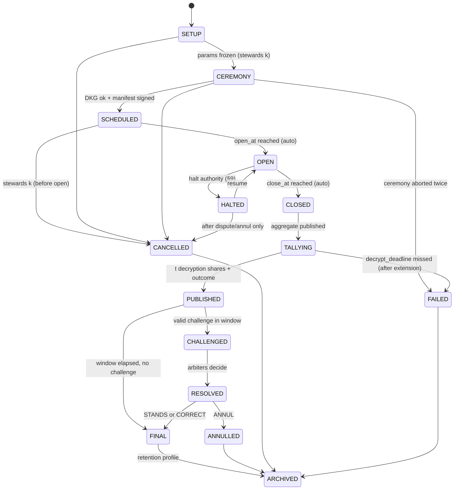

# QV-03 — Governance and Policy

**Module ID:** `policy-manifest` (M2)
**Status:** Draft
**Owner:** Product/Policy lead (project owner until appointed)
**Last reviewed:** 2026-10-21
**Related specs:** QV-00, QV-02, QV-04 (roll), QV-05 (protocol), QV-06 (retention), QV-16 (ceremony bytes), QV-20 (voting methods); ADR-001, 004, 005, 006, 007

## 1. Objective

Define what a group can configure, how rules become binding and immutable for each election, how an election moves through its lifecycle, and how disputes, recounts, emergencies, and rule changes are handled — such that **no steward, operator, or majority can silently change the rules of a running vote** and a minority retains a verifiable path to challenge.

Design stance: group policy is *data* (signed JSON), not code or server state. Every state transition is a signed, logged entry. The platform enforces only the invariants in §11 (platform-enforced constraints); everything else is group choice recorded in the manifest.

## 2. Scope

**In scope:** group rule schema, election manifest, lifecycle state machines (proposal and election), proposal and amendment rules, quorum/threshold/tie arithmetic, disputes and recount, emergency halt, anti-capture protections, roles/authority matrix, example templates.
**Out of scope:** identity mechanics (QV-04), cryptographic detail (QV-16), UI copy (QV-10), discussion tooling, enforcement of the group's real-world bylaws.

## 3. Group rule schema (`GroupRules`, proto `qv/1`)

Canonical JSON (RFC 8785 JCS) signed by ≥ `stewards.approval.k` steward keys; `rules_hash = SHA-256("QV-rules/1" ‖ jcs(doc))`. Integers only (no floats). Time as RFC 3339 UTC strings; durations in hours.

### 3.1 Annotated example

```json
{
  "proto": "qv/1", "kind": "group-rules",
  "group_id": "b32:…", "version": 3, "prev_rules_hash": "hex:…",
  "name": "Example Foundation",
  "stewards": {
    "keys": ["ed25519:…", "ed25519:…", "ed25519:…"],
    "approval": {"k": 2, "n": 3},
    "term_days": 365, "max_consecutive_terms": 2
  },
  "enrollment": {"approval": "steward", "invite_ttl_hours": 336, "label_policy": "pseudonym_ok"},
  "proposals": {
    "who": "any_member", "sponsors_required": 0,
    "min_review_hours": 168, "max_open_per_member": 3, "max_text_chars": 20000
  },
  "elections": {
    "min_notice_hours": 72, "min_voting_hours": 72, "max_voting_hours": 720,
    "revoting": "allowed",
    "trustees": {"min_n": 3, "min_t": 2, "independence": "warn"},
    "roll_churn_alarm_bp": 1000,
    "extension": {"allowed_if": "quorum_unmet", "max_hours": 72, "max_times": 1}
  },
  "decision_classes": {
    "ordinary":  {"quorum_bp": 2000, "threshold": {"num": 1, "den": 2, "cmp": "gt",  "base": "yes_no"}, "min_review_hours": 168, "min_voting_hours": 72},
    "bylaw":     {"quorum_bp": 4000, "threshold": {"num": 2, "den": 3, "cmp": "gte", "base": "yes_no"}, "min_review_hours": 336, "min_voting_hours": 168},
    "rules":     {"quorum_bp": 5000, "threshold": {"num": 2, "den": 3, "cmp": "gte", "base": "yes_no"}, "min_review_hours": 336, "min_voting_hours": 168},
    "entrenched":{"quorum_bp": 6000, "threshold": {"num": 3, "den": 4, "cmp": "gte", "base": "yes_no"}, "min_review_hours": 504, "min_voting_hours": 240}
  },
  "tie_break": {"yes_no": "status_quo", "multi_winner": "drand_lot", "drand": {"chain_hash": "52db9ba7…", "round_rule": "first_round_after_close_plus_600s"}},
  "disputes": {
    "window_hours": 168,
    "arbiters": {"count": 3, "selection": "sortition", "exclude": ["stewards", "trustees", "proposers", "challengers"]},
    "grounds": ["G1_MISSING_BALLOT", "G2_VERIFY_FAIL", "G3_ROLL_ERROR", "G4_PROCEDURE", "G5_CONFLICT", "G6_OTHER"]
  },
  "halt": {"authority": "stewards_k_or_trustees_t", "max_hours_each": 72, "max_halts": 2, "max_total_hours": 168},
  "disclosure": {"roll_labels": "members", "result_detail": "full_counts"},
  "retention_profile": "default-v1"
}
```

### 3.2 Field reference and validation

| Path | Type / range | Default | Platform-enforced bounds | Notes |
|---|---|---|---|---|
| `stewards.keys` | 1–15 Ed25519 keys | creator | k ≥ 1; k ≤ n; **if n = 1 warning W-SINGLE-STEWARD** | Steward set changes are `entrenched` class decisions (§6.2) |
| `stewards.approval.k/n` | ints | 2/3 (or 1/1) | k > n/2 recommended; k=1 with n>1 warns | |
| `stewards.term_days`, `max_consecutive_terms` | int | 365 / 2 | 0 = unlimited (warns) | Enforced by roll of steward set at next rules version |
| `enrollment.approval` | `auto`\|`steward` | `steward` | | `auto` = any valid invite enrols |
| `enrollment.invite_ttl_hours` | 1–2160 | 336 | | |
| `enrollment.vouches` | 0–10 | 0 | | Number of existing-member vouch signatures required (QV-04 §5.3) |
| `enrollment.label_policy` | `pseudonym_ok`\|`unique_only` | `pseudonym_ok` | | No real-name mode (non-goal) |
| `proposals.who` | `any_member`\|`sponsored`\|`stewards` | `any_member` | | `sponsored` requires `sponsors_required` ≥ 1 distinct members' signatures |
| `proposals.min_review_hours` | 0–2160 | 168 | **≥ 24** | Overridable upward per decision class |
| `proposals.max_open_per_member` | 1–20 | 3 | | Spam control |
| `elections.min_notice_hours` | 24–720 | 72 | **≥ 24** | Time between manifest signing and OPEN |
| `elections.min/max_voting_hours` | 24–2160 | 72 / 720 | **min ≥ 24** | |
| `elections.revoting` | `allowed`\|`single` | `allowed` | | Cannot change after manifest |
| `elections.trustees.min_n/min_t` | n≥3, 2≤t≤n, t>n/2 | 3 / 2 | **t ≥ 2** | t=1 would let one party decrypt |
| `elections.trustees.independence` | `warn`\|`require` | `warn` | | `require` forbids any operator-affiliated or steward key from being a trustee (§11 AC6) |
| `elections.roll_churn_alarm_bp` | 0–10000 | 1000 | | If \|roll changes since last election\| exceeds this fraction, manifest carries `W-ROLL-CHURN` |
| `elections.extension` | see §5.5 | quorum_unmet, ≤72 h, once | extension never *shortens* | |
| `decision_classes.*.quorum_bp` | 0–10000 | see 3.1 | none | basis points of roll size |
| `decision_classes.*.threshold` | `num/den` ints, `cmp` ∈ {`gt`,`gte`}, `base` ∈ {`yes_no`,`all_cast`,`eligible`} | | **`entrenched` must be ≥ 3/4 gte** (§11) | |
| `tie_break` | §7.3 | | | |
| `disputes.*` | §8 | | **window ≥ 72 h; arbiters ≥ 3 odd** | |
| `halt.*` | §9 | | **max_hours_each ≤ 168; max_halts ≥ 1 if authority ≠ none** | |
| `elections.min_counted_ballots` | int ≥ 3 (QV-ADR-021; below 10 needs `privacy_ack`) | 5 if N ≥ 8 else 3 (+`W-SMALL-ROLL`) | | If fewer counted voters at close, trustees do not decrypt → `FAILED(PRIVACY_MIN)` (QV-06 §6) |
| `disclosure.log_read_during_open` | `public`\|`members` | `public` | | QV-06 §6 |
| `disclosure.roll_labels` | `members`\|`public`\|`hidden` | `members` | voter *keys* are always in the public log (needed to verify) | See QV-06 §9 |
| `retention_profile` | id | `default-v1` | must exist in QV-06 §5 | |

Validation errors: `E_RULES_SCHEMA`, `E_RULES_BOUND` (violates platform bound), `E_RULES_SIG` (insufficient steward signatures), `E_RULES_CHAIN` (`prev_rules_hash` mismatch), each with JSON pointer paths.

## 4. Election manifest (`ElectionManifest`)

Created by M2 from `GroupRules@rules_hash` + proposal(s) + election parameters; signed by ≥ k stewards; appended to the log; `manifest_id = SHA-256("QV-manifest/1" ‖ jcs(manifest))`. Everything a voter, verifier or auditor needs to evaluate the election is in or hash-referenced from the manifest.

| Field | Content |
|---|---|
| `election_id`, `group_id`, `rules_hash`, `decision_class` | identity and class |
| `contests[]` | `{id, proposal_hash, method, options[], params (k, min/max selections), blank_allowed}` per QV-20 |
| `schedule` | `notice_at`, `open_at`, `close_at`, `decrypt_deadline`, `challenge_hours` (all UTC; UI renders local) |
| `quorum_bp`, `threshold`, `tie_break` | copied from the decision class (not references) |
| `revoting` | allowed/single |
| `roll` | `{root, size, scheme, snapshot_log_index}` per QV-04 |
| `trustees` | `{n, t, keys[], dkg_transcript_hash, joint_pk}` (QV-16) |
| `identity_mode` | `phase1-keys` (later: `phase2-blind`, `phase3-zk`) |
| `witnesses[]`, `mirrors[]` | optional cosigning keys and URLs |
| `drand` | chain hash and round rule if lot tie-break used |
| `warnings[]` | `W-SINGLE-STEWARD`, `W-ROLL-CHURN`, `W-TRUSTEE-OVERLAP`, `W-SMALL-ROLL` (< 8 voters, QV-06 §9) |
| `proto`, `verifier_min_version` | |
| `signatures[]` | steward signatures |

**Immutability:** the manifest is the single source for the election's rules. No endpoint may mutate it; a changed rule requires cancelling and creating a new manifest (new `election_id`). The "Rules at a glance" page and the verifier both read only the manifest.

**Acceptance of rules:** members implicitly accept by voting; the client shows `manifest_id` and the glance page and records the viewed `manifest_id` inside the signed ballot envelope (so a ballot is bound to the rules the voter saw; a ballot for another `manifest_id` is invalid). There is no separate consent artifact in MVP.

## 5. Decision lifecycle

### 5.1 Proposal state machine

```mermaid
stateDiagram-v2
  [*] --> DRAFT
  DRAFT --> REVIEW: submit (proposer; sponsors if required)
  REVIEW --> REVIEW: amend (new version)
  REVIEW --> READY: review period elapsed
  REVIEW --> WITHDRAWN: proposer
  READY --> ATTACHED: steward attaches to election manifest
  ATTACHED --> VOTED: election FINAL
  READY --> EXPIRED: no election within 90 d (rule)
  DRAFT --> WITHDRAWN
```



### 5.2 Election state machine



**Conformance note (QV-ADR-022, QV-ADR-021).** The state machine above is extended by the board-level states `PAUSED` (= `HALTED` here), `STALLED` (from `TALLYING`, fewer than t trustees), and `INVALIDATED` (= `ANNULLED` via signed `INVALIDATE` entry); QV-09/QV-18 name `SCHEDULED` as `READY`, `PUBLISHED` as `TALLIED`, and pre-open `FAILED` as `ABORTED`. Control entries `pause`/`resume`/`invalidate` are signed by stewards (never the operator). `blank_allowed` is presentation-only: in QV-16 suite v1 an all-zero (blank) ballot is always valid and counts as participation. Threshold `base` values map to QV-16 `basis`: `yes_no`→`yes+no`, `all_cast`→`counted`, `eligible`→`roll`; `quorum_bp` is expressed in the manifest as `quorum {type:fraction, num:quorum_bp, den:10000, basis:roll}`.

### 5.3 Transition table

| # | From → To | Guard | Authorised actor | Log entry (immutable) |
|---|---|---|---|---|
| T1 | SETUP → CEREMONY | proposal(s) READY; params validate against rules; ≥ `min_notice` possible before `open_at` | k stewards | `election.setup` (params hash) |
| T2 | CEREMONY → SCHEDULED | DKG transcript verifies; every trustee key-check confirmed; roll snapshot built; manifest valid | k stewards sign manifest | `election.manifest` |
| T3 | SCHEDULED → OPEN | `now ≥ open_at`; notice elapsed | system (scheduler; verifiable by STH time) | `election.open` |
| T4 | OPEN → CLOSED | `now ≥ close_at` (+ approved extension) | system | `election.close` (final ballot index N) |
| T5 | CLOSED → TALLYING | aggregation computed and published | anyone can compute; system posts | `tally.aggregate` |
| T6 | TALLYING → PUBLISHED | ≥ t valid decryption shares before deadline; outcome rule evaluated | system posts; verifiable by anyone | `tally.result` (+report hash) |
| T7 | PUBLISHED → CHALLENGED | challenge filed by a roll member, ground ∈ enumerated, in window | member | `dispute.filed` |
| T8 | CHALLENGED → RESOLVED | arbiters (majority) sign decision with reasons | arbiters | `dispute.resolved` |
| T9 | PUBLISHED/RESOLVED → FINAL | window elapsed with none open, or decision STANDS/CORRECT | system | `election.final` |
| T10 | any pre-OPEN → CANCELLED | stewards k; reason code | k stewards | `election.cancel` |
| T11 | OPEN → HALTED → OPEN/… | §9 | halt authority | `election.halt` / `election.resume` |

**Invariants.** (I1) Only forward transitions except HALTED↔OPEN. (I2) No transition may modify the manifest. (I3) CLOSED is irreversible; ballots after the `election.close` entry (by log index) are never counted. (I4) FINAL/ANNULLED are terminal for tallies; a new decision requires a new election.

### 5.4 Failure states

| State | Cause | Behaviour |
|---|---|---|
| `FAILED(CEREMONY)` | DKG aborted twice, trustee unreachable | No ballots ever accepted; steward may start a new election with new trustees |
| `FAILED(DECRYPT)` | < t shares by `decrypt_deadline` (+ one extension of ≤ 72 h if stewards decide) | Result **not published**. Fallback options, set per election in manifest `decrypt_fallback`: `rerun` (default: annul and re-run election) or `recover` (trustees holding shares who later respond may still publish; record flagged late). **No fallback may substitute a steward-held master key** (none exists). |
| `FAILED(PRIVACY_MIN)` | Counted voters < `min_counted_ballots` | Trustees do not decrypt; no totals published; group may re-run with extended window or accept lower floor via new manifest |
| `FAILED(VERIFY)` | Aggregation/decryption proof invalid | Treated as `HALTED` pending dispute (G2) |
| `INVALID` report | Any verifier check fails | Result displayed as "UNVERIFIED — see report"; state moves to CHALLENGED automatically with ground G2 |

### 5.5 Time, closing, and extension

- **Clock trust.** Timestamps come from the operator and are untrusted. Binding: a ballot counts iff its log index < index of `election.close`. The `election.close` entry must appear in an STH whose time is within ±120 s of `close_at` (verifier check `V-TIME`); with a witness cosignature, the witness time is used. A member holding a receipt for a ballot that sits at a lower log index than close but is missing from the final log has proof of omission (G1).
- **No early close.** Close before `close_at` is impossible except HALT→CANCELLED.
- **Extension.** Allowed only before `close_at`, by k stewards, only if `extension.allowed_if` is satisfied (`always` | `quorum_unmet` evaluated on the roll and counted voters *at the time of extension request*, publicly computable), ≤ `max_hours`, ≤ `max_times`; logged as `election.extend` with the quorum evidence. Rationale: unrestricted extensions let a steward wait until the desired result arrives.

## 6. Proposal rules and amendments

### 6.1 Proposals
1. Who may propose is `proposals.who`; a proposal is signed by the proposer key (and sponsors).
2. Text is versioned; version N+1 carries `prev_hash`; the review period restarts **only if** the change is flagged `substantive` by the proposer; any member may flag an amendment as substantive-disputed, which restarts the review (anti-stealth-edit).
3. Min review is `max(proposals.min_review_hours, class.min_review_hours)`.
4. The election attaches the exact `proposal_hash` of the final version; edits after attaching are impossible.
5. Competing amendments to the same proposal are modeled as separate contests (e.g. approval vote among versions A/B) — **amendment voting** is a normal contest (`method: single_choice` between options "Original", "Amended") held before the final yes/no.
6. A proposal that changes `GroupRules` must declare `target = rules`, include the full new rules document, and be class `rules` (or `entrenched` for protected fields).

### 6.2 Rule amendments (changing `GroupRules`)
- Passed under class `rules` (default quorum 50%, ≥ 2/3, ≥ 14 d review, ≥ 7 d voting). Changes to **entrenched fields** (steward set size/approval, class thresholds of `rules` and `entrenched`, dispute and halt authority, retention floor, disclosure to less private values) require class `entrenched` (≥ 3/4, quorum 60%, ≥ 21 d review).
- Rule version N+1 takes effect when the deciding election is FINAL; `prev_rules_hash` chain makes forks visible. Elections already past T2 remain governed by their manifest.
- **Initial rules** (version 1) are signed by the founding stewards and are the only rules not ratified by vote; they are published and members are told this explicitly.
- Emergency rule change by stewards alone is not supported (see anti-capture AC3).

## 7. Quorum, thresholds, ties — exact arithmetic

All computation uses integers (BigInt in code). Let `N` = roll size in manifest; `V` = number of distinct voters with a counted ballot (latest valid per voter, including blank ballots).

### 7.1 Election quorum
`quorum_met ⇔ V × 10000 ≥ quorum_bp × N`. If not met: outcome `NO_QUORUM` (all contests inconclusive; counts are still published). Edge: N = 0 invalid manifest.

### 7.2 Contest outcomes (yes/no method)
Let `Y`, `Nn`, `A` = counts of YES, NO, ABSTAIN-or-blank ballots for the contest. Base `B` by `threshold.base`: `yes_no` → `Y+Nn`; `all_cast` → `Y+Nn+A`; `eligible` → `N`. Passes iff `Y × den  CMP  num × B` where CMP is `>` for `gt` and `≥` for `gte`. If `B = 0` the contest fails (`NO_VOTES`).

### 7.3 Multi-option methods and ties
Single-choice, approval, k-of-n: options ranked by count; the top `w` (`winners` param) win. Ties at the cutoff are broken by the manifest `tie_break`:

| Rule | Behaviour |
|---|---|
| `status_quo` (yes/no only) | A tie on the threshold boundary resolves to "not passed" |
| `drand_lot` | Seed `s = SHA-256("QV-tie/1" ‖ manifest_id ‖ randomness(round))` where `round` is the first drand round with timestamp ≥ `close_at + 600 s` on the chain `drand.chain_hash` (default: League of Entropy *quicknet*, 3 s period [1]); tied options are sorted by option id and permuted by Fisher–Yates driven by `HMAC-SHA-256(s, counter)`; first positions win. Anyone can recompute; the drand value is public and verifiable. If drand is unreachable within 24 h → `manual_runoff` |
| `runoff` | Automatic follow-up election between tied options under same roll, 72 h |
| `fail` | Tie = no winner; contest inconclusive |
| `incumbent` | Prior holder retains |

Abstentions never count toward `yes_no` base. Blank ballots count toward `V` (turnout) and `A`.

### 7.4 Reference vectors (normative; must be in the test suite)

| N | quorum_bp | V | Y | Nn | A | threshold | Result |
|---|---|---|---|---|---|---|---|
| 100 | 2000 | 19 | 19 | 0 | 0 | 1/2 gt yes_no | NO_QUORUM (19×10000 = 190000 < 2000×100 = 200000) |
| 100 | 2000 | 20 | 10 | 10 | 0 | 1/2 gt yes_no | quorum met; FAIL (tie → status_quo) |
| 100 | 2000 | 20 | 11 | 9 | 0 | 1/2 gt yes_no | PASS (11×2=22 > 20) |
| 100 | 4000 | 50 | 30 | 15 | 5 | 2/3 gte yes_no | PASS (30×3=90 ≥ 2×45=90) |
| 100 | 4000 | 50 | 29 | 15 | 6 | 2/3 gte yes_no | FAIL (87 < 88) |
| 100 | 4000 | 50 | 30 | 15 | 5 | 2/3 gte all_cast | FAIL (90 < 100) |
| 7 | 5000 | 4 | 4 | 0 | 0 | 1/2 gt eligible | quorum 40000 ≥ 35000 met; 4×2=8 > 7 PASS |

## 8. Disputes, challenges, recount

### 8.1 Grounds (enumerated)

| Code | Ground | Evidence expected | Typical remedy |
|---|---|---|---|
| G1 | My (receipted) ballot is missing/altered | receipt + STH + failed inclusion proof | CORRECT if log error; ANNUL if operator tampering |
| G2 | Verification failure | verifier report with FAIL check | CORRECT or ANNUL |
| G3 | Roll error (ineligible included / eligible excluded) | roll diff, rule text | CORRECT (if not outcome-changing), else ANNUL |
| G4 | Procedure violation (notice, schedule, review period, wrong class) | log entries | ANNUL or STANDS |
| G5 | Conflict of interest / suspected trustee-steward collusion | signed statements, log | ANNUL, steward/trustee removal motion |
| G6 | Other | free text | Arbiters may dismiss with reasons |

### 8.2 Process
1. Window: `disputes.window_hours` (default 168) from `tally.result`. Filing: signed by a roll member key; body ≤ 1 MB; body hash logged (body itself stored by operator, exportable).
2. **First-line recount = deterministic re-verification**: any party runs the verifier; its result is attached. Individual ballots cannot be hand-recounted after close because they are encrypted (by design). A "re-decryption" by trustees is only meaningful if a share/proof failed; otherwise it repeats the same output.
3. **Arbiters** (default `sortition`): `count` roll members chosen by seed `SHA-256("QV-arbiter/1" ‖ manifest_id ‖ drand_randomness(round after window opens + 600 s))` using the §7.3 permutation over roll members who are not stewards, trustees, proposers, challengers, or have a declared conflict; each selected arbiter may recuse once (next in order replaces). Alternative `named`: arbiters named in the rules.
4. Decision: majority signs `dispute.resolved` ∈ {STANDS, CORRECT, ANNUL} with reasons within 168 h; silence → STANDS and a logged `W-ARBITER-TIMEOUT`.
5. ANNUL voids the result; a new election with a fresh manifest may be created without min-review (proposal already reviewed) but with full notice.
6. **Appeal.** One appeal to the whole membership: an `entrenched`-class vote can overturn an arbiter decision within 30 days (heavy by design). Out-of-band legal remedies are the group's.
7. **Retaliation protection.** Challenger identity is a key and label as visible to roll members; ground G1 packets reveal no choice. Rules may allow `anonymous challenge` in Phase 2 via blind tokens. [Decision: MVP challenges are attributable to a roll key; documented non-claim.]

## 9. Emergency halt policy

**Purpose:** stop acceptance of ballots when integrity or secrecy is at risk. Not a means to change outcomes.

| Aspect | Rule |
|---|---|
| Triggers (reason codes) | `H1_LOG_INCONSISTENCY` (consistency proof fails), `H2_PROOF_FAILURE`, `H3_KEY_COMPROMISE` (trustee/steward/operator), `H4_SERVER_COMPROMISE`, `H5_MANIFEST_ERROR`, `H6_LEGAL_OR_SAFETY` |
| Authority | `halt.authority`: k stewards **or** ≥ t trustees (default). Operator may *pause its own service* but this is not a HALT: it is logged as unavailability and extends nothing |
| Effect | Server rejects casts (`E_HALTED`); state HALTED; existing log immutable; countdown of `max_hours_each` (≤ 72 h default) |
| Close time | `close_at` is extended by the exact halted duration (computed from `election.halt` and `election.resume` log entries) |
| Resume | Same authority threshold, with a `resume_basis` text; if the cause is H1/H2/H4 the resume requires a verifier PASS over the log so far |
| Caps | ≤ `max_halts` (2) and ≤ `max_total_hours` (168) per election; beyond the cap the election must be CANCELLED (and re-run), not further halted |
| Abuse resistance | Each halt/resume is a signed log entry visible to everyone; any roll member may file a G4/G5 challenge against a halt; repeated halts count toward AC8 (steward removal motion template) |
| Post-close | HALT is not available after CLOSED. Tally problems go through `FAILED(...)` or disputes |
| Cancel from OPEN | Only via HALTED plus a dispute decision ANNUL, or `H3/H4` with trustees ≥ t sign `cancel`; ballots remain in the log and the cancellation is explained publicly |

## 10. Example policy templates

Templates are `GroupRules` v1 starting points, selectable at creation (QV-02-REQ-003). They differ only in the fields shown; others default to §3.1.

| Field | **T1 Foundation board** | **T2 Co-op / association bylaws** | **T3 Informal collective** |
|---|---|---|---|
| Typical size | 50–2,000 | 50–1,000 | 5–100 |
| Stewards (k/n) | 2/3 | 3/5 | 1/2 (warn) |
| Enrollment approval | steward | steward | auto |
| Proposals.who | any_member, min review 168 h | sponsored (2), review 336 h | any_member, review 24 h |
| Voting window | 168 h | 240 h | 48 h |
| `ordinary` quorum / threshold | 20% / simple | 30% / simple | 0% / simple |
| `bylaw` quorum / threshold | 40% / 2/3 gte | 50% / 2/3 gte | 25% / 2/3 gte |
| `rules` | 50% / 2/3 | 60% / 3/4 | 40% / 2/3 |
| Revoting | allowed | single | allowed |
| Trustees (n/t) | 5/3, independence `require` | 5/3, `require` | 3/2, `warn` |
| Tie-break | status_quo; drand_lot for seats | status_quo; runoff | status_quo; drand_lot |
| Dispute window | 168 h, sortition 3 | 336 h, named arbiters (3) | 72 h, sortition 3 |
| Roll labels | members | members | members |
| Typical contests | board seats (approval/k-of-n), bylaw ratification (yes/no) | bylaw amendment, board election | funding allocation poll (approval), yes/no |

**Bylaw-adoption clause (copy-paste, not legal advice):** "Decisions of [Group] may be made by electronic ballot conducted with QuietVote under the rules published at manifest_id [X]. The published verification report constitutes the record of the count. The members adopt the group rules of version [N] (rules_hash [H]) as the procedure for such ballots."

## 11. Anti-capture protections

Platform-enforced (cannot be configured away) or default-on with visible warnings.

| ID | Protection | Threat addressed |
|---|---|---|
| AC1 | Manifest immutability and rules hash-chain; any rule change creates a new visible version | Silent rule change |
| AC2 | Minimum notice (≥ 24 h), review (≥ 24 h), voting (≥ 24 h) floors | Ambush votes |
| AC3 | No steward-only rule changes; rules change only by `rules`/`entrenched` vote (except the founding version) | Steward takeover |
| AC4 | Entrenchment: `entrenched` class ≥ 3/4 and quorum ≥ 60% for protected fields; platform refuses lowering these via `rules` class | Weakening the amendment threshold, then capturing |
| AC5 | Steward set: multi-steward default, k > n/2 warnings, term limits default, steward removal motion template at `rules` class | Single-point capture |
| AC6 | Trustee independence: `require` mode forbids operator-affiliated and steward trustees from forming ≥ t; with `warn` the manifest records overlaps and the UI shows "Your operator/steward can contribute x of t shares" | Collusion to decrypt; "t-1 collusion learns nothing" must hold in practice |
| AC7 | Roll churn alarm: if roll differs from prior election's by more than `roll_churn_alarm_bp`, or > 0 additions after notice, manifest warning and mandatory publication of diff | Roll stuffing |
| AC8 | Extension and halt caps (§5.5, §9) | Delaying to win |
| AC9 | Public log of every steward action with signatures; verifiers flag any action not authorized by the rules in force | Unauthorized acts |
| AC10 | Fork/exit right: complete export + import of group state, roll, rules, log; any quorum of members can run a fork with the same history | Operator or steward capture, deplatforming |
| AC11 | Operator has no authority in the state machine (cannot sign manifests, halt, resume, cancel); its signature only appears on log heads/receipts | Operator capture |
| AC12 | No override/backdoor key; no "admin decrypt" | Coercion of operator; legal compulsion limited to what exists |
| AC13 | Disputes: arbiters by public verifiable sortition, excluding stewards, trustees and the challenger | Captured tribunal |

## 12. Roles and authority matrix

Legend: ✔ allowed; ✔(k) needs k-of-n; ✖ none; R = read; L = logged only.

| Action | Member | Proposer | Steward | Trustee | Observer | Operator |
|---|---|---|---|---|---|---|
| View published rules/manifest | R | R | R | R | R | R |
| Create/edit own proposal | ✖ | ✔ | ✔ (if member) | ✖ | ✖ | ✖ |
| Attach proposal, set election params | ✖ | ✖ | ✔(k) | ✖ | ✖ | ✖ |
| Sign manifest | ✖ | ✖ | ✔(k) | ✖ | ✖ | ✖ |
| Run DKG / post decryption share | ✖ | ✖ | ✖ | ✔ | ✖ | ✖ |
| Open / close | ✖ | ✖ | ✖ (automatic by manifest) | ✖ | ✖ | executes scheduler only; verifiable |
| Cast ballot | ✔ (on roll) | ✔ | ✔ (if on roll) | ✔ (if on roll) | ✖ | ✖ |
| View an individual's choice | ✖ | ✖ | ✖ | ✖ (< t) | ✖ | ✖ — **nobody**, by construction |
| View who voted (Phase 1) | R | R | R | R | R (public log) | R |
| Verify tally evidence | ✔ | ✔ | ✔ | ✔ | ✔ | ✔ |
| Halt/resume | ✖ | ✖ | ✔(k) | ✔(t) | ✖ | ✖ (may pause service only) |
| File challenge | ✔ (roll key) | ✔ | ✔ | ✔ | ✖ | ✖ |
| Decide dispute | ✖ | ✖ | ✖ | ✖ | ✖ | ✖ — arbiters only |
| Export group data | own record | own | ✔ | ✖ | public bundle | ✔ (it already holds it) |
| Delete records | per QV-06 §7 | per QV-06 | retention jobs only | own share | ✖ | ✔ only inside retention rules |

## 13. Requirements

| ID | Requirement | Pri | Acceptance criteria | Ver |
|---|---|---|---|---|
| QV-03-REQ-001 | `GroupRules` shall validate against the §3 schema with the platform bounds; violations return `E_RULES_BOUND` with path. | Must | Negative corpus of ≥ 40 invalid docs rejected with expected path/code | T |
| QV-03-REQ-002 | Rules versions shall form a hash chain and require ≥ k steward signatures (founding version: creator). | Must | Broken chain or k-1 sigs rejected | T |
| QV-03-REQ-003 | The manifest shall be built only from signed rules, contain every field of §4, and be signed by ≥ k stewards; any later mutation shall be impossible through the API. | Must | Fuzz API for mutation endpoints = none; recomputed `manifest_id` equals logged | T/R |
| QV-03-REQ-004 | The system shall enforce the election state machine of §5 (only listed transitions; guards; authorised actor) and log each transition. | Must | Model-based test generating random event sequences never reaches an illegal state | T |
| QV-03-REQ-005 | The system shall enforce minimum notice, review and voting durations at T1/T2 and reject violating schedules with `E_SCHEDULE`. | Must | Boundary tests at 23h59/24h | T |
| QV-03-REQ-006 | A ballot shall count iff its log index < index of `election.close` and its envelope `manifest_id` equals the election's. | Must | Verifier test with crafted logs | T |
| QV-03-REQ-007 | Quorum, thresholds and ties shall be computed per §7 with integer arithmetic and pass all §7.4 vectors in M2, M7, and every verifier. | Must | Shared vector file; ≥ 2 implementations agree | T |
| QV-03-REQ-008 | Extension shall be accepted only per §5.5 and recorded with quorum evidence. | Must | Extension denied when quorum already met under `quorum_unmet`; denied twice | T |
| QV-03-REQ-009 | Halt/resume shall implement §9 including caps and close-time adjustment; the verifier shall recompute the effective close. | Must | Scenario tests incl. 3rd halt refused | T |
| QV-03-REQ-010 | Dispute filing, sortition, decision, and outcomes shall implement §8; sortition shall be reproducible by any party from public inputs. | Must | Independent script reproduces arbiter list | T |
| QV-03-REQ-011 | Amendment (rules) votes shall use class `rules` or `entrenched` per field; the system shall refuse rules versions that lower entrenched fields without `entrenched` approval. | Must | Attempt lowers `entrenched` threshold via `rules` class → `E_ENTRENCHED` | T |
| QV-03-REQ-012 | The system shall surface `warnings[]` in the glance page, ballot screen and verifier report. | Must | Warning present for each trigger | T/U |
| QV-03-REQ-013 | Operator keys shall have no authority over any state transition; a transition signed only by the operator shall be rejected by the verifier. | Must | Crafted log with operator-only `election.halt` → verifier FAIL | T |
| QV-03-REQ-014 | Templates T1–T3 shall ship as validated documents with plain-language summaries. | Should | Each loads, validates, summary snapshot test | T |
| QV-03-REQ-015 | The glance page shall state decision class, quorum, threshold with a worked example ("with N=100 members, at least X must vote and Y yes votes needed"). | Should | Content test | U |

## 14. Security and abuse cases

| Case | Attacker | Impact | Mitigation | Residual risk |
|---|---|---|---|---|
| Steward changes rules mid-vote | Rogue steward | Outcome manipulation | AC1, I2: manifest immutable, verifier checks `rules_hash` | Colluding stewards can create a *new* election (visible) |
| Steward adds fake members | Steward | Ballot stuffing | AC7, public roll keys, churn alarm; members check own inclusion | Undetectable if members unknown to each other (QV-04 §3.4) |
| Operator clock manipulation to cut off ballots | Operator | Disenfranchise | Close by log index and receipts; witness time | Needs receipt-holders to complain |
| Endless extension/halt | Steward | Delay | Caps, quorum-unmet rule | Still some delay |
| Trustees collude (< t) | Trustees | None: fewer than t shares reveal nothing | Threshold crypto (ADR-004/008) | — |
| Trustees collude (≥ t) | t trustees | **Can decrypt any individual ballot** (ciphertexts are public in the log) — this is the secrecy trust base | AC6 independence, diverse trustee selection, key destruction after audit window (ADR-013) | Inherent; stated in QV-05 §5 |
| Captured arbiters | Group faction | Biased resolution | Sortition, exclusion list, appeal | Small groups: arbiter pool may be partisan |
| Rules-change spiral | Faction | Lower thresholds | AC4 entrenchment | Founding rules weakness |

## 15. Open questions

| Question | Owner | Target | Proposed default |
|---|---|---|---|
| Is attributing challenges to roll keys acceptable? | Product | v0.5 | Yes in MVP; anonymous challenges in Phase 2 |
| Should rules allow weighted votes now? | Product | Phase 2 | No; QV-20 Phase 2 |
| Is sortition feasible when roll < 15? | Policy | v0.5 | Fall back to `named` arbiters + warning |
| Legal bylaw template per jurisdiction | Legal advisor | v0.9 | Generic clause only (§10) |

## 16. Approval and change history

| Reviewer | Decision | Date | Notes |
|---|---|---|---|
| Project owner | Pending | — | — |

## References

1. drand — HTTP API and quicknet: https://drand.love/developer/http-api and https://docs.drand.love/blog/2023/10/16/quicknet-is-live (accessed 2026-10-21; quicknet chain hash `52db9ba70e0cc0f6eaf7803dd07447a1f5477735fd3f661792ba94600c84e971`, 3 s period as listed there).
2. RFC 8785 — JSON Canonicalization Scheme (JCS), https://www.rfc-editor.org/rfc/rfc8785.
3. RFC 9162 — Certificate Transparency Version 2.0, https://www.rfc-editor.org/rfc/rfc9162.html (accessed 2026-10-21) — log structure underlying ADR-007.

## Proposed ADRs

- **QV-ADR-P03-1 — Close is defined by log index of `election.close`, not wall-clock claims by the operator.**
- **QV-ADR-P03-2 — Entrenchment: protected rule fields require ≥ 3/4 and ≥ 60% quorum.**
- **QV-ADR-P03-3 — Dispute arbiters by verifiable sortition seeded from drand; fallback to named arbiters in small groups.**
- **QV-ADR-P03-4 — Manifest binds ballots through `manifest_id` inside the signed envelope.**
