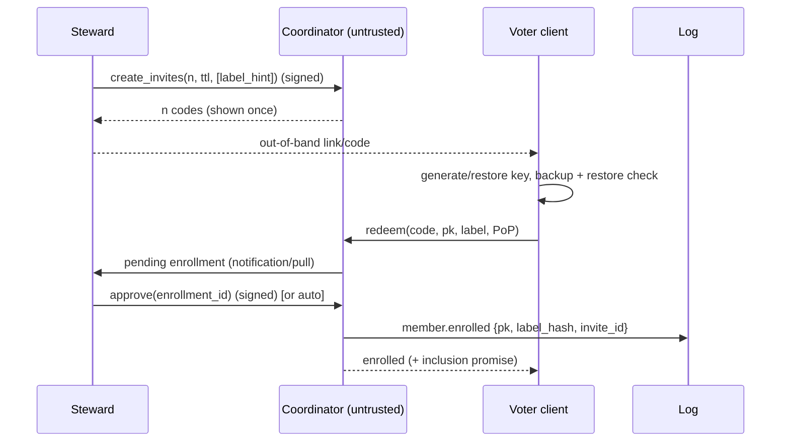

# QV-04 — Identity and Eligibility

**Module ID:** `identity-roll` (M3)
**Status:** Draft
**Owner:** Identity/protocol lead (project owner until appointed)
**Last reviewed:** 2026-10-21
**Related specs:** QV-03 (rules, manifest), QV-05 (ballot protocol), QV-06 (data), QV-07 (threats), QV-16 (crypto bytes); ADR-001, ADR-005, ADR-008, ADR-013

## 1. Objective

Define how a group establishes **who may vote** and ensures **one voter, one counted ballot** while collecting no identity beyond a group-chosen credential, and how that credential is enrolled, rotated, recovered and snapshotted. This spec is written in the three phases of ADR-005:

| Phase | Name | Property | Status |
|---|---|---|---|
| 1 | Secret ballot, public participation | Ballot content secret; *who voted* is public; ballots linkable to voter keys | **MVP** |
| 2 | Unlinkable ballots | Blind-signed single-use tokens (RFC 9474); registrar cannot link token to ballot | Designed here; build after v1.0 |
| 3 | Registrar-free anonymous eligibility | Membership proof with nullifier; no registrar | Research design here |

Anonymity-of-participation claims are made **only** from Phase 2/3 and only as specified in §9–§10. Hidden display names are not anonymity (framework warning retained).

## 2. Scope

**In scope:** identity modes and comparison; voter key; roll commitment; invitation and enrollment; eligibility lifecycle and snapshot; duplicate prevention; rotation, recovery, device change, compromise; Phase 2/3 designs at spec level.
**Out of scope:** key-management UX copy (QV-10), curve/proof byte formats (QV-16), organisational membership policy (group's own bylaws), legal identity verification.

## 3. Identity modes

### 3.1 Comparison

| Mode | Setup friction | Linkability (ballot ↔ person) | Recovery | Steward/admin visibility | Collusion assumptions | Operating cost | Phase / status |
|---|---|---|---|---|---|---|---|
| **A. Org-managed named account** (email/password) | Low | Total (operator knows account → ballot metadata) | Password reset by operator (= impersonation vector) | Full roster and participation | Operator honest for integrity | Low | **Not provided** (violates ADR-001 stance; secrecy would depend on operator) |
| **B. Pseudonymous voter key (invite-enrolled)** | Medium (key backup) | Participation public; ballot content secret; key↔label known to stewards | Backup file/QR; steward-endorsed amendment with veto (§6) | Roll keys, labels; not choices | Stewards honest about *who is a real distinct member* | Low | **Phase 1 default (MVP)** |
| **C. Group-issued credential** (steward-generated key or one-time code) | Low for voter; high steward effort | Steward knows credential↔person (if issued by hand) | Re-issue by steward | Full mapping at issuance | Steward honest | Low | MVP **variant of B** ("steward-generated invitation with pre-bound label"; key still generated client-side at redemption) |
| **D. External IdP attestation** (e.g. OIDC login, OSS-forge org membership) to *gate enrollment only* | Low | IdP learns that the user enrolled in this group; roll still holds voter key only | As B | Enrollment server sees IdP subject transiently | IdP honest about membership; third-party tracking exposure | Medium (adapter maintenance) | **Later / Could** (adapter spec in QV-04 Phase 2) |
| **E. Blind-token credential** | Medium–high (token backup, extra round) | Registrar cannot link token ↔ voter; ballots unlinkable to roll key (not to each other when revoting) | Token lost = vote lost unless re-issuance policy (§9.6) | Registrar sees who *requested* a token | Registrar can only deny, not stuff, within bounds (§9.5); network metadata (Tor) | Medium | **Phase 2** |
| **F. ZK / linkable-ring membership + nullifier** | High (proving cost) | No registrar; ballots unlinkable to keys; nullifier links revotes | Rotation only before snapshot | Nobody | Cryptographic assumptions + setup (if SNARK) | High | **Phase 3 research** |
| **G. Hybrid per group** | — | Group picks per election via manifest `identity_mode` | — | — | — | — | Manifest field from v0.5 |

### 3.2 Default for MVP

Mode B (with C variant). A group's `GroupRules.enrollment` and election `identity_mode = phase1-keys`.

### 3.3 Visibility in Phase 1 (what a reader of the public log learns)

Voter public keys on the roll; which keys cast ballots and when; **how many ballots each key submitted** (revotes visible); ciphertexts and proofs; never the choice (ADR-005/008). Labels are visible per `disclosure.roll_labels` (members/public/hidden). The server operator additionally sees IP addresses at the TCP layer unless Tor is used (ADR-009: not persisted).

### 3.4 What the steward is trusted for (explicit)

In Phase 1 the steward set (k of n) is trusted for **roll correctness**: that each enrolled key corresponds to one distinct real member and that eligible members are not excluded. Nothing in the protocol can prove that two keys do not belong to the same person. Mitigations: public roll with churn alarm (QV-03 AC7), optional member vouching (§5.3), members verifying that people they know are on the roll, G3 disputes. This is a **residual risk, not a solved problem**, and shall be stated in the UI and the privacy/claims text.

## 4. Voter keys and roll commitment (Phase 1)

### 4.1 Voter key
- Algorithm: Ed25519 (RFC 8032 [1]) for ballot-envelope signatures.
- Key hierarchy: a 32-byte random **master seed** `S` per person-device-backup. Per-group key `sk_g = HKDF-SHA-256(S, salt = group_id, info = "QV-voter/1")` → Ed25519 seed. Purpose: one backup serves many groups while public keys in different groups are not linkable to each other by observers (a person's multiple group memberships are not correlated by key).
- Generated client-side with the platform CSPRNG (`crypto.getRandomValues`). The server never sees `S` or `sk_g`.
- **Backup formats** (at least two offered at enrollment; completion of one is a hard gate unless explicitly waived):
  1. *Key file* `.qvkey`: JSON `{v:1, pk, kdf:{alg:"argon2id", m:65536 KiB, t:3, p:1, salt}, enc:{alg:"AES-256-GCM", iv, ct}}`; passphrase minimum 12 chars or 4 random words suggested. (AES-GCM via Web Crypto avoids an extra dependency; see Proposed ADR P04-1.)
  2. *Paper code*: `qvseed1-` + base32(S) + 4-char checksum, rendered as text and QR; shown once.
- **Restore check:** after backup the client asks the user to restore-test (re-enter checksum or scan QR) and shows that the derived `pk` matches.
- **Storage on device:** browser IndexedDB, wrapped with a non-extractable WebCrypto key where supported, optionally passphrase-protected; the UI states that clearing site data deletes the key.

### 4.2 Roll leaf and Merkle commitment
- Leaf data: `"QV-leaf/1" ‖ pk (32 B) ‖ weight (u32 BE, = 1 in MVP; reserved for Phase 2 weighted voting)`.
- Tree: RFC 9162 Merkle Tree Hash [2] (leaf hash `SHA-256(0x00 ‖ data)`, node hash `SHA-256(0x01 ‖ L ‖ R)`), over leaves **sorted ascending by `pk` bytes**, so the root depends only on the set, not enrollment order.
- `roll.root`, `roll.size N`, `roll.snapshot_log_index` go into the manifest (QV-03 §4). The full leaf list is published as the `roll.snapshot` log artifact; any member verifies inclusion (or just scans for their key).
- Labels are not in leaves; label mapping is published per disclosure policy as a separate signed `roll.labels` artifact (hash recorded in manifest) so that rotation and relabelling never change the root.

### 4.3 Ballot authentication (Phase 1)
Each ballot envelope contains `{election_id, manifest_id, voter_pk, ballot_ct, proofs, seq?}` signed by `voter_pk` over `"QV-ballot/1" ‖ canonical(envelope)`. A ballot is *eligible* iff `voter_pk` ∈ roll (or alias of a member, §6) and the signature verifies. Details: QV-05 §4, QV-16.

## 5. Invitation and enrollment flow

### 5.1 Steps

- **Invite code:** 128-bit random, base32 (26 chars); server stores only `SHA-256("QV-invite/1" ‖ code)`; single use; TTL default 336 h (rules); bound optionally to a `label_hint` (reserved label) so a steward can pre-assign who it is for.
- **Redeem request:** `{code, pk, label, pop}` with `pop = Ed25519.sign(sk, "QV-enroll/1" ‖ group_id ‖ invite_id ‖ pk ‖ label)` (proof of possession; prevents registering someone else's key).
- **Approval:** `steward` mode = one steward signature (policy may require k); `auto` = code suffices.
- **Log entry** `member.enrolled`: `{pk, label_hash = SHA-256(group_salt ‖ label), invite_id, approver_sigs}`; the code, IP and contact handle are never logged.
- **Error codes:** `E_INVITE_USED`, `E_INVITE_EXPIRED`, `E_INVITE_UNKNOWN` (same response time as USED to prevent oracle), `E_LABEL_TAKEN`, `E_POP_INVALID`, `E_KEY_DUPLICATE` (pk already enrolled), `E_RATE_LIMIT`.

### 5.2 Eligibility lifecycle

| Member state | Meaning | Transitions |
|---|---|---|
| INVITED | code issued, unredeemed | → ENROLLED, EXPIRED |
| PENDING | redeemed, awaiting approval | → ENROLLED, REJECTED |
| ENROLLED | on membership list, eligible for elections whose snapshot is created *after* this state | → SUSPENDED, REVOKED, ROTATED |
| SUSPENDED | excluded from future snapshots; reversible | → ENROLLED, REVOKED |
| REVOKED | excluded from future snapshots; key dead | terminal (re-join = new invite) |
| ROTATED | key replaced (§6.2) | the new key is ENROLLED |

All transitions are signed and logged without secrets (QV-02-REQ-012). Renewal (periodic re-confirmation) is a group policy that can be implemented as suspend/re-enroll; no automation in MVP.

### 5.3 Optional vouching (Should)
`enrollment.vouches = m` requires m existing members' signatures `vouch(pk_new, group_id)` in addition to (or instead of) steward approval. Rationale: spreads sybil defense beyond the steward; costs: vouchers are publicly linked to the new key. Default 0. (Adds `enrollment.vouches` to QV-03 §3.2 — see Proposed ADR P04-2.)

### 5.4 Eligibility snapshot
Eligibility is **fixed at manifest signing (QV-03 T2)**: roll = all ENROLLED members at that log index. Rejected alternative: "eligible at submission time" — it lets a steward change the electorate during voting, requires every verifier to replay mid-election membership timelines against ballot times, and gives operators a new lever. Only the controlled amendments in §6.4 may change the effective voter set after T2. Late enrolment ⇒ not eligible; the group may schedule a new election.

## 6. Recovery, rotation, device change

### 6.1 Principles
1. Recovery shall never silently change a submitted ballot or the tally (it only changes *which key may cast from now on*).
2. A recovery mechanism that lets someone else vote for me is an impersonation vector; every non-self-service path therefore requires (a) k stewards, (b) a public delay, (c) a veto by the old key.
3. Everything is visible in the log; the member (or anyone) can see "your slot was amended".

### 6.2 Self-service rotation (old key available)
Certificate `rot = {group_id, old_pk, new_pk, nonce, sig_old, sig_new}` where each signature covers `"QV-rotate/1" ‖ group_id ‖ old_pk ‖ new_pk ‖ nonce`. Logged as `member.rotate` (index *r*).
- Before any snapshot: roll uses `new_pk`.
- After a snapshot of an open election: `new_pk` becomes an **alias** of the voter whose leaf contains the chain's origin key. Ballots signed by `old_pk` with log index > *r* are rejected `E_KEY_ROTATED`; ballots by `old_pk` at index < *r* remain valid; "latest ballot per **voter**" (not per key) counts. No steward action required; rotation allowed until close.
- Use cases: suspected compromise (old key still held), device-hardening, label change not needed.

### 6.3 Lost key (no old key) — recovery by roll amendment
1. Member proves control of a *new* key by redeeming a fresh steward-issued invite bound to the member's existing label (out-of-band confirmation of "this is the same person" is the steward's job — the trust of §3.4).
2. k stewards sign `roll.amend{voter_leaf = old_pk, new_pk, reason, evidence_hash, effective_after = now + amend_delay}`; `amend_delay` default **24 h** (min 6 h, max 72 h).
3. During the delay the **old key may veto** by signing `amend.veto{amend_id}` (proves the key is not lost; amendment void, steward incident logged). Anyone may watch `roll.amend` entries.
4. After the delay, the amendment takes effect like a rotation (alias; old key rejected afterwards).
5. Anti-abuse cap: ≤ `max(2, ⌊N × amend_cap_bp / 10000⌋)` amendments per election; `amend_cap_bp` default 200 (2%). Above cap requires HALT + dispute (QV-03 §9).
6. Not available after CLOSED. A member who lost the key after close can file G3; the remedy cannot add a vote.
7. Link-to-ballot risk: the amendment is tied to the voter's label and key (already public in Phase 1); it does not reveal a choice. In Phases 2–3 recovery has different semantics (§9.6, §10.5).

### 6.4 Roll amendments of other kinds (post-snapshot)
Two other post-snapshot actions exist, both k-steward-signed, logged, delay ≥ 24 h, G3-challengeable:
- `roll.revoke{voter_leaf, reason ∈ {DECEASED, EXPELLED_PER_BYLAWS, DUPLICATE_KEY_PROVEN}}`: voter's ballots are excluded from aggregation (verifiable, because the ballot list is public); quorum denominator `N` is **unchanged**.
- `roll.add{pk, reason ∈ {WRONGLY_EXCLUDED_G3}}` (only to implement a dispute decision; requires `dispute.resolved`).

### 6.5 Device change
- Preferred: import the `.qvkey` or paper code on the new device (same key; both devices can vote; latest ballot by log order wins; the UI warns about concurrent sessions).
- Alternative: rotate to a key generated on the new device (§6.2) — recommended if the old device is retired.
- The server holds no key escrow; there is no "forgot password".

### 6.6 Suspected compromise
If the old key is available: rotate (§6.2), then the attacker's ballots after *r* are rejected (but earlier attacker ballots remain *as ballots by this voter*; the legitimate voter's later ballot supersedes them if revoting is allowed). If revoting is `single` and an attacker voted first: G5/G3 dispute; the platform cannot distinguish. This is why `single` is discouraged for open-ended groups (QV-03 template T2 notes).

### 6.7 Recovery vs. coercion
Unlimited revoting reduces the effect of coercion but not receipt-based vote buying — not claimed (ADR-008). Recovery processes do not add or remove such protections.

## 7. Duplicate-vote prevention (Phase 1)

| Mechanism | Rule |
|---|---|
| One voter = one roll leaf | Roll built from set of distinct `pk`; `E_KEY_DUPLICATE` on enrollment |
| One active key per voter at any log index | Rotation/amendment makes old key dead from index *r* |
| One counted ballot per voter | Per-voter latest by log index (`revoting: allowed`) or first only (`single`; later ballots `E_ALREADY_VOTED`) |
| Total order | The append-only log defines order; ballot replay is idempotent on `ballot_id` |
| Multi-session/multi-device | Allowed; same key; latest wins |
| What the mechanism exposes | `pk` ↔ ballot count and timing (public); nothing about content |
| Residual | Same human with two keys (steward/vouch trust §3.4) |

## 8. Observers verifying eligibility counts independently

The verifier recomputes: roll root from published leaf set, N, number of voters with counted ballots V, each ballot's signature and roll membership (with alias chain), that no revoked/rotated key signed after its cut-off index, and that all steward actions meet the rules' thresholds (QV-03 AC9). Observers cannot verify that a leaf corresponds to a distinct person — only that the roll the stewards committed to is the one used.

## 9. Phase 2 — Unlinkable ballots via blind-signed single-use tokens

**Goal:** after tally, no party (registrar, operator, other voters, observers) can link a counted ballot to a roll key, while eligibility and one-token-per-voter remain publicly verifiable. Participation of the *token request* is still visible; whether the token was then *used* is not attributable.

### 9.1 Primitives
- RSA Blind Signatures **RFC 9474** [3] (RSABSSA). Variant: `RSABSSA-SHA384-PSS-Randomized` (RFC variant list; randomised message prefix). RSA modulus **3072** bits (RFC permits ≥ 2048; chosen for margin) `[parameter choice to confirm in QV-16]`.
- Registrar key pair `(sk_R, pk_R)` **generated fresh per election**, `pk_R` in the manifest; `sk_R` destroyed after the issuance window closes (ADR-013 spirit; prevents later forging).
- Ed25519 ephemeral per-election voting key `(sk_t, pk_t)` derived by the voter.

### 9.2 Protocol
1. Voter derives `sk_t = HKDF(sk_g, "QV-token/1" ‖ election_id)`; `pk_t` its public key. Token message `m = "QV-token/1" ‖ election_id ‖ pk_t`.
2. Voter runs `Blind(pk_R, m)` → `blinded_msg`, `inv`.
3. Voter sends `issue_request{election_id, blinded_msg, voter_pk, sig_voter(“QV-issue/1” ‖ election_id ‖ H(blinded_msg))}` to the registrar. (Phase 1 key authenticates.)
4. Registrar checks: voter_pk ∈ roll; no prior issuance for this leaf; window open; appends log entry `token.issued{voter_pk, H(blinded_msg), sig_voter}` and returns `blind_sig` (`BlindSign`).
5. Voter `Finalize` → `sig_R`; verifies `RSASSA-PSS-Verify`.
6. **Casting:** ballot envelope `{election_id, manifest_id, pk_t, sig_R, ballot_ct, proofs}` signed by `sk_t`, submitted over a channel that does not link to step 3 (Tor, or a different network identity, with randomised delay ≥ 0–10 min jitter).
7. **Verifier rules:** `RSABSSA-Verify(pk_R, sig_R, m(pk_t))` and ballot signature under `pk_t`; "voter" = `pk_t`; latest ballot per `pk_t` counts (revoting preserved, linking only a voter's own ballots to each other); weights from the roll leaf are unavailable in this mode (weighted voting needs separate design).

### 9.3 Properties
- *Unlinkability of token to voter:* by blindness of RSABSSA (information-theoretic for the registrar's view of `blinded_msg`) [3].
- *Eligibility:* each valid `pk_t` carries a registrar signature; issuance entries are signed by voters, so the registrar **cannot fabricate issuances for voters who did not ask**.
- *One-per-voter:* one issuance per leaf; one `pk_t` per issuance.

### 9.4 Public checks
`#distinct valid pk_t among counted ballots ≤ #token.issued entries ≤ N`. Verifier flags violation.

### 9.5 Attack: registrar stuffing
The registrar can sign extra blinded messages off-log ("shadow tokens"). The check in §9.4 bounds the damage: shadow tokens can be used only up to the number of **issued-but-unused tokens** (voters who requested a token but did not cast). Mitigations: (a) short `issue_window` coupled to voting (voters request the token when they start voting, within the same client session, so unused tokens ≈ failed sessions); (b) the number of unused tokens at close is public (`issued − used`); a large number is a visible red flag; (c) the registrar may be split across k-of-n parties in later work (threshold RSA — research, not claimed). **Residual:** stuffing up to the unused-token count; to be stated in the claims.

### 9.6 Recovery in Phase 2
A lost token cannot be reissued safely: the registrar cannot tell a legitimate re-request from a second token for a double vote, because it never sees `m`. Design consequences: (i) `sk_t` is derived deterministically from the backed-up master key (§9.2 step 1), so restoring the key regenerates the same `pk_t`; (ii) the finalized `sig_R` is stored inside the encrypted key file/backup and re-fetchable from the voter's own device only; (iii) **token reissue is unsupported**; a voter who loses both the key and `sig_R` after issuance cannot vote in that election. **[OPEN]** whether a safe deterministic re-signing protocol exists (registrar returns the same `sig_R` for an identical `blinded_msg` it has already signed, which is idempotent and leaks nothing new) is for QV-16 review; if adopted, re-signing must be idempotent per `H(blinded_msg)` and never sign a different `blinded_msg` for the same leaf.

### 9.7 Limits (stated, not hidden)
Network metadata (IP, timing) can link step 3 and step 6 if no anonymity network is used; small rolls give small anonymity sets; the registrar sees *who requested*; a compromised client can leak the link; voters with unique ballot features (write-ins) are excluded (no write-ins).

## 10. Phase 3 — Registrar-free anonymous membership with nullifiers (research design)

**Goal:** a voter proves "I hold the secret key of *some* leaf in the roll" and publishes a per-election **nullifier** so that the same key cannot cast two *independent* ballots, without a registrar and without revealing which leaf.

### 10.1 Requirements for any construction
R1 membership in `roll.root` (or ring) without revealing the leaf; R2 deterministic election-scoped nullifier `nf = F(sk, election_id)` unlinkable across elections and to the leaf; R3 binding of proof to the ballot hash (signal) so a proof cannot be replayed for another ballot; R4 revoting via equal nullifier (latest by log order); R5 no trusted setup preferred; if one is unavoidable, a published multi-party ceremony; R6 browser proving ≤ 10 s and verification ≤ 50 ms per ballot for N ≤ 2,000 on a mid-range phone `[targets to validate]`; R7 domain-separated, versioned, reviewable.

### 10.2 Candidate designs (decision deferred to a research spike)

| Option | Idea | Proof size | Setup | Fits ristretto255/Ed25519 roll? | Notes |
|---|---|---|---|---|---|
| **3a. Linkable ring signature** over the existing Phase 1 voter keys (LSAG [4] / CLSAG-style [5]) with election-scoped linking tag | Ring = roll keys; tag `I = sk · H(election_id)` | O(N): ≈ 64 B × N (≈ 128 KB at N = 2,000) | None | **Yes — same roll, no re-enrollment** | Needs adaptation of key-image base from `H(pk)` to `H(election_id)` and its own security proof; simplest path to anonymity for N ≤ ~2,000 |
| **3b. One-out-of-many proof** (Groth–Kohlweiss [6]) | Prove one of N commitments opens to zero; nullifier via VRF-style tag | O(log N) group elements (≈ 4⌈log₂N⌉ elements + 3⌈log₂N⌉ scalars per an implementation README [6]) | None | Yes (Pedersen over ristretto255) | Needs enrollment commitments to the extra Pedersen structure |
| **3c. Semaphore-style SNARK** ([7]) | Poseidon Merkle membership + nullifier in Groth16 | Constant (~200 B) | Trusted setup (circuit-specific/shared ceremony) | No (BN254/Poseidon, new key type) | Heaviest dependencies; departs from ADR-003 minimal-deps; only if proof-size or N ≫ 2,000 requires it |

**Recommendation to QV-21/QV-3x research spike:** prototype 3a first (shortest path, zero setup, uses existing keys); evaluate 3b for log-size when N > 2,000. 3c is out unless a no-setup alternative fails requirements.

### 10.3 Ballot flow (generic)
Voter builds ballot; computes `nf`; produces membership proof over `H(ballot_envelope)`; submits **without** a voter-key signature (the proof is the authentication). Verifier: proof valid; `nf` first-seen or later-seen (revote); counted ballot per `nf`.

### 10.4 Properties and non-claims
Registrar-free: nobody can link ballots to keys *cryptographically*; metadata links remain (network); roll correctness still trusts the steward (§3.4); nullifier links one voter's revotes to each other; anonymity set = roll size; a voter's participation is hidden only if verification doesn't reveal who *didn't* vote (ring ballots reveal turnout count, not identity). Soundness and anonymity of the adapted construction are **not** claimed until reviewed (QV-11).

### 10.5 Recovery in Phase 3
Rotation only before snapshot; after snapshot a lost key = lost vote (equivalent to §9.6), with the same open question.

## 11. Requirements

Adversary model tags: **S** = malicious steward, **O** = malicious operator, **M** = malicious member, **N** = network, **X** = external attacker.

| ID | Requirement | Pri | Acceptance criteria | Adv. | Ver |
|---|---|---|---|---|---|
| QV-04-REQ-001 | The client shall generate voter keys locally with a CSPRNG and never transmit secret key material or master seed. | Must | Network capture and server logs contain no key material over 100 enrollment runs | X, O | T |
| QV-04-REQ-002 | Per-group keys shall be derived by HKDF from the master seed with `group_id` as salt (§4.1); the same person's keys in two groups shall be unrelated to observers. | Must | Two derived pks share no byte relation; KAT vectors pass in ≥ 2 implementations | O | T |
| QV-04-REQ-003 | The roll shall be committed as the RFC 9162 Merkle root over leaves sorted by pk, with leaf format `"QV-leaf/1" ‖ pk ‖ weight`. | Must | Shared KAT root; permutation of enrollment order gives same root; inclusion proofs verify | S | T |
| QV-04-REQ-004 | Invite codes shall have ≥ 128 bits entropy, be stored hashed, be single-use, expire per rules, and have uniform response time for unknown/used. | Must | Statistical timing test (no distinguishable difference at p<0.01 over 10⁴ trials); reuse rejected | X | T |
| QV-04-REQ-005 | Enrollment shall require a proof of possession signature binding group, invite, pk, label. | Must | Enrolling a pk without PoP, or with another group's PoP, rejected `E_POP_INVALID` | M | T |
| QV-04-REQ-006 | The system shall refuse to complete enrollment until a key backup is confirmed by a restore check, unless the user explicitly waives with a recorded acknowledgement (client-side only). | Must | UI test; no waive = cannot proceed | — | U/T |
| QV-04-REQ-007 | Ineligible keys shall be unable to produce a valid counted ballot. | Must | 10⁴ randomized ballots with non-roll keys, revoked keys, rotated keys after cut-off all rejected | M, X | T |
| QV-04-REQ-008 | At most one ballot per voter shall be counted (latest by log index when revoting, first when single); aliases shall resolve to the same voter. | Must | Property test over random sequences incl. rotations | M | T |
| QV-04-REQ-009 | Eligibility shall be fixed by the roll snapshot at manifest signing; later enrollments shall not affect an open election. | Must | Enroll after T2; ballots by that key rejected | S | T |
| QV-04-REQ-010 | Rotation certificates shall require both old and new key signatures; ballots by the old key after rotation index shall be rejected. | Must | Missing sig rejected; post-r old-key ballot `E_KEY_ROTATED` | M, X | T |
| QV-04-REQ-011 | Lost-key recovery shall use k-steward `roll.amend` with a public delay (default 24 h) and old-key veto; amendments shall be capped per §6.3(5). | Must | Veto cancels; cap enforced; amendment visible in log | S | T |
| QV-04-REQ-012 | Recovery and rotation shall not modify, delete, or re-order any previously accepted ballot or log entry. | Must | Log consistency proof across amendment passes; tally unchanged for earlier ballots | S, O | T |
| QV-04-REQ-013 | All membership and roll actions shall be logged without secrets; the log shall allow an observer to recompute N, V and alias chains. | Must | Verifier recomputes from log only | O | T |
| QV-04-REQ-014 | The UI and docs shall state the Phase-1 visibility facts (§3.3) and steward-trust fact (§3.4) before enrollment and before casting. | Must | Strings present, QV-02-REQ-046/082 | — | U/R |
| QV-04-REQ-015 | Roll revocation after snapshot shall exclude the voter from aggregation without altering N and shall require k stewards, delay and reason code. | Should | Test vectors; verifier handles exclusion | S | T |
| QV-04-REQ-016 | Optional member vouching (m vouches) shall be supported by rules. | Could | Enrollment with < m vouches rejected | S | T |
| QV-04-REQ-017 | The identity-mode field shall be in the manifest and the verifier shall refuse unknown modes (fail closed). | Must | Unknown mode → `E_PROTO` | — | T |
| QV-04-REQ-018 | Phase 2: token issuance shall be signed by the requesting voter, limited to one per leaf, logged; the verifier shall enforce `#valid pk_t ≤ #issued ≤ N`. | Should (Phase 2) | Shadow-token test is flagged when exceeding | S, O | T |
| QV-04-REQ-019 | Phase 2: registrar keys shall be election-specific and destroyed after the issuance window with a logged attestation. | Should (Phase 2) | Attestation entry present | O | R |

## 12. Security and abuse cases

| Case | Attacker | Impact | Mitigation | Residual risk |
|---|---|---|---|---|
| Fake members (sybil) | S | Ballot stuffing | Public roll, churn alarm, vouching, G3 | Undetectable among strangers |
| Invite phishing / interception | X | Attacker enrolls as a member | PoP irrelevant; steward approval; label_hint binding; short TTL | Steward must verify identity out-of-band |
| Impersonating a lost-key member | S | Steal vote | Delay + old-key veto + k signatures + log visibility | If member never watches the log during the window |
| Key theft from device | X | Cast on behalf | Passphrase-wrapped store, rotate, revoting | Single-vote mode irrecoverable |
| Enrollment-oracle probing | X | Learn valid invites | Uniform responses, rate limit | — |
| Cross-group correlation by pk | O, M | Link membership across groups | HKDF per-group keys (REQ-002) | Same label reuse across groups |
| Server swaps roll after snapshot | O | Eligibility change | Roll root in signed manifest; verifier recomputes | — |
| Turnout/participation exposure | any | Social pressure on non-voters | Documented Phase-1 non-claim; Phase 2/3 | Accepted in MVP |

## 13. Interfaces and dependencies

Upstream: QV-03 (rules, manifest, steward keys), M1 crypto-core. Downstream: M5 (eligibility predicate `isEligible(pk, logIndex)`), M7 (alias/roll recomputation), M8 (enrollment endpoints). Versioning: roll leaf and cert formats carry `proto`; any change = new leaf domain string.

## 14. UX, accessibility, localization (requirements to QV-10/13)
Key backup must work with screen readers (text code available, QR optional), passphrase entry accessible, no CAPTCHA in enrollment (rate limit instead), plain-language explanation of "your key = your vote; keep it safe", localizable error messages for §5.1 codes.

## 15. Open questions

| Question | Owner | Target | Proposed default |
|---|---|---|---|
| Deterministic safe re-issuance in Phase 2 (§9.6) | QV-16 author | before Phase 2 | Unsupported |
| Linkable-ring tag base adaptation (§10.2 3a) security argument | Research QV-21/3x | Phase 3 spike | Prototype, review before any claim |
| Threshold-split registrar | Research | post-v1.0 | Not in scope |
| IdP adapter privacy design (mode D) | Identity | v1.1 | Optional, OIDC, no storage of subject |
| Is `weight` in leaf worth carrying now? | Protocol | v0.5 | Yes, constant 1 |
| Argon2id memory cost on low-end phones | UX/crypto | v0.5 | 64 MiB; fall back to 19 MiB with warning |

## 16. Approval and change history

| Reviewer | Decision | Date | Notes |
|---|---|---|---|
| Project owner | Pending | — | — |

## References (accessed 2026-10-21)

1. RFC 8032, Edwards-Curve Digital Signature Algorithm (EdDSA), https://www.rfc-editor.org/rfc/rfc8032.
2. RFC 9162, Certificate Transparency Version 2.0 (Merkle tree, inclusion/consistency proofs), https://www.rfc-editor.org/rfc/rfc9162.html — hash prefix bytes 0x00/0x01 are from the author's knowledge of §2.1.1 `[UNVERIFIED in this session; check]`.
3. RFC 9474, RSA Blind Signatures (Denis, Jacobs, Wood; Oct 2023; Informational, CFRG), https://www.rfc-editor.org/rfc/rfc9474.html.
4. Liu, Wei, Wong, "Linkable Spontaneous Anonymous Group Signature for Ad Hoc Groups," ACISP 2004, https://eprint.iacr.org/2004/027 (DOI 10.1007/978-3-540-27800-9_28).
5. Goodell, Noether, RandomRun, "Compact Linkable Ring Signatures and Applications" (CLSAG), ePrint 2019/654, https://eprint.iacr.org/2019/654 (preprint).
6. Groth, Kohlweiss, "One-out-of-Many Proofs: Or How to Leak a Secret and Spend a Coin," EUROCRYPT 2015, https://eprint.iacr.org/2014/764 (no trusted setup; log-size). Implementation size note: https://git-crysp.uwaterloo.ca/iang/gk15.
7. Semaphore protocol documentation (identity commitment, Merkle group, nullifier, scope), https://docs.semaphore.pse.dev/.
8. Chaum, "Blind Signatures for Untraceable Payments," CRYPTO '82 (1983) — original blind-signature concept `[UNVERIFIED by fetch this session]`.

## Proposed ADRs

- **QV-ADR-P04-1 — Use Web Crypto AES-256-GCM + Argon2id (`@noble/hashes`) for key files** rather than adding `@noble/ciphers`; keeps dependency count down (ADR-003).
- **QV-ADR-P04-2 — Per-group key derivation by HKDF from a master seed; optional member vouching (`enrollment.vouches`) added to the rules schema.**
- **QV-ADR-P04-3 — Roll amendments (lost-key recovery) require k stewards + public delay + old-key veto + per-election cap.**
- **QV-ADR-P04-4 — Phase 3 first prototype is a linkable ring signature over existing voter keys (no new enrollment, no setup); SNARK route only if requirements fail.**
- **QV-ADR-P04-5 — Phase 2 token reissue is unsupported until a safe design is reviewed.**
