# QV-07 — Threat Model and Security

**Module ID:** `security-privacy`  
**Status:** Draft  
**Owner:** Security lead (interim: project owner)  
**Last reviewed:** 2026-10-21  
**Related specs:** QV-00, QV-04 (identity/eligibility), QV-05 (ballot protocol), QV-06 (privacy), QV-08 (architecture), QV-11 (testing/assurance), QV-12 (operations), QV-16 (crypto protocol, authored concurrently), QV-24 (traceability), QV-29 (abuse/DoS), QV-33 (vulnerability disclosure); binding ADRs QV-ADR-001…013 ([decision log](decision-log.md))

> **Reading guide.** §1–2 scope and method; §3 system model and trust boundaries (Mermaid); §4 assets; §5 adversaries; §6 security properties P1–P15; §7 STRIDE per component; §8 attack trees for the eight priority attacks; §9 requirements `QV-07-REQ-nnn`; §10 residual risks; §11 non-claims; §12 security-claims register; §13 release-blocking gates; §14 review/audit plan; §15 incident response and pause/invalidate matrix; §16–19 data, interfaces, assumptions, open questions; §20 proposed ADRs; §21 references.
>
> **Status of this document.** No code exists. Everything below is a *design-time* model. Terms such as "mitigated" mean "a requirement exists that, if implemented and verified per §13, addresses the threat" — not that the threat is addressed today. Protocol-level details (byte formats, proof statements) live in QV-16; where QV-07 and QV-16 disagree on a *security* requirement, QV-07 states the required property and QV-16 must meet it or propose an ADR.

## 1. Objective

Give engineers, reviewers, and group stewards one authoritative answer to: *who can do what to a QuietVote election, what stops them, what remains possible, and what we are allowed to tell users.* Concretely this spec:

1. Models the system, data flows, and trust boundaries (§3).
2. Registers assets (§4) and adversaries with capabilities (§5).
3. Defines the security properties the product aims to provide (§6) and the exact assumptions each depends on.
4. Enumerates threats (STRIDE, §7) and the eight priority attack paths (§8).
5. States testable security requirements (§9), release-blocking gates (§13), a review plan (§14) and an incident-response matrix including when to pause or invalidate an active decision (§15).
6. Constrains public language to what is true (§11–12), per QV-ADR-001 ("honest guarantees").

## 2. Scope, method and sources

### In scope
The MVP stack of QV-ADR-002/003: single self-hostable server (untrusted coordinator + bulletin board), browser client, CLI verifier and offline verifier page, trustee tooling, steward console, build/release pipeline, optional witnesses/mirrors, optional Tor onion service. Phase 1 eligibility (QV-ADR-005) in full; Phase 2/3 only as forward-looking notes marked **(P2)/(P3)**.

### Out of scope (and why)
- Public governmental elections, legally binding shareholder votes, anything needing certification (QV-00 boundary).
- Physical security of voters' homes, endpoint security of voter devices beyond what the client can do (see A7, §11).
- Legal compulsion strategy (jurisdiction-specific); the model treats compulsion of the operator as a capability of A5/A11 and relies on cryptographic non-reliance on the operator.
- Security of the group's *membership process* (who the group chooses to admit) beyond what is cryptographically bound into the roll.
- Post-quantum attackers (QV-ADR-013): documented as residual risk R-10.

### Method
- **System decomposition and DFDs** (levels 0 and 1) with explicit trust boundaries.
- **STRIDE per element** (Shostack, *Threat Modeling: Designing for Security*, 2014) for spoofing/tampering/repudiation/information disclosure/denial of service/elevation, supplemented by **privacy threats** in the style of LINDDUN (linkability, identifiability, detectability, non-repudiation, disclosure of information, unawareness, non-compliance) where STRIDE is silent — chiefly linkability of voter to ballot.
- **Attack trees** (Schneier, "Attack Trees", Dr. Dobb's Journal, 1999) for the eight highest-impact goals; leaves carry difficulty and a mitigation reference.
- **Property-first** analysis from the e-voting literature: individual verifiability, universal verifiability, eligibility verifiability, ballot secrecy, receipt-freeness and coercion-resistance (Benaloh–Tuinstra 1994; Juels–Catalano–Jakobsson 2005); lineage Helios (Adida 2008) and ElectionGuard.

### Standards and guidance consulted (verified status in §21)
| Source | Use here | Applicability caveat |
|---|---|---|
| Council of Europe, Recommendation CM/Rec(2017)5 on standards for e-voting (adopted 14 June 2017; supersedes Rec(2004)11) | Cross-check of property list (secrecy, integrity, verifiability, availability, transparency, voter authentication); informs the claims register | Non-binding; written for statutory elections. QuietVote does **not** claim conformance (claim C-12 forbids it). |
| BSI **BSI-CC-PP-0121** "Protection Profile for E-Voting Systems for non-political Elections" v1.0 (certified 20 Feb 2024; EAC4+ALC_FLR.2, per BSI) | Checklist for security objectives of a server-side non-political e-voting product; informs §13 gates and the audit scope | Server-product PP with a trust model that differs from ours (we do not trust the server). No conformance or certification claimed. Full SFR mapping is an open question (OQ-3). |
| NISTIR 7551 (2008) *A Threat Analysis on UOCAVA Voting Systems*; NISTIR 7770 (2011) *Security Considerations for Remote Electronic UOCAVA Voting* | Source for client-malware and remote-voting threat classes; basis for non-claim N-3 (compromised device) | US overseas-voter context; older. NISTIR 7770 itself concludes internet voting cannot be audited with polling-place-comparable confidence — an input to our honest-guarantee stance. |
| NIST SP 800-53 Rev. 5 control families | Mapped informally in §9 (column "800-53") for operators who need control language (AC, AU, CM, IA, SA, SC, SI, SR families) | A catalogue, not a threat model; we map selectively, no claim of baseline compliance. |
| NIST SP 800-30 Rev. 1 (risk assessment) | Likelihood/impact vocabulary in §10 | Qualitative only. |
| "NIST IR 8363" | Suggested by the brief as a possible source. **Could not be located/verified** by search on 2026-10-21; **not relied on** `[UNVERIFIED]`. | Do not cite until a title is confirmed. |
| OWASP ASVS (v4.0.3 / 5.0) | Web-layer verification checklist for §14 pentest scope | Application-security baseline, not voting-specific. |
| RFC 9162 (Certificate Transparency v2), RFC 9116, RFC 9474, RFC 8032 | Bulletin-board semantics; disclosure contact; Phase-2 tokens; signatures | See QV-16. |

## 3. System model

### 3.1 Components

| ID | Component | Description | Runs where | Trusted for |
|---|---|---|---|---|
| C1 | **Browser client** | Web app: key generation, ballot encryption + proofs, Benaloh audit, receipt storage, board verification. Served by the operator (QV-ADR-010 weak link). | Voter device | Voter's own secrecy (voter must trust their device + the code they run) |
| C2 | **Verifier (CLI + offline page)** | Independent re-implementation of all verification: manifest, roll, ballots, proofs, tree consistency, tally. | Any observer's machine | Nothing external; inputs are untrusted |
| C3 | **Server (coordinator)** | HTTP API, ballot intake, rate limiting, serving client + board, `node:sqlite` storage. Holds *no* trustee secrets. | Operator host | **Availability only** |
| C4 | **Bulletin board (log)** | Append-only Merkle log of all election artifacts; signed tree heads (STH). Logical component implemented inside C3, replicated by C7. | Operator host + mirrors | Nothing; tamper-evident |
| C5 | **Trustee tool** | Key ceremony (DKG), share storage, partial decryption with proofs. | Trustee device (ideally offline/air-gapped) | Secrecy: any t−1 trustees learn nothing |
| C6 | **Steward console** | Create group/election manifest, roll, open/close/pause; signs with steward key(s). | Steward device | Rule-setting authority (not ballot access) |
| C7 | **Witness / mirror** | Independent party that cosigns STHs after consistency check and/or replicates the log. | Third party | Non-equivocation (≥1 honest witness) |
| C8 | **Build & release pipeline** | Source repo, CI, reproducible builds, signed release manifest, SBOM. | GitHub/CI + maintainer keys | Release integrity (threshold of maintainer signatures) |
| C9 | **Transport** | TLS 1.2+/1.3 and optional Tor onion service. | Network | Confidentiality of channel only |
| C10 | **Out-of-band channels** | Invite links, ceremony coordination, out-of-band roll confirmation (chat, e-mail, in person). | Various | Nothing (assumed observable/forgeable by adversaries) |

### 3.2 Level-0 context diagram

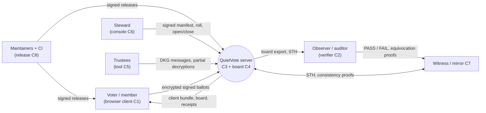

### 3.3 Level-1 data-flow diagram with trust boundaries

Trust boundaries (TB) are drawn as subgraphs. **Everything outside a voter's own device and own trustee tool is treated as adversary-controllable for confidentiality and integrity**; only *detection* remains.

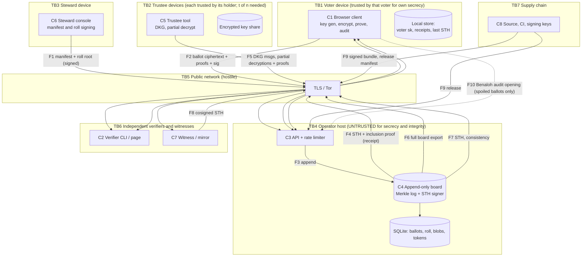

### 3.4 Trust boundaries and what crosses them

| TB | Boundary | Crosses it | Rule |
|---|---|---|---|
| TB1 | Voter device ↔ network | Ciphertext, proofs, signature, public key, receipts. **Never** plaintext vote, encryption randomness of a cast ballot, or private key | Client must not transmit/log secrets (QV-07-REQ-020) |
| TB2 | Trustee device ↔ network | Public DKG messages, partial decryptions + proofs. **Never** share, or any decryption of a single ballot | QV-07-REQ-010/014 |
| TB3 | Steward ↔ network | Signed manifest/roll/state changes | Signed artifacts only; no ballot access exists |
| TB4 | Operator host | Everything stored here is public-or-ciphertext by design; the operator can drop, delay, reorder, equivocate, or serve altered *code* | Integrity by verification, not trust (QV-07-REQ-040…047, 050…054) |
| TB5 | Network | All traffic | TLS/Tor protect channel only; metadata (IP, timing, size) visible to the network observer |
| TB6 | Verifier/witness ↔ operator | Reads board; witnesses sign heads | Independent of operator by construction |
| TB7 | Supply chain | Source, dependencies, build, signing keys, update channel | Reproducible builds, multi-signer releases (QV-07-REQ-050…060) |

### 3.5 Election state machine (security-relevant; extends QV-03 lifecycle)

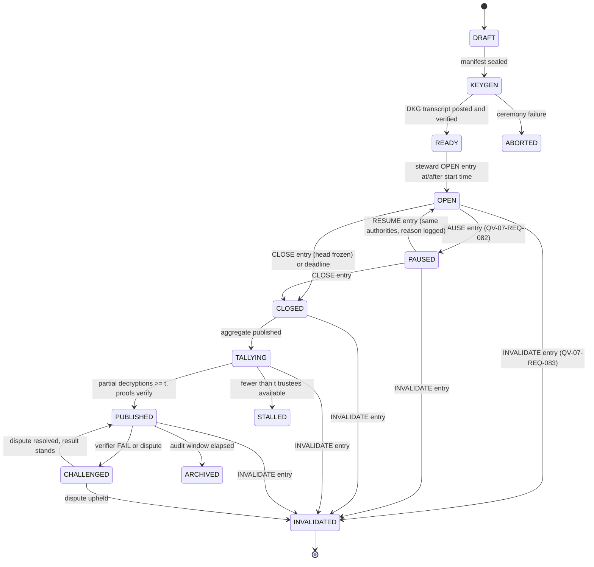

`PAUSED`, `STALLED`, `CHALLENGED`, `INVALIDATED` are states introduced or made explicit by this spec; QV-03 (lifecycle) and QV-09 (event schema) must adopt them (see Proposed ADR QV-ADR-P07-1).

## 4. Asset register

Classification: **S** secret, **I** integrity-critical, **A** availability-critical, **P** public by design. "Loss impact" is for the *group*, not the project.

| ID | Asset | Class | Where | Owner | Primary threats | Loss/compromise impact |
|---|---|---|---|---|---|---|
| AS-1 | Ballot plaintext choices | S | Voter device RAM only (transient) | Voter | A7, A4 | Individual secrecy lost |
| AS-2 | Ballot→voter linkage (which key cast which ciphertext) | S* | Board (public in Phase 1 by design: key↔ciphertext link is public; **ciphertext→choice** is the secret) | — | A8 (decrypt), A1 via leakage | Secrecy loss if ciphertexts decrypt; *participation is public in Phase 1* |
| AS-3 | Election private key shares | S | Trustee devices (encrypted) | Trustees | A8, A9, A12 | ≥t shares ⇒ decrypt every individual ballot |
| AS-4 | Election public key + DKG transcript | I/P | Board | Steward/trustees | A5 (substitute key) | Substituted key ⇒ operator decrypts ballots (key-substitution attack) |
| AS-5 | Voter private (signing) key | S | Voter device | Voter | A7, phishing | Impersonation; unauthorized votes; revote overwrite |
| AS-6 | Voter roll (public keys + Merkle root) | I | Manifest + board | Steward | A3, A5 | Ghost voters / disenfranchisement |
| AS-7 | Election manifest (rules, options, roll root, trustees, thresholds, times) | I | Board (signed) | Steward | A3, A5 | Rules change / wrong question |
| AS-8 | Steward signing key(s) | S | Steward device(s) | Steward(s) | A3, A7, phishing | Forged manifests, early close, false pause/invalidate |
| AS-9 | Ballot ciphertexts + proofs + signatures | I | Board | — | A5, A3 | Dropped/forged ballots |
| AS-10 | Bulletin-board log + STH signing key | I | Operator host | Operator | A5 | Equivocation, rewrite (detectable) |
| AS-11 | Tally, partial decryptions, decryption proofs | I | Board | Trustees | A5, A8 | False result |
| AS-12 | Client code as delivered (bundle) | I | Operator → voter browser | Maintainers/operator | A5, A9 | Total break of AS-1/AS-5 for served voters |
| AS-13 | Release artifacts, signing keys, build pipeline, dependencies | I | GitHub/CI/maintainer HSMs | Maintainers | A9, A12 | Systemic compromise of every deployment |
| AS-14 | Metadata: IP, timing, size, user-agent | S* | Network, logs | Operator/network | A5, A6 | Participation timing correlation, deanonymization of pseudonyms |
| AS-15 | Receipts (inclusion promises, STH) | I | Voter device | Voter | A5, A3 | Loss of individual evidence of inclusion |
| AS-16 | Availability of voting service during window | A | Operator host | Operator | A10, A5 | Disenfranchisement, deadline miss |
| AS-17 | Proposal text and timing | I/P | Board blobs | Proposer/steward | A3, A10 | Harassment, misleading content (QV-29) |
| AS-18 | Operational logs and backups | S* | Operator host | Operator | A5, A11 | Metadata disclosure; stale-backup rollback |
| AS-19 | Invite tokens / pending registrations | S | Server (hashed) + out-of-band | Steward | A1, A10 | Unauthorized roll entry, Sybil members |
| AS-20 | Public trust/reputation of the project (claims accuracy) | I | Docs, site | Maintainers | Overclaiming | Users rely on false assurance (QV-07 §12) |

## 5. Adversary profiles

Each profile lists capability, motivation, access, likely impact, and **what the MVP must resist** (decision closing the framework's open question "Which attacker is the MVP required to resist?"). "Resist" = the stated property holds under that adversary or the attack is detected (tamper-evidence) with a defined response.

| ID | Adversary | Capabilities | Motivation | Access | Likely impact | MVP resists? | Out-of-scope assumptions |
|---|---|---|---|---|---|---|---|
| A1 | **Curious/malicious member (voter)** | Normal client use; reads public board; scripts API calls; can run modified clients; one roll key (or more if Sybil) | Learn others' votes; vote twice; disrupt | Public interfaces | Probing for linkage; replay; duplicate votes | **Yes** (P1, P4, P5, P11) | Member's own device is theirs |
| A2 | **Colluding members** | A1 plus coordination and pooling of observations; may include up to t−1 trustees (see A8) | Deanonymize a victim; swing a close vote | As A1 | Same as A1, amplified; small-group inference | **Yes**, except inference from public tallies in tiny electorates (R-06) | Group size above warning thresholds (REQ-017) |
| A3 | **Malicious/curious steward (organizer/admin)** | Holds steward key; defines manifest/roll; opens/closes/pauses; may run the server; sees all public data | Rig outcome, enroll ghosts, disenfranchise, learn votes | Steward console, possibly operator | Ghost voters; early close; roll manipulation; rule games | **Yes** for integrity (detectable); secrecy yes provided steward ≠ ≥t trustees | Group members check the roll against real membership (REQ-032) |
| A4 | **Coercer / vote buyer** (employer, boss, steward, faction) | Social/economic pressure; can demand proof, require voting in front of them, or demand the voter's key/credentials | Force a particular vote or abstention | Out-of-band | Distorted votes | **Partially** — revoting only (R-04, N-1). Not receipt-free against strong adversary | Coercer cannot observe the voter continuously |
| A5 | **Malicious/compromised operator** | Full control of server host, DB, logs, TLS keys; drops/delays/reorders/injects; equivocates; serves modified client code; sees all IP/timing; legal compulsion | Rig, surveil, extort, censor | Total over C3/C4/DB | Censorship; targeted client swap; metadata surveillance | **Yes** for secrecy (needs ≥t trustees) and integrity (detectable); **not** for availability; **targeted malicious client delivery only mitigated** (R-01) | Operator does not control ≥t trustees, ≥ all witnesses, or all voters' devices |
| A6 | **Network observer** (ISP, Wi-Fi, state) | Passive: IP, SNI, timing, sizes. Active: block, MITM with rogue CA | Deanonymize participation; censor | Network | Participation timing, blocking | **Passive: partial** (TLS; Tor optional). **Active MITM:** TLS + pinning-by-release-manifest for CLI. | Global passive adversary vs Tor out of scope |
| A7 | **Compromised voter device/browser** (malware, malicious extension, shoulder-surfing, stolen unlocked phone) | Reads/modifies DOM/memory; steals keys; changes vote before encryption | Learn or alter specific voters' votes | Voter device | Secrecy and cast-as-intended loss for that voter | **No** for secrecy; **cast-as-intended detection** via Benaloh with a second device (N-3, R-02) | — |
| A8 | **Trustee compromise / collusion** | Obtains 1…n trustee shares by theft, coercion, or malware; or malicious trustee in DKG | Decrypt individual ballots; sabotage tally | Trustee devices, ceremony | <t: none; ≥t: full ballot decryption; DKG abuse: biased/known key | **Yes for <t**; ≥t is a stated trust assumption (N-2) | Trustees chosen from independent parties (REQ-011 guidance) |
| A9 | **Supply-chain attacker** (dependency, CI, registry, maintainer account) | Malicious package, build tampering, stolen release key, typosquat | Backdoor all deployments | Source, CI, npm | Systemic client/server compromise | **Partially**: repro builds, minimal deps, multi-sig (R-03) | Not all upstream (Node.js, OS, browser) compromises are preventable |
| A10 | **DoS / spam / flooding attacker** | Volumetric/L7 floods, ballot flooding with valid/invalid payloads, Sybil proposals, resource exhaustion | Disrupt, delay close, force extension, harass | Public interfaces | Disenfranchisement, deadline miss | **Basic** (QV-29); volumetric DDoS needs upstream protection (R-07) | Operator can buy upstream mitigation |
| A11 | **Legal/state compulsion** (seizure, subpoena, gag) | Compels operator/steward/trustee to hand over data/keys or alter service | Surveillance, suppression | Legal | As A5/A8 | Cryptographic design makes operator-held data useless for secrecy; trustee/steward compulsion → N-2 | Jurisdiction policy not modeled |
| A12 | **Malicious insider maintainer / contributor** | Commit rights, review influence, access to signing keys | Backdoor, sabotage | Repo, CI | As A9 | Partial: 2-reviewer rule, multi-sig, repro builds | Collusion of ≥ signing threshold of maintainers |
| A13 | **Phisher / account taker** | Impersonates steward/support; steals voter keys or invite links; fake client site | Impersonate member, push malicious client | Social | Key theft; look-alike client | Partial: signed-roll check, build-hash display, no passwords to phish | Users verify URL/onion |

## 6. Security properties (P1–P15)

Properties are the unit of traceability (QV-24). Each is stated as *"who cannot do what, assuming what."* Phase = earliest phase where it holds.

| ID | Property | Adversary classes covered | Assumptions | Phase | Primary requirements |
|---|---|---|---|---|---|
| P1 | **Ballot secrecy.** No party outside the voter's device learns the voter's choice from published/served data unless ≥ t trustees collude (or a single-trustee degraded mode is declared). Participation is public in Phase 1. | A2, A3, A5, A6, A8(<t), A11 | DDH-hard in ristretto255; fewer than t trustees dishonest; voter device clean; correct client code | 1 | 010–018, 020, 021, 063 |
| P2 | **Individual verifiability.** A voter can check (a) the client encrypted what they chose (Benaloh cast-or-audit) and (b) their ballot is on the board (inclusion proof against a pinned STH). | A5, A9 (partly), faulty client | Voter performs audit with independent code/device; ≥1 honest verifier path | 1 | 024, 026, 027 |
| P3 | **Universal verifiability.** Anyone can check that the published tally is the correct decryption of the homomorphic sum of exactly the counted ballots, and that each counted ballot is well formed. | A3, A5, A8 | Verifier code correct and obtained independently; sound Fiat–Shamir statements (QV-16) | 1 | 019, 028, 029, 033, 035 |
| P4 | **Eligibility verifiability.** Every counted ballot is signed by a key in the committed roll; roll root is in the signed manifest. | A1, A3(partly), A5 | Members can check the roll against real membership; steward signing key not compromised | 1 | 022, 023, 024, 031, 032, 034 |
| P5 | **One-voter-one-count.** For each roll key at most one ballot (latest valid by sequence) is counted; rule is deterministic and recomputable. | A1, A5 | Voter key not shared or stolen | 1 | 025, 033 |
| P6 | **Bulletin-board integrity and non-equivocation.** Dropping, reordering, altering, or showing different histories to different parties is detectable by a monitor, voter with receipt, or witness. | A5, A3 | ≥1 honest, reachable witness/mirror or gossiping verifiers; clients keep STHs | 1 | 040–047 |
| P7 | **Rule immutability.** Manifest (question, options, method, thresholds, roll root, trustees, times) cannot change after sealing; amendments are explicit, signed, public, and bounded. | A3, A5 | Verifiers compare to the sealed manifest hash | 1 | 022, 030, 031, 034 |
| P8 | **Key-material safety.** Trustee shares are never accessible to the operator; fewer than t shares reveal nothing; DKG misbehavior is detectable and attributable. | A5, A8, A9 | Honest-majority style threshold assumption; verifiable DKG | 1 | 010–016 |
| P9 | **Client and release integrity.** Delivered client/CLI/server artifacts match source via reproducible builds and multi-signer releases; deviations are detectable. | A5, A9, A12, A13 | ≥ signing-threshold maintainers honest; ≥1 independent builder | 1 | 050–060 |
| P10 | **Metadata minimization.** Server stores/logs no IPs or UA by default; no third-party resources; Tor supported. Network observer still sees participation timing. | A5, A6 | Operator follows default config (verifiable only by self-hosters) | 1 | 053, 063, 064, 066 |
| P11 | **Abuse resilience.** Floods and Sybil/spam cannot deny eligible voters service beyond documented limits; resource use is bounded per key/bucket. | A1, A10 | Upstream bandwidth ≥ attack volume or operator-provided mitigation | 1 | 047, 067 (+ QV-29) |
| P12 | **Safe failure.** On verification failure, compromise, or unrecoverable error the system fails closed (pause/invalidate/flag), never silently proceeds. | All | Humans act on signals (§15) | 1 | 005, 080–086 |
| P13 | **Honest claims.** All public/UI statements are within the claims register. | — | Process enforcement | 1 | 002, 003, 004, 071 |
| P14 | **Partial coercion mitigation.** Voters can override a coerced ballot by revoting while the election is open; client keeps no vote-proving secrets. *Not* receipt-freeness. | A4 (weak) | Voter can vote unobserved at least once before close | 1 | 021, 070, 071, 072 |
| P15 | **Coordinated vulnerability handling.** Reports are received, triaged, fixed, and disclosed on published SLAs. | All | Reporter good faith | 1 | 087 (+ QV-33) |

*Notation: requirement numbers abbreviate `QV-07-REQ-nnn`.*

## 7. STRIDE analysis per component

Req references are suffixes of `QV-07-REQ-nnn`. "Det." means *detected* rather than prevented. S=Spoofing, T=Tampering, R=Repudiation, I=Information disclosure, D=Denial of service, E=Elevation of privilege; L = linkability (LINDDUN).

### C1 Browser client
| Cat | Threat | Mitigation | Reqs |
|---|---|---|---|
| S | Look-alike site / phished link serves malicious client | Verify URL/onion; build-hash display; verifier page compares served bundle to signed manifest; no passwords exist to phish | 054, 061 |
| S | Attacker uses stolen voter key to vote/revote | Key stored non-extractable where possible (WebCrypto `extractable:false` for Ed25519 where supported, else encrypted local storage with passphrase); public roll lets voter see unexpected ballot sequence for own key (det.) | 024, 025, 026 |
| T | Malicious served JS alters vote before encryption | Benaloh audit; reproducible builds; CSP; SRI; offline verifier; N-3 for malware | 027, 050–054 |
| T | Extension/XSS modifies DOM | Strict CSP, Trusted Types, no inline script, no `eval`, framework output escaping; sanitized proposal rendering (text/markdown subset, no HTML) | 052 |
| R | Voter claims "my ballot was dropped" / operator claims "never received" | Signed inclusion promise (receipt) from server + later inclusion proof | 026 |
| I | Plaintext/randomness leaves device via logs, error reports, analytics, referrer, crash dumps | No telemetry; no third-party; canary tests; client erases randomness | 020, 021, 053 |
| I (L) | Fingerprinting/timing links IP to ballot | Tor option; optional submit-time jitter; uniform sizes | 064, 066 |
| D | Bundle size/CPU makes voting infeasible on low-end devices | Performance budget (QV-13), proof-gen time budget | 062 |
| E | Client trusts server-supplied election parameters (key substitution) | Client fetches manifest, verifies steward signature and DKG transcript hash, checks election public key equals DKG output before encrypting | 012, 022 |

### C2 Verifier (CLI and offline page)
| Cat | Threat | Mitigation | Reqs |
|---|---|---|---|
| S | Trojaned verifier says PASS | Reproducible build, signed release, second independent implementation, golden vectors | 028, 029, 050, 051 |
| T | Malformed input exploits parser | Strict parsing, size limits, fuzzing, memory-safe language | 062, 093 |
| I | Verifier phones home | No network except to fetch designated board URLs; offline mode; no telemetry | 053 |
| D | Hostile board export exhausts resources | Streaming verification with bounds; fail with explicit error | 062 |
| E | Path traversal / code exec via artifact fields | No dynamic code; parsing only; sandbox docs | 062 |

### C3 Server (coordinator)
| Cat | Threat | Mitigation | Reqs |
|---|---|---|---|
| S | Steward impersonation via forged API call | All privileged actions are signature-verified objects, not sessions | 034, 061 |
| T | Server alters/drops/reorders ballots | Board structure + receipts + witnesses (det.) | 026, 040–046 |
| T | SQL injection/DB write | Parameterized statements; DB holds no secrets; integrity anchored on board | 062 |
| R | Operator denies having accepted a ballot | Signed inclusion promise; STH ≤ MMD | 026, 041 |
| I | Logs leak IP/timing/linkage | No IP/UA logging default; coarse timestamps; log review | 063 |
| I | Backup disclosure | Contents public or ciphertext; backups still access-controlled | 065 |
| D | Floods, slowloris, proof-verification CPU exhaustion | QV-29 controls; cheap checks before expensive | 067, 047 |
| E | Server compromise gives access to decryption | No secrets exist on server (structural) | 010 |
| E | Dependency/RCE in Node | Minimal deps; non-root; read-only FS; seccomp | 055, 065 |

### C4 Bulletin board
| Cat | Threat | Mitigation | Reqs |
|---|---|---|---|
| S | Fake STH from stolen log key | Log key rotation; witnesses; STH includes size+root; clients compare | 041, 043 |
| T | Rewrite history / fork | Consistency proofs; witnesses; equivocation proof | 042–044 |
| T | Rollback via restore | Anti-rollback check against witnesses/mirror | 045 |
| R | Disputed order or close time | Close entry in log; head frozen; witness cosign | 030 |
| I | Board leaks more than intended (e.g., small-n inference, content hashes) | Data classification (QV-06), no plaintext, no PII in entries | 017, 020 |
| D | Entry spam bloats log | Append authz + per-key quotas + size caps | 047 |
| E | Non-steward appends control entries | Control entries require valid steward (or authorized-party) signature | 034 |

### C5 Trustee tool
| Cat | Threat | Mitigation | Reqs |
|---|---|---|---|
| S | Fake trustee joins DKG | Trustee public keys fixed in sealed manifest; DKG messages signed | 012, 022 |
| T | Malicious dealer sends inconsistent shares | Feldman/Pedersen VSS verification, complaints, disqualification | 012 |
| T | Biased public key (rushing adversary in plain Pedersen DKG) | Use a DKG construction with proofs of knowledge / Gennaro et al. "New DKG" resolution; QV-16 selects; QV-07 requires a published analysis | 012 |
| R | Trustee denies participating | Signed transcripts | 012, 014 |
| I | Share theft from disk/memory | Encrypted at rest; recommended offline device; zeroization | 013 |
| I | Coerced to decrypt individual ballots | Tool refuses single-ballot decryption; only aggregate over frozen set | 014 |
| D | Trustee unavailable at tally | n−t slack; documented reserves; no operator fallback | 011, 016 |
| E | Malicious server tricks trustee into decrypting a *chosen subset* (e.g., a single ballot) | Trustee verifies aggregate = homomorphic sum of the full frozen set, against witnessed head, before partial decryption | 014 |

### C6 Steward console
| Cat | Threat | Mitigation | Reqs |
|---|---|---|---|
| S | Stolen steward key forges manifest/roll | k-of-m steward keys option; hardware key support; roll root visible; sealed manifest immutable | 022, 034 |
| T | Late roll/rule changes | Immutability and amendments declared up-front | 031 |
| R | Steward denies action | Signed, logged | 034 |
| I | Steward device leaks invite tokens | Tokens single-use, short expiry (QV-29) | 067 |
| D | Steward unavailable at close | Auto-close at manifest deadline (no steward needed) | 030 |
| E | Steward acts as operator + trustee | Declared trust composition shown to voters; single-trustee flag | 004, 011 |

### C7 Witness / mirror
| Cat | Threat | Mitigation | Reqs |
|---|---|---|---|
| S | Fake witness | Witness public keys pinned in manifest | 043 |
| T/R | Witness cosigns inconsistent heads | Witness verifies consistency proofs before signing; its own log | 043, 044 |
| D | Witness offline | k-of-w policy; clients tolerate missing witnesses by *labelling* election tier | 043 |

### C8 Build and release pipeline
| Cat | Threat | Mitigation | Reqs |
|---|---|---|---|
| S | Typosquat / dependency confusion | Exact pinned lockfile, registry scope, provenance, ban install scripts | 055 |
| T | Malicious commit / CI step alters artifact | Reviews, CODEOWNERS, pinned actions, repro build comparison by independent builder | 050, 056 |
| R | Unattributable release | Signed tags, DCO, signed manifest | 051 |
| I | Secrets in repo/CI logs | Secret scanning, OIDC short-lived creds | 056, 060 |
| D | Registry/CDN outage blocks upgrade | Vendored release tarballs, mirrors | 059 |
| E | Compromised maintainer account | Hardware 2FA, branch protection, 2-person rule on crypto paths, offline release keys | 056, 058 |

### C9/C10 Transport and out-of-band channels
| Cat | Threat | Mitigation | Reqs |
|---|---|---|---|
| S/T | TLS MITM (rogue CA) | TLS 1.2+; HSTS; CLI verifies release hash; Tor onion self-authenticating | 064 |
| I (L) | Network timing correlation | Tor; jitter; size uniformity | 064, 066 |
| T | Invite link intercepted (C10) | Single-use hashed tokens; steward reviews pending registrations; roll is public | 023, 032, 067 |
| D | Block of domain | Onion service, mirrors | 064 |

## 8. Attack trees (top 8)

Notation: rectangles = goals/sub-goals; **OR** children = alternatives; **AND** children = all required. Leaf labels carry difficulty (E easy / M medium / H hard / X infeasible-by-assumption) and the requirement(s) that counter them. Trees are for the MVP (Phase 1) unless stated.

### AT-1 Break ballot secrecy (learn how a specific voter, or the electorate, voted)
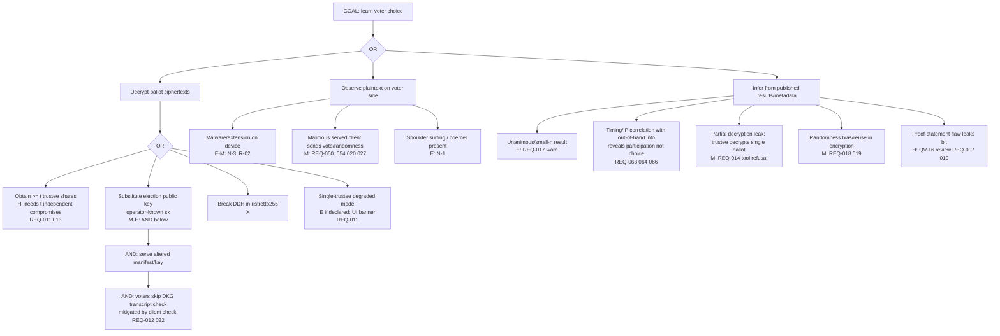

### AT-2 Ballot stuffing (count ballots that should not count, or extra ballots)
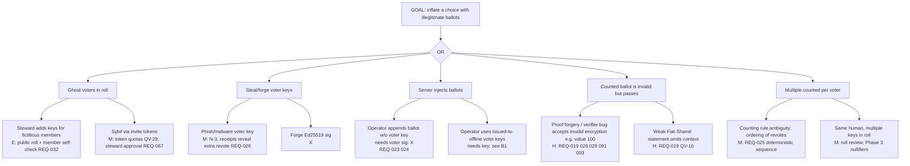

### AT-3 Tally falsification (publish wrong result)
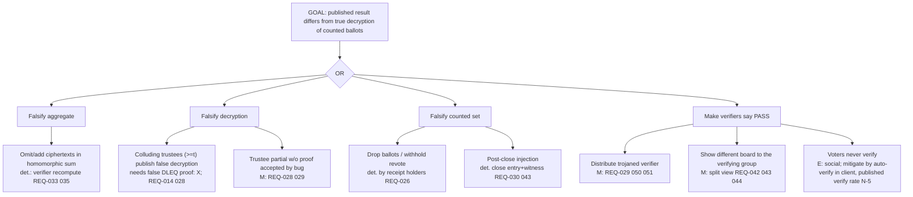

### AT-4 Eligibility bypass (non-member votes, or member denied)
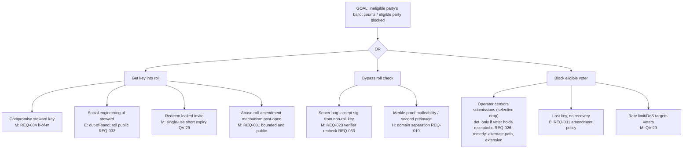

### AT-5 Trustee key compromise
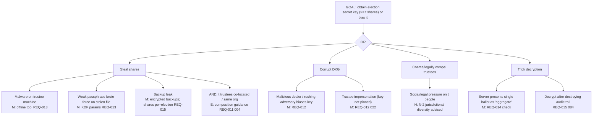

### AT-6 Client compromise
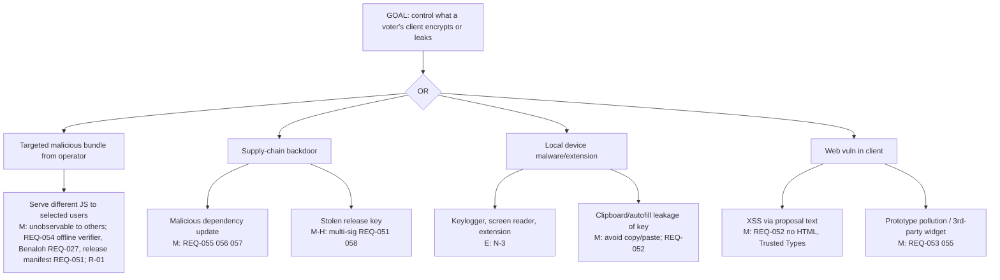

### AT-7 Bulletin-board equivocation (split view)
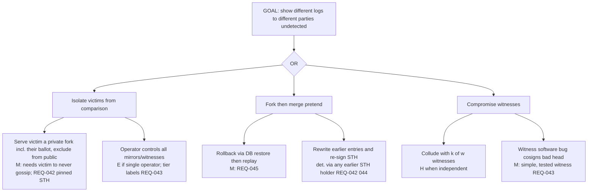

### AT-8 Coercion and vote buying
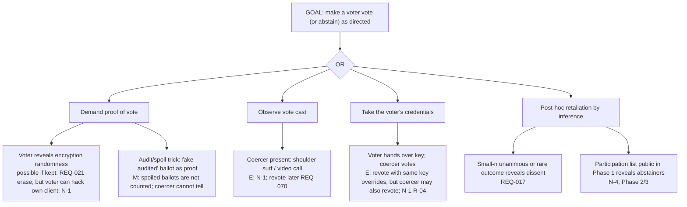

Attack-tree upkeep: each tree is a living artifact; adding a leaf requires a mitigation reference or a residual-risk entry in §10. QV-11 must create at least one test or review item for every leaf marked E or M.

## 9. Security requirements

Conventions: "shall" = mandatory; Priority Must/Should/Could. IDs below are written `nnn`, meaning `QV-07-REQ-nnn`. Verification: **T** = automated test, **R** = review/audit, **D** = drill/exercise, **I** = inspection. Test IDs `QV-TST-SEC-nnn` are catalogued in [QV-24](24-traceability-matrix.md) §8 (the test number equals the requirement number unless noted). "800-53" gives the nearest control family for operators needing that vocabulary; it is informational, not a compliance claim.

### 9.1 Governance of security and claims
| ID | Requirement | Pri | Acceptance criteria | Ver. | 800-53 |
|---|---|---|---|---|---|
| 001 | Any change that alters a trust boundary, data flow, adversary assumption, or cryptographic construction **shall** be reviewed against this threat model; the PR template **shall** include a "threat-model impact" checkbox with a link to the updated section or "none". | Must | CI fails PRs touching `packages/{crypto,protocol,server,client}` lacking the checkbox; review log shows at least one security reviewer approval | T/I | SA-3, CM-3 |
| 002 | All public security/privacy statements (README, site, UI strings, release notes) **shall** be drawn from the claims register (§12). A lint **shall** fail on forbidden phrases (§12.3) in `docs/`, `README.md`, UI string catalogs, and release notes. | Must | Lint test with fixtures of each forbidden phrase fails; allowed phrases pass; lint runs in CI | T | PL-4, SA-5 |
| 003 | Every build, the server's status page, and the election page **shall** display an **assurance label** from {`Experimental`, `Reviewed`, `Audited`} determined solely by the evidence recorded in the release manifest (§13). Default is `Experimental`. | Must | Snapshot test; label cannot be set by config; label `Reviewed` appears only if manifest lists a valid review report hash | T | CA-2 |
| 004 | Each election page **shall** show a **trust declaration** generated from the manifest: trustee count n, threshold t, whether the operator, steward, or any trustee overlap (declared), witness count and tier (REQ-043), whether revoting is on, eligibility phase, and the non-claims list link. | Must | Rendering test across ≥6 manifest permutations; degraded single-trustee shows red banner "Organizer can read individual ballots" | T | PL-2 |
| 005 | On any verification failure (signature, proof, tree, tally, release hash), clients and verifiers **shall** fail closed: stop, show an explicit "NOT VERIFIED" state with the failing check, and never present a result as verified. | Must | Mutation tests: flip one byte in each artifact class ⇒ verifier exit ≠ 0 and UI never shows "verified" | T | SI-7, SI-10 |
| 006 | Release-blocking gates SG-1…SG-16 (§13) **shall** be enforced by a release script that refuses to sign a release unless each gate has linked evidence. | Must | Dry run with one missing evidence item fails; evidence bundle signed | T/I | SA-11, CM-3 |
| 007 | Before any label other than `Experimental` is applied, the cryptographic protocol (QV-16) and its implementation **shall** have passed independent review per §14 (R1+R2) with no unresolved High/Critical findings. | Must | Reports referenced in release manifest; findings tracker has zero open High/Critical | R | CA-2, SA-11 |
| 008 | Each fixed vulnerability **shall** add a regression test referencing the advisory ID. | Should | Test names include `QV-SA-…`; audit shows 100% of High+ advisories covered | T | SI-2 |

### 9.2 Ballot secrecy and key management
| ID | Requirement | Pri | Acceptance criteria | Ver. | 800-53 |
|---|---|---|---|---|---|
| 010 | The server, bulletin board, steward console, and operator tooling **shall** never receive, store, or process trustee secret shares, election secret keys, or any decryption capability for individual ballots. | Must | Static dependency/import check: server package cannot import trustee modules; API schema contains no share/secret fields; code review checklist | T/R | SC-12, SC-28 |
| 011 | Elections **shall** use t-of-n threshold decryption with **default n ≥ 3, t = ⌊n/2⌋+1 (so t ≥ 2)**. Manifest validation **shall** reject t < 2 unless `trustees.mode = "single-trustee-degraded"`, which **shall** (a) require an explicit steward acknowledgement in the manifest, (b) trigger the red banner of REQ-004, and (c) be excluded from claims C-1 and C-2. Guidance: trustees should be independent persons/organizations, ideally in different jurisdictions; the operator should not be a trustee for hosted deployments. | Must | Manifest validator tests (t=1 without flag rejected; with flag accepted+banner); doc review | T | SC-12, AC-5 |
| 012 | Key generation **shall** use a verifiable DKG selected in QV-16 (Pedersen/Feldman VSS lineage with proofs of knowledge; resolution of the biased-key problem of plain Pedersen DKG — Gennaro–Jarecki–Krawczyk–Rabin) with: signed DKG messages from manifest-pinned trustee keys; complaint/disqualification rounds; a public transcript on the board; each trustee verifying its own share and the final election public key; the client verifying (before encrypting) that the key in use equals the DKG output hashed in the sealed manifest. | Must | Test: malicious dealer sending bad share ⇒ complaint, disqualification, ceremony restarts or continues per QV-16; client refuses key that differs from transcript hash | T | SC-12, SC-17 |
| 013 | Trustee shares **shall** be stored encrypted at rest under a key derived with a memory-hard KDF (Argon2id ≥ 64 MiB, t ≥ 3, p = 1, or scrypt N=2^17, r=8, p=1 if Argon2 unavailable in the chosen library — QV-16/ADR to confirm), file mode 0600, with a minimum-entropy passphrase check (zxcvbn-class score ≥ 3 or ≥ 6 diceware words); the tool **shall** support running fully offline and export of an encrypted backup. | Must | Unit tests for KDF parameter floor; refusal of weak passphrase; wrong-passphrase failure; file-permission check | T | SC-28, IA-5 |
| 014 | A trustee tool **shall** produce a partial decryption **only** for the homomorphic aggregate that it has itself recomputed from the full ballot set under a witnessed/frozen board head, after a CLOSE entry, with the head hash displayed for human confirmation; it **shall** refuse partial decryption of any single ballot ciphertext or of any aggregate over a subset smaller than the full counted set (per-contest aggregates are allowed). | Must | Tests: single-ciphertext request refused; pre-close refused; head mismatch refused; subset aggregate refused | T | AC-6, SC-12 |
| 015 | Trustee tools **shall** support verified destruction of election key shares (overwrite + delete + signed "destroyed" attestation posted to the board); default retention is the audit window (**30 days after result publication**, steward-extendable by manifest to 365). Shares **should not** be reused across elections. | Should | Command exists; attestation verifies; tests that a new election generates new keys | T/D | SC-12, MP-6 |
| 016 | If fewer than t trustees can produce partial decryptions, the election **shall** enter `STALLED`; there shall be no fallback that gives decryption capability to the operator, steward, or a subset. Steward docs **shall** require a trustee-continuity plan (offline backups held by the trustee, spare trustees seated at keygen). | Must | Test: t−1 trustees ⇒ STALLED, no result; docs checklist | T/R | CP-2, CP-9 |
| 017 | Result publication **shall** compute and display disclosure warnings: electorate (roll) size < 10 ⇒ "Results may reveal individual votes"; any option with 0 or n votes ⇒ "Unanimous result: every participant's choice is known"; stewards **shall** be able to require a minimum-turnout floor below which per-option counts are suppressed (manifest `minPublishTurnout`, default 0) — but ballots remain on the board, so suppression is a UX measure, not a cryptographic one, and is labelled as such. | Should | Table-driven tests of thresholds; UI copy review | T | PT-2 |
| 018 | All randomness (nonces, encryption randomness, key generation, challenge salts) **shall** come from the platform CSPRNG (`crypto.getRandomValues` / `node:crypto`) via the audited library API; `Math.random` **shall** be banned by lint; failure to obtain entropy **shall** abort the operation. Nonces for Fiat–Shamir proofs **shall** not be derived in a way that permits reuse across statements (see QV-16 for deterministic-nonce rules). | Must | Lint rule test; entropy-failure injection aborts; review of nonce derivation | T/R | SC-12, SC-13 |
| 019 | Hash-to-scalar/challenge derivations, Merkle leaf/node hashing, signatures and board-entry hashes **shall** use distinct, versioned domain-separation tags and length-prefixed encodings, binding the full statement (election ID, contest ID, public key, ciphertexts, commitments) as in QV-16. Test vectors **shall** be published, including negative vectors (cross-context replay, statement mutation). | Must | Replay of a valid proof in another election/contest/statement fails verification; vector files in `/test-vectors` checked by both verifiers | T | SC-13 |
| 020 | Voter plaintext choices, encryption randomness of cast ballots, and private keys **shall never** be sent to the server, written to logs, error reports, URLs, analytics, or crash dumps. | Must | Canary test: run a full election with canary strings as choices/passphrases; capture all HTTP traffic, server logs, DB, board export; canaries absent | T | SC-28, AU-3 |
| 021 | After a ballot is cast, the client **shall** zeroize in-memory plaintext and encryption randomness and **shall not** persist or offer export of them; the "audit" path **shall** apply only to ballots the voter explicitly spoils (Benaloh). | Should | Memory/storage inspection test in headless browser; UI has no "export proof of vote" | T | SC-4 |

### 9.3 Eligibility and ballot integrity
| ID | Requirement | Pri | Acceptance criteria | Ver. | 800-53 |
|---|---|---|---|---|---|
| 022 | The manifest (question text hash, options, method, thresholds, roll Merkle root, trustee keys, DKG transcript hash (after KEYGEN), time rules, revote/amendment policy, witness list) **shall** be signed by the steward key(s) and appended to the board; the **election ID is the hash of the sealed manifest**. After sealing, any change **shall** require a new election. | Must | Mutating any manifest field after sealing is rejected by server and detected by verifier; artifacts bind to election ID | T | CM-3, CM-5 |
| 023 | The server **shall** reject, before any expensive verification, ballots whose signing key is not in the roll (Merkle inclusion against the manifest root); the verifier **shall** independently re-check inclusion for every counted ballot. | Must | Ballot from non-roll key rejected; verifier flags a board containing such a ballot and refuses to count it | T | IA-2, AC-3 |
| 024 | Each ballot submission **shall** be signed by the voter key over (election ID, ballot-hash, per-voter sequence number, protocol version); servers and verifiers **shall** reject replays across elections, altered ciphertexts, and non-increasing sequence numbers. | Must | Replay/mutation tests reject; sequence property tests | T | SC-23, SI-10 |
| 025 | The counted ballot for each voter **shall** be the valid ballot with the highest sequence number published before the CLOSE entry's tree size; the rule **shall** be implemented identically in server, both verifiers, and trustee tool and exercised with property-based tests over randomized orders. | Must | Property tests (≥10,000 random histories) yield identical counted sets across implementations | T | SI-10 |
| 026 | On acceptance the server **shall** return a signed inclusion promise (STH commitment). The client **shall** persist it, and **shall** fetch and verify the inclusion proof against a later STH within the MMD (REQ-041), warning the voter if it fails. | Must | Test where the server drops an accepted ballot ⇒ client shows alarm with downloadable evidence package; evidence verifies offline | T | AU-10 |
| 027 | The client **shall** offer Benaloh cast-or-audit: the voter may spoil any number of encrypted ballots, receive the opening, and verify it with a second device/independent verifier; spoiled ballots are published and never counted. The UI **shall** explain this in plain language and **should** prompt for ≥1 audit before the first cast. | Must | E2E: audited ballot decrypts to the intended choice; a deliberately cheating client double (swaps choice) is detected on audit; on cast, ballot cannot be audited afterwards | T | SI-10 |
| 028 | A CLI verifier and an offline verifier page **shall** check: release hash, manifest signature and ID, DKG transcript, roll proofs, every ballot's signature/proofs, counted-set selection, tree consistency and inclusion, close entry, aggregate, partial decryptions and their proofs, and the final result; output **shall** be deterministic PASS/FAIL with a machine-readable report. | Must | Golden good/bad bundle suite; each negative vector yields the expected failure code | T | CA-2, SI-7 |
| 029 | A second verifier implementation in a different language/runtime (e.g., Python or Rust) written from QV-16 and test vectors without sharing code **should** exist before the `Reviewed` label. | Should | Differential tests on ≥1,000 generated elections incl. fuzzed mutations agree | T | SA-11 |
| 030 | Election close **shall** be enforced by a board CLOSE entry at the manifest deadline (auto) or by steward action after start; ballots appended after the frozen tree size **shall not** be counted. Clock source: the server's UTC time, with the deadline visible as an absolute UTC instant; witnesses' cosignature times bound skew (>±120 s from witness time flagged). | Must | Late submission rejected; late entry in board ignored by verifier; skew injection flagged | T | AU-8 |
| 031 | After OPEN, the roll and rules **shall not** change. The only permitted exception is a *roll amendment* if the sealed manifest sets `rollAmendments.max > 0` (default 0, hard max 5% of roll); each amendment is a steward-signed public board entry with a new Merkle root and reason, triggers a visible notice to members, and is counted/limited by the verifier. | Must | Attempted amendment with max=0 rejected; amendments beyond max rejected; verifier reports each amendment | T | CM-5 |
| 032 | Before OPEN, members **shall** be shown the roll size and be able to check that their key is present (client "roll check" step); the roll (public keys with optional group-chosen pseudonym labels) **shall** be downloadable by any member. Stewards **should** publish the count of real members out of band. | Must | E2E; export contains all roll keys | T/I | IA-4 |
| 033 | The verifier **shall** report: roll size, number of distinct signing keys with ≥1 valid ballot (turnout), number of valid counted ballots, number superseded, invalid or rejected (with reason codes), and flag if counted > roll size or any key counted twice. | Must | Fixture elections with injected anomalies reported exactly | T | AU-6 |
| 034 | All steward/organizer state changes (manifest seal, open, close, pause, resume, invalidate, roll amendment, trustee list) **shall** be Ed25519-signed objects verified by server and verifiers; stewards **should** be able to configure k-of-m steward keys; no password-based or cookie-session authority exists for these actions. | Must | Unsigned/wrongly signed action rejected; k-of-m threshold enforced | T | AC-2, AC-3, IA-2 |
| 035 | The final result object **shall** include everything needed to recompute it from the board: aggregate ciphertexts, partial decryptions with Chaum–Pedersen proofs, discrete-log recovery bound and method, and the tally-rule application; the verifier **shall** recompute thresholds/quorum. | Must | Independent recompute from a fresh board export matches | T | AU-10 |

### 9.4 Bulletin board
| ID | Requirement | Pri | Acceptance criteria | Ver. | 800-53 |
|---|---|---|---|---|---|
| 040 | The board **shall** be an append-only Merkle tree with RFC 9162 §2 hashing (distinct leaf/node prefixes), inclusion and consistency proofs, and Ed25519-signed tree heads containing (election ID, size, root, timestamp, version). | Must | RFC 9162 proof test vectors and cross-implementation checks pass | T | AU-9, SI-7 |
| 041 | A new STH **shall** be issued at least every **60 s** while an election is OPEN or PAUSED, and every accepted ballot **shall** be covered by an STH within **MMD = 300 s**; during TALLYING at least every 5 min. | Must | Time-based simulation shows no ballot uncovered > 300 s; violation alarms | T | AU-8 |
| 042 | Clients and verifiers **shall** store the latest STH they have seen per election (receipts include the STH) and verify a consistency proof whenever a newer STH is obtained; a failure **shall** produce an equivocation/inconsistency alarm and a downloadable evidence package. | Must | Fork/shrink/rewrite fixtures detected | T | SI-7 |
| 043 | The manifest **shall** support a witness list and cosigning threshold k-of-w; witnesses **shall** verify consistency before cosigning. Elections declare a **witness tier**: Tier 0 = none; Tier 1 = ≥1 independent witness; Tier 2 = ≥2 independent witnesses operated by unrelated parties plus a public mirror. Claims C-6/C-7 apply only at Tier 1/2 respectively. The project **should** run at least one public default witness. | Should | Witness protocol tests; tier computed and displayed (REQ-004); claim lint refers to tier | T | SC-8 |
| 044 | Two validly signed STHs for the same election with the same size but different roots, or any pair failing consistency, **shall** constitute a transferable *equivocation proof*; a verifier **shall** emit it in a defined JSON format (spec in QV-09), and its detection **shall** cause the client to show `INTEGRITY ALERT` and the matrix of §15 row IR-6 to apply. | Must | Third-party verification of a generated proof; UI alert test | T | AU-10 |
| 045 | On restore from backup or after crash, the server **shall** refuse to serve or append unless its tree size ≥ the largest size known from its own WAL markers and any reachable witness/mirror; it **shall** log (without PII) and alert when rollback is suspected. | Must | Restore-from-stale-backup test: server refuses; operator override requires explicit flag and appends a visible ROLLBACK notice entry | T | CP-9, SI-7 |
| 046 | Full board export (all entries, blobs, heads, cosignatures) **shall** be available to any member/observer without authentication during and after the election; a documented mirroring command **shall** let a third party replicate and verify incrementally. | Must | Export/import reproduces identical root; mirror sync test | T | CP-9 |
| 047 | Board appends **shall** require: a valid signature by a role authorized for that entry type; size ≤ per-type cap (ballot ≤ 128 KiB, control ≤ 16 KiB, blob ≤ 256 KiB); and respect QV-29 per-key quotas. | Must | Fuzzed entries rejected at the cheapest check; quotas enforced | T | SC-5, AC-3 |

### 9.5 Client, build and supply chain
| ID | Requirement | Pri | Acceptance criteria | Ver. | 800-53 |
|---|---|---|---|---|---|
| 050 | Builds of server, client bundle, CLI and verifier **shall** be reproducible: two independent builders (different OS image and time) produce bit-identical artifacts; CI **shall** fail if they differ; hashes published in the release manifest. | Must | Repro job green for 3 consecutive release candidates; one external rebuild attested | T | SA-10, SR-4 |
| 051 | The release manifest (artifact hashes, version, assurance label inputs, SBOM hash, review report hashes) **shall** be signed by ≥ **2 of 3** maintainer keys (Ed25519, hardware-held); the verifier/CLI **shall** require this threshold and a monotonic version for updates. | Must | 1 signature insufficient; wrong key rejected; downgrade rejected | T | SI-7, SR-4 |
| 052 | The server **shall** send: `Content-Security-Policy: default-src 'none'; script-src 'self'; style-src 'self'; img-src 'self' data:; connect-src 'self'; font-src 'self'; base-uri 'none'; form-action 'self'; frame-ancestors 'none'; require-trusted-types-for 'script'`; plus `Strict-Transport-Security: max-age=63072000; includeSubDomains`, `X-Content-Type-Options: nosniff`, `Referrer-Policy: no-referrer`, `Cross-Origin-Opener-Policy: same-origin`, `Cross-Origin-Resource-Policy: same-origin`, `Permissions-Policy` denying all features. Scripts **shall** carry SRI hashes in the HTML. No inline script/style; no `eval`/`new Function`. Proposal text rendered as escaped text or a small whitelisted markup subset. | Must | Header scan e2e (Mozilla Observatory-style grade A+ equivalent); XSS corpus tests | T | SC-18, SI-10 |
| 053 | The client and verifier page **shall** make no requests to third-party origins (fonts, analytics, CDNs, error reporting), shall include no telemetry, and the e2e network capture **shall** show same-origin requests only. | Must | Capture test in CI | T | SC-7, PT-5 |
| 054 | The UI **shall** display the running client's build hash and version; the offline verifier page and CLI **shall** offer "check served client" (fetch the bundle from the instance and compare with the signed release manifest). Documentation **shall** state this does not defeat targeted per-user delivery (R-01). | Should | E2E hash display; mismatch test | T | SI-7 |
| 055 | Dependencies **shall** be pinned by lockfile with integrity hashes; installs **shall** use `npm ci --ignore-scripts`; the crypto and protocol path **shall** have ≤ 5 production dependencies (target: `@noble/curves`, `@noble/hashes` and at most 3 others), each new runtime dependency requiring an ADR (maintainer count, audit status, size, transitive deps); known-vulnerable dependencies (OSV/`npm audit`) at High+ block release. | Must | Dependency-budget test; CI audit job; ADR links | T | SR-3, SA-12 |
| 056 | CI/CD **shall**: pin third-party Actions by commit SHA; use least-privilege `GITHUB_TOKEN` and OIDC short-lived credentials; protect default branches and tags (signed commits/tags, ≥2 approvals on crypto/protocol/release paths via CODEOWNERS); disallow secrets on forked-PR builds; require hardware-backed 2FA for maintainers. | Must | Config lint passes; audit of settings export | T/I | CM-3, AC-6, IA-2 |
| 057 | Each release **shall** ship an SBOM (CycloneDX or SPDX) and a build-provenance attestation (SLSA-style) and list them in the release manifest. | Must | Verification script validates SBOM hash and attestation | T | SR-4 |
| 058 | Release signing keys **shall** be generated and kept offline on hardware tokens, with documented rotation, revocation (published revocation list in repo) and a quarterly signer drill; loss of ≥2 keys has a documented key-rollover procedure that requires an announcement and verifier update. | Must | Drill report; rotation test | D | SC-12 |
| 059 | The update path for self-hosters **shall** use signed releases with rollback protection; auto-update is **off** by default; upgrading while an election is OPEN **shall** require an explicit flag and be recorded. | Should | Downgrade refused; upgrade-during-election flag test | T | CM-3, SI-2 |
| 060 | The repository **shall** run secret scanning on every push and PR and block merges on findings; no secrets or keys in source, images, or examples (placeholders only). | Must | CI job with seeded canary secret fails | T | IA-5 |

### 9.6 Server, transport, metadata
| ID | Requirement | Pri | Acceptance criteria | Ver. | 800-53 |
|---|---|---|---|---|---|
| 061 | The system **shall not** implement passwords, password reset, or e-mail-link login for voters, stewards, or trustees; authority derives from keys. (Convenience wrappers storing keys must follow REQ-013-style encryption.) | Must | Route inventory contains no credential-reset endpoints | I | IA-5 |
| 062 | All inputs **shall** be parsed by strict, size-bounded, schema-validating decoders with canonical encoding (reject non-minimal, duplicate keys, unknown critical fields, point/scalar encodings not canonical, small-subgroup/identity points where excluded by QV-16). Fuzz targets exist for each decoder. | Must | Fuzz corpus run in CI ≥ 10 min/PR nightly 1 h; non-canonical vectors rejected | T | SI-10 |
| 063 | Default logging **shall not** record IP addresses, user-agents, ballot content, tokens, keys, or full request bodies; access logs **shall** record only: UTC time rounded to the minute, route class, status class, and size class. A debug mode that logs more **shall** require an explicit flag, print a startup warning, and be rejected in "production" profile. Log retention default 7 days. | Must | Log-content tests with canaries; config test for debug gating | T | AU-3, AU-11, PT-2 |
| 064 | The server **shall** support TLS 1.2+ (TLS 1.3 preferred; AEAD suites only) and **shall** document and test deployment as a Tor onion service (v3) without code changes; the client **shall** work in Tor Browser Standard mode (no WebAssembly/JIT dependency that is blocked in Safest mode is a *documented* limitation). | Must | testssl-class scan; onion e2e in CI | T | SC-8, SC-13 |
| 065 | Reference deployment artifacts (container/systemd) **shall**: run non-root, read-only root FS, drop capabilities, default seccomp, private temp, memory/CPU limits, SQLite file mode 0600, separate data volume, and use no network egress except explicitly configured (witness, notifier). | Should | Container scan (e.g., trivy/grype) and runtime assertions | T | CM-6, SC-7 |
| 066 | Ballot submit responses **shall** be fixed-size per protocol version; the client **should** offer optional random submission delay (0–120 s, default off) and **shall** not include timing-distinguishing behavior between accepted/duplicate/invalid beyond defined error codes. | Should | Response-size test; timing-variance test | T | SC-31 |
| 067 | Abuse controls of QV-29 (rate limits, PoW, invite tokens, quotas, load-shedding) **shall** be implemented as specified there without logging IPs. | Must | QV-29 acceptance tests | T | SC-5 |

### 9.7 Coercion
| ID | Requirement | Pri | Acceptance criteria | Ver. | 800-53 |
|---|---|---|---|---|---|
| 070 | Revoting **shall** be enabled by default (`maxBallotsPerVoter` default 5, QV-29), the UI **shall** tell voters that only the latest ballot counts and that voting again overrides a pressured vote, and stewards **shall** be able to disable it with a warning describing the trade-off (revote suppression by the operator). | Must | Default-manifest test; UI copy test | T | — |
| 071 | UI, onboarding, and docs **shall** state plainly: QuietVote does not protect against someone watching you vote, forcing you to vote, or taking your device or key; participation is visible in Phase 1; and the voter's own device is trusted. | Must | Copy review snapshot | R/T | PL-4 |
| 072 | Receipts, exports, and logs **shall** contain no data from which a third party can verify how a voter voted (no plaintext, no randomness, no per-ballot decryption proof) except the opening of explicitly spoiled audit ballots. | Should | Receipt-content inspection test | T | — |

### 9.8 Incident response, disclosure and review
| ID | Requirement | Pri | Acceptance criteria | Ver. | 800-53 |
|---|---|---|---|---|---|
| 080 | The project **shall** maintain an incident response plan (roles: incident commander, crypto lead, comms lead, scribe; severity per §15.1) and exercise it by tabletop at least twice a year and before each major release. Operators of hosted instances **shall** have an equivalent runbook (QV-12). | Must | Exercise reports dated; findings tracked | D | IR-1…IR-8 |
| 081 | The board **shall** support signed control entries `PAUSE`, `RESUME`, `INVALIDATE`, `SECURITY_NOTICE` that all clients and verifiers render, and the election state machine of §3.5 **shall** be enforced by server and verifier. | Must | State transition tests; verifier output shows state history | T | IR-4 |
| 082 | `PAUSE` may be issued by: (a) the steward authority (k-of-m if configured); (b) any t-of-n trustees acting jointly (they hold the veto: no `PAUSE` ⇒ they may still refuse to decrypt); (c) the operator via `SECURITY_NOTICE` + server-side hold (accepts no ballots) — the operator cannot create `RESUME` or `INVALIDATE`. While PAUSED, no new ballots are accepted; the clock for the deadline is extended only by an explicit steward `RESUME` with a new close time (bounded by manifest `maxExtension`, default 7 days). | Must | Authority matrix tests; operator hold visible to members and logged | T | IR-4 |
| 083 | `INVALIDATE` **shall** be issued only by steward authority (k-of-m) or, if the manifest delegates, by trustee t-of-n; it **shall** carry a reason code from §15.2 and a link to the evidence bundle; it is permanent and public; a new election is the remedy. Verifiers **shall** render invalidated elections as `INVALIDATED` regardless of tally validity. | Must | Record test; verifier output | T | IR-4 |
| 084 | On any Sev-1/Sev-2 incident the responder **shall** snapshot and hash the board export, server logs, DB, and release artifacts and store them (encrypted if they contain non-public data) before remediation. | Must | Runbook step + drill | D | IR-4, AU-9 |
| 085 | Notification SLAs (from confirmation): Sev-1 — affected stewards/trustees within **4 h**, public `SECURITY_NOTICE` and advisory within **24 h**; Sev-2 — **24 h** / **72 h**; Sev-3 — next release notes. | Must | Drill measures elapsed times | D | IR-6 |
| 086 | A public, blameless post-incident review **should** be published within 14 days for Sev-1/Sev-2 incidents (redacting non-public data). | Should | Template and published examples | I | IR-4 |
| 087 | Vulnerability reports **shall** be handled under QV-33 (published `SECURITY.md`, `security.txt`, SLAs, advisories, CVE handling). | Must | QV-33 acceptance criteria | I | SI-2, RA-5 |
| 090 | The review plan of §14 **shall** be executed on its schedule and results (summaries and fixed findings) published. | Must | Reports linked in release evidence | R | CA-2, CA-8 |
| 091 | A symbolic or computational model of the ballot protocol (e.g., ProVerif/Tamarin for cast-as-intended, eligibility and board properties) **should** be produced for P2–P4/P6 before `Audited`. | Should | Model files + results in repo | R | SA-11 |
| 092 | A penetration test of the deployed reference stack (server, client, CLI, container) **shall** be completed before `Reviewed`. | Must | Report with zero open High/Critical | R | CA-8 |
| 093 | Property-based and fuzz tests **shall** cover all decoders, the tally/counting rule, Merkle code, and proof verification, run on every PR (short) and nightly (long). | Must | CI jobs present; coverage of target modules ≥ 90% line, mutation score reported (target ≥ 70% for crypto/protocol packages) | T | SA-11 |
| 094 | Privacy-leak tests **shall** run on every release: logs, DB, exports, error pages, headers, and board entries scanned for canary identifiers (IP, UA, key material, plaintext). | Must | Canary suite green | T | PT-2 |

## 10. Residual risks

Likelihood/impact: L/M/H (qualitative, per NIST SP 800-30 vocabulary). "Owner" is the role that must decide acceptance.

| ID | Residual risk | L | I | Why it remains | Mitigation in place | Acceptance owner |
|---|---|---|---|---|---|---|
| R-01 | Targeted delivery of a malicious client to chosen voters by a malicious operator (web-delivery problem, QV-ADR-010) | M | H | Browsers run what the server sends; detection requires users to compare | Benaloh audit with independent verifier; build-hash/offline verifier; pinned/installable client; Tor reduces targeting by IP | Project owner (documented in claims) |
| R-02 | Malware on a voter's device reads or changes the vote | M | H (individual) | Cannot be solved in software we control | Benaloh with second device detects alteration (not reading) | Voter (stated) |
| R-03 | Compromised upstream dependency, Node.js, browser, or OS | L–M | H | Trust in toolchain unavoidable | Minimal deps, repro builds, multi-sig, SBOM | Maintainers |
| R-04 | Coercion/vote buying (receipt-freeness absent) | M (context-dependent) | M–H | Strong coercion resistance requires JCJ-class protocols/untappable channels, out of scope | Revoting; no vote-proving artifacts; honest non-claim | Steward (chooses use-case) |
| R-05 | Collusion of ≥t trustees | L | H | Threshold assumption | Independent trustee selection; trust declaration; key destruction | Steward + trustees |
| R-06 | Small-electorate/unanimity inference | H (small groups) | M | Inherent to tallies | Warnings (REQ-017) | Steward |
| R-07 | Volumetric DDoS near deadline | M | M | Self-hosters lack capacity | Extension policy, onion service, load shedding; upstream mitigation | Operator |
| R-08 | Selective censorship of a voter by operator | M | M | Operator controls ingress | Receipts, alternate submission path via mirror/steward relay *[design TBD in QV-09]*, extension rights | Steward |
| R-09 | Public participation set (Phase 1) enables pressure on abstainers | H | M | Design choice (QV-ADR-005) | Phase 2/3 roadmap; steward can choose pseudonymous keys | Steward |
| R-10 | Harvest-now-decrypt-later (quantum) | L (today) | H (long-term) | Classical crypto (QV-ADR-013) | Short-lived keys, share destruction, research QV-21 | Project owner |
| R-11 | Cryptographic protocol or implementation flaw not yet found | M (unreviewed) | H | No review yet | Assurance label `Experimental`; SG gates; audits | Project owner |
| R-12 | Human error by stewards (misconfigured trust, publishing wrong roll) | M | M–H | Usability | Trust declaration, roll check, templates, dry-run mode | Steward |
| R-13 | Legal compulsion of trustees/stewards | L–M | H | Out of technical control | Jurisdictional diversity guidance | Trustees |
| R-14 | Side channels in JS crypto (timing, memory remanence) | M | M | Browser JS limitations | Audited constant-time-oriented libraries; no secret-dependent branching in our code; documented | Maintainers |
| R-15 | Time/clock manipulation at deadlines | L–M | M | Server UTC | Witness times, absolute UTC display | Operator |

## 11. Explicit non-claims

These are binding and shall appear (in condensed form) in onboarding and documentation (REQ-071).

| ID | QuietVote does **not** claim… | Basis |
|---|---|---|
| N-1 | Receipt-freeness or coercion-resistance against a strong adversary (observation of the voting act, key surrender, vote buying). Revoting is a *partial* mitigation. | QV-ADR-008; R-04 |
| N-2 | Secrecy if ≥ t trustees collude or are compelled, or if single-trustee degraded mode is used. | R-05 |
| N-3 | Protection from a compromised voter device, browser, or extension. | A7; NISTIR 7770 |
| N-4 | Anonymity of participation in Phase 1 (who voted is public); anonymity only from Phase 2/3 and only as specified there. | QV-ADR-005, 008 |
| N-5 | That every voter will actually verify; universal verifiability is a *capability*, not a guarantee that anyone checked. | — |
| N-6 | Long-term secrecy against quantum or future-cryptanalytic adversaries. | QV-ADR-013 |
| N-7 | Protection against network metadata analysis unless used via Tor, and even then not against a global adversary. | QV-ADR-008/009 |
| N-8 | Availability guarantees; the operator is trusted for availability only and may cause delay or denial. | QV-ADR-008 |
| N-9 | Conformance to, or certification against, any governmental or statutory e-voting standard (Council of Europe Rec(2017)5, BSI-CC-PP-0121, EAC/VVSG), or suitability for public elections or legally binding votes. | QV-00 |
| N-10 | Verification that a voter is the real-world person claimed (no identity proofing); only that a key in the roll signed. | QV-ADR-001 |
| N-11 | That the roll matches the group's true membership; the group must check. | A3 |
| N-12 | Protection against bugs not yet found; absence of known vulnerabilities is not proof of security. | R-11 |
| N-13 | Secrecy of proposal texts or the existence of elections (these are public on the board by design). | AS-17 |
| N-14 | Protection from the steward who is also operator and trustee holding ≥t shares (trust composition is the group's responsibility). | A3/A8 |

## 12. Security-claims register

### 12.1 Rules of use
1. Public language **may** use only the **allowed text** below (or text that is strictly weaker), together with the stated **conditions**. Where a condition depends on election configuration, the claim is shown **only on pages generated for elections meeting it** (e.g., the Tier 2 witness claim).
2. The **assurance label** (REQ-003) must accompany any security claim: claims C-1…C-8 are made under label `Experimental` only in the hedged form "is designed to…". The unhedged form "provides…" requires label `Reviewed` or `Audited` per column "Min. label".
3. Adding or relaxing a claim requires a PR to this section, approval by security lead + project owner, and a link to supporting evidence in QV-24 (rows for P-numbers).
4. Marketing, README, talks, funding applications and sales material are covered. Third parties' statements are outside our control but we correct those we learn of.

### 12.2 Allowed claims
| ID | Allowed text (exact or weaker) | Conditions / required evidence | Min. label for unhedged form | Property |
|---|---|---|---|---|
| C-1 | "Ballots are encrypted on the voter's device. The server never holds a key that can decrypt them." | REQ-010, 020 tests pass; election not in degraded single-trustee mode | Experimental (as design fact) | P1 |
| C-2 | "Individual ballots can be decrypted only if at least *t* of the *n* named trustees cooperate; the trust declaration for each election lists n and t." | REQ-011–014 tests; DKG verified | Reviewed | P1, P8 |
| C-3 | "Anyone can verify, with independent software, that the published result is the correct count of the ballots on the public board." | REQ-028, 029 (for 'independent software' plural), 033, 035 | Reviewed | P3 |
| C-4 | "Voters can check that their ballot was recorded, and can test that their device encrypted the choice they made (cast-or-audit)." | REQ-026, 027; audit requires voter action and a second device/verifier | Reviewed | P2 |
| C-5 | "Only keys in the group's published voter list can cast counted ballots, and each key counts once (latest ballot)." | REQ-022–025, 033 | Reviewed | P4, P5 |
| C-6 | "All election records are in an append-only, tamper-evident log; changes to history are detectable." | REQ-040–042, 044. Must say "detectable", never "impossible" | Reviewed | P6 |
| C-7 | "Independent witnesses co-sign the log so the server cannot show different histories to different people without detection." | Election is Tier 1+ (≥1 independent witness); text states witness count | Reviewed | P6 |
| C-8 | "The rules of an election are fixed and public before voting opens; changes require a new election." | REQ-022, 031 (when `rollAmendments.max = 0`; otherwise say "bounded, public amendments") | Reviewed | P7 |
| C-9 | "We don't log IP addresses by default." | REQ-063 default shipped; **applies to project-maintained deployments only if operator attestation exists**; self-hosters set their own policy | Experimental | P10 |
| C-10 | "Voting is anonymous *from other voters' choices*: nobody can see how you voted. Who voted is visible in this version." | N-4 stated adjacent | Experimental | P1 |
| C-11 | "You can change your vote until the election closes; only your latest ballot counts. This helps if you were pressured, but QuietVote cannot protect you from someone watching you vote." | REQ-070, 071 | Experimental | P14 |
| C-12 | "QuietVote is not certified and does not claim compliance with any government e-voting standard." | Always true unless certified | — | P13 |
| C-13 | "The code is open source (AGPL-3.0-or-later) and builds are reproducible." | After REQ-050 achieved; hash list published | Reviewed | P9 |
| C-14 | "This software has been independently reviewed by <named firm/people> on <date>; the report is here <link>; findings fixed: …" | Only with an actual report; state scope and version reviewed | Reviewed/Audited | P15 |
| C-15 | "We accept vulnerability reports at <link>; we commit to the published response times." | QV-33 live | — | P15 |

### 12.3 Forbidden or restricted language (lint list, REQ-002)
| Phrase / idea | Why | Use instead |
|---|---|---|
| "unhackable", "unbreakable", "100% secure", "bulletproof", "guaranteed secure" | Absolute | "designed to…", state assumption |
| "military-grade", "bank-grade", "government-grade" encryption | Meaningless marketing | Name the primitive (ristretto255, Ed25519) |
| "anonymous voting" (unqualified) | Phase 1 participation is public | C-10 wording |
| "coercion-proof", "coercion-resistant", "receipt-free", "vote-buying proof" | N-1 | C-11 wording |
| "tamper-proof", "immutable ledger" | Tamper-*evident* only | C-6 wording |
| "trustless" | There are trusted parties (trustees, witnesses, maintainers) | "minimal-trust" with the list of trusted parties |
| "blockchain-secured", "decentralized" (as a security property) | No chain (QV-ADR-012); decentralization ≠ security | — |
| "quantum-safe", "post-quantum secure" | N-6 | "classical security; PQ migration researched" |
| "end-to-end verifiable" unqualified | Requires voter action and honest verifier availability | C-3/C-4 wording |
| "the operator cannot see your vote" without condition | True only if ≥t trustees exclude operator control | C-1/C-2 wording |
| "certified", "compliant with Council of Europe/BSI/EAC/VVSG/ISO 27001/SOC 2" | N-9 | C-12 |
| "audited"/"independently reviewed" without link to report | Unverifiable | C-14 |
| "no data collected" | Roll keys, ballots, and metadata at network level exist | specific data list (QV-06) |
| "safe for governmental/legally binding elections" | Out of scope | — |
| "your vote is secret even if we are hacked" | Depends on trustees/clients | C-2 wording |

## 13. Release-blocking security gates

A release (including release candidates published for general use) **shall not** be signed unless every gate below is satisfied or has a documented, time-boxed waiver approved by security lead + project owner and published in the release notes. Waivers are not permitted for SG-1…SG-6, SG-9.

| Gate | Requirement | Evidence (stored in `evidence/<release>/`) | Linked REQs |
|---|---|---|---|
| SG-1 | No open Critical/High vulnerabilities (QV-33 rubric) in released components | Findings tracker export | 007, 087 |
| SG-2 | All Must security requirements have passing automated tests or recorded review/drill evidence (QV-24 report: zero uncovered Must rows) | RTM report | all |
| SG-3 | Crypto test vectors pass in **both** the primary and the independent verifier path (second implementation required for `Reviewed`) | CI logs, vector hashes | 019, 028, 029 |
| SG-4 | Reproducible build confirmed by independent rebuild; release manifest multi-signed | Rebuild attestation, signatures | 050, 051 |
| SG-5 | Privacy canary suite green (logs, exports, network, board) | Test report | 020, 063, 094 |
| SG-6 | No unreviewed changes in `crypto/`, `protocol/`, `verifier/` since last review (diff reviewed by ≥2 people incl. one security reviewer) | PR links | 001, 056 |
| SG-7 | Dependency audit: no High+ advisories; dependency budget satisfied; SBOM + provenance produced | SBOM, audit log | 055, 057 |
| SG-8 | Fuzz/property tests ran ≥ 24 h cumulative since last release with no new crashes; corpus committed | Fuzz report | 062, 093 |
| SG-9 | Claims lint green; docs and UI contain only register claims; assurance label matches evidence | Lint log | 002, 003 |
| SG-10 | Header/TLS/onion deployment checks green | Scan reports | 052, 064 |
| SG-11 | Backup/restore + anti-rollback drill passed on the release | Drill notes | 045 |
| SG-12 | Incident response tabletop within last 6 months; contact path live (`security.txt` valid, not expired) | Exercise report | 080, 087 |
| SG-13 | `Reviewed` label only: independent protocol review (R1) and implementation review (R2) completed, no open High/Critical | Reports | 007 |
| SG-14 | `Reviewed` label only: penetration test (R3) completed, no open High/Critical | Report | 092 |
| SG-15 | `Audited` label only: second independent audit within 12 months, symbolic model results, public bounty live for ≥ 90 days | Reports | 091 |
| SG-16 | Migration check: upgrade from previous release preserves board verification of existing archived elections | Migration test log | 059 |

**Severity vocabulary for blocking defects:** Critical/High/Medium/Low as defined in QV-33 §5 (CVSS v4.0 plus QuietVote overrides).

## 14. Security review and audit plan

### 14.1 Review layers

| Layer | Name | Scope | Reviewer | When | Output | Gates |
|---|---|---|---|---|---|---|
| R0 | Internal design review | This spec, QV-16 protocol text, QV-08 architecture, API (QV-09); threat-model delta per PR | Security lead + one non-author engineer | Every spec change; before implementation start | Review log, updated tree | SG-6 |
| R1 | **Independent cryptographic protocol review** | QV-16 as a standalone spec: DKG, ElGamal encoding, CDS/Chaum–Pedersen statements, Fiat–Shamir domain separation, Benaloh, board/STH, tally and discrete-log recovery bounds, ballot signature scheme, revote rule, parameter choices; compare against Helios/ElectionGuard known attacks (e.g., weak Fiat–Shamir ⇒ vote-secrecy/forgery attacks, Cortier–Smyth ballot-replay on Helios) | 2 independent academic/industry cryptographers (neither a project contributor); ≥ 2–3 person-weeks total *[ESTIMATE]* | After QV-16 reaches Review and **before** implementation of crypto packages is frozen | Public report; findings tracker | SG-13 |
| R2 | **Implementation review** | `packages/crypto`, `protocol`, `verifier` (both implementations), trustee tool, key storage, RNG usage, constant-time-sensitive code, encodings, parsers; test vectors; build reproducibility | Independent security firm; 3–5 person-weeks *[ESTIMATE]* | At feature-complete beta; re-review of diff for each later release touching these paths | Report with severity ratings; retest | SG-13 |
| R3 | **Application penetration test** | Server API, rate-limiting/abuse controls, client web app (XSS, CSP, storage, service worker), steward console, container/deployment baseline, TLS/onion, authorization of control entries, DoS resilience (non-destructive) | Independent pentesters; 2–3 person-weeks *[ESTIMATE]* | Beta and again before 1.0 | Report; retest | SG-14 |
| R4 | **Supply-chain and release review** | Repro build, CI config, signing procedures, key custody, dependency budget, SBOM, update channel | Independent reviewer or friendly project with SLSA/repro expertise; 1 person-week *[ESTIMATE]* | Before first `Reviewed` release; annually | Report; attestation | SG-4, SG-7 |
| R5 | Formal/symbolic model | ProVerif/Tamarin (or Verifpal/EasyCrypt as feasible) models for cast-as-intended, eligibility, bulletin-board consistency; ballot-secrecy via observational equivalence where tractable | Academic partners or contracted specialist | Between R1 and 1.0; refreshed on protocol changes | Models + results in repo | SG-15 |
| R6 | Usability and human-factors review | Benaloh audit comprehension, trust declaration comprehension, roll-check step; QV-10 research | UX researchers + volunteers | Beta | Findings + changes | — |
| R7 | Continuous | Fuzzing (OSS-Fuzz-like or own), SAST (CodeQL/Semgrep), dependency monitoring (OSV), public bug bounty (QV-33) | Automated + community | Ongoing | Dashboards | SG-7, SG-8 |
| R8 | Operator/hosted-instance review | Deployment hardening of any maintainer-hosted instance; log policy attestation | Independent | Before hosting launch | Report | — |

### 14.2 Scope rules
- **In scope for all external reviews:** every artifact that can influence P1–P9: protocol spec, libraries, verifier(s), client bundle, server, trustee tool, build and release pipeline, default deployment config, test vectors, and this threat model (reviewers are asked to challenge it, not only the code).
- **Out of scope for external reviewers (stated up front):** third-party libraries' internals (we rely on audits of `@noble/*`; reviewers are asked only to confirm correct *usage* and pinned versions), the browser and OS, hosting-provider infrastructure, social engineering of maintainers.
- **Reviewer independence:** no contributor to the reviewed code; no financial dependency on the project beyond the engagement; reviewer may publish findings after the agreed embargo (default 90 days or fix, whichever is first).
- **Publishing:** reports (redacted of exploit details until fixed) are published in `docs/reviews/`; the claims register may cite only published reports.
- **Fix/retest:** all High/Critical findings fixed and retested by the same reviewer; Medium either fixed or accepted with written rationale.
- **Triggers for re-review:** change to any primitive, proof statement, encoding, DKG, tally rule, board hashing, or ballot signature format (always); new voting method (QV-ADR-006 phase 2); Phase 2/3 eligibility (blind-signature tokens, ZK membership) is a **new R1/R2 cycle**; a Critical vulnerability found in production.

### 14.3 Schedule and budget (proposal; funding in QV-14)
| Milestone | Reviews | Indicative cost *[ESTIMATE, not quotes]* |
|---|---|---|
| M2 Protocol frozen (draft) | R0, R1 | €15–35k |
| M4 Feature-complete beta | R2, R3, R4, R6 | €40–90k |
| 1.0 `Reviewed` label | retests, R5 start | €10–25k |
| Post-1.0 yearly | R2 delta, R3 refresh, bounty fund | €30–60k/yr |
Funding candidates (to be investigated, none verified): public-interest security audit funders (e.g., OSTIF-style programs), national/EU open-source funds, community donations, foundation sponsorship `[UNVERIFIED current availability]`. Until budget exists the label stays `Experimental`; the project must not market around the gap.

### 14.4 Review-readiness checklist (entry criteria)
Spec frozen with changelog; test vectors published; threat model current; build reproducible; issue tracker for findings; point-of-contact; scope document; list of known weaknesses (R-xx) shared in advance so reviewers spend time on unknowns.

## 15. Incident response and pause/invalidate matrix

### 15.1 Severity

| Sev | Definition | Examples |
|---|---|---|
| Sev-1 | Confirmed or credibly imminent break of P1, P3, P4, P6 or P9 affecting released versions or active elections | Ballot decryption without t trustees; verifier accepts forged proofs; equivocation proof; compromised release key |
| Sev-2 | Break of a property under limited conditions, or breach of P10 affecting active elections; availability loss at/near a deadline | Client leaks metadata; sig bypass needing steward key; log containing IPs; DoS during open window |
| Sev-3 | Defense-in-depth failure, no property broken | Missing header, verbose error |
| Sev-4 | Hygiene | Doc errors |

### 15.2 Reason codes for `PAUSE`/`INVALIDATE`
`KEY_COMPROMISE_TRUSTEE`, `KEY_COMPROMISE_STEWARD`, `PROOF_SYSTEM_FLAW`, `VERIFIER_FLAW`, `CLIENT_COMPROMISE`, `SUPPLY_CHAIN`, `BOARD_EQUIVOCATION`, `BOARD_ROLLBACK`, `ROLL_INTEGRITY`, `TALLY_MISMATCH`, `AVAILABILITY`, `OPERATOR_COMPROMISE`, `COERCION_EVIDENCE`, `OTHER` (with text).

### 15.3 Decision principles
1. **Pause** when continuing could cause irreversible harm (secrecy loss for ballots not yet cast, unverifiable counted ballots) and the harm of delay is smaller. Pausing is cheap, reversible, and fast; **prefer pause on uncertainty**.
2. **Invalidate** when: (a) integrity of the counted set or tally cannot be restored or re-derived from the board (e.g., invalid ballots may have been counted and their number ≥ margin or unknown); (b) the election key is believed compromised and the manifest declares `secrecyRequired = true` (default true); (c) the board has forked and the authoritative history cannot be established from witnesses/mirrors; (d) the rules/roll were altered outside declared amendments; (e) systematic coercion/vote-buying evidence meets the group's own policy (QV-03).
3. **Do not invalidate** merely because a vulnerability existed if the board lets the group *re-verify* all ballots with a fixed verifier and the result still holds, or the affected voters can revote while OPEN. Prefer *repair-and-reverify* to *invalidate* where the artifacts allow.
4. Secrecy loss is irreversible: after a secrecy break, the remedy for **future** elections is new keys; for the **current** election pre-tally it is invalidate/new election; post-publication it is public disclosure and group decision (the result may stand as an integrity matter).
5. Authority: steward authority invalidates (k-of-m if configured); trustees can veto tally (refusal); the **operator can pause (hold) and publish notices but cannot resume or invalidate** (REQ-082/083). Maintainers can publish advisories and mark versions `UNSAFE` in the release manifest — verifiers show a warning for elections run on UNSAFE versions.
6. Transparency: every pause/resume/invalidate is a board entry with reason code; no silent action.

### 15.4 Response matrix

IR = Incident Response. "Election state" shows state at discovery. Notification clocks run from **confirmation**, per REQ-085.

| # | Trigger | Sev | Election state | Immediate actions | Pause? | Invalidate? | Decider | Notify | Evidence/follow-up |
|---|---|---|---|---|---|---|---|---|---|
| IR-1 | One trustee device/share compromised (< t−1 of the threshold margin) | 2 | Any | Trustee rotates local environment; stewards informed; DKG transcript unchanged; continue with heightened watch | No | No | Steward + affected trustee | Stewards, trustees | Re-evaluate margin: track number of compromised vs t; record on board `SECURITY_NOTICE` |
| IR-2 | Compromised shares = t−1 (one more breaks secrecy) or unknown scope | 1 | OPEN / KEYGEN / READY | Pause; assess; if scope not bounded treat as IR-3 | **Yes** | If not bounded: yes | Steward + trustees | Stewards 4 h; public 24 h | Preserve trustee logs; schedule new DKG |
| IR-3 | ≥ t shares compromised or colluding evidence; election key exposed | 1 | OPEN/CLOSED/TALLYING | Pause; stop tally; destroy shares; publish notice | **Yes** | **Yes** if `secrecyRequired` and not yet published; if already PUBLISHED: do not rewrite, publish notice that secrecy is compromised and let group decide | Steward k-of-m | All stewards/members; public | New election with new trustees; post-incident review |
| IR-4 | Soundness bug in proof verification (invalid ballot could be accepted) | 1 | OPEN | Pause; patch verifier; re-run verification of all board ballots with fixed verifier; list newly rejected ballots | Yes (until fixed verifier deployed) | Only if invalid ballots counted and count ≥ margin or cannot be bounded | Steward on crypto lead's advice | Stewards 4 h; public 24 h | Regression vectors; advisory |
| IR-5 | Same bug found after CLOSED/PUBLISHED | 1 | CLOSED/PUBLISHED | Re-verify offline; publish corrected verification report | n/a | Yes if corrected count changes outcome or can't be re-derived; else note | Steward; challenge process (QV-03) | As above | Updated result object |
| IR-6 | **Equivocation proof** or failed consistency proof from any verifier/witness | 1 | Any | Server enters hold (operator-side) if operator is honest; clients show `INTEGRITY ALERT`; collect STHs from witnesses/mirrors to determine authoritative history | **Yes** | If authoritative history cannot be established, or fork excluded ballots ≥ margin: yes | Steward (+ witness quorum evidence) | Public; witnesses | Equivocation proofs archived; operator replaced/migrated via full export |
| IR-7 | Board rollback detected (restore from stale backup) | 2 | OPEN | Restore from mirror/witness-backed copy; append ROLLBACK notice; ask voters to re-check receipts | Yes during repair | Only if lost ballots cannot be recovered and revoting window insufficient: extend (`maxExtension`) first | Steward + operator | Voters (receipt re-check), public | Backup/restore fix |
| IR-8 | Malicious or compromised client bundle detected (release or served) | 1 | OPEN | Mark release `UNSAFE`; operator pulls bundle, serves known-good; advisory; voters who cast with affected hash are listed (by hash in receipt, no identity) | Yes until clean client served | No, if revoting enabled and period remains: affected voters re-cast with clean client + audit; else if open time insufficient or tamper reach unknown: yes | Steward | Stewards 4 h; public 24 h | Repro build diff; forensic hash set |
| IR-9 | Supply-chain: malicious dependency/build/signing-key compromise | 1 | Any | Revoke key (revocation list); freeze releases; rebuild from clean; advisory; verifiers warn on UNSAFE | Yes for elections on affected versions | As IR-8 | Maintainers + stewards | Public, operators list | Rotation drill, root-cause |
| IR-10 | Steward key compromised / unauthorized control entries | 1–2 | Pre-open: seal | Abort election (`ABORTED`); rotate keys | n/a | Pre-open: abort; Open: pause, invalidate if unauthorized `CLOSE`/amendments/roll changes affected outcome | Remaining steward keys (k-of-m) or group process | Members | If single-key steward: group must run out-of-band decision to restart |
| IR-11 | Roll integrity problem (ghost voters / missing members found) | 2 | READY/OPEN | Pause; publish analysis; steward remedies via amendment (if allowed) or new election | Yes | Yes if ghost ballots counted ≥ margin or unbounded (verifier lists) | Steward / group governance | Members | Roll review procedure |
| IR-12 | Tally mismatch (verifier FAIL on published result) | 1 | PUBLISHED | Mark `CHALLENGED`; recompute from export; trustee re-publish | n/a | Yes if cannot be reconciled | Trustees + steward | Public | Verifier report |
| IR-13 | Trustees unavailable (< t) | 2 | TALLYING | `STALLED`; contact trustees; recover from backups | n/a | After `stalledMax` (manifest default 30 days) steward may invalidate and rerun | Steward | Members | Continuity plan update |
| IR-14 | DoS / flooding threatens deadline | 2–3 | OPEN | Enable load-shedding profile (QV-29 L2/L3); move to onion/mirror; extend close time within `maxExtension` | If sustained: Pause → `RESUME` with later close | No | Steward + operator | Members | Capacity review |
| IR-15 | Metadata/log leak (IPs, timing) | 2 | Any | Contain; purge; notify; rotate | No | No (secrecy of choices unaffected) | Operator + project security lead | Affected groups 24 h; public 72 h | Privacy incident report (GDPR-style timelines are operator responsibility) |
| IR-16 | Credible evidence of coercion/vote buying | 3 | OPEN | Remind voters of revote; extend close; document | Optional | Per group policy only | Steward/group | Members | No technical remedy; state N-1 |
| IR-17 | Critical vulnerability reported privately (no exploitation) | 1–2 | Any | Follow QV-33 timeline; prepare fix; consider election calendars (avoid release flipping during active elections, but never delay a Critical fix for convenience) | Pause only if active elections exposed and exploit trivial | No | Security lead | Pre-notification list under embargo; then public advisory | Advisory `QV-SA-…` |
| IR-18 | Vulnerable dependency (CVE) in transitive package | 3 | Any | Triage reachability; patch within SLA | No | No | Maintainers | Release notes | SBOM-based search |

### 15.5 Roles and tools
Incident commander (security lead), crypto lead, comms lead, scribe; for hosted instances also the operator on-call (QV-12). Tools: verifier CLI (`qv-verify --election <id> --report json`), board export snapshot, witness query, signing procedure for `PAUSE`/`INVALIDATE`/`SECURITY_NOTICE`, pre-written templates for notice (plain-language: what happened, what is affected, what you must do, what is not affected).

## 16. Data, privacy and operational notes (summary)

- **Data inputs/outputs:** QV-06 owns the inventory. Security-relevant classes: public (manifest, roll, ballots as ciphertext, signatures, STH, results), local secret (voter key, trustee share), operational (rate-limit buckets in memory only, minute-granularity access counters).
- **Visibility:** member — all public board data and own secrets; steward — public data plus pending registrations (QV-29); operator — everything on the host (still public/ciphertext + hashed tokens + minimized logs); observer — public board; trustee — own share.
- **Linkability:** Phase 1 links *public key → ciphertext* publicly; the voter's identity↔key mapping is outside the system (roll labels are group-chosen). Linking identity to choice requires decrypting a ciphertext (t trustees) or compromising the device.
- **Retention:** board is permanent by design (verifiability); erasure of published artifacts is impossible; QV-06 must tell users. Logs: 7 days default. Trustee shares: destroy after audit window.
- **Privacy properties not claimed:** see N-1…N-14.
- **Compliance note:** no GDPR/CCPA analysis is performed here; QV-06 owns it. Operators are controllers for their instances.

## 17. Interfaces and dependencies

- **Upstream:** QV-04 (roll/credentials), QV-05 + QV-16 (protocol), QV-03 (lifecycle/dispute), QV-08 (components).
- **Downstream:** QV-11 (test plan implements §9/§13), QV-12 (runbooks implement §15), QV-24 (traceability of P1–P15), QV-29 (abuse controls), QV-33 (disclosure), QV-14 (budget for §14).
- **Contracts this spec imposes on others:** QV-09 must define control entries (`PAUSE`, `RESUME`, `INVALIDATE`, `SECURITY_NOTICE`), equivocation-proof JSON, error codes distinguishing rejection reasons; QV-16 must supply test vectors incl. negative vectors, DKG with complaint phase, domain-separation registry, deterministic revote rule; QV-04 must support roll check and bounded amendments; QV-10 must implement the trust declaration, assurance label and Benaloh UX; QV-13 must ensure audit and verification flows are accessible.

## 18. Constraints and assumptions

1. Assumptions A-1…A-8 (each a conditional on a property): A-1 DDH/discrete-log hardness in ristretto255 and soundness of Fiat–Shamir in the random-oracle model (as used by Helios/ElectionGuard); A-2 SHA-512/SHA-256/SHA3 collision resistance as used by the chosen constructions; A-3 Ed25519 EUF-CMA; A-4 platform CSPRNG is sound; A-5 fewer than t trustees are malicious; A-6 ≥1 witness/mirror or verifier honest and reachable for equivocation detection; A-7 voter's device is not compromised at vote time (for secrecy); A-8 at least a threshold of maintainers and one independent builder are honest (for release integrity).
2. No identity proofing: the system trusts the group's roll as input.
3. Time is UTC from the server; witnesses bound skew.
4. Assumes `@noble/*` audits remain valid for pinned versions `[UNVERIFIED — confirm versions and audit scope at implementation time]`.

## 19. Open questions

| # | Question | Owner | Target | Proposed default / status |
|---|---|---|---|---|
| OQ-1 | Alternate submission path when the operator censors a voter (R-08): mirror relay? steward relay? | QV-09 owner + security lead | Before M3 | Voters can post a signed ballot to any mirror that forwards to the board; operator unreachable ⇒ steward may append on voter's behalf only the signed object (cannot alter) |
| OQ-2 | DKG construction (Gennaro et al. vs. FROST-style key-gen vs. Pedersen with PoK) — QV-16 | QV-16 author | M1 | Pedersen with Schnorr PoK + complaints (Helios/ElectionGuard lineage); revisit in R1 |
| OQ-3 | Detailed clause-by-clause mapping to BSI-CC-PP-0121 SFRs for the server-side objectives; is a "PP-informed" statement worth publishing? | Security lead | M4 | Informal mapping only; no conformance claim |
| OQ-4 | Required witness operators for the default public witness; who runs it | Project owner | M3 | Project-run + one volunteer organization |
| OQ-5 | Argon2id availability in selected hashing library for trustee tool; fallback to scrypt in `@noble/hashes` | QV-16/QV-08 | M1 | scrypt N=2^17 until confirmed |
| OQ-6 | Should the steward key be mandatory k-of-m for elections above 500 voters? | QV-03 owner | M2 | Recommend, don't require |
| OQ-7 | Anchoring STHs in OpenTimestamps as extra witness (QV-ADR-012 optional) | Security lead | M4 | Optional, off by default |
| OQ-8 | Bounds for `maxExtension`, `stalledMax` | QV-03 owner | M2 | 7 days, 30 days |
| OQ-9 | Minimum viable independent-verifier language (Python vs Rust) | QV-11 owner | M2 | Python for readability, differential only |
| OQ-10 | What the "installable/pinned client" distribution is (PWA with SRI? browser extension? native?) to shrink R-01 | QV-08 owner | M3 | Signed PWA bundle + CLI |

## 20. Proposed ADRs

### QV-ADR-P07-1 — Control entries and extended election state machine
- **Context:** Matrix §15 requires pause, invalidate, notices, stalled and challenged states, absent from QV-03's proposed lifecycle.
- **Decision:** Add `PAUSED`, `STALLED`, `CHALLENGED`, `INVALIDATED`, `ABORTED` states and signed board entries `PAUSE`, `RESUME`, `INVALIDATE`, `SECURITY_NOTICE`; operator may only hold/notice.
- **Consequences:** QV-03, QV-09, QV-16 (entry types) updated; verifier renders state history.
- **Review trigger:** Governance disputes over who may invalidate.

### QV-ADR-P07-2 — Assurance labels and witness tiers
- **Decision:** Three labels (`Experimental`, `Reviewed`, `Audited`) tied to evidence; witness Tiers 0/1/2; claims register governs language. Default `Experimental`.
- **Alternatives:** Binary "audited or not" (too coarse); no labels (invites overclaim).

### QV-ADR-P07-3 — Single-trustee degraded mode permitted only with explicit banner
- **Context:** Small groups may not have 3 independent trustees. **Decision:** allow `t=1,n=1` only with explicit flag, red banner, and exclusion from claims C-1/C-2. **Alternatives:** forbid (excludes small groups; they would use worse tools).

### QV-ADR-P07-4 — Release integrity: 2-of-3 signed manifests plus reproducible builds
- **Decision:** as REQ-050/051. **Alternatives:** Sigstore keyless only (adds dependence on third-party infrastructure; may be added as extra attestation); single maintainer key (rejected).

### QV-ADR-P07-5 — No passwords; key-based authority only
- **Decision:** REQ-061. **Consequence:** key loss recovery handled by roll amendments (REQ-031) and multi-key stewards rather than resets.

## 21. References (accessed 2026-10-21 unless noted)

Verified in this session by search:
- Council of Europe, *Recommendation CM/Rec(2017)5 on standards for e-voting*, adopted 14 June 2017 — existence/date confirmed via search results (coe.int); the retrieved PDF URL was not confirmed to be the 2017 text: https://rm.coe.int/1680726f6f `[UNVERIFIED which text this URL is]`. Predecessor Rec(2004)11 confirmed.
- BSI, *Protection Profile for E-Voting Systems for non-political Elections* BSI-CC-PP-0121 v1.0, certified 20 Feb 2024: https://www.bsi.bund.de/SharedDocs/Zertifikate_CC/PP/aktuell/PP_0121.html ; Common Criteria portal copy: https://www.commoncriteriaportal.org/files/ppfiles/pp0121a_pdf.pdf . SFR contents **not** read in full.
- NISTIR 7551 (Regenscheid & Hastings, Dec 2008), *A Threat Analysis on UOCAVA Voting Systems*: https://www.nist.gov/node/1805471 ; NISTIR 7770 (Hastings, Peralta, Popoveniuc, Regenscheid, Feb 2011), *Security Considerations for Remote Electronic UOCAVA Voting*: https://csrc.nist.gov/publications/detail/nistir/7770/final
- NIST IR 8363: search found no matching publication; **not used** `[UNVERIFIED]`.
- RFC 9116 (security.txt): https://www.rfc-editor.org/rfc/rfc9116 ; RFC 9474 (RSA Blind Signatures): https://www.rfc-editor.org/rfc/rfc9474
- Juels, Catalano, Jakobsson, *Coercion-Resistant Electronic Elections*, 2005 (WPES): https://eprint.iacr.org/2002/165
- Adida, *Helios: Web-based Open-Audit Voting*, USENIX Security 2008 (citation confirmed; text not re-read). Cortier & Smyth, *Attacking and fixing Helios: an analysis of ballot secrecy*, JCS 2013 (existence confirmed by search summary).
- CVSS v4.0 specification (FIRST, released 1 Nov 2023): https://www.first.org/cvss/specification-document

From the author's knowledge, **not re-fetched this session** (verify before citing externally):
- NIST SP 800-53 Rev. 5, *Security and Privacy Controls for Information Systems and Organizations*; NIST SP 800-30 Rev. 1.
- RFC 9162 *Certificate Transparency Version 2.0*; RFC 8032 *EdDSA*.
- Benaloh, *Simple Verifiable Elections*, EVT 2006; Benaloh & Tuinstra, *Receipt-free secret-ballot elections*, STOC 1994.
- Cramer, Damgård, Schoenmakers, *Proofs of Partial Knowledge…*, CRYPTO 1994; Chaum & Pedersen, *Wallet databases with observers*, CRYPTO 1992.
- Pedersen, *A threshold cryptosystem without a trusted party*, EUROCRYPT 1991; Feldman, *A practical scheme for non-interactive verifiable secret sharing*, FOCS 1987; Gennaro, Jarecki, Krawczyk, Rabin, *Secure distributed key generation for discrete-log based cryptosystems*, EUROCRYPT 1999 / J. Cryptology 2007.
- Schneier, *Attack Trees*, Dr. Dobb's Journal, Dec 1999. Shostack, *Threat Modeling: Designing for Security*, Wiley 2014. LINDDUN privacy threat modeling (KU Leuven). OWASP ASVS. SLSA framework.
- Microsoft ElectionGuard specification (current version to be pinned in QV-16).

## 22. Approval and change history

| Reviewer | Decision | Date | Notes |
|---|---|---|---|
| Project owner | Pending | — | Review of §5 MVP adversary decisions, §12 claims, §13 gates |
| Independent cryptographer | Pending | — | R1 |

| Version | Date | Change |
|---|---|---|
| 0.1 | 2026-10-21 | Initial full draft replacing framework |
