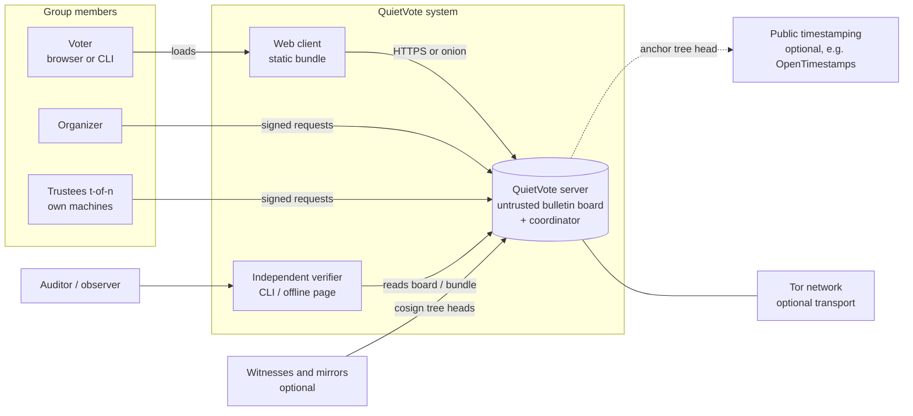
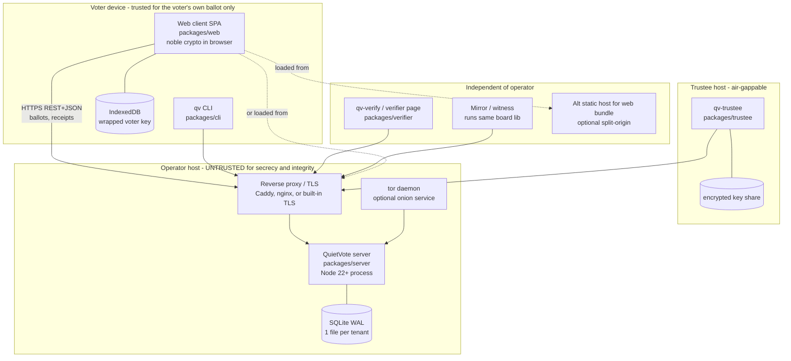
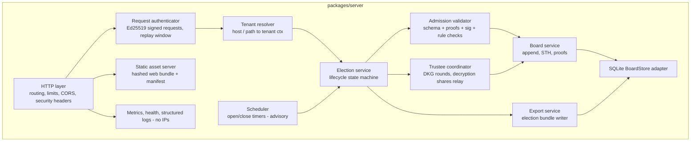
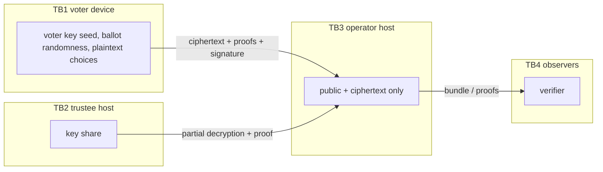

# QV-08 — Architecture and Deployment

**Module ID:** `platform-interfaces`  
**Status:** Draft  
**Owner:** Architecture lead (project owner until delegated)  
**Last reviewed:** 2026-10-21  
**Related specs:** QV-01, QV-04, QV-05, QV-06, QV-07, QV-09, QV-11, QV-12, QV-16 (crypto protocol, written concurrently), QV-19 (client supply chain), QV-27 (governance/release), QV-30 (engineering standards); ADR-002, 003, 004, 005, 007, 008, 009, 010, 013

## 1. Objective

Define the system boundaries, monorepo package structure, public package interfaces, dependency rules, deployment models, tenant isolation, failure behaviour, capacity targets and backup design for QuietVote's MVP, so that implementation can start in parallel across packages without violating the trust model (ADR-001, ADR-008).

The governing architectural idea: **the server is an untrusted bulletin board and coordinator**. Everything the server stores is public or ciphertext. All integrity-relevant claims are checkable by an independent verifier from an exported bundle. Anything that needs secrecy (voter keys, trustee shares, ballot randomness) never reaches the server.

## 2. Scope

### In scope
- C4 context, container and component views (Mermaid), trust boundaries and data flows.
- Monorepo layout, per-package responsibility, dependency rules, public interfaces.
- Deployment models: single binary, Docker, systemd, Tor onion service, split-origin client, hosted multi-tenant.
- Tenant isolation, failure modes, capacity targets and sizing, backup/restore/export.

### Out of scope
- Byte-level protocol, proof formats and message encodings (QV-16, QV-09).
- Web client internals, browser key storage, supply chain (QV-19). CI and coding standards (QV-30). Release governance (QV-27).
- P2P/federated operation (deferred, ADR-002; "QV-32" research track).
- Day-2 operations runbooks (QV-12), though this spec supplies the inputs.

## 3. Actors and user journeys

| Actor | Goal | Preconditions | Main outcome |
|---|---|---|---|
| Organizer | Create election, publish manifest, open/close, publish result | Organizer signing key; server reachable | Signed manifest and lifecycle events on the board |
| Voter | Register key, audit, cast, check receipt | Invitation; browser or CLI | Ballot included in the board with inclusion proof |
| Trustee | Run DKG, hold key share, partial-decrypt | Trustee keypair; `packages/trustee` on own machine | Joint public key; verified partial decryptions |
| Operator | Run the server, back up, upgrade | Host; binary or image | Available board; cannot read or alter outcomes undetected |
| Auditor/Observer | Verify the election independently | Election bundle or board URL | Pass/fail report from `verifier` |
| Witness/Mirror | Cosign tree heads, mirror the log | Public board URL | Split-view detection |
| Maintainer | Build and release | Signing keys, CI | Signed reproducible release (QV-19, QV-27) |

## 4. Architecture views

C4 diagrams below use Mermaid `flowchart` (the native `C4*` diagram types are still marked experimental in Mermaid; flowchart renders reliably everywhere). Boundaries are drawn as subgraphs.

### 4.1 Level 1 — System context



External systems are all optional or replaceable: no identity provider, no chain, no analytics, no CDN (ADR-009, ADR-012).

### 4.2 Level 2 — Containers



### 4.3 Level 3 — Server components



Component responsibilities:

| Component | Responsibility | Never does |
|---|---|---|
| Admission validator | Rejects malformed/invalid artifacts early (availability hygiene). Re-uses `protocol` verification functions. | Is not the source of truth: verifiers re-check everything. |
| Board service | Single-writer append, assigns sequence numbers, builds RFC 9162 Merkle tree, signs tree heads (STH) with the board key, serves inclusion/consistency proofs. | Edits or deletes entries. |
| Trustee coordinator | Relays DKG round messages and partial decryptions as board entries. | Holds any share or key. |
| Scheduler | Fires open/close per manifest times; times are advisory, closing is a signed board event whose timestamp is evidence, not a trust anchor. | Is not trusted for time (see QV-08-REQ-017). |
| Export service | Streams a self-verifying bundle. | Redacts silently. |

### 4.4 Trust boundaries and data flows



| Flow | Crosses | Data | Protection |
|---|---|---|---|
| F1 ballot submission | TB1 to TB3 | Encrypted selections, ZK proofs, voter signature | TLS/Tor; secrecy by encryption to joint key; integrity by signature+proofs |
| F2 receipt | TB3 to TB1 | Board index, STH, inclusion proof | Signed STH; voter verifies against a later consistency check |
| F3 DKG / decryption | TB2 to TB3 | Public commitments, encrypted share transport, partial decryptions with proofs | Pairwise-encrypted shares (QV-16); all public values proof-checked |
| F4 verification | TB3 to TB4 | Everything on the board | Merkle proofs, signatures, witnesses |
| F5 web client delivery | TB3 (or other host) to TB1 | JS bundle | QV-19 (residual risk R-WEB per ADR-010) |

Nothing marked secret in QV-06/QV-07 crosses TB1 or TB2 outward.

## 5. Monorepo package layout and dependency rules

npm workspaces (ADR-003). Tooling versions checked 2026-10-21 via `npm view` / nodejs.org: `@noble/curves` 2.4.0, `@noble/hashes` 2.4.0 (includes Argon2id), `esbuild` 0.28.2, TypeScript 7.0.2, Node 22.23.3 "Jod" (maintenance LTS) and 24.22.0 "Krypton" (active LTS), `@cyclonedx/cyclonedx-npm` 6.0.1. Exact versions are pinned in the lockfile, not here; this table is a snapshot (QV-30 governs bumping).

```
quietvote/
  packages/
    crypto/    L0  group, scalars, hashing, ElGamal, proofs, Shamir/DKG, signatures, KDF
    protocol/  L1  message schemas, canonical encoding, manifest, ballot build/verify, tally, state machine
    board/     L2  Merkle log, STH, proofs, BoardStore interface, log-client verification
    server/    L3  HTTP service, SQLite adapter, tenants, scheduler, static assets
    web/       L3  browser client
    cli/       L3  voter + organizer CLI (`qv`)
    trustee/   L3  trustee tool (`qv-trustee`)
    verifier/  L3  independent verifier (`qv-verify`) and offline verifier page
  docs/ scripts/ test-vectors/ .github/
```

### 5.1 Dependency rules (enforced mechanically)

| # | Rule |
|---|---|
| D1 | Imports flow strictly downward: `crypto` < `protocol` < `board` < {`server`,`web`,`cli`,`trustee`,`verifier`}. No cycles; L3 packages never import each other. |
| D2 | `crypto` runtime deps: only `@noble/curves`, `@noble/hashes` (ADR-003). No Node built-ins except via an injected `randomBytes` source (`globalThis.crypto.getRandomValues`). Works unchanged in browser and Node. |
| D3 | `protocol` and `board` (core) are pure: no I/O, no clock, no randomness except via injected `Rng`/`Clock` parameters. All persistence goes through the `BoardStore` interface. |
| D4 | Only `server` may import `node:sqlite`, `node:http(s)`, `node:fs`. Only `web` may reference DOM/IndexedDB/WebCrypto-storage. Lint rules `no-restricted-imports` per package. |
| D5 | `verifier` imports only the `verify` entry points (`@quietvote/protocol/verify`, `@quietvote/board/verify`, `@quietvote/crypto`) and never `server`, `web`, `cli`, `trustee`. Its production dependency closure is limited to `@noble/*`. Rationale: the verifier is the independence guarantee (ADR-001 principle 1). |
| D6 | Each package exposes one public entry (`exports` map); deep imports are blocked. Internals are not semver-covered. |
| D7 | No package depends on a third-party runtime library other than `@noble/*` without an ADR (QV-30-REQ-021, QV-19 §10). |
| D8 | Secrets types (`SecretScalar`, `SeedBytes`) are defined in `crypto` and must not be serialisable by default (no `toJSON`; see QV-30 §6). |

Enforcement: `dependency-cruiser` config (dev-only) plus an in-repo script `scripts/check-deps.mjs` that parses every `package.json` and fails CI on violations of D1, D2, D5, D7 (QV-30 CI job `deps-boundaries`).

### 5.2 Public interfaces (illustrative TypeScript; authoritative signatures in generated API docs)

```ts
// @quietvote/crypto
export interface Rng { bytes(n: number): Uint8Array }
export const ristretto: { G: Point; order: bigint; /* add, mul, encode, decode (canonical, reject non-canonical) */ };
export function hashToScalar(domain: string, ...parts: Uint8Array[]): Scalar;       // length-prefixed (ADR-004)
export function elgamalEncrypt(pk: Point, m: 0n|1n, rng: Rng): { ct: Ciphertext; r: Scalar };
export function proveBit(stmt: BitStatement, wit: BitWitness, rng: Rng): DisjunctiveProof;
export function verifyBit(stmt: BitStatement, p: DisjunctiveProof): boolean;
export function proveDecryption(...): CPProof;  export function verifyDecryption(...): boolean;
export function shamirSplit / feldmanVerify / lagrange(...);
export const ed25519: { sign; verify; keygen(rng) };
export function argon2id(pass: Uint8Array, salt: Uint8Array, p: Argon2Params): Uint8Array;

// @quietvote/protocol
export function buildBallot(m: Manifest, voter: VoterKey, sel: Selection, rng: Rng): { ballot: Ballot; audit: AuditData };
export function verifyBallot(m: Manifest, b: Ballot): Result<void, ProtocolError>;
export function tally(m: Manifest, ballots: readonly Ballot[]): EncryptedTally;
export function verifyElection(bundle: ElectionBundle): VerificationReport;      // pure
export function nextState(s: ElectionState, ev: ElectionEvent, now: number): Result<ElectionState, ProtocolError>;

// @quietvote/board
export interface BoardStore {                      // implemented by server (SQLite), tests (memory), verifier (in-memory)
  append(batch: Entry[]): Promise<{ firstSeq: number; size: number }>;   // atomic, durable on resolve
  get(seq: number): Promise<Entry | undefined>;
  range(from: number, to: number): AsyncIterable<Entry>;
  hashes(level: number, from: number, to: number): Promise<Uint8Array[]>; // Merkle node cache
  latestSth(): Promise<SignedTreeHead | undefined>;  putSth(s: SignedTreeHead): Promise<void>;
}
export class MerkleLog { constructor(store: BoardStore, signer: Signer); append(...); inclusionProof(seq, size); consistencyProof(a, b); }
export function verifyInclusion / verifyConsistency / verifySth(...): boolean;
export class LogMonitor { /* client: tracks STHs, detects split view, checks witness cosignatures */ }
```

HTTP/JSON contracts are QV-09; types above are normative only for package boundaries.

## 6. Deployment models

### 6.1 Decision

| Model | Decision |
|---|---|
| Organization self-hosted (single binary / Docker / systemd) | **First supported** (ADR-002). |
| Tor onion service | **First-class**, supported as a sidecar to any self-hosted model (ADR-009). |
| Split-origin client (web bundle hosted separately from board) | **Supported** as the strongest web-delivery posture (QV-19 §3). |
| Maintainer-hosted multi-tenant | **Later** (post-MVP), same code, operator untrusted. |
| Federated / P2P | **Deferred** (ADR-002). Mirrors and witnesses provide read-side redundancy only. |

Self-hosting or Tor does not by itself give anonymity or correctness (README principle 5); it moves the availability trust base.

### 6.2 Single binary

Node.js Single Executable Application (SEA): server code, web bundle, migrations and verifier page embedded as assets; `node:sqlite` built in. Artifacts: `quietvote-<ver>-linux-x64`, `-linux-arm64`, `-darwin-arm64`, `-win-x64`. The embedded Node binary is the unmodified official release, SHA-256 verified against `SHASUMS256.txt` at build time. Usage: `quietvote serve --data /var/lib/quietvote --listen 127.0.0.1:8443`. Zero config required: data directory is created with mode 0700; a board signing key is generated on first run (Ed25519, stored 0600; losing it is recoverable — see §8.4).

### 6.3 Docker

- Base: pinned-by-digest distroless/`node:22-slim` build stage; final image runs as UID 65532, read-only root filesystem, `--cap-drop=ALL`, `no-new-privileges`, tmpfs `/tmp`, volume `/data`.
- Image contains exactly the SEA binary (or `dist/` plus Node); no shell in the final stage; labelled with git commit and release manifest digest; signed with cosign (QV-19).
- Healthcheck: `GET /healthz` (process) and `/readyz` (DB writable, clock sane).
- Reference `compose.yaml` ships `quietvote` + `caddy` (automatic ACME) + optional `tor`.

### 6.4 systemd

Reference unit `quietvote.service`:

```ini
[Service]
ExecStart=/usr/local/bin/quietvote serve --config /etc/quietvote/config.toml
DynamicUser=yes
StateDirectory=quietvote
StateDirectoryMode=0700
ProtectSystem=strict
ProtectHome=yes
PrivateTmp=yes
PrivateDevices=yes
NoNewPrivileges=yes
CapabilityBoundingSet=
RestrictAddressFamilies=AF_INET AF_INET6 AF_UNIX
SystemCallFilter=@system-service
MemoryDenyWriteExecute=no   # V8 JIT requires W+X
LimitNOFILE=8192
Restart=on-failure
RestartSec=2s
TimeoutStopSec=30s
```

Graceful shutdown: on SIGTERM stop accepting, flush the append queue, write a final STH, close SQLite (`PRAGMA wal_checkpoint(TRUNCATE)`), exit 0 within 30 s. `ExecReload` unsupported in MVP (restart is fast).

### 6.5 Tor onion service

- `tor` runs as a separate process/container; `HiddenServiceDir` with v3 service; forwards onion port 80 to the server's Unix socket or 127.0.0.1 port. The server never sees client addresses either way.
- Onion identity key is operator-owned; the manifest MAY list `board_urls` (clearnet + onion). Clearnet responses carry `Onion-Location`.
- Browser secure-context behaviour of `http://*.onion` (needed for WebCrypto/IndexedDB use) differs by browser; Tor Browser/Firefox treat onion as secure `[UNVERIFIED — test matrix in QV-11 must confirm per browser]`. Where unavailable, the CLI is the supported path.
- Tor does not hide that a key signed a ballot (Phase 1 participation is public), only network metadata (ADR-008).
- Optional vanguards/PoW-defence config for DoS resistance is documented in QV-12.

### 6.6 Reverse proxy and TLS

Server speaks plain HTTP on loopback/Unix socket by default; built-in TLS (`node:tls`, cert/key files, reload on SIGHUP is out of scope) is supported for single-binary users. ACME automation is delegated to Caddy or similar to avoid a dependency. HSTS and the security header set (QV-19 §8) are emitted by the server itself so they hold behind any proxy.

### 6.7 Hosted multi-tenant (post-MVP)

Same binary with `--multi-tenant`. Tenant = organization, addressed by hostname (`<org>.example`) or path prefix. See §7.

### 6.8 Minimum targets

| Item | Minimum | Recommended |
|---|---|---|
| Server host | 1 vCPU, 512 MiB RAM, 2 GiB disk, Linux x64/arm64 (Raspberry Pi 4 OK), also macOS/Windows for dev | 2 vCPU, 2 GiB, SSD |
| Node (non-SEA) | `>=22.13` (`node:sqlite` unflagged) | 24 LTS |
| Browsers | Evergreen Chrome/Edge >= 137, Firefox >= 129, Safari >= 17 `[UNVERIFIED: confirm WebCrypto Ed25519 floor in QV-19 test matrix]`; older browsers use a pure-noble fallback path | |
| Offline participation | Not required for voting; **required** for verification (offline verifier page, trustee air-gap) | |

## 7. Tenant isolation and authorization

Design premise: server-held data is public or ciphertext, so isolation is about **write authorization, integrity of per-tenant logs, availability fairness and metadata**, not secrecy of ballots. In Phase 1 the roll and participation are public to those with board access, so tenant separation also limits who can enumerate them (election read access can be public, token-gated, or unlisted per manifest).

| Layer | Control |
|---|---|
| Storage | One SQLite database file per tenant (`/data/tenants/<tenant-id>/board.sqlite`), directory mode 0700; one Merkle log per election inside it. No cross-tenant SQL path exists. |
| Process | Default: one process, per-tenant connection objects. High-assurance option: one process per tenant (systemd template unit `quietvote@.service` or one container each) fronted by the proxy. |
| Keys | Per-tenant board signing key (Ed25519). Compromise of one tenant's key never affects another. |
| Authorization | No passwords or sessions. Organizer/trustee actions are **signed requests**: `Authorization: QV-Sig keyid=…,ts=…,nonce=…,sig=…` over `method \|\| path \|\| body-hash \|\| ts \|\| nonce`; ±120 s window; nonce replay cache. Role membership derives from keys committed in the manifest (QV-04, QV-09). Voters authenticate by ballot signature, not by session. |
| Quotas | Per-tenant: max elections, voters/election (default 10,000, hard cap 100,000), request rate, storage (default 5 GiB), enforced before DB access. |
| Rate limiting | In-memory token bucket per tenant and per coarse client bucket (the proxy supplies a salted-hash-of-IP bucket id; raw IPs never reach the app or logs). |
| Logging | Structured logs with tenant id, route, status, latency. No IPs, no ballot content, no keys. |

## 8. Failure modes, capacity, sizing, backup

### 8.1 Failure modes

| ID | Failure | Detection | Behaviour / mitigation | Integrity impact |
|---|---|---|---|---|
| FM1 | Server crash during append | Restart; SQLite WAL recovery | Append is one transaction (entry + tree nodes + seq). Client got no receipt, retries idempotently (entry hash is the idempotency key). | None |
| FM2 | Disk full | `readyz` fails; pre-emptive threshold at 90% | Reject writes with `503 STORAGE_FULL`; reads continue; alert. | None |
| FM3 | Disk corruption / lost DB | Startup integrity check (`PRAGMA integrity_check` nightly; Merkle root recompute on boot) | Refuse to start serving; restore from backup (§8.4). | Detectable |
| FM4 | Restore to older state ("rollback") | Voters/mirrors hold later STHs; consistency check fails | Appears as a log fork; ballots lost are detectable by receipt holders who re-submit (revoting makes this safe pre-close). Operator must disclose. | Detected, not prevented |
| FM5 | Malicious operator drops/reorders/forks | Inclusion/consistency checks; witnesses/mirrors | Evidence is cryptographic and transferable. | Detected |
| FM6 | Split view (different STH to different clients) | Gossip: web client and CLI exchange latest STH with mirrors; witness cosigs | Alarm in verifier; election flagged. | Detected if any honest cross-check exists |
| FM7 | Trustee unavailable | Missing partial decryption at deadline | Any t of n suffice; below t the tally cannot be decrypted. Manifest declares `t`, `n`; recommended `t = floor(n/2)+1`. Organizer may extend the decryption window by signed event. | Availability only |
| FM8 | Trustee compromise (< t) | — | No secrecy loss (ADR-008). Rotate for future elections. | None |
| FM9 | Clock skew on server | `readyz` NTP check (compare to 2+ peers or `timedatectl`) | Server refuses to enforce window edges if skew > 5 s and flags in STH extension; closing is an explicit signed event, not inferred. | Time is evidence only |
| FM10 | Board signing key lost | Startup | Generate successor; cross-sign with a rotation entry only if old key available; otherwise election is re-anchored by organizer-signed `board.key.rotate` (manifest allows an organizer recovery path). | Visible in log |
| FM11 | Web asset tampering | QV-19 | Release-manifest verification; split-origin; CLI | Residual risk R-WEB |
| FM12 | DoS / ballot flood | Rate limits, quota | Only ballots signed by roll keys are admitted (cheap Ed25519 check precedes proof verification); unauthenticated request cost bounded. | None |
| FM13 | Tor service down | Operator monitor | Clearnet fallback listed in manifest; election window extension by organizer-signed event. | None |
| FM14 | Worker/OOM during proof verification | Process limits | Bounded request body (64 KiB ballot), bounded concurrency (workers = vCPU), 429 under load. | None |

### 8.2 Capacity targets

Reference election: 10,000 voters, one contest with 5 options (single-choice, per-selection encryption), 24-hour window, no more than 2 ballots per voter on average (revoting).

Size model (ristretto255 points and scalars are 32 B): ciphertext = 64 B; per-selection disjunctive bit proof (2 branches × (2 commitments + challenge + response)) ≈ 224 B; sum/limit proof ≈ 160 B; Ed25519 signature 64 B; envelope ≈ 200 B. Per ballot ≈ 5×(64+224) + 160 + 64 + 200 ≈ 1.9 KB binary, ≈ 2.6 KB base64-JSON. These are **design estimates** pending QV-16 byte formats.

| Metric | Target (S: 1k) | Target (M: 10k, reference) | Stretch (L: 100k) |
|---|---|---|---|
| Voters per election | 1,000 | **10,000** | 100,000 (single-process, best effort, requires worker pool) |
| Concurrent elections per instance (2 vCPU/2 GiB) | 200 | 20 | 2 |
| Ballot ingest sustained | 10/s | **25/s** (deadline rush: 10% of voters in 5 min = 3.3/s average; 7× headroom) | 100/s |
| Ballot admission latency (p95, server-side incl. proof verify and durable commit) | < 300 ms | **< 500 ms** | < 1 s |
| Server CPU per ballot (estimate, noble in Node) | ~15 ms (≈5 × 2 ms bit proofs + sum proof + signature) | same | same |
| Read: inclusion proof p95 | < 50 ms | < 50 ms | < 100 ms |
| Board entries per election (ballots + audits + events) | ~3k | ~30k | ~300k |
| Board storage (ballots + Merkle nodes + indexes) | ~10 MB | **~100 MB** | ~1 GB |
| Export bundle size | ~8 MB | **~80 MB** (gzip ~55 MB) | ~800 MB |
| Full independent verification, single thread, laptop | ~15 s | **< 5 min** (est. 3 min) | < 60 min; < 20 min with 4 workers |
| Web client: ballot construction (5 options, mid-range phone) | < 1.5 s | < 1.5 s | < 1.5 s |
| Web client bundle (gzip, voting path) | < 120 KB | < 120 KB | < 120 KB |
| Tally decryption (trustee side, 5 selections) | < 1 s | < 1 s | < 1 s (aggregate is constant-size; verification of ballots dominates) |
| STH cadence | batch every <= 1 s under load, at least every 60 s | same | same |
| Availability target (self-hosted, per election window) | best effort | 99.5% over window | best effort |
| RPO / RTO | <= 15 min / <= 1 h | <= 5 min / <= 1 h | <= 5 min / <= 4 h |

Per-ballot timings are derived from typical noble-curves throughput (order 10^3 scalar multiplications/s per core in JS; `[UNVERIFIED — must be replaced by benchmark results in QV-11 perf suite]`). Release-blocking: benchmark suite `bench/reference-10k` must meet the M column on CI reference hardware (QV-08-REQ-020).

### 8.3 Sizing guidance

| Deployment | Hardware | Notes |
|---|---|---|
| Club (≤ 500 voters) | Raspberry Pi 4 / 1 vCPU / 512 MiB | SEA binary + Caddy |
| Cooperative (≤ 10k voters) | 2 vCPU / 2 GiB / 20 GiB SSD | Reference |
| Federation (≤ 100k) | 4 vCPU / 8 GiB / 100 GiB NVMe; verification worker pool = vCPU | One election at a time recommended |
| Hosted multi-tenant | N× reference nodes sharded by tenant hash | Tenant never spans nodes |

Memory: Node heap default is adequate; ballot verification is streaming, so RSS stays < 300 MiB at M. SQLite settings: `journal_mode=WAL`, `synchronous=FULL` for the ballot DB (durability beats throughput; group commit batches appends within a 10 ms window, which sustains > 500 appends/s on SSD), `busy_timeout=5000`, `foreign_keys=ON`. One writer per tenant DB (in-process mutex).

### 8.4 Backup, restore, export

| Mechanism | What | Cadence | Notes |
|---|---|---|---|
| Hot backup | SQLite backup API / `VACUUM INTO` to timestamped file, then `integrity_check` | Every 5 min during open windows, hourly otherwise | Copy off-host; encrypted at rest with `age`-style tooling (operator choice). Content is not secret, but encryption protects roll metadata. |
| Election bundle export | Self-verifying archive (JSONL entries, STHs, manifest, witness cosigs, checksums) | On close, on result, on demand | Importable into another server (`quietvote import`), verifiable by `qv-verify`. Format in QV-09. |
| Mirror | `qv mirror <url>` continuously pulls and verifies the board | Continuous | Doubles as backup and split-view detector. |
| Restore | Restore file, start; server verifies Merkle root, recomputes tree, compares with last known STH (if provided via `--expect-sth`) | On demand | Restoration of an older state is disclosed as a fork (FM4); never silently continue. |
| Key backup | Board signing key and organizer keys | At creation | Operator responsibility; never include trustee shares. |
| Exit | Export + import on another host; manifest `board_urls` updated by organizer-signed event | Anytime | Meets ADR-001 principle 4. |

Retention/deletion obligations (QV-06) apply to the operator's copy; the public board is append-only by design, so personal data must never be placed on it (QV-06).

## 9. Requirements

| ID | Requirement | Priority | Acceptance criteria | Verification |
|---|---|---|---|---|
| QV-08-REQ-001 | The repository shall contain exactly the eight packages `crypto, protocol, board, server, web, cli, trustee, verifier` under `packages/` with the layering in §5. | Must | `scripts/check-deps.mjs` passes; layout test lists these packages. | CI |
| QV-08-REQ-002 | Package imports shall follow rules D1–D8; violations shall fail CI. | Must | Introducing a `server` import into `verifier` fails the `deps-boundaries` job. | CI negative test |
| QV-08-REQ-003 | `packages/crypto` shall depend at runtime only on `@noble/curves` and `@noble/hashes` and shall run unmodified in Node and browsers. | Must | `npm ls --omit=dev --workspace crypto` lists only those; test suite passes under Node and headless browser. | CI |
| QV-08-REQ-004 | `protocol` and `board` core shall be deterministic and I/O-free: time, randomness, and storage are injected. | Must | Property test: same inputs and injected RNG yield byte-identical outputs; lint forbids `Date.now`, `Math.random`, `node:*` imports. | Lint, unit |
| QV-08-REQ-005 | The server shall treat itself as untrusted: it shall store no value whose disclosure breaks secrecy (voter seeds, ballot randomness unless voluntarily published as an audit, trustee shares, plaintext choices). | Must | Static data-classification test over the DB schema; fuzzed integration run asserts no secret test-markers appear in DB, logs, or responses. | Test, review |
| QV-08-REQ-006 | The board shall be append-only; there shall be no code path or API to update or delete an entry. | Must | Schema has no UPDATE/DELETE triggers permitted; DB trigger test raises on attempt; API has no mutating verbs on entries. | Test |
| QV-08-REQ-007 | The board shall implement an RFC 9162-style Merkle tree and issue signed tree heads, inclusion proofs and consistency proofs. | Must | Interop test vectors from RFC 9162 pass; proofs verify in `verifier`. | Unit, vectors |
| QV-08-REQ-008 | Every accepted ballot shall return a receipt (seq, entry hash, STH, inclusion proof) before the HTTP response completes, and the entry shall be durable (fsync) first. | Must | Kill -9 test: no receipt issued for an entry lost after restart (10,000 trials). | Fault-injection test |
| QV-08-REQ-009 | Appends shall be idempotent on entry hash. | Must | Replaying a request returns the original receipt, size unchanged. | Integration |
| QV-08-REQ-010 | `qv-verify` shall verify a complete election from an export bundle with no network access and no import of server/web/cli/trustee code. | Must | Runs with network namespace disabled; dependency closure test. | CI |
| QV-08-REQ-011 | The system shall provide a self-verifying export bundle and an import function enabling migration to a new host without loss of verifiability. | Must | Export on A, import on B, `qv-verify` passes on both and roots match. | E2E |
| QV-08-REQ-012 | Distribution shall include a single-binary build for linux-x64, linux-arm64, darwin-arm64, win-x64, and an OCI image for linux-x64/arm64. | Must | Release job produces all, smoke test `serve`+`healthz` on each target in CI. | CI |
| QV-08-REQ-013 | The OCI image shall run as non-root with read-only root filesystem and no shell. | Should | `docker run --read-only --cap-drop=ALL` smoke test passes; image scan shows no shell binary. | CI |
| QV-08-REQ-014 | A hardened reference systemd unit shall ship and be validated. | Should | `systemd-analyze security` exposure score <= 2.5 (target "OK") in CI container job `[UNVERIFIED: tool availability in CI]`. | CI |
| QV-08-REQ-015 | The server shall support an onion-service deployment in which it binds only loopback/Unix socket and records no peer addresses. | Must | Packet-capture integration test; log grep for IP patterns returns zero. | Integration |
| QV-08-REQ-016 | The server shall not load any third-party resource, emit any outbound request except configured (witness, timestamp anchor, webhook), and shall serve all assets from its own origin or the declared split origin. | Must | Egress-deny integration test passes with default config; CSP test (QV-19). | E2E |
| QV-08-REQ-017 | Server time shall be treated as evidence, not authority: open/close are signed events, and verifiers shall report event times and manifest windows without treating them as proofs. | Must | Verifier output lists time claims distinctly; server with skewed clock refuses edge enforcement. | Test |
| QV-08-REQ-018 | Tenant data shall be stored in separate database files and directories with mode 0700; there shall be no shared tables across tenants. | Must | Test attempts cross-tenant read via path traversal and ID guessing; both fail. | Security test |
| QV-08-REQ-019 | Organizer and trustee API calls shall be authenticated by signed requests with replay protection (±120 s, nonce cache) and no password or cookie sessions. | Must | Replay, stale ts and wrong-key tests rejected with `AUTH_*` codes. | Unit, fuzz |
| QV-08-REQ-020 | The M-tier capacity targets in §8.2 shall be demonstrated by an automated benchmark on defined reference hardware, and regression > 20% shall block release. | Must | `bench/reference-10k` report archived per release. | CI nightly, release gate |
| QV-08-REQ-021 | Request bodies shall be bounded (ballot <= 64 KiB; others <= 1 MiB) and proof verification concurrency bounded by CPU count. | Must | Oversize requests return 413; load test shows bounded RSS. | Load test |
| QV-08-REQ-022 | The server shall perform the cheap signature/roll-membership check before proof verification. | Must | Profiling test: unsigned flood of 10k requests consumes < 10% of the CPU of the same count of valid ballots. | Perf test |
| QV-08-REQ-023 | The server shall verify database integrity and recompute the Merkle root on boot and refuse to serve on mismatch. | Must | Corrupt-file test blocks startup with `E_BOARD_INTEGRITY`. | Fault test |
| QV-08-REQ-024 | Graceful shutdown shall flush pending appends, publish a final STH, and exit within 30 s. | Should | SIGTERM during load loses no acknowledged entry. | Integration |
| QV-08-REQ-025 | A mirror/monitor mode (`qv mirror`) shall verify consistency between successive STHs and exchange STHs with other monitors. | Should | Fork injected on a test board is detected within one poll interval. | Integration |
| QV-08-REQ-026 | The web client and CLI shall persist the latest STH seen per election and verify consistency on each new fetch. | Must | Rollback test triggers a visible fork alert. | E2E |
| QV-08-REQ-027 | The server shall support optional witness cosigning (`witness_urls` config), without making availability depend on witnesses. | Should | Witness down: appends continue; STH marked "uncosigned". | Integration |
| QV-08-REQ-028 | Logs shall omit IP addresses, ballot payloads, keys, and request bodies by default. | Must | Log-scan test over E2E suite. | Test |
| QV-08-REQ-029 | Every release shall ship a configuration reference with safe defaults (loopback bind, quotas, rate limits) and a startup warning for unsafe overrides (public bind without TLS). | Should | Start with unsafe config produces `WARN_UNSAFE_*`. | Test |
| QV-08-REQ-030 | Backups shall be producible online without stopping the server, and restore shall refuse silent regression relative to a supplied expected STH. | Must | Backup during load passes `integrity_check`; restore with older state exits non-zero unless `--accept-rollback` and logs a `board.rollback` notice. | Integration |
| QV-08-REQ-031 | Schema migrations shall be forward-only, transactional, preceded by an automatic pre-migration backup, and recorded in `schema_migrations`. | Must | Migration test from each prior released schema. | Test |
| QV-08-REQ-032 | The server shall expose `/healthz`, `/readyz`, and Prometheus-format `/metrics` (loopback or token-protected) with no tenant-identifying labels beyond tenant id. | Should | Endpoint tests. | Test |
| QV-08-REQ-033 | The system shall run with `--max-old-space-size` defaults compatible with a 512 MiB host for tier S. | Could | Soak test on 512 MiB container. | Soak |
| QV-08-REQ-034 | Split-origin operation shall be supported: the board server shall serve CORS only to origins on an operator allowlist and the web client shall accept a board URL from the signed manifest or invitation fragment. | Should | E2E with bundle hosted on different origin. | E2E |
| QV-08-REQ-035 | Supported Node versions shall be the two current LTS lines (now 22 and 24); CI shall run both. | Must | CI matrix. | CI |

## 10. Data and privacy

- **Data inputs:** signed manifest, voter public keys, ballots, audit (spoiled) ballots, DKG/decryption messages, witness cosignatures.
- **Data outputs:** board entries, STHs, proofs, export bundles, metrics.
- **Data controller/operator:** the self-hosting group; in hosted mode the maintainer is a processor of public data only.
- **Retention and deletion:** the board is append-only for the election's life. After the audit window the group may archive and delete the operator copy; personal data must not be on the board (QV-06). Logs: 14 days default, no IPs.
- **Linkability risks:** Phase 1 reveals which roll keys voted and when (ADR-005, ADR-008). Timestamps on entries are coarse (second precision, optionally rounded to the minute per manifest) to limit timing correlation with outside observations.
- **Visibility:** voter sees own ballot plaintext only on own device; organizer sees roll and participation; operator sees ciphertexts and network-layer metadata (unless Tor); observer sees the entire board.
- **Claimed:** server cannot learn choices (given < t trustees colluding and honest client code); server cannot undetectably alter or drop included ballots.
- **Not claimed:** receipt-freeness, anonymous participation, protection from compromised devices or from malicious web code delivered by the operator (R-WEB), long-term secrecy, availability.

## 11. Security and abuse cases

| Case | Attacker/cause | Impact | Mitigation | Residual risk |
|---|---|---|---|---|
| Operator serves modified client | Malicious operator | Choice leakage/forged ballot | QV-19: split-origin, reproducible builds, signed manifest, Benaloh audit, CLI | Voter who never verifies stays exposed |
| Operator omits ballots | Malicious operator | Lost votes | Receipt + consistency checks, mirrors | Voters who do not check |
| Ballot flood | Outsider | DoS | Roll-signed admission, quotas, bounded verification | Availability only |
| Cross-tenant access | Bug | Metadata leak | Separate DB files, path canonicalisation, tests | Shared-process memory bugs; use per-tenant processes for high assurance |
| Backup theft | Thief | Roll metadata exposure | Encrypted backups | Operator hygiene |
| Server key theft | Intruder | Forge STHs for that board | Witnesses/mirrors detect equivocation; key rotation | Window until detected |
| Timing side-channel in server proof verification | Remote | None for secrecy (verification uses public data) | — | None |
| Supply-chain compromise of server binary | Upstream | Total for that operator | QV-19 verification; verifier is independent | Operator must verify |

## 12. Open questions

| Question | Owner | Target review | Resolution / proposed default |
|---|---|---|---|
| Is Node 22 or 24 the primary development line? | Architecture lead | Before 1.0 | Develop on 24 LTS, keep 22 supported until its EOL (2027-04 per Node schedule `[UNVERIFIED]`); see QV-ADR-P08-1. |
| `node:sqlite` stability (Node docs mark it release-candidate/experimental depending on version) | Architecture lead | M1 | Wrap behind `BoardStore`; contingency adapter on `better-sqlite3` is **not** pre-approved (ADR-003 minimal deps). Reassess at each LTS. |
| Time zone display of windows | UX (QV-10) | M2 | Manifest stores UTC instants plus IANA zone label; client shows both. |
| Seed nodes | — | — | None. No seed nodes exist or are required (no federation in MVP). |
| Which witness protocol (C2SP tlog-witness / checkpoint format) | Crypto lead with QV-16 author | M2 | Adopt C2SP signed-note checkpoint format if compatible with RFC 9162 trees `[UNVERIFIED]`. |
| Minimum browser matrix | QV-13/QV-19 | M2 | Table in §6.8 pending test results. |

## 13. Proposed ADRs

- **QV-ADR-P08-1 — Node baseline moves to 24 LTS.** ADR-003 names Node 22; Node 24 is now active LTS and 22 is in maintenance. Proposal: `engines: ">=22.13"`, CI on 22 and 24, SEA built on 24, switch minimum to 24 once 22 reaches EOL.
- **QV-ADR-P08-2 — Split-origin client as a supported posture** (§6, QV-19): client bundle may be hosted independently of the board.
- **QV-ADR-P08-3 — Per-tenant SQLite file isolation** with optional per-tenant processes.
- **QV-ADR-P08-4 — Signed-request authentication, no sessions** for organizer/trustee APIs.

## 14. References (accessed 2026-10-21)

- RFC 9162, Certificate Transparency v2.0 — https://www.rfc-editor.org/rfc/rfc9162 (cited from memory; fetch blocked in authoring environment `[UNVERIFIED access]`).
- Node.js release data — https://nodejs.org/dist/index.json (v22.23.3 "Jod", v24.22.0 "Krypton", v26.12.0 current).
- npm registry (`npm view`): `@noble/curves` 2.4.0, `@noble/hashes` 2.4.0 (exports `./argon2.js`), `esbuild` 0.28.2, `typescript` 7.0.2, `@cyclonedx/cyclonedx-npm` 6.0.1.
- Node.js Single Executable Applications — https://nodejs.org/api/single-executable-applications.html `[UNVERIFIED access]`.
- Tor Project, Onion Services — https://community.torproject.org/onion-services/ `[UNVERIFIED access]`.
- C2SP tlog-witness / tlog-checkpoint — https://c2sp.org `[UNVERIFIED access]`.

## 15. Approval and change history

| Reviewer | Decision | Date | Notes |
|---|---|---|---|
| Project owner | Pending | — | Draft authored 2026-10-21 |
