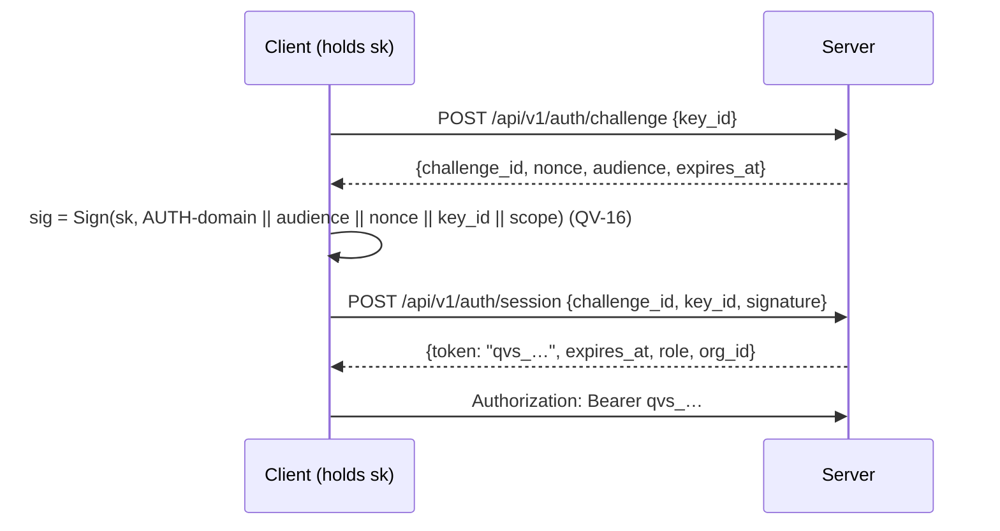

# QV-09 — HTTP API and Data Contracts

**Module ID:** `platform-interfaces`
**Status:** Draft
**Owner:** Backend lead (proposed)
**Last reviewed:** 2026-10-21
**Related specs:** QV-ADR-001, 002, 003, 005, 007, 009, 010 · QV-16 (crypto objects — symbolic) · QV-17 (trustee ceremony) · QV-18 (log, proofs, witnesses) · QV-28 (storage, privacy classes) · QV-04 · QV-05 · QV-07 · QV-08 · QV-10 · QV-12

This document supersedes the framework version of QV-09. All byte-level encodings of keys, ciphertexts, proofs and signatures are **opaque `bytes` fields** here; their canonical encodings, domain-separation strings and verification are owned by QV-16. Log semantics are owned by QV-18; this spec defines the HTTP surface.

---

## 1. Objective

Define the complete, versioned HTTP API of a QuietVote server (untrusted coordinator + bulletin board, QV-ADR-002) used by the browser client, CLI verifier, trustee client, organizer tools, witnesses, mirrors and third-party observers. Design goals:

1. **Self-authenticating writes.** Anything that affects the election record is a signed log entry (QV-18) whose authorization is verifiable by anyone; HTTP-level authentication is a convenience, never a trust basis.
2. **Everything public is cacheable and mirror-able** with plain `GET`.
3. **Minimal metadata.** No cookies, no IP-based identity, no third-party calls, no tracking headers (QV-ADR-009).
4. **Boring and stable.** JSON over HTTP/1.1+, RFC 9457 errors, additive evolution.

## 2. Scope and actors

### In scope
Auth; organization/election management; voter registration and roll; trustee onboarding; log read/write, proofs, checkpoints, witnessing, gossip; event stream; export/import; admin/ops; error model; idempotency; versioning; pagination; rate limits; schemas and examples.

### Out of scope
Crypto encodings (QV-16); UI (QV-10); identity proofing beyond invite codes (QV-04); federation between servers (QV-32).

| Actor | Auth | Typical calls |
|---|---|---|
| Anonymous observer / mirror / verifier | none (or read key for `link` elections) | all `GET` under `/elections/{id}`, SSE, export |
| Voter | invite code once (registration); thereafter **entry signature** by voter key | `POST registrations`, `POST log/entries (ballot)`, proofs |
| Trustee | invite code once (redeem); thereafter **entry signature** | `POST …/redeem`, `POST log/entries (dkg_*, decryption_share…)` |
| Organizer | **session bearer** (Ed25519 challenge–response) for management; **entry signature** for log entries | org/election CRUD, invites, exports |
| Instance admin | session bearer, `instance_admin` role | `/admin/*` |
| Witness | none for `add-checkpoint` (it is the *server* calling witness); `POST log/cosignatures` is signature-verified | cosignature push |

## 3. Authentication and authorization

### 3.1 Principles
- **No cookies, no ambient credentials.** All credentials travel in `Authorization: Bearer …` or inside signed objects. CORS: public `GET`s allow `Access-Control-Allow-Origin: *` without credentials; authenticated endpoints allow only configured origins (the instance's own client origin).
- **Key-based identity.** Organizer, admin, voter and trustee identities are public keys (QV-16 signature suites, Ed25519 default). Key identifier `key_id = KeyId(pk)`.
- **No mandatory identity.** Account creation needs a key and (depending on instance policy) a registration token; no email, phone or name.

### 3.2 Organizer / admin session (challenge–response)


- `audience` = instance id + origin (prevents relay between instances). Challenge TTL 120 s, single use. Token: 256-bit random, TTL 12 h, stored only as SHA-256 (QV-28). `DELETE /auth/session` revokes. Failed attempts rate-limited per `key_id` and bucket.
- Registration of a new organization key uses the same flow with `purpose: "register"` and the public key supplied inline (proof of possession).

### 3.3 Voter
- **Registration** (`POST /elections/{id}/registrations`): body carries a one-time `invite_code` (128-bit; sent out-of-band by the organizer), the voter's new public key `pk`, and a proof-of-possession signature over `(election_id, pk)`. The code authorizes *only* registering one key.
- **Ballot casting and revoting**: `POST /elections/{id}/log/entries` with `type=ballot`; authorization = valid signature by a key in the roll committed by the `roll_commit` entry. No bearer is needed or accepted.
- Voters hold no server session. Anything a voter may read is public (Phase 1). Phase 2 (blind tokens, QV-ADR-005) changes the ballot author to a token key; same endpoint.

### 3.4 Trustee
- **Redeem** (`POST /elections/{id}/trustees/{trustee_id}/redeem`): invite code + `pk_sign`, `pk_xport` + PoP binds the keys to the slot (server records expected keys; the authoritative binding is the later `trustee_accept` entry).
- All ceremony/tally actions are signed log entries by `pk_sign`.

### 3.5 Observer
- `access=public` elections: no credentials.
- `access=link` elections: header `QV-Read-Key: <read_key>` (128-bit, distributed in the URL fragment so it never hits server logs or Referer; the client moves it to the header). Missing/invalid → `403 READ_KEY_REQUIRED`. `link` is *obscurity-grade access control, not secrecy*: anyone with the key (mirrors, witnesses) can republish the log.

### 3.6 Authorization matrix

| Endpoint class | anon | read key | voter (entry sig) | trustee (entry sig) | organizer (bearer) | org owner | admin |
|---|---|---|---|---|---|---|---|
| Instance info, release manifest | ✔ | | | | | | |
| Election public reads (`GET /elections/{id}/…`) | public: ✔ | link: ✔ | ✔ | ✔ | ✔ | ✔ | ✔ |
| Registration (with invite) | ✔ (code) | | | | | | |
| Log append | | | ballot, ballot_audit | ceremony/tally types | manifest, roll_commit, open, close, notice… | | |
| Invites, exports, election drafts | | | | | own org | own org | ✔ |
| Delete election, manage org keys | | | | | | ✔ | ✔ |
| `/admin/*` | | | | | | | ✔ |

Cross-org access is impossible: the session’s `org_id` must equal the election’s `org_id` (QV-28 registry).

## 4. Conventions

### 4.1 Base, media types, encodings
- Base path `/api/v1`; health endpoints `/healthz`, `/readyz` outside it. HTTPS only (QV-ADR-009); `.onion` deployments serve HTTP over Tor with the same paths.
- `Content-Type: application/json; charset=utf-8` unless stated. Signed checkpoints: `text/plain; charset=utf-8` (C2SP signed note). Export bundles: `application/x-tar`.
- **Bytes** → base64url without padding (`b64u`); except consistency/inclusion proof hashes, which use standard base64 to match tlog tooling (QV-18 §7.3). **Layering (QV-ADR-019):** these b64u rules apply to the API/transport layer only; protocol artifact bodies are QV-JSON per QV-16 §5.5 (fixed-length lower-case hex inside the body), and entry `header`/`body` are carried as their exact canonical bytes in b64u. **Integers** are JSON numbers ≤ 2^53−1; larger values as decimal strings. **Times** are RFC 3339 UTC (`2026-11-02T18:04:11Z`) in JSON; the log's own header uses unix seconds. **IDs** are 26-char lowercase base32.
- Request bodies ≤ 1.1 MiB (entries ≤ 1 MiB + framing). Unknown JSON members in requests → `400 UNKNOWN_FIELD` (strict, catches typos); members prefixed `x-` are ignored. **Responses may gain members**; clients ignore unknown members.
- Responses include `QV-API-Version: 1.0`, `X-Request-Id` (random, not derived from client data), `Cache-Control` per class (below), `X-Content-Type-Options: nosniff`.

### 4.2 Caching

| Resource | Cache-Control |
|---|---|
| `GET log/entries/{seq}`, `GET log/proof/inclusion` with explicit `tree_size`, `GET log/proof/consistency` | `public, max-age=31536000, immutable` |
| `GET log/checkpoint` (latest), `/state`, `/tally`, `/ceremony` | `no-cache` (ETag = tree size/root) |
| `GET log/entries?from&limit` for complete past range | `public, max-age=3600` |
| Everything authenticated | `no-store` |

### 4.3 Error model (RFC 9457)

All errors: `Content-Type: application/problem+json`.

```json
{
  "type": "urn:quietvote:problem:ENTRY_INVALID",
  "title": "Entry failed validation",
  "status": 422,
  "code": "ENTRY_INVALID",
  "detail": "Ballot proof for contest 'c1' does not verify.",
  "retryable": false,
  "request_id": "01hxk…",
  "reason": "BALLOT_PROOF_INVALID",
  "errors": [{"pointer": "/body", "message": "…"}]
}
```
- `code` is stable and machine-readable; `detail` is human text (English; localized by clients from `code`); `retryable` guides clients; `reason` carries a QV-16 failure code for `ENTRY_INVALID`; `errors` (optional) lists JSON Pointer validation failures. No stack traces; no echo of secrets or submitted ciphertexts.
- Rate-limit errors add `Retry-After` (seconds).

| HTTP | `code` | Meaning | Retryable |
|---|---|---|---|
| 400 | `BAD_REQUEST`, `MALFORMED_ENTRY`, `UNKNOWN_FIELD`, `INVALID_CURSOR` | syntax/shape | no |
| 401 | `UNAUTHENTICATED`, `SESSION_EXPIRED`, `CHALLENGE_EXPIRED`, `BAD_SIGNATURE` | credentials | after re-auth |
| 403 | `FORBIDDEN`, `AUTHOR_NOT_AUTHORIZED`, `READ_KEY_REQUIRED`, `REGISTRATION_CLOSED` | not permitted | no |
| 404 | `NOT_FOUND` | no such resource (also for cross-org probes) | no |
| 409 | `WRONG_PHASE`, `NONCE_REUSE`, `INVITE_USED`, `STATE_CONFLICT`, `WITNESS_QUORUM_REQUIRED`, `IDEMPOTENCY_IN_PROGRESS` | conflict with current state | sometimes (`IDEMPOTENCY_IN_PROGRESS`, `WITNESS_QUORUM_REQUIRED` after delay) |
| 410 | `EVENT_GONE`, `ELECTION_DELETED` | permanently gone | no |
| 413 | `ENTRY_TOO_LARGE` | exceeds per-type limit (QV-18 §5.2) | no |
| 415 | `UNSUPPORTED_MEDIA_TYPE` | | no |
| 422 | `ENTRY_INVALID`, `VALIDATION_FAILED`, `IDEMPOTENCY_MISMATCH`, `INVITE_EXPIRED` | semantically invalid | no |
| 429 | `RATE_LIMITED`, `REVOTE_LIMIT` | throttled | yes, after `Retry-After` |
| 500 | `INTERNAL` | bug | maybe |
| 503 | `LOG_UNAVAILABLE`, `QUARANTINED`, `MAINTENANCE` | server cannot append / is read-only | yes (reads still work) |
| 507 | `LOG_FULL` | per-election cap | no |

### 4.4 Idempotency
- **Log appends** are naturally idempotent: identical `(header, body)` ⇒ `200` with original receipt; same `(author,type,author_nonce)` with different bytes ⇒ `409 NONCE_REUSE`. Clients retry safely after network errors with the **same bytes**.
- **Other mutating `POST`/`PUT`/`PATCH`/`DELETE`** accept `Idempotency-Key: <8–128 chars>`; required on `POST /orgs`, `POST …/elections`, `…/invites`, `…/exports`, `/imports`. Same key + same request hash ⇒ stored response replayed (header `Idempotent-Replay: true`) for 24 h; same key + different request ⇒ `422 IDEMPOTENCY_MISMATCH`; concurrent in-flight ⇒ `409 IDEMPOTENCY_IN_PROGRESS`. Scope of a key: `(principal, key)`.
- `POST registrations` is idempotent on `(invite_code, pk)`: repeating with the same pk returns the original result; a different pk → `409 INVITE_USED`.
- `PUT`/`DELETE` are idempotent by definition.

### 4.5 Versioning and compatibility
- **URL major version** (`/api/v1`). Within v1 only **additive** changes: new endpoints, optional request members, new response members, new enum values for *responses* (clients must tolerate unknown enum values), new entry types gated by `manifest.protocol_suite`.
- Breaking changes ⇒ `/api/v2` served alongside v1 for ≥ 12 months; v1 responses carry `Sunset` (RFC 8594) and `Link: <…>; rel="successor-version"` once scheduled.
- `GET /instance` returns `api_versions`, `server_version`, `protocol_suites`, `entry_types`, `limits`, `registration_mode`, `logging`, `witnesses_supported`, `features`; clients use feature flags rather than version sniffing.
- Entry payloads version independently via `EntryHeader.v` and manifest `protocol_suite` (QV-18, QV-16); bundle format via `bundle.json.format`.
- The machine-readable contract is **JSON Schema 2020-12** files in `packages/protocol/schemas/` (single source of truth) from which an **OpenAPI 3.1** document (`openapi.json`, served at `/api/v1/openapi.json`) is generated; this document's tables are normative until the generated artifacts exist, afterwards CI diff-checks them against this spec.

### 4.6 Pagination
- Lists use `limit` (default 100, max 500; log entries default 100, max 1000) and opaque `cursor` (base64url of `{last_key}` + HMAC to prevent tampering); response `{ "items": […], "next_cursor": "…" | null }`.
- Log entry ranges are addressed by `from` (inclusive seq) and `limit`: `{ "entries": […], "from": n, "next_from": m|null, "tree_size": N }`. Ranges beyond the tree return an empty array, not an error. Stable under appends (append-only).
- No offset pagination, no total counts except `tree_size`, `roll_size`.

### 4.7 Rate limits
Per QV-18 §10 and in addition:

| Class | Applies to | Default |
|---|---|---|
| `R` read | public GETs | 120 req/min/bucket; ≤ 4 SSE streams/bucket |
| `P` proof | proof endpoints | 600 req/min/bucket |
| `W` write-entry | `POST log/entries` | 10/min/author key; pre-auth 30/min/bucket |
| `A` auth | `/auth/*`, `redeem`, `registrations` | 10/min/bucket + 5 failures/10 min/key_id/invite |
| `M` manage | org/election management | 60/min/session |
| `X` export | export creation | 2/hour/election |
| `G` gossip | `POST /gossip/checkpoints`, `log/cosignatures` | 30/min/bucket |

Responses carry `RateLimit-Limit`, `RateLimit-Remaining`, `RateLimit-Reset` and `Retry-After` on `429`. Note: the `RateLimit-*` names are early-draft names of the IETF httpapi RateLimit header fields; the current Internet-Draft (draft-ietf-httpapi-ratelimit-headers-11, May 2026, not final) uses `RateLimit-Policy` and `RateLimit` instead. The reference server currently emits the early-draft names (see docs/errata/spec-errata-log.md); the names may change again before the draft is published as an RFC. "Bucket" semantics: in-memory HMAC of client address, daily rotating, never persisted (QV-18 §10); with `logging.ip=off` and on onion deployments all unauthenticated callers share one bucket, and per-key limits dominate.

## 5. Requirements

| ID | Requirement | Pri | Acceptance criteria | Ver |
|---|---|---|---|---|
| QV-09-REQ-001 | The server shall expose exactly the endpoints in §6–§10 under `/api/v1`, with request/response bodies validating against the JSON Schemas in §11. | Must | Contract tests generated from schemas pass; unknown route → 404 problem+json. | T |
| QV-09-REQ-002 | Schemas in `packages/protocol/schemas` shall be the single source; OpenAPI 3.1 shall be generated; CI shall fail on drift between code, schemas and this document's endpoint tables. | Must | CI job. | T |
| QV-09-REQ-003 | All errors shall be RFC 9457 `application/problem+json` with stable `code`, `retryable`, `request_id`; no stack traces. | Must | Fuzz: every error path returns the shape. | T |
| QV-09-REQ-004 | No endpoint shall set cookies, require third-party resources, or log client IP/User-Agent by default. | Must | Header scan; log scan with canary headers. | T |
| QV-09-REQ-005 | Log appends shall be self-authenticating; the server shall verify entry signatures and authorization (QV-18 §5.3) independent of any bearer token, and shall ignore bearer tokens on `POST log/entries`. | Must | Test: valid bearer + invalid entry sig → rejected; no bearer + valid sig → accepted. | T |
| QV-09-REQ-006 | Organizer/admin sessions shall use the challenge–response flow with audience binding, single-use 120 s challenges, 12 h tokens stored hashed. | Must | Replay and cross-instance tests fail. | T |
| QV-09-REQ-007 | Invite codes, session tokens and read keys shall be ≥ 128-bit random, compared in constant time, and never logged. | Must | Code review; log scan. | T/R |
| QV-09-REQ-008 | Idempotency semantics of §4.4 shall hold, including crash-retry of the same entry bytes returning the original receipt. | Must | Chaos test. | T |
| QV-09-REQ-009 | Public read endpoints shall be CORS-enabled (`*`, no credentials) so third-party verifiers and mirrors can fetch from browsers. | Must | Browser fetch test from foreign origin. | T |
| QV-09-REQ-010 | The server shall provide SSE (`/events`) with `Last-Event-ID` resume, at-least-once delivery, heartbeat ≤ 20 s, containing only P0 data. | Must | Disconnect/resume test; payload audit. | T |
| QV-09-REQ-011 | Pagination shall follow §4.6; log ranges shall be stable under concurrent appends. | Must | Property test. | T |
| QV-09-REQ-012 | Rate limits per §4.7 shall be enforced with documented headers and without persisting client addresses. | Must | Load test; storage audit. | T |
| QV-09-REQ-013 | `GET /instance` shall advertise capabilities and limits so clients adapt without version sniffing; it shall truthfully advertise logging mode (`ip`, `ua`). | Must | Test vs config. | T |
| QV-09-REQ-014 | Integrations (webhooks, SSE, exports) shall receive only P0/P1 data; webhooks shall never carry contacts, invite codes, or session data. | Must | Payload schema test. | T |
| QV-09-REQ-015 | `DELETE /elections/{id}` shall follow QV-28 §11.2 preconditions, returning `409 STATE_CONFLICT` with the unmet condition otherwise. | Must | State matrix test. | T |
| QV-09-REQ-016 | The API shall support full election export (public bundle) at any time after `manifest` for any reader of the election, without organizer involvement. | Must | Anonymous `GET /export` returns verifying bundle. | T |
| QV-09-REQ-017 | Timestamps in responses shall be informational; no API semantics shall depend on client clocks. | Must | Skewed-client test. | T |
| QV-09-REQ-018 | Registration policy (`registration_mode`) of `open`, `token`, `closed` shall be enforceable per instance. | Should | Tests per mode. | T |
| QV-09-REQ-019 | The API shall remain fully functional over HTTP/1.1 behind a Tor onion service (no HTTP/2-only features, no WebSockets). | Should | Onion e2e. | T |
| QV-09-REQ-020 | A reference TypeScript client (`@quietvote/client`) shall be generated from the schemas, used by the web client, CLI and verifier. | Should | Package builds; used in e2e. | T |

## 6. Instance, auth, organization, election management

Endpoint notation: Auth = `anon` / `read` (public or read key) / `org` (organizer bearer, same org) / `owner` / `admin` / `sig` (self-authenticating). Class = rate class §4.7. Idem = `Idempotency-Key` required (R) / honored (h) / n.a.

### 6.1 Instance and health

| Method & path | Auth | Class | Request | Success response | Notes |
|---|---|---|---|---|---|
| `GET /healthz` | anon | R | — | `200 {"status":"ok"}` | liveness, no dependencies |
| `GET /readyz` | anon | R | — | `200` / `503` | DB writable, KEK loaded |
| `GET /api/v1/instance` | anon | R | — | `Instance` | capabilities, limits, logging mode, registration mode |
| `GET /api/v1/instance/release` | anon | R | — | signed release manifest (ADR-010): `{version, files:[{path,sha256}], signature, signing_key_id}` | client integrity |
| `GET /api/v1/openapi.json` | anon | R | — | OpenAPI 3.1 | generated |

### 6.2 Auth

| Method & path | Auth | Class | Request | Response | Errors |
|---|---|---|---|---|---|
| `POST /api/v1/auth/challenge` | anon | A | `{key_id}` or `{pk, alg, purpose:"register"}` | `201 Challenge` | 404 unknown key (uniform delay to avoid key enumeration—see note) |
| `POST /api/v1/auth/session` | anon | A | `{challenge_id, key_id, signature}` | `201 Session` | 401 `BAD_SIGNATURE`, `CHALLENGE_EXPIRED` |
| `DELETE /api/v1/auth/session` | org/admin | M | — | `204` | |

Note: unknown `key_id` returns a normal-looking challenge (the failure appears at `session`), preventing account enumeration.

### 6.3 Organizations

| Method & path | Auth | Class | Idem | Request | Response |
|---|---|---|---|---|---|
| `POST /api/v1/orgs` | anon (per `registration_mode`) | A | R | `OrgCreate` | `201 Org` + owner key registered |
| `GET /api/v1/orgs/{org_id}` | org | M | n.a. | — | `Org` |
| `PATCH /api/v1/orgs/{org_id}` | owner | M | h | `{name?}` | `Org` |
| `GET /api/v1/orgs/{org_id}/keys` | org | M | n.a. | — | `Page<OrgKey>` |
| `POST /api/v1/orgs/{org_id}/keys` | owner | M | R | `{pk, alg, role, label?, challenge_id, signature}` (PoP) | `201 OrgKey` |
| `DELETE /api/v1/orgs/{org_id}/keys/{key_id}` | owner | M | h | — | `204` (cannot remove last owner) |
| `GET /api/v1/orgs/{org_id}/elections` | org | M | n.a. | `?state=&cursor=&limit=` | `Page<ElectionSummary>` |
| `POST /api/v1/orgs/{org_id}/webhooks` / `GET` / `DELETE …/{id}` | owner | M | R | `{url, events[], election_id?}` | *Could* — public events only (REQ-014); HMAC-signed deliveries |

### 6.4 Elections

| Method & path | Auth | Class | Idem | Request | Response |
|---|---|---|---|---|---|
| `POST /api/v1/orgs/{org_id}/elections` | org | M | R | `ElectionCreate` | `201 ElectionDraft` (election_id, origin, `log_pk`, state `DRAFT`) |
| `PUT /api/v1/elections/{election_id}/draft` | org | M | h | `ManifestDraft` (JSON; non-binding convenience store for the manifest being edited) | `200 ElectionDraft` |
| `GET /api/v1/elections/{election_id}` | read | R | n.a. | — | `Election` (public summary) |
| `GET /api/v1/elections/{election_id}/manifest` | read | R | n.a. | — | `EntryView` of seq 0 (409 `WRONG_PHASE` before publish) |
| `GET /api/v1/elections/{election_id}/state` | read | R | n.a. | — | `ElectionState` (derived phase, gates, witness status, integrity) |
| `GET /api/v1/elections/{election_id}/tally` | read | R | n.a. | — | `TallyView` (aggregate, shares received, result) |
| `GET /api/v1/elections/{election_id}/ceremony` | read | R | n.a. | — | `CeremonyView` (per-trustee phase, deadlines, fingerprint) |
| `DELETE /api/v1/elections/{election_id}` | owner | M | h | `{confirm: "<title>"}` | `202 Job` or `409 STATE_CONFLICT` |

Publishing the manifest = `POST log/entries` with `type=manifest` signed by an organizer key; the server checks it against the stored draft only for convenience (mismatch = warning field `draft_diff`, not rejection). Lifecycle transitions (`ceremony_start`, `roll_commit`, `election_open`, `election_close`, `audit_close`, `election_cancel`) are likewise signed entries by the organizer client — there are no "state-setting" endpoints, so the state of an election cannot be altered without a publicly verifiable record.

## 7. Registration, roll, trustees

### 7.1 Invites and roll

| Method & path | Auth | Class | Idem | Request | Response |
|---|---|---|---|---|---|
| `POST /elections/{id}/invites` | org | M | R | `InviteCreate`: `{count?: 1..1000, items?: [{label?, contact?}], expires_at?, deliver?: false}` | `201 {invites:[{invite_id, code, label?}]}` — **`code` returned once**; stored hashed. If `deliver:true` and server mail configured, `contact` used then purged. |
| `GET /elections/{id}/invites` | org | M | n.a. | `?state=&cursor=` | `Page<InviteStatus>` (no codes, no contacts unless `include_label=true`) |
| `DELETE /elections/{id}/invites/{invite_id}` | org | M | h | — | `204`; code unusable |
| `POST /elections/{id}/registrations` | anon+code | A | h | `Registration` | `201 RegistrationResult` `{voter_kid, status}`; `409 INVITE_USED`; `422 INVITE_EXPIRED`; `403 REGISTRATION_CLOSED` |
| `PATCH /elections/{id}/voters/{voter_kid}` | org | M | h | `{status:"approved"|"rejected"}` | `200 Voter` (only when manifest `roll_policy.approval=required`; before `roll_commit`) |
| `GET /elections/{id}/roll` | read | R | n.a. | `?cursor&limit=` | `Page<Voter>` (`voter_kid`, `pk`, `alg`, `status`, `roll_index`, `weight`) + `roll_root`, `roll_size` once committed |
| `GET /elections/{id}/voters/{voter_kid}` | read | R | n.a. | — | `VoterStatus` `{registered, status, ballot_count, first_seq, latest_seq}` (public in Phase 1) |
| `GET /elections/{id}/voters/{voter_kid}/ballots` | read | R | n.a. | `?cursor` | `Page<{seq, leaf_hash}>` |

Registration closes automatically at `roll_commit`.

### 7.2 Trustees

| Method & path | Auth | Class | Idem | Request | Response |
|---|---|---|---|---|---|
| `POST /elections/{id}/trustee-invites` | org | M | R | `{trustee_id, contact?, expires_at?}` | `201 {invite_id, code, expires_at}` (code once) |
| `POST /elections/{id}/trustees/{trustee_id}/redeem` | anon+code | A | h | `{invite_code, pk_sign, pk_xport, alg, pop}` | `200 {trustee_id, manifest_hash, expected_next:"trustee_accept"}` |
| `GET /elections/{id}/trustees` | read | R | n.a. | — | `Page<Trustee>` (label, public keys, status, accepted_seq, disclosure) |

Trustee ceremony messages and tally shares are log entries (§8). `GET /elections/{id}/log/entries?type=dkg_round2&from=…` is how a trustee fetches messages addressed to them (recipient identifiers are in the clear in the entry header refs; payloads are encrypted per QV-16).

## 8. The log (QV-18 on the wire)

All under `/api/v1/elections/{election_id}/log`.

| Method & path | Auth | Class | Request | Success response | Errors |
|---|---|---|---|---|---|
| `POST /entries` | sig | W | `EntrySubmission` | `201 AppendResult` (new) / `200` (replay) | 400 `MALFORMED_ENTRY`; 403 `AUTHOR_NOT_AUTHORIZED`; 409 `WRONG_PHASE`/`NONCE_REUSE`/`WITNESS_QUORUM_REQUIRED`; 413; 422 `ENTRY_INVALID`; 429 `RATE_LIMITED`/`REVOTE_LIMIT`; 503 `LOG_UNAVAILABLE`/`QUARANTINED`; 507 |
| `GET /entries` | read | R | `?from=0&limit=100&type=&author=` | `EntryPage` | 400 `INVALID_CURSOR` |
| `GET /entries/{seq}` | read | R | — | `EntryView` | 404 |
| `GET /entries/by-leaf/{leaf_hash}` | read | R | — | `EntryView` | 404 |
| `GET /checkpoint` | read | R | `Accept: text/plain` (default) or `application/json` | signed note (text) or `CheckpointView` | 503 if no checkpoint yet (tree empty) |
| `GET /checkpoints` | read | R | `?after_size=&limit=` | `Page<CheckpointView>` | |
| `GET /proof/inclusion` | read | P | `?seq=` or `?leaf_hash=`, `&tree_size=` (default latest) | `InclusionProof` | 404; 400 if `seq ≥ tree_size` |
| `GET /proof/consistency` | read | P | `?old=&new=` (new default latest) | `ConsistencyProof` | 400 if `old>new` |
| `GET /witnesses` | read | R | — | `WitnessStatus` (policy, per-witness last cosigned size, lag, quorum state) | |
| `POST /cosignatures` | sig | G | `{checkpoint_size, lines:["— name b64…"]}` | `200 {accepted:[…], rejected:[…]}` | 403 unknown key; 422 mismatched root |
| `GET /bundle` *(alias of `/export.qvb`)* | read | X | — | tar stream | see §10 |

Instance-level (not election-scoped):

| Method & path | Auth | Class | Request | Success response | Notes |
|---|---|---|---|---|---|
| `POST /api/v1/gossip/checkpoints` | anon | G | `{note: "<signed note text>"}` | `200 {latest_note, consistent: bool, proof?}` or `409 EQUIVOCATION` with `EquivocationEvidence` | peers and voter clients (QV-18 §9.5) |

Semantics:
- `POST /entries` blocks up to 2 s for the next checkpoint (QV-18 §7.2); `AppendResult.status` is `included` (with proof) or `sequenced` (promise only). `Location: …/entries/{seq}` header.
- Entries are returned **exactly as submitted** (`header_b64u`, `body_b64u` or `body_b64u: null` if redacted, `redacted: true`) — never re-serialized — plus convenience `parsed` (header fields decoded as JSON) which clients must not rely on for verification.
- `GET /entries?type=ballot` returns ballots in seq order; `latest_per_voter=true` is deliberately **not** offered (clients compute from the log, to avoid trusting the server's projection; the `ballot_index` is exposed only by `voters/{kid}`).

### 8.1 Worked example: casting and verifying a ballot

```
# 1. fetch election context
GET /api/v1/elections/ab3k…/state            -> {"phase":"OPEN","manifest_hash":"…","witnessed":true,…}
GET /api/v1/elections/ab3k…/log/entries/0    -> manifest (client verifies, computes joint_pk from joint_key entry)
GET /api/v1/elections/ab3k…/log/checkpoint   -> text note (client verifies, consistency vs pinned)

# 2. client encrypts ballot (QV-16), builds EntryHeader+Body, signs with voter key
POST /api/v1/elections/ab3k…/log/entries
Content-Type: application/json
{"header":"<b64u>","body":"<b64u>"}

201 Created
Location: /api/v1/elections/ab3k…/log/entries/233
{"status":"included","receipt":{"origin":"quietvote/v1/ab3k…","seq":233,"leaf_hash":"…",
 "promise":{"sequenced_at":1793640251,"checkpoint_deadline":1793640281},"promise_sig":"…",
 "inclusion":{"tree_size":240,"path":["…","…"],"checkpoint_note":"quietvote/v1/ab3k…\n240\n…\n\n— quietvote/v1/ab3k… …\n"}}}

# 3. later: voter checks inclusion in the final checkpoint
GET …/log/checkpoint                               (size 421, cosigned)
GET …/log/proof/consistency?old=240&new=421        (pin update)
GET …/log/proof/inclusion?seq=233&tree_size=421
```

## 9. Event stream

`GET /api/v1/elections/{id}/events` — `text/event-stream` (WHATWG EventSource). Auth `read`. Class `R`.

```
: heartbeat                        (every ≤20 s)

id: 4021
event: checkpoint
data: {"tree_size":421,"root":"…","witnessed":true,"cosigners":["w1","w2"],"issued_at":"2026-11-02T18:04:11Z"}

id: 4022
event: entry
data: {"seq":421,"type":"election_close","author":"…","leaf_hash":"…"}

id: 4023
event: phase
data: {"from":"OPEN","to":"CLOSED","seq":421}

event: witness   data: {"witness":"w1","lag_seconds":95,"quorum_met":true}
event: alert     data: {"kind":"quarantine|equivocation|rollback","detail_code":"…"}
```
- `Last-Event-ID` header (or `?last_event_id=`) resumes; backlog from `event` table (QV-28), retention 30 d after ARCHIVED; older → `410 EVENT_GONE` (client resyncs via log). Delivery is at-least-once, ordered per election; clients dedupe by `id`.
- Events carry only P0 data (REQ-014). `entry` events do **not** carry bodies (clients fetch). Max 4 streams per bucket; server may close idle streams after 10 min (clients reconnect).
- HTTP/1.1 chunked streaming; no WebSocket (REQ-019). Polling `GET /state` and `/log/checkpoint` is the fallback for Tor-constrained clients.

## 10. Export, import, jobs, admin

| Method & path | Auth | Class | Idem | Request | Response |
|---|---|---|---|---|---|
| `GET /elections/{id}/export.qvb` | read | X | n.a. | `?at_size=` (default latest) | `200 application/x-tar` stream of the public bundle (QV-18 §12); `ETag: "<root>:<size>"`; supports `Range`; cached ≤ 10 min |
| `POST /elections/{id}/exports` | org | X | R | `{kind:"public"|"operator", include_contacts?: false, encrypt_to?: "<age recipient>"}` | `202 Job` |
| `GET /elections/{id}/exports/{export_id}` | org | M | n.a. | — | `ExportRecord` + `download_url` (expires 7 d) |
| `POST /imports` | org/admin | X | R | `Content-Type: application/x-tar` body (≤ `limits.max_import_bytes`) with `?org_id=` | `202 Job`; verification per QV-18-REQ-033 |
| `GET /jobs/{job_id}` | creator | M | n.a. | — | `Job {state, progress, error?, result_ref?}` |
| `GET /admin/status` | admin | M | n.a. | — | `{db:{…}, backups:{last_at}, quarantined:[ids], disk:{free_bytes}, migrations:{control,version}}` |
| `GET /admin/elections` | admin | M | n.a. | `?state&cursor` | `Page<AdminElection>` (no P2) |
| `POST /admin/backups` | admin | M | R | `{scope:"all"|"election", election_id?}` | `202 Job` |
| `POST /admin/elections/{id}/self-audit` | admin | M | R | — | `202 Job` |
| `POST /admin/elections/{id}/quarantine/clear` | admin | M | R | `{ack: "<incident id>", verified_against:["witness:w1"]}` | `200` only after server re-verification against witnesses/mirrors (QV-18-REQ-053); audit-logged |
| `DELETE /admin/elections/{id}` | admin | M | h | `{confirm}` | `202 Job` (policy preconditions as §6.4) |

**Behaviour of the reference server (`packages/server`, additive to the table above).**
- **Range.** `export.qvb` and `export.json` answer `Accept-Ranges: bytes`. Exactly one byte range is served (`a-b`, `a-`, `-n`): `206` with `Content-Range: bytes a-b/len`. `If-Range` is honoured only with the current strong ETag, otherwise the full `200` is sent. Any other well-formed-or-not `bytes=` request (several ranges, `a>b`, `-0`, start beyond the end, non-numeric, header over 128 characters, an empty representation) is `416` with `Content-Range: bytes */len` and a small problem body; a non-`bytes` unit is ignored. Several ranges are never expanded (no multipart/byteranges). `If-None-Match` wins over `Range`. The ETag is `"<size>:<root16>:<gen>"`; built bundles are cached per election for 10 minutes (bounded), so resumed downloads do not rebuild them.
- **`POST /imports`** takes the raw `.qvb` (`Content-Type: application/x-tar`, `Content-Length` mandatory, body at most `limits.max_import_bytes`), signed like every management call (QV-08), with `?org_id=` (defaults to the caller's organization; instance admins must name one), optional `?access=public|link` and `?manifest_hash=<hex>` (out-of-band trust anchor). The signature, timestamp window and key are pre-checked from the headers before the body is read. `Idempotency-Key` is required. Answer: `202` + `Location: /api/v1/jobs/{id}` + the `Job` (a `read_key` is added once for `access=link`). The job verifies everything (framing, `SHA256SUMS`, every entry header/signature/authorisation, tree, checkpoints, witness gates, every protocol record and proof, record-to-entry binding) before creating the election with state `IMPORTED`; failure is `Job.state=failed` with `error:{code:"IMPORT_REJECTED", rule, detail, seq?}` and nothing is created.
- **`GET /jobs/{job_id}`** (signed): visible to the creating key and to instance admins; unknown ids and other principals get `404`. `Job` additionally carries `result` (import: `{election_id, origin, tree_size, manifest_hash, verdict, warnings}`; self-audit: `{ok, failures[]...}`), `election_id`, `created_at`, `finished_at`.
- **`/admin/*`** requires a signed request whose key is registered as `instance_admin` (QV-08, see decision D-84). Every mutating call needs an `Idempotency-Key`. `GET /admin/status` returns `{instance_id, db, backups:{last_at}, quarantined:[ids], quarantine_incidents[], disk:{free_bytes}, migrations:{control,version}}`. `POST /admin/backups` snapshots with SQLite's online backup into `<data>/backups/<job>/` (0700/0600, `manifest.json` with SHA-256s, never the KEK). `POST .../self-audit` recomputes leaf hashes, body digests, the Merkle root and every checkpoint; a mismatch quarantines a live log. `POST .../quarantine/clear` needs the incident id as `ack`, `verified_against:["witness:<name>"]` naming configured witnesses that hold a valid cosignature over a stored checkpoint at least as large as the incident, a log that replays and passes a fresh full audit, and no fork/inconsistency evidence (those are permanent).
- **Gossip.** `POST /gossip/checkpoints` answers `200 {latest_note, consistent, relation: same|peer_behind|peer_ahead|diverged, tree_size, proof?:{old_size,new_size,path[]}}`. `consistent` is true only when the posted note is proven to be a prefix-consistent view of this log. A note signed by this log's key that contradicts the local tree yields `409 EQUIVOCATION` with `evidence` (`qv-equivocation/v1`; kinds `fork`, `inconsistent`, and the additive `rollback` = a note for a larger tree than we hold) and, for a live log, the persistent fail-closed quarantine (`503 QUARANTINED` on appends). Notes not signed by the origin's log key are `422`, unknown origins `404`, `link` elections need `QV-Read-Key`. Recorded evidence is listed at `GET /elections/{id}/log/evidence`.

## 11. Schemas (JSON Schema 2020-12 snippets)

Shared definitions (`$defs`) — abbreviated; complete files live in `packages/protocol/schemas/`.

```json
{
  "$schema": "https://json-schema.org/draft/2020-12/schema",
  "$id": "https://quietvote.invalid/schemas/common.json",
  "$defs": {
    "B64u":    {"type": "string", "pattern": "^[A-Za-z0-9_-]*$"},
    "B64":     {"type": "string", "pattern": "^[A-Za-z0-9+/]*={0,2}$"},
    "Id":      {"type": "string", "pattern": "^[a-z2-7]{26}$"},
    "ElectionId": {"type": "string", "pattern": "^[0-9a-f]{32}$", "description": "QV-16 manifest election_id (16 random bytes, lower-case hex); used wherever this document says election_id"},
    "KeyId":   {"type": "string", "pattern": "^[A-Za-z0-9_-]{16,64}$"},
    "Hash32":  {"type": "string", "pattern": "^[A-Za-z0-9_-]{43}$"},
    "Ts":      {"type": "string", "format": "date-time"},
    "Alg":     {"type": "string", "enum": ["ed25519"], "description": "QV-16 signature suites; more may be added"},
    "Cursor":  {"type": "string", "maxLength": 256},
    "Page":    {"type": "object", "required": ["items", "next_cursor"],
                "properties": {"items": {"type": "array"}, "next_cursor": {"type": ["string", "null"]}},
                "additionalProperties": false},
    "Problem": {"type": "object", "required": ["type", "title", "status", "code", "retryable", "request_id"],
                "properties": {
                  "type": {"type": "string", "pattern": "^urn:quietvote:problem:[A-Z_]+$"},
                  "title": {"type": "string"}, "status": {"type": "integer", "minimum": 400, "maximum": 599},
                  "code": {"type": "string"}, "detail": {"type": "string"},
                  "retryable": {"type": "boolean"}, "request_id": {"type": "string"},
                  "reason": {"type": "string"},
                  "errors": {"type": "array", "items": {"type": "object", "required": ["pointer", "message"],
                              "properties": {"pointer": {"type": "string"}, "message": {"type": "string"}}}}}}
  }
}
```

### 11.1 Log objects

```json
{
  "$id": "https://quietvote.invalid/schemas/log.json",
  "$defs": {
    "EntrySubmission": {
      "type": "object", "required": ["header", "body"], "additionalProperties": false,
      "properties": {
        "header": {"$ref": "common.json#/$defs/B64u", "maxLength": 2800, "description": "canonical enc(EntryHeader), QV-18 §5.1"},
        "body":   {"$ref": "common.json#/$defs/B64u", "maxLength": 1400000, "description": "type-specific body bytes, QV-16"}
      }
    },
    "Receipt": {
      "type": "object", "required": ["origin", "seq", "leaf_hash", "promise", "promise_sig"], "additionalProperties": false,
      "properties": {
        "origin": {"type": "string"}, "seq": {"type": "integer", "minimum": 0},
        "leaf_hash": {"$ref": "common.json#/$defs/Hash32"},
        "promise": {"type": "object", "required": ["sequenced_at", "checkpoint_deadline"],
                    "properties": {"sequenced_at": {"type": "integer"}, "checkpoint_deadline": {"type": "integer"}}},
        "promise_sig": {"$ref": "common.json#/$defs/B64u"},
        "inclusion": {"$ref": "#/$defs/InclusionProof"}
      }
    },
    "AppendResult": {
      "type": "object", "required": ["status", "receipt"], "additionalProperties": false,
      "properties": {"status": {"enum": ["included", "sequenced"]}, "receipt": {"$ref": "#/$defs/Receipt"}}
    },
    "InclusionProof": {
      "type": "object", "required": ["seq", "leaf_hash", "tree_size", "path"], "additionalProperties": false,
      "properties": {
        "seq": {"type": "integer"}, "leaf_hash": {"$ref": "common.json#/$defs/Hash32"},
        "tree_size": {"type": "integer", "minimum": 1},
        "path": {"type": "array", "maxItems": 64, "items": {"$ref": "common.json#/$defs/B64"}},
        "checkpoint_note": {"type": "string", "description": "signed note for tree_size (if known)"}
      }
    },
    "ConsistencyProof": {
      "type": "object", "required": ["old_size", "new_size", "path"], "additionalProperties": false,
      "properties": {"old_size": {"type": "integer", "minimum": 0}, "new_size": {"type": "integer", "minimum": 0},
                     "path": {"type": "array", "maxItems": 63, "items": {"$ref": "common.json#/$defs/B64"}}}
    },
    "CheckpointView": {
      "type": "object", "required": ["tree_size", "root", "note", "witnessed", "cosigners"], "additionalProperties": false,
      "properties": {"tree_size": {"type": "integer"}, "root": {"$ref": "common.json#/$defs/B64"},
                     "note": {"type": "string"}, "witnessed": {"type": "boolean"},
                     "cosigners": {"type": "array", "items": {"type": "string"}}, "issued_at": {"$ref": "common.json#/$defs/Ts"}}
    },
    "EntryView": {
      "type": "object", "required": ["seq", "type", "author", "leaf_hash", "header_b64u", "body_b64u"], "additionalProperties": false,
      "properties": {
        "seq": {"type": "integer"}, "type": {"type": "string"}, "author": {"$ref": "common.json#/$defs/KeyId"},
        "leaf_hash": {"$ref": "common.json#/$defs/Hash32"},
        "header_b64u": {"$ref": "common.json#/$defs/B64u"},
        "body_b64u": {"oneOf": [{"$ref": "common.json#/$defs/B64u"}, {"type": "null"}]},
        "redacted": {"type": "boolean", "default": false},
        "parsed": {"type": "object", "description": "non-authoritative convenience decode of header"}
      }
    },
    "EntryPage": {
      "type": "object", "required": ["entries", "from", "next_from", "tree_size"], "additionalProperties": false,
      "properties": {"entries": {"type": "array", "items": {"$ref": "#/$defs/EntryView"}, "maxItems": 1000},
                     "from": {"type": "integer"}, "next_from": {"type": ["integer", "null"]}, "tree_size": {"type": "integer"}}
    },
    "EquivocationEvidence": {
      "type": "object", "required": ["format", "kind", "notes"], "additionalProperties": false,
      "properties": {"format": {"const": "qv-equivocation/v1"},
                     "kind": {"enum": ["fork", "inconsistent", "missing_consistency", "broken_promise", "witness_conflict"]},
                     "notes": {"type": "array", "items": {"type": "string"}, "minItems": 1},
                     "proof": {"$ref": "#/$defs/ConsistencyProof"}, "receipt": {"$ref": "#/$defs/Receipt"}}
    }
  }
}
```

### 11.2 Management objects

```json
{
  "$id": "https://quietvote.invalid/schemas/mgmt.json",
  "$defs": {
    "Instance": {
      "type": "object", "required": ["instance_id", "api_versions", "server_version", "limits", "logging", "registration_mode"],
      "properties": {
        "instance_id": {"type": "string"},
        "api_versions": {"type": "array", "items": {"type": "string"}},
        "server_version": {"type": "string"},
        "protocol_suites": {"type": "array", "items": {"type": "string"}},
        "entry_types": {"type": "array", "items": {"type": "string"}},
        "registration_mode": {"enum": ["open", "token", "closed"]},
        "logging": {"type": "object", "required": ["ip", "user_agent"],
                    "properties": {"ip": {"type": "boolean"}, "user_agent": {"type": "boolean"}}},
        "limits": {"type": "object", "properties": {
            "max_entry_bytes": {"type": "integer"}, "max_import_bytes": {"type": "integer"},
            "max_revotes": {"type": "integer"}, "max_log_bytes": {"type": "integer"}}},
        "features": {"type": "array", "items": {"type": "string"}}
      }
    },
    "Challenge": {"type": "object", "required": ["challenge_id", "nonce", "audience", "expires_at"],
      "properties": {"challenge_id": {"type": "string"}, "nonce": {"$ref": "common.json#/$defs/B64u"},
                     "audience": {"type": "string"}, "expires_at": {"$ref": "common.json#/$defs/Ts"}}},
    "SessionRequest": {"type": "object", "required": ["challenge_id", "key_id", "signature"], "additionalProperties": false,
      "properties": {"challenge_id": {"type": "string"}, "key_id": {"$ref": "common.json#/$defs/KeyId"},
                     "signature": {"$ref": "common.json#/$defs/B64u"}}},
    "Session": {"type": "object", "required": ["token", "expires_at", "role"],
      "properties": {"token": {"type": "string", "pattern": "^qvs_[A-Za-z0-9_-]{43}$"},
                     "expires_at": {"$ref": "common.json#/$defs/Ts"},
                     "role": {"enum": ["org_owner", "org_organizer", "instance_admin"]},
                     "org_id": {"$ref": "common.json#/$defs/Id"}}},
    "OrgCreate": {"type": "object", "required": ["name", "owner_key", "challenge_id", "signature"], "additionalProperties": false,
      "properties": {"name": {"type": "string", "minLength": 1, "maxLength": 120},
                     "owner_key": {"type": "object", "required": ["pk", "alg"],
                                   "properties": {"pk": {"$ref": "common.json#/$defs/B64u"}, "alg": {"$ref": "common.json#/$defs/Alg"}}},
                     "registration_token": {"type": "string"},
                     "challenge_id": {"type": "string"}, "signature": {"$ref": "common.json#/$defs/B64u"}}},
    "ElectionCreate": {"type": "object", "required": ["title"], "additionalProperties": false,
      "properties": {"title": {"type": "string", "minLength": 1, "maxLength": 200},
                     "access": {"enum": ["public", "link"], "default": "public"}}},
    "ManifestDraft": {"type": "object", "description": "Organizer-editable draft; the binding manifest is the signed seq-0 entry (body per QV-16/QV-03). Server stores opaquely, max 256 KiB.",
      "properties": {"title": {"type": "string"}, "contests": {"type": "array"}, "trustees": {"type": "array"}, "n": {"type": "integer"}, "t": {"type": "integer"},
                     "ceremony_mode": {"enum": ["online-dkg", "airgap-dkg", "airgap-dealer"]},
                     "schedule": {"type": "object"}, "witness_policy": {"type": "object"}, "audit_window_days": {"type": "integer", "minimum": 7, "maximum": 365}}},
    "ElectionDraft": {"type": "object", "required": ["election_id", "origin", "log_pk", "state"],
      "properties": {"election_id": {"$ref": "common.json#/$defs/Id"}, "origin": {"type": "string"},
                     "log_pk": {"$ref": "common.json#/$defs/B64u"}, "state": {"const": "DRAFT"}, "draft": {"$ref": "#/$defs/ManifestDraft"}}},
    "ElectionState": {"type": "object", "required": ["election_id", "phase", "tree_size", "witnessed", "integrity"],
      "properties": {
        "election_id": {"$ref": "common.json#/$defs/Id"},
        "phase": {"enum": ["SETUP", "CEREMONY", "SETUP_KEYED", "READY", "OPEN", "PAUSED", "CLOSED", "TALLYING", "STALLED", "TALLIED", "CHALLENGED", "AUDIT", "ARCHIVED", "INVALIDATED", "CANCELLED", "ABORTED"]},
        "tree_size": {"type": "integer"}, "witnessed": {"type": "boolean"},
        "witness_quorum": {"type": "object", "properties": {"required": {"type": "integer"}, "have": {"type": "integer"}}},
        "manifest_hash": {"$ref": "common.json#/$defs/Hash32"},
        "phase_seq": {"type": "object", "additionalProperties": {"type": "integer"}},
        "integrity": {"enum": ["ok", "unwitnessed", "quarantined", "equivocation_suspected", "compromised"]},
        "gates": {"type": "array", "items": {"type": "object", "properties": {"name": {"type": "string"}, "satisfied": {"type": "boolean"}, "detail": {"type": "string"}}}}
      }},
    "InviteCreate": {"type": "object", "additionalProperties": false,
      "properties": {"count": {"type": "integer", "minimum": 1, "maximum": 1000},
                     "items": {"type": "array", "maxItems": 1000, "items": {"type": "object", "additionalProperties": false,
                               "properties": {"label": {"type": "string", "maxLength": 120}, "contact": {"type": "string", "maxLength": 254}}}},
                     "expires_at": {"$ref": "common.json#/$defs/Ts"}, "deliver": {"type": "boolean", "default": false}},
      "oneOf": [{"required": ["count"]}, {"required": ["items"]}]},
    "Registration": {"type": "object", "required": ["invite_code", "pk", "alg", "pop"], "additionalProperties": false,
      "properties": {"invite_code": {"type": "string", "minLength": 22, "maxLength": 64},
                     "pk": {"$ref": "common.json#/$defs/B64u"}, "alg": {"$ref": "common.json#/$defs/Alg"},
                     "pop": {"$ref": "common.json#/$defs/B64u", "description": "signature over (election_id, pk) under domain QV-REG-v1 (QV-16)"}}},
    "RegistrationResult": {"type": "object", "required": ["voter_kid", "status"],
      "properties": {"voter_kid": {"$ref": "common.json#/$defs/KeyId"}, "status": {"enum": ["pending", "approved"]}}},
    "Voter": {"type": "object", "required": ["voter_kid", "pk", "alg", "status"],
      "properties": {"voter_kid": {"$ref": "common.json#/$defs/KeyId"}, "pk": {"$ref": "common.json#/$defs/B64u"}, "alg": {"type": "string"},
                     "status": {"enum": ["pending", "approved", "rejected", "committed"]}, "roll_index": {"type": ["integer", "null"]}, "weight": {"type": "integer"}}},
    "TrusteeRedeem": {"type": "object", "required": ["invite_code", "pk_sign", "pk_xport", "alg", "pop"], "additionalProperties": false,
      "properties": {"invite_code": {"type": "string"}, "pk_sign": {"$ref": "common.json#/$defs/B64u"}, "pk_xport": {"$ref": "common.json#/$defs/B64u"},
                     "alg": {"$ref": "common.json#/$defs/Alg"}, "pop": {"$ref": "common.json#/$defs/B64u"}}},
    "Job": {"type": "object", "required": ["job_id", "kind", "state"],
      "properties": {"job_id": {"type": "string"}, "kind": {"enum": ["export", "import", "delete", "backup", "self_audit", "redact", "migrate"]},
                     "state": {"enum": ["queued", "running", "done", "failed", "expired"]},
                     "progress": {"type": "number", "minimum": 0, "maximum": 1}, "error": {"$ref": "common.json#/$defs/Problem"},
                     "result_ref": {"type": "string"}}}
  }
}
```

### 11.3 Examples

*Organization registration and organizer login*

```
POST /api/v1/auth/challenge          {"pk":"…","alg":"ed25519","purpose":"register"}
 -> 201 {"challenge_id":"c_9f…","nonce":"…","audience":"qv:inst_7d…@https://vote.example","expires_at":"2026-11-02T18:02:00Z"}
POST /api/v1/orgs  (Idempotency-Key: 5d1b8c0e-…)
 {"name":"Riverside Co-op","owner_key":{"pk":"…","alg":"ed25519"},"challenge_id":"c_9f…","signature":"…"}
 -> 201 {"org_id":"kq2…","name":"Riverside Co-op","keys":[{"key_id":"…","role":"org_owner"}]}
```

*Voter registration*

```
POST /api/v1/elections/ab3k…/registrations
{"invite_code":"Q7uV…","pk":"<b64u>","alg":"ed25519","pop":"<b64u>"}
 -> 201 {"voter_kid":"…","status":"approved"}
 (replay with same pk -> 201 same body; different pk -> 409 {"code":"INVITE_USED",…})
```

*Failure examples*

```
POST …/log/entries  (ballot after election_close)
 -> 409 {"type":"urn:quietvote:problem:WRONG_PHASE","status":409,"code":"WRONG_PHASE",
         "detail":"Election closed at seq 412; ballots are no longer accepted.","retryable":false,"request_id":"…"}
POST …/log/entries  (11th submission in a minute)
 -> 429 Retry-After: 37  {"code":"RATE_LIMITED","retryable":true,…}
POST …/log/entries  (ballot with bad proof)
 -> 422 {"code":"ENTRY_INVALID","reason":"BALLOT_PROOF_INVALID",…}
```

## 12. Data and privacy

- **Inputs**: signed entries; keys; invite codes; optional organizer-provided labels/contacts (P2, QV-28).
- **Outputs**: public log and derived views (P0/P1). No endpoint returns P2/P3 except organizer-scoped invite creation (code once) and the operator export (explicit).
- **Metadata**: no cookies, no IP/UA logging by default (`Instance.logging` reflects truth). Request IDs random. Timing of ballot POSTs is visible to the operator (non-claim; Tor recommended, QV-ADR-009). `created_at` in entry headers is client-rounded by default (QV-18 §15).
- **Integrations**: SSE/webhooks/exports are limited to P0/P1 (REQ-014); identity data cannot leak to integrations because the server doesn't hold any beyond organizer-private labels, which no integration endpoint exposes.
- **Visibility**: voter sees public data; organizer sees additionally invite states and (if entered) labels/contacts; operator sees everything stored (QV-28 §6).
- **Retention/deletion**: QV-28 §11; the API cannot delete published log content.
- **Claimed**: self-authenticating writes; public auditability; unlinkability of invite code to key *on the server* (not stored) — but the organizer may correlate by delivery order (non-claim; QV-28 §8.2).
- **Not claimed**: network anonymity, protection from a malicious server serving malicious client code (QV-ADR-010).

## 13. Security and abuse cases

| Case | Attacker | Impact | Mitigation | Residual |
|---|---|---|---|---|
| Replay of a signed entry to another election | Any | Wrong-election ballot | `origin` in signed header (QV-18) | None known |
| Session token theft | XSS/log leak | Organizer actions | No cookies; short TTL; hashed storage; strict CSP; entries still need signatures so token cannot publish manifest/open/close | Management actions (invites, drafts, export) |
| Invite code guessing | Bot | Unauthorized registration | 128-bit codes, rate limits, per-invite fail counters | None |
| Registration flooding (open mode) | Bot | Roll pollution | `registration_mode=token`, approval policy, organizer review of roll before commit | Organizer workload |
| Account enumeration | Bot | Privacy | Uniform challenge response | Timing noise |
| Cross-org probing | Org user | Disclosure | 404 for foreign resources, constant-time-ish | None |
| Request smuggling / oversized bodies | Attacker | DoS | Body caps, header limits, slowloris timeouts (reverse proxy guidance, QV-12) | Availability |
| CORS abuse | Malicious site | Credentialed requests | No ambient credentials; credentials only in headers; authenticated endpoints origin-restricted | None |
| Cache poisoning of proofs | Intermediary | False proofs | Clients verify all proofs cryptographically; immutable URLs include `tree_size` | None |
| SSE resource exhaustion | Attacker | DoS | Stream caps, heartbeat, idle close | Availability |
| Malicious server returns forked views | Operator | Split view | Pinning, gossip endpoints, witnesses (QV-18) | See QV-18 |
| Webhook SSRF | Org user | Internal network probing | Block private ranges, DNS pinning, HTTPS-only, no redirects | Low |
| Mass export abuse | Anyone | Bandwidth | Per-election cache, class X limit, `Range` | Availability |

## 14. Interfaces and dependencies

- Upstream: QV-18 (append, proofs), QV-16 (opaque payload validation), QV-28 (`Store` port), QV-17 (ceremony state view), QV-04 (roll/registration policy).
- Downstream: web client, CLI (`qv`, `qv-trustee`, `qv-verify`), witnesses/mirrors, QV-10 flows, QV-11 contract tests.
- Reverse-proxy expectations (QV-12): TLS termination, HTTP/1.1+, `X-Forwarded-*` **not** trusted for addresses unless configured; request size and time limits.
- Failure/retry: clients retry idempotent calls with exponential backoff + jitter honoring `Retry-After`; `503` on writes while reads work; clients must treat unknown `code` as non-retryable unless `retryable:true`.

## 15. UX and localization

- Error `code` → localized message catalog in clients; `detail` is fallback English only.
- Machine-readable `retryable` drives "try again" UI; `QUARANTINED` / `alert` events map to the red integrity banner (QV-10).
- All timestamps UTC at the API; clients render local time + UTC (QV-13/QV-17).

## 16. Operations

- Config: `registration_mode`, `logging.{ip,ua}`, rate-limit overrides, `limits.*`, CORS origins, SSE caps.
- Monitoring: request counts by route class and status (no per-user labels), p99 latencies, append→checkpoint latency, SSE connections, `429` rate.
- Audit: admin and organizer management actions in `operator_audit` (QV-28), never voter actions.
- Incident: `QUARANTINED` runbook (QV-12); API continues read-only.

## 17. Testing and verification

- **Contract tests** generated from JSON Schemas (every request/response, positive and negative); OpenAPI lint (Spectral or equivalent `[VERIFIED: spectral README, OpenAPI 3.1, 2026-10-21]`).
- **Auth tests**: replay, cross-audience, expired/used challenges, bearer on `POST entries` ignored, cross-org access matrix.
- **Idempotency/chaos**: kill server between append commit and response; client retry returns original receipt.
- **Conformance suite** shared with mirrors/witnesses: proof endpoints vs QV-18 vectors; checkpoint note parsing.
- **Privacy tests**: no cookies; log/DB scan for IP/UA with canary values; payload audits for SSE/webhooks/exports.
- **Load**: 50 appends/s with SSE fan-out to 500 clients; p99 targets from QV-18.
- **Compatibility**: N-1 client against N server for all `GET`s and entry posts.
- **Release blockers**: REQ-001, 002, 003, 004, 005, 006, 008, 010, 016.

## 18. Constraints and assumptions

- HTTP/1.1 sufficient; no WebSocket; JSON only.
- Clients are the verification authority; the API conveys data and never "says" a result is valid.
- Instance base URL stable; origin independent of host (QV-18).

## 19. Open questions

| # | Question | Owner | Proposed default | Resolution |
|---|---|---|---|---|
| Q1 | Is the API public, internal or both? | QV-08 | **Public**: same API for first-party clients and third parties (observers, mirrors, witnesses); only management endpoints are restricted | Closed |
| Q2 | Schema format and versioning policy | QV-09 | JSON Schema 2020-12 + OpenAPI 3.1 generated; URL-major versioning, additive minors (§4.5) | Closed |
| Q3 | How can integrations avoid receiving identity/ballot-choice data? | QV-06 | Integrations receive P0/P1 only (REQ-014); server holds no choices | Closed |
| Q4 | Which records are portable between deployments? | QV-12 | Public bundle (complete log) and operator bundle; no live migration of OPEN elections | Closed (see QV-18 §12) |
| Q5 | Should voters get optional sessions for convenience (notifications)? | QV-10 | No in v1 (no identity) | Pending |
| Q6 | WebAuthn/passkey support for organizer login (as key storage, signs the challenge)? | UX | Client-side only; server sees Ed25519 or ECDSA P-256 if QV-16 adds suite | Pending |
| Q7 | `Idempotency-Key` header standardization status | API | Use as specified; revisit if IETF RFC lands | Pending |
| Q8 | `link` access read-key rotation | QV-12 | Organizer can rotate; old key invalid after 24 h | Pending |

## 20. Proposed ADRs

- **QV-ADR-P09-1 — Self-authenticating writes: state changes only via signed log entries.** No endpoint sets election state; bearer tokens are for management conveniences only.
- **QV-ADR-P09-2 — No cookies, bearer-in-header, no ambient authority.**
- **QV-ADR-P09-3 — Public API == internal API; OpenAPI generated from JSON Schemas.**
- **QV-ADR-P09-4 — Entries transported as canonical bytes (never re-serialized JSON).** Avoids canonicalization attacks.

## 21. Approval and change history

| Reviewer | Decision | Date | Notes |
|---|---|---|---|
| Project owner | Pending | — | Replaces framework version of QV-09 |

## 22. References (accessed 2026-10-21)

None of the following were fetched in this authoring session (network access to standards hosts was unavailable); citations are from author knowledge and marked accordingly:

- RFC 9457, *Problem Details for HTTP APIs* (supersedes RFC 7807)
- RFC 3339 (timestamps), RFC 4648 (base64/base64url), RFC 6585 (429), RFC 8594 (`Sunset`), RFC 9110 (HTTP semantics)
- JSON Schema 2020-12 — https://json-schema.org/draft/2020-12 `[VERIFIED: json-schema.org draft page, 2026-10-21]`
- OpenAPI Specification 3.1 — https://spec.openapis.org/oas/v3.1.0 `[UNVERIFIED]`
- WHATWG HTML Living Standard, Server-sent events
- IETF httpapi `RateLimit` header fields — https://datatracker.ietf.org/doc/draft-ietf-httpapi-ratelimit-headers/ (Internet-Draft -11, May 2026; not final; current draft defines `RateLimit-Policy` and `RateLimit`, not the `-Limit/-Remaining/-Reset` names) `[VERIFIED: datatracker, per research/verification-results/part-2-standards-crypto.md S12]`
- C2SP tlog-checkpoint / tlog-witness / tlog-cosignature (fetched; see QV-18 §24)
