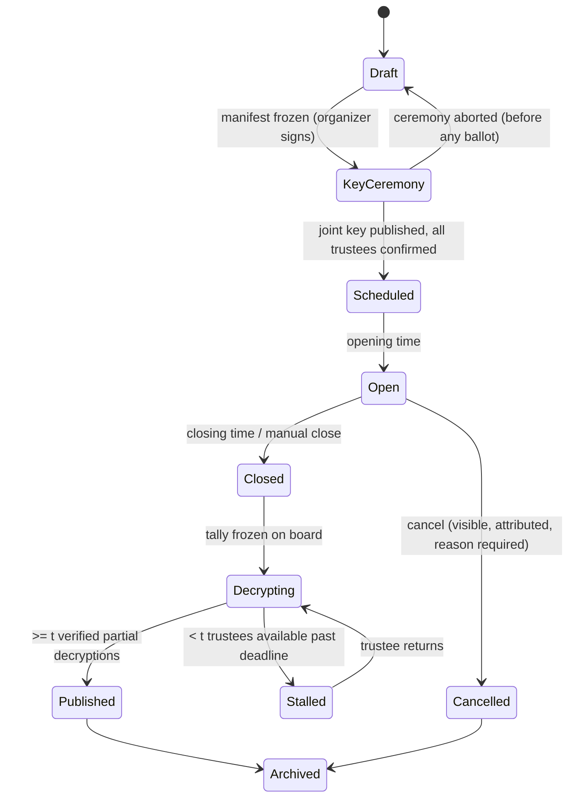
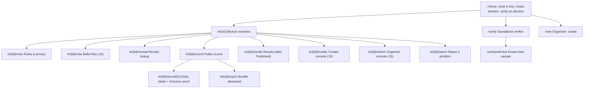
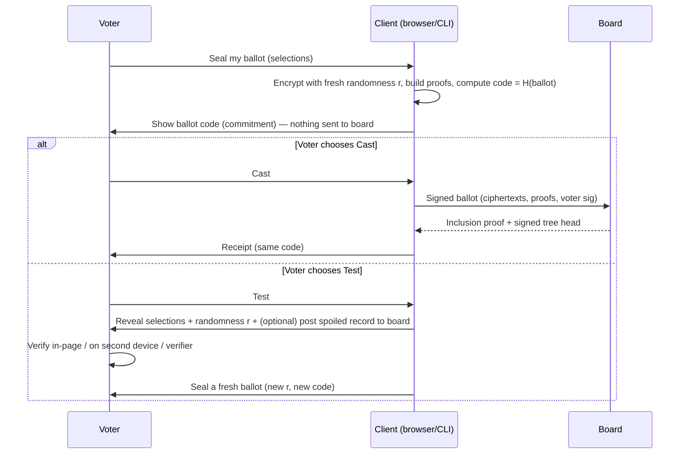

# QV-10 — User Experience

**Module ID:** `experience-accessibility`  
**Status:** Draft  
**Owner:** UX lead (proposed); protocol owner co-signs all privacy/guarantee copy  
**Last reviewed:** 2026-10-21  
**Related specs:** QV-02 (journeys), QV-03 (lifecycle), QV-04 (credentials), QV-05/QV-16 (protocol; ADR-004), QV-06 (data), QV-07 (threats), QV-09 (API/error codes), QV-11 (testing), QV-13 (accessibility/i18n), QV-34 (test vectors); ADR-001, 004, 005, 008, 009, 010

> **Reading rule.** This spec makes the honest-guarantee stance (ADR-001, ADR-008) concrete in screens and words. If any copy here ever promises more than QV-07/ADR-008 supports, the copy is the bug. Strings in §7 are *normative source strings*; QV-13 governs how they are localized.

## 1. Objective

Let ordinary members of a voluntary group cast a private ballot, and let organizers, trustees and observers run and check an election, **without needing to understand cryptography and without being misled about what is and is not protected**. Three UX goals, in priority order:

1. **No false assurance.** No screen, color, icon or phrase shall imply a guarantee outside ADR-008. "Verified" is only ever shown next to an enumerated list of what was verified.
2. **Verification is reachable but never mandatory.** The default path is short (target ≤ 90 s from opening the link to a receipt for a single yes/no contest). Cast-or-audit (Benaloh) and independent verification are one tap away and explained, not hidden in an "advanced" ghetto.
3. **Hard to phish, hard to fake.** A voter can establish, through a channel the operator does not control, that they are in the *real* election and that a *real* verifier is checking.

## 2. Scope

### In scope
- Personas, information architecture, role-based screens and flows for Organizer, Voter, Trustee, Observer/Auditor.
- Exact guarantee / non-claim copy, error states, empty/loading/offline states.
- Benaloh audit UX, receipt UX, shared-device UX, anti-phishing and fake-verifier UX.
- Usability and comprehension test plan with pass thresholds.

### Out of scope
- Visual brand/identity, marketing site (QV-14).
- Accessibility conformance mechanics and translation pipeline (QV-13) — referenced, not repeated.
- Cryptographic message formats (QV-16), HTTP API (QV-09), operator admin console (QV-12).
- Mobile native apps (web only for MVP; see QV-02 MVP boundary).

## 3. Actors, personas and journeys

### 3.1 Personas

| ID | Persona | Context | Skill / device | Privacy need | Primary risk we design against |
|---|---|---|---|---|---|
| P-ORG | **Olga**, secretary of a 140-member housing co-op; organizer | Runs 4–6 votes/yr, volunteer, 2 evenings to set up | Comfortable with spreadsheets; laptop | Wants members to trust her *can't* peek | Misconfiguring rules; being coerced to "look" at results early |
| P-VOT | **Marcus**, 58, member, casual voter | Opens link from email on a mid-range Android, patchy 4G | Low tech confidence, not interested in crypto | Doesn't want neighbours to know how he voted | Giving up half-way; mistaking a receipt for proof of *his choice*; phishing |
| P-VPR | **Priya**, privacy-aware member / developer | Runs Tor Browser or Firefox hardened; may use CLI | High | Wants to verify, not trust | Hidden telemetry; fake verifier; non-claims buried |
| P-VAT | **Tomasz**, member who is blind (NVDA/VoiceOver) and **Rana**, member with dyslexia/low vision | Desktop + phone | Assistive tech; zoom 200–400% | Same as P-VOT | Cast-flow traps (timeouts, drag/CAPTCHA, unlabeled controls); Benaloh flow unusable by AT |
| P-VCO | **Jun**, voter in a coercive household/workplace | Voting where someone may watch | Any | Wants to vote differently than demanded | Receipt used as proof of vote; shared device history. (Partial mitigation only: revoting; ADR-008) |
| P-TRU | **Tariq**, trustee (1 of 5; threshold 3) | Holds a key share for an election; 2 ceremony sessions + 1 decryption session | Technical-ish; may be semi-technical elder of the group | Must never lose or leak share | Lost share; coerced into co-decrypting early; phished into ceremony on fake site |
| P-OBS | **Aisha**, observer/auditor (member, journalist, or independent monitor) | Runs the verifier days later, possibly offline | High (CLI) or medium (verifier page) | Needs evidence, not assertions | Fake verifier that says "OK"; board equivocation |
| P-OPS | Operator (self-host admin) | Console in QV-12 | Sysadmin | — | Out of scope here except that operator-origin pages carry no election secrets |

### 3.2 Journeys (map to QV-02 journeys 1–7)

| Actor | Goal | Preconditions | Main outcome |
|---|---|---|---|
| Organizer | Create and open an election | Has an organizer key; ≥ n trustees invited | Signed manifest published; trustee ceremony complete; election Scheduled/Open |
| Trustee | Join ceremony; later contribute partial decryption | Invitation + trustee key | Joint public key published; later verified partial decryption on board |
| Voter | Join, understand, vote, get receipt | Invitation link + election ID obtained out-of-band; voter key | Ballot on board; receipt saved; optional audit |
| Voter | Change vote (revote) while open | Voted before; election allows revoting | Newer ballot supersedes; earlier ones remain on board but are shown as superseded |
| Observer | Verify election end-to-end | Public board data (online or exported bundle) | Itemized verification report; shareable |
| Organizer | Close, tally, publish | Closing time passed or manual close | Result + proofs published |
| Anyone | Report a problem / dispute | Election in any state | Dispute record tied to specific board entries |

### 3.3 Election lifecycle as seen by users

States shown to users (aligned with QV-03; QV-03 is authoritative on transitions):



**Rule:** after `KeyCeremony` the ballot definition, eligibility root and rules are immutable; any change creates a *new* election (QV-ADR-007 log shows the old one superseded). Users never see an "edit" button on a frozen election (QV-10-REQ-004).

## 4. Requirements

Priority: M = Must, S = Should, C = Could. Verification: T = automated test, M = manual/usability test, R = review.

| ID | Requirement | Pri | Acceptance criteria | Verif. |
|---|---|---|---|---|
| QV-10-REQ-001 | Before a voter can seal a ballot the client shall display, on one reviewable screen, the question(s), options, the rule (method, limit, threshold, quorum), opening/closing times in election zone and viewer zone, whether revoting is allowed, and the **Election ID** (§9). | M | Screen contains all listed fields; e2e asserts presence by test-id; usability: ≥ 90% of testers can state closing time and whether they can change their vote. | T, M |
| QV-10-REQ-002 | The guarantee panel (§7.1) shall be shown on first entry to every election, reachable from every voter screen in ≤ 1 action, and shall list both guarantees and **non-claims** in the same visual weight. | M | Snapshot test; no screen in voter flow lacks link `qv.nav.privacy`. | T, R |
| QV-10-REQ-003 | UI shall distinguish four visibility classes with a consistent legend: *Everyone with the public record*, *Organizers*, *Trustees (acting together)*, *Server operator*. Every data item shown ("you voted", "your ballot code", "your choice") shall state who can see it. | M | Copy audit checklist (§7.5) passes; usability comprehension Q1–Q4 (§13) ≥ 80%. | M, R |
| QV-10-REQ-004 | After the key ceremony completes, no UI control shall allow changing manifest, voter roll, rules or trustees; organizers get "Create a corrected copy" which makes a new election. | M | e2e: controls absent; API write rejected (QV-09). | T |
| QV-10-REQ-005 | The confirmation and receipt screens shall **never display the voter's selections** in text, color or icon (shared-screen safety). A separate, explicitly requested "Review my choices" view before sealing may show them. | M | e2e: after seal, DOM and screenshot contain no option labels from the voter's selection set (except the neutral contest title). | T |
| QV-10-REQ-006 | The client shall state one of exactly six submission outcomes (§8.2) and never "Success" without an outcome. | M | State-machine coverage test: all outcomes reachable by fault injection. | T |
| QV-10-REQ-007 | Cast-or-audit (Benaloh): the ballot code (commitment) shall be shown **before** the voter chooses Cast or Test, and the choice screen shall give equal prominence to both options. Audit shall be offered every time, default focus on Cast, with text making clear the test ballot is discarded. | M | e2e: network trace shows ciphertext not sent to board before Cast; UI snapshot checks button parity. | T, R |
| QV-10-REQ-008 | A test (spoiled) ballot shall be shown as a **plaintext decryption record** (selections + randomness proof) plus a "Check on a second device" path (QR + file + link) and an in-page checker clearly labeled as less independent (ADR-010). | M | Usability T6; verifier accepts the exported record (QV-34 vector `benaloh/*`). | T, M |
| QV-10-REQ-009 | The receipt shall contain: election ID, ballot code (100-bit, §10.2), board inclusion proof + signed tree head (machine-readable), timestamp as logged, supersede status field, **no choice data**, and a plain statement of what the receipt does/does not prove. | M | Receipt JSON validates against QV-09 schema; copy string `qv.receipt.proves`/`qv.receipt.doesnt` present. | T |
| QV-10-REQ-010 | The client shall allow the voter to re-check inclusion later (receipt lookup by code or file) without logging in. | M | e2e: lookup works without credential; returns Included/Superseded/NotFound. | T |
| QV-10-REQ-011 | Shared-device mode: a persistent "This is a shared or public device" toggle and a **Clear this device** action that deletes voter key material, receipts and drafts from the browser; the confirmation screen offers it as the primary secondary action. | M | e2e: after clear, IndexedDB/localStorage contain no QV entries (QV-06). | T |
| QV-10-REQ-012 | Every election link given to voters shall be accompanied (in organizer UX) by the Election ID, with a prompt to distribute it by a second channel; voter client shall show the Election ID in a persistent header and ask the voter to compare once ("Does this match what your organizer told you?"). | M | Unit: header present on all voter routes. Usability T9. | T, M |
| QV-10-REQ-013 | The verifier (page and CLI) shall report results as an itemized list of named checks with pass/fail/not-run, the manifest hash it verified against, and shall never emit a single "all good" badge without the list. | M | Snapshot; QV-34 negative vectors cause specific named checks to fail. | T |
| QV-10-REQ-014 | The verifier shall ship with a built-in **known-bad sample** ("canary") that must fail on at least the named checks defined in QV-34 §9; the UI shall offer "Run the self-test" and display the expected failures. | S | Self-test E2E; documented in verifier help. | T |
| QV-10-REQ-015 | The client shall not load any third-party resources, fonts, or analytics (ADR-009); error reporting is opt-in, local-first ("Copy diagnostic info"), and contains no ballot data. | M | CSP test (QV-11); crawler asserts zero third-party requests. | T |
| QV-10-REQ-016 | Organizer UI shall provide an **eligibility & rules preview** exactly as voters will see it, and a "dry-run" election with synthetic voters that exercises ceremony + tally on the same code path. | S | Dry run produces a verifiable bundle accepted by verifier. | T, M |
| QV-10-REQ-017 | Organizer views shall not expose any ballot-to-voter mapping and shall show participation only at the granularity the election's visibility setting allows (Phase 1: per-voter "has a valid ballot" is public; stated in copy). | M | e2e on organizer screens; privacy test (QV-11). | T |
| QV-10-REQ-018 | Early-results lock: UI and docs shall state that no partial tally exists; trustee UI shall refuse to produce partial decryptions before tally freeze and shall show the tally-freeze board entry as the prerequisite. | M | Trustee client refuses; test with early request. | T |
| QV-10-REQ-019 | All time displays shall follow QV-13 (§Time) — dual zone, explicit offset; countdowns do not announce every second to AT. | M | See QV-13-REQ-090 to QV-13-REQ-097 and QV-13-REQ-094 (closing race). | T |
| QV-10-REQ-020 | Loss-of-connectivity behavior: draft selections persist in memory (and optionally session storage if the voter opts in) for the page session; a ballot is only "sent" when the board returns a signed inclusion proof; pending state is shown with retry that is idempotent (same ballot bytes). | M | Fault-injection e2e: offline mid-submit → pending → retry → accepted exactly once. | T |
| QV-10-REQ-021 | Voter key backup: after first credential creation the client shall offer (not force) an export of the voting key as a passphrase-protected file, with the copy in §7.3, and warn that losing it before voting may block voting (recovery per QV-04). | M | e2e; usability T2. | T, M |
| QV-10-REQ-022 | Disputes: any user viewing a board entry or verifier failure can "Report a problem" which prefills the entry reference; report goes to organizer-visible queue and is also offered as an exportable signed statement for external escalation. | S | e2e. | T |
| QV-10-REQ-023 | Trustee key-share handling UX shall require explicit acknowledgement of backup (second copy), show the share fingerprint, and prevent proceeding until a restore test (decrypt a test message) passes. | M | e2e on ceremony; manual drill. | T, M |
| QV-10-REQ-024 | No dark patterns: no pre-checked options, countdown pressure language, or "are you sure you want to skip verification?" nudges. | M | Design review checklist. | R |
| QV-10-REQ-025 | Reading level of voter-flow strings shall be ≤ CEFR B1 / ≈ grade 8 English (measure via documented method) with a glossary tooltip for each term in §7.6. | S | Readability script in CI warns; manual review for key strings. | T, R |
| QV-10-REQ-026 | An organizer-chosen **display name policy** (real name / pseudonym / "voter number") applies to the participation list; voters see which policy applies before joining. | M | e2e. | T |
| QV-10-REQ-027 | The usability test plan (§13) shall be executed with results recorded before each minor release that changes a voter flow; failing a threshold is release-blocking per QV-11. | M | Evidence artifact in release dossier. | R |

## 5. Information architecture

### 5.1 Principles
- **One URL per election; role is determined by keys held, not by URL.** Role switcher is not needed; the same election page shows what the viewer's keys allow.
- **Public record is first-class** (`/e/{id}/record`), same data for everybody, no login.
- **Static-first.** Read-only pages are server-rendered HTML (work without JS, QV-13); casting and ceremony pages require JS or the CLI.
- **No accounts with email/password.** Entry is by invitation link + local key (QV-04). Email may be used only for notification delivery by organizer's choice (QV-06).

### 5.2 Sitemap (route proposals; QV-09 owns real routes)



### 5.3 Global chrome (all pages)
Header: product name · Election name · **Election ID** (grouped, copy button) · language switcher (QV-13) · Privacy & limits link · Status chip (state from §3.3 with text, not color alone). Footer: version + client build hash (`qv.footer.build`), link to release manifest and "Verify this page" (ADR-010), source link (AGPL).

## 6. Screen-by-screen flows

Wireframe notation: `[Button]`, `( )` radio, `[x]` checkbox, `{field}`, `<…>` dynamic text, `‖` region boundary. All wireframes are single-column ≤ 640 px first; wider screens only add whitespace and a right-hand "Rules & privacy" aside (QV-13 reflow).

### 6.1 Organizer flow

Screens: **O1 Create** → **O2 Rules** → **O3 Ballot** → **O4 Voters** → **O5 Trustees** → **O6 Review & freeze** → **O7 Ceremony monitor** → **O8 Scheduled/Open dashboard** → **O9 Close & publish** → **O10 Archive/export**.

**O1 Create election**
```
‖ Create an election ‖
Name of decision      {Annual budget 2027                    }
Description (shown to voters)  {…multi-line, plain text/markdown subset…}
Languages offered     [x] English  [ ] Español  [ ] العربية  [+ Add language]
Time zone of this election  {Europe/Berlin ▾}   (Closing times are shown in this zone and in each voter's own zone.)
[Continue]                                   Step 1 of 6
```
Notes: language set determines which manifest text maps are required (QV-13 §i18n). All content is plain text with a safe markdown subset (no HTML, no images, no remote links auto-fetched).

**O2 Rules**
```
Voting method   (•) Yes / No   ( ) Choose one   ( ) Approve any   ( ) Choose up to {k}
Pass rule       (•) Simple majority of votes cast  ( ) At least {2/3} of votes cast
Quorum          [x] Require at least {40} voters   (counts: voters with a valid ballot)
Tie rule        {Proposal fails ▾}
Revoting        (•) Voters may change their vote until close   ( ) One ballot only
Voting opens    {2027-03-01 09:00}    Voting closes {2027-03-14 18:00}   zone: Europe/Berlin (UTC+01:00)
Who can see who voted   (•) Everyone with the public record (Phase 1: this is how it works)
‖ Plain-language preview of your rules (read-only, updates live)  ‖
[Back] [Continue]
```
Inline guard: choosing "Choose up to {k}" validates 1 ≤ k < options; quorum > roll size is an error (§8.1 `E-ORG-QUORUM`).

**O3 Ballot**: contest title, option list (reorder via up/down buttons *and* drag — drag is never the only way, WCAG 2.5.7), option labels in each offered language (missing translation flagged), "Randomize option order per voter" toggle (default off; when on, copy explains order is local to each voter's device and not recorded).

**O4 Voters**: paste/import list of voter public keys or invitations (QV-04); preview count; shows display-name policy choice (QV-10-REQ-026); the roll Merkle root and count are displayed read-only. Import errors show row numbers.

**O5 Trustees**: set `n` and threshold `t` (default suggestion: n=5, t=3; warns if t ≤ n/2 or t = n). Each trustee entry: name/label + invitation link. Always-visible copy: `qv.org.trustee.warning` (§7.4). Shows live trustee readiness table: Invited / Joined / Commitment posted / Shares verified / Backup confirmed.

**O6 Review & freeze**: renders voter-facing summary and the **manifest hash / Election ID**. Two-step: checkbox "I have read the plain-language rules as voters will see them" + typed election name confirmation. Warning copy `qv.org.freeze`. After freeze the page offers "Copy Election ID", "Print announcement (includes Election ID and QR)", and the invitation distribution tool.

**O7 Ceremony monitor**: stepper (Commitments → Share distribution → Complaints window → Joint key published). Complaints raised by trustees (QV-16 DKG complaint phase) appear with plain explanation and guided remedies; stall > 48 h triggers a "Trustee X hasn't responded" state with options "Remind", "Replace trustee (abort and restart ceremony)" — only legal before Scheduled.

**O8 Dashboard** (Scheduled/Open): state chip, countdown (static text + optional live region), counts: eligible, **valid ballots received** (public in Phase 1), superseded ballots, rejected submissions by reason (aggregate only), board health (last signed tree head age; witness cosignatures present?). Actions: Extend voting (allowed only if manifest declared extension policy; creates visible attributed board entry), Cancel (reason required, public), Export bundle. **No "view ballots" action exists** (REQ-017). Warning banner when tree head older than 15 min (`E-BOARD-STALE`).

**O9 Close & publish**: after close, "Freeze tally" shows what will be frozen (ballot count, board root); then Decrypting status with trustee readiness; when ≥ t partial decryptions verify, result auto-publishes. Organizer cannot publish a result; only a verifiable decryption can appear (REQ-018). Provides announcement text with Election ID + result + link to verifier.

**O10 Archive/export**: one-click full bundle (QV-09 export format, QV-34 compatible), ADR-001 exit-friendly: "Download everything. You never need our permission to leave." (`qv.org.export`).

### 6.2 Voter flow

Screens: **V1 Invitation landing** → **V2 Rules & privacy** → **V3 Unlock/create voting key** → **V4 Ballot** → **V5 Review** → **V6 Seal & choose (Cast / Test)** → **V7 Receipt** → (optional) **V8 Audit result** / **V9 Receipt check** / **V10 Results**.

**V1 Invitation landing**
```
‖ <Election name> ‖                Election ID: K7QM-4T9R-XD2P-8WNC-J5HV  [Copy]
You're invited to vote. Opens <date> / Closes <date>  (<zone>) · Your time: <…>
Before you start: ask your organizer for the Election ID they sent you separately.
Does it match the ID above?   [Yes, it matches] [It doesn't match] [I don't have it]
```
"It doesn't match" → stop screen with `qv.phish.mismatch` (§7.7). "I don't have it" proceeds with a persistent amber "Not yet confirmed" chip in header and an extra reminder at V6 (once). This is *friction proportional to risk*, not a gate (ADR-001: no mandatory gatekeeping beyond what the group chooses).

**V2 Rules & privacy** (full-screen once, then link): election summary in plain language, then the guarantee panel (§7.1) with expandable "Why can't I just trust this?" → explains independent verification (ADR-010). [Continue to vote] is enabled immediately (no forced scroll — WCAG/cognitive); the page remembers acknowledgement locally only (no server record).

**V3 Voting key** (QV-04 owns mechanics)
```
Your voting key lives only on this device.
(•) Create a new voting key on this device
( ) Use a key file I saved before  [Choose file…]
( ) Use a different device for voting (command-line)
Protect it with a passphrase (optional on personal device; strongly suggested on shared) {          } [Show]
[Create key]      Copy: qv.key.local
```
Passphrase field allows paste and password managers; no confusable-character rules; no composition rules (WCAG 3.3.8, NIST-style). Presents key fingerprint (short) and invites export (REQ-021). If eligibility check fails (key not on roll): `E-VOT-NOTONROLL`.

**V4 Ballot**
```
‖ <Contest title> ‖
<Contest description>
Choose one:   ( ) Yes   ( ) No   ( ) Abstain/blank*
*Blank ballots count toward quorum only if rules say so: <rule text>
Selections left: n/a
[Review my choices]            [Back to rules]
```
For approval / k-of-n: checkbox group with live-regioned counter ("2 of 3 selected") and, on over-selection, inline error `E-VOT-OVERVOTE` plus keeping state; under-selection (undervote) is allowed if rules say so with explicit text "You've selected fewer than the maximum. That is allowed." (never silently). Options are laid out as full-width 48 px-min touch targets (target ≥ 24×24 CSS px required by WCAG 2.5.8; we exceed).

**V5 Review**
```
Your choices (only you can see this screen) — hidden from the receipt and from this device after you leave.
 Contest 1: <label>  [Change]
 …
[Back] [Seal my ballot]    (Sealing encrypts your choices on this device. Nothing is sent yet.)
```
The review screen carries `translate="no"` on the choices region plus a banner when browser auto-translation is detected (QV-13 §translation leakage).

**V6 Seal, then choose**
```
Your ballot is sealed.   Ballot code: 4Q8T-W2LM-9ZRX-C7DK-5HPN  [Copy]
This code is a fingerprint of your sealed ballot. It was created before you chose below.
What would you like to do?
  [Cast this ballot]   Send it. You'll get a receipt.
  [Test this ballot]   Check that this device sealed your choices correctly. This test ballot
                       is thrown away and made public; you then seal a fresh one.
‖ Learn more: Why test? ‖
```
Both buttons same size/style; Cast gets initial focus; keyboard order Cast, Test. After Test → V8 audit result → "Seal a new ballot" (returns to V5 with selections preserved, re-encrypts with fresh randomness → **different code**; copy highlights "The new code is different. That's expected.").

**V7 Receipt (after Cast)**
```
✔ Your ballot is recorded.   (state text: ACCEPTED_RECORDED)
Ballot code 4Q8T-W2LM-9ZRX-C7DK-5HPN   Logged <time>, entry #<n>
This receipt shows your ballot was received and recorded. It does not show what you chose.
Voting is open until <…>. You can change your vote <if allowed> and your newest ballot counts.
[Save receipt file] [Show QR] [Print] [Check inclusion now]
[Clear this device] (recommended on shared devices)   [Done]
```
Never shows contest selections (REQ-005).

**V8 Audit result (after Test)**: Shows "Test ballot opened". Table: contest → what your device sealed (selections as you chose) — this is safe because the test ballot is discarded — and an item list of automatic in-page checks (commitment matches code ✔, proofs valid ✔, plaintext matches your selections ✔ — the last one the *voter* confirms by eye: "Do these match what you picked? [Yes] [No – something is wrong]"). "No" → `qv.audit.mismatch` guided escalation with evidence bundle (§8.3). Offers second-device check (QR + file) and warns that in-page checks are by the same software (ADR-010) — so the independent verifier is the real check.

**V9 Receipt check**: input code or file → states: `Included` (with entry #, tree head, whether superseded), `Superseded by a newer ballot (code …)`, `Not found (yet)` (with delay explanation), `Board inconsistent` (fork alarm → §8.3).

**V10 Results**: headline numeric result, per-option counts with table (non-visual first), pass/fail vs rules, quorum status, "How do I know this is correct?" → itemized verification (client runs proofs in-page; offers the standalone verifier). Charts always have a data table adjacent (QV-13).

### 6.3 Trustee flow

Screens: **T1 Invitation** → **T2 Create trustee key & backup** → **T3 Ceremony round 1 (commit)** → **T4 Round 2 (receive/verify shares)** → **T5 Complaint window / confirm** → **T6 Idle ("Standing by")** → **T7 Decrypt** → **T8 Retire (destroy share)**.

- T1 shows what a trustee is and the duty in plain words (§7.4 `qv.trustee.role`), who the other trustees are (labels), the threshold, and the Election ID to compare.
- T2 generates the trustee key on-device; **mandatory backup step**: download encrypted share file + print recovery sheet; then *restore test*: client asks trustee to load the file and proves it decrypts a test ciphertext (REQ-023).
- T3/T4 are automatic with a progress list; each step prints named checks (e.g., "Proof of possession from Trustee 2 verified"). Failures show `E-TRU-BADSHARE` with the *Complaint* option that posts a verifiable complaint to the board.
- T6 shows share fingerprint, "Your next task: wait for tally freeze (≈ <date>)", reminder channel.
- T7 appears only after the tally-freeze entry is on the board; trustee sees the ciphertext aggregate hash, ballots counted, and **compares them with their own verifier/board mirror** (the ceremony UI links to a one-click "check with verifier" — a trustee decrypting a doctored tally is a classic attack); button "Contribute my partial decryption". Result: proof posted, shown with check list.
- T8 after audit window (QV-ADR-013): "Destroy my share" with typed confirmation; shows `qv.trustee.destroy`. Destruction is local and unverifiable by others; copy says so.

### 6.4 Observer / auditor flow

Screens: **A1 Verify** (`/verify` or CLI) → **A2 Choose source** (live URL, uploaded bundle, or mirror) → **A3 Enter independent anchors** (Election ID/manifest hash from announcement; optional trusted tree-head hash from a witness/mirror) → **A4 Report** → **A5 Share findings**.

```
‖ Verify an election ‖
Where is the election data?  (•) This server  ( ) A file I downloaded  ( ) A mirror URL
Election ID you were told (from your organizer, not from this page): {____-____-____-____-____}
[Run checks]
Checks (each shown with result and explanation)
 ✔ 1 Manifest hash matches the Election ID you entered
 ✔ 2 Organizer signature on manifest
 ✔ 3 Trustee keys & joint key proofs (5/5)
 ✔ 4 Board is an append-only log (tree heads consistent: 41 heads)
 ✔ 5 Witness cosignatures (2 of 3 required)       [not run if no witnesses]
 ✔ 6 Every ballot: voter on roll, signature, proofs valid (212 ballots)
 ✔ 7 Latest-ballot-per-voter rule applied (198 counted, 14 superseded)
 ✔ 8 Homomorphic tally recomputed = published tally
 ✔ 9 Decryption proofs from ≥ t trustees valid (3 of 5)
 ✔ 10 Result matches rules (method, threshold, quorum)
 ✔ 11 Test ballots opened by voters: 17 opened, 17 consistent
 Manifest verified: sha256:… (Election ID K7QM-…)   Verifier build: <hash>
[Download report (JSON + human text)]  [Run verifier self-test]
```
Check numbering is stable and defined in QV-34 §9 (named IDs like `chk.manifest.hash`). A failed check shows failure reason, board entries involved, and "Report a problem" with prefilled evidence. The report is a signed statement option (observer key) for sharing.

The observer sees a **participation view** (Phase 1: list of voters with valid ballots + counts; no choices) clearly labeled with `qv.obs.participation.public`.

## 7. Plain-language privacy and guarantee copy (normative source strings)

Format: ICU MessageFormat (QV-13). `{…}` are variables. IDs are stable keys. **These are the exact English strings.** Changing a string requires protocol-owner approval (QV-11 release gate G7) and invalidates translations of that key until re-reviewed.

### 7.1 Guarantee panel — Phase 1 ("secret ballot, public participation"; ADR-005/008)

| Key | String |
|---|---|
| `qv.privacy.headline` | `Your choices are secret. The fact that you voted is not.` |
| `qv.privacy.g1` | `Your ballot is locked on your own device before it is sent. The server, the organizers and other members only ever see the locked version.` |
| `qv.privacy.g2` | `Nobody can open a single ballot alone. Opening needs {t} of the {n} trustees ({trustee_names}) working together, and they open only the combined total.` |
| `qv.privacy.g3` | `Anyone can check the count. The locked ballots, the proofs and the result are published, and free software can re-check them without trusting the server or the organizers.` |
| `qv.privacy.g4` | `If you change your mind, you can vote again before the vote closes. Only your newest ballot counts.` |
| `qv.privacy.public` | `Visible to everyone who can see this election: that you voted, when, and your ballot code. Not visible: what you chose.` |
| `qv.privacy.notclaimed.head` | `What this does not protect` |
| `qv.privacy.nc1` | `If {t} or more trustees secretly work together, they could read individual ballots.` |
| `qv.privacy.nc2` | `If your phone or computer is infected or being watched, someone could see or change what you pick before it is locked. Testing your ballot (see "Test this ballot") can catch some of this, not all.` |
| `qv.privacy.nc3` | `If someone makes you vote a certain way or watches you vote, this system cannot stop them. Voting again later is the only protection offered, and only while the vote is open.` |
| `qv.privacy.nc4` | `This vote is not anonymous about participation. Others can see that you voted.` |
| `qv.privacy.nc5` | `Your internet provider, and the server, can see that your device connected to this site. Using Tor Browser hides this from them.` |
| `qv.privacy.nc6` | `If everyone who voted picks the same option, others can tell how everyone voted. Very small groups reveal more.` |
| `qv.privacy.nc7` | `Today's locks are expected to hold against current computers. A future, much more powerful computer could in theory open recorded ballots later.` |
| `qv.privacy.review` | `This system has {review_status}.` with `review_status` ∈ { `not yet been independently reviewed`, `been independently reviewed by {reviewer} on {date} (report)` } |

`qv.privacy.review` is mandatory and must be sourced from the signed release manifest (no unreviewed build may omit it). The default reads "not yet been independently reviewed" until QV-11 gate G9 evidence exists (ADR: no claim before review).

### 7.2 Guarantee panel — Phase 2 variant (anonymous participation, unlinkable tokens; only enabled when feature is implemented and reviewed)

Replaces `qv.privacy.public` and `qv.privacy.nc4`:

| Key | String |
|---|---|
| `qv.privacy.public.p2` | `Visible to everyone who can see this election: the total number of ballots, and when each was recorded. Not visible: who sent which ballot, or what any ballot chose.` |
| `qv.privacy.nc4.p2` | `The group's registrar issued the voting tokens and can tell who asked for one. If you request a token and the registrar and the server share information, timing and network details could link you to your ballot.` |

### 7.3 Voting key and device

| Key | String |
|---|---|
| `qv.key.local` | `Your voting key is created and kept on this device. We cannot see it and cannot recover it for you.` |
| `qv.key.backup` | `Save a backup file. If you lose this key before you vote, you may not be able to vote until your organizer helps you get a new one.` |
| `qv.device.shared` | `On a shared or public computer? Choose "Clear this device" when you finish. This removes your voting key, receipts and drafts from this browser.` |
| `qv.device.cleared` | `This device has been cleared. If you saved your receipt file, you can still check your ballot later.` |

### 7.4 Roles

| Key | String |
|---|---|
| `qv.trustee.role` | `As a trustee you hold one piece of the key that opens the final total. By yourself you can open nothing. You must keep your piece safe, never give it to anyone, and join the opening step after voting closes. Trustees together can open only the combined total, unless {t} of you agree to do more. Do not.` |
| `qv.org.trustee.warning` | `Choose trustees who do not all answer to the same person. If {t} trustees work together, they can read every ballot. If more than {n_minus_t} trustees become unavailable, the result cannot be opened.` |
| `qv.org.freeze` | `Once you freeze this election, its question, options, rules, voter list and trustees cannot be changed. If you find a mistake later, you will need to create a corrected election and cancel this one in public.` |
| `qv.org.export` | `Download everything. The record of this election is yours, and you can run it anywhere.` |
| `qv.org.nopeek` | `Organizers cannot see how anyone voted, and cannot see partial results. That is by design.` |

### 7.5 Receipt, audit and verification copy

| Key | String |
|---|---|
| `qv.receipt.proves` | `This receipt proves your ballot was received and recorded in the public log, and lets anyone (including you) check that it has not been removed or changed.` |
| `qv.receipt.doesnt` | `It does not show what you chose, and it cannot be used to prove to anyone else how you voted.` |
| `qv.receipt.shared` | `Anyone who sees this receipt can tell that you voted.` |
| `qv.audit.why` | `Your device locks your choices. A test lets you check that it locked the choices you picked, and not something else. A tested ballot is thrown away and cannot be cast.` |
| `qv.audit.public` | `A test ballot is published, including what it contained. Don't test with choices you want to keep private, and never cast a ballot you have tested.` |
| `qv.audit.ok` | `This test ballot matched what you picked. That is good, but it only tells you about this one test. Testing more than once makes tampering less likely to go unnoticed.` |
| `qv.audit.mismatch` | `Something does not match. Do not cast. Save the evidence below and tell your organizer and an independent observer. Use a different device if you can.` |
| `qv.verify.scope` | `Passing these checks means the public record is internally consistent and the count follows from the locked ballots. It does not prove that your own device locked your choice correctly unless you tested a ballot, and it does not protect against anything listed under "What this does not protect".` |
| `qv.verify.itemized` | `{passed} of {total} checks passed.` (never shown without the list) |

Do-not-use phrases (copy audit): "secure", "guaranteed", "tamper-proof", "unhackable", "anonymous" (Phase 1), "verified!" alone, "your vote is safe", "end-to-end encrypted" without definition, "100%".

### 7.6 Glossary (tooltips, ≤ 20 words each)

| Term | Definition string |
|---|---|
| Election ID | `A short fingerprint of this election's rules. If it matches what your organizer told you separately, you are in the right election.` |
| Ballot code | `A fingerprint of your locked ballot. Used to find it in the public log.` |
| Trustee | `One of several people who each hold part of the key that opens the final total.` |
| Public log | `A list of everything that happened in this election, that anyone can download and check.` |
| Verifier | `Free software that re-checks the public log without trusting anyone.` |
| Superseded | `Replaced by a newer ballot from the same voter.` |

### 7.7 Anti-phishing copy

| Key | String |
|---|---|
| `qv.phish.mismatch` | `Stop. This Election ID does not match the one you were given. You may be on a copy of the real site. Don't enter anything. Tell your organizer, and use the link or ID they gave you in person or by another channel.` |
| `qv.phish.unconfirmed` | `You haven't confirmed the Election ID yet.` |
| `qv.phish.verifierwarn` | `A checker you didn't download or compare yourself can lie. See "How to trust a verifier".` |
| `qv.phish.neverask` | `We will never ask for your voting key file or passphrase by email, chat, or on any page other than the one that created it.` |

## 8. Error, empty and edge states

### 8.1 Error catalog (UX codes; QV-09 maps API errors to these)

Each error shows: **what happened**, **what it means for your vote**, **what to do**, **a copyable reference** (error code + request id, no ballot data).

| Code | Trigger | What it means for your vote | Message (title / body) | Primary action |
|---|---|---|---|---|
| `E-NET-OFFLINE` | No connectivity at any step | Nothing was sent unless a receipt is shown | `You're offline` / `Nothing has been sent. Your choices are still on this screen.` | Retry; keep page open |
| `E-NET-TIMEOUT` | Submit sent, no board reply in 20 s | Unknown if recorded | `We're not sure your ballot arrived` / `Don't vote again yet. Check status first — it's safe to retry.` | [Check status] (idempotent) |
| `E-VOT-NOTONROLL` | Voting key not on roll | Cannot vote | `This key isn't on the voter list` / `Ask your organizer to check the list. Don't share your key file.` | Contact organizer |
| `E-VOT-CLOSED` | Submit after close | Not counted | `Voting has closed` / `Your ballot was not counted. Voting closed at {time_election_zone}.` | View result when published |
| `E-VOT-NOTOPEN` | Before open | Cannot vote yet | `Voting opens {time}` | Add to calendar (ICS, no remote calls) |
| `E-VOT-OVERVOTE` | Selections exceed limit | Blocked in UI | `Too many choices` / `You can choose up to {k}. You've chosen {x}.` | Adjust |
| `E-VOT-ONEBALLOT` | Revoting disallowed, already voted | Not counted | `You've already voted` / `This election allows one ballot per person. Your first ballot counts.` | View receipt |
| `E-VOT-REJECTED-PROOF` | Board rejects ballot proofs | Not counted | `Your ballot couldn't be accepted` / `Your device produced a ballot that failed the checks. Nothing was recorded. Reload this page and try again; if it happens again, report it with the reference.` | Reload; Report |
| `E-VOT-DUP` | Identical ballot already recorded | Already counted | `This exact ballot is already recorded` | Show receipt |
| `E-VOT-SUPERSEDED-LOST` | Race: older ballot arrives after newer | Not counted (older) | `A newer ballot from you is already recorded` | Show receipt |
| `E-KEY-LOCKED` | Wrong passphrase | None | `That passphrase didn't unlock the key` / (no attempt limit lock-out beyond local backoff) | Retry; use backup |
| `E-KEY-LOST` | No key, no backup | Cannot vote | `We can't recover your key` / `Nobody can, by design. Ask your organizer about issuing a replacement (QV-04).` | Contact organizer |
| `E-KEY-STORAGE` | Browser blocks storage | Must keep file | `This browser won't store your key` / `Download the key file now and use it each time.` | Download |
| `E-BOARD-STALE` | Signed tree head older than policy | Availability issue; integrity unaffected | `The record hasn't updated since {time}` | Retry; mirror link |
| `E-BOARD-FORK` | Two inconsistent tree heads observed | **Integrity alarm** | `The public record doesn't agree with itself` / `Two different versions were shown. Do not rely on results from this server. Save the evidence and tell an independent observer.` | Save evidence |
| `E-BOARD-INCL-FAIL` | Receipt's inclusion proof fails | **Integrity alarm** | `Your receipt doesn't match the record` | Save evidence; Report |
| `E-CLIENT-HASH` | Client build hash ≠ signed release manifest | Possibly altered client | `This page is not the official version` / `Don't vote here. Compare with the official release hash.` | How to check |
| `E-ORG-QUORUM` | Quorum > roll size etc. | Blocks freeze | `That quorum can't be reached` | Fix |
| `E-ORG-TRUSTEES` | t=0, t>n, duplicate trustee keys | Blocks freeze | `Trustee setup isn't valid` | Fix |
| `E-ORG-LANG` | Missing translation for an offered language | Blocks freeze | `Add the {lang} text for every option, or remove that language.` | Fix |
| `E-TRU-BADSHARE` | Share fails consistency check | Ceremony cannot finish | `A share from {trustee} failed its check` | Raise complaint |
| `E-TRU-NOBACKUP` | Restore test failed | Blocks progress | `Your backup didn't work. Try again before continuing.` | Retry |
| `E-TRU-TALLYMISMATCH` | Trustee's recomputed aggregate ≠ board aggregate | Do not decrypt | `The total doesn't match your copy of the record. Do not contribute until resolved.` | Escalate |
| `E-DEC-STALLED` | < t partial decryptions after deadline | Result delayed, nothing lost | `The result can't be opened yet` / `{missing} more trustees are needed.` | Remind trustees |
| `E-VER-FAIL` | Any verifier check failed | Result not established | `Check {id} failed` + detail | Report; export evidence |
| `E-VER-ANCHOR` | Entered Election ID ≠ manifest hash | You may be examining a different election | `This doesn't match the Election ID you entered` | Stop |
| `E-GEN-UNSUPPORTED` | Browser too old (feature detection) | Cannot cast here | `This browser can't vote here` / `Use a newer browser or the command-line voter.` | CLI instructions |

### 8.2 Submission outcomes (the only six)

| Outcome | Shown when | Copy (title) | Counts? |
|---|---|---|---|
| `ACCEPTED_RECORDED` | Signed inclusion proof received and verified in-client | `Your ballot is recorded` | Yes (if newest) |
| `PENDING_UNCONFIRMED` | Sent, no proof yet | `Waiting for confirmation` | Unknown |
| `REJECTED_{reason}` | Board refuses | `Not accepted` + reason (§8.1) | No |
| `SUPERSEDED` | Newer ballot exists (shown on receipt check) | `Replaced by a newer ballot` | No |
| `DUPLICATE_IGNORED` | Same bytes seen | `Already recorded` | Yes (once) |
| `AFTER_CLOSE` | Late | `Voting had closed` | No |

### 8.3 Evidence capture for integrity alarms
`Save evidence` creates a JSON file `qv-evidence-<ts>.json` with: election ID, observed tree heads (signed), the offending proof/entry, client build hash, user-agent string (opt-out), no voter key, no selections. Offered to be posted to the board "problem report" endpoint and to be copied to out-of-band channels.

### 8.4 Loading / empty / degraded states
- Slow network: skeleton text, never spinner-only; 8 s → show `Still working… this can take a minute on slow connections` and a "Use command-line voting" link.
- Zero ballots yet: "No ballots yet." on counts; results hidden before Published (`Results appear after voting closes and the trustees open the total.`).
- Server unavailable: static "status" explanation + mirror list from the signed manifest + Tor mirror (ADR-009).
- Client crash: global error boundary shows reference and `Your ballot has not been sent unless you saw a receipt.`

## 9. Election ID (anti-phishing anchor) — design

- **Definition:** `Election ID = Crockford-Base32( first 100 bits of H(manifest) )`, grouped 4×5 with hyphens, uppercase, excluding visually ambiguous characters (Crockford avoids I L O U). `H` and canonicalization per QV-16/QV-09; value computed identically by client, verifier, CLI (QV-34 vector `election-id/*`).
- 100 bits makes a second-preimage search (producing a lookalike election with the same ID) infeasible; it is a *display* form, the full 256-bit hash is shown in details and used in the verifier.
- **Distribution:** organizer UI after freeze generates an announcement (text, printable page with QR) and prompts to send it by a channel other than the invitation link (meeting, signal, notice board). Voters compare once (V1); the client stores "confirmed" locally.
- **Why not domain only:** self-hosted deployments have arbitrary domains and onion addresses (ADR-002/009); domain recognition does not scale and typo-squatting is trivial.
- **Residual risk:** a phisher who controls both the invitation and the "out-of-band" ID defeats it. Documented in `qv.phish.*` help and QV-07.

## 10. Benaloh audit and receipt UX — details

### 10.1 Benaloh cast-or-audit sequence



Design rules:
1. **Order is the security property.** The code must be visible (and in DOM, for screenshot/AT) before the Cast/Test buttons become enabled. QV-11 includes a test that no network request containing ciphertext occurs before Cast, and that the Test record's code equals the displayed code.
2. **Spoiled ballots are posted** (voter-optional toggle default on) to the board as `spoiled` entries so Observer check 11 counts them. A spoiled ballot can never be cast: client discards it and board rejects a cast of a code previously marked spoiled by the same voter.
3. **Prompting policy (default):** every voter is offered Test, never forced. The first-ever voting session shows an extra explainer card with one-sentence reason. Organizer can raise prominence ("Encourage testing" adds a one-line nudge) but cannot disable the option (QV-10-REQ-007).
4. **Statistical honesty:** copy never says testing "proves" the cast ballot is right; `qv.audit.ok` says why.
5. **Second-device path:** QR code encodes a URL fragment (not sent to server) containing the spoiled record when ≤ 2.9 kB, else offers file download; the checker on device two is the standalone verifier (`/verify#spoiled=…`) or CLI `quietvote verify-spoiled <file>`.
6. **Coercion note:** tested ballots reveal their content by construction; copy `qv.audit.public` warns. Test records must not include voter identity beyond the board's existing voter key signature (spoiled record is unsigned by the voter key? **Open Q-10-3**: signing spoiled ballots links the voter to the test content; recommended unsigned with a per-session proof-of-eligibility to avoid spam — decided jointly with QV-16).

### 10.2 Receipt design
- **Ballot code format:** 20 Crockford base32 chars = 100 bits of H(ballot bytes) in 4-char groups. Full 256-bit hash in "Details".
- **Receipt file:** `qv-receipt-<electionIdShort>-<codeShort>.json` (schema: QV-09; `QV-34` vector `receipt/*`): election ID, ballot hash, board entry index, leaf hash, inclusion proof, signed tree head, time, client build hash. Plaintext (it has no secrets). Optional QR (for ≤ ~1.2 kB compact form: ballot hash + index + tree size; the full proof is refetched).
- **Receipt check semantics:** `Included` requires verifying the inclusion proof against a tree head the client independently re-fetched; `consistent with earlier head` requires consistency proof (ADR-007). If the server is down: verify against saved head + any mirror.
- **Receipt-freeness (non-claim):** The receipt contains nothing that proves content. The *ballot randomness* is deleted from the client after Cast (never persisted) so the voter cannot later prove their choice; the Test path is the only time randomness is revealed (discarded ballots). Copy never claims coercion resistance (`nc3`).
- **Storage:** receipts stored locally only if the voter opts in ("Remember receipts on this device") — default off in shared mode, on otherwise; otherwise voter must save the file.

## 11. Anti-phishing and fake-verifier UX

| Threat | UX control |
|---|---|
| Lookalike site / link in phishing email | Election ID compare (V1); persistent header chip; `E-CLIENT-HASH` if build hash mismatch; invitation text templates contain no "click here to log in" language; voters told operators never ask for key files (`qv.phish.neverask`) |
| Operator-served client modified to change votes | Benaloh test (V6/V8); footer build hash + "Verify this page" link (ADR-010); optional pinned/installable client; CLI voter |
| Fake verifier says "OK" | (a) Itemized report only (REQ-013); (b) verifier requires an **independently obtained Election ID** as input and reports mismatch (E-VER-ANCHOR); (c) **self-test canary**: known-bad sample must produce the documented named failures; (d) "How to trust a verifier" page: use ≥ 2 independent implementations (TypeScript CLI + second implementation validated against QV-34), build from source, compare release hash; (e) verifier page served only from a different origin than the election server when possible and marked `qv.phish.verifierwarn` when loaded from the election server itself |
| Fake receipt "proof" | Receipt copy states what it proves; receipts must be re-checked against the log, not just displayed; screenshots flagged as not evidence |
| Social-engineering of trustees | T7 requires independent tally comparison (E-TRU-TALLYMISMATCH); trustee UI has no "enter share to decrypt now" path outside the official ceremony; out-of-band confirmation of the tally freeze entry hash |
| Clickjacking / overlay | CSP `frame-ancestors 'none'`; seal/cast buttons require trusted pointer events only on same document (QV-07 owns controls) |

## 12. Data and privacy (UX-specific)

- Data inputs: selections (device memory only until sealed), voter key, passphrase, language, shared-device toggle, optional email for reminders.
- Data outputs: sealed ballot, receipt, optional spoiled record, evidence bundle.
- Client-side storage: voter key (if stored), receipts (opt-in), language and a11y preferences. No identifiers in localStorage that are server-correlatable. Clear-device wipes all.
- Telemetry: none (ADR-009). UX research uses opt-in lab sessions and synthetic elections only; no production behavioral analytics. Usability metrics at scale, if ever wanted, must be opt-in aggregates computed locally and manually exported by the voter (Could; not MVP).
- Visibility: shown in each screen's legend per REQ-003.
- Claimed: UX never leaks selections after sealing. Not claimed: screen-shoulder surfing, malicious browser extensions, coercion.

## 13. Usability and comprehension test plan

### 13.1 Method
- **Rounds:** Formative (moderated, 5 participants per segment × 3 iterations) during design; summative (unmoderated + moderated mix, ≥ 30 participants, ≥ 8 using assistive tech, ≥ 8 on low-end Android on throttled network) before 1.0 and before any release that changes the voter flow.
- **Segments:** P-VOT-like (non-technical members), P-VPR (technical), P-VAT (screen reader, magnifier, switch/keyboard-only, cognitive), P-ORG (organizers), P-TRU, P-OBS.
- **Materials:** synthetic election "Community garden budget", test double organizer, throttled network profile (Slow 3G: 400 kbps, 400 ms RTT) and CPU 4× slowdown; ethics: informed consent, no real ballots, compensation, data retention ≤ 90 days, recordings deletable on request.
- **Think-aloud** for formative; **post-task** single ease question (SEQ) and **SUS** at end.

### 13.2 Tasks and measures

| # | Task | Persona | Success criterion | Target |
|---|---|---|---|---|
| T1 | Open invitation, find closing time and say whether you can change your vote | P-VOT | Correct answers | ≥ 90% |
| T2 | Create/back up voting key | P-VOT | Backup file saved or consciously declined | ≥ 85% complete without help |
| T3 | Cast a yes/no ballot and save receipt | P-VOT | Receipt obtained, ≤ 3 min | ≥ 90% |
| T4 | Cast with k-of-n, hitting over-selection error | P-VOT | Recovers and casts | ≥ 90% |
| T5 | Go offline mid-cast, recover | P-VOT | Correctly states ballot status; does not double-cast confusion | ≥ 80% |
| T6 | Use Test ballot and check on second device | P-VPR, P-VOT | Completes check | ≥ 90% (VPR), ≥ 60% (VOT, with prompts) |
| T7 | Recognize a mismatched Election ID | P-VOT | Stops and reports | ≥ 80% |
| T8 | Distinguish real from fake verifier (given self-test + anchor flow) | P-VPR, P-OBS | Rejects fake | ≥ 80% |
| T9 | Shared-device exit | P-VOT | Uses Clear this device | ≥ 70% when prompted by receipt screen |
| T10 | Check receipt later | P-VOT | Reports correct state incl. superseded | ≥ 85% |
| T11 | Create and freeze an election incl. trustees | P-ORG | No critical errors; ≤ 45 min | ≥ 80% |
| T12 | Trustee ceremony incl. restore test | P-TRU | Completes, backup valid | ≥ 90% |
| T13 | Trustee detects mismatched tally | P-TRU | Declines to decrypt | ≥ 80% |
| T14 | Run verifier, interpret a failing check | P-OBS | Can state what failed and implications | ≥ 85% |
| T15 | Entire voter flow with screen reader/keyboard-only/zoom 400% | P-VAT | Completes unaided | ≥ 90% (any failure = Sev-1 until fixed; QV-13) |

Time-on-task, error counts, and help requests recorded. Overall: SUS ≥ 75 (voter), ≥ 70 (organizer/trustee). The numeric thresholds are initial targets `[UNVALIDATED]` — revise after round 1 with documented reasoning, never silently lowered.

### 13.3 Privacy comprehension questions (asked after V2 and after V7; 5-point confidence + multiple choice)
1. Who can see that you voted? (Everyone with the public record — correct.)
2. Who can see what you chose? (Nobody alone; trustees together could — correct: "only if {t} trustees collude".)
3. Can the organizer see partial results during voting? (No.)
4. What does your receipt prove? (That your ballot was recorded; not what you chose.)
5. If someone forces you to vote, what can you do? (Vote again before close; not a guarantee.)
6. What is "Test this ballot" for? (Checking your device sealed what you picked; test ballot discarded.)
Pass: each ≥ 80% correct; Q1 and Q2 ≥ 90%. Failure on Q1/Q2 is release-blocking for copy changes (QV-11 gate G7).

### 13.4 Reporting
Findings → severity (Sev-1 blocks task/accessibility, Sev-2 causes misunderstanding of guarantees, Sev-3 friction) → issue with QV-10-REQ link → evidence artifact `evidence/ux/<release>/` (QV-11).

## 14. Security and abuse cases (UX-layer)

| Case | Attacker/cause | Impact | Mitigation | Residual risk |
|---|---|---|---|---|
| Voter misreads receipt as proof of choice | Cognitive | False assurance; coercion proof sold | Copy §7.5, comprehension test | Some misreading persists |
| Shoulder-surfing at confirmation | Bystander | Choice leak | REQ-005: no choice shown after seal | Review screen still visible |
| Auto-translate leaks ballot to third party | Browser feature | Disclosure of review screen | `translate="no"` on review/choice region, banner (QV-13) | Other extensions |
| Dark-pattern skipping of audit | Organizer/operator | Reduced detection | REQ-024; audit always offered | — |
| Organizer coerced to preview results | Pressure | Early result | No partial tally exists (cryptographic); UX has no such view | Trustee collusion (nc1) |
| Clipboard exposure of ballot code/key | Malware | Link voter to ballot | Key export is file not clipboard; code is non-secret | Public log already links voter key to ballot in Phase 1 |
| Phishing via email notifications | External | Credential theft | `qv.phish.neverask`, no login links, notification templates carry Election ID | Users ignore |

## 15. Interfaces and dependencies

- Upstream: QV-03 (lifecycle states), QV-04 (credential flows — V3 is a placeholder shell for its mechanics), QV-16 (ballot, code, proofs, spoiled record format), QV-09 (error codes, receipt schema).
- Downstream: QV-13 (components, strings), QV-11 (tests derived from REQ and test plan), QV-34 (receipt, spoiled, election-id vectors).
- Design system: tokens, components defined once; no remote assets (ADR-009).

## 16. Operations

- Content ownership: protocol owner approves §7 strings; UX lead owns the rest.
- Content change control: string hash list in repo; CI fails if a key in §7.1/§7.5 changes without an approval record.
- Support: self-hosters get an organizer runbook (QV-12) with a printable "what to tell your members" one-pager derived from §7.1.

## 17. Testing and verification
Per-REQ verification above; plus: Playwright flows for V1–V10, O1–O10 (QV-11 §e2e), copy lint for forbidden phrases and required keys, screenshot/DOM assertion for REQ-005, network-trace assertion for Benaloh order, usability rounds per §13, and accessibility per QV-13.

## 18. Constraints and assumptions
- Web only; JS available for casting (CLI alternative exists).
- Voters have an out-of-band way to hear the Election ID from the organizer (assumption to validate; if false, the control degrades to "not confirmed" chip).
- Group sizes 5–10,000 for MVP UX; very large lists need pagination in record views.

## 19. Proposed ADRs

| ID | Proposal | Rationale |
|---|---|---|
| QV-ADR-P10-1 | Adopt 100-bit Crockford-base32 grouped display for **Election ID** and **Ballot code**, full hash always available | Human-comparable, localizable (ASCII), second-preimage margin |
| QV-ADR-P10-2 | Verifier ships a built-in known-bad **canary sample** (QV-34 §9) and UIs must offer a self-test | Defends against fake verifiers saying "OK" |
| QV-ADR-P10-3 | Spoiled (test) ballots are posted to the board by default (voter may opt out) and cannot later be cast | Makes audit statistics observable (check 11) |
| QV-ADR-P10-4 | `translate="no"` on review/receipt regions plus banner on detected auto-translation | Prevent third-party disclosure of selections |
| QV-ADR-P10-5 | Mandatory `qv.privacy.review` line sourced from signed release manifest | No review claim without evidence |

## 20. Open questions

| Question | Owner | Target | Proposed default |
|---|---|---|---|
| Q-10-1 First target org type & minimum technical skill | Product (QV-02) | M1 | Housing co-op / small association; assume smartphone-only members |
| Q-10-2 Should "Test" be shown by default for all voters or behind "Advanced"? | UX + protocol | Round 1 test | Always offered, equal prominence (this spec) |
| Q-10-3 Are spoiled ballots signed by the voter key? | QV-16 author | Protocol freeze | Unsigned with eligibility-bound anti-spam token |
| Q-10-4 Real-name vs pseudonym display per group vs per decision | QV-03/QV-04 | M2 | Per group, announced at join; per-decision override disallowed |
| Q-10-5 Is the Election-ID compare step acceptable friction? | UX | Round 1 | Keep as one-tap with "I don't have it" path |
| Q-10-6 Voter reminders by email: content and privacy | QV-06 | M2 | Opt-in; message contains Election ID, no link text like "log in" |
| Q-10-7 How many seconds before `E-NET-TIMEOUT`? | Eng | Load test | 20 s |

## 21. Approval and change history

| Reviewer | Decision | Date | Notes |
|---|---|---|---|
| Project owner | Pending | — | Draft authored 2026-10-21 |

## References
- Benaloh, J. "Simple Verifiable Elections" (EVT 2006) — cast-or-audit. https://www.usenix.org/legacy/event/evt06/tech/full_papers/benaloh/benaloh.pdf [UNVERIFIED in session: URL from memory]
- Adida, B. "Helios: Web-based Open-Audit Voting" (USENIX Security 2008).
- Cortier & Smyth, "Attacking and fixing Helios: An analysis of ballot secrecy", CSF 2011 / JCS 2013. https://members.loria.fr/VCortier/files/Publications/b2hd-Helios-CSF11.html (accessed 2026-10-21)
- Crockford Base32: https://www.crockford.com/base32.html [UNVERIFIED in session]
- ElectionGuard specification (listing of versions; v2.1 changes challenged-ballot opening to release nonces) via search summary 2026-10-21; primary site electionguard.vote/spec (not fetched; `[UNVERIFIED]` details).
- W3C WCAG 2.2 for referenced criteria: see QV-13.
