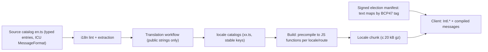

# QV-13 — Accessibility and Localization

**Module ID:** `experience-accessibility`  
**Status:** Draft  
**Owner:** Accessibility & i18n lead (proposed)  
**Last reviewed:** 2026-10-21  
**Related specs:** QV-10 (screens, copy), QV-06 (data), QV-07 (threats), QV-09 (locale/time fields), QV-11 (testing, gates), QV-34 (vectors for locale-sensitive encodings); ADR-003, 009, 010

## 1. Objective

Make every voter, organizer, trustee and observer task completable by people with disabilities, on slow networks and old devices, in their own language, **without** weakening privacy (no third-party services, no ballot content leaking to translators or translation tools) and without hiding the guarantees and non-claims behind language barriers. Accessibility is a security property here: a voter who cannot complete the Benaloh test or read the non-claims has a weaker guarantee than one who can.

## 2. Scope

### In scope
- Conformance target, per-component requirements, verification.
- Screen-reader, keyboard, low-vision, motor and cognitive requirements.
- Low-bandwidth, no-JS-where-possible, old-device behavior; performance budgets.
- i18n architecture (ICU MessageFormat), RTL, time zones, numbers, initial languages, translation workflow.

### Out of scope
- Legal accessibility compliance advice for any jurisdiction (we state a target, not legal conformance; see §12).
- Voice/telephone voting, paper ballots, native apps.
- Machine translation of ballot content.

## 3. Actors

| Actor | Goal | Preconditions | Outcome |
|---|---|---|---|
| Voter using screen reader | Cast, test, check receipt unaided | NVDA/JAWS/VoiceOver/TalkBack, current browser | Same outcome as sighted voter |
| Voter with low vision / zoom | Read rules, compare codes | 400% zoom / forced colors / large text | No loss of content or function |
| Voter with motor impairment | Operate without precise pointer or timing | Keyboard, switch, voice control | Completes without drag, hover, or tight timing |
| Voter with cognitive disability / low literacy | Understand rules and guarantee | Plain-language strings | Correct comprehension (QV-10 §13.3) |
| Voter on a 2G/3G phone | Cast reliably | Slow, intermittent network, old Android | Cast or CLI/assisted fallback |
| Voter in non-source language | Use all flows in own language | Supported locale | Full parity incl. non-claims |
| Translator | Contribute translations | Open workflow | No ballot content exposure |
| Organizer | Author multilingual ballot | — | Signed manifest with all languages |

## 4. Conformance target

**Decision (QV-ADR-P13-1):** QuietVote targets **WCAG 2.2 Level AA** for all voter-, trustee-, observer- and organizer-facing web interfaces, plus selected Level AAA criteria listed in §5.3. WCAG 2.2 is a W3C Recommendation (published 5 Oct 2023); it adds nine success criteria over 2.1 and obsoletes 4.1.1 Parsing (informational note: authors bound to WCAG 2.0/2.1 may still need to test 4.1.1) [search-verified 2026-10-21 via secondary sources; W3C primary text not reachable from the build environment — criteria numbers below to be re-confirmed against https://www.w3.org/TR/WCAG22/ before Review]. Equivalent standards (EN 301 549, Section 508) are tracked in the VPAT/ACR (§12) but do not change the target.

New in 2.2 and how we treat them:

| SC | Name | Level | Treatment |
|---|---|---|---|
| 2.4.11 | Focus Not Obscured (Minimum) | AA | Required; sticky header must not cover focused element (scroll-padding) |
| 2.4.12 | Focus Not Obscured (Enhanced) | AAA | Adopted (Should) — easy with no overlay chrome |
| 2.4.13 | Focus Appearance | AAA | Adopted (Should): 2 px outline, 3:1 contrast |
| 2.5.7 | Dragging Movements | AA | Required; every drag has a single-pointer alternative (option reorder) |
| 2.5.8 | Target Size (Minimum) | AA | Required (24×24 CSS px); our target is 44×44 for primary controls |
| 3.2.6 | Consistent Help | A | Required; help/report link in same place on every page |
| 3.3.7 | Redundant Entry | A | Required; never re-ask Election ID/passphrase within a session unnecessarily |
| 3.3.8 | Accessible Authentication (Minimum) | AA | Required for key unlock (§5.2 C-KEY) |
| 3.3.9 | Accessible Authentication (Enhanced) | AAA | Adopted (Should) |

## 5. Requirements

### 5.1 General requirements

| ID | Requirement | Pri | Acceptance criteria | Verif. |
|---|---|---|---|---|
| QV-13-REQ-001 | All in-scope pages shall conform to WCAG 2.2 AA. | M | Automated (axe-core via Playwright) zero serious/critical violations; manual audit with no AA failures; ACR published per release. | T, M |
| QV-13-REQ-002 | A page's accessibility tree shall be complete and correct with CSS and JS enabled, and read-only pages shall be complete with JS disabled (§7). | M | No-JS e2e passes; landmark/heading checks. | T |
| QV-13-REQ-003 | Every voter-flow task in QV-10 §6.2 and trustee/observer task in §6.3–6.4 shall be completable by keyboard alone, screen reader alone, and at 400% zoom / 320 CSS px width. | M | Task scripts executed per release; Sev-1 on failure (blocks release). | M |
| QV-13-REQ-004 | Color shall never be the sole carrier of meaning (election state, check pass/fail, error). | M | WCAG 1.4.1; every status has text + icon with accessible name. | T, M |
| QV-13-REQ-005 | The guarantee panel and non-claims (QV-10 §7) shall be provided in every offered language at parity and with equal prominence (see §9.6 gating). | M | Missing-key CI check; native review record. | T, R |
| QV-13-REQ-006 | The product shall support `prefers-color-scheme`, `prefers-reduced-motion`, `prefers-contrast`, and `forced-colors`. | M | Visual regression across modes; no animation > 5 s without pause; motion removed under reduce. | T |
| QV-13-REQ-007 | No timeouts shorter than 20 hours unless extendable (WCAG 2.2.1); session inactivity > 15 min shall warn ≥ 2 min before with option to extend; draft selections persist in memory during warning. | M | e2e with fake clock. | T |
| QV-13-REQ-008 | No CAPTCHAs, puzzles, image-recognition or timed tests anywhere; abuse controls use proof-of-work or token-based methods compatible with 3.3.8. | M | Static scan + review. | R |
| QV-13-REQ-009 | Page `lang` and per-fragment `lang` shall be set correctly; election-authored text in another language is marked with its own `lang`. | M | Automated check of `lang` vs manifest text map tags. | T |
| QV-13-REQ-010 | Organizer authoring tools shall help produce accessible ballots (required text for each option, no images-only options; alt text mandatory if images are ever allowed — images disallowed in MVP). | M | Form validation tests. | T |

### 5.2 Per-component conformance requirements

Component IDs are used by QV-10 and by test names (`a11y/<component>/*`). "SC" = WCAG 2.2 success criterion; levels A/AA unless noted.

| Component | Where used (QV-10) | Required behavior | Key SC | Notes for AT testing |
|---|---|---|---|---|
| **C-SHELL** header/nav/footer | all | Landmarks (`header`, `nav`, `main`, `footer`); skip link first focusable (target `main`); consistent order; help link location constant; Election ID in header exposed as text with `aria-label` giving spoken-friendly form ("K 7 Q M …" via grouped spans) | 1.3.1, 2.4.1, 2.4.2, 2.4.6, 3.2.3, 3.2.4, 3.2.6 | Page `<title>`: "{step} — {election name} — QuietVote" |
| **C-STATUS** state chip | header/dashboard | Text label + icon; `role="status"` only on change, not initial load | 1.4.1, 4.1.3 | |
| **C-STEPPER** multi-step | O1–O6, T3–T5, V1–V7 | Ordered list with `aria-current="step"`; each step a real page/route (history works); focus moves to step heading on navigation | 2.4.3, 2.4.6, 3.2.2 | |
| **C-FORM** text/select inputs | organizer, key | Visible persistent labels; hints via `aria-describedby`; errors: summary at top (focus moved, `role="alert"` once) + inline per field; no placeholder-as-label; `autocomplete` tokens where applicable | 1.3.1, 1.3.5, 3.3.1, 3.3.2, 3.3.3, 3.3.4 | |
| **C-CHOICE** radio/checkbox contest | V4 | Native `fieldset/legend` (contest title+description in legend); native inputs styled not replaced; group instructions (limit) in legend description; counter via polite live region updated on change **debounced**; over-selection prevented/explained; targets ≥ 44 px; option order identical in DOM and visual | 1.3.1, 1.3.2, 2.4.3, 2.5.8, 3.3.1, 3.3.4, 4.1.2 | Test NVDA+Firefox, JAWS+Chrome, VO+Safari, TalkBack+Chrome |
| **C-REORDER** option reorder (organizer) | O3 | Up/Down buttons per item as the primary method; drag optional; announce new position | 2.5.1, 2.5.7, 4.1.3 | |
| **C-REVIEW** review & seal | V5–V6 | Table of selections with row headers; "Change" links named "Change choice for {contest}"; the sealing step announces completion once ("Ballot sealed. Code is …") | 2.4.4, 4.1.3 | `translate="no"` on choices region (§9.7) |
| **C-CODE** ballot code / Election ID / hashes | V1,V6,V7,A | Rendered as text (never image); groups separated by real hyphens or `` with `aria-label`s so SR reads "4 Q 8 T"; copy button with visible + announced result; `dir="ltr"` and `<bdi>`; monospace font with 0/O and 1/I disambiguation; code never wraps mid-group; selectable | 1.3.1, 1.4.4, 1.4.10, 3.3.2 | Compare-codes task: provide "Read aloud slowly" disclosure with NATO-style spelled form (localized alphabet) |
| **C-QR** QR codes | receipt, second-device check | Always accompanied by text alternative (link/file/code) — QR is never the sole path; `alt` states purpose ("QR code containing your receipt; use the Save button instead if you cannot scan") | 1.1.1, 1.3.3 | |
| **C-BENALOH** cast/test dialog | V6–V8 | Not a modal trap: inline section; both actions equal DOM prominence; heading "Choose what to do next"; result table with headers; "Do these match what you picked?" as radio group; unambiguous focus return after "Seal a new ballot" | 2.4.3, 3.3.4, 3.2.2, 4.1.2 | Includes full second-device path text |
| **C-RECEIPT** | V7, V9 | Success message in heading (not just toast); actions are buttons/links with explicit names; downloadable file link has type/size; print stylesheet | 1.3.1, 2.4.4 | |
| **C-TABLE** data tables (counts, participation, checks) | V10, O8, A4 | Native `<table>` with `<caption>`, `<th scope>`; sortable headers as buttons with `aria-sort`; large tables paginated with live "Showing x–y of N"; horizontal scroll container is focusable + labeled and reflow-safe | 1.3.1, 1.4.10 | |
| **C-CHART** results visualization | V10 | Chart (SVG) is supplemental; **adjacent data table is the primary** and always present; chart has `role="img"` + concise name and description linking to table; patterns + direct labels, not color only; ≥ 3:1 non-text contrast | 1.1.1, 1.4.1, 1.4.11 | Non-visual equivalent decided: table + text summary ("Yes 132 (66%), No 66 (33%)…") |
| **C-CHECKLIST** verifier checks list | A4, V10 | List of checks, each with name + status text ("passed"/"failed"/"not run") + expandable details (`
`); counts summary in heading; failure moves focus to first failure on request ("Jump to first failure") | 1.4.1, 4.1.2 | |
| **C-COUNTDOWN** deadline | O8, V1 | Static textual time always; optional live countdown disabled for SR (`aria-hidden` visual ticker) and announces only thresholds (1 day, 1 hour, 10 min, 1 min) via polite region | 2.2.2, 4.1.3 | |
| **C-ALERT** errors/toasts | all | No auto-dismissing toasts for errors; errors persistent until resolved; `role="alert"` for blocking, `role="status"` for info; ≥ 5 s min for info toasts with pause/hover/focus keep | 2.2.1, 4.1.3 | |
| **C-DISCLOSE** accordions/glossary | V2, help | Native `
`; glossary terms are buttons toggling inline text (not hover-only tooltips); Esc dismisses; content hoverable/persistent | 1.4.13, 2.1.1 | |
| **C-KEY** key creation/unlock | V3 | Passphrase field allows paste, password-manager autofill (`autocomplete="new-password"`/`"current-password"`), show/hide toggle; no transcription of characters, no puzzle, no composition rules; alternative: key file via file chooser (native `input type=file`), or platform authenticator where later supported; no timed step | 3.3.7, 3.3.8, 3.3.9 (AAA) | Biometric/WebAuthn optional later |
| **C-FILE** file import/export | V3, O4, receipts | Native inputs; drag-and-drop area optional with button alternative; file errors precise with row numbers | 2.5.7, 3.3.1 | |
| **C-LANG** language switcher | header | Language names in own script (`autonym`, `lang` attribute set per option); persists locally; changing language keeps page state | 3.1.1, 3.1.2 | |
| **C-DIALOG** confirmations | freeze, cancel, clear device | Native `<dialog>` with focus trap + Esc + return focus; destructive confirmation by typed name is optional **and** has a checkbox alternative to avoid typing burden; label states consequence | 2.1.2, 2.4.3, 3.3.4 | |
| **C-TRUSTEE** ceremony progress | T3–T8 | Per-step named checks as C-CHECKLIST; long-running steps show progress via `<progress>` with text and `aria-live=polite` throttled to ≤ 1 update / 5 s | 4.1.3 | |
| **C-HELP** help/report | all | Same link and position on each page; contact mechanics don't require recall | 3.2.6 | |

### 5.3 Selected AAA and supplementary targets (Should)

| Target | Criterion | Rule |
|---|---|---|
| Reading level | 3.1.5 (AAA) | Voter-flow strings ≤ lower-secondary level (~grade 8 / CEFR B1) in English source; equivalent measure for translations is native-speaker review |
| Focus enhancements | 2.4.12, 2.4.13 | As in §4 |
| No timing | 2.2.3/2.2.6 (AAA) | Warn about data loss at timeouts; voting sessions have no timing other than election close |
| Contrast enhanced | 1.4.6 (AAA) | Body text ≥ 7:1 in default theme where design permits |
| Section headings | 2.4.10 (AAA) | Headings structure complete |
| Abbreviations | 3.1.4 (AAA) | Glossary term pattern QV-10 §7.6; first use expanded |
| Error prevention | 3.3.6 (AAA) | Submit flows reviewable/confirmable (already by design) |

### 5.4 Screen-reader requirements (cross-cutting)

- QV-13-REQ-020 (M): Support matrix for manual AT testing each release: NVDA (latest stable) + Firefox ESR and Chrome; JAWS (supported releases per vendor) + Chrome/Edge; VoiceOver macOS + Safari; VoiceOver iOS + Safari; TalkBack + Chrome Android. Acceptance: tasks T15 of QV-10 pass on each.
- QV-13-REQ-021 (M): Live regions used sparingly: at most one polite region and one assertive region per page; each message ≤ 140 chars; no repeated announcement of unchanged text.
- QV-13-REQ-022 (M): Sealing (client-side encryption/proof, up to several seconds) shall expose status text and completion announcement; page remains interactive for navigation; no focus loss on completion (focus moves to code heading).
- QV-13-REQ-023 (M): Hashes and codes: SR output must be intelligible (spelled by group); a "Copy" success is announced.
- QV-13-REQ-024 (S): Provide an "Accessibility help" page documenting keyboard shortcuts (none required; no single-key shortcuts → 2.1.4) and AT tips.

### 5.5 Keyboard, motor, low-vision, cognitive

| ID | Requirement | Pri | Criteria |
|---|---|---|---|
| QV-13-REQ-030 | No keyboard traps; logical tab order = reading order; visible focus indicator ≥ 2 px, ≥ 3:1 against adjacent colors; focused element never hidden by sticky UI | M | 2.1.1, 2.1.2, 2.4.3, 2.4.7, 2.4.11 |
| QV-13-REQ-031 | No single-character shortcuts, or they are disable-able/remappable | M | 2.1.4 |
| QV-13-REQ-032 | Pointer: all actions single-pointer, no path-based gestures; down-event not used to trigger (use click/up); label-in-name | M | 2.5.1, 2.5.2, 2.5.3, 2.5.7 |
| QV-13-REQ-033 | Reflow at 320 CSS px with no 2-D scroll except tables/code blocks with scroll containers; text resize 200% without loss; text-spacing override tolerance (1.4.12); content on hover/focus dismissible, hoverable, persistent | M | 1.4.4, 1.4.10, 1.4.12, 1.4.13 |
| QV-13-REQ-034 | Contrast: text ≥ 4.5:1 (3:1 large); UI components/graphics ≥ 3:1 in all themes including dark and forced-colors | M | 1.4.3, 1.4.11 |
| QV-13-REQ-035 | Orientation and input purpose: not locked to one orientation; `autocomplete` tokens for identity fields | M | 1.3.4, 1.3.5 |
| QV-13-REQ-036 | Cognitive: one primary action per screen; steps ≤ 7 per flow; consistent terminology (glossary); no jargon in primary flow without tooltip; progress indication; error messages state fix; undo/back at each step without data loss; avoid timeouts; avoid mixing languages | S→M for flow-critical | 3.2.1, 3.2.2, 3.3.x; COGA guidance |
| QV-13-REQ-037 | Plain-language "Explain this screen" disclosure available at V2, V6, V8, V9 with ≤ 80 words | S | — |
| QV-13-REQ-038 | Media: any tutorial video must have captions, transcript and no autoplay; MVP: no video | M | 1.2.x |

## 6. Verification

### 6.1 Automated (every change; blocks merge on serious/critical)
- `@axe-core/playwright` on every route and every state fixture (error, empty, loading, long text) in light/dark/forced-colors, LTR and RTL, 320 px and 1280 px.
- HTML validation, `lang` checks, landmark/heading-order checks, color contrast tokens unit-tested from the design tokens.
- Lighthouse a11y score is *not* a gate (coarse); axe + custom rules are.
- Custom lint: `` without `alt`; `div` with `onclick`; `tabindex>0`; `outline:none` w/o replacement; physical CSS properties (left/right/margin-left) in app CSS (RTL, §10); hard-coded strings in templates (i18n lint).
- Keyboard-walk test: scripted Tab/Shift+Tab traversal asserts order and no traps for each route.

### 6.2 Manual (every release touching UI; full audit every minor)
- AT matrix §5.4 over QV-10 tasks.
- Zoom 200%/400%, text-spacing bookmarklet, Windows High Contrast / forced colors, dark mode, reduced motion.
- Voice control (Dragon / iOS Voice Control) for label-in-name.
- Switch access spot-check on voter flow.
- Cognitive walkthrough with plain-language checklist.

### 6.3 User testing with disabled participants
At least 8 participants per summative round (QV-10 §13), across blind/screen-reader, low-vision/zoom, motor/keyboard-or-switch, deaf/hard-of-hearing (for any audio — none in MVP), dyslexia/cognitive. Compensate fairly; recruit via disability organizations; report findings into the release dossier.

### 6.4 Release-blocking (ties to QV-11 gates)
- Any WCAG 2.2 A/AA failure on a voter-flow component: block.
- Any task in QV-10 T15 not completable by AT user: block (Sev-1).
- Missing or unreviewed translation of a guarantee/non-claim string for an *offered* language: block that language (not whole release; language dropped from the offer list).
- Organizer/trustee/observer-tool AA failures: block unless a documented accessible alternative path exists (e.g., CLI) and issue is Sev-2 with date.

## 7. Low-bandwidth, no-JS, old devices

### 7.1 Principle
Cryptography (encrypting the ballot) must run on the voter's own device (ADR-004, 010). Everything that does **not** need to compute locally shall work without JavaScript, so that a failed script, hardened browser (Tor "Safest"), or a very old device can still read rules, see results and check the log.

### 7.2 Matrix

| Capability | No-JS | JS (modern) | CLI / assisted |
|---|---|---|---|
| Election overview, rules, privacy panel | Yes (server-rendered) | Yes | Yes (`quietvote show`) |
| Public record browse, entry detail, export download | Yes | Yes | Yes |
| Results page (tables, text) | Yes | Yes (+chart) | Yes |
| Receipt lookup by code | Yes (form POST/GET → rendered page; in-page proof verification not available) | Yes + client verification | Yes |
| Casting a ballot | **No** (encryption needs client compute) — but see below | Yes | Yes |
| Casting via no-JS upload of a ballot file produced by CLI/another device | **Yes** (plain `multipart/form-data` upload; server returns receipt page) | — | Yes |
| Verifier | Standalone page needs JS; CLI covers | Yes | Yes |
| Organizer console, trustee ceremony | No (client crypto/keys) | Yes | CLI parity for trustee operations (QV-12) |

### 7.3 Requirements

| ID | Requirement | Pri | Acceptance criteria | Verif. |
|---|---|---|---|---|
| QV-13-REQ-040 | Read-only pages in §7.2 shall be fully functional with JS disabled and shall show a `<noscript>` explanation on JS-only pages ("Casting needs JavaScript so your ballot can be locked on your device. You can also vote with the command-line tool or ask someone to prepare a ballot file for you.") plus instructions. | M | Playwright with `javaScriptEnabled:false`. | T |
| QV-13-REQ-041 | The voter flow total transfer on first visit (HTML+CSS+JS+fonts+i18n catalog for one language, gzip/brotli) shall be ≤ **300 kB**; JS ≤ 200 kB compressed including crypto libs; no web fonts beyond system stack by default (self-hosted optional ≤ 60 kB); i18n catalogs split per locale and per route (≤ 20 kB each). | M | Budget check in CI from esbuild metafile and network trace. | T |
| QV-13-REQ-042 | Time to interactive on reference "low" profile (Slow 3G emulation 400 kbps/400 ms RTT, 4× CPU slowdown) ≤ 10 s for V1; ballot seal for 20 selections in a single contest ≤ 8 s on reference low-end Android (2 GB RAM, ~2018 mid-range) `[to be calibrated on device lab]`. Sealing runs in a Web Worker with progress. | M | Lab measurement script; regression threshold +20%. | T |
| QV-13-REQ-043 | The submission shall tolerate intermittent connectivity: idempotent retry, request bodies ≤ 64 kB per ballot (size budget with 10 contests × 10 selections), resumable pending state (QV-10-REQ-020). | M | Fault-injection e2e. | T |
| QV-13-REQ-044 | Browser support baseline: evergreen Chrome/Edge, Firefox (incl. ESR), Safari — current and previous 2 major versions; plus extended support floor **ES2020 + BigInt + Web Crypto `getRandomValues` + `<dialog>`**: i.e. Chrome ≥ 80-class, Firefox ≥ 78 ESR-class, Safari ≥ 15.4-class (for `<dialog>`), Android WebView ≥ 90-class `[to be validated with browserslist and device lab]`. Tor Browser (ESR-based) shall be tested each release. Feature detection (not UA sniffing) yields `E-GEN-UNSUPPORTED` with CLI instructions. | M | Matrix run; unsupported-browser e2e. | T |
| QV-13-REQ-045 | Progressive enhancement: base HTML+CSS usable on small screens; JS enhances. No framework that requires hydration for read-only pages (ADR-003 minimal dependencies). | S | Architecture review. | R |
| QV-13-REQ-046 | Data-saver: `prefers-reduced-data` honored where available (no non-essential assets); no images in MVP flows; icons inline SVG sprite ≤ 10 kB. | S | Budget check. | T |
| QV-13-REQ-047 | The CLI voter and verifier shall have accessible output: plain text, no color-only meaning, `--no-color`, `--json`, screen-reader friendly line structure, localized messages by `LANG`. | M | CLI tests. | T |
| QV-13-REQ-048 | Offline-capable verifier page: single static HTML file (< 1 MB) verifying an exported bundle with no network access. | S | Offline e2e (QV-11). | T |
| QV-13-REQ-049 | Print stylesheet for announcement (Election ID, QR + text) and receipt; works in black-and-white. | S | Visual test. | T |

## 8. Accessible authentication and recovery

QuietVote has no passwords-for-accounts; the sensitive step is unlocking/creating a voting key (QV-10 V3) and trustee key operations.

- No cognitive function test (no memorize/transcribe/puzzle); allowed mechanisms: paste-able passphrase with password-manager support, key file, platform authenticator (future).
- Recovery (QV-04): organizer re-issues a voter credential; UX path described in QV-10 `E-KEY-LOST`. The request can be made by any channel (voice, email, in person); the UI provides a copyable "recovery request" text so no form-filling in the client is required.
- Trustee share backup: encrypted file + printed recovery sheet using **text** (not just QR); restore test step (QV-10-REQ-023). Sheet printed in accessible format on request (large print, Braille-ready plain text export).
- Re-authentication is never required more than once per session beyond the key unlock (3.3.7).

## 9. Internationalization architecture

### 9.1 Overview

### 9.2 Requirements

| ID | Requirement | Pri | Acceptance criteria | Verif. |
|---|---|---|---|---|
| QV-13-REQ-060 | All user-visible strings shall be message IDs in catalogs using **ICU MessageFormat** syntax (plural, select, selectordinal, number/date/time arguments); no string concatenation, no sentence fragments assembled in code. | M | i18n lint fails on literal text in templates; lint on concatenation patterns. | T |
| QV-13-REQ-061 | Catalogs shall be typed TypeScript modules with namespaces by flow and stable IDs never reused for a different meaning. English entries contain `message`, translator `description`, `sensitivity` (`guarantee` or `normal`), and optional `maxLength`; locale modules map the same IDs to translated messages. | M | Typecheck and CI catalog validation enforce exact key parity, valid ICU messages and matching placeholders/plural/select structure. | T |
| QV-13-REQ-062 | The web app shall use the project-maintained TypeScript ICU compiler at build time to emit registered formatter functions; the browser app shall not parse source ICU messages at runtime. Number, plural, list and relative-time formatting shall use the relevant `Intl` APIs. | M | Tests compare emitted formatters with source formatting across every catalog message, reject malformed ICU, and verify the built app contains no ICU parser; the existing compressed-size budget remains enforced. | T |
| QV-13-REQ-063 | Locale negotiation: URL path/query `?lang=` > locally stored preference > `Accept-Language` (server-rendered pages) > default `en`; the server never records the language preference (QV-06); locales identified by **BCP 47** tags (e.g. `pt-BR`, `ar`, `zh-Hans`). | M | Unit tests of negotiation. | T |
| QV-13-REQ-064 | Fallback chain: `xx-YY → xx → en` for **normal** strings; for strings with `sensitivity: guarantee` there is **no silent fallback**: if missing, the language is not offered for voter flows (build fails for that locale). | M | CI matrix. | T |
| QV-13-REQ-065 | Pseudo-localization locales `en-XA` (accented/expanded +40%) and `ar-XB` (RTL pseudo) are built and used in CI visual tests to detect truncation/hard-coded strings/RTL bugs. | M | Visual regression run. | T |
| QV-13-REQ-066 | Election-authored content (name, description, option labels) is stored in the **signed manifest** as maps `{ "en": "…", "es": "…" }` keyed by BCP 47; the manifest declares `default_language` and `languages[]`; every offered language shall have complete text for all fields (freeze error `E-ORG-LANG`); the language set and text are covered by the manifest hash (Election ID) — so translations cannot be altered by the operator. | M | Manifest validation tests; hash coverage test (QV-34). | T |
| QV-13-REQ-067 | UI strings never contain election data; election data is inserted only as arguments. Translators never see election data (§11). | M | Catalog lint: no placeholders named like contest/option content inside translator-visible examples. | T, R |
| QV-13-REQ-068 | Numbers, dates, lists, plurals and units via `Intl` with explicit locale; **digits**: UI numerals follow locale defaults, but *codes, hashes, Election ID and ballot counts used in verification exports* are always ASCII/Latin (use `-u-nu-latn` where locale default is non-Latin) so they are copy-comparable; counts in result tables follow locale numbering with an ASCII `data-value` in export. | M | Snapshot tests for `ar`, `fa`, `hi`. | T |
| QV-13-REQ-069 | Machine-readable exports (receipts, verifier JSON, bundle) are locale-independent (ASCII, RFC 3339 UTC timestamps, no localized numerals); only human-readable renderings are localized. | M | Schema tests (QV-34). | T |
| QV-13-REQ-070 | Governance terminology: a **glossary** per language (term, definition, approved translation, forbidden alternatives) for: trustee, ballot, receipt, seal/cast/test, public log, Election ID, quorum, threshold, supersede, tally, eligible, revote. Translators must follow it; mismatches flagged by lint. | M | Glossary lint. | R, T |
| QV-13-REQ-071 | Text expansion tolerance ≥ 40% (container layouts flexible); no fixed-width buttons; no text in images. | M | Pseudo-locale tests. | T |
| QV-13-REQ-072 | Sorting/collation by `Intl.Collator` for the viewer's locale in lists (display only; canonical order in protocol data is byte order and unaffected). | S | Unit. | T |
| QV-13-REQ-073 | Names: forms allow single-field full name; no assumptions about first/last; Unicode NFC normalization for display names; for identity comparisons (roll import) NFKC + case-fold + confusables warnings (display-only, not security-bearing) — canonicalization rules for anything hashed belong to QV-16/QV-09. | M | Unit. | T |

### 9.3 Initial languages (decision QV-ADR-P13-2)

First target community is unconfirmed (QV-10 Q-10-1); default launch set optimizes coverage of likely early adopters and exercises each script/direction class:

| Tier | Locale | Why | Gate to ship in voter flow |
|---|---|---|---|
| Source | `en` | Source language, plain-English authored | Native editorial review |
| Tier 1 | `es`, `fr`, `de`, `pt-BR` | Large speaker populations; Latin script; complex plurals (fr/pt), gender, formal/informal register decisions | 100% voter-flow + guarantee strings, native reviewer sign-off, glossary |
| Tier 1 (RTL pilot) | `ar` | Exercises RTL, 6 plural categories, numerals | Same, plus RTL manual audit |
| Tier 2 (community) | `zh-Hans`, `ru`, `hi`, `uk`, `fa` (RTL), `he` (RTL), `id`, `tr`, `pl`, `it`, `nl` | Added on request via workflow | Offered only when guarantee strings complete + 1 native reviewer |
| Pseudo | `en-XA`, `ar-XB` | Test only | Never shipped |

Rule: the **organizer's** languages come from the offered list; voters may use any shipped locale for UI even if the election text isn't translated (election text then shown in manifest languages with a visible notice — "This election is written in {languages}").

### 9.4 Right-to-left support

| ID | Requirement | Pri | Criteria |
|---|---|---|---|
| QV-13-REQ-080 | Document direction via `dir` on `<html>` from locale; CSS uses **logical properties** only (`margin-inline-start`, `inset-inline`, `text-align: start`, `border-start-*`); lint bans physical properties in app CSS. | M | Lint + RTL visual tests. |
| QV-13-REQ-081 | Directional icons (back/next/progress) mirror; non-directional icons (check, warning, lock) do not; icons set `dir`-aware via CSS class. | M | Visual test. |
| QV-13-REQ-082 | Bidi isolation: all embedded LTR tokens (Election ID, codes, hashes, URLs, numbers with Latin digits, email) wrapped in `<bdi dir="ltr">` or `unicode-bidi: isolate`; user-provided strings use `dir="auto"` + `<bdi>`; mixed-direction option labels are tested with bidi corpora (including Unicode bidi control characters in input — must be sanitized/neutralized in display to prevent "Trojan Source"-style spoofing: strip or visibly escape U+202A–U+202E, U+2066–U+2069 in organizer-supplied text; these are rejected at manifest validation, QV-34 negative vectors `manifest/bidi-controls`). | M | Unit + visual. |
| QV-13-REQ-083 | ICU message arguments inserting LTR/RTL fragments use FSI/PDI isolation (via formatter) so punctuation doesn't flip. | M | Snapshots. |
| QV-13-REQ-084 | Layout of tables, steppers, progress, sliders and wizard buttons mirrored; keyboard arrow-key semantics follow visual direction for radiogroups per WAI-ARIA behavior (browser-native). | M | Manual. |

### 9.5 Time zones, dates and deadlines

Time is a correctness and fairness issue: a voter who misreads a deadline loses their vote.

| ID | Requirement | Pri | Acceptance criteria | Verif. |
|---|---|---|---|---|
| QV-13-REQ-090 | The manifest stores `opens_at`, `closes_at` as **RFC 3339 UTC instants** (e.g. `2027-03-14T17:00:00Z`) plus `display_time_zone` as an **IANA zone ID** (e.g. `Europe/Berlin`) chosen by the organizer. Authority for open/close is the instant, never wall-clock text. | M | Manifest schema (QV-09); vectors. | T |
| QV-13-REQ-091 | Every deadline shown in UI/notifications/exports shall display (a) the election zone with explicit offset and zone name, and (b) the viewer's zone if different, e.g. `Closes Sun 14 Mar 2027, 18:00 CET (UTC+01:00, Europe/Berlin) — your time: Sun 14 Mar 2027, 12:00 EDT (America/New_York)`. | M | Snapshot tests across DST boundaries. | T |
| QV-13-REQ-092 | Organizer input of local times resolved against `display_time_zone` with explicit handling of DST gaps (non-existent local time → error with suggested alternatives) and folds (ambiguous time → must choose offset); preview shows UTC instant. | M | Unit tests with 2027 DST transitions. | T |
| QV-13-REQ-093 | Server time vs client clock: client obtains authoritative time from signed board responses (tree head timestamp) and shows `Your device clock is {delta} off` if > 60 s; voting eligibility is decided by the board's time, not the client's; countdown uses server-offset-corrected time. | M | Clock-skew e2e. | T |
| QV-13-REQ-094 | Closing-time race behavior: ballot is accepted iff board receipt time < `closes_at`; client shows `E-VOT-CLOSED` otherwise; the final minute displays a "Closing in less than 1 minute — submit now or it won't count" polite announcement (assertive only at ≤ 10 s). Grace/extension policy per QV-03; never silent. | M | e2e with fake clock. | T |
| QV-13-REQ-095 | Calendar (ICS) export generated locally, containing UTC times and zone; includes Election ID in description; no remote fetch. | S | Test. | T |
| QV-13-REQ-096 | Use `Intl.DateTimeFormat` with `timeZone` option; IANA tzdata is that of the browser, so the manifest also carries the **UTC offset at open and close as computed by the organizer's client** and the verifier warns on mismatch (tzdata skew). Zones with rule changes during the election window show a warning. | S | Unit with tzdata mock. | T |
| QV-13-REQ-097 | Calendar systems: Gregorian default; locale calendar (e.g. `ar-SA` Umm al-Qura, `fa-IR` Persian, `th-TH` Buddhist) shown via `Intl` only when the locale's default applies, *always* with ISO date (`2027-03-14`) as secondary text in election deadlines to disambiguate. | M | Snapshot. | T |

### 9.6 Quality gating for translations

- **Sensitivity classes:** `guarantee` (QV-10 §7.1–7.5, 7.7, error messages that describe integrity alarms), `normal` (everything else).
- Gate for `guarantee` strings in any shipped locale: (1) professional or qualified native translation, (2) second-person review, (3) **back-translation check** by a third person to English with meaning diff reviewed by protocol owner, (4) recorded in `i18n/review/<locale>.json` with reviewer pseudonym/date/hash of source string. Source-string change invalidates review (hash mismatch fails CI for that locale — language dropped from offered list until re-reviewed).
- QV-10 comprehension questions (§13.3) run in each Tier-1 language at least once pre-release with ≥ 5 native speakers (Should for Tier 2).

### 9.7 Translation-leak prevention

Threats: (i) ballot content (proposal text, options) sent to translators or machine-translation vendors before the election is public; (ii) voter selections leaked through browser auto-translation or extension; (iii) translators' tools embed telemetry.

| Control | Detail |
|---|---|
| Separation | **UI catalog** (static, public, product-level) vs **election content** (organizer-authored, in manifest). The translation workflow touches only the UI catalog. Election content is translated by the organizer (or their chosen translators) inside the organizer console / offline file, never via project infrastructure. |
| No data in strings | Catalog contains no election data; examples in translator context use fixed fictional placeholders ("Community Garden Budget"). CI scans the catalog for strings matching any real election manifest in the test corpus. |
| Translation platform | Self-hostable, open workflow (Git PRs / self-hosted Weblate); translators do not need accounts that leak identity beyond what they choose; **no third-party MT/TM APIs in the pipeline**; if MT is used for drafting, it is run locally and results still need human review. |
| Release integrity | Catalogs are part of the reproducible build and signed release manifest (ADR-010); the client verifies catalog hash with the bundle; translators cannot ship text to production without maintainer merge and CI gate. |
| Organizer authoring | Console flags "Don't paste confidential text into online translators" and offers an *offline translation file* export/import (XLIFF 2.0 or JSON) for the organizer's own translator; import validates language tags and completeness. Imports never go to a project service. |
| Browser auto-translate | Review/choice/receipt regions set `translate="no"` and `<meta name="google" content="notranslate">` on those routes only; the rest of the app stays translatable by browsers. Detection heuristic (`<html class="translated-*">`, `lang` mutation by MutationObserver) shows the QV-10 banner on review/seal routes: *"Your browser appears to be translating this page. Translation tools may send what you see here to another company. Turn translation off for this page or use {language} in the language menu."* Trade-off: screen-reader users relying on translation get native in-app languages instead; documented as residual risk. |
| Spellcheck/autofill | Organizer free-text fields set `spellcheck="false"` for sensitive drafts; passphrase fields `spellcheck=false autocapitalize=off autocorrect=off`. |
| Screenshots/telemetry | No analytics; error reports contain no strings from election content. |
| Draft secrecy | Organizer draft elections stored client-side/ server only as encrypted-at-rest per QV-06; the translation of a **draft** manifest never leaves the organizer's browser or chosen files. |

### 9.8 Pluralization, gender and register guidance
- Always use ICU `plural`/`select`; never "(s)". Provide `description` with an example for every plural/select argument.
- Avoid gendered first/second-person references in source English; target languages choose neutral wording where possible; document register (informal "tú"/"du" vs formal) per locale in the style guide: default **informal singular** for voter-facing text in `es`, `fr`(vous formal default) — decision in style guide `i18n/style/<locale>.md` `[to be set with reviewers]`.
- Numbers ≥ 1000 grouped per locale; percentages via `Intl.NumberFormat` with `style: 'percent'` (one decimal max) and exact counts always adjacent (no rounding-only reporting).

## 10. Data and privacy
- Language preference and a11y preferences stored in localStorage only; never sent to server (server uses `Accept-Language` only to select a no-JS page language and does not log it, QV-06).
- Assistive-technology use is not detected, logged or transmitted. No fingerprinting by feature probing beyond what is needed locally.
- Translators: contribute via public channels; no election data; no personal data stored by project beyond VCS identity chosen by them.

## 11. Security and abuse cases

| Case | Cause | Impact | Mitigation | Residual |
|---|---|---|---|---|
| Spoofed meaning via translation error ("cast" vs "test") | Translator mistake | Voter discards ballot or misunderstands audit | Glossary + back-translation + comprehension test | Residual mistranslation |
| Malicious translation PR changes guarantee copy | Contributor/supply chain | False assurance | Hash-pinned reviews, maintainer merge, reproducible build | Collusion of reviewers |
| Bidi spoofing of option labels | Organizer/attacker | Visually reorder labels | Reject bidi controls in manifest; `<bdi>`; isolate | Homoglyph confusables (display warning) |
| Deadline misread across zones | UX | Lost vote | Dual-zone display, ISO date, reminders | User ignoring |
| Auto-translate leaks review screen | Browser | Disclosure | `translate="no"`, banner | Extensions |
| Accessible alternative weaker than main path (e.g., CLI) | Design | Unequal guarantees | Parity requirements; CLI supports Benaloh test | — |
| Abuse controls (CAPTCHA) block AT users | Anti-spam | Exclusion | Ban CAPTCHAs (REQ-008) | Spam handled by eligibility-gating |
| Locale-specific digit mismatch in codes | Localization | Comparison failure | ASCII codes always (REQ-068) | — |
| Pseudo-accessible "overlay" widgets | Third-party | Privacy + a11y regressions | No third-party scripts (ADR-009) | — |

## 12. Interfaces and dependencies

- Upstream: QV-10 (components, tasks, strings), QV-09 (manifest `languages`, `display_time_zone`, `opens_at/closes_at`; export schemas), QV-16 (canonical encoding of text — NFC/UTF-8 and bidi-control rejection rules must be identical in all implementations; vectors in QV-34).
- Downstream: QV-11 (a11y/i18n tests in pyramid and release gates), QV-12 (support channels in multiple languages), QV-14 (cost of translation/audit).
- **ACR/VPAT:** produced per minor release using the VPAT 2.5 WCAG template `[UNVERIFIED version]`; EN 301 549 mapping included; status "Supports/Partially Supports/Does Not Support" per criterion, linked to evidence in `evidence/a11y/<release>/`.
- Versioning: catalogs versioned with the app; message ID changes tracked in `i18n/CHANGELOG.md`.

## 13. Operations
- Accessibility feedback channel (email + issue tracker + anonymous form), response SLA: acknowledge in 3 business days, Sev-1 fix target 14 days (self-host: best effort).
- Translation maintenance: owner per locale; a locale with no active maintainer for 12 months moves to "unmaintained" and is removed from default offering if strings drift.
- Self-hosted deployments may add locales via config catalog packs; unreviewed packs show a visible "community translation" notice and are excluded from `guarantee` strings unless reviewed (they fall back to disabling the voter flow in that language unless the operator acknowledges).

## 14. Testing and verification (summary; details in QV-11)
- Unit: message compile, plural rules, time-zone resolution (DST fixtures for America/New_York 2027-03-14 spring-forward, Europe/Berlin 2027-03-28 and 2027-10-31, Australia/Lord_Howe 30-min DST, Asia/Kolkata no DST, Pacific/Apia legacy skip) `[verify exact 2027 dates with tzdata at implementation]`.
- Integration: locale negotiation; manifest language completeness; bidi-control rejection.
- E2E (Playwright): full voter flow in `en`, `ar` (RTL), `en-XA` with axe at each step; no-JS read-only checks; keyboard-only walk; reduced-motion; forced-colors; 320 px.
- Manual: AT matrix, translation review, back-translation records.
- Performance: size and time budgets in CI.

## 15. Constraints and assumptions
- Assumes the QV-10 flows are the only interactive surfaces in MVP.
- Assumes no third-party translation/MT service is acceptable (privacy stance).
- The CLI voter provides the accessible fallback path for environments where browser limitations bite; its parity is a requirement, not a nicety.
- Unicode MessageFormat 2 (MF2) was declared Stable in CLDR 47 (13 March 2025); v1 syntax is chosen for tooling maturity, not because MF2 is unstable; migration tracked (open question Q-13-5). `[VERIFIED: Unicode blog 2025/03 and CLDR 47 release notes, per part-2-standards-crypto.md S15]`.

## 16. Proposed ADRs

| ID | Proposal | Rationale |
|---|---|---|
| QV-ADR-P13-1 | WCAG 2.2 AA target + listed AAA; no CAPTCHAs; AT test matrix | Measurable, current standard |
| QV-ADR-P13-2 | Initial locales en, es, fr, de, pt-BR, ar (+ tiers, gating) | Coverage and RTL exercise |
| QV-ADR-P13-3 | Guarantee-class strings have no fallback; locale dropped if unreviewed | Honest-guarantee parity |
| QV-ADR-P13-4 | Election content translations live in signed manifest (hash-covered) | Prevents operator altering translated rules; keeps content out of translation pipeline |
| QV-ADR-P13-5 | No-JS casting via CLI-produced ballot-file upload | Accessibility/old-device/hardened-browser path |

## 17. Open questions

| Question | Owner | Target | Proposed default |
|---|---|---|---|
| Q-13-1 First community's languages | Product | M1 | Ship Tier-1 set; add first-community language immediately |
| Q-13-2 Which visualizations need non-visual equivalents | A11y lead | M2 | Table is mandatory for all charts (decided) |
| Q-13-3 Reference low-end device list | QA | M2 | Moto G-class Android + older iPhone SE |
| Q-13-4 Formal/informal register per locale | Translators | per locale | Style guide |
| Q-13-5 Adopt MF2 later? | i18n lead | 2027 | Stay on MF1 until toolchain mature |
| Q-13-6 Audio (read-aloud) of codes: system TTS only? | A11y | M3 | Rely on AT; no custom audio |
| Q-13-7 Accessibility of printed trustee recovery sheets (Braille, large print) | Ops | M3 | Provide plain-text export |

## 18. Approval and change history

| Reviewer | Decision | Date | Notes |
|---|---|---|---|
| Project owner | Pending | — | Draft authored 2026-10-21 |

## References
- W3C, Web Content Accessibility Guidelines (WCAG) 2.2 — https://www.w3.org/TR/WCAG22/ (primary URL not fetchable from build environment on 2026-10-21; list of 2.2 additions cross-checked via secondary sources: Deque, "WCAG 2.2 Removes 4.1.1 Parsing and How axe-core is Impacted" https://www.deque.com/blog/ ; Somerset playbook https://playbook.somerset.gov.uk/accessibility/whats-new-in-wcag-2-2 ). Other criteria numbers (1.x–3.x from WCAG 2.0/2.1) are from author knowledge `[UNVERIFIED in session]`; re-confirm before Review.
- ICU MessageFormat — https://unicode-org.github.io/icu/userguide/format_parse/messages/ ; Unicode CLDR plural rules https://cldr.unicode.org `[UNVERIFIED in session]`.
- BCP 47 / RFC 5646; RFC 3339 (timestamps); IANA Time Zone Database.
- Unicode UAX #9 (Bidirectional Algorithm) and UTR #36/#39 for confusables/Trojan Source (Boucher & Anderson, "Trojan Source", 2021) `[UNVERIFIED in session]`.
- W3C COGA — Making Content Usable for People with Cognitive and Learning Disabilities.
