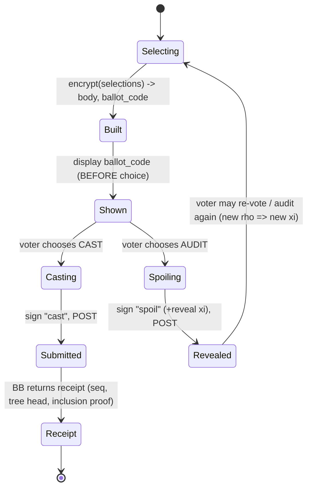

# QV-16 — Cryptographic Protocol (Byte-Level)

**Module ID:** `crypto-protocol`  
**Status:** Draft  
**Owner:** Lead protocol author (cryptography); independent cryptographic review required before any non-experimental claim (QV-11)  
**Last reviewed:** 2026-10-21  
**Protocol suite identifier:** `qv1-r255-sha2` (this document defines suite version 1)  
**Related specs:** QV-04 (identity/eligibility), QV-05 (ballot protocol), QV-07 (threat model), QV-09 (API/data contracts), QV-17 (key ceremony), QV-18 (bulletin board), QV-19 (client/supply chain), QV-20 (voting methods), QV-34 (test vectors), baseline ADRs 001–013 in `decision-log.md`

> **Reading guide.** Sections 1–4 give scope and the requirement list. Section 5 is the normative protocol, written so that two independent implementers produce byte-identical hashes, proofs-of-form and records. Sections 6–14 cover the remaining template items. Section 15 lists proposed ADRs. Appendix A is a worked tiny example with the exact order of hashed fields; Appendix B is the pitfalls checklist; Appendix C is the verifier check list. Keywords **shall/shall not/should/may** are used in the RFC 2119 sense.
>
> **Source verification note (honest disclosure).** At authoring time (2026-10-21) the sandbox could not resolve `rfc-editor.org`, `datatracker.ietf.org` or `electionguard.vote` for direct fetching; only web-search snippets were available. Facts confirmed by search are marked in §16 as *verified (search)*. The ristretto255 base-point encoding and group order were additionally **recomputed independently** from the RFC 9496 algorithms during authoring (§5.2). Everything else cited from memory is marked `[UNVERIFIED-OFFLINE]` and must be re-checked by the reviewer before this document leaves Draft. `docs/research/R-01` did not exist when this was written; if it appears it must be reconciled with §15 and §16.

---

## 1. Objective

Define, at byte level, the cryptographic protocol by which a QuietVote election (a) fixes its rules in a signed manifest, (b) creates a threshold election key with no trusted dealer, (c) lets eligible voters submit encrypted, proven-well-formed, signed ballots with cast-or-audit assurance, (d) lets any observer verify every step from the public record, and (e) decrypts only the aggregate tally (and voluntarily spoiled ballots), never an individual cast ballot.

The design is a conservative composition of published constructions (Helios, ElectionGuard lineage; Cramer–Gennaro–Schoenmakers exponential-ElGamal voting; Feldman VSS; Chaum–Pedersen and CDS sigma protocols; Benaloh challenge). **No new primitives are invented.** Where QuietVote makes a choice the literature leaves open (serialization, label registry, nonce hedging, DKG complaint mechanics, `supersedes` chains) the choice is isolated, justified and proposed as an ADR (§15).

## 2. Scope

### In scope
- Notation, group and scalar encodings, hash functions, Fiat–Shamir transcript framing and the label registry.
- Canonical serialization and protocol versioning / algorithm agility.
- Election manifest and "election context" binding.
- Distributed key generation (Feldman VSS + proofs of possession + complaints) and disqualification.
- Ballot encryption, proofs, nonce derivation, ballot code, Benaloh cast-or-spoil, ballot signing, revoting and ordering.
- Per-ballot verification, aggregation, threshold partial decryption, Lagrange combination, discrete-log recovery, tally publication.
- Complete verifier algorithm, error taxonomy, security-parameter justification, test-vector requirements.
- Phase statement: what is Phase 1 (ADR-005) and which interface hooks exist for Phase 2/3.

### Out of scope
- Voting-method semantics beyond the encodings needed here (QV-20), trustee ceremony procedures and custody (QV-17), bulletin-board log mechanics, witness protocol and receipts transport (QV-18), HTTP/API shapes (QV-09), UI (QV-10), client delivery integrity (QV-19), network anonymity (QV-26).
- Ranked/weighted/delegated ballots (Phase 2 of ADR-006), write-ins (excluded, ADR-006).
- Post-quantum or everlasting-privacy constructions (ADR-013 research track).
- The concrete Phase 2 blind-signature token protocol and Phase 3 ZK-membership circuit: only interface hooks are defined here (§5.21).

## 3. Actors

| Actor | Goal | Preconditions | Main outcome |
|---|---|---|---|
| Organizer / coordinator | Publish manifest, run phases | Holds coordinator key(s) listed in manifest | Signed manifest; phase markers on the log |
| Trustee *T_i* | Hold a key share; decrypt only the tally | Ed25519 signing key in manifest; secure device | DKG contribution; partial decryptions with proofs |
| Voter | Cast intent privately and verifiably | Ed25519 voter key in roll | Signed encrypted ballot; tracking code; optional audits |
| Bulletin board (untrusted) | Order and publish artifacts | — | Append-only log; sequence numbers (QV-18) |
| Verifier / auditor | Independently check everything | Public record only | Accept/reject verdict with located failure |
| Adversary | See Section 7 | — | — |

## 4. Requirements

All requirements are normative. "Verification" names the primary method; QV-34 vectors cover every Must unless stated.

| ID | Requirement | Priority | Acceptance criteria | Verification |
|---|---|---|---|---|
| QV-16-REQ-001 | All group elements shall be 32-byte canonical ristretto255 encodings (RFC 9496 §4.3.1 decode, §4.3.2 encode); decoders shall reject non-canonical, negative-`s` and non-square encodings. | Must | Known invalid encodings from RFC 9496 Appendix A are rejected; round-trip of valid vectors is exact. | Unit + QV-34 |
| QV-16-REQ-002 | All scalars on the wire shall be 32-byte little-endian integers strictly less than ℓ; values ≥ ℓ shall be rejected, never reduced. | Must | Vector with `s = ℓ` and `s = 2^256−1` rejected on every parser. | Unit + QV-34 |
| QV-16-REQ-003 | Secret scalars (private keys, ElGamal randomness, sigma-protocol nonces, polynomial coefficients) shall be non-zero; implementations shall resample/increment-counter on zero. | Must | Property test with injected zero RNG output yields retry, never zero. | Unit |
| QV-16-REQ-004 | Every Fiat–Shamir challenge and every derived identifier shall be computed with the framed hash of §5.3 using a label from the registry (§5.4) and shall include the election context and the complete statement. | Must | Cross-check: mutating any statement field, label, or context changes the challenge; static test that no hash call site lacks a registry label. | Unit + code review |
| QV-16-REQ-005 | Artifacts shall be serialized as RFC 8785 JSON under the strict "QV-JSON" profile of §5.5; hash/signature inputs shall be exactly the JCS bytes (or the binary frames of §5.3). | Must | Two independent serializers produce identical bytes for the 20 QV-34 canonicalization vectors, including key order, escapes and rejected inputs. | Conformance suite |
| QV-16-REQ-006 | Every artifact shall carry `proto` = `qv1-r255-sha2`; verifiers shall reject unknown protocol identifiers without attempting best-effort processing. | Must | Artifact with `proto:"qv2-…"` yields `E_VERSION`. | Unit |
| QV-16-REQ-007 | The manifest shall conform to §5.6; its hash is the root of all domain binding. | Must | Schema validator rejects each missing/extra/mistyped field in the negative corpus. | Schema test |
| QV-16-REQ-008 | The DKG shall follow §5.7 (commit, reveal, share distribution, complaints, finalization, key confirmation); no single party, including the coordinator or the board operator, shall learn the joint secret or choose the joint key. | Must | Simulation with t−1 corrupt trustees recovers no information on secret (statistical test of share distribution); rushing-adversary test shows commit-reveal prevents key bias via adaptive coefficient choice. | Review + simulation |
| QV-16-REQ-009 | Every DKG coefficient commitment and the encryption key of each trustee shall be accompanied by a Schnorr proof of possession bound to the dealer index, coefficient index and DKG context. | Must | Rogue-key test: dealer publishing `A = Y_other − …` without knowledge fails verification. | Unit |
| QV-16-REQ-010 | Invalid or missing DKG deliveries shall be adjudicated deterministically from the public record per §5.7.6; the qualified set *Q* shall be recomputable by any verifier and shall be required to satisfy \|Q\| ≥ t. | Must | Table-driven test over complaint scenarios (§5.7.6) yields documented *Q*; \|Q\|<t aborts. | Unit |
| QV-16-REQ-011 | Each ballot selection shall be an exponential-ElGamal ciphertext with a CDS 0/1 proof (§5.9–5.10); contests with a selection limit shall have placeholder selections and a limit proof; contests without a limit shall have neither. | Must | Valid ballot verifies; ballot with a selection encrypting 2, −1, or an overvote fails with `E_CDS` / `E_LIMIT_PROOF` in 100% of fuzzed cases. | Unit + property |
| QV-16-REQ-012 | Every ballot proof transcript shall bind the voter binder (§5.8) so that proofs cannot be transplanted to another voter's ballot. | Must | Ballot-copy attack (re-sign copied ciphertexts+proofs under another key) fails `E_CDS`. | Security test |
| QV-16-REQ-013 | Encryption randomness and proof nonces shall be derived per §5.11 (hedged: voter secret, fresh CSPRNG bytes, election context, plaintext vector), such that nonce reuse across distinct plaintexts is impossible even with a failed RNG. | Must | Test with constant RNG: same inputs give identical ballots, different plaintexts give independent-looking randomness (distinct r values). | Unit |
| QV-16-REQ-014 | Clients shall implement the Benaloh cast-or-spoil flow of §5.13: the ballot code is displayed before the cast/spoil choice and the choice is not communicated to the client code path that constructs the ballot. | Must | UI/E2E test: ballot object is immutable after code display; spoil path reveals ξ; recompute equals ballot. | E2E |
| QV-16-REQ-015 | Spoiled ballots shall be unforgeably distinguished from cast ballots (distinct signature label) and a ballot code that is both spoiled and cast shall be flagged and excluded. | Must | Test: cast+spoil of same code → `E_SPOILED_CODE_CAST`, ballot not counted, alarm raised. | Unit |
| QV-16-REQ-016 | Voter ballots shall be Ed25519 signed over the framed digest of §5.12 with strict (RFC 8032, non-ZIP-215) verification. | Must | Non-canonical `S`, small-order `A`, and non-canonical `A` vectors rejected. | QV-34 |
| QV-16-REQ-017 | Ballot validity shall be context-independent of client clocks; ordering and the "latest valid ballot wins" rule shall use bulletin-board sequence numbers and the `supersedes` chain (§5.14). | Must | Reordered-log test: operator cannot make an older ballot override a newer one without a verifier-detectable chain violation. | Unit + log test |
| QV-16-REQ-018 | Tally aggregation, partial decryption with Chaum–Pedersen proofs, Lagrange combination for any subset ≥ t of Q, and bounded discrete-log recovery shall follow §5.15–5.18, with canonical subset selection so all verifiers derive the same result. | Must | Different valid trustee subsets of size ≥ t produce identical `t_o`; t−1 trustees cannot proceed. | Unit + QV-34 |
| QV-16-REQ-019 | The tally record format of §5.19 shall be published as a log entry and shall allow full recomputation without the trustees. | Must | Verifier recomputes every field from the record. | Verifier CLI |
| QV-16-REQ-020 | A standalone verifier shall implement the full check list of Appendix C, report each failure with an error code from §5.20, and exit non-zero on any failure. | Must | Negative corpus: each Appendix C check has ≥1 failing artifact detected with the specific code. | Conformance suite |
| QV-16-REQ-021 | Implementations shall use only the libraries named in ADR-003 (`@noble/curves`, `@noble/hashes`) plus the platform's AES-GCM; no hand-rolled field, group or hash code. | Must | Dependency audit; lint rule forbids other crypto imports. | Review |
| QV-16-REQ-022 | Secret key material of the DKG (coefficients, shares, ElGamal randomness, voter nonce key) shall never be logged or transmitted unencrypted; trustee shares shall be destroyed after the audit window (ADR-013). | Must | Log-scrub test; ceremony checklist (QV-17). | Review |
| QV-16-REQ-023 | The Phase 2/3 interface hooks of §5.21 shall be implemented as an `AuthScheme` abstraction in Phase 1 so that adding a scheme requires no change to ballot proofs, aggregation or tallying. | Should | Phase 1 code passes tests with a mock second scheme. | Unit |
| QV-16-REQ-024 | Tie-break, quorum and threshold rules from the manifest shall be evaluated with exact integer arithmetic (no floating point). | Must | Vector tests including boundary equality cases. | Unit |
| QV-16-REQ-025 | The trustee spoiled-ballot decryption mode (§5.13.4) may be supported but shall be disabled unless the manifest enables it (QV-ADR-020); the randomness-reveal mode (private by default, published on opt-in) is mandatory. | Should | Spoiled ballot decrypted with valid CP proofs and matches reveal result. | Unit |

---

## 5. Normative Protocol Specification

### 5.1 Notation

| Symbol | Meaning |
|---|---|
| `ℓ` | Prime order of ristretto255: `2^252 + 27742317777372353535851937790883648493` (decimal `7237005577332262213973186563042994240857116359379907606001950938285454250989`; LE bytes `edd3f55c1a631258d69cf7a2def9de14 00000000000000000000000000000010`). |
| `Z_ℓ` | Integers mod ℓ. Lower-case letters `a,r,s,x,c` are scalars. |
| `G` (also `g`) | The ristretto255 base point; canonical encoding `e2f2ae0a6abc4e71a884a961c500515f58e30b6aa582dd8db6a65945e08d2d76`. Written additively: `[a]G`; the product `a·P` means scalar multiplication. Exponential notation in prose (`g^r`) is shorthand for `[r]G`. |
| `O` | The identity element; canonical encoding is 32 zero bytes. |
| `K` | Joint election public key. `x` = joint secret, `K = [x]G`. |
| `n, t` | Number of trustees, threshold (any t reconstruct; t−1 learn nothing). `1 ≤ t ≤ n ≤ 32`. |
| `i, j` | Trustee indices, 1-based, equal to position in the manifest `trustees` array. The scalar for index `j` is the integer `j` (so `j ≠ 0`). |
| `Q` | Qualified set of trustees after the DKG; `S ⊆ Q`, `|S| ≥ t`: decrypting subset. |
| `‖` | Byte concatenation. |
| `u8, u16, u32, u64` | Unsigned big-endian fixed-width integers. |
| `lp(x)` | `u32(len(x)) ‖ x`. |
| `pt(P)` | 32-byte ristretto encoding of `P`. |
| `sc(a)` | 32-byte little-endian encoding of `a ∈ Z_ℓ`. |
| `hex(x)` | Lower-case hexadecimal, no prefix, two characters per byte. |
| `JCS(v)` | RFC 8785 canonical UTF-8 bytes of JSON value `v` under the QV-JSON profile (§5.5). |
| `α, β` | ElGamal ciphertext components. `Enc_K(m; r) = (α,β) = ([r]G, [m]G + [r]K)`. |
| `ctx` | The 32-byte `election_ctx` (§5.6.3). |
| `binder` | 32-byte voter/authenticator binder (§5.8). |

Complexity convention: "scalar mult" = one ristretto255 variable-base multiplication.

### 5.2 Group, scalar and point wire formats

**Group.** ristretto255 as specified in RFC 9496 (December 2023, Informational, CFRG), built over edwards25519. It is a prime-order group of order ℓ; cofactor 8 of the underlying curve is *eliminated by the encoding*, which is the reason it was chosen (ADR-004): every decoded element is in the prime-order group, so no cofactor clearing, torsion or small-subgroup checks are needed, and encodings are unique per element.

**Point encoding.** 32 bytes. Decoding shall follow RFC 9496 §4.3.1 and shall fail (producing `E_POINT_DECODE`) if: the 32-byte string is not the canonical encoding of a field element `s` (i.e. interpreted as a 255-bit LE integer it is ≥ p = 2^255 − 19, or its high bit is set), `s` is "negative" (odd), or the square-root ratio test fails, or `t` is negative, or `y = 0`. Libraries expose this as `RistrettoPoint.fromHex` (noble-curves) or equivalent; implementations shall use it unmodified. After decoding, an additional **identity check** applies where §5 states "non-identity" (the identity is a *valid* encoding; the check is a protocol rule, not a decoding rule).

**Scalar encoding.** 32 bytes little-endian; the decoded integer shall be `< ℓ`. Hash-to-scalar uses wide reduction of 64 hash bytes (§5.3), never of 32 bytes. Scalar arithmetic is mod ℓ; inversion by Fermat or extended Euclid; implementers shall not use data-dependent-timing inversion on secret values where the library offers a constant-time variant.

**Domain constants.**
- Base point `G` as above (verified by recomputation from the RFC 9496 encode algorithm during authoring: encoding of the Ed25519 base point `(Bx, 4/5)` is `e2f2ae0a…2d76`).
- No second generator is needed in Phase 1 (no Pedersen commitments are used). Where a second generator is ever needed (Phase 2/3 hooks, §5.21) it shall be derived as `H = ristretto255_one_way_map(SHA-512(lp("QV1-GEN") ‖ lp("qv1-r255-sha2") ‖ lp(name)))`, i.e. RFC 9496 §4.3.4 "element derivation" over a 64-byte uniformly distributed string, so that no one knows `log_G H`.

### 5.3 Hash functions and the framed hash

Two hash functions, both from FIPS 180-4:

- **SHA-512** for everything that is turned into a scalar (challenges, nonces). Output 64 bytes; `hs(...)` below reduces the 512-bit LE integer mod ℓ (bias ≈ 2^-259, negligible).
- **SHA-256** for 32-byte identifiers: manifest hash, context, ballot code, Merkle trees (RFC 9162-compatible, ADR-007), signature digests.

Rationale: SHA-512 gives wide reduction without a XOF; SHA-256 is native to WebCrypto, RFC 9162 and the log. Both are length-extension-susceptible in isolation, which is neutralised by the fixed framing below (every field length-prefixed, field count prefixed, label prefixed, so concatenation ambiguity and extension are impossible in a parser that checks the frame).

**Framed preimage.** For label string `L` (ASCII, from the registry in §5.4) and a list of byte-string fields `f_1 … f_m`:

```
FRAME(L; f_1..f_m) =
      lp("QV1-HASH")          ; fixed ASCII, 8 bytes + 4-byte length
   ‖ lp("qv1-r255-sha2")      ; suite identifier (algorithm agility, version binding)
   ‖ lp(L)                    ; registry label, ASCII
   ‖ u32(m)                   ; number of fields
   ‖ lp(f_1) ‖ … ‖ lp(f_m)
```

```
H256(L; f…)  = SHA-256(FRAME(L; f…))             → 32 bytes
H512(L; f…)  = SHA-512(FRAME(L; f…))             → 64 bytes
hs(L; f…)    = LE_int(H512(L; f…)) mod ℓ          → scalar (may be 0 only with prob. 2^-252)
hs_nz(L; f…) = first of  hs(L; f…, u32(0)), hs(L; f…, u32(1)), …  that is non-zero
```

`hs_nz` (used for secret nonces): the counter field `u32(c)` is **always** appended as the last field, starting at `c = 0`, and `c` is incremented until the result is non-zero. The field list of a derivation is therefore the same shape whether or not a retry occurred.

**Field typing rules.** Fields are raw bytes. Points are `pt(P)` (32 B), scalars `sc(a)` (32 B), indices `u8`/`u16`/`u32` as stated per use, strings UTF-8 NFC bytes (IDs are restricted to ASCII `[a-z0-9_~-]`, so no normalisation ambiguity), digests are 32 raw bytes. A field's width is never implicit: because each field is length-prefixed the verifier can reject a wrong-width field, and implementations **shall** check widths before hashing.

**Why not just hash the JSON?** Fiat–Shamir inputs are group elements and small integers; binary frames avoid every JSON-canonicalisation ambiguity in the part of the protocol where ambiguity can break soundness. JCS (§5.5) is used only where the object is the thing being identified or signed (manifest, ballot body, records).

### 5.4 Label registry (domain separation)

Every call to `H256/H512/hs` uses exactly one of these labels. Labels are ASCII, never reused for two purposes; adding a label requires a spec revision. The suite identifier is inside the frame, so a future `qv2-…` suite cannot collide with these even if labels are reused.

| Label | Function | Output | Field list (in this exact order) |
|---|---|---|---|
| `manifest` | manifest hash | H256 | `JCS(manifest_body)` |
| `dkg-commit` | DKG round-0 commitment | H256 | `manifest_hash`, `u8(i)`, `JCS(dealing_body)` |
| `dkg-transcript` | DKG record digest | H256 | `manifest_hash`, `u32(Qmask)`, then for each `i ∈ Q` ascending the 32-byte `dkg-dealing` digest (§5.7.8) |
| `dkg-dealing` | per-dealer digest | H256 | `manifest_hash`, `u8(i)`, `JCS(dealing_body_i)` |
| `election-ctx` | election context | H256 | `manifest_hash`, `pt(K)`, `dkg_transcript_hash`, `u32(Qmask)`, `u8(t)`, `u8(n)` |
| `pok` | Schnorr PoK (DKG) | hs | `manifest_hash`, `u8(i)`, `u16(k)`, `pt(A)`, `pt(R)` |
| `pok-share` | Schnorr PoK of final share | hs | `ctx`, `u8(j)`, `pt(Y_j)`, `pt(R)` |
| `cp-dh` | DH-reveal proof in complaints | hs | `manifest_hash`, `u8(i)`, `u8(j)`, `pt(E_j)`, `pt(R_ij)`, `pt(S)`, `pt(a1)`, `pt(a2)` |
| `cds01` | 0/1 disjunctive proof | hs | `ctx`, `binder`, `contest_id`, `option_id`, `pt(K)`, `pt(α)`, `pt(β)`, `pt(a0)`, `pt(b0)`, `pt(a1)`, `pt(b1)` |
| `cp-limit` | selection-limit proof | hs | `ctx`, `binder`, `contest_id`, `u32(L)`, `pt(K)`, `pt(Aσ)`, `pt(Bσ)`, `pt(a)`, `pt(b)` |
| `cp-dec` | partial decryption proof (tally) | hs | `ctx`, `contest_id`, `option_id`, `u8(j)`, `pt(Y_j)`, `pt(A)`, `pt(B)`, `pt(M)`, `pt(a)`, `pt(b)` |
| `cp-dec-spoil` | partial decryption proof (spoiled ballot) | hs | `ctx`, `ballot_code`, `contest_id`, `option_id`, `u8(j)`, `pt(Y_j)`, `pt(α)`, `pt(β)`, `pt(M)`, `pt(a)`, `pt(b)` |
| `ballot-code` | ballot hash / tracking code | H256 | `ctx`, `JCS(ballot_body)` |
| `binder-roll` | Phase 1 binder | H256 | `ctx`, `voter_pk` (32 raw bytes) |
| `sig-cast` | digest signed for casting | H256 | `ctx`, `ballot_code` |
| `sig-spoil` | digest signed for spoiling | H256 | `ctx`, `ballot_code`, `reveal_digest` (32 bytes; 32 zero bytes if none) |
| `sig-record` | digest signed for records | H256 | `scope_hash`, `record_type` (ASCII), `JCS(record_body)`; `scope_hash` = `manifest_hash` before the election context exists, else `ctx` |
| `voter-nonce-key` | voter nonce secret | H256 | the 32-byte Ed25519 seed |
| `ballot-seed` | per-attempt master seed ξ | H512 | `ctx`, `voter_nonce_key`, `rho` (32 CSPRNG bytes), `u64(attempt)`, `selvec_digest` |
| `selvec` | plaintext vector digest | H256 | `ctx`, then one byte `0x00/0x01` per ciphertext in canonical order (§5.9.1) |
| `enc-nonce` | ElGamal randomness | hs_nz | `ξ`, `contest_id`, `option_id` |
| `proof-w` | prover commitment nonce | hs_nz | `ξ`, `contest_id`, `option_id`, `u8(branch)` |
| `proof-csim` | simulated challenge | hs | `ξ`, `contest_id`, `option_id` |
| `proof-ssim` | simulated response | hs | `ξ`, `contest_id`, `option_id` |
| `limit-w` | limit-proof nonce | hs_nz | `ξ`, `contest_id` |
| `cp-dec-nonce` | trustee proof nonce (hedged) | hs_nz | `sc(s_j)`, `ctx`, `contest_id`, `option_id`, `rand32` (32 CSPRNG bytes) |
| `reveal` | digest of spoil reveal object | H256 | `ctx`, `JCS(reveal)` |

Roll leaves (§5.6.2) and the counted-ballot root (§5.19) use plain RFC 9162 hashing (`0x00`/`0x01` prefixes) and therefore have no registry label.


### 5.5 Canonical serialization and versioning

**Decision.** Artifacts (manifest, DKG records, ballots, spoil records, tally, results, receipts) are JSON canonicalized per **RFC 8785 (JCS)** under a strict profile, "QV-JSON". Fiat–Shamir transcripts and nonce derivations use the binary frames of §5.3, not JSON.

**Justification.**
- *Why JSON/JCS rather than deterministic CBOR (RFC 8949 §4.2).* QuietVote's trust model is "any observer can verify": auditors, journalists and group members must be able to read, diff and script against the record with commodity tools (`jq`, browsers, spreadsheets) — ADR-001's verifiability goal outranks the 2–3× size overhead. Browsers and Node implement JSON natively; JCS needs only a ~100-line serializer given the profile below (ECMAScript number rules disappear because the profile forbids non-integers). The artifact sizes are small (a ballot with 13 selections ≈ 5 KB hex JSON vs ≈ 2.6 KB binary), and dominated by cryptographic verification cost, not parsing.
- *Costs accepted:* hex doubles binary fields; JSON parsers differ on duplicate keys and number handling — mitigated by the profile (reject duplicates, integers only, safe-integer range).
- *Rejected: CBOR.* Smaller and has native bytes, but deterministic-encoding implementations vary (map ordering rules, indefinite lengths, preferred float serialization), tooling for non-programmers is poorer, and an extra dependency is needed in the browser. *Rejected: ad-hoc binary TLV.* Smallest, but highest bespoke-parser risk and weakest auditability.
- *Rejected: hash the JSON text with whitespace trimmed.* Not canonical.

**QV-JSON profile (normative).**
1. Input is UTF-8 without BOM. Parsers shall reject invalid UTF-8, lone surrogates (`\ud800`…), duplicate object keys at any depth, and any value outside {object, array, string, integer, boolean}. `null` is forbidden; absent optional fields are omitted.
2. Numbers are **integers only** (no fraction, no exponent, no `-0`) within `[-(2^53-1), 2^53-1]`. Anything larger (scalars, points, hashes) is a **hex string**.
3. Binary values (points, scalars, hashes, keys, signatures) are lower-case hex strings of exact fixed length; upper-case hex is rejected, not normalised.
4. Free-text strings (titles, labels) shall be Unicode NFC; identifiers (`election_id`, `contest_id`, `option_id`) match `^[a-z0-9][a-z0-9_-]{0,63}$`. The prefix `~` is reserved for placeholder option IDs (`~ph1`, `~ph2`, …), which therefore can never collide with a user option.
5. Timestamps are strings `YYYY-MM-DDTHH:MM:SSZ` (UTC, no fractions) and are **informational for protocol validity** (see §5.14.3); no cryptographic rule depends on parsing them except the window check against witness-cosigned tree heads.
6. Serialization is JCS: object keys sorted by UTF-16 code units, no insignificant whitespace, ECMAScript string escaping, shortest integer form.
7. Schemas are **closed**: unknown fields are an error (`E_SCHEMA`), eliminating malleability through junk fields. Forward-compatible extensions require a new `proto` value.
8. Array order is semantically significant wherever the manifest defines an order (contests, options, trustees) and verifiers shall check order, not set equality.

**Envelope.** Signed records are `{"body": <object>, "sig": {"key": "<hex pk>", "sig": "<hex 64B>"}}` where the signature covers a framed digest of `JCS(body)` (label `sig-record`, §5.4), never the envelope. Ballot submissions use the dedicated envelope of §5.12.

**Versioning / agility.** Every `body` has `"proto": "qv1-r255-sha2"` and `"type"` (e.g. `"manifest"`, `"dkg-dealing"`, `"ballot"`, `"tally"`). The suite string names: group (ristretto255), hash (SHA-2 family per §5.3), signature (Ed25519), canonicalization (JCS), share cipher (AES-256-GCM/HKDF-SHA-256). Changing *any* of those requires a new suite string; hashing the suite string into every frame means artifacts of different suites can never be confused. A single election uses exactly one suite, fixed by the manifest. Verifiers shall implement a registry keyed by `proto` and shall refuse unknown values (`E_VERSION`).

### 5.6 Election manifest and context

#### 5.6.1 Manifest body

```json
{
  "proto": "qv1-r255-sha2",
  "type": "manifest",
  "election_id": "9f1c…32 hex chars (16 random bytes)",
  "title": "General Assembly Vote 2026-11",
  "created": "2026-10-21T12:00:00Z",
  "voting_open": "2026-11-01T09:00:00Z",
  "voting_close": "2026-11-08T21:00:00Z",
  "clock_skew_s": 300,
  "contests": [ {
      "id": "budget",
      "title": "Adopt the 2027 budget?",
      "method": "yes-no",
      "options": [ {"id": "yes", "label": "Yes"}, {"id": "no", "label": "No"} ],
      "selection_limit": 1,
      "min_selections": 0,
      "rule": { "type": "threshold", "num": 1, "den": 2, "basis": "yes+no", "strict": true },
      "tie_break": { "type": "status-quo", "option": "no" }
  } ],
  "quorum": { "type": "fraction", "num": 1, "den": 3, "basis": "roll" },
  "roll": { "scheme": "ed25519-roll-v1", "size": 412, "root": "<hex32 RFC 9162 root>", "weights": "uniform" },
  "trustees": [ {"index": 1, "name": "T1", "sign_pk": "<hex32 Ed25519>"},
                {"index": 2, "name": "T2", "sign_pk": "…"}, {"index": 3, "name": "T3", "sign_pk": "…"} ],
  "n": 3,
  "t": 2,
  "coordinator": { "keys": ["<hex32 Ed25519>"], "m": 1 },
  "ballots": { "max_per_voter": 8, "max_spoils_per_voter": 16 },
  "bb": { "log_id": "<hex32>", "log_pk": "<hex32>", "witness_quorum": 0 }
}
```

**Field rules.**
- `election_id`: 16 random bytes from a CSPRNG, hex. Uniqueness prevents cross-election replay in addition to the context hash.
- `contests[*].method` ∈ {`yes-no`, `single-choice`, `approval`, `k-of-n`} in Phase 1 (QV-20 defines semantics; this document only needs the selection model). `options` has 1..255 entries (yes-no has exactly 2: `yes`, `no`).
- `selection_limit` `L` is an integer `1 ≤ L < |options|`, or **absent** meaning "no cap" (approval). Present ⇒ placeholders and limit proof are mandatory (§5.9.3). Fixed by method: `yes-no` and `single-choice` ⇒ `L = 1`; `k-of-n` ⇒ `L = k`; `approval` ⇒ absent.
- `min_selections` shall be `0` in suite v1 (blank/abstain ballots are permitted; "exactly k" is enforced by presentation and counted as undervote otherwise). Non-zero values are reserved.
- `rule` (outcome threshold) and `tie_break`: exact-integer semantics, §5.19.3. `tie_break.type` ∈ `status-quo` (named option wins ties), `declare-tie` (no winner), `lexicographic` (smallest `option_id` among tied wins; deterministic but arbitrary and shall be flagged as such in the UI), `beacon` (reserved: tie resolved by a pinned public randomness beacon round, parameters to be fixed by QV-20; verifiers shall reject `beacon` in suite v1 until QV-20 defines it).
- `quorum`: `fraction` (`num/den` of `basis`) or `count` (absolute number of counted voters) or absent. Basis `roll` = `roll.size`. Participation is counted voters, i.e. voters with a counted cast ballot (abstaining ballots count as participation).
- `roll.root`: RFC 9162 Merkle tree hash over leaves as in §5.6.2; `size` = number of leaves. Per QV-ADR-015, `root`/`size` are optional in the manifest (static-roll mode); when absent the authoritative root is that of the organizer-signed `roll_commit` entry bound by `election_open` (QV-18), and when present it shall equal it.
- `min_counted_ballots` (QV-ADR-021): integer ≥ 3, default 5 (3 if roll < 8); with `privacy_ack: true` required when < 10. Trustees shall not release decryption shares, and verifiers shall mark the result INVALID, if `V` is below it (`E_BELOW_FLOOR`).
- `trustees`: exactly `n` entries, `index` = 1…n in order; `sign_pk` distinct Ed25519 keys (long-lived trustee identity). `1 ≤ t ≤ n ≤ 32`. `t = 1` is allowed but the manifest validator shall mark the election "no threshold protection" for UI purposes.
- `coordinator.keys`: `m`-of-`k` Ed25519 keys authorised to sign phase-control records (open/close markers, DKG deadlines). The coordinator has *no* secrecy or integrity power over tallies: the worst abuse is mis-timing a phase, which is detectable (witnessed tree-head times vs manifest times).
- `bb.log_pk`: the log's signing key for tree heads (QV-18); `witness_quorum`: number of witness cosignatures required on tree heads for the verifier to treat timestamps as trusted.

The manifest is signed as a record by `m` coordinator keys (envelope with `sigs` array; a single-coordinator election uses one).

**Manifest hash:** `manifest_hash = H256("manifest"; JCS(manifest_body))`. Voters, trustees and verifiers shall obtain the manifest and its hash out of band at least once (pasted fingerprint, QR, or invitation link) — the log operator cannot be the sole source of a manifest hash.

#### 5.6.2 Voter roll Merkle tree (Phase 1)

Roll leaves are sorted by `voter_pk` (raw 32-byte Ed25519 public key) ascending bytewise, duplicates forbidden. For leaf *i* the RFC 9162 leaf input is

```
leaf_data = voter_pk(32) ‖ u32(weight)        ; weight = 1 in Phase 1 ("uniform")
leaf_hash = SHA-256(0x00 ‖ leaf_data)         ; RFC 9162 §2.1.1
node_hash = SHA-256(0x01 ‖ left ‖ right)
```

and `roll.root` = MTH of the sorted list per RFC 9162 §2.1.1 (unbalanced tree split at the largest power of two < n). The full roll (list of `voter_pk` with optional human labels held *outside* the cryptographic record) is a published artifact in Phase 1: participation is public (ADR-005, ADR-008). Verifiers recompute the root and compare with `roll.root` and `roll.size`. Individual membership proofs (audit paths) are optional conveniences.

#### 5.6.3 Election context

The joint key does not exist when the manifest is signed, so two scopes are used:

- **Pre-key scope** (`manifest_hash`): DKG proofs and DKG records.
- **Election context** (post-key), bound into every ballot, tally and decryption proof:

```
dkg_transcript_hash = H256("dkg-transcript"; manifest_hash, u32(Qmask), digest_i for i∈Q ascending)   ; §5.7.8
ctx = H256("election-ctx"; manifest_hash, pt(K), dkg_transcript_hash, u32(Qmask), u8(t), u8(n))
```

`Qmask` is the big-endian bit-mask of qualified trustees (bit `i-1` set iff `i ∈ Q`). `ctx` therefore binds election ID (via the manifest), contests, options, roll root, trustee list, threshold, all times, the public key and the entire DKG outcome. A ballot, proof or partial decryption valid under one `ctx` is invalid under any other (`E_CTX` or, because `ctx` is hashed into challenges, a proof failure).

### 5.7 Distributed key generation (DKG)

**Construction.** Joint-Feldman DKG (Pedersen 1991 / GJKR 1999 lineage) over ristretto255: every trustee acts as a Feldman-VSS dealer of a random degree-(t−1) polynomial; the joint key is the sum of constant-term commitments of the qualified dealers. Three additions harden the textbook protocol: (i) a **commit-then-reveal** round so a rushing adversary cannot choose its contribution after seeing honest ones (the known bias attack on Joint-Feldman, GJKR 1999/2007 `[UNVERIFIED-OFFLINE]`); (ii) **Schnorr proofs of possession** for every coefficient commitment (rogue-key defence; ElectionGuard also proves every coefficient); (iii) **publicly verifiable complaints** — a complaint reveals a Diffie–Hellman value with a DLEQ proof, so *any* verifier can adjudicate without trusting the complainer, the dealer, or the board.

Pedersen (information-theoretically hiding) VSS is *not* used in suite v1: with the commit-reveal round the Joint-Feldman bias concern does not apply to the way `K` is used for ElGamal, and Feldman commitments directly yield public key shares `Y_j`, which the decryption proofs need. This is recorded as QV-ADR-P16-2.

**Parameters.** `n` trustees, threshold `t`, `1 ≤ t ≤ n ≤ 32`. Indices 1…n. All DKG messages are BB records signed with the trustee's manifest `sign_pk` (envelope §5.5, `scope_hash = manifest_hash`). Phases are delimited by coordinator-signed marker records: `dkg-open`, `dkg-r1-open`, `dkg-r1-close`, `dkg-r2-close`, `dkg-r3-close`, `dkg-final`. "Timely" means "has a smaller bulletin-board sequence number than the corresponding close marker" (never a client clock).

#### 5.7.1 Round 0 — commit

Trustee *i* generates (all with a CSPRNG; scalars uniform and non-zero):
- Polynomial coefficients `a_{i,0}, …, a_{i,t-1}` and `f_i(x) = Σ_k a_{i,k} x^k mod ℓ`.
- Encryption key pair `e_i`, `E_i = [e_i]G` (used only to receive shares in this DKG; never reused across elections).
- Commitments `A_{i,k} = [a_{i,k}]G`.
- Proofs (§5.7.2) and the `dkg-dealing` body (§5.7.3).

It publishes `{"type":"dkg-commit","i":i,"h":hex(H256("dkg-commit"; manifest_hash, u8(i), JCS(dealing_body)))}`. Nothing else is revealed.

#### 5.7.2 Schnorr proof of possession (compact form)

Statement: dealer knows `a` with `A = [a]G`. Context tuple `(i, k)` where `k ∈ 0..t-1` for coefficient `k`, and `k = 0xFFFF` for the encryption key `E_i`.

```
prove:  u ← hs_nz-style CSPRNG nonce (non-zero);  R = [u]G
        c = hs("pok"; manifest_hash, u8(i), u16(k), pt(A), pt(R))
        s = u + c·a   (mod ℓ)          ; proof = (c, s)
verify: R' = [s]G − [c]A
        accept iff  c == hs("pok"; manifest_hash, u8(i), u16(k), pt(A), pt(R'))  and  A ≠ O and c,s canonical
```

The challenge hashes the statement `A` and the commitment `R'` (strong Fiat–Shamir, see §5.22). `u` must be fresh CSPRNG output (or hedged per §5.11 style with the secret and context); a repeated `u` with different `c` reveals `a`.

#### 5.7.3 Round 1 — reveal

Trustee *i* publishes `dkg-dealing` (timely before `dkg-r1-close`):

```json
{ "proto":"qv1-r255-sha2", "type":"dkg-dealing", "i": 1,
  "enc": { "E": "<hex32>", "c": "<hex32>", "s": "<hex32>" },
  "coeffs": [ { "A": "<hex32>", "c": "<hex32>", "s": "<hex32>" }, … exactly t entries, k = 0..t-1 … ] }
```

**Round-1 validity of dealer *i*** (all must hold; otherwise *i* is disqualified, reason `R1`):
1. A `dkg-commit` from *i* is on the log earlier than the `dkg-r1-open` marker, and `h` equals `H256("dkg-commit"; …)` of the revealed body.
2. `coeffs` has exactly `t` entries; every `A_{i,k}` decodes and is **not the identity**; every `E_i` decodes and is not the identity.
3. All `t + 1` PoKs verify.
4. `A_{i,0}` differs from every other dealer's `A_{i',0}` (copy-attack hygiene).

Let `R1` be the set of trustees that pass. Trustees outside `R1` receive no shares and take no further part (they may still be asked to *observe*).

#### 5.7.4 Round 2 — encrypted share distribution

Trustee *i ∈ R1* computes, for each `j ∈ R1`, `j ≠ i`: `y_{i,j} = f_i(j) mod ℓ`, and encrypts it to `E_j`:

```
r ← CSPRNG scalar, non-zero;  R = [r]G;  S = [r]E_j
key = HKDF-SHA-256(salt = manifest_hash, ikm = pt(S),
                   info = "qv1-r255-sha2/dkg-share" ‖ u8(i) ‖ u8(j) ‖ pt(R), L = 32)      ; RFC 5869
(ct, tag) = AES-256-GCM(key, IV = 12 zero bytes, AAD = manifest_hash ‖ u8(i) ‖ u8(j) ‖ pt(R), pt = sc(y_{i,j}))
```

A fresh `r` per pair makes every `key` single-use, so the fixed IV is safe (SP 800-38D requires IV uniqueness *per key*). `ct` is 32 bytes, `tag` 16 bytes. Dealer *i* keeps `y_{i,i} = f_i(i)` locally.

Published `dkg-shares` record (timely before `dkg-r2-close`):

```json
{ "proto":"qv1-r255-sha2", "type":"dkg-shares", "i": 1,
  "shares": [ { "j": 2, "R": "<hex32>", "ct": "<hex32>", "tag": "<hex16>" }, … one per j ∈ R1\{i}, ascending j … ] }
```

**Round-2 validity of dealer *i*:** a timely `dkg-shares` exists with exactly one entry for every `j ∈ R1 \ {i}`, each `R` decodes and is non-identity. Otherwise *i* is disqualified (reason `R2`).

*Rationale for using a library AEAD rather than "share XOR hash":* AES-GCM and HKDF are standard (NIST SP 800-38D, RFC 5869) and present in WebCrypto and Node without a new dependency (QV-ADR-P16-6). Authenticity of the dealer is provided by the record signature; the AEAD tag provides integrity of the ciphertext under the DH key.

#### 5.7.5 Round 3 — verification and complaints

Trustee *j ∈ R1* decrypts each incoming package: `S' = [e_j]R`, derives `key`, decrypts, parses `y` as a canonical scalar, and checks the Feldman equation

```
[y_{i,j}]G  ==  Σ_{k=0}^{t-1} [ j^k mod ℓ ] A_{i,k}                       (F)
```

(evaluate by Horner: `P = A_{i,t-1}; for k = t−2..0: P = [j]P + A_{i,k}`).

If decryption, scalar parsing or (F) fails, *j* publishes a `dkg-complaint` (timely before `dkg-r3-close`):

```json
{ "proto":"qv1-r255-sha2", "type":"dkg-complaint", "accuser": j, "accused": i,
  "S": "<hex32 = [e_j]R>", "c": "<hex32>", "s": "<hex32>" }
```

where `(c,s)` is a DLEQ proof that `log_G E_j = log_R S` (the `cp-dh` label):

```
u ← CSPRNG non-zero;  a1 = [u]G;  a2 = [u]R
c = hs("cp-dh"; manifest_hash, u8(i), u8(j), pt(E_j), pt(R), pt(S), pt(a1), pt(a2))
s = u + c·e_j
verify: a1' = [s]G − [c]E_j;  a2' = [s]R − [c]S;  accept iff c == hs(… pt(a1'), pt(a2'))
```

**Why this works.** Given a valid `S`, *anyone* can derive `key`, decrypt `(ct, tag)` and test (F), so adjudication needs no secret. The complaint reveals only the one-time DH value for this single package; `e_j` is not exposed (and the dealt share `y_{i,j}` is thereafter public — acceptable because dealer *i* is about to be disqualified, or *j* is).

#### 5.7.6 Deterministic adjudication

Given the log, any verifier computes `Q`:

| Condition (checked in this order) | Outcome |
|---|---|
| Dealer *i* not in `R1` (missing/early/late/mismatching commit-reveal, bad PoK, identity point, wrong coefficient count) | *i* ∉ Q |
| Dealer *i* ∈ R1 with missing/late `dkg-shares` or missing entry for some `j ∈ R1\{i}` | *i* ∉ Q |
| Valid complaint `(j→i)` (record timely; DLEQ proof valid) **and** the revealed `S` yields AEAD failure, non-canonical scalar, or (F) failure | *i* ∉ Q |
| Valid-proof complaint `(j→i)` **and** decryption succeeds **and** (F) holds (complaint is false) | *j* ∉ Q (false accuser) |
| Complaint with invalid DLEQ proof, late, or naming a non-member | ignored (no effect) |
| Duplicate complaints against same dealer | each adjudicated; outcome as above |
| Otherwise | *i* ∈ Q (if also in R1, and not a false accuser) |

`Q` = `R1` minus disqualified. Disqualification of both parties in conflicting complaints is possible and is intended. **Abort rule:** if `|Q| < t`, the DKG failed and a fresh ceremony (new `election_id`/manifest or a new DKG epoch recorded by the coordinator) is required. No manual override exists: a human "decision" cannot alter `Q`.

*Residual (accepted, honest) weakness:* a corrupt board operator can *censor* an honest trustee's round-1/2 records past the deadline and thereby disqualify it. This is an availability attack only (the operator could equally deny service) and it cannot cause a wrong key, only a smaller trustee set; detection is by the trustee itself (it holds receipts/inclusion proofs for its own submissions, QV-18) and the ceremony restarts with another board.

#### 5.7.7 Round 4 — finalization and key derivation

Let `Q` as above (with `|Q| ≥ t`, bitmask `Qmask`).

```
K       = Σ_{i∈Q} A_{i,0}                                          (must be ≠ O)
Y_j     = Σ_{i∈Q} Σ_{k=0}^{t-1} [ j^k ] A_{i,k}   for each j ∈ Q   (public key share of j)
s_j     = Σ_{i∈Q} y_{i,j}  mod ℓ   (trustee j computes, with y_{j,j} its own local value)
```

with the invariant `[s_j]G = Y_j` and `s_j = F(j)` for the joint polynomial `F = Σ_{i∈Q} f_i`, `F(0) = x = log_G K`. The coordinator may publish a convenience `dkg-final` record (`Q`, `K`) but verifiers recompute it and ignore any discrepancy in favour of their own derivation (reporting `E_DKG_FINAL`).

#### 5.7.8 Key confirmation and transcript hash

Each `j ∈ Q` verifies `[s_j]G == Y_j` and publishes a `dkg-keyconf` record (timely before `dkg-final`; each trustee computes `ctx` itself, §5.6.3) containing a Schnorr proof of knowledge of `s_j` with respect to `Y_j`:

```
u ← CSPRNG non-zero;  R = [u]G;  c = hs("pok-share"; ctx, u8(j), pt(Y_j), pt(R));  s = u + c·s_j
```

The final context is computed from `Q`, `K` and the dealings only (the key confirmations are *not* part of it), so `ctx` is already defined when the confirmations are produced:

```
digest_i            = H256("dkg-dealing"; manifest_hash, u8(i), JCS(dealing_body_i))      for i ∈ Q ascending
dkg_transcript_hash = H256("dkg-transcript"; manifest_hash, u32(Qmask), digest_i …)
ctx                 = H256("election-ctx"; manifest_hash, pt(K), dkg_transcript_hash, u32(Qmask), u8(t), u8(n))
```

Note the transcript hash covers *dealings* (commitments and PoKs) of qualified dealers, not the encrypted shares; shares are covered by the log itself.

The **decrypter set** is `T = { j ∈ Q : valid timely dkg-keyconf }`. If `|T| < t` the election cannot be tallied and the DKG aborts (the abort rule of §5.7.6 extended). Trustees outside `T` are excluded from every later step.

Trustees shall verify `K`, `Qmask`, `ctx` on a second device or from an independent verifier before the coordinator is allowed to publish `election-open`, and shall record the 16-hex-character prefix of `ctx` in the ceremony transcript (QV-17).

#### 5.7.9 Secrecy and robustness statement

For any adversary corrupting at most `t−1` trustees in `Q` and not the board: the joint secret `x` is hidden if at least one honest dealer in `Q` chose its constant term at random (the `t−1` shares a coalition holds are independent of that term). Corrupt dealers can be disqualified but cannot bias `K` beyond choosing whether to be in `Q` (commit-reveal fixes their contribution before honest reveals). Availability needs `|T| ≥ t` at tally time. These statements rely on DDH/DL hardness in ristretto255 and the random-oracle model for the PoKs; they are **not** claimed against an adversary who controls ≥ t trustees or a quantum adversary (ADR-008/013).

### 5.8 Voter authentication binding (the `binder`)

All ballot proofs are bound to a 32-byte `binder` identifying the authorised voter *as the ballot-authentication scheme sees them*. This is the single hook that makes Phase 2/3 possible without touching ballot proofs (§5.21).

**Phase 1 (`ed25519-roll-v1`):** `binder = H256("binder-roll"; ctx, voter_pk)` where `voter_pk` is the 32-byte Ed25519 public key in the roll. Binding proofs to the voter defeats **ballot copying**: an adversary who copies Alice's ciphertexts and proofs under his own key fails `cds01` verification because the challenge hashes Alice's binder, and he cannot produce proofs for ciphertexts whose randomness he does not know (Cortier–Smyth, "Attacking and fixing Helios", CSF 2011 `[VERIFIED (search): paper exists; claims paraphrased]`).

### 5.9 Ballot encryption

#### 5.9.1 Selection vector and canonical order

For contest `c` with ordered options `o_1…o_N` and selection limit `L` (absent = unbounded):
- If `L` is present, append placeholder options `~ph1 … ~phL` after the real options (these never appear in the manifest). If absent, no placeholders.
- The canonical ciphertext order is: contests in manifest order; within a contest, real options in manifest order, then placeholders in numeric order.

A voter selects a set `Σ` of real options with `|Σ| ≤ L` (if `L` present) or any subset (if absent); for method `yes-no`/`single-choice` `|Σ| ≤ 1`, blank allowed. Plaintext bits:

```
m(o) = 1 if o ∈ Σ else 0                         (real options)
m(~ph_k) = 1 for k = 1..(L − |Σ|), else 0        (placeholders)
```

Hence `Σ_all m = L` exactly whenever `L` is present. Placeholder assignment is deterministic (lowest indices first); the pattern is hidden by encryption and never decrypted.

`selvec_digest = H256("selvec"; ctx, byte(m_1), byte(m_2), …)` over all ciphertexts in canonical order, one byte `0x00` or `0x01` each.

#### 5.9.2 Encryption

For each ciphertext position with plaintext bit `m` and randomness `r` (§5.11, non-zero):

```
α = [r]G
β = [m]G + [r]K          (m ∈ {0,1}, so [m]G is O or G)
```

`K` is the joint key from the manifest/record, decoded and checked non-identity once per session.

### 5.10 Ballot proofs

#### 5.10.1 CDS 0/1 disjunctive proof (per ciphertext)

Statement: `∃ r: α = [r]G ∧ ( β = [r]K  ∨  β − G = [r]K )`. Define `β_0 = β`, `β_1 = β − G`.

**Prover** (knows `m ∈ {0,1}`, `r`; `b = m` real branch, `b' = 1−m` simulated branch):

```
w      = hs_nz("proof-w";    ξ, cid, oid, u8(m))
c_sim  = hs("proof-csim";    ξ, cid, oid)
s_sim  = hs("proof-ssim";    ξ, cid, oid)
a_m    = [w]G                       b_m    = [w]K
a_b'   = [s_sim]G − [c_sim]α        b_b'   = [s_sim]K − [c_sim]β_b'
c      = hs("cds01"; ctx, binder, cid, oid, pt(K), pt(α), pt(β), pt(a_0), pt(b_0), pt(a_1), pt(b_1))
c_m    = c − c_sim  (mod ℓ)         s_m    = w + c_m·r  (mod ℓ)
proof  = (c_0, s_0, c_1, s_1)       with c_b' = c_sim, s_b' = s_sim
```

**Verifier** (compact form — commitments are recomputed, never transmitted):

```
for b in {0,1}:  a_b = [s_b]G − [c_b]α ;   b_b = [s_b]K − [c_b]β_b
c = hs("cds01"; ctx, binder, cid, oid, pt(K), pt(α), pt(β), pt(a_0), pt(b_0), pt(a_1), pt(b_1))
accept iff  c_0 + c_1 ≡ c (mod ℓ)  and α ≠ O and β ≠ O (all decoded) and all scalars canonical
```

Correctness for the real branch: `[s_m]G − [c_m]α = [w + c_m r]G − [c_m r]G = [w]G`; `[s_m]K − [c_m]β_m = [w]K` because `β_m = [r]K`. The simulated branch is consistent by construction. Soundness: special soundness of the Chaum–Pedersen OR-composition (Cramer–Damgård–Schoenmakers 1994); the hashed statement includes the ciphertext `(α,β)`, `K`, `ctx`, `cid`, `oid` and `binder` — the "strong" Fiat–Shamir variant whose omission broke Helios (Bernhard–Pereira–Warinschi, ASIACRYPT 2012 `[VERIFIED (search)]`).

#### 5.10.2 Selection-limit proof (per contest with a limit)

Let the contest's ciphertexts be `(α_k, β_k)`, `k = 1…N+L` (real + placeholders), and `A_σ = Σ α_k`, `B_σ = Σ β_k`, `R = Σ r_k mod ℓ`. Statement: `A_σ = [R]G ∧ B_σ − [L]G = [R]K` (a Chaum–Pedersen DH-tuple proof).

```
u = hs_nz("limit-w"; ξ, cid);   a = [u]G;   b = [u]K
c = hs("cp-limit"; ctx, binder, cid, u32(L), pt(K), pt(A_σ), pt(B_σ), pt(a), pt(b))
s = u + c·R
verify: a' = [s]G − [c]A_σ ;  b' = [s]K − [c](B_σ − [L]G) ;  accept iff c == hs(… pt(a'), pt(b'))
```

Together with 5.10.1 (every `m_k ∈ {0,1}`) this proves `Σ m_k = L`, i.e. at most `L` real selections: no overvote is possible and fewer selections (undervotes) are absorbed by placeholders. Hidden: how many real selections were made.

*Design choice (ElectionGuard lineage).* Placeholders follow ElectionGuard 1.x; ElectionGuard 2.0 is reported (search snippet of the official spec page) to have **eliminated placeholder selections** in a major refactor `[VERIFIED (search); mechanism not read]`. QuietVote retains placeholders because the construction is simple, standard-sigma-protocol only, and the cost (`L` extra ciphertexts, typically 1–3) is small. Revisit on review (open question OQ-3).

### 5.11 Nonce generation (hedged, deterministic derivation)

All per-ballot randomness derives from one 64-byte seed `ξ`:

```
voter_nonce_key = H256("voter-nonce-key"; ed25519_seed_32)       ; or 32 CSPRNG bytes if the signer is external
ρ               = 32 bytes from the platform CSPRNG (fresh per attempt)
attempt         = u64 counter of ballot construction attempts in this session (0 if not persisted)
ξ               = H512("ballot-seed"; ctx, voter_nonce_key, ρ, u64(attempt), selvec_digest)
r_{c,o}         = hs_nz("enc-nonce"; ξ, cid, oid)                   ; per ciphertext
```

Proof nonces use the labels in §5.4 with `ξ` as the first field. **Properties:**
- *P1 (good RNG):* `ρ` fresh ⇒ `ξ` is uniform to anyone without `ρ` or `voter_nonce_key`.
- *P2 (failed/duplicated RNG):* if `ρ` repeats, `ξ` still differs whenever the plaintext vector differs (because `selvec_digest` is hashed), so ElGamal randomness is never reused across different plaintexts — the catastrophic failure mode (`β_1/β_2 = g^{m_1−m_2}`) requires a SHA-512 collision. Identical plaintext ⇒ identical ballot, which leaks nothing.
- *P3 (compromised RNG, known `ρ`):* secrecy still depends on `voter_nonce_key` (derived from the voter's signing seed), so an attacker needs both. (Hedging against single-component failure, the reasoning behind Ed25519's own deterministic nonces and "hedged" signatures.)
- *P4 (reproducibility):* given `ξ` and the plaintext selections, the whole ballot body is recomputable — this is what the Benaloh audit reveals (§5.13). `ξ` is one-way in the voter key.
- Reuse caveat: if a client re-creates a ballot with *identical* inputs (RNG failure + same selections) after the earlier one was spoiled/revealed, the new ballot has the same code. Clients **shall** remember spoiled codes (in memory/session storage) and refuse to cast a code that was spoiled; the verifier flags `E_SPOILED_CODE_CAST` regardless.

Non-zero-ness: `hs_nz` appends counter `u32(c)` as an additional last field and increments `c` until the scalar is non-zero. Simulated values `c_sim`, `s_sim` use plain `hs` (zero is harmless and astronomically unlikely).

### 5.12 Ballot body, tracking code and signing

#### 5.12.1 Ballot body (the thing hashed)

```json
{
  "proto": "qv1-r255-sha2", "type": "ballot",
  "ctx": "<hex32>",
  "voter": "<hex32 Ed25519 pk>",
  "supersedes": "<hex32 ballot code of this voter's previous counted ballot, or 64 zeros>",
  "contests": [
    { "id": "budget",
      "sel": [ { "opt": "yes", "a": "<hex32 α>", "b": "<hex32 β>", "c0": "<hex32>", "s0": "<hex32>", "c1": "<hex32>", "s1": "<hex32>" },
               { "opt": "no",  … } ],
      "ph":  [ { "opt": "~ph1", … } ],
      "lim": { "c": "<hex32>", "s": "<hex32>" } }
  ]
}
```

`ph` and `lim` are present iff the contest has a selection limit. The body contains **no timestamp, no device information, no user agent, no client version** (privacy, QV-26; and anything in the body is covered by the code, so extra fields would be a covert channel).

```
ballot_code = H256("ballot-code"; ctx, JCS(ballot_body))                       ; 32 bytes — the tracking code
```

**Display of the tracking code.** Encoded as Crockford base32 (RFC 4648 alphabet variant `[UNVERIFIED-OFFLINE: Crockford spec]`), 52 characters, grouped in fours. Clients shall display at least the first 26 characters (130 bits) and offer the full code; the Benaloh security argument requires that a cheating client cannot cheaply find a *different* ballot with the same displayed prefix (§5.22).

#### 5.12.2 Signing and submission

```
cast:   msg = H256("sig-cast";  ctx, ballot_code)                                          ; 32 bytes
spoil:  msg = H256("sig-spoil"; ctx, ballot_code, reveal_digest)                           ; reveal_digest = H256("reveal"; ctx, JCS(reveal)) or 32 zero bytes
sig     = Ed25519_sign(voter_sk, msg)          ; pure Ed25519 (RFC 8032), no prehash, no context string
```

Submission envelopes:

```json
{ "intent": "cast",  "body": { …ballot body… }, "sig": "<hex64>" }
{ "intent": "spoil", "body": { … }, "reveal_digest": "<hex32 or 64 zeros>", "reveal": { "xi": "<hex64>", "selections": { "budget": ["yes"] } }, "sig": "<hex64>" }
```

The `reveal` object is optional. **Spoil modes (QV-ADR-020):** (a) `reveal` present: published reveal (voter opt-in); (b) `reveal` absent and `reveal_digest` ≠ 32 zero bytes: **private audit (default)** — the reveal is delivered only to the voter's second device/verifier, the log carries the signed `reveal_digest`; (c) `reveal` absent and `reveal_digest` = zeros: trustee-decryption mode (§5.13.4), valid only if the manifest enables it (off by default in suite v1). Cast and spoil signatures are over different labels so a spoil record can never be re-presented as a cast.

**Verification of the signature shall be strict:** reject `S ≥ ℓ`, reject non-canonical or small-order `voter` keys, and use the cofactorless-equivalent strict RFC 8032 check (noble-curves `verify(sig, msg, pk, { zip215: false })` `[UNVERIFIED-OFFLINE: option name]`). Rationale: signature malleability and verifier disagreement (ZIP-215 vs RFC 8032 acceptance sets differ) would otherwise allow two verifiers to disagree on validity.

### 5.13 Benaloh cast-or-spoil (cast-as-intended)

#### 5.13.1 Protocol



1. Client builds the ballot (`§5.9–5.12`) and computes `ballot_code`. The ballot body is **frozen**; the client displays `ballot_code` (and a QR of it).
2. Voter chooses **CAST** or **AUDIT (spoil)**. The choice is made after the code is displayed; the client cannot know in advance which will be chosen. A client that encrypts differently from the voter's intent would be caught with probability equal to the audit probability.
3. **CAST:** client signs with the `sig-cast` label and submits. The server returns a receipt (QV-18). The voter, ideally from a different device, verifies the code appears in the log (recorded-as-cast).
4. **AUDIT:** client signs with `sig-spoil` and submits the spoil record. By default (QV-ADR-020) the reveal goes only to the voter's second device and the log carries `reveal_digest`; if the voter opts in, `reveal` is attached and published. Whoever holds the reveal — at minimum the voter's second device running the independent verifier — recomputes the entire ballot from `reveal` and checks it equals `body` byte for byte (`JCS` equality) and that the revealed `selections` are what the voter intended.
5. The voter may spoil any number of ballots (bounded by `max_spoils_per_voter` for abuse control, QV-29) and then casts a **freshly encrypted** ballot (new `ρ`, hence new `ξ`).

The decision to audit or cast is a *human* decision; protocol security (statistical, cheating detected with prob. ≥ the audit rate per falsified ballot) is analysed in Benaloh 2006 `[UNVERIFIED-OFFLINE]` and Adida 2008 `[UNVERIFIED-OFFLINE]` and discussed in §7.

#### 5.13.2 Verification of a spoil with `reveal`

1. Envelope signature strict-verifies under `voter`; `voter ∈ roll`.
2. `ballot_body' = BallotEncrypt(ctx, voter, supersedes, selections, ξ)` — a pure deterministic function of its inputs — must satisfy `JCS(ballot_body') == JCS(body)`.
3. `reveal_digest` matches the one signed.
4. The spoiled `ballot_code` is added to the **spoiled set**; it can never be counted.

#### 5.13.3 What spoiling reveals

In published-reveal mode (voter opt-in, QV-ADR-020) the spoil record publishes the voter's selections for that ballot attempt and links them to the voter key; in the default private-audit mode only the ciphertext, proofs and `reveal_digest` are public. Publication is acceptable when chosen: the voter chose it, the attempt does not count, and this does not provide a receipt for the *cast* ballot (the cast ballot has fresh randomness). The UI shall tell the voter plainly that audited ballots become public and are never counted (QV-10).

#### 5.13.4 Spoiled-ballot decryption by trustees (optional mode, Should)

If `reveal` is absent, the spoiled ballot is decrypted at tally time by the decrypter set using the same threshold procedure as §5.16–5.17 applied to each selection ciphertext `(α,β)` separately (no aggregation), with the label `cp-dec-spoil` (which binds `ballot_code`). Since each `m ∈ {0,1}`, discrete log recovery is a single comparison (`T = O` or `T = G`). Use case: voters whose device cannot run the reveal computation, or ElectionGuard-style "challenged ballot" workflows. The result is published in the tally record's `spoiled` array and checked by the verifier.

### 5.14 Revoting, ordering and counting rules

#### 5.14.1 Principle
Order and validity never depend on client clocks. The only ordering is the **bulletin-board sequence number** assigned at append time, protected by the transparency log (signed tree heads, witness cosigning, QV-18). The operator can still *choose* an order, so the protocol adds the `supersedes` hash chain so the operator cannot make an older ballot win over a newer one without the voter's own signed statement.

#### 5.14.2 Ballot chain
Process each voter's cast envelopes in log-sequence order. A cast ballot is **admissible** iff it passes §5.14.4 checks 1–10, satisfies the chain rule below relative to the voter's previous admissible ballot, and does not exceed the limit. Let `b_1, b_2, …` be the admissible ballots in order. Chain rule:

```
b_1.supersedes == 32 zero bytes
b_k.supersedes == ballot_code(b_{k-1})            (k ≥ 2)         ; b_{k-1} = previous admissible cast ballot
```

A ballot violating the chain rule is **inadmissible** for counting (`E_SUPERSEDES`) but stays on the log. The **counted ballot** of a voter is the last admissible cast ballot (highest sequence). If the voter has more than `max_per_voter` admissible casts, ballots beyond that number are inadmissible (`E_REVOTE_LIMIT`). The client obtains `supersedes` by reading the log (its own latest receipt or a log query), so two concurrent devices of one voter conflict: the later-appended ballot with a stale `supersedes` is not counted, and the client retries after refreshing state.

Spoil records do not participate in the chain and do not consume `max_per_voter`.

#### 5.14.3 Window
`ELECTION_OPEN` and `ELECTION_CLOSE` are coordinator-signed log records. A ballot is in the window iff its sequence number is strictly between the two markers. The verifier additionally checks, when `witness_quorum > 0`, that the witness-cosigned tree head covering the open marker has timestamp ≥ `voting_open − clock_skew_s` and the one covering the close marker has timestamp ≥ `voting_close − clock_skew_s` (the coordinator may not close early) and ≤ `voting_close + clock_skew_s` unless the manifest permits extensions via a signed `extension` record (not defined in suite v1). With `witness_quorum = 0` the times are reported **unwitnessed** and the verdict carries that caveat.

#### 5.14.4 Admission/verification checks per cast ballot (the server SHOULD run these at submission; verifiers MUST run all)

| # | Check | Failure code |
|---|---|---|
| 1 | Envelope parses under QV-JSON, closed schema, sizes within limits | `E_PARSE` / `E_SCHEMA` |
| 2 | `proto` known; `ctx` equals the election's context | `E_VERSION` / `E_CTX` |
| 3 | `voter` is a valid, canonical, non-small-order Ed25519 key and a leaf of the roll | `E_VOTER_NOT_ELIGIBLE` |
| 4 | Ed25519 signature strict-verifies over `sig-cast` | `E_SIG` |
| 5 | Contest list equals manifest contests in order; each contest's `sel` lists exactly the manifest options in order; `ph` has exactly `L` placeholders iff `L` present, and `lim` present iff `L` present | `E_STRUCTURE` |
| 6 | Every `a`, `b` decodes as a canonical ristretto255 point and is not the identity | `E_POINT_DECODE` / `E_IDENTITY` |
| 7 | Every proof scalar is canonical (< ℓ) | `E_SCALAR_RANGE` |
| 8 | Every `cds01` proof verifies (with the voter's `binder`) | `E_CDS` |
| 9 | Every `cp-limit` proof verifies | `E_LIMIT_PROOF` |
| 10 | Sequence number within window | `E_TIME_WINDOW` |
| 11 | `supersedes` chain rule (needs log state) | `E_SUPERSEDES` |
| 12 | Count ≤ `max_per_voter` | `E_REVOTE_LIMIT` |
| 13 | `ballot_code` not already used by a different voter's ballot (duplicate code) | `E_DUP_CODE` |
| 14 | `ballot_code` not in the spoiled set | `E_SPOILED_CODE_CAST` |

Checks 1–9 are **context-free** (depend only on the ballot and the election record) and are the same for server and verifier; 10–14 depend on log position.

### 5.15 Homomorphic aggregation

After close, the verifier and the tally coordinator compute the **counted set** `C` (one counted ballot per voter, §5.14.2; `V = |C|`). For each contest `c` and each **real** option `o` (placeholders are excluded):

```
A_o = Σ_{b ∈ C} α_{b,o}          B_o = Σ_{b ∈ C} β_{b,o}          (ristretto255 point addition; summation order irrelevant)
```

Then `(A_o, B_o) = Enc_K(T_o; R_o)` with `T_o = Σ_b m_{b,o}` (the number of counted ballots selecting `o`) and `0 ≤ T_o ≤ V`. If `V = 0` the tally is empty: no decryption is performed, all counts are 0 and the record states `n_counted = 0` (quorum rules then decide the outcome). Aggregates may legitimately equal the identity only when `V = 0` (or with probability ≈ 2^-252); a verifier encountering `A_o = O` with `V > 0` shall flag `E_AGG_IDENTITY` and treat the tally as failed pending investigation.

Ballot codes of counted ballots are committed to in the tally record via a Merkle root (`counted_root`, §5.19) so observers can check that the counted set equals the set derived from the log.

### 5.16 Threshold partial decryption with Chaum–Pedersen proofs

Trustee `j ∈ T` holds `s_j` with `Y_j = [s_j]G` (public). For each `(c, o)`:

```
M_{j,o} = [s_j] A_o                                       ; partial decryption share
u = CSPRNG (or hedged) non-zero;  a = [u]G;  b = [u]A_o
c = hs("cp-dec"; ctx, cid, oid, u8(j), pt(Y_j), pt(A_o), pt(B_o), pt(M_{j,o}), pt(a), pt(b))
s = u + c·s_j
proof = (c, s)
verify: a' = [s]G − [c]Y_j ;  b' = [s]A_o − [c]M_{j,o} ;  accept iff c == hs(… pt(a'), pt(b'))  and M decodes
```

`Y_j` is **recomputed by the verifier** from the DKG commitments (§5.7.7) — it is never taken from the trustee's message. The statement proves `log_G Y_j = log_{A_o} M_{j,o}`, i.e. the trustee used its committed share. The challenge hashes `B_o` as well, binding the full ciphertext.

Trustees shall derive `u` with a hedged construction: `u = hs_nz("cp-dec-nonce"; sc(s_j), ctx, cid, oid, 32 CSPRNG bytes)` (registry label, §5.4). A repeated `u` for a different challenge exposes `s_j`.

A trustee shall **never** produce partial decryptions for any `(A, B)` other than the published tally aggregates and, in spoil mode, published spoiled ballots: a decryption oracle for an individual cast ballot would break secrecy. Trustee software shall therefore ignore the coordinator's claimed aggregates, recompute every `A_o, B_o` itself from the log (§5.15, after running all §5.14.4 checks), and decrypt only those; for spoiled ballots it shall decrypt only ballots whose spoil record is on the log and is in trustee-decryption mode. QV-17 specifies the ceremony.

### 5.17 Lagrange combination (t-of-n, missing trustees)

Let `T_valid` be the set of trustees in `T` that published, for **every** `(c, o)` of the election, a share whose proof verifies. If `|T_valid| < t` the tally fails (`E_TALLY_INSUFFICIENT`). Otherwise the **canonical subset** `S` is the `t` smallest indices of `T_valid` (deterministic, so every verifier computes the same `S`). Invalid proofs from a trustee in `T` are recorded as misbehaviour but have no other effect.

```
λ_j^S = Π_{m ∈ S, m ≠ j}  m · (m − j)^{-1}   (mod ℓ)           ; Lagrange coefficient at 0
M_o   = Σ_{j ∈ S} [λ_j^S] M_{j,o}
D_o   = B_o − M_o      (= [T_o]G)
```

Because `m − j ≠ 0` mod ℓ for distinct small indices, inverses exist. Correctness: `Σ_j λ_j s_j = F(0) = x`, so `M_o = [x]A_o`, and `B_o − [x]A_o = [T_o]G + [R_o]K − [x][R_o]G = [T_o]G`.

**Missing trustees and compensation.** Suite v1 uses **no compensation scheme**. Any `t` shares of the joint polynomial suffice, so absent trustees need no stand-in: this is simpler and has a smaller attack surface than ElectionGuard's compensated decryption (where each guardian's own key must be reconstructed from backups — a design forced by ElectionGuard's per-guardian share structure) `[UNVERIFIED-OFFLINE: description of ElectionGuard compensated decryption from memory]`. The price: if fewer than `t` decrypters are available, there is no tally (documented availability limit, ADR-008; mitigated by a recovery ceremony using backups held per QV-17). Worked check in Appendix A.

Optional redundancy check (verifiers should): if more than `t` valid shares exist, recompute `M_o` with a second disjoint-as-possible subset and require equality; with valid proofs this is guaranteed, so a mismatch indicates an implementation bug.

### 5.18 Discrete-log recovery

`D_o = [T_o]G` with the public bound `0 ≤ T_o ≤ V` (each counted ballot adds 0 or 1 to every real option; method-specific weighting multiplies the bound — Phase 2). Recovery is by **baby-step giant-step**:

```
m = ceil(sqrt(V + 1))
table: for i = 0..m−1, key pt([i]G) → i                          ; m entries, 32-byte keys
Γ = [−m]G;  P = D_o
for k = 0..m:  if pt(P) in table: return k·m + table[pt(P)];  P = P + Γ
fail
```

Accept the result `T_o` only if `T_o ≤ V` (else `E_DLOG_RANGE`) and `[T_o]G == D_o` (explicitly re-verified; the verifier performs this regardless of how `T_o` was found). Costs: `m + (m+1)` point operations; `V = 10^6` ⇒ `m = 1000` — negligible, and cheaper than the verifier's proof checking. A linear scan is also conformant for small `V`. The table may be built once per election and shared across options. If a contest has `K_c` options, additionally verify `Σ_o T_o ≤ L·V` when `L` is present (sanity bound).

### 5.19 Tally publication format and result evaluation

#### 5.19.1 Record

Published as a log entry of type `tally` signed by the tally coordinator (a convenience signature; **the record is verified, not trusted**):

```json
{ "proto":"qv1-r255-sha2", "type":"tally", "ctx":"<hex32>",
  "n_counted": 3, "counted_root": "<hex32 RFC 9162 root over leaf_data = ballot_code(32) ‖ voter_pk(32), sorted by voter_pk>",
  "decrypters": [1,3],
  "contests": [ { "id":"budget", "options": [
      { "id":"yes", "A":"<hex32>", "B":"<hex32>",
        "shares":[ {"j":1,"M":"<hex32>","c":"<hex32>","s":"<hex32>"}, {"j":3,"M":"…","c":"…","s":"…"} ],
        "T": 2 },
      { "id":"no", … } ] } ],
  "spoiled": [ { "code":"<hex32>", "mode":"reveal"|"trustees", "selections": { "budget":["yes"] }, "shares": [ … only for mode trustees … ] } ],
  "results": [ { "contest":"budget", "participation": 3, "quorum_met": true, "outcome": { … §5.19.3 } } ] }
```

`decrypters` lists all `T_valid` members that supplied shares (not only `S`); `S` is derived by the verifier (§5.17). Trustees' individual share records may be published as separate signed log entries and aggregated into the tally record; the verifier accepts either as long as every proof is present.

#### 5.19.2 What the full election record contains
Manifest + coordinator signatures; roll; DKG records (commit, dealing, shares, complaints, keyconf, markers); open/close markers; all cast and spoil envelopes in sequence order with receipts-relevant tree heads; tally record; signed tree heads and witness cosignatures (QV-18); verifier version/hash used. The record is exportable as a single archive (ADR-001 exit) and re-verifiable offline.

#### 5.19.3 Outcome evaluation (exact integer arithmetic)

Let `V` = participants (counted voters), `N_roll = roll.size`.
1. **Quorum.** `fraction`: met iff `V·den ≥ num·N_roll`. `count`: met iff `V ≥ n`. Absent: met. If not met, outcome `no-quorum` for every contest.
2. **yes-no / threshold rule.** With `y = T_yes`, `n_ = T_no`, basis `yes+no`: pass iff `y·den > num·(y + n_)` if `strict`, else `≥`; basis `counted`: replace `(y+n_)` by `V`; basis `roll`: replace `(y+n_)` by `N_roll` (conformance addition from QV-03/QV-20 `eligible` base). Equality of `y` and `n_` is a *tie* only if the rule cannot decide (e.g. simple majority with `y = n_`): then `tie_break` applies.
3. **single-choice / k-of-n / approval:** select the `w` options (`w = 1` for single-choice, manifest `winners` for others — defined by QV-20) with greatest `T_o`; ties at the cut-off are resolved by `tie_break`; `declare-tie` ⇒ outcome `tie`.
4. All comparisons use big-integer or 64-bit-safe integers; `T_o ≤ V ≤ N_roll ≤ 2^31` in suite v1, so `num·V` fits 64-bit. Floating point shall not be used (QV-16-REQ-024).

### 5.20 Error and invalid-ballot taxonomy

Classes: **R** = refuse at admission (server SHOULD not append; verifier does not count); **L** = logged but not counted (verifier classification, e.g. appended by a malicious or buggy server); **F** = fatal for the verdict (verification fails).

| Code | Class | Meaning |
|---|---|---|
| `E_PARSE` | R/L | Not valid UTF-8/JSON or violates QV-JSON profile (duplicate key, float, null, non-NFC, bad hex) |
| `E_SCHEMA` | R/L | Missing/unknown field, wrong type/width/length |
| `E_VERSION` | R/L/F | Unknown `proto` or `type` |
| `E_CTX` | R/L | `ctx` does not match this election (cross-election replay) |
| `E_VOTER_NOT_ELIGIBLE` | R/L | Voter key not in roll, or invalid key |
| `E_SIG` | R/L | Bad/non-canonical signature |
| `E_STRUCTURE` | R/L | Contest/option/placeholder set or order mismatch |
| `E_POINT_DECODE` | R/L/F | Non-canonical or invalid ristretto255 encoding |
| `E_IDENTITY` | R/L/F | Identity element where non-identity required |
| `E_SCALAR_RANGE` | R/L/F | Scalar ≥ ℓ |
| `E_CDS` | R/L | 0/1 proof failed |
| `E_LIMIT_PROOF` | R/L | Selection-limit proof failed |
| `E_TIME_WINDOW` | L | Outside open/close markers (by sequence) |
| `E_SUPERSEDES` | L | Revote chain violated |
| `E_REVOTE_LIMIT` | L | More than `max_per_voter` casts |
| `E_DUP_CODE` | L | Same `ballot_code` submitted by different voters (cannot happen honestly: the body contains the voter key) |
| `E_SPOILED_CODE_CAST` | L + alarm | Code both spoiled and cast |
| `E_SPOIL_MISMATCH` | L | Reveal does not reproduce the ballot |
| `E_DKG_*` (`_R1`, `_R2`, `_COMPLAINT`, `_FINAL`, `_QUORUM`, `_KEYCONF`) | F (if `\|Q\|<t` or `\|T\|<t`) else informational | DKG adjudication outcome |
| `E_AGG_IDENTITY` | F | Aggregate unexpectedly the identity |
| `E_DEC_PROOF` | informational (share ignored) / F if `\|T_valid\|<t` | Partial decryption proof failed |
| `E_TALLY_INSUFFICIENT` | F | Fewer than `t` valid decryption shares |
| `E_DLOG_RANGE` | F | Recovered count > `V` or not matching `D_o` |
| `E_COUNTED_ROOT` | F | Published counted-set root differs from recomputation |
| `E_RESULT` | F | Published results differ from exact evaluation |
| `E_LOG_*` | F | Log inconsistency (QV-18) |

In Phase 1 the roll is public, so returning precise codes to submitters leaks nothing; Phase 2/3 specifications must revisit whether eligibility errors may be distinguished from proof errors.

### 5.21 Phase boundaries and interface hooks

| Capability | Phase 1 (ADR-005) | Phase 2 (stub) | Phase 3 (stub) |
|---|---|---|---|
| Voter authentication | Ed25519 key in Merkle-committed roll; signature on ballot | Blind-signed single-use token (RFC 9474 RSABSSA) obtained from a registrar; ballot signed by a fresh ephemeral key certified by the token | ZK Merkle-membership proof + nullifier (Semaphore-style) |
| Participation visibility | Public (who voted) | Registrar sees who *requested* a token; ballots unlinkable to voters if issuance/casting separated | Hidden (set membership only) |
| `binder` | `H256("binder-roll"; ctx, voter_pk)` | `H256("binder-token"; ctx, token_digest)` | `H256("binder-nullifier"; ctx, nullifier)` |
| Revote key (`supersede_key`) | `voter_pk` | token serial (revote = new ballot under the same token) | nullifier |
| Ballot content, proofs, aggregation, decryption | Defined here | Unchanged | Unchanged |
| Anonymity claims | **None** (secrecy of choice only) | Only as specified by Phase-2 spec | Only as specified by Phase-3 spec |

**`AuthScheme` interface (shall be implemented in Phase 1 as the only place voter identity is touched):**

```
interface AuthScheme {
  id: string                                         // "ed25519-roll-v1" | "rsabssa-token-v1" | "zk-merkle-nullifier-v1"
  manifestSection(): schema                          // validates manifest.roll / manifest.auth
  binder(ctx, ballotAuthData): bytes32
  verifyAuth(ctx, ballotBodyOrCode, authData, manifest): { ok: boolean, supersedeKey: bytes, error?: Code }
  signSubmission(secrets, ctx, ballotCode, intent): authData      // client side
}
```

In Phase 1, `authData` = `{voter_pk, sig}`. A scheme may add fields to the ballot *envelope* but not to the ballot *body* hashed into `ballot_code` except through `voter`/`auth` replaced by a scheme-defined `auth` object (manifest `auth_scheme` selects it; suite v1 manifest uses `roll.scheme = "ed25519-roll-v1"`). The chain rule, window rule and `max_per_voter` operate on `supersedeKey`. Phase 2 and 3 specifications must (a) define `binder`, (b) state precisely what the registrar/verifier learns, (c) state non-claims; none of that is asserted here. Token issuance via RFC 9474 is only an interface sketch: blind-signature variant, key rotation and issuance rate limiting are open items in QV-04.

### 5.22 Security parameters and justification

| Parameter | Value | Justification |
|---|---|---|
| Group | ristretto255, `ℓ ≈ 2^252.0` | Best known generic attack Pollard-rho `≈ √(πℓ/4) ≈ 2^125.7` group operations ≈ 126-bit security; comparable to P-256/Curve25519. Prime order, canonical encoding, no cofactor traps. |
| Challenge size | 252-bit (hash-to-scalar of 512 bits) | Soundness error of each sigma proof `≤ 2^-252` plus ROM loss; OR-composition does not degrade it. |
| Hash | SHA-256 (ids), SHA-512 (scalars) | Collision resistance 128 / 256 bits; second-preimage ≥ 2^250 for ids truncated by nothing; SHA-512 wide reduction bias ≈ 2^-259. Framing makes domain-separation unconditional. |
| Fiat–Shamir variant | **Strong**: challenge hashes the whole statement and the commitments (`ctx`, binder, ids, `K`, `α`, `β`, commitments) | Weak FS (commitment only) is broken for Helios-style adaptive statements (Bernhard–Pereira–Warinschi 2012). |
| Signatures | Ed25519 (RFC 8032), ~126-bit | Standard; strict verification mitigates malleability. |
| Share cipher | AES-256-GCM, single-use HKDF key, 96-bit zero IV | One key per message ⇒ nonce uniqueness trivially satisfied; 128-bit tag. |
| Threshold | `1 ≤ t ≤ n ≤ 32`; manifest validator **should** warn if `t < ⌊n/2⌋+1` (secrecy risk) and if `n − t < ⌈n/3⌉` (availability risk) | Secrecy needs `< t` colluders; liveness needs `≥ t` online. |
| Tracking-code display | ≥ 130 bits shown, 256 bits available | In Benaloh, a cheating client must show a code *before* the cast/audit choice; to substitute a different ballot after a "cast" choice it would have to find a ballot with the same displayed prefix: `2^130` hashes is infeasible, whereas a 32-bit prefix would be grindable in seconds. |
| Max sizes | `\|options\| ≤ 255`, contests ≤ 64, roll ≤ 2^20 (v1), ballot body ≤ 256 KiB, `n ≤ 32` | DoS bounds; verifier memory. |
| Tally bound | `T_o ≤ V ≤ roll.size` | BSGS cost `O(√V)`. |

**Assumptions:** DDH in ristretto255 (ballot secrecy), discrete log (signature, PoK extraction), random-oracle model for SHA-2-based challenges, secure AES-GCM/HKDF, at least one honest trustee dealer and `< t` corrupt trustees for secrecy, a good CSPRNG *or* a good voter secret for nonces (§5.11), and honest-enough auditing for cast-as-intended. **Integrity** of the tally (given an honest verifier with the correct manifest and complete log) does not rely on any trustee or the operator. **Not claimed** (ADR-008): coercion resistance/receipt-freeness, protection from compromised voter devices that do not get audited, post-quantum secrecy (Shor breaks DDH: harvest-now-decrypt-later risk, ADR-013), anonymity of participation in Phase 1.

---

## 6. Data and privacy

- **Data inputs:** manifest, voter roll (public keys), DKG records, encrypted ballots, spoil records, partial decryptions.
- **Data outputs:** election record; tally; spoiled ballot selections (voluntary).
- **Secret material:** trustee shares `s_j`, coefficients `a_{i,k}`, `e_i`; voter Ed25519 seeds and `voter_nonce_key`; ballot seeds `ξ` (until spoiled).
- **Visibility:** *Everyone:* roll, participation (who has a cast ballot, how many times — revoting is visible), ciphertexts, aggregates, results, proofs, spoiled selections. *Operator:* everything above plus network metadata (QV-26). *Trustees (< t):* nothing about individual ballots. *Voter:* own selections and `ξ` of the attempts they made.
- **Retention:** election record is retained for the audit window; trustee secret shares destroyed after the window (ADR-013); voter seeds remain client-side only.
- **Linkability risks:** Phase 1 links voter key ↔ ballot ciphertext (not content). Revote count and timing leak behaviour. `reveal` records link a voter to an audited choice.
- **Claimed:** ballot secrecy against < t trustees plus operator (computational, classical); universal verifiability.
- **Not claimed:** see §5.22 and ADR-008.

## 7. Security and abuse cases

| Case | Attacker/cause | Impact | Mitigation | Residual risk |
|---|---|---|---|---|
| Rogue-key / key cancellation in DKG | Trustee publishes `A_{i,0}` depending on others | Controls `K` | Commit-reveal + PoK per coefficient + distinct-`A_0` rule | None under DL/ROM |
| Biasing `K` (rushing) | Last revealer | Skewed key | Round-0 commit hash | Attacker may withdraw (abort) |
| Malicious share / false complaint | Dealer or accuser | Wrong share or DoS | Public DH-reveal DLEQ adjudication | Honest censored by operator |
| Weak Fiat–Shamir | Implementation hashes only commitments | Forged 0/1 proofs (e.g. vote for 1000) | Framed hash with full statement; unit test per label | Implementation bugs → conformance suite |
| Ballot copying / malleation | Voter/operator copies or re-randomises another's ballot | Duplicate-vote influence, privacy attack | Binder in proof challenges; ciphertext non-malleable by proofs | None known beyond reuse by device |
| Nonce reuse | RNG failure, VM snapshot | Plaintext relation leak | Hedged derivation (§5.11) | SHA-512 collision |
| Bad cofactor / identity points | Adversarial encodings | Subgroup attacks, trivial proofs | ristretto255 decode; identity checks | None |
| Cross-election replay | Replay ballot into other election | Counted twice | `ctx`/`election_id` in ballot, signature, binder | None |
| Operator drops/reorders ballots | Untrusted BB | Silent removal or stale-vote win | Merkle log, receipts, `supersedes` chain, monitors | Detection depends on voters/monitors checking |
| Decryption oracle | Malicious coordinator asks trustee to decrypt one ballot | Break secrecy | Trustee recomputes aggregate itself; refuses other ciphertexts | Trustee software bugs |
| Trustee collusion ≥ t | Insider | Decrypt aggregate or (with ballots) individual ballots | Out of model; ceremony diversity (QV-17); short key life | Accepted (ADR-008) |
| Malicious client (cast-as-intended) | Compromised web code | Wrong vote encrypted | Benaloh audits, independent verifier | Unaudited fraction (probabilistic) |
| Coercion/vote buying | External | Pressure on voter | Revoting only | Not claimed |
| Timing/side channels | Local attacker | Key leakage | Libraries' constant-time ops; no secret-dependent branching in own code | JS engine limits |
| Tally game: fewer than t trustees | Unavailability | No result | Backups; recovery ceremony | Documented |
| Spoiled/cast confusion | Client bug | Revealed ballot counted | Distinct sign labels, spoiled-set check | Privacy of that ballot lost |

## 8. Interfaces and dependencies

- **Upstream:** QV-04 (roll format and issuance), QV-07 (threats), QV-17 (ceremony procedures), QV-18 (log, markers, receipts).
- **Downstream:** QV-09 (schemas = QV-JSON definitions here; JSON Schema generated from §5.5–5.19), QV-19 (client builds), QV-20 (method semantics), QV-34 (vectors), QV-28 (storage).
- **Versioning:** `proto` string; breaking changes require a new suite id; manifest hash locks it per election.
- **Failure/retry behaviour:** All verifications are pure functions of the record; retries idempotent. Servers return deterministic error codes (§5.20).
- **Libraries:** `@noble/curves` (ristretto255, ed25519), `@noble/hashes` (sha256, sha512, hkdf), platform AES-GCM (WebCrypto / `node:crypto`). Any additional crypto dependency requires an ADR.

## 9. UX, accessibility, localization (hooks only; owner QV-10/QV-13)

- Tracking code shown as grouped base32 with copy/QR; verbal reading aid.
- Audit flow in plain language; clear warning that audited ballots are public and uncounted.
- Fingerprint strings (manifest hash prefix, `ctx` prefix) in a screen-reader-friendly grouped format.
- Verifier page works offline and without third-party resources (ADR-009/010).

## 10. Operations

- Configuration: manifest only; no mutable protocol parameters.
- Monitoring: monitors compare tree heads and re-run the verifier periodically (QV-18, QV-31 without PII).
- Backup/recovery: record export; trustee share backups per QV-17; share destruction after audit window.
- Incident response: any `F`-class verification failure halts result publication and triggers the dispute path (QV-03).

## 11. Testing and verification — requirements handed to QV-34

QV-34 shall publish machine-readable known-answer vectors (JSON, QV-JSON format) and a cross-implementation harness covering at least:

1. **Encoding:** valid and invalid ristretto255 encodings (RFC 9496 Appendix A), identity, base-point multiples `[1..16]G`, scalar edge values (`0`, `1`, `ℓ−1`, `ℓ`, `2^256−1`).
2. **Hashing:** one vector per registry label with all field bytes, the full framed preimage and outputs (H256/H512/hs/hs_nz including a forced-zero retry).
3. **Canonical JSON:** ≥ 20 JCS vectors incl. key ordering by UTF-16 units, escapes, rejected inputs (dup keys, floats, `null`, upper-case hex, non-NFC).
4. **Manifest:** valid, each-field-invalid corpus; `manifest_hash`.
5. **Roll Merkle:** sizes 1, 2, 3, 5, 8 and the RFC 9162 split rule; root vectors.
6. **DKG:** a fixed-seed `n=3,t=2` and `n=5,t=3` ceremony with all intermediate values (polynomials, commitments, PoK nonces, ciphertexts, keyconf), plus scenario vectors: bad share, false complaint, missing share, early/late record, identity commitment, duplicate `A_0`; expected `Q`, `T`, `K`, `ctx`.
7. **Ballot:** deterministic ballot from fixed `(ξ, selections)`: every `r`, `w`, `c_sim`, `s_sim`, ciphertext, proof, `ballot_code`, signature; blank, full, overvote attempt (must fail), and tampered variants (each flipped field ⇒ expected error code).
8. **Benaloh:** spoil with reveal reproduces; mismatched reveal fails.
9. **Chain/order:** logs with reorderings, forks, double devices; expected counted set.
10. **Aggregation/decryption:** shares, proofs, Lagrange for every `t`-subset; canonical subset selection; missing-trustee cases; `V = 0`; bound edge (`T_o = V`); BSGS correctness.
11. **Verifier negative corpus:** one failing artifact per Appendix C check ID with expected code.
12. **Cross-implementation:** at least two independent implementations (TypeScript reference + one other language, e.g. Rust `curve25519-dalek`/Python) must agree on every vector before the suite is declared stable.

Other verification: property-based tests of the proofs (completeness, soundness against tampering), fuzzing of parsers, independent protocol review (QV-11), formal review of the DKG adjudication table, side-channel review of client code. **Release blocker:** all Must requirements pass QV-34 and an external review has no unresolved high-severity finding.

## 12. Constraints and assumptions

- Browser JavaScript BigInt/noble performance bounds ballot proving to roughly tens of ms per ciphertext; large contests (hundreds of options) need Web Workers.
- Clients must have a CSPRNG (WebCrypto `getRandomValues` / Node `randomBytes`).
- The roll is public in Phase 1.
- Trustees can run a CLI or a pinned page and possess an Ed25519 key before the manifest is signed.
- Tie-break `beacon` is unavailable in v1.

## 13. Open questions

| ID | Question | Owner | Proposed default |
|---|---|---|---|
| OQ-1 | Pedersen (hiding) VSS instead of Feldman for DKG? | Protocol lead / reviewer | Keep Feldman + commit-reveal (QV-ADR-P16-2); revisit at external review |
| OQ-2 | Mandatory vs optional `min_selections` (exactly-k)? | QV-20 | `0` in v1 |
| OQ-3 | Drop placeholders for a range-style limit proof (ElectionGuard 2.0)? | Protocol lead | Keep placeholders; evaluate ElectionGuard 2.0 spec text once fetchable |
| OQ-4 | Tie-break beacon definition (which beacon, pinning) | QV-20/QV-18 | Disabled in v1 |
| OQ-5 | Should verifier accept ZIP-215 signatures for voter keys generated by other tools? | QV-19 | Strict only |
| OQ-6 | Display length of tracking code and word-list encoding | QV-10 | 130 bits base32 |
| OQ-7 | Hedged nonce labels for DKG PoK and complaint proofs (currently plain CSPRNG; add registry labels) | Protocol lead | Add in next revision |
| OQ-8 | Per-contest weights / large `V` bound for Phase 2 | QV-20 | Out of v1 |
| OQ-9 | Third-party extension record for closing time | QV-03 | None in v1 |
| OQ-10 | R-01 reconciliation (research doc absent at authoring) | Protocol lead | Reconcile when present |

## 14. Approval and change history

| Reviewer | Decision | Date | Notes |
|---|---|---|---|
| Project owner | Pending | — | Needs ADR review (§15) |
| Independent cryptographer | Pending | — | Required by QV-ADR-004 review trigger |

| Version | Date | Change |
|---|---|---|
| 0.1 | 2026-10-21 | Initial Draft |

---

## 15. Proposed ADRs

All proposals are **Proposed**; none is binding until recorded in `decision-log.md` by the project owner. None contradicts baseline ADRs 001–013; QV-ADR-P16-1…3 *refine* ADR-004.

### QV-ADR-P16-1 — Canonical serialization: RFC 8785 JSON (QV-JSON profile) for artifacts; framed binary for Fiat–Shamir
- **Context:** Need unambiguous bytes for hashing/signing and auditor-friendly artifacts.
- **Decision:** §5.3 and §5.5. **Alternatives:** deterministic CBOR (smaller, weaker tooling); custom TLV (bespoke parser risk); hashing raw JSON (non-canonical).
- **Consequences:** ~2× size; strict parsers mandatory; QV-09 derives schemas from here.
- **Review trigger:** inability to achieve cross-implementation byte equality in QV-34.

### QV-ADR-P16-2 — DKG: Feldman VSS with commit-then-reveal, per-coefficient PoK and DH-reveal complaints
- **Decision:** §5.7. **Alternatives:** Pedersen VSS (hiding; no public key shares directly), FROST-style two-round DKG (RFC 9591 `[UNVERIFIED-OFFLINE]`; designed for signatures), trusted dealer (violates ADR-001).
- **Consequences:** Public, deterministic adjudication; operator can DoS a trustee by censorship but not forge `K`.
- **Review trigger:** reviewer finds bias or adjudication gap.

### QV-ADR-P16-3 — Selection limit via placeholder ciphertexts and a Chaum–Pedersen sum proof
- **Decision:** §5.9–5.10. **Alternatives:** range proofs (ElectionGuard 2.0 direction, more complex), per-contest bit-decomposition.
- **Review trigger:** OQ-3.

### QV-ADR-P16-4 — Threshold decryption without compensated shares
- **Decision:** §5.17: any `t` shares via Lagrange; canonical lowest-index subset. **Alternatives:** compensated decryption with backup shares.
- **Consequences:** Simpler verifier; hard availability floor at `t`.

### QV-ADR-P16-5 — Hash split and suite id: SHA-256 for identifiers, SHA-512 for scalars; suite string hashed into every frame
- **Decision:** §5.3. **Alternatives:** SHA-512/256 only; SHA3/SHAKE (not in WebCrypto; heavier dependency); BLAKE2/3 (not required, less ubiquitous in standards).
- **Consequences:** Merkle compatibility with RFC 9162 (ADR-007).

### QV-ADR-P16-6 — DKG share transport: ephemeral-static ristretto DH + HKDF-SHA-256 + AES-256-GCM
- **Decision:** §5.7.4 using platform AES-GCM (no new dependency). **Alternatives:** `@noble/ciphers` ChaCha20-Poly1305 (new dependency), hashed-ElGamal XOR (ad hoc).
- **Review trigger:** WebCrypto availability or review preference.

### QV-ADR-P16-7 — Revoting: BB-sequence ordering with `supersedes` hash chain, `max_per_voter`
- **Decision:** §5.14. **Alternatives:** client timestamps (rejected: forgeable), server-only ordering (operator can silently reorder), counters signed by voter (equivalent, less simple).
- **Consequences:** concurrent-device conflicts retry; detection of reorder/drop remains monitor-dependent (QV-18).

### QV-ADR-P16-8 — Hedged deterministic ballot randomness `ξ` and two spoil modes (reveal mandatory, trustee-decrypt optional)
- **Decision:** §5.11, §5.13. **Alternatives:** pure CSPRNG (RNG-failure risk), pure deterministic from key (nonce reuse across attempts).

### QV-ADR-P16-9 — Strict Ed25519 verification (RFC 8032, no ZIP-215 leniency) and proof-binding to voter `binder`
- **Decision:** §5.8, §5.12. **Consequence:** voter keys generated by tools that produce non-canonical encodings are rejected at roll build time.

### QV-ADR-P16-10 — Phase hooks via `AuthScheme` and `binder`
- **Decision:** §5.21: Phase 2/3 change only authentication and binder, never ballot proofs or tally. **Review trigger:** Phase 2 design reveals a need to alter body fields.

## 16. References

Access date for all: 2026-10-21. Network note: direct page fetching failed (DNS) in the authoring sandbox; status of each citation is given.

| Ref | Source | Status |
|---|---|---|
| [RFC9496] | H. de Valence et al., "The ristretto255 and decaf448 Groups", RFC 9496, Dec 2023 (published 2023-12-22), https://www.rfc-editor.org/rfc/rfc9496.html | Existence/date verified (search); encode algorithm and base-point encoding recomputed independently during authoring |
| [ElectionGuard] | ElectionGuard Specification, https://electionguard.vote/spec/ (v2.0 reported to remove placeholder selections and cut proof size >90%) | Verified (search snippet only); detailed mechanisms not read |
| [BPW12] | D. Bernhard, O. Pereira, B. Warinschi, "How not to Prove Yourself: Pitfalls of the Fiat-Shamir Heuristic and Applications to Helios", ASIACRYPT 2012, https://eprint.iacr.org/2016/771 | Verified (search): weak vs strong Fiat–Shamir |
| [CS11] | V. Cortier, B. Smyth, "Attacking and fixing Helios: An analysis of ballot secrecy", CSF 2011, https://lsv.ens-paris-saclay.fr/Projects/anr-avote/PUBLIS/CS-csf11.pdf | Existence verified (search); content paraphrased |
| [Adida08] | B. Adida, "Helios: Web-based Open-Audit Voting", USENIX Security 2008 | `[UNVERIFIED-OFFLINE]` |
| [Benaloh06] | J. Benaloh, "Simple Verifiable Elections", EVT 2006 | `[UNVERIFIED-OFFLINE]` |
| [CGS97] | R. Cramer, R. Gennaro, B. Schoenmakers, "A Secure and Optimally Efficient Multi-Authority Election Scheme", EUROCRYPT 1997 | `[UNVERIFIED-OFFLINE]` |
| [CDS94] | R. Cramer, I. Damgård, B. Schoenmakers, "Proofs of Partial Knowledge and Simplified Design of Witness Hiding Protocols", CRYPTO 1994 | `[UNVERIFIED-OFFLINE]` |
| [CP92] | D. Chaum, T. P. Pedersen, "Wallet Databases with Observers", CRYPTO 1992 | `[UNVERIFIED-OFFLINE]` |
| [Feldman87] | P. Feldman, "A Practical Scheme for Non-interactive Verifiable Secret Sharing", FOCS 1987 | `[UNVERIFIED-OFFLINE]` |
| [Ped91] | T. P. Pedersen, "A Threshold Cryptosystem without a Trusted Party", EUROCRYPT 1991 | `[UNVERIFIED-OFFLINE]` |
| [GJKR] | R. Gennaro, S. Jarecki, H. Krawczyk, T. Rabin, "Secure Distributed Key Generation for Discrete-Log Based Cryptosystems" (EUROCRYPT 1999; J. Cryptology 2007) | `[UNVERIFIED-OFFLINE]` |
| [Shamir79] | A. Shamir, "How to Share a Secret", CACM 1979 | `[UNVERIFIED-OFFLINE]` |
| [Schnorr91] | C.-P. Schnorr, "Efficient Signature Generation by Smart Cards", J. Cryptology 1991 | `[UNVERIFIED-OFFLINE]` |
| [RFC8032] | Edwards-Curve Digital Signature Algorithm (EdDSA), Jan 2017 | Existence/title verified (search) |
| [RFC8785] | JSON Canonicalization Scheme (JCS), RFC 8785 | Existence verified (search); rules recalled from memory |
| [RFC9162] | Certificate Transparency Version 2.0, RFC 9162 (Merkle tree hash definition) | `[UNVERIFIED-OFFLINE]` (not returned by search) |
| [RFC9474] | RSA Blind Signatures, RFC 9474 | `[UNVERIFIED-OFFLINE]` |
| [RFC5869] | HKDF, RFC 5869 | `[UNVERIFIED-OFFLINE]` |
| [SP800-38D], [FIPS180-4] | NIST AES-GCM and Secure Hash Standard | `[UNVERIFIED-OFFLINE]` |
| [Semaphore] | Semaphore protocol (ZK group membership with nullifiers) | `[UNVERIFIED-OFFLINE]` |
| [RFC9591] | FROST, RFC 9591 | `[UNVERIFIED-OFFLINE]` |

---

## Appendix A — Worked tiny example (symbolic)

**Setup.** Election `E`; one contest `budget`, method `yes-no`, options `yes`, `no`, `L = 1`, so canonical ciphertext positions are `(yes, no, ~ph1)`. Trustees `n = 3`, `t = 2`. Voters Alice (`pk_A`) and Bob (`pk_B`). Write `[x]` for `[x]G`, `⊕` for group addition.

**A.1 DKG (Joint-Feldman, shown for dealers 1, 2, 3).** Dealer `i` picks `f_i(x) = a_{i0} + a_{i1} x`. Commitments `A_{i0} = [a_{i0}]`, `A_{i1} = [a_{i1}]`. PoK for `(i,k)`: `R = [u]`, `c = hs("pok"; MH, u8(i), u16(k), pt(A_{ik}), pt(R))`, `s = u + c·a_{ik}`. Share to `j`: `y_{ij} = a_{i0} + a_{i1}·j`; encrypted to `E_j` with `S = [r]E_j`, `key = HKDF(MH, pt(S), "qv1-r255-sha2/dkg-share"‖i‖j‖pt(R))`. Check (F): `[y_{ij}] = A_{i0} ⊕ [j]A_{i1}`. Assume all qualify: `Q = {1,2,3}`, `Qmask = 0b111 = u32(7)`.

`K = A_{10} ⊕ A_{20} ⊕ A_{30}`; `x = a_{10}+a_{20}+a_{30}`.  
`Y_j = Σ_i (A_{i0} ⊕ [j]A_{i1})`, `s_j = Σ_i y_{ij} = F(j)` with `F(z) = x + (Σ a_{i1}) z`.  
`ctx = H256("election-ctx"; MH, pt(K), DT, u32(7), u8(2), u8(3))` where `DT = H256("dkg-transcript"; MH, u32(7), d_1, d_2, d_3)` and `d_i = H256("dkg-dealing"; MH, u8(i), JCS(dealing_i))`.

**A.2 Lagrange with trustee 2 missing.** `S = {1,3}`: `λ_1 = 3·(3−1)^{-1} = 3/2`, `λ_3 = 1·(1−3)^{-1} = −1/2`. With `F(z) = x + δ z` (`δ = Σ a_{i1}`): `s_1 = x+δ`, `s_3 = x+3δ`; `λ_1 s_1 + λ_3 s_3 = (3x+3δ)/2 − (x+3δ)/2 = x` ✓. Hence `M_o = [3/2]M_{1,o} ⊕ [−1/2]M_{3,o} = [x]A_o`. With `S = {1,2}`: `λ_1 = 2/(2−1) = 2`, `λ_2 = 1/(1−2) = −1`; `2(x+δ) − (x+2δ) = x` ✓. Any valid pair yields the same `M_o`.

**A.3 Alice votes `yes`.** Plaintext vector in canonical order: `m = (1, 0, 0)` (real count 1 ⇒ `L − 1 = 0` placeholders set). `selvec_digest = H256("selvec"; ctx, 01, 00, 00)`.  
`ξ = H512("ballot-seed"; ctx, vnk_A, ρ, u64(0), selvec_digest)`; `binder_A = H256("binder-roll"; ctx, pk_A)`.  
For position `yes`: `r_y = hs_nz("enc-nonce"; ξ, "budget", "yes")` etc.; `α_y = [r_y]`, `β_y = G ⊕ [r_y]K`; for `no`: `α_n = [r_n]`, `β_n = [r_n]K`; for `~ph1`: `α_p = [r_p]`, `β_p = [r_p]K`.

**A.4 CDS proof for `yes` (m = 1, real branch 1, simulated branch 0).**

```
w      = hs_nz("proof-w"; ξ, "budget", "yes", u8(1))
c_sim  = hs("proof-csim"; ξ, "budget", "yes")          = c_0
s_sim  = hs("proof-ssim"; ξ, "budget", "yes")          = s_0
a_1 = [w]                     b_1 = [w]K
a_0 = [s_0] − [c_0]α_y        b_0 = [s_0]K − [c_0]β_y            ; β_0 = β_y
c   = hs("cds01"; ctx, binder_A, "budget", "yes", pt(K), pt(α_y), pt(β_y), pt(a_0), pt(b_0), pt(a_1), pt(b_1))
c_1 = c − c_0 ;  s_1 = w + c_1·r_y
```

Exact hashed field order for `cds01` (each field `lp`-framed, preceded by the frame header `lp("QV1-HASH") ‖ lp("qv1-r255-sha2") ‖ lp("cds01") ‖ u32(11)`):
`1 ctx(32) · 2 binder(32) · 3 "budget"(6) · 4 "yes"(3) · 5 pt(K)(32) · 6 pt(α)(32) · 7 pt(β)(32) · 8 pt(a_0)(32) · 9 pt(b_0)(32) · 10 pt(a_1)(32) · 11 pt(b_1)(32)`.  
Total preimage length = `(4+8)+(4+13)+(4+5)+4 + (4+32)+(4+32)+(4+6)+(4+3)+7×(4+32)` bytes = 12+17+9+4+36+36+10+7+252 = **383 bytes** (QV-34 shall include this as a length check).  
Verifier: `a_b = [s_b] − [c_b]α_y`, `b_b = [s_b]K − [c_b]β_b` (with `β_1 = β_y − G`), recompute `c`, accept iff `c_0 + c_1 = c`.

**A.5 Limit proof.** `A_σ = α_y ⊕ α_n ⊕ α_p`, `B_σ = β_y ⊕ β_n ⊕ β_p`, `R = r_y + r_n + r_p`; check `B_σ − [1] = [R]K`, `A_σ = [R]`. `u = hs_nz("limit-w"; ξ, "budget")`, `c = hs("cp-limit"; ctx, binder_A, "budget", u32(1), pt(K), pt(A_σ), pt(B_σ), pt(a), pt(b))`, `s = u + cR`.

**A.6 Body, code, signature.** Body JSON (§5.12.1, `supersedes` = 64 zeros) → `JCS` → `code_A = H256("ballot-code"; ctx, JCS(body_A))`. Alice's client shows `code_A` and she chooses CAST: `msg = H256("sig-cast"; ctx, code_A)`, `sig = Ed25519(sk_A, msg)`. Bob votes `no` analogously with `m = (0,1,0)`.

**A.7 Tally.** Both counted, `V = 2`. `A_yes = α^A_y ⊕ α^B_y`, `B_yes = β^A_y ⊕ β^B_y` and likewise for `no`. Trustees 1 and 3 publish `M_{j,o} = [s_j]A_o` with `cp-dec` proofs; `M_o = [3/2]M_{1,o} ⊕ [−1/2]M_{3,o}`; `D_yes = B_yes − M_yes = [1]`, `D_no = [1]`. BSGS with `V = 2` ⇒ `m = ceil(√3) = 2`, table `{O:0, G:1}` ⇒ `T_yes = 1`, `T_no = 1`. Rule `simple majority, strict`: `1·2 > 1·2`? false ⇒ tie ⇒ `tie_break = status-quo(no)` ⇒ outcome `rejected (tie, status quo)`; quorum: `V·3 ≥ 1·N_roll` with `N_roll = 2`: `6 ≥ 2` met.

## Appendix B — Pitfalls checklist (implementation review gate)

1. No zero secret scalars anywhere (private keys, `r`, `u`, coefficients); `hs_nz` retry loop tested.
2. Every decoded point checked: canonical (ristretto decode) **and**, where §5 says so, not the identity; never compare or hash points other than via canonical 32-byte encodings.
3. Scalars on the wire `< ℓ`: reject, never reduce, to prevent malleability of proofs and signatures.
4. No cofactor handling code anywhere (ristretto removes it); do **not** mix raw edwards25519 points with ristretto encodings; do **not** feed Ed25519 public keys to ristretto decoders.
5. Fiat–Shamir hashes the **full statement + commitments + `ctx` + `binder`**, with the framed encoding and a registry label; a unit test per label mutates each field.
6. Never reuse a sigma-protocol nonce `u`/`w`, ElGamal `r`, or AEAD key; derive per §5.11; test with constant RNG.
7. Replay: `ctx` and `election_id` in manifests, ballots, signatures, binder; test cross-election replay.
8. Malleability: closed schemas, strict JCS, strict Ed25519, hex lower-case only, duplicate-key rejection, no unknown fields.
9. Ballot copying: proofs bound to `binder`; test copy-and-resign attack.
10. Spoil/cast separation: distinct signature labels; client refuses to cast a spoiled code; verifier excludes and alarms.
11. Time: never use client clocks for validity; sequence numbers only.
12. Trustee software recomputes aggregates itself and decrypts nothing else; no decryption of single counted ballots.
13. Secrets never logged, never in URLs, never in localStorage unencrypted; share files encrypted at rest; destroy after audit window.
14. Constant-time operations for secret-dependent code via library primitives; no `===` on secret byte arrays (use constant-time compare).
15. BigInt/JSON pitfalls: integers > 2^53 never in JSON numbers; no `parseFloat`.
16. Verify `[s_j]G = Y_j` before publishing key confirmation; verify (F) before accepting any share.
17. Domain separation is enforced by label registry; CI fails on unregistered labels.
18. Validate bounds on all variable-length arrays and strings before allocation (DoS).
19. Exact integer arithmetic for quorum/threshold; test equality boundaries.
20. Do not decrypt placeholder aggregates or reveal per-contest undervote counts beyond what results imply.
21. Random-number sources: `crypto.getRandomValues` / `randomBytes` only; never `Math.random`.
22. Do not accept `V = 0` shortcuts for `V > 0` (identity aggregate check).

## Appendix C — Full verifier algorithm (check list)

Inputs: the election record (§5.19.2) and the out-of-band `manifest_hash`. Output: PASS or FAIL with located error codes; non-zero exit on FAIL.

**C1. Manifest and parameters**
1. Parse record with QV-JSON; reject on `E_PARSE/E_SCHEMA/E_VERSION`.
2. Recompute `manifest_hash`; compare with out-of-band value; verify `m` coordinator signatures.
3. Validate manifest fields: ranges (`1 ≤ t ≤ n ≤ 32`), IDs regex, option counts, `L` rules per method, tie-break types, time ordering.
4. Roll: sort/duplicate check; recompute Merkle root and size; compare.

**C2. DKG**
5. Verify all DKG records are signed by the manifest trustee keys; order against phase markers by sequence.
6. Check commit/reveal hash equality, coefficient count, point decoding, non-identity, all `t+1` PoKs, distinct `A_0`: derive `R1`.
7. Check shares-package completeness (R2).
8. Adjudicate every complaint (verify DLEQ, re-derive key, decrypt, check Feldman equation): derive `Q`.
9. Require `|Q| ≥ t`; compute `K` (non-identity), `Y_j`, `dkg_transcript_hash`, `ctx`; compare with `dkg-final` and with every later `ctx`.
10. Verify key confirmations; derive `T`; require `|T| ≥ t`.

**C3. Log and window**
11. Verify log consistency/inclusion/tree-head signatures and witness cosignatures (QV-18); identify open/close markers; check wall-clock sanity per §5.14.3.

**C4. Ballots (every cast and spoil envelope, in sequence)**
12. Checks 1–9 of §5.14.4 (parse, version/ctx, eligibility, signature, structure, points, scalars, CDS, limit).
13. Window check; chain rule; revote limit; duplicate-code; spoiled-set.
14. Compute counted set `C` and `V`; recompute `counted_root`; compare.

**C5. Spoiled ballots**
15. For spoils whose `reveal` is published: recompute ballot from `ξ`, compare byte-for-byte and check `reveal_digest`; for private-audit spoils verify only the strict `sig-spoil` signature and that the code is in the spoiled set. For `trustees` mode: verify `cp-dec-spoil` proofs, Lagrange, recover bits, compare with published selections.

**C6. Aggregation and decryption**
16. Recompute `A_o, B_o` for every real option; compare with record; identity check if `V > 0`.
17. For every published share: recompute `Y_j` from DKG; verify `cp-dec` proof; mark valid/invalid.
18. Compute `T_valid`, canonical `S`; require `|T_valid| ≥ t` and `V ≥ min_counted_ballots` (QV-ADR-021).
19. Compute `λ`, `M_o`, `D_o`; recover `T_o` by BSGS; check `T_o ≤ V`, `[T_o]G = D_o`, published `T` equals.
20. Sanity: `Σ_o T_o ≤ L·V` when `L` present.

**C7. Results**
21. Evaluate quorum, threshold/winner and tie-break with exact integers; compare with published `results`.

**C8. Verdict**
22. Report PASS only if no `F`-class error occurred. Always list: number of cast, spoiled, counted, ignored ballots by error code; unwitnessed-time caveat; `ctx` prefix; verifier version and hash. Also emit machine-readable report (QV-JSON).
