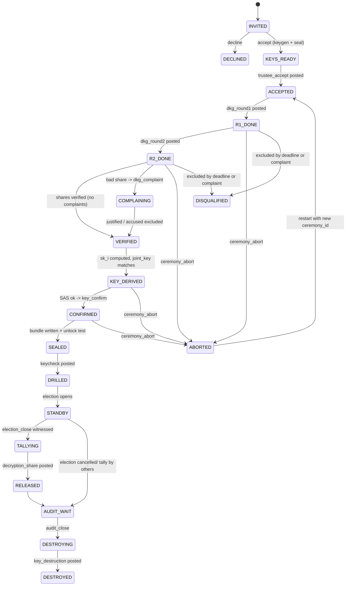

# QV-17 — Key Ceremony and Trustee Operations

**Module ID:** `trustee-ops`
**Status:** Draft
**Owner:** Protocol lead + UX lead (proposed)
**Last reviewed:** 2026-10-21
**Related specs:** QV-ADR-004, 007, 008, 010, 013 · QV-16 (crypto protocol — DKG, share transport, decryption-share and proof formats; names used symbolically) · QV-18 (log/entries) · QV-28 (storage) · QV-09 (API) · QV-10 (UX) · QV-12 (ops) · QV-07 · QV-03

Notation: field names such as `joint_pk`, `sk_i`, `pk_sign_i`, `pk_xport_i`, `enc_share(i→j)`, `commitments_i`, `decryption_share_i` are **QV-16 symbols**; this document defines *who does what, when, on which machine, how secrets are stored*, not their encodings. Log entry types (`dkg_round1`, `joint_key`, …) are defined in QV-18 §5.2.

---

## 1. Objective

Trustees collectively hold the election decryption capability (QV-ADR-004/008): any `t-1` colluding trustees learn nothing about individual or aggregate ballots; any `t` can decrypt **the aggregate tally** (and could decrypt individual ballots if they chose — see §3.3). This spec defines everything needed to make that real for small, non-technical groups:

1. Trustee roles and eligibility.
2. Key generation ceremony runbooks (online and air-gapped).
3. Storage, backup and encryption of trustee secrets.
4. Onboarding, absence and compromise handling.
5. Threshold selection guidance.
6. Transcripts for after-the-fact verification.
7. Key destruction after the audit window (QV-ADR-013).
8. Trustee client/CLI behaviour and its state machine.
9. UX for people who have never heard of "threshold cryptography".

The ceremony produces **no secret that any single machine or person ever holds in full**: the election secret `x` (with `joint_pk = g^x`) is never assembled. Each trustee ends up holding one share `sk_i`.

## 2. Scope

### In scope
Ceremony procedure and software behaviour; trustee secret lifecycle; operational policies; transcript format; trustee-facing UX copy and flows; failure/compromise handling; destruction.

### Out of scope
DKG math, share-transport encryption, proof formats (QV-16); log mechanics (QV-18); proactive resharing and share refresh (research, §20 Q3); legal custody agreements; hardware token procurement.

### Non-claims
- Destruction of shares cannot be proven; it is an attestation (§11).
- A group of `t` trustees *can* decrypt individual ballots if they deviate from software; the client refuses, but a modified client does not (§3.3). Protection is social/structural (independent trustees), not cryptographic.
- A compromised trustee device defeats that trustee's share (QV-ADR-008).
- Trustee identity is a key, not a verified legal person, unless the group does that out of band.

## 3. Actors and roles

| Role | Description | Holds | Privileges |
|---|---|---|---|
| **Trustee** (n per election) | A person (or small organization) holding one share | `sk_sign_i` (identity), `sk_xport_i` (share transport), `sk_i` (election share) | Publish ceremony/tally entries; release decryption shares |
| **Ceremony coordinator** | Usually the organizer or a trustee; runs the schedule | Nothing secret | Starts/aborts ceremony; cannot see shares; sees public state only |
| **Organizer** | Defines election and trustee set | Organizer key | Names trustees in manifest; cannot add/remove after `ceremony_start` |
| **Ceremony witness / scribe** (air-gapped only) | Observes room, signs transcript | Nothing secret | Co-signs transcript |
| **Observer/auditor** | Verifies transcript and log | Nothing | Public read |
| **Operator** | Hosts server | Nothing about shares | Availability only; cannot learn shares (encrypted to trustees) |

### 3.1 Trustee eligibility and independence rules (policy, enforced by UX warnings)
- No single faction, household or employer should control `t` or more trustee seats; the manifest carries a `trustee_disclosure` text per trustee (affiliation) shown to voters, and the wizard warns when two trustees share a contact domain.
- The operator (host admin) should hold **at most one** trustee seat unless the organizer acknowledges the risk in the manifest.
- Candidates/proposers on the ballot should not be trustees (conflict warning, not a block).
- A trustee may be a hardware-backed bot/organization key; the same person should not hold two seats (warn on duplicate email/key reuse; otherwise unenforceable — non-claim).

### 3.2 Journeys

| Actor | Goal | Preconditions | Main outcome |
|---|---|---|---|
| Trustee (non-technical) | Join an election as trustee in < 20 min active effort | Invite link, device, phone for out-of-band check | Sealed share + printed card; "ready" status |
| Coordinator | Run a ceremony for 3–7 trustees | Manifest drafted | `joint_key` published, transcript signed |
| Trustee at tally | Release decryption share | Election closed | `decryption_share` entry, no secret exposed |
| Trustee after audit | Destroy share and attest | `audit_close` | `key_destruction` entry |

### 3.3 Honest statement of what threshold decryption protects
A coalition of `t` trustees can decrypt any ciphertext. In Phase 1 ballots are linked to voter keys, so `t` colluding trustees could reveal individual votes. The system makes this **detectable only if** the colluders publish; it is **not** prevented. Mitigations: (i) the trustee client only ever computes shares for ciphertexts it independently derives as the aggregate (REQ-040); (ii) trustee independence guidance; (iii) auditability of released shares (every `decryption_share` entry names its ciphertext reference; a share on any non-aggregate ciphertext is visible in the log, since honest operation posts shares to the log — an off-log decryption is undetectable, non-claim). The ballot secrecy claim is stated in these terms in QV-05/QV-07.

## 4. Requirements

| ID | Requirement | Pri | Acceptance criteria | Ver |
|---|---|---|---|---|
| QV-17-REQ-001 | The manifest shall fix `n`, `t`, the trustee set (ids, `pk_sign`, `pk_xport` placeholders to be proven at accept), `ceremony_mode` ∈ {`online-dkg`, `airgap-dkg`, `airgap-dealer`}, and `audit_window_days` before `ceremony_start`. | Must | Server rejects `ceremony_start` unless all fields present; changes after start require new election. | T |
| QV-17-REQ-002 | The software shall enforce `2 ≤ t ≤ n`, `t ≥ ⌊n/2⌋+1` (honest majority) by default; `t=1` and `t=n` allowed only with an explicit risk-acknowledgement flag in manifest, displayed to voters. | Must | Creation of (5,2) without override fails; (3,3) shows "any one absence stops the tally". | T |
| QV-17-REQ-003 | `n ≤ 15` in v1. | Should | Config validation. | T |
| QV-17-REQ-010 | Default mode shall be a **true DKG** (no dealer): every trustee generates their own polynomial; the joint key and per-trustee public shares are computed by all participants from public commitments. | Must | Transcript contains `commitments_i` from all qualified trustees; no entry reveals a full secret. | T/R |
| QV-17-REQ-011 | `airgap-dealer` mode (one offline machine generating all shares and handing them out) may be offered, labelled prominently "single point of secrecy during ceremony", recorded in the manifest, shown in verifier output and voter-facing election page. | Could | Verifier outputs `key_generation: dealer-airgap`. | T |
| QV-17-REQ-012 | All randomness shall come from the platform CSPRNG (`crypto.getRandomValues`/`node:crypto`); the air-gapped ceremony image may additionally mix user-supplied dice entropy via HKDF (never replace the CSPRNG). | Must | Code review; unit test that dice input only adds. | R |
| QV-17-REQ-013 | Every trustee shall verify, before confirming, the received share `s_(j→i)` against `commitments_j`, and shall file a `dkg_complaint` on failure. | Must | Fault-injection: bad share → complaint → accused must justify or is disqualified. | T |
| QV-17-REQ-014 | A trustee disqualified in the ceremony is excluded from the qualified set; the ceremony continues only if `|qualified| ≥ max(t, ⌊n/2⌋+1)` and the effective threshold stays `t`; else `ceremony_abort`. | Must | Test matrix of 0..n disqualifications. | T |
| QV-17-REQ-015 | Each trustee shall confirm the `joint_pk` fingerprint (`key_confirm`) after comparing it out-of-band with ≥1 other trustee (§8.3 SAS). The election cannot open without `key_confirm` from **all** qualified trustees. | Must | `election_open` rejected if any missing. | T |
| QV-17-REQ-016 | Before `election_open`, a **fire drill** (`keycheck`) shall prove ≥ t trustees can produce valid decryption shares for a public test ciphertext encrypted to `joint_pk`. | Must | Server/verifier enforce: ≥ t valid `keycheck` entries; each trustee individually shown pass/fail. | T |
| QV-17-REQ-020 | The trustee client shall store secrets only inside an **encrypted trustee bundle** (§6); plaintext `sk_*` shall exist only in process memory, zeroed best-effort after use. | Must | Static review; test greps disk for key bytes after run. | T/R |
| QV-17-REQ-021 | The bundle shall be encrypted with `age` (C2SP age v1) using exactly one of: passphrase (scrypt recipient), hardware-token plugin recipient, or X25519 recipient (file-based identity held on another device). Passphrase work factor ≥ 2^18 (log2 = 18, age default) and client-generated passphrases ≥ 100 bits of entropy. | Must | Round-trip tests with `age` CLI; entropy check. | T |
| QV-17-REQ-022 | The client shall refuse user-chosen passphrases with estimated entropy < 60 bits unless a hardware recipient is also used; recommended default is a generated 8-word passphrase (§8.2). | Should | Unit tests of strength check. | T |
| QV-17-REQ-023 | Share backups shall be opt-in per trustee, listed in the transcript as `backup_made: true/false` (count only; no locations), and never uploaded to the server or any network. | Must | Network capture shows no bundle bytes leave the device. | T |
| QV-17-REQ-024 | The client shall support Shamir splitting of the trustee's **own bundle decryption key** (not the election share) via SLIP-0039 mnemonic shares, default 2-of-3, for personal custody backup. | Could | Split/combine round-trip with reference vectors. | T |
| QV-17-REQ-030 | The server and log shall never receive `sk_*`, passphrases, or decrypted bundles; share transport entries are ciphertexts decryptable only by the recipient trustee. | Must | Code/API review; data-flow diagram in QV-08. | R |
| QV-17-REQ-031 | Trustee identity keys (`sk_sign`) shall by default be generated **per election** (unlinkable across elections); reuse is an explicit option. | Should | Default flow creates new key. | T |
| QV-17-REQ-040 | The trustee client shall compute and release a `decryption_share` **only** for a ciphertext the client itself derived locally from the verified log (the homomorphic aggregate of ballots up to `election_close`), after verifying the full log (QV-18 §13 steps 1–6). | Must | Test: server supplies different ciphertext → client refuses and reports `AGGREGATE_MISMATCH`; no CLI flag to decrypt arbitrary ciphertext in the release build. | T |
| QV-17-REQ-041 | The client shall require the latest checkpoint to be witnessed to quorum (QV-18 §9.4) before releasing a share; override requires typed confirmation and is logged (`override` field in the transcript, not in any entry). | Must | Without quorum, share not released unless override. | T |
| QV-17-REQ-050 | Absent trustees: if `< t` shares arrive by `tally_deadline`, the coordinator escalation procedure (§9.1) applies; the protocol has no way to replace a trustee after `election_open`. | Must | Documented; tested via simulation with n−t+1 absent. | T/R |
| QV-17-REQ-051 | A trustee who suspects compromise shall be able to publish a signed `trustee_compromise_report` from any device holding `sk_sign` or via organizer countersign (§9.2); the UI shall show it on the election page. | Must | Entry accepted in all phases. | T |
| QV-17-REQ-052 | Ceremony restart before `election_open` shall create fresh keys (new `ceremony_id`); old transcript entries remain in the log marked superseded by `ceremony_abort`. | Must | After abort, `ceremony_start` allowed once more with new id; verifier uses last. | T |
| QV-17-REQ-060 | Every ceremony shall produce a **transcript** (§10) consisting of the public log entries plus a human-readable summary, signed by each participating trustee (and scribe/witnesses in air-gap mode). | Must | `qv ceremony verify` validates. | T |
| QV-17-REQ-070 | After `audit_close`, each trustee client shall offer one-tap **key destruction** (§11) and publish `key_destruction`; the organizer UI shall show attestation status; reminders at +1, +7, +30 days. | Must | State machine reaches DESTROYED; entry published. | T |
| QV-17-REQ-080 | The trustee CLI (`qv-trustee`, including its localhost UI) shall implement the state machine in §12 with persisted state and idempotent, resumable steps (crash at any step is recoverable). | Must | Chaos test: kill at every transition. | T |
| QV-17-REQ-081 | A non-technical trustee shall complete the online ceremony using only the guided localhost UI of the `qv-trustee` executable (no command line; no remote-origin web page ever holds trustee secrets, QV-ADR-024), in ≤ 6 screens (§13); usability test: ≥ 8/10 first-time participants complete without help. | Should | Moderated usability study (QV-10). | R |
| QV-17-REQ-082 | All ceremony and trustee UX shall meet QV-13 accessibility requirements, including keyboard/screen-reader operation and non-visual fingerprint comparison (words, not only QR). | Must | QV-13 audit. | R |

## 5. Threshold selection guidance

Definitions: **collusion tolerance** = `t−1` (secrecy holds against any `t−1` malicious trustees); **absence tolerance** = `n−t` (tally still completes with that many missing). An adversary needs `t` compromised to break secrecy; an adversary needs `n−t+1` removed to block the tally.

| n | t | Collusion tolerance | Absence tolerance | Recommended for | Notes |
|---|---|---|---|---|---|
| 3 | 2 | 1 | 1 | Default for groups ≤ 50 | Minimum recommended; any two trustees can reveal ballots |
| 4 | 3 | 2 | 1 | Groups wanting stronger secrecy than (3,2) | One absence tolerated |
| 4 | 2 | 1 | 2 | Availability-first | Weak secrecy; discouraged |
| 5 | 3 | 2 | 2 | Default for groups 50–500 | Best balance for small groups |
| 7 | 4 | 3 | 3 | Large associations; contested elections | Coordination cost |
| 7 | 5 | 4 | 2 | High-secrecy | |
| 2 | 2 | 1 | 0 | Discouraged | Any absence kills tally; requires ack |
| 1 | 1 | 0 | 0 | **Not secret** | Trustee alone can decrypt; only allowed as "operator-trusted" with explicit acknowledgement |

Guidance (shown in the wizard):
1. Choose trustees who **do not share a household, employer, or faction**. Independence matters more than count: five trustees from one clique are worse than three from separate groups.
2. Pick `t` as a strict majority of `n` unless the group explicitly prefers availability.
3. Plan for `n−t ≥ 1` so one illness does not stop the tally.
4. For very small groups (≤ 10 voters): (3,2) with trustees who are members or trusted outsiders; acknowledge that 2 trustees could learn individual votes (Phase 1) — for such groups open voting may be more honest; the wizard says so.
5. Do not make the host/operator a majority; do not make candidates a majority.
6. Quorum-by-role is not supported (no weighted trustees in v1).

## 6. Secret material, storage, backup, encryption

### 6.1 Inventory

| Secret | Created | Purpose | Lifetime | Stored where |
|---|---|---|---|---|
| `sk_sign_i` | trustee accept | signs log entries and API auth | election (+ audit window) | trustee bundle |
| `sk_xport_i` | trustee accept | decrypts `enc_share(j→i)` during ceremony | until `key_confirm`, then may be destroyed | trustee bundle (dropped early, §6.3) |
| `s_(j→i)` (received shares) | ceremony | summed into `sk_i` | until `sk_i` computed | memory only; encrypted bundle if ceremony interrupted |
| `sk_i` (election share) | ceremony | produce `decryption_share_i` | until key destruction | trustee bundle |
| bundle passphrase / hardware token | trustee choice | unlocks bundle | trustee-managed | memory / token / paper |

### 6.2 Trustee bundle (`*.qvtb`)

An **age**-encrypted file (age v1, ChaCha20-Poly1305 STREAM, per age spec) whose plaintext is the QV-16 canonical encoding of `{bundle_version, election_id, trustee_id, ceremony_id, sk_sign_i, sk_i?, sk_xport_i?, own public data, transcript_hash, created_at, backup_epoch}`.

Recipient options (exactly one *header class*; age rule: a scrypt stanza must be the sole stanza):

| Option | Mechanism | Pros | Cons | Default for |
|---|---|---|---|---|
| A. Passphrase | age scrypt recipient (work factor 2^18+) | no extra device; works air-gapped | memorized/printed secret; offline brute-force if file stolen | online non-technical trustees |
| B. Hardware token | age plugin recipient (e.g. YubiKey PIV via `age-plugin-yubikey`; FIDO2 hmac-secret plugins) `[UNVERIFIED: plugin names/maintenance status not verified 2026-10-21]` | theft-resistant; user-presence | needs hardware + plugin; loss ⇒ lose share | technically able trustees; strongly recommended for `t≥3` |
| C. X25519 identity file | age native recipient `age1…` with identity held offline/another device | air-gap friendly; combine with B | key management burden | air-gapped mode |

Multi-recipient (e.g. token + X25519 backup recipient) is permitted when no scrypt stanza is used. Passphrase **plus** hardware needs layering (age-encrypt twice) — client does this: inner passphrase, outer token (`layered: true` in bundle metadata, outside the encrypted payload).

### 6.3 Reducing exposure

- `sk_xport_i` is deleted from the bundle after the trustee's own `key_confirm` (no longer needed; reduces what a stolen bundle reveals about past transcripts).
- Received shares `s_(j→i)` are deleted after `sk_i` is derived and verified against public commitments.
- The bundle is re-encrypted (fresh file key) each time it changes; atomic write via temp file + `fsync` + rename.

### 6.4 Backup and custody

Because the share is **the only copy of `sk_i`**, lost shares reduce absence tolerance by one; there is no recovery from the server. Policy hierarchy, in order:

1. **Primary defence: threshold slack** (`n−t ≥ 1`). Prefer this to backups.
2. **Own-device redundancy** (optional): a second copy of the *encrypted bundle* on a USB stick in a different physical location. Counts as a "backup" in transcript metadata. The encrypted bundle carries the same compromise surface as the passphrase — more copies mean more theft chances for the file but not for the passphrase.
3. **Shamir split of the bundle passphrase / bundle decryption key** (Could, REQ-024): SLIP-0039 mnemonic shares (e.g. 2-of-3) given to the trustee's trusted people. Protects against trustee forgetting the passphrase; each split makes a new custody group. SLIP-0039 details `[UNVERIFIED: spec not re-fetched 2026-10-21]`. Not used to split `sk_i` itself, because that would introduce a second threshold scheme on top of the election's.
4. **Paper card** (§13): printed, containing the passphrase (generated words) and the bundle QR/hash only if the bundle fits; stored in an envelope in a safe place. Mandatory suggestion; not a mandatory action.

Not supported (and warned): cloud sync (Dropbox, iCloud) of bundles; password-manager storage is acceptable for passphrase only if the manager is not the same place as the file; emailing bundles.

### 6.5 File permissions and hygiene (CLI)
`0600` on bundle and state; refuse to run if bundle is world-readable; no swap hints (`mlock` best-effort on Linux); no secrets in logs; `--debug` redacts hex keys by pattern.

## 7. Onboarding

```mermaid
sequenceDiagram
  participant Org as Organizer
  participant S as Server
  participant T as Trustee
  Org->>S: manifest draft lists trustee slots (label, contact optional)
  Org->>T: invite link qv://<server>/t/<invite_code>#<manifest_hash> (out-of-band)
  T->>T: opens client; verifies manifest hash words with organizer (voice/chat)
  T->>T: generates keys, picks storage method (§6.2)
  T->>S: trustee_accept entry (pks + proof of possession)
  S-->>T: receipt (QV-18)
```

Onboarding checklist the client enforces:
1. **Understand**: three short plain-language screens (§13): what a trustee is, what they must never do (share passphrase, install bundle on shared PC), time commitments (ceremony: ~20 min; tally: ~5 min; destruction: ~2 min; plus availability windows).
2. **Verify the election**: shows election title, organizer, `n`/`t`, and a manifest fingerprint as 6 words; trustee confirms with the organizer by a second channel.
3. **Choose storage**: passphrase / token / hardware+passphrase; generate paper card; do **unlock test** (re-open bundle).
4. **Contact preference**: optional notification address held by the *organizer*, not the server; server may store nothing. Alternatives: calendar `.ics` with ceremony date; web push [Could].
5. **Accept**: `trustee_accept` entry.
6. **Dry-run**: link to a public sandbox election to rehearse (Should).

Invite codes are single-use, 128-bit, expire in 14 days (config), carried by the organizer through whatever channel they trust; the code authorizes *registering a key for slot k*, nothing more. Manifest-hash words prevent an operator substituting a different election.

## 8. Ceremony runbooks

Common pre-conditions: manifest published (seq 0); all `trustee_accept` entries present; `ceremony_start{ceremony_id, mode, deadline}` posted by organizer. Common phases map to log entries:

| Phase | Name | Who | Entry | Deadline (default) |
|---|---|---|---|---|
| R0 | Register | each trustee | `trustee_accept` (before start) | invite expiry |
| R1 | Commit | each trustee | `dkg_round1` | start + 48 h online / same session air-gap |
| R2 | Share | each trustee | `dkg_round2` (encrypted per recipient) | R1 close + 48 h |
| R3 | Verify | each trustee | `dkg_complaint` (only on failure), `dkg_justification` | R2 close + 48 h |
| R4 | Finalize | anyone | `joint_key` (derived), then each trustee `key_confirm` | R3 close + 48 h |
| R5 | Fire drill | ≥ t trustees | `keycheck` | R4 close + 72 h |
| R6 | Seal & card | each trustee | (local) bundle finalized, `transcript` signed | with R4 |

**Round mapping to QV-16 (normative: QV-16 prevails):** R1 `dkg_round1` = QV-16 round 0 `dkg-commit` followed by round 1 `dkg-dealing` (two `dkg_round1` entries per trustee, in that order); R2 `dkg_round2` = `dkg-shares`; R3 `dkg_complaint` = `dkg-complaint` (DH-reveal; QV-16 has no separate justification step, so `dkg_justification` is unused in suite v1); R4 = `dkg-final` (`joint_key`) and `dkg-keyconf` (`key_confirm`).

Phase advance occurs when all (non-disqualified) trustees posted or the deadline passes. Missing at a deadline ⇒ disqualified (R1/R2) or ceremony stalls (R4/R5, see §9.1).

### 8.1 Online DKG runbook (default)

Prerequisites: each trustee has the `qv-trustee` executable (CLI or localhost UI; QV-ADR-024), a second channel to other trustees (phone call/chat), the invite accepted.

1. **Organizer** posts `ceremony_start`. Everyone is notified (SSE/ICS/organizer message).
2. **R1 (≈2 min each).** Trustee client: unlock bundle → generate polynomial (degree `t−1`) from CSPRNG → compute `commitments_i` and proof of knowledge of the constant term → post `dkg_round1`. The polynomial coefficients live in memory only, written to the bundle encrypted as `ceremony_state` so a crash is resumable (re-derive deterministic from stored seed, never re-randomize after posting R1).
3. **R2 (≈1 min).** Client fetches all `dkg_round1` (verifies each proof), computes shares `f_i(j)` for every `j`, encrypts each to `pk_xport_j` (QV-16 `enc_share`), posts one `dkg_round2`. Own share `f_i(i)` kept locally.
4. **R3 (≈1 min).** Client decrypts the shares addressed to it, verifies each against `commitments_j`. All pass ⇒ nothing to post. Fail ⇒ `dkg_complaint{accused, round2_seq, evidence}`; accused answers with `dkg_justification` (reveals that share in the open — acceptable since the share is only one of many and the complaint outcome decides disqualification); verifiers decide; if the accused is guilty or silent past deadline ⇒ disqualified, the qualified set shrinks, all shares from them are discarded, and `sk_i` is computed only from the qualified set.
5. **R4 (≈3 min).** Client computes `sk_i = Σ s_(j→i)` (qualified j), and `pk_i = g^{sk_i}`; `joint_pk` = product of qualified constant-term commitments. Anyone can post `joint_key` (the server auto-posts as convenience); the client verifies it equals its own computation. The client displays the **fingerprint** `F = H("qv/jointkey/v1" ‖ joint_pk ‖ qualified_set_hash ‖ manifest_hash)` as 6 words (§8.3). Trustee phones another trustee (or the organizer), compares words; then taps *Confirm* ⇒ `key_confirm`.
6. **R6 (local).** Client seals `sk_i` into the bundle (§6.2), prints/prepares the paper card, and exports the **ceremony receipt** (§10).
7. **R5 (≈2 min each, ≥ t trustees).** Fire drill: a public test ciphertext `ct_test` (encrypting a known random value) is posted by the organizer/server; trustees unlock bundle and produce `keycheck` (decryption share + proof). The organizer UI turns ready/not-ready per trustee.
8. **Ready**: `roll_commit` and `election_open` may proceed.

Recoverable aborts: any trustee may request `ceremony_abort` before R4 with reason; organizer may abort anytime before `election_open`.

### 8.2 Air-gapped runbook (strongest, for contested or high-stakes elections)

**Concept.** Each trustee uses an offline machine (their own laptop booted from a published, hash-pinned live image, or a dedicated Raspberry-Pi-class device). Machines never connect to a network. Public ceremony messages travel by **sneakernet**: USB sticks with a `ceremony-packet` file per message, or QR sequences (animated QR with checksum) for tiny devices. Secret material never crosses; only entries that would be public anyway (`dkg_*` entries incl. encrypted shares, `key_confirm`) plus the sealed bundle onto personal media.

**Roles in the room (or a video-supervised session):** Master of Ceremony (reads the script), Scribe (records timestamps, collects fingerprints), trustees, ≥ 1 independent witness (not a trustee). One *online bridge* machine (not holding secrets) is used by the Scribe to submit packets to the log.

**Equipment.** Per trustee: offline device; two blank USB sticks (A: packets, B: sealed bundle); printer optional (offline); pen & card. Shared: ceremony image USB(s) written and verified in advance; the bridge laptop.

**Image provenance.** The `qv-ceremony` live image is built reproducibly; its SHA-256 and a signed release manifest (ADR-010) are published; at the start each trustee compares the printed hash with the booted image's `qv-ceremony --self-hash` output **on a separate device** (phone) and the Scribe notes pass/fail. Software on the stick is the CLI only; no network stack drivers loaded (`rfkill`, `modprobe -r` in image).

**Procedure.**

| Step | Action | Output |
|---|---|---|
| A0 | Scribe reads preamble: purpose, `n/t`, manifest hash words, ceremony id. Everyone confirms manifest words match what they saw earlier. | Transcript preface |
| A1 | Each trustee boots the image, runs `qv-ceremony init`. Optional: roll dice 50 times for entropy mixing and type digits (REQ-012). | `trustee_accept`-equivalent already online; here: attestation of local environment hash |
| A2 | `qv-ceremony round1` → writes `packet-r1-<id>.qvp` on stick A. Bridge posts all R1 entries. | `dkg_round1` ×n |
| A3 | Bridge exports **all** R1 entries onto a bridge-prepared stick; trustees import via `qv-ceremony import` (client verifies proofs). | — |
| A4 | `round2` → each offline device produces its `dkg_round2` packet; bridge posts. | `dkg_round2` ×n |
| A5 | Import all R2; `verify` → complaints (if any) posted; rerun rule §8.1 step 4. | |
| A6 | `finalize`: device derives `sk_i`, shows fingerprint words and also prints/saves a fingerprint file. Trustees read words aloud **in turn**; Scribe confirms all match. | `key_confirm` ×n via bridge |
| A7 | `seal`: bundle written to stick B using age recipient (passphrase generated on screen and written on paper card, or token). Unlock test. | `.qvtb` |
| A8 | Fire drill: bridge posts `ct_test`; each device produces `keycheck` packet; bridge posts. | `keycheck` ≥ t |
| A9 | `transcript`: each device prints/saves the ceremony summary hash; all sign. Witness signs. Devices are powered off; RAM cleared by power-off (+ 60 s wait; cold-boot note). | signed transcript |
| A10 | Stick A wiped (re-flash), stick B kept by trustee; optional photo-free rule. | |

**Variants.**
- *Dealer mode* (`airgap-dealer`, REQ-011): a single offline machine generates all `n` shares, writes each into a separate age bundle for each trustee (recipient chosen by trustee in advance), then wipes. Simpler but the machine and room are a single point of secrecy; accepted by some small groups. Shown to voters as "keys generated by a single trusted offline machine".
- *Distributed air-gap*: each trustee in a different place, the ceremony run over days using postal/USB or QR via phone photos; the bridge is the server. Slower; equivalent security if each device remains offline.
- *Hybrid*: devices offline; bridge online; (above).

Time: 90 min for n=5 including hash checks; 20 min active per trustee.

### 8.3 Out-of-band fingerprint comparison (SAS)

- Fingerprint = first 66 bits of `F`, rendered as 6 words from a 2048-word list (PGP-style / BIP39-sized list `[UNVERIFIED: wordlist choice not fixed; use a published 2048-word list with unique 4-letter prefixes]`) plus the first 8 hex bytes for technical users.
- Comparison protocol: trustees A and B on a call (voice recognition is a weak check; video preferred): A reads words 1–3, B reads 4–6, each checks the other half against their own screen. Any mismatch ⇒ **stop**; report; do not confirm.
- At least one other **trustee** must be compared with (not only the organizer) and the client records `compared_with: [trustee_ids]` locally for the transcript (self-attested; non-claim).
- 66 bits ≈ resistant to second-preimage in an interactive human setting (attacker must find a colliding joint key in advance; ceremony state is public beforehand so precomputation is limited); a mismatch protects against operator substitution of the `joint_pk` presented to a specific trustee, which the log would otherwise have to catch by the trustee verifying their own computation — the client does verify its own computation, so the SAS is defence in depth against a modified client/UI.

## 9. Absence and compromise

### 9.1 Absence

| Situation | Handling |
|---|---|
| Trustee unresponsive in R1/R2 | Disqualified at deadline (REQ-014); ceremony continues if qualified set ≥ `max(t, ⌊n/2⌋+1)`; otherwise restart with replacement trustee (new election/ceremony; manifest amendment is a new `manifest` only before `ceremony_start`) |
| Trustee unresponsive in R4/R5 | Ceremony stalls: wait through extended deadline (+48 h), organizer contacts out-of-band, else abort and restart with replaced trustee set |
| Trustee unresponsive at tally | If ≥ t shares arrive: proceed (absence tolerance). If not: escalate: (1) T+0 notification; (2) T+24 h each other trustee/organizer call; (3) T+72 h organizer may extend `tally_deadline` (logged `notice/extension`); (4) if the missing trustee's bundle is lost: if backups exist restore; else the election is **un-tallyable** — organizer options: declare failed and rerun the vote with new keys (ballots are not recoverable), per QV-03 policy |
| Trustee wishes to withdraw after open | Cannot be replaced; they may still decrypt at tally; withdrawal means they will not (counts as absence) |
| Replacement after `election_open` | **Not possible** in v1 (requires resharing — Proposed QV-ADR-P17-2 research) |

### 9.2 Compromise

Compromise = suspected loss of confidentiality of `sk_i`, bundle + passphrase, or `sk_sign_i` (device theft, malware, coercion).

| When | Case | Action |
|---|---|---|
| Before `key_confirm` complete | Any | `ceremony_abort`, restart with fresh keys and remediated device. Cheap. |
| After confirm, before open | Any | Same: abort and restart (new `ceremony_id`; never reuse). |
| After open, 1 trustee (`< t−1` margin) | Share compromised, attacker holds `c` shares total | Publish `trustee_compromise_report`; secrecy holds as long as total compromised < t; margin reduced by `c`; the organizer UI shows "secrecy margin: t−c" to voters. Decide governance (QV-03): continue / extend / cancel. The compromised trustee still may release honestly if their share is intact (confidentiality loss only). |
| After open, `c ≥ t` plausible | Secrecy possibly void | Cancel election (`election_cancel`) and rerun with new ceremony; ballots already cast are decryptable by the adversary: voters told. |
| `sk_sign_i` compromised only | Impersonation of trustee entries (not decryption) | Report; entries by the key after report timestamp are untrusted; because `decryption_share` requires `sk_i`-based valid proof, a forged share fails verification; a forged `key_destruction` is a false attestation (flagged). |
| Coercion | Trustee forced to decrypt/hand shares | Out-of-scope technical; policy: duress word [Could]; trustee-reported compromise. |

Trustee compromise reports are public entries (REQ-051). No server-side "revocation" can restore secrecy lost; this is why the UI places weight on the pre-open fire drill and device hygiene guidance.

## 10. Ceremony transcripts

### 10.1 Components
1. **Public log segment**: seq range from `ceremony_start` to the last `keycheck` (`ceremony_abort` for failed ones) — inherently verifiable.
2. **Summary document** `ceremony-summary.json` + human-readable `ceremony-summary.txt/pdf` (hash-bound):

```json
{
  "format": "qv-ceremony-transcript/v1",
  "election_id": "…", "origin": "quietvote/v1/…", "ceremony_id": "…",
  "mode": "online-dkg|airgap-dkg|airgap-dealer",
  "n": 5, "t": 3, "qualified": ["T1","T2","T4","T5"], "disqualified": [{"id":"T3","reason":"no_round1"}],
  "log_range": {"from_seq": 4, "to_seq": 21, "checkpoint_size": 22, "checkpoint_root_b64": "…"},
  "joint_key_fingerprint_words": ["…"], "joint_key_fingerprint_hex": "…",
  "software": {"client": "qv-trustee 1.0.0", "build_hash": "…", "image_hash": "…|null"},
  "environment": [{"trustee":"T1","self_reported": {"os":"…","network":"online|offline","storage":"passphrase|token|x25519","backup_made":true}}],
  "sas": [{"trustee":"T1","compared_with":["T2"],"result":"match"}],
  "events": [{"t":"2026-11-02T18:04:11Z","note":"image hash verified by phone","who":"scribe"}],
  "signatures": [{"signer":"T1","kid":"…","sig":"…"}, {"signer":"scribe","…":"…"}]
}
```
(Encodings/hash domain of signatures: QV-16; summary is hashed with the "QV-CEREMONY-v1" domain.)
3. **Per-trustee ceremony receipt** (private): bundle metadata, SAS result, backup flags; helps trustees prove they participated.

### 10.2 Properties and non-claims
The transcript lets any observer (a) re-derive `joint_pk` from the log and compare to the fingerprint announced; (b) check that all `dkg_*` proofs verify; (c) see disqualifications. It does **not** prove that no trustee kept a copy of shares, that air-gap was genuinely offline, or that devices were uncompromised: `environment` and `events` are self-reported attestations. Air-gap sessions may be video-recorded (optional; privacy: no screens with passphrases; recordings stay with the organization, hash listed in transcript).

## 11. Tally participation and key destruction

### 11.1 Tally (trustee-side)
Trigger: `election_close` + witnessed checkpoint → client notified or opened by trustee → *Release my part*:
1. Fetch the log; run offline verification steps 1–6 (QV-18 §13) locally.
2. Locally compute the aggregate ciphertext; compare with `tally_aggregate` entry if present; mismatch ⇒ stop (`AGGREGATE_MISMATCH`).
3. Unlock bundle; produce `decryption_share` with proof (QV-16); post; verify own entry in the log.
4. Show "Done. You may close this. Your key is still needed until the audit window ends only for challenge/recount".
Each step is idempotent; posting twice returns the same receipt.

### 11.2 Audit window and destruction (QV-ADR-013)
- Manifest `audit_window_days` default **30**, min 7, max 365. Window starts at `tally_result`; `audit_close` entry by organizer ends it (earliest `tally_result + audit_window_days`). Challenges/recounts (QV-05) during the window may require trustees to re-release shares; hence shares are kept until `audit_close`.
- After `audit_close`, each trustee must destroy `sk_i` (and `sk_sign_i` unless reused). The client automates:
  1. Verify `audit_close` entry (witnessed).
  2. Re-confirm intent ("This permanently removes your ability to decrypt this election").
  3. **Crypto-erase**: delete bundle file(s); delete OS-level references; if hardware token held the only recipient: reset/overwrite the token's slot using vendor tool or the plugin's delete command; if bundle was on SSD/flash: note that file deletion does not guarantee physical erasure; **therefore** the bundle's age file key is derived from a passphrase/token that is also destroyed — destroying *both* the ciphertext and the key renders residual blocks useless; the client prompts: "destroy the passphrase card: shred it, and delete any password-manager entry".
  4. Backup copies and Shamir shares: list and instruct (the client knows the counts from the bundle metadata `backup_epoch`).
  5. Post `key_destruction{trustee_id, method, destroyed_at, statement}` signed by `sk_sign_i`, then destroy `sk_sign_i` as well.
- State `DESTROYED` is terminal. The organizer UI shows attestation count; unattested trustees get reminders (+1, +7, +30 d); after +90 d the election page shows "n of N trustees have not confirmed destroying their share" — information, not enforcement.
- Honesty: a malicious trustee can keep a copy; destruction mitigates future (e.g. quantum or coerced) decryption only for honest trustees. The privacy benefit relies on **at least `n−t+1` honest trustees destroying**: only then can the adversary no longer assemble `t` shares. (Correct statement: after destruction by ≥ `n−t+1` trustees, fewer than `t` shares remain in existence.)
- Server-side: no secrets to destroy; server deletes `trustee` convenience rows per QV-28 retention.

## 12. Trustee client and CLI behaviour

### 12.1 Deliverables
- **Web client** `/t/...`: invitation redemption and read-only ceremony status only. Per QV-ADR-024 it shall not generate, hold or use trustee secrets (shares, signing keys, polynomials); those operations run only in `qv-trustee`/`qv-ceremony`. (Superseded text: an earlier draft ran key operations in a Web Worker in the browser.)
- **CLI** `qv-trustee` (Node 22/24 single executable, QV-ADR-014) and `qv-ceremony` (air-gapped build with no network code).

### 12.2 CLI surface (illustrative)

```
qv-trustee join <invite-url>                  # accept + keygen + seal
qv-trustee status [--election ID]             # state machine state, next action, deadlines
qv-trustee ceremony run  [--election ID]      # drive R1..R5 interactively, resumable
qv-trustee fingerprint [--election ID]        # show SAS words
qv-trustee drill                              # fire drill share (keycheck)
qv-trustee tally release [--election ID]      # verify log, compute, post decryption_share
qv-trustee report-compromise --severity …
qv-trustee destroy [--election ID]            # post-audit destruction & attestation
qv-trustee export-transcript / verify-transcript
qv-ceremony init|round1|import|round2|verify|finalize|seal|drill|transcript   # offline variants, file/QR I/O
```
Exit codes: 0 ok; 10 user declined; 20 verification failed (evidence written); 30 network; 40 state conflict; 50 bundle locked/wrong passphrase; 60 refused for safety (`AGGREGATE_MISMATCH`, `NOT_WITNESSED`). Machine-readable `--json`. No flag exists to decrypt arbitrary ciphertexts (REQ-040).

### 12.3 State machine (per trustee per election)



Compromise-reported is an overlay flag, not a state; ABORTED may also be entered from other pre-STANDBY states. Persistence: state in an encrypted `trustee-state` file (age) beside the bundle, written atomically; log is truth, so on restart the client **re-derives** the state from the log + local bundle (reconciliation procedure: if local says R1_DONE but log lacks `dkg_round1`, re-post the stored entry bytes — idempotent by `author_nonce`; if the log has an entry the local state does not know (crash after post), adopt it).

| Transition | Preconditions (verified by client) | Side effects |
|---|---|---|
| ACCEPTED → R1_DONE | all `trustee_accept` present; `ceremony_start` valid; deadline not passed | post `dkg_round1`; persist polynomial seed encrypted |
| R2_DONE → VERIFIED | all `dkg_round2` from qualified peers parse; each share matches commitments | none (silent) |
| KEY_DERIVED → CONFIRMED | `joint_key` entry equals local derivation; SAS compared (user attests) | post `key_confirm` |
| SEALED → DRILLED | `ct_test` published with valid structure | post `keycheck` |
| STANDBY → TALLYING | `election_close`, witnessed checkpoint size = seq(close), local aggregate matches | none |
| TALLYING → RELEASED | local aggregate verified; not already released | post `decryption_share` |
| AUDIT_WAIT → DESTROYING | `audit_close` witnessed and window elapsed | §11.2 |

Failure/edge behaviour: wrong passphrase 5× ⇒ client does not lock out (offline attack anyway) but slows with scrypt cost, warns; expired deadline ⇒ state shows `MISSED_DEADLINE`, instructs contacting organizer; log unreachable ⇒ queue outbound entries in local outbox (retry with backoff, same bytes).

## 13. UX for non-technical trustees

Design principle: **the trustee should never need to know the words "polynomial", "Feldman", "share", or "scalar"**. Use "your key piece", "the election key", "check code".

### 13.1 Screens (online ceremony, ≤ 6)
1. **You've been asked to be a Keyholder.** What this means in 3 bullets: "You hold 1 of N pieces; any T of you can open the final count; no one of you can see how anyone voted alone (and fewer than T together learn nothing)." Time needed. Buttons: *Continue* / *Not me*.
2. **Check this is the right election.** Title, organizer, N/T, six check-words; "Ask the organizer to read you the same words."
3. **Protect your key piece.** Choose: *Easy (a passphrase)* — generates 8 random words, shows "write these on paper now", prompts to retype 3 random words to prove; *Safer (a security key)* — instructions with tokens; advanced: file recipient. Always followed by *Download your key file* (bundle) with "Keep in two places, never in cloud/email".
4. **Key creation** (auto-run R1–R4 with a progress list; each line a plain sentence "We are sending encrypted pieces to the other keyholders… all checks passed"). Waiting states explain who we are waiting for and the deadline; email/ICS reminders.
5. **Compare the check code with another keyholder.** Large words; *Call them / read yours first*; *They match* / *They don't match* (the latter explains next steps and aborts).
6. **Practice run & done.** "Open your key file and unlock it" test; prints the **Keyholder card** (PDF/HTML print view with election name, role, date, dates when you will be needed, who to call, passphrase words field **left blank** for handwriting if the user prefers not to print secrets; also the final *Destroy after* date).

### 13.2 Tally and destruction screens
- *Count day*: "The voting has closed. Your task: confirm the count with your key" (verification progress "We checked N ballots yourself on your device"; button *Use my key piece*). Success message and what happens next.
- *Cleanup day*: "The review period ended. Please delete your key piece. This is permanent." Steps with checkboxes: delete file ✓, shred card ✓, wipe USB ✓; button posts attestation.

### 13.3 Principles and content rules
- Plain language ≤ grade 8; no jargon; every red/yellow state has an action sentence.
- Never show raw hex as the primary check; words first, hex under "technical details".
- Irreversible actions need typed confirmation of the election name.
- Errors: what happened / what it means / what to do (+ copyable error code).
- Safety copy: "Never send your passphrase to anyone, including the organizer or support."
- Time zone: all deadlines shown in local time **and** UTC.
- Accessibility (QV-13): all words readable via screen reader with phonetic option; no QR-only paths; focus order; reduced-motion; text alternatives for QR sequences (air-gap uses file-based path as accessible alternative).
- Low bandwidth: ceremony payloads ≤ 100 KiB per trustee for n=7.
- Localization: word lists localized only for display; internal fingerprint bytes language-independent; check-word lists must keep identical across languages for the same fingerprint (UI shows the localized word *and* English word in technical details).

## 14. Data and privacy

- **Server stores** (QV-28): trustee slot rows (label, `pk_sign`, `pk_xport`, status), invite-code hashes, the public log entries; **never** bundles, passphrases, secrets. Trustee contact (if collected by organizer in the UI) is stored encrypted, deleted at `audit_close`.
- **Linkability**: per-election trustee keys by default; trustee `label` may be a pseudonym; the manifest publishes the trustee set (public by design — voters need to know whom they trust).
- **Retention**: ceremony log entries per QV-18 §11; local bundles destroyed per §11.2.
- **Claimed**: no single party (including operator) learns `sk`; transport of shares confidential to recipients; ceremony verifiable.
- **Not claimed**: secrecy against `≥ t` collusion; erasure proof; secure devices.

## 15. Security and abuse cases

| Case | Attacker | Impact | Mitigation | Residual risk |
|---|---|---|---|---|
| Malicious DKG participant sends bad shares | Trustee | Corrupt joint key | Share verification, complaints, disqualification (R3) | Rushing/last-mover bias in plain Feldman DKG — QV-16 chooses Pedersen-style/proof-of-knowledge; bias cannot reveal secrets; QV-16 owns analysis |
| Rogue-key attack on `joint_pk` | Last-publishing trustee | Controls `joint_pk` | Proof of knowledge of constant term in `dkg_round1` (REQ-010) with posting order commit-then-reveal not needed because PoK | Depends on QV-16 |
| Operator substitutes `joint_pk`/manifest per-trustee | Operator | Man-in-the-middle of ceremony | Manifest hash words at onboarding; SAS at confirm; log + witnesses | Trustee skips comparisons |
| Malicious client UI (web delivery) | Operator | Steals passphrase, share | Pinned client/CLI, reproducible builds, airgap image (ADR-010); air-gap mode for high stakes | Residual accepted (ADR-010) |
| Phishing for passphrase/bundle | Attacker | Share loss | Warning copy; hardware token; never-ask rule | User error |
| Coerced decryption of individuals | Colluding t trustees | Ballot privacy loss | Independence rules; REQ-040 prevents software doing it; transparency of released shares | Social collusion undetectable off-log |
| Replay of old ceremony entries | Operator | Confusion | `ceremony_id`, `origin` bound into every ceremony statement (QV-16) | None known |
| Denial of tally by withholding | `n−t+1` trustees | No result | Threshold slack, escalation (§9.1), cancel/rerun | Accepted: availability |
| Share loss via device failure | Hardware | Reduced tolerance | Encrypted bundle backups; fire drill; threshold slack | Residual by design |
| Fake destruction attestation | Trustee | False assurance | Labeled self-attested; ≥ n−t+1 honest assumption | Non-claim |
| Cold-boot / swap leaks of in-memory shares | Physical | Share loss | Air-gap image: no swap, power-off, `mlock` best-effort | Physical access |
| Fingerprint words collision over phone call | MITM voice | SAS bypass | Video preferred, 66 bits, interactive | Weak human check |

## 16. Interfaces and dependencies

- **QV-16**: DKG, `enc_share`, proofs, keys (`age` use for *bundles* is a local storage concern defined here; share transport uses QV-16's encryption, not age, unless QV-16 adopts age for it — flagged Q1).
- **QV-18**: entry types, witness gating, `keycheck`, `key_destruction`, `audit_close`.
- **QV-09**: endpoints `POST /elections/{id}/trustee-invites`, `POST /elections/{id}/trustees/{trustee_id}/redeem`, `GET /elections/{id}/ceremony`, `/log/entries` (QV-09 §6–§8).
- **QV-28**: tables `trustee`, `trustee_invite`, `ceremony_view` projection.
- **QV-10/13**: screens and accessibility.
- **Failure/retry**: client outbox with exponential backoff; idempotent posts; deadline awareness.

## 17. Operations (QV-12)

- Config: `ceremony.deadline_hours` (48), `invite_ttl_days` (14), `audit_window_days` (30), reminders cadence, mode availability.
- Monitoring: counts of ceremony stalls, missing-attestation list; no secrets.
- Backup/restore: server backups exclude nothing secret (none exist). Ceremony state is re-derivable from the log.
- Incident: compromise playbook (§9.2); operator contact template.
- Support rule: support staff never ask for passphrases or bundles; there is no password reset (explained to trustees).

## 18. Testing and verification

- Unit: state machine transitions; bundle round-trip with reference `age`; entropy estimator; SAS word encoding stable vectors; Shamir vectors (if REQ-024 built).
- Integration: full 3-of-5 ceremony with 0..2 malicious participants (bad share, withheld R2, wrong complaint, wrong justification); aborted/restarted ceremony; crash-at-each-step resume.
- E2E: online ceremony + election + tally + destruction with real browser; air-gap flow using file I/O between three processes with no network (network namespace test).
- Security: attempt to obtain decryption of single ballot via client (REQ-040) must fail; memory scan for key bytes in swap-disabled container after run; network capture shows no secrets leave.
- Usability: moderated test with non-technical participants (REQ-081).
- Review: independent cryptographic review of ceremony (with QV-16), tabletop exercise of absence/compromise.
- Release blockers: REQ-010, 013, 015, 016, 020, 021, 040, 060, 070, 080.

## 19. Constraints and assumptions

- Trustees are reachable at least at ceremony, tally, destruction; time-zone spread tolerated by 48 h phase windows.
- Each trustee has a device that is not known-compromised; the product cannot verify this.
- `age` (v1) and a mature implementation (`age` Go reference; a TypeScript/JS implementation) are available; the dependency choice is subject to ADR-003 minimal-dependency policy — see Q2.
- Resharing/refresh/replacement of trustees after open is out of scope for v1.

## 20. Open questions

| # | Question | Owner | Proposed default | Resolution |
|---|---|---|---|---|
| Q1 | Does QV-16 use `age` or ECIES (ristretto255/X25519) for `enc_share`? | QV-16 author | QV-16's own ECIES with domain separation; `age` only for local bundles | Pending (QV-16) |
| Q2 | Which `age` implementation to depend on (JS port, `rage` WASM, shelling to `age` binary)? Adds dependency vs ADR-003 | Protocol lead | Use a small audited JS implementation if available; else CLI interop via spawning `age` for hardware plugins | Pending; `[UNVERIFIED]` ecosystem status |
| Q3 | Proactive resharing / trustee replacement after open | Research (QV-21) | Out of v1; document limitation | Deferred |
| Q4 | Word list for SAS | UX | Published 2048-word list | Pending |
| Q5 | Mandatory air-gap for elections above some size/stake? | Governance (QV-03) | Recommend, not require | Pending |
| Q6 | Allow a trustee to be a service (e.g. org-run HSM)? | Ops | Allowed as "organization trustee" with disclosure | Pending |
| Q7 | Default `audit_window_days` 30 vs 14 | Governance | 30 | Pending |

## 21. Proposed ADRs

- **QV-ADR-P17-1 — True DKG by default; dealer mode only as disclosed option.** Rationale: ADR-004 mandates a Pedersen/Feldman verifiable DKG; dealer mode kept for tiny groups with disclosure.
- **QV-ADR-P17-2 — No trustee replacement or resharing after `election_open` in v1.** Rationale: needs a resharing protocol outside baseline; handled by cancel/rerun. Reopen when QV-21 delivers a vetted protocol.
- **QV-ADR-P17-3 — Trustee client releases shares only for locally derived aggregate ciphertexts (REQ-040).** Rationale: reduce accidental/forced single-ballot decryption by honest software; honest scope (§3.3).
- **QV-ADR-P17-4 — Age as trustee bundle format.** Rationale: small, widely implemented, supports passphrase, plugins/hardware; avoids inventing a container format.

## 22. Approval and change history

| Reviewer | Decision | Date | Notes |
|---|---|---|---|
| Project owner | Pending | — | — |

## 23. References (accessed 2026-10-21)

- age file encryption format (C2SP) — https://github.com/C2SP/C2SP/blob/main/age.md (fetched: X25519 recipient, scrypt recipient with work-factor log2 argument and sole-recipient rule, plugin mechanism for hardware-tagged recipients, ChaCha20-Poly1305 64 KiB STREAM payload).
- C2SP tlog-witness / tlog-checkpoint (witness quorum gating; see QV-18 §24).
- Pedersen, *A Threshold Cryptosystem without a Trusted Party*, EUROCRYPT '91 `[UNVERIFIED: not re-fetched]`; Feldman, *A Practical Scheme for Non-interactive Verifiable Secret Sharing*, FOCS '87 `[UNVERIFIED]`; Gennaro, Jarecki, Krawczyk, Rabin, *Secure Distributed Key Generation for Discrete-Log Based Cryptosystems*, J. Cryptology 2007 `[UNVERIFIED]`. Exact DKG selection and analysis: QV-16.
- Shamir, *How to share a secret*, CACM 1979 `[UNVERIFIED]`; SLIP-0039 (Shamir's Secret-Sharing for Mnemonic Codes) — https://github.com/satoshilabs/slips/blob/master/slip-0039.md `[UNVERIFIED: not fetched]`.
- Adida, *Helios: Web-based Open-Audit Voting*, USENIX Security 2008 `[UNVERIFIED]`; ElectionGuard specification (key ceremony) — https://github.com/microsoft/electionguard `[UNVERIFIED: not fetched]`.
