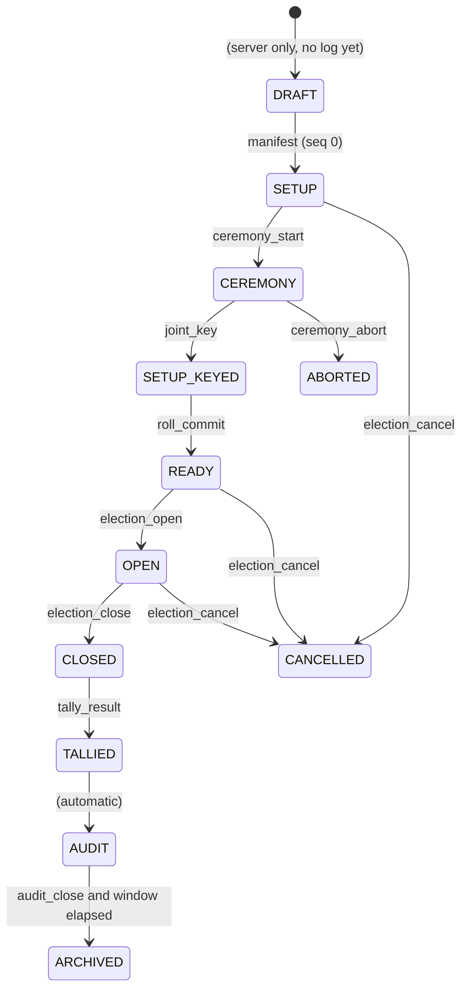

# QV-18 — Bulletin Board and Transparency Log

**Module ID:** `bulletin-board`
**Status:** Draft
**Owner:** Protocol/infrastructure lead (proposed)
**Last reviewed:** 2026-10-21
**Related specs:** QV-ADR-001, 004, 005, 007, 008, 009, 012, 013 · QV-16 (crypto protocol, written concurrently — field names used symbolically) · QV-17 (trustee ceremony) · QV-28 (storage) · QV-09 (HTTP API) · QV-05 · QV-07 · QV-11

Notation: `H` = SHA-256. `‖` = byte concatenation. `enc(x)` = the canonical byte encoding of `x` defined by QV-16; this document never defines the byte encoding of keys, group elements, ciphertexts or proofs. `KeyId(pk)` = the key identifier function of QV-16. `b64u` = unpadded base64url (RFC 4648 §5) used only in JSON transport.

---

## 1. Objective

The bulletin board (BB) is the single public, append-only record of everything that determines an election's outcome: the manifest, the trustee key ceremony, the voter-roll commitment, every accepted ballot, ballot audits, close, tally aggregate, decryption shares, result, and key-destruction attestations. It is hosted by an **untrusted** server (QV-ADR-002, QV-ADR-008): the server is trusted for availability only. The BB design must make the following *detectable by any observer* even when the operator is malicious:

1. Dropping, reordering, altering or back-dating an entry.
2. Showing different histories (equivocation / split view) to different parties.
3. Accepting an entry that violates the election's rules (every rule is re-checkable by a verifier from the log alone).
4. Silently rolling back to an earlier state (e.g. restoring an old DB backup).

The design adapts the Certificate Transparency v2 Merkle log (RFC 9162) and the C2SP transparency-log ecosystem (signed checkpoints, witness cosigning) to a **one log per election**, authenticated-submitter model with no X.509 and no precertificates.

## 2. Scope

### In scope
- Log structure, hashing, entry envelope, entry types and authorization rules, sequence numbers.
- Checkpoints (signed tree heads), receipts, inclusion and consistency proofs.
- Witness cosigning, mirrors, gossip, equivocation evidence.
- Rate limits and admission control, retention and redaction, export/import bundle, offline verification, failure behaviour.

### Out of scope
- Byte-level encoding of cryptographic objects and proof verification equations (QV-16).
- Ceremony procedure (QV-17), voter-roll construction (QV-04), HTTP routing details (QV-09), table DDL (QV-28).
- A global/cross-election log (not needed: each election is self-contained; see §12 Q3).
- Anonymity of the *network path* of submitters (QV-ADR-008 non-claim; Tor is supported, QV-ADR-009).

### Non-claims
- The log proves **what was published and in what order**, not that a ballot was cast by a free, uncoerced, uncompromised voter.
- Witnesses reduce but do not eliminate split-view risk: if all of a voter's witness/mirror paths are controlled by the adversary, equivocation can persist undetected for that voter (§9.6).
- Phase 1 ballots reveal *who participated* (QV-ADR-005); the log is public, so participation is public.
- Timestamps in the log are advisory except where cosigned by witnesses or anchored (§10); they are not proof of wall-clock time to legal standard.

## 3. Actors

| Actor | Goal | Preconditions | Outcome |
|---|---|---|---|
| Voter client | Submit ballot, obtain receipt, later check inclusion | Voter key registered in roll; election open | Receipt + inclusion proof against a (co)signed checkpoint |
| Trustee client (QV-17) | Publish ceremony/tally artifacts | Registered trustee key | Entries sequenced; own entries verifiable |
| Organizer | Publish manifest/roll/open/close | Organizer key in manifest | Lifecycle entries |
| Log server (sequencer) | Order entries, sign checkpoints, serve proofs | Holds per-election log signing key | Consistent append-only log |
| Witness | Verify consistency, cosign | Knows log origin + public key | Cosigned checkpoints |
| Mirror | Hold full verified copy, re-serve | Pulls from log | Availability + extra view |
| Observer/auditor | Verify whole election | Public read access | Verification verdict (QV-16 + this spec) |

## 4. Requirements

Priorities: Must / Should / Could. Verification: T = automated test, R = review, I = interop test against reference vectors, F = fault-injection.

### 4.1 Structure and hashing

| ID | Requirement | Pri | Acceptance criteria | Ver |
|---|---|---|---|---|
| QV-18-REQ-001 | Each election shall have exactly one log identified by an `origin` string `quietvote/v1/<election_id>` (`election_id` = 32-char lowercase hex of 16 random bytes, exactly as QV-16 §5.6.1). | Must | Two elections never share an origin; origin appears in every checkpoint, entry header and signature domain. | T |
| QV-18-REQ-002 | The tree shall use RFC 9162 §2.1 hashing with SHA-256: `MTH({})=H("")`, leaf `=H(0x00‖LeafBytes)`, node `=H(0x01‖L‖R)`, split at the largest power of two `< n`. | Must | Passes RFC 9162 / RFC 6962 reference vectors for roots, inclusion and consistency proofs for n=1..1025. | I |
| QV-18-REQ-003 | `LeafBytes` shall be `enc(EntryHeader)` (§5.1) where the header includes a `body_digest`, so bodies can be redacted without invalidating the tree (§11.2). | Must | Replacing a body with `null` leaves root and all proofs valid; changing body bytes changes `body_digest` check result. | T |
| QV-18-REQ-004 | Sequence numbers shall be the zero-based leaf index, gapless and monotone; the server shall never reuse or skip one. | Must | DB constraint + test: concurrent 1000-writer stress yields seq 0..n-1 exactly once. | T |
| QV-18-REQ-005 | Appends shall be serialized by a single sequencer per election; leaf append, `merkle_node` update and entry persistence shall be one atomic DB transaction (QV-28). | Must | Kill -9 during append leaves either the entry fully present with consistent tree or fully absent. | F |
| QV-18-REQ-006 | The server shall verify, before sequencing, every rule in §5.3 (schema, signature, authorization, phase, uniqueness, size). Verifiers shall re-verify all of them independently; server acceptance is never evidence of validity. | Must | Offline verifier rejects a log seeded with an entry the server was patched to accept. | T |

### 4.2 Checkpoints and receipts

| ID | Requirement | Pri | Acceptance criteria | Ver |
|---|---|---|---|---|
| QV-18-REQ-010 | Checkpoints shall use the C2SP `tlog-checkpoint` note format (origin / size / base64 root, blank line, signature lines) and be signed by the per-election log key (Ed25519, signed-note type 0x01 with key name = origin). | Must | `qv-verify` parses checkpoints produced by the server and by a third-party signed-note library. | I |
| QV-18-REQ-011 | The sequencer shall issue a new checkpoint within 1 s of any append when the previous checkpoint is older than 1 s (batching ≤ 1 s), and always before responding `included` (§7.2). | Must | p99 append→checkpoint ≤ 2 s at 50 appends/s in load test. | T |
| QV-18-REQ-012 | Tree size in successive checkpoints shall be non-decreasing; the server shall never sign two checkpoints that are mutually inconsistent. A server restart shall not change this (persist last checkpoint before replying). | Must | Test: restore older DB backup → server refuses to sign (REQ-053). | F |
| QV-18-REQ-013 | Append responses shall carry a **receipt** (§7) enabling the submitter to prove the server accepted the entry even if the server later denies it. | Must | Receipt verifies offline against log public key; a receipt for a missing leaf is accepted as equivocation evidence. | T |
| QV-18-REQ-014 | The server shall serve inclusion proofs (by seq or leaf hash, against any size ≤ current) and consistency proofs between any two sizes, in RFC 9162 §2.1.3/§2.1.4 format. | Must | Proofs verify with an independent implementation. | I |

### 4.3 Witnesses, mirrors, gossip

| ID | Requirement | Pri | Acceptance criteria | Ver |
|---|---|---|---|---|
| QV-18-REQ-020 | The manifest shall declare a `witness_policy`: list of witnesses (name, algorithm, public key, submission URL) and `quorum` k. A checkpoint is **witnessed** when it carries valid cosignatures from ≥ k distinct policy witnesses. | Must | Verifier computes witnessed status from manifest only. | T |
| QV-18-REQ-021 | The server shall submit new checkpoints to every policy witness using the C2SP `tlog-witness` `add-checkpoint` protocol and shall attach returned cosignature lines to the stored checkpoint. | Must | Interop with a reference witness (including 409 resync flow, §9.2). | I |
| QV-18-REQ-022 | Ed25519 witness cosignatures (tlog-cosignature type 0x04) shall be supported; ML-DSA-44 cosignatures (type 0x06) should be supported when a vetted library is adopted (§12 Q4). | Must / Should | Verifier accepts both when keys are in policy. | I |
| QV-18-REQ-023 | The default policy for an election with a closing ballot shall require quorum ≥ 1 independent witness before `election_open`, and ≥ k for `election_close` and `tally_result` (§9.4). An organizer may choose k=0 only with an explicit manifest flag `witness_policy.none_acknowledged=true`; verifiers and UIs shall display "NOT WITNESSED". | Must | Open entry rejected by server and verifier if quorum unmet and flag absent. | T |
| QV-18-REQ-024 | The project shall ship a self-hostable witness (`qv witness serve`) implementing tlog-witness so trustees/observers can act as witnesses without third-party infrastructure. | Should | A trustee runs it on a laptop/VPS; cosigns for a test log. | T |
| QV-18-REQ-025 | The project shall ship a mirror (`qv mirror`) that fully verifies and re-serves a log read-only on the same API (QV-09 §log). | Should | Mirror serves identical bytes and proofs; refuses to advance on verification failure. | T |
| QV-18-REQ-026 | Clients (browser, CLI) shall persist the latest checkpoint they have seen per origin and demand a consistency proof from it on every subsequent visit. | Must | Tampering test: server presents forked history → client raises `EQUIVOCATION_SUSPECTED`. | T |
| QV-18-REQ-027 | Clients and verifiers shall be able to cross-check against ≥1 witness monitoring endpoint or mirror (gossip, §9.5) and produce a portable equivocation proof (§9.6) on divergence. | Must | Forked-log test yields proof verifiable offline. | T |

### 4.4 Admission, retention, export

| ID | Requirement | Pri | Acceptance criteria | Ver |
|---|---|---|---|---|
| QV-18-REQ-030 | The server shall enforce rate limits and size limits (§10) without recording client IP addresses by default (QV-ADR-009). | Must | Limits hold in load test; DB/logs contain no IPs by default. | T/R |
| QV-18-REQ-031 | Every accepted entry shall be retained at least until the audit window has closed (`audit_close`, QV-17 §11) **and** an export bundle was generated and the organizer acknowledged/downloaded it or the instance default grace (30 days) elapsed. | Must | Deletion job refuses earlier deletion. | T |
| QV-18-REQ-032 | The system shall produce a self-contained **export bundle** (§12) from which any third party can reconstruct and verify the entire election offline with no network. | Must | `qv-verify bundle.qvb` succeeds in an air-gapped container. | T |
| QV-18-REQ-033 | An import shall verify the whole bundle (every entry, checkpoint, signature) before exposing it, and mark the imported log `read-only mirror`. | Must | Corrupted bundle rejected with exact failing seq. | T |
| QV-18-REQ-035 | A proof-of-work challenge for pre-auth endpoints could be offered as an anti-spam option (§10). | Could | Off by default; difficulty configurable. | T |
| QV-18-REQ-034 | Bodies of entries may be redacted after retention (§11.2); redaction shall be recorded, never alter leaf hashes, and verifiers shall report "verified with N redacted bodies" with degraded claims. | Should | Verifier output lists which guarantees no longer re-checkable. | T |

### 4.5 Failure and safety

| ID | Requirement | Pri | Acceptance criteria | Ver |
|---|---|---|---|---|
| QV-18-REQ-050 | If the log signing key is unavailable or signing fails, the server shall stop accepting appends (fail closed) and return `503 LOG_UNAVAILABLE`; reads continue. | Must | Fault injection. | F |
| QV-18-REQ-051 | If witness quorum cannot be reached, the server shall continue sequencing during `open` (availability of voting wins) but mark checkpoints `unwitnessed`, expose lag via API/event, and block phase transitions that require witnessing (§9.4). | Must | Witness outage test: ballots accepted; `election_close` blocked until quorum or organizer waiver entry. | F |
| QV-18-REQ-052 | A waiver of a witness requirement shall itself be a logged `notice` entry type `witness_waiver` signed by the organizer, and verifiers shall surface it prominently. | Should | Verifier output flags waiver. | T |
| QV-18-REQ-053 | **Rollback guard:** on start-up and every 60 s the server shall query configured witnesses/mirrors for their latest cosigned size; if any is larger than the local tree size or inconsistent, it shall enter `QUARANTINE` (read-only, no signing) and alert the operator. | Must | Restore-old-backup test enters quarantine; witness 409 observed. | F |
| QV-18-REQ-054 | The server shall run a periodic self-audit (full root recomputation, default every 6 h and after restore) and quarantine on mismatch. | Should | Bit-flip test detected. | F |

## 5. Entry model

### 5.1 Envelope

An entry is `(Header, Body)`. Only the header is hashed into the tree.

```
EntryHeader {
  v            : uint        // schema version, = 1
  origin       : string      // "quietvote/v1/<election_id>"
  type         : string      // §5.2
  author       : KeyId       // KeyId(author_pk)
  author_alg   : string      // QV-16 signature suite id for author key (e.g. "ed25519")
  author_nonce : bytes[16]   // random; unique per (author,type) -> idempotency & replay defence
  created_at   : uint        // unix seconds, author-claimed, advisory
  body_len     : uint
  body_digest  : bytes[32]   // H(domain || body) per QV-16 hashing rules for "qv/body/v1"
  refs         : [uint]      // optional seq numbers of entries this one depends on (e.g. dkg complaint -> round2 msg)
  sig          : bytes       // author signature over enc(header without sig) under domain "QV-ENTRY-v1"
}
```

- `LeafBytes = enc(EntryHeader)` including `sig` (so the tree commits to the signature).
- Signature domain separation and the exact signed bytes are QV-16's; QV-18 requires only that the signed message include `origin` and `body_digest`, preventing cross-log replay and body substitution.
- `author_nonce` plus `author` plus `type` uniquely identifies a submission; the same header re-submitted returns the original receipt (idempotent); same `(author,type,author_nonce)` with different bytes → `409 NONCE_REUSE`.
- Max sizes: header ≤ 2 KiB, body ≤ per-type limit in §5.2 (global hard cap 1 MiB).
- JSON transport form (QV-09): `{ "header_b64u": "...", "body_b64u": "..." }` — the header is transported as its canonical bytes, never re-serialized, so the hash is unambiguous.

### 5.2 Entry types

`Body` content is defined by QV-16 (symbolic field names shown). Phases: S = SETUP, O = OPEN, C = CLOSED/TALLY, A = AUDIT. "Author" is the authorized key class; the manifest binds the actual keys.

| type | Phase | Author | Body (symbolic, QV-16 owns encoding) | Max body | Cardinality / rules |
|---|---|---|---|---|---|
| `manifest` | S | organizer | `manifest` = {election_id, title, organizer keys, contests, voting rules, schedule, trustee set {trustee_id, pk_sign, pk_xport}, n, t, ceremony_mode, `log_pk`, `witness_policy`, `audit_window_days`, retention flags, protocol suite id, QV-16 `params`} | 256 KiB | exactly one, seq 0. All later authorizations derive from it. |
| `trustee_accept` | S | trustee | `{trustee_id, pk_sign, pk_xport, pop}` proof-of-possession | 2 KiB | one per trustee; must match manifest |
| `trustee_decline` | S | trustee | `{trustee_id, reason_code}` | 1 KiB | → ceremony cannot start; organizer must amend (new election) |
| `ceremony_start` | S | organizer | `{ceremony_id, mode, deadline}` | 1 KiB | once |
| `dkg_round1` | S | trustee | QV-16 `dkg-commit` (hash commitment), then QV-16 `dkg-dealing` (Feldman commitments + per-coefficient PoK); two entries per trustee, commit strictly before reveal | 8 KiB | one per trustee |
| `dkg_round2` | S | trustee | `{for_trustee: [{recipient, enc_share, ...}]}` encrypted to each recipient's `pk_xport` | 16 KiB·n | one per trustee |
| `dkg_complaint` | S | trustee | `{accused, round2_seq, revealed_evidence}` | 4 KiB | refs → the `dkg_round2` |
| `dkg_justification` | S | trustee | `{complaint_seq, opened_share}` | 4 KiB | by accused; verifier decides disqualification |
| `key_confirm` | S | trustee | `{joint_pk_fingerprint, qualified_set_hash}` | 1 KiB | one per qualified trustee |
| `joint_key` | S | organizer *or any trustee* | `{joint_pk, qualified_set, per_trustee_public_shares}` — derivable; verifier recomputes | 8 KiB·n | exactly one; must equal verifier's recomputation |
| `keycheck` | S | trustee | `{test_ciphertext_ref, decryption_share, proof}` (QV-17 fire drill) | 4 KiB | optional, ≥t recommended |
| `ceremony_abort` | S | organizer / trustee | `{reason_code, note}` | 1 KiB | terminates log (election `ABORTED`) |
| `roll_commit` | S | organizer | `{roll_root, roll_size, roll_policy_hash}` plus Merkle commitment of voter keys (QV-04) | 4 KiB | once; before open |
| `election_open` | S→O | organizer | `{manifest_hash, joint_key_seq, roll_commit_seq, opens_at}` | 1 KiB | requires witness quorum (REQ-023); commits to the three artifacts (§5.4) |
| `ballot` | O | voter | `{ballot_ct, proofs, contest selections ciphertexts, voter_sig_data}` per QV-16 | contest-dependent, ≤ 256 KiB | author ∈ roll; latest valid per voter counts (ADR-005); all stay in log |
| `ballot_audit` | O | voter | `{spoiled_ballot_ct, proofs, reveal_digest, reveal? (opt-in)}` — Benaloh challenge | 256 KiB | The spoiled ballot is a separate ciphertext that was never cast. Signed under `sig-spoil` with `reveal_digest` (QV-16 §5.12.2); the `reveal` openings are included **only if the voter opts in** (QV-ADR-020). Never counted; `refs` empty. |
| `notice` | any | organizer / server-op key | `{code, text}`; codes: `witness_waiver`, `extension`, `info` | 4 KiB | advisory, except `witness_waiver`, `extension` |
| `election_close` | O→C | organizer | `{closes_at, last_ballot_seq_claim}` | 1 KiB | after `opens_at`; ballots after are rejected; also auto-close entry by organizer key delegate (§5.5) |
| `tally_aggregate` | C | **anyone** (typically server) | `{contest → aggregated ciphertexts, included_ballot_set_hash}` | 64 KiB | verifier recomputes from ballots; mismatch = invalid |
| `decryption_share` | C | trustee | `{trustee_id, share, chaum_pedersen_proof}` for the aggregate | 16 KiB | ≥ t distinct qualified trustees needed |
| `tally_result` | C | **anyone** | `{counts, combine_info (lagrange set), rule outcomes}` | 16 KiB | verifier recomputes; first valid wins |
| `trustee_compromise_report` | S/O/C/A | trustee/organizer | `{trustee_id, severity, note}` | 2 KiB | QV-17 §9 |
| `key_destruction` | A | trustee | `{trustee_id, method, destroyed_at, statement}` | 2 KiB | after `audit_close` |
| `anchor` | any | server or anyone | `{checkpoint_size, root, kind: "ots"|"other", proof}` | 64 KiB | optional external timestamp (ADR-012) |
| `audit_close` | C→A | organizer | `{final_size_claim, export_hash?}` | 1 KiB | signals end of challenge window |
| `election_cancel` | any | organizer (+ policy) | `{reason_code, note}` | 1 KiB | terminal; see QV-03 |

**QV-16 mapping (QV-16 prevails on bodies).** `dkg_round2` = `dkg-shares`; `dkg_complaint` = `dkg-complaint` (carries the DH reveal; adjudicated deterministically, so `dkg_justification` is unused in suite v1); `joint_key` = `dkg-final`; `key_confirm` = `dkg-keyconf`; `election_open`/`election_close` = QV-16 `ELECTION_OPEN`/`ELECTION_CLOSE` markers signed by a manifest `coordinator` key (the QV-18 "organizer" key). Entry bodies are QV-JSON (hex inside; QV-ADR-019). Ballot order is by `seq` with the QV-16 `supersedes` chain (QV-ADR-016).

**Control entries (QV-ADR-022).** Types `pause`, `resume`, `invalidate`, `security_notice` (authors per manifest steward/trustee delegation; never the operator key except `security_notice` as a notice) extend the phase grammar: `OPEN`↔`PAUSED`, `STALLED` (QV-07), `INVALIDATED` (terminal), `CHALLENGED`.

Cardinality, ordering and authorization are enforced as a **grammar** (§5.3) by both server and verifier.

### 5.3 Admission checks (server) and validity rules (verifier)

For entry `e` proposed at seq `s`, in order:

1. **Parse/size**: header parses under `v=1`; `body_len` and `H(body)` match; within per-type limits.
2. **Origin**: equals this log's origin.
3. **Signature**: valid under `author` key; for `author` not yet known (e.g. voter) — resolved from `roll_commit`/`manifest`; unknown author → `403 AUTHOR_NOT_AUTHORIZED`.
4. **Authorization**: author class matches the type column (key must appear in manifest organizers, trustee set, or committed roll as appropriate).
5. **Phase grammar**: type is permitted in current phase (state machine in §5.4); cardinality limits (e.g. second `manifest` rejected).
6. **Uniqueness/replay**: `(author,type,author_nonce)` not seen.
7. **Type-specific validity** (calls QV-16 verifiers): e.g. `ballot` proofs verify against `joint_pk` and contest definitions; `dkg_*` checks; `decryption_share` proof verifies against `tally_aggregate`; `tally_aggregate` recomputed from included ballots. Failure → `422 ENTRY_INVALID` with a QV-16 reason code. Invalid entries are **never** appended (a rejected ballot leaves no trace except an optional non-log operator counter).
8. **Time sanity**: `created_at` within ±24 h of server time (advisory; rejects wildly wrong clocks); `ballot` only while `opens_at ≤ server_time < closes_at` and no `election_close` yet.
9. **Capacity**: rate limit & per-election cap (§10).

Server clock does not determine validity of anything except step 8 and open/close enforcement; ballots *received* near close are ordered by seq, and the `election_close` seq is the authoritative cutoff: a ballot is counted iff its seq < seq(`election_close`). This makes the cutoff universally verifiable and removes dependence on timestamps.

### 5.4 Election state machine (derived from the log)



`election_open` commits to `(manifest_hash, joint_key_seq, roll_commit_seq)`. **Clarification of QV-ADR-005**: ADR-005 states the voter-roll Merkle root is "committed in the signed election manifest". Because the roll is built (registrations) after the manifest must fix the trustee set, and the ceremony must precede the roll freeze in practice, the roll root is committed in the separate organizer-signed `roll_commit` entry and bound into the signed `election_open` entry, which is the final commitment voters rely on. The security property (roll cannot change after open) is identical. See Proposed ADR QV-ADR-P18-1.

### 5.5 Delegated close

To allow scheduled closing without an online organizer, the manifest may name a `closer` key (e.g. the server's scheduler key). `election_close` by `closer` is valid only if `server_time ≥ closes_at` in the manifest; verifiers accept it if `created_at ≥ closes_at - 24h` (advisory) and the *seq cutoff* rule above still applies. Default: organizer-only close, or the closer key is a separate key held by the organizer's scheduler. The closer key can only close, never alter.

## 6. Worked example (abridged)

```
seq  type              author
0    manifest          org1
1    trustee_accept    T1
2    trustee_accept    T2
3    trustee_accept    T3
4    ceremony_start    org1
5-7  dkg_round1        T1,T2,T3
8-10 dkg_round2        T1,T2,T3
11-13 key_confirm      T1,T2,T3
14   joint_key         org1
15-16 keycheck         T1,T2        (2-of-3 fire drill)
17   roll_commit       org1
18   election_open     org1         [checkpoint 18+ cosigned by W1 ≥ quorum]
19.. ballot            v_17...
...
412  election_close    org1
413  tally_aggregate   server
414-415 decryption_share T1,T3
416  tally_result      server
417  audit_close       org1
418-419 key_destruction T1,T2 ...
```

A voter's receipt for `ballot` at seq 233: `{seq:233, leaf_hash, checkpoint_note (size≥234), inclusion_proof}` — verifiable with `qv verify-receipt`.

## 7. Receipts and proofs

### 7.1 Receipt

```
Receipt {
  origin, seq, leaf_hash,            // leaf_hash = H(0x00 || LeafBytes)
  promise: { sequenced_at (unix s), checkpoint_deadline (unix s) },
  promise_sig,                       // log key signature over "QV-RECEIPT-v1" || origin || seq || leaf_hash || sequenced_at || checkpoint_deadline
  inclusion?: { tree_size, path: [b64 hash] , checkpoint_note }   // present when status = included
}
```

- `checkpoint_deadline = sequenced_at + 30 s` (max merge delay, MMD). If no checkpoint covering `seq` exists after the deadline, the `promise_sig` is a transferable proof of log misbehaviour.
- A receipt with `inclusion` is **self-contained**: anyone can verify `leaf_hash` against the note's root and the log signature, and (if witnessed) cosignatures.
- The voter client must store receipts (browser storage + exportable file) and prompt a re-check after close (QV-10). The server never needs to learn the receipt is stored.

### 7.2 Append response states

- `included` — checkpoint covering the entry was signed within the request (waits ≤ 2 s); body carries full inclusion proof.
- `sequenced` — assigned seq, promise only; client polls `GET .../proof/inclusion?leaf=…`.
Both are `201`; replays of the same entry return `200` with the original receipt (idempotent).

### 7.3 Proof formats

Inclusion and consistency proofs are arrays of 32-byte hashes (JSON: base64 std, matching tlog conventions, to keep note/proof tooling interoperable; if a library prefers b64u it converts). The path semantics are exactly RFC 9162 §2.1.3 (inclusion by leaf index/tree size) and §2.1.4 (consistency, `old_size → new_size`). Consistency proofs from size 0 are empty; sizes equal require equal roots (witness rule 422 otherwise).

## 8. Signed checkpoints

```
quietvote/v1/<election_id>\n
<tree_size decimal>\n
<base64 root hash>\n
\n
— quietvote/v1/<election_id> <b64(keyid4 || ed25519_sig)>\n
— <witness_name> <b64(keyid4 || 8-byte BE timestamp || sig)>\n   (cosignature lines appended)
```

- No extension lines (QV-18-REQ-010; monitors cannot audit them).
- Log key: Ed25519, generated per election by the server at draft creation, its public key placed in the organizer-signed `manifest` (`log_pk`). The key is deleted at `ARCHIVED` (no more appends possible).
- Checkpoint cadence per REQ-011. The server stores all checkpoints it ever signed (needed for equivocation analysis and export), thinned only in export policy: all checkpoints at sizes {each phase boundary, final, every 64th size, every witness-cosigned size} — plus every checkpoint ever returned inside a receipt.
- Key-hash derivation (`SHA-256(name ‖ "\n" ‖ type ‖ pk)[:4]`) and note parsing follow C2SP signed-note/tlog-checkpoint (verified 2026-10-21, §24).

## 9. Witnessing, mirroring, gossip, equivocation

### 9.1 Witness trust

Witnesses are independent parties configured in the manifest. Recommended sets: (a) one organization-external witness (project-run default witness `[UNVERIFIED: not yet operated]`), (b) each trustee's `qv witness serve` instance, (c) a mirror run by an observer group. A witness's only duty: never cosign a checkpoint inconsistent with one it has cosigned.

### 9.2 Cosigning flow (tlog-witness `add-checkpoint`)

For each policy witness `W` (parallel, 5 s timeout, exponential backoff 1,2,4,…,60 s):

```
POST <W.submission>/add-checkpoint
body: "old <N>\n" + consistency proof lines (base64, ≤63) + "\n" + checkpoint note
```
- `N` = witness's last cosigned size for this origin (initially 0). If the server's guess is wrong the witness replies `409` with its size (`text/x.tlog.size`); the server recomputes the proof and retries once.
- `200` → body lines are cosignature signed-note lines appended to the stored checkpoint.
- `403` (key mismatch) / `404` (origin unknown): operator misconfiguration alert; `422`: **possible equivocation or server bug** → server enters `QUARANTINE` (this means the server is trying to push a history the witness considers inconsistent). Never retried blindly.
- Onboarding a witness for a new origin is out-of-band (witness operator adds `origin + log_pk`). `qv witness serve --auto-enroll` may accept enrollment signed by the manifest-listed organizer key for that origin (convenience for trustee-run witnesses); this is a QV extension, not part of tlog-witness.
- Also accepted: `POST /log/cosignatures` (QV-09) letting an external witness push a cosignature line it produced elsewhere; the server verifies key name/ID, signature and that the size/root match a checkpoint it signed.

### 9.3 Cosignature properties used

Per tlog-cosignature (accessed 2026-10-21): checkpoint cosignatures cover timestamp + origin + size + root; Ed25519 form signs `cosignature/v1\ntime <ts>\n<origin>\n<size>\n<b64 root>\n`; timestamp is POSIX seconds and monotonic per cosigner; ML-DSA-44 is the recommended modern algorithm. Verifiers may reject future-dated cosignature timestamps (QV: reject if `ts > now + 300 s` online; offline verification ignores this and just reports the timestamp).

### 9.4 Witness gating of phase transitions

| Transition | Requirement |
|---|---|
| `election_open` accepted | latest checkpoint (covering `election_open`'s *predecessor* `roll_commit`) witnessed by quorum before the server accepts `election_open` |
| Ballots during open | not gated (availability); lag flagged |
| `election_close` | checkpoint covering all ballots (size = seq(close)) witnessed by quorum **before** `tally_aggregate` is accepted (the final ballot set is frozen and visible to all) |
| `tally_result` | checkpoint witnessed before the organizer announces; UI shows "NOT WITNESSED" otherwise |
| `waiver` | `notice/witness_waiver` signed by organizer unblocks, permanently flagged |

### 9.5 Gossip and monitoring

1. **Client-side pinning** (REQ-026): `last_seen = {origin, size, root, note}` stored; next visit: fetch latest note; request `consistency(last_seen.size → latest.size)`; verify; replace. Fail → alarm.
2. **Witness cross-check**: client fetches `GET <W.monitoring>/<hex(H(origin))>/checkpoint` (tlog-witness monitoring endpoint) and verifies it is consistent with (not necessarily equal to — witnesses may lag ≤ 1 h by spec) the server's latest.
3. **Checkpoint exchange**: voter clients post their pinned note to mirrors/witness-capable servers' `POST /api/v1/gossip/checkpoints` (QV-09) and receive that peer's latest note; both sides check consistency. This spreads views among voters without Tor-unfriendly direct contact. Rate-limited; accepted only if the log signature verifies.
   *Reference-server rule:* a posted note counts only if it carries a valid signature of this log's key; every judgement (same / behind / ahead / diverged) is recomputed from the local tree and the evidence is built from local data, so a peer's own claims or proofs are never believed. A note for a larger tree than the log holds (rollback, REQ-053) or a root that differs from the local tree at a held size puts a live log into the persistent `QUARANTINE`; `fork` and `inconsistent` evidence is permanent, `rollback` can be cleared by an instance admin once the log is restored (`/admin/elections/{id}/quarantine/clear`). Outbound exchange with configured peers (`gossipPeers`, https only, SSRF policy of QV-09 §13, pinned address, no redirects, bounded answers) uses the same code path.
4. **Out-of-band**: QR/short-code "checkpoint fingerprint" `SHA-256(note)[:6]` words can be compared in the meeting/chat; the UI (QV-10) offers it at close time.
5. **Anchoring** (optional, ADR-012): `anchor` entries carrying an OpenTimestamps proof for a checkpoint root give an external lower time bound and a global anti-equivocation hook. Never required.

### 9.6 Equivocation evidence

An **equivocation proof** (`qv-equivocation/v1`, JSON) is any of:

| Kind | Contents | Offline-verifiable? |
|---|---|---|
| `fork` | two log-signed notes with the same origin, same `tree_size`, different roots | yes — conclusive |
| `inconsistent` | two log-signed notes sizes `a<b` + a consistency proof furnished by the *server* that does not verify | yes — conclusive |
| `missing_consistency` | two log-signed notes sizes `a<b` + transcript showing the server refused/failed to return a proof for ≥ 24 h and ≥ 3 mirrors/witnesses cannot | no — **suspicion only** (cannot prove a negative) |
| `broken_promise` | a receipt (`promise_sig`) for leaf L at seq s, plus a log-signed note with size > s whose inclusion proof for seq s yields a different leaf, or a later note with size > s whose consistency with a note containing L fails | yes |
| `witness_conflict` | cosigned notes of the same witness for same origin/size with different roots, or non-monotone cosigner timestamps | yes (witness fault) |

Handling: UI displays red banner "This election's record shows signs of tampering"; the proof file is shareable; `election.integrity = COMPROMISED`. Whether the election is annulled is a governance decision (QV-03).

### 9.7 Mirrors

A mirror pulls `GET /log/checkpoint` and entries, runs the full validity rules (§5.3 grammar), stores them, and serves the same read API. If verification of a new entry fails, the mirror keeps serving up to the last good size and raises an alert (publishing the failing evidence). Mirrors may also act as witnesses (a mirror that verifies full content is a stronger witness than a consistency-only witness). Operators: organization members, observers, independent civil society. Minimum recommended: 1 mirror outside the operator's administrative control before `election_open`.

## 10. Rate limits and admission

Per election, keyed by `author` key where known and by a coarse client bucket otherwise (no IP storage: bucket = HMAC(daily-rotating server secret, IP) kept **in memory only**, discarded after 24 h; disable-able; on `.onion` deployments everything shares one bucket and author-key limits dominate).

| Surface | Limit | On exceed |
|---|---|---|
| Unauthenticated read (entries, proofs) | 120 req/min per bucket, 4 concurrent streams | `429` + `Retry-After` |
| `POST entries` (any type) per author key | 10/min, burst 5 | `429 RATE_LIMITED` |
| `ballot` per voter key | 6 per hour, 20 total counting revotes (configurable `max_revotes`, default 10) | `429 REVOTE_LIMIT` |
| Pre-auth `POST entries` from unknown keys (before roll check) | 30/min per bucket | `429` |
| Size | per §5.2; election total log ≤ `max_log_bytes` (default 1 GiB) | `507 LOG_FULL` (fail closed to appends; ballots at 90% emit `notice`) |
| Gossip POST | 30/min per bucket | `429` |
| Proof requests | 600/min per bucket | `429` |

Spam resistance is by authorization first (only roll keys can append ballots), so unauthenticated attackers cannot grow the log; the pre-auth path is bounded by cheap signature verification and the 30/min limit. A proof-of-work challenge for pre-auth endpoints is **Could** (QV-18-REQ-035).

Denial-of-service against ballot submission by exhausting a voter's own limit is impossible without their key; against the global bucket (shared onion) the author-key path stays available to authenticated voters.

## 11. Retention and redaction

### 11.1 Retention schedule (defaults, manifest-overridable within bounds)

| Material | Minimum retention | Default | Then |
|---|---|---|---|
| Header + checkpoints + tree nodes | forever for public elections; until export acknowledged + 30 d | until organizer deletes election | tombstone record keeps `origin, final root, final size, deleted_at` |
| `ballot`, `ballot_audit` bodies | audit window | audit window + 365 d | redaction allowed |
| Ceremony bodies (`dkg_*`) | audit window | audit window + 365 d | redaction allowed (encrypted shares are useless after destruction anyway) |
| Receipts (server copy) | none (server need not store) | not stored | — |

### 11.2 Redaction

Because `LeafBytes` contain only `body_digest`, a body can be deleted. Procedure: `UPDATE log_entry SET body = NULL, redacted_at = now` (permitted by trigger only after `audit_close` + retention; QV-28), append `notice{code: "redaction", seq_range, reason}` (so the act is publicly logged and counts toward the tree) when the log is still writable; after `ARCHIVED` the redaction is recorded in the export bundle's `redactions.json` and a signed-by-operator manifest line (non-tree). Redaction invalidates re-verification of tally from raw ballots; verifiers report which claims remain (tree integrity, ordering, header authenticity: yes; tally recomputation: no).

### 11.3 Deletion limits

Published artifacts may have been mirrored; deletion by the origin operator is **not** a deletion guarantee (README QV-06 rule). The ballot ciphertext is public by design; unlinking is by key destruction, not by log erasure.

## 12. Export / import format (`.qvb`, QuietVote Bundle v1)

A POSIX tar (optionally `.tar.zst` is a transport wrapper only) with deterministic ordering, mtime 0, uid/gid 0, so identical content ⇒ identical bytes.

```
bundle.json                    // {format:"qv-bundle/v1", origin, created_at, tree_size, root_b64, entries_sha256, checkpoints_sha256, generator, spec:"QV-18"}
manifest.entry.json            // entry seq 0 (convenience copy)
log/entries.jsonl              // one JSON object per line, strictly seq-ordered: {"seq":N,"header_b64u":"...","body_b64u":"..."|null}
log/checkpoints/<size>.txt     // signed notes, verbatim (UTF-8, LF), including all cosignature lines
log/receipts/                  // optional receipts contributed by voters (verified & de-duplicated)
witness/policy.json            // copy of manifest witness_policy + any extra trusted keys supplied by exporter (not trusted by default)
anchors/<size>.ots             // optional raw OpenTimestamps proofs
redactions.json                // [{seq, redacted_at, reason}], else []
SHA256SUMS                     // sha256 of every other file
README.txt                     // human text: how to verify offline with `qv-verify`
```

- JSON uses UTF-8, no BOM; `bundle.json` signed optionally (`bundle.json.sig`, detached, by organizer key) — convenience only, the verifier never relies on it.
- **Import** (`qv import`, `POST /imports`): extract to temp; run full verification (§13); only then create a read-only election DB flagged `imported=1, writable=0`. Verification failure reports `{seq, rule, detail}`.
- **Reference-server details.** `bundle.json` additionally carries `log_pk_b64u`, `server_pk_b64u` and `organizer_pk_b64u` (the keys behind the manifest and `tally_aggregate` entry authors, which the log header only names by id; the importer checks each against the id in the header), and the archive carries `election.json` (the protocol `ElectionBundle`). The importer rejects bundles with redactions (the election could not be replayed), unlisted or unchecksummed files, tar links/devices/prefix names/duplicates/trailing data, and bundles whose log key is not the manifest's `bb.log_pk`. An imported election is `IMPORTED`: no signing keys, no invites, no registrations, no cosignature intake; gossip about it is judged against the imported tree and a peer that is ahead is reported (`peer_ahead`), not treated as an offence of the mirror.
- **Portability**: the bundle contains everything needed to move an election to another operator ("exit-friendly", ADR-001). A *live* migration (continue appends on a new host) is not supported; migration is only for read-only archives, because the log key is bound to the old origin's sequencer. For in-flight elections, operator exit = export, a fresh election with the same roll/trustees is required (documented limitation; open question Q5).

## 13. Offline verification algorithm (`qv-verify`)

Inputs: bundle (or live URL), optional extra trusted witness keys, optional previously pinned checkpoint.

1. Load `manifest` (seq 0): verify author signature against the organizer key listed *in the manifest itself* (self-attested) and report manifest hash `H_m` for out-of-band comparison with the value the group announced (this is the trust anchor: a human-verified hash of the manifest).
2. Rebuild the Merkle tree from all `LeafBytes`; compute root per RFC 9162; for every provided checkpoint of size `n`, check root of first `n` leaves equals the note's root, and verify log signature with `log_pk` from manifest.
3. For each witness cosignature on each checkpoint: verify against `witness_policy`; compute witnessed status; list non-policy cosignatures separately.
4. Check checkpoint chain monotonicity and pairwise consistency (recompute; no proofs needed since all leaves are present).
5. For each entry: apply §5.3 steps 1–7 (parse, origin, signature, authorization resolved from manifest/roll_commit/ceremony state, phase grammar, uniqueness, QV-16 type-specific validity), verify `body_digest` when body present.
6. Phase & gating checks: `election_open` binds correct hashes; quorum witnessed per §9.4; ballot seq range between open and close; every counted ballot is the latest valid per voter; spoiled audits not counted.
7. Recompute `tally_aggregate`, verify `decryption_share` proofs, recombine, compare `tally_result` (QV-16 procedure).
8. Check `key_destruction` entries and `audit_close` for completeness; report which trustees did not attest (informational).
9. Output machine-readable verdict `{integrity: VERIFIED|FAILED|PARTIAL, witnessed: n/k, redacted: n, failures:[…], warnings:[…], pinned_checkpoint}`. `PARTIAL` iff redactions present or unverifiable parts.
10. Receipts (optional input): verify each against the recomputed tree.

Complexity: O(n) hashes and one signature verification per entry; ballot proofs dominate (QV-16 cost). Required to run without network, as a single static artifact (Node bundle or `qv-verify.html` standalone page, ADR-010).

## 14. Failure behaviour

| Failure | Behaviour | Visible as |
|---|---|---|
| Signing key unavailable/corrupt | fail closed on appends (`503 LOG_UNAVAILABLE`); reads continue | status API `log: "read-only"` |
| Witness unreachable | keep sequencing; checkpoints `unwitnessed`; lag metric; gate phase transitions (§9.4) | event `witness.lag`, UI banner |
| Witness returns 422 | `QUARANTINE`; operator investigation | event `integrity.alert` |
| DB restored from older backup | detected by witness/mirror/client pins; server `QUARANTINE` (REQ-053); clients with pins raise `ROLLBACK_DETECTED` | alerts |
| Disk full | `507 LOG_FULL`, no partial writes (transaction) | `503/507` |
| Crash mid-append | transaction atomicity; on restart verify last checkpoint ≤ tree; recompute root | none (self-heal) |
| Clock jump | only affects step 8 sanity; sequencing unaffected; warn when `created_at` skew > 24h | warnings |
| Duplicate submission (network retry) | idempotent same receipt | `200` |
| Client submits during close race | whichever seq precedes `election_close` counts; the receipt does not say "counted" (not knowable until close), so the UI tells the voter to check after close | post-close verification |
| Mirror verification failure | halts mirror at last good size, publishes evidence | alert |
| Operator disappears | anyone with a mirror/bundle can still verify; tally may be blocked if trustees cannot post: allowed alternate submission via mirror-forwarding (QV-17 §10) → entries signed by trustees can be delivered to the log by any party; see §12 migration limit | — |

## 15. Data and privacy

- **Inputs**: signed entries; submitter network metadata (transient, not logged).
- **Outputs**: public log, checkpoints, bundles.
- **Visibility**: the log is world-readable by default (`access: public`) or readable with a link secret (`access: link`, read key in URL fragment-derived header; QV-09). Observer sees voter `author` key IDs (pseudonymous in Phase 1; participation visible), encrypted ballots, all proofs.
- **Linkability risks**: `author` KeyId correlates a voter's ballots/revotes and across elections if keys are reused — clients default to **per-election voter keys** (QV-04). `created_at` leaks local clock; clients may round to the minute (default) to reduce fingerprinting. Timing of submission links to network metadata held by the operator (non-claim).
- **Retention/deletion**: §11.
- **Claimed**: append-only, ordered, equivocation-detectable (given ≥1 honest witness/mirror path), receipts for inclusion.
- **Not claimed**: ballot-box stuffing resistance beyond roll authorization; anonymity of participation (Phase 1); correct ordering of *concurrent* arrivals (the sequencer chooses order; order has no semantic effect except latest-ballot-per-voter, where the voter's own receipt proves relative order).

## 16. Security and abuse cases

| Case | Attacker | Impact | Mitigation | Residual risk |
|---|---|---|---|---|
| Drop a voter's ballot after issuing receipt | Malicious operator | Disenfranchisement | Receipt promise + inclusion proof; broken promise = evidence | Voter who never checks (UI nudges; mirrors can check counts) |
| Drop ballot before sequencing, no receipt | Operator | Censorship | Not preventable by log; client retries via alternative submission path (mirror/other relay forwarding; Tor); Availability-trust residual | Targeted censorship possible |
| Split view (different logs for different voters) | Operator | Different tallies | Witness cosign + gossip + pinning (§9) | All paths controlled |
| Rollback after close | Operator restores older DB | Erase ballots | Pins, witness 409/422, quarantine | Voter and witnesses all offline |
| Replay of an entry into another election | Any | Wrong-election ballot | `origin` in signed header and in body binding (QV-16 statement hashing) | None known |
| Revote flooding to grow log | Corrupt voter | Storage DoS | Per-voter revote cap | Bounded |
| Ballot grinding / timing side channel | Operator | Correlate voters | Constant-size ballots per contest (QV-16), rounded `created_at` | Network-level metadata |
| Malicious witness | Witness | False alarm / refusing to cosign | Quorum k of n; evidence-based alarms only | Availability only |
| Bad leaf-hash second-preimage | Crypto | Forge entries | 0x00/0x01 domain separation (RFC 9162) | None known |
| Header substitution after receipt | Operator | Alter content | Header signed; leaf hash in receipt | None |
| Log key theft | Attacker | Fork signing | Equivocation proofs; witnesses refuse inconsistent; key deleted at archive | Window before detection |
| Organizer forces early close | Malicious organizer | Exclude voters | `closes_at` in manifest; early close visible, flagged by verifier (`close_before_schedule`) | Governance (QV-03) |

## 17. Interfaces

- Upstream: QV-16 verifiers; manifest (QV-03/QV-05 rules); roll (QV-04).
- Downstream: QV-09 endpoints (log read/write, gossip, cosignatures, SSE); QV-28 tables `log_entry`, `merkle_node`, `checkpoint`, `witness_cosig`; QV-17 trustee client; QV-10 verifier UX.
- Versioning: `EntryHeader.v`, `bundle.json.format`, origin `v1` component. A new protocol suite id ships as a new `manifest` field (QV-ADR-013 algorithm agility); old logs verify with archived verifier versions pinned by `bundle.json.generator`.
- Compatibility: tlog-checkpoint, tlog-witness, tlog-cosignature are C2SP specifications that may evolve; QV pins the version it implemented (see §20) and records it in `bundle.json`.

## 18. UX notes (see QV-10)

Voter: after casting, show "Your ballot is recorded: #233 — saved receipt" with download; later "Check my ballot was counted" does a full check in one click; show witness count ("recorded and confirmed by 2 of 3 independent observers"). Plain language for NOT WITNESSED and EQUIVOCATION banners. Observer: a single "Verify this election" button using the standalone verifier, outputs a short verdict plus printable report with manifest hash.

## 19. Testing and verification

- Unit: RFC 9162 vectors; entry parse/sign/verify; grammar fuzzing; redaction invariants.
- Property tests: for random append sequences, every inclusion/consistency proof verifies and no forged proof verifies.
- Interop: C2SP reference witness (`add-checkpoint`), signed-note parsers from at least one other implementation.
- Fault injection: kill -9 during append, disk-full, witness 409/422/timeouts, restore-old-backup.
- Adversarial: forked-server simulation with two voters (equivocation detection by gossip); replay across origins.
- Audit: independent review of grammar and receipt-promise semantics (QV-11).
- Release blockers: REQ-002, 005, 012, 013, 021, 026, 032, 053 green; verifier passes offline in air-gapped container.

## 20. Constraints and assumptions

- Single-sequencer per election (no multi-writer consensus). Throughput target: ≥ 50 appends/s sustained, ≤ 100 k entries per election (SQLite single writer; ballot verification dominates CPU).
- Assumes at least one witness or mirror path not controlled by the operator for equivocation detection.
- C2SP spec versions implemented: tlog-checkpoint, tlog-witness (`add-checkpoint`; optional `sign-subtree` not used), tlog-cosignature (Ed25519 type 0x04, ML-DSA-44 type 0x06 — verified existing as of 2026-10-21, see References). These documents are living; re-verify before implementation (§12 Q4).

## 21. Open questions

| # | Question | Owner | Proposed default | Resolution |
|---|---|---|---|---|
| Q1 | Should `ballot` header expose `author` KeyId in cleartext (needed for roll check and latest-ballot rule)? Phase 2 (ADR-005) replaces with token-based unlinkable author. | QV-16/QV-04 | Yes for Phase 1; Phase 2 defines `author = ephemeral token key` | Pending |
| Q2 | Is a client-held `last_seen` checkpoint in browser storage robust enough (private windows)? | QV-10 | Also offer exportable "pin file" and CLI | Pending |
| Q3 | Global per-instance directory log of election heads? | Protocol lead | No (per-election only); instance publishes list of origins unsigned | Closed: no |
| Q4 | Adopt `@noble/post-quantum` for ML-DSA-44 cosignatures (adds a dependency vs ADR-003)? | Protocol lead | Verify-only support, optional build flag | Pending |
| Q5 | Live operator migration of an in-flight election | Ops (QV-12) | Not supported in v1; export & restart | Pending |
| Q6 | tlog-tiles style static serving for large logs (C2SP; not verified) | Infra | Defer; API-only | Pending |
| Q7 | Default witness operated by the project? | Project owner | Ship software; no operated default until funded (QV-14) | Pending |

## 22. Proposed ADRs

- **QV-ADR-P18-1 — Roll commitment via `roll_commit` bound by `election_open`.** Amends ADR-005 wording ("committed in the signed election manifest") to "committed by an organizer-signed entry that the signed `election_open` entry binds, together with manifest hash and joint key". Rationale: §5.4. Reopen if QV-04 requires roll before manifest.
- **QV-ADR-P18-2 — One log, one signing key per election; key deleted at archive.** Rationale: isolation, simple deletion, bounded key-compromise blast radius.
- **QV-ADR-P18-3 — Cutoff by sequence number, not timestamp.** Counted iff seq < seq(`election_close`).
- **QV-ADR-P18-4 — Header-only hashing (`body_digest`) to permit redaction.**

## 23. Approval and change history

| Reviewer | Decision | Date | Notes |
|---|---|---|---|
| Project owner | Pending | — | — |

## 24. References (accessed 2026-10-21)

- RFC 9162, *Certificate Transparency Version 2.0* (IETF, Dec 2021; Experimental; obsoletes RFC 6962) — https://www.rfc-editor.org/rfc/rfc9162. RFC 6962 §2.1 Merkle hash definitions are carried over unchanged.
- C2SP tlog-checkpoint — https://github.com/C2SP/C2SP/blob/main/tlog-checkpoint.md (fetched: origin/size/root note body, signature types 0x04/0x06, key-ID = first 4 bytes SHA-256).
- C2SP tlog-cosignature — https://github.com/C2SP/C2SP/blob/main/tlog-cosignature.md (fetched: Ed25519 message `cosignature/v1\ntime…`, ML-DSA-44 recommended, timestamps monotone).
- C2SP tlog-witness — https://github.com/C2SP/C2SP/blob/main/tlog-witness.md (fetched: `POST add-checkpoint`, `old <N>` body, 200/403/404/400/409/422 semantics, monitoring endpoint `GET <prefix>/<hex SHA-256 origin>/checkpoint`).
- C2SP signed-note — https://github.com/C2SP/C2SP/blob/main/signed-note.md.
- OpenTimestamps — https://opentimestamps.org `[UNVERIFIED: not fetched]`.
- Crosby & Wallach, *Efficient Data Structures for Tamper-Evident Logging*, USENIX Security 2009 (background on history trees).
