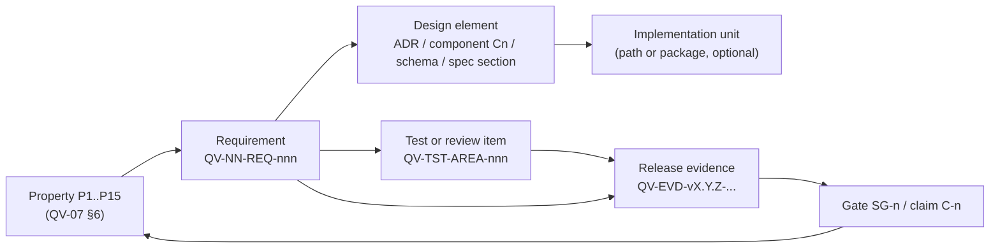

# QV-24 — Traceability Matrix

**Module ID:** `operations-assurance` (traceability)  
**Status:** Draft  
**Owner:** QA/assurance lead (interim: security lead)  
**Last reviewed:** 2026-10-21  
**Related specs:** QV-07 (security properties P1–P15, requirements, gates SG-1…SG-16), QV-11 (testing and assurance), QV-12 (operations), QV-29, QV-33, [SPEC-INDEX](SPEC-INDEX.md) §Traceability; binding ADRs QV-ADR-001…013

## 1. Objective

Make "does the shipped system do what the specs say, and can we prove it?" a mechanical question. This spec defines (a) the **chain** requirement → design → test → release evidence, (b) the **process and ownership** that keep it true as specs change, (c) a **machine-readable input format** and generator so the matrix is produced by a script, and (d) an **initial hand-curated matrix of security properties P1–P15** (QV-07 §6) mapped to requirements and planned tests. Rows for all other specs are placeholders that the script fills (§6, §9).

Guiding rule (QV-ADR-001, honest guarantees): *a claim in the QV-07 claims register may only be made when every Must requirement of the property it rests on has status `Verified` in the release's evidence bundle.*

## 2. Scope

### In scope
Identifier schemes; link types; status model; change-control; waiver process; script input/output formats; CI checks; release evidence bundle; initial P-matrix and security test catalog.

### Out of scope
Project management/issue tracking beyond linking; test implementation (QV-11); choosing a commercial requirements tool (the matrix is plain text in git so it is exportable and verifiable by anyone — consistent with exit-friendliness).

## 3. Artifact model and identifiers



| Artifact | ID format | Defined in | Example |
|---|---|---|---|
| Security property | `P<n>` | QV-07 §6 | `P3` |
| Requirement | `QV-<spec 2 digits>-REQ-<3 digits>` | Each spec §Requirements table | `QV-07-REQ-028` |
| Design element | `QV-ADR-<nnn>` or `QV-ADR-P<spec>-<n>`; component `QV-07:C3` style; schema/spec anchor `QV-09#event-ballot` | decision log, QV-08, QV-09 | `QV-ADR-004` |
| Test / review / drill item | `QV-TST-<AREA>-<nnn>`; AREA ∈ {`SEC`,`CRY`,`PRO`,`API`,`UX`,`OPS`,`ABU`,`DIS`,`A11`,`PRV`,`GOV`,`ID`}. For QV-07 requirements, number equals the requirement number (`QV-TST-SEC-028` covers `QV-07-REQ-028`) unless the catalog says otherwise | §8 and test code | `QV-TST-SEC-028` |
| Implementation unit | repo-relative path or package name | code | `packages/verifier` |
| Release evidence | `QV-EVD-<release>-<kind>-<nn>` stored under `evidence/<release>/` | §10 | `QV-EVD-v0.3.0-TESTRUN-01` |
| Gate | `SG-<n>` | QV-07 §13 | `SG-4` |
| Claim | `C-<n>` | QV-07 §12 | `C-3` |
| Waiver | `QV-WVR-<yyyy>-<nnn>` | `trace/waivers.yaml` | `QV-WVR-2027-001` |
| Advisory | `QV-SA-<yyyy>-<nnn>` | QV-33 | `QV-SA-2027-002` |

Rules: IDs are **never reused or renumbered**; a withdrawn requirement keeps its ID with status `Withdrawn` and a reason. A requirement split yields new IDs; the old one lists `supersededBy`.

## 4. Status model

| Level | Requirement status | Meaning | Required links |
|---|---|---|---|
| 0 | `Proposed` | Written in a spec at Draft | — |
| 1 | `Approved` | Spec approved (decision log) | — |
| 2 | `Designed` | Design element(s) identified | ≥1 design link |
| 3 | `Implemented` | Code merged | ≥1 implementation link |
| 4 | `Tested` | Test exists and passes in CI | ≥1 test link, last run `pass` |
| 5 | `Verified` | Evidence recorded in a signed release bundle | evidence link with hash |
| — | `Waived` | Not met; waiver granted (time-boxed) | waiver ID |
| — | `Withdrawn` | No longer required | reason, decision-log link |
| — | `Failed` | Test failing or evidence negative | — |

For requirements whose verification method is Review/Inspection/Drill (not automated test), `Tested` means the review/drill item has a dated report; `Verified` means the report hash is in the signed evidence bundle. Properties inherit status from their Must requirements: **a property is `Verified` iff all Must requirements mapped to it are `Verified`**.

## 5. Process

### 5.1 Lifecycle and ownership
1. **Authoring:** spec authors define requirements with IDs, priority, acceptance criteria, verification method (template §4). Each requirement lists the properties it supports in the spec's text or in `trace/links.yaml`.
2. **Design linking:** the owner of the design (QV-08/09/16 authors) adds `design` links when the architecture or ADR addresses the requirement.
3. **Test linking:** test authors annotate tests (§6.3). The generator derives test links from annotations; humans never edit generated regions.
4. **Implementation linking:** optional; derived from `@covers` annotations in source files for code units.
5. **Release:** the release script collects the evidence bundle (§10), runs the generator in `--release` mode, and refuses to sign if gates fail (QV-07 REQ-006).
6. **Review cadence:** weekly CI report on the default branch; monthly triage of orphan, stale, or failing rows; before each release a formal traceability review by the assurance lead + security lead.

### 5.2 Change control
| Change | Required action |
|---|---|
| New requirement | Add to spec; generator creates row `Proposed`; PR must add at least a planned test ID (`status: planned`) for any Must |
| Modified acceptance criteria | Requirement keeps ID; spec change log entry; **all linked tests flagged `review-needed`** until a human confirms or updates them (generator compares a hash of the requirement's text; stale hashes fail `--strict`) |
| Withdrawn requirement | Status `Withdrawn`, reason, decision-log reference; tests either re-pointed or deleted |
| New/changed security property (QV-07 §6) | Update §7 matrix in the same PR; threat-model review (QV-07 REQ-001) |
| Vulnerability fixed | Add regression test linked to the requirement and `QV-SA-…` (QV-33 REQ-008) |
| Test deleted/renamed | CI fails if a Must requirement loses its last passing test |

### 5.3 Waivers
A waiver is a signed entry in `trace/waivers.yaml`: `{id, requirement, reason, risk, compensatingControls, approvedBy[2], expires, releaseScope}`. Rules: ≤ 90 days; at most two renewals; two approvers including security lead for security requirements; **no waivers** for QV-07 gates SG-1…SG-6, SG-9; waivers are listed in release notes (QV-07 §13).

### 5.4 Coverage rules (CI-enforced)
| Rule | Level |
|---|---|
| Every `Must` requirement in an `Approved` spec has ≥1 linked test/review item (planned or real) | Error |
| Every test annotation references an existing requirement ID | Error |
| No requirement ID defined twice | Error |
| Every Must requirement of properties P1–P9 has an automated test (not review-only) unless QV-07 marks verification as R/D | Error at release |
| Orphan tests (no covers) | Warning |
| Requirements `Approved` > 90 days with status `Proposed`/`Designed` | Warning |
| Stale test links (requirement text hash changed) | Error at release |
| Release candidate: every `Must` is `Verified` or `Waived` | Error |

## 6. Script specification (generator)

A small Node 22 CLI (`tools/rtm/rtm.mjs`, zero runtime deps, `node:test` for its own tests, per QV-ADR-003) — **specified here, implemented later**. It reads specs, link files, test annotations, and evidence manifests, then writes the generated regions in this document and JSON/CSV reports.

### 6.1 Inputs

**(a) Spec requirement tables (parsed from `docs/*.md`).** The parser scans Markdown tables whose header row, case-insensitive, contains the columns `ID`, `Requirement`, and `Priority` (extra columns such as `Acceptance criteria`, `Verification`, `800-53` are accepted in any order and captured by header name). A data row is a requirement if its first cell matches `^QV-(\d{2})-REQ-(\d{3})$`. Extracted fields:

| Field | Source | Notes |
|---|---|---|
| `id` | col `ID` | must match its file's spec number prefix, else error |
| `text` | col `Requirement` | markdown stripped for hashing |
| `priority` | col `Priority` | `Must`/`Should`/`Could` (case-insens.); else error |
| `acceptance` | col `Acceptance criteria` (or `Acceptance`) | optional but warned if empty for Must |
| `verification` | col `Verification` / `Ver.` | normalized to {Test, Review, Inspection, Drill, Analysis} using aliases T/R/I/D |
| `sourceFile`, `line` | parser | for reports |
| `textHash` | SHA-256 of normalized `text + acceptance + priority` | stale-link detection |
| `specStatus` | spec header `**Status:**` line | gating of rules in §5.4 |

**(b) `trace/links.yaml`** — hand-maintained links not derivable from annotations. YAML (parsed by a tiny strict subset parser or JSON accepted as `trace/links.json`):

```yaml
version: 1
properties:                 # optional here if parsed from QV-07 §6 table; used as override
  P3:
    title: Universal verifiability
    requirements: [QV-07-REQ-019, QV-07-REQ-028, QV-05-REQ-012]
links:
  - req: QV-07-REQ-028
    design: [QV-ADR-004, "QV-08:C2"]          # design elements
    impl:   [packages/verifier]               # optional; code units
    tests:  [QV-TST-SEC-028]                  # optional if annotations exist
    properties: [P3]
    status: designed                          # optional manual floor: proposed|approved|designed
    notes: "second verifier tracked as REQ-029"
  - req: QV-29-REQ-018
    design: ["QV-09#error-codes"]
    properties: [P11]
```
JSON Schema (draft 2020-12, abbreviated):
```json
{ "$id": "qv-links.schema.json", "type": "object", "required": ["version","links"],
  "properties": {
   "version": {"const": 1},
   "properties": {"type":"object","patternProperties":{"^P[0-9]+$":{"type":"object","required":["requirements"],
      "properties":{"title":{"type":"string"},"requirements":{"type":"array","items":{"$ref":"#/$defs/reqid"}}}}}},
   "links": {"type":"array","items":{"type":"object","required":["req"],
      "properties":{"req":{"$ref":"#/$defs/reqid"},
        "design":{"type":"array","items":{"type":"string"}},
        "impl":{"type":"array","items":{"type":"string"}},
        "tests":{"type":"array","items":{"type":"string","pattern":"^QV-TST-[A-Z0-9]+-[0-9]{3,4}$"}},
        "properties":{"type":"array","items":{"type":"string","pattern":"^P[0-9]+$"}},
        "status":{"enum":["proposed","approved","designed"]},"notes":{"type":"string"}},
      "additionalProperties": false}}},
  "$defs": {"reqid":{"type":"string","pattern":"^QV-[0-9]{2}-REQ-[0-9]{3}$"}} }
```

**(c) Test annotations.** The scanner walks `**/*.test.{ts,js,mjs}`, `test/**`, `tests/**`, `e2e/**`, `fuzz/**`, `drills/**/*.md`, and review reports under `docs/reviews/**/*.md`. It recognizes, per test:
- Source comment tag: `// @covers QV-07-REQ-028, QV-07-REQ-033` (comma/space separated, may span multiple lines directly above a `test(`/`it(`/`describe(`).
- Test ID tag: `// @test QV-TST-SEC-028`.
- Test-name convention (for runner output matching): `test('[QV-TST-SEC-028] verifier rejects forged proof', …)`.
- Markdown (reviews/drills) front matter:
  ```yaml
  ---
  test: QV-TST-OPS-080
  covers: [QV-07-REQ-080]
  date: 2027-03-02
  result: pass        # pass|fail|partial
  reportHash: sha256:…
  ---
  ```
Annotation regex: `@covers\s+((?:QV-\d{2}-REQ-\d{3}[,\s]*)+)`.

**(d) Test results** — `evidence/<release>/test-results/*.json`: TAP-to-JSON or `node:test` JSON reporter output normalized to `[{ "testId": "QV-TST-SEC-028", "name": "...", "result": "pass|fail|skip", "durationMs": 12, "commit": "…", "runId": "…" }]`. Matching key: the `[QV-TST-…]` token in the test name (preferred) or file+name through a `tests.map.json` if tokens are absent.

**(e) Evidence manifest** — `evidence/<release>/manifest.json`:
```json
{ "release": "v0.3.0", "commit": "…", "created": "2027-01-15T10:00:00Z",
  "artifacts": [ { "id": "QV-EVD-v0.3.0-TESTRUN-01", "kind": "test-run", "path": "test-results/all.json",
                   "sha256": "…", "covers": ["QV-07-REQ-028"] },
                 { "id": "QV-EVD-v0.3.0-REVIEW-R1", "kind": "review-report", "path": "reviews/r1.pdf",
                   "sha256": "…", "covers": ["QV-07-REQ-007"], "gate": "SG-13" } ],
  "gates": { "SG-1": "pass", "SG-4": {"result":"pass","evidence":["QV-EVD-v0.3.0-REPRO-01"]} },
  "signatures": [ { "keyId": "…", "sig": "…" } ] }
```
**(f) Waivers** — `trace/waivers.yaml` per §5.3.

### 6.2 Outputs
| Output | Path | Notes |
|---|---|---|
| Generated matrix regions | between `<!-- RTM:BEGIN spec=QV-NN -->` and `<!-- RTM:END spec=QV-NN -->` in §9 of this file | idempotent; rewrites only inside markers |
| Full machine-readable matrix | `trace/matrix.json` | `{generatedAt, commit, requirements:[{id, spec, priority, textHash, status, designs[], impls[], tests:[{id, lastResult}], evidence[], properties[], waiver?, flags[]}], properties:[…], gates:[…]}` |
| CSV export | `trace/matrix.csv` | one row per requirement-test pair for spreadsheets/audits |
| Property report | `trace/properties.md` | P-status roll-up (mirror of §7 with computed status) |
| Gaps report | `trace/gaps.md` | uncovered Musts, orphans, stale, failing |
| Release snapshot | `evidence/<release>/rtm.json` + hash | included in evidence manifest |

Generated row format (per spec region):
```
| Req | Pri | Spec status | Design | Tests | Last result | Evidence | Status | Props |
| QV-05-REQ-012 | Must | Draft | QV-ADR-004 | QV-TST-CRY-012 | pass | QV-EVD-… | Verified | P3 |
```

### 6.3 CLI and exit codes
```
rtm generate [--write] [--spec QV-05] [--specs-dir docs] [--links trace/links.yaml]
rtm check    [--strict] [--release v0.3.0]     # enforce §5.4
rtm report   [--format md|json|csv] [--out trace/]
rtm snapshot --release v0.3.0 --results evidence/v0.3.0/test-results   # writes evidence/rtm.json
```
Exit codes: `0` ok; `1` rule violations (errors in §5.4); `2` input parse error (bad table, bad YAML, schema violation); `3` internal error. `check --release` additionally verifies evidence hashes, signatures (via the verifier's release-manifest code path), and gate statuses; any `Must` not `Verified|Waived` ⇒ exit 1.

### 6.4 Determinism and trust
Output is deterministic (sorted IDs, no timestamps except `generatedAt` in JSON, excluded from hashes). The script has no network access. Because it gates releases it is itself under QV-07 SG-6 review; its tests include golden fixtures for each failure rule.

## 7. Initial matrix: security properties P1–P15

Status column is the *current* roll-up (all `Proposed`, nothing implemented). Requirement lists in the "QV-07" column are complete as of this draft; cross-spec requirements are added by the generator from `links.yaml` as those specs mature (placeholders in the "Other specs" column name the owning spec and the expected requirement area; no ID is assumed to exist yet).

| Prop | Property (QV-07 §6) | QV-07 requirements | QV-29 / QV-33 requirements | Other specs (expected; to be linked by script) | Planned tests (QV-TST-SEC-…) | Gates | Claims | Status |
|---|---|---|---|---|---|---|---|---|
| P1 | Ballot secrecy | 004, 010, 011, 012, 013, 014, 015, 016, 017, 018, 020, 021, 063 | QV-29-REQ-003, 022 | QV-05 (secrecy, encryption), QV-06 (data minimisation), QV-16 (ElGamal/DKG) | 010–018, 020, 021, 063 | SG-3, SG-5 | C-1, C-2, C-10 | Proposed |
| P2 | Individual verifiability | 024, 026, 027 | — | QV-05 (receipts, audit), QV-10 (audit UX), QV-16 (Benaloh) | 024, 026, 027 | SG-3 | C-4 | Proposed |
| P3 | Universal verifiability | 019, 028, 029, 033, 035, 062, 091, 093 | — | QV-05 (tally), QV-16 (proof statements), QV-11 (vectors) | 019, 028, 029, 033, 035 | SG-3 | C-3 | Proposed |
| P4 | Eligibility verifiability | 022, 023, 024, 031, 032, 034 | QV-29-REQ-008, 009, 010 | QV-04 (roll, credentials), QV-03 (rules) | 022–024, 031, 032, 034 | SG-3 | C-5 | Proposed |
| P5 | One-voter-one-count | 025, 033 | QV-29-REQ-006, 007 | QV-04 (duplicate prevention), QV-05 (revote rule) | 025, 033 | SG-3 | C-5 | Proposed |
| P6 | Board integrity / non-equivocation | 040, 041, 042, 043, 044, 045, 046, 047 | QV-29-REQ-018 | QV-08 (board), QV-09 (entries), QV-12 (backups) | 040–047 | SG-3, SG-11 | C-6, C-7 | Proposed |
| P7 | Rule immutability | 022, 030, 031, 034 | QV-29-REQ-021 | QV-03 (lifecycle), QV-09 (manifest schema) | 022, 030, 031, 034 | SG-2 | C-8 | Proposed |
| P8 | Key-material safety | 010, 011, 012, 013, 014, 016 | — | QV-16 (DKG), QV-12 (trustee ops) | 010–014, 016 | SG-3 | C-2 | Proposed |
| P9 | Client and release integrity | 050, 051, 052, 053, 054, 055, 056, 057, 058, 059, 060, 061, 062, 065 | QV-33-REQ-009 | QV-08 (build), QV-12 (updates), QV-14 (release funding) | 050–060 | SG-4, SG-7, SG-10, SG-16 | C-13 | Proposed |
| P10 | Metadata minimisation | 053, 063, 064, 066, 094 | QV-29-REQ-003, 022, 023 | QV-06 (logs, retention), QV-08 (Tor) | 053, 063, 064, 066, 094 | SG-5, SG-10 | C-9 | Proposed |
| P11 | Abuse resilience / availability | 047, 067 | QV-29-REQ-001 … 025 | QV-12 (capacity), QV-13 (PoW a11y), QV-08 | 047, 067 + QV-TST-ABU-001…025 | SG-2 | — | Proposed |
| P12 | Safe failure | 001, 005, 006, 061, 080, 081, 082, 083, 084, 085, 086 | — | QV-03 (lifecycle states), QV-09 (control entries), QV-12 (runbooks) | 005, 080–086 | SG-2, SG-12 | — | Proposed |
| P13 | Honest claims | 001, 002, 003, 004, 071 | QV-33-REQ-014 | QV-10 (copy), QV-02 (product claims), QV-00 | 002, 003, 004, 071 | SG-9 | C-12 | Proposed |
| P14 | Partial coercion mitigation | 021, 070, 071, 072 | QV-29-REQ-006 | QV-03 (revote policy), QV-10 (copy) | 021, 070–072 | SG-2 | C-11 | Proposed |
| P15 | Coordinated vulnerability handling | 006, 007, 008, 087, 090, 091, 092, 093 | QV-33-REQ-001 … 015 | QV-11 (review budget), QV-14 | 008, 087, 090, 092, 093 + QV-TST-DIS-001…015 | SG-1, SG-12, SG-13, SG-14 | C-14, C-15 | Proposed |

**Property-level cross-checks:** (i) every QV-07 requirement 001–094 appears in at least one property row or is a process requirement (001, 006, 007 are cross-cutting and attach to P12/P15); (ii) the generator verifies this via `properties` entries in `links.yaml` (`rtm check` warns on requirements with no property).

### 7.1 Requirement → property reverse index (QV-07)
| Req | Props | Req | Props | Req | Props | Req | Props |
|---|---|---|---|---|---|---|---|
| 001 | P12,P13 | 023 | P4 | 047 | P6,P11 | 066 | P10 |
| 002 | P13 | 024 | P2,P4 | 050 | P9 | 067 | P11 |
| 003 | P13 | 025 | P5 | 051 | P9 | 070 | P14 |
| 004 | P13,P1 | 026 | P2 | 052 | P9 | 071 | P13,P14 |
| 005 | P12 | 027 | P2 | 053 | P9,P10 | 072 | P14 |
| 006 | P12,P15 | 028 | P3 | 054 | P9 | 080 | P12 |
| 007 | P15 | 029 | P3 | 055 | P9 | 081 | P12 |
| 008 | P15 | 030 | P7 | 056 | P9 | 082 | P12 |
| 010 | P1,P8 | 031 | P4,P7 | 057 | P9 | 083 | P12 |
| 011 | P1,P8 | 032 | P4 | 058 | P9 | 084 | P12 |
| 012 | P1,P8 | 033 | P3,P5 | 059 | P9 | 085 | P12 |
| 013 | P1,P8 | 034 | P4,P7 | 060 | P9 | 086 | P12 |
| 014 | P1,P8 | 035 | P3 | 061 | P9,P12 | 087 | P15 |
| 015 | P1 | 040 | P6 | 062 | P3,P9 | 090 | P15 |
| 016 | P1,P8 | 041 | P6 | 063 | P1,P10 | 091 | P3,P15 |
| 017 | P1 | 042 | P6 | 064 | P10 | 092 | P15 |
| 018 | P1 | 043 | P6 | 065 | P9,P11 | 093 | P3,P15 |
| 019 | P3 | 044 | P6 | | | 094 | P10 |
| 020 | P1 | 045 | P6 | | | | |
| 021 | P1,P14 | 046 | P6 | | | | |
| 022 | P4,P7 | | | | | | |

(Prefix `QV-07-REQ-` omitted.) These pairs are authoritative until `links.yaml` is generated; the script's first run must reproduce them.

## 8. Initial security test catalog (QV-TST-SEC-nnn)

Level: **U** unit, **P** property-based, **I** integration, **E** end-to-end, **F** fuzz, **S** static/lint/CI-config, **R** review/audit, **D** drill. All are **planned** (no code exists). Each test `QV-TST-SEC-nnn` covers `QV-07-REQ-nnn` unless the Covers column says otherwise.

| Test | Lvl | Description (pass condition) | Covers |
|---|---|---|---|
| 001 | S | PR template/CI check blocks changes to protected paths lacking threat-model checkbox | 001 |
| 002 | S | Claims lint: every forbidden phrase (QV-07 §12.3) fails; allowed claims pass | 002 |
| 003 | E | Assurance label renders per manifest evidence; cannot be overridden by config | 003 |
| 004 | U | Trust declaration generated for ≥6 manifest permutations; degraded mode shows red banner | 004, 011 |
| 005 | U/E | One-byte mutation of each artifact class ⇒ verifier exit ≠ 0, UI never shows "verified" | 005 |
| 006 | S | Release script refuses to sign with any gate evidence missing | 006 |
| 007 | R | Review reports (R1/R2) referenced in manifest with zero open High/Critical | 007 |
| 008 | S | Every High+ advisory has regression test with advisory ID in name | 008 |
| 010 | S/R | Server package has no import path to trustee modules; schema has no secret fields | 010 |
| 011 | U | Manifest validator: t<2 rejected without degraded flag; accepted with banner | 011 |
| 012 | I | Malicious-dealer DKG: complaint, disqualification; client rejects key ≠ transcript hash | 012 |
| 013 | U | KDF floor, wrong passphrase, weak passphrase refusal, file mode 0600 | 013 |
| 014 | I | Trustee tool refuses single-ciphertext, pre-close, head-mismatch, subset aggregate | 014 |
| 015 | I | Share destruction attestation verifies; new election yields new keys | 015 |
| 016 | I | t−1 trustees ⇒ `STALLED`, no operator fallback | 016 |
| 017 | U | Disclosure warnings for roll < 10, unanimity, suppressed-count labelling | 017 |
| 018 | S/U | Lint bans `Math.random`; entropy failure aborts | 018 |
| 019 | U/P | Cross-election/contest/statement replay of proofs and Merkle nodes fails; negative vectors | 019 |
| 020 | E | Canary run: plaintext, passphrase, randomness absent from traffic, logs, DB, board export | 020 |
| 021 | E | Post-cast memory/storage scan finds no plaintext/randomness; no export of proof-of-vote | 021 |
| 022 | I | Mutating sealed manifest rejected; election ID = manifest hash | 022 |
| 023 | I | Non-roll key and bad Merkle proof rejected before proof verification | 023 |
| 024 | I | Replay across elections, altered ciphertext, non-increasing sequence rejected | 024 |
| 025 | P | ≥10,000 random revote histories ⇒ identical counted set across server/verifiers/trustee tool | 025 |
| 026 | E | Receipt inclusion proof verified; dropped ballot raises alarm with offline-verifiable evidence | 026 |
| 027 | E | Benaloh audit decrypts correctly; cheating-client double detected; cast ballots cannot be audited | 027 |
| 028 | I | Golden good/bad bundles: each negative vector gives expected failure code | 028 |
| 029 | I | Differential testing between two verifiers on ≥1,000 generated + mutated elections | 029 |
| 030 | I | Late submissions rejected; late board entries ignored; skew injection flagged | 030 |
| 031 | I | Roll/rule change after open rejected; amendments bounded and reported | 031 |
| 032 | E | Roll self-check and published roll size; export contains all keys | 032 |
| 033 | I | Verifier reports injected anomalies (extra, duplicate, count>roll) exactly | 033 |
| 034 | I | Unsigned/wrongly signed control entries rejected; k-of-m enforced | 034 |
| 035 | I | Independent recompute of tally from fresh export matches published result | 035 |
| 040 | U | RFC 9162 proof test vectors, cross-implementation | 040 |
| 041 | I | Simulation: no ballot uncovered by an STH > 300 s | 041 |
| 042 | I | Client detects shrinking/forking/rewriting tree | 042 |
| 043 | I | Witness cosignature verification; tier computation | 043 |
| 044 | I | Equivocation proof built and verified by a third party; UI alert | 044 |
| 045 | I | Restore from stale backup ⇒ server refuses; override leaves visible notice | 045 |
| 046 | I | Export/import reproduces identical root; mirror sync | 046 |
| 047 | F | Fuzzed appends rejected at cheapest check; per-type caps enforced | 047 |
| 050 | S/R | Two independent builders produce identical hashes (3 consecutive RCs; one external rebuild) | 050 |
| 051 | U | 1-of-3 signatures insufficient; wrong key rejected; downgrade rejected | 051 |
| 052 | E | Header scan and XSS corpus; Trusted Types enforced | 052 |
| 053 | E | Network capture shows same-origin requests only | 053 |
| 054 | E | Displayed build hash equals manifest; mismatch detected | 054 |
| 055 | S | Dependency budget and lockfile integrity checks; audit gate | 055 |
| 056 | S | CI config lint: pinned actions, permissions, branch protection export | 056 |
| 057 | S | SBOM and provenance verify | 057 |
| 058 | D | Signing-key rotation/revocation drill | 058 |
| 059 | I | Downgrade refused; upgrade during OPEN election requires flag | 059 |
| 060 | S | Secret scanner catches seeded canary | 060 |
| 061 | I | Route inventory: no password/reset endpoints; unsigned admin action rejected | 061 |
| 062 | F | Decoder fuzzing; non-canonical encodings rejected | 062 |
| 063 | E | Log-content tests: no IP/UA; debug mode gated | 063 |
| 064 | E | TLS scan; onion-service e2e; Tor Browser smoke test | 064 |
| 065 | S | Container baseline scan and runtime assertions | 065 |
| 066 | I | Fixed-size responses; timing variance bound | 066 |
| 067 | E | Delegates to QV-TST-ABU-001…025 | 067 |
| 070 | E | Default manifest has revoting; UI copy test | 070 |
| 071 | R | Copy review snapshot includes non-claims | 071 |
| 072 | I | Receipt/export content inspection: no vote-proving data | 072 |
| 080 | D | Tabletop exercise report dated < 6 months | 080 |
| 081 | I | State machine transition tests incl. PAUSED/INVALIDATED | 081 |
| 082 | I | Pause authority matrix; operator hold limits | 082 |
| 083 | I | Invalidation entry accepted only from authorized parties; verifier renders `INVALIDATED` | 083 |
| 084 | D | Evidence snapshot procedure drill | 084 |
| 085 | D | Notification SLA drill with timers | 085 |
| 086 | R | Post-incident review template present; example published | 086 |
| 087 | R | `SECURITY.md` and `security.txt` valid; PVR round trip (QV-33) | 087 |
| 090 | R | Review plan evidence (reports) linked | 090 |
| 091 | R | Symbolic model runs and results archived | 091 |
| 092 | R | Penetration test report, zero open High/Critical | 092 |
| 093 | F/P | Fuzz and property suites in CI, coverage and mutation thresholds | 093 |
| 094 | E | Privacy leak canary on logs, DB, exports, errors, headers, board entries | 094 |

Further catalogs (`QV-TST-ABU-nnn` for QV-29, `QV-TST-DIS-nnn` for QV-33, `QV-TST-CRY-nnn` etc.) will be created by those spec owners or by the generator from annotations; this file holds only the QV-07 catalog.

## 9. Per-spec matrices (generated)

Do not edit between markers. The generator rewrites each region; until the first run each region contains `_not yet generated_`. Specs not yet containing requirement tables will appear with zero rows.

<!-- RTM:BEGIN spec=QV-02 -->
_not yet generated_
<!-- RTM:END spec=QV-02 -->

<!-- RTM:BEGIN spec=QV-03 -->
_not yet generated_
<!-- RTM:END spec=QV-03 -->

<!-- RTM:BEGIN spec=QV-04 -->
_not yet generated_
<!-- RTM:END spec=QV-04 -->

<!-- RTM:BEGIN spec=QV-05 -->
_not yet generated_
<!-- RTM:END spec=QV-05 -->

<!-- RTM:BEGIN spec=QV-06 -->
_not yet generated_
<!-- RTM:END spec=QV-06 -->

<!-- RTM:BEGIN spec=QV-07 -->
_not yet generated_
<!-- RTM:END spec=QV-07 -->

<!-- RTM:BEGIN spec=QV-08 -->
_not yet generated_
<!-- RTM:END spec=QV-08 -->

<!-- RTM:BEGIN spec=QV-09 -->
_not yet generated_
<!-- RTM:END spec=QV-09 -->

<!-- RTM:BEGIN spec=QV-10 -->
_not yet generated_
<!-- RTM:END spec=QV-10 -->

<!-- RTM:BEGIN spec=QV-11 -->
_not yet generated_
<!-- RTM:END spec=QV-11 -->

<!-- RTM:BEGIN spec=QV-12 -->
_not yet generated_
<!-- RTM:END spec=QV-12 -->

<!-- RTM:BEGIN spec=QV-13 -->
_not yet generated_
<!-- RTM:END spec=QV-13 -->

<!-- RTM:BEGIN spec=QV-14 -->
_not yet generated_
<!-- RTM:END spec=QV-14 -->

<!-- RTM:BEGIN spec=QV-16 -->
_not yet generated_
<!-- RTM:END spec=QV-16 -->

<!-- RTM:BEGIN spec=QV-29 -->
_not yet generated_
<!-- RTM:END spec=QV-29 -->

<!-- RTM:BEGIN spec=QV-33 -->
_not yet generated_
<!-- RTM:END spec=QV-33 -->

New specs add a region by adding the marker pair; the generator inserts missing regions for any spec file with requirement tables and warns.

## 10. Release evidence bundle

Each release produces `evidence/<release>/` (published alongside the release, signed per QV-07 REQ-051):

| Item | Content | Used for |
|---|---|---|
| `manifest.json` | §6.1(e) | Index + gate results + signatures |
| `rtm.json` | Snapshot of the matrix at the release commit | Traceability review |
| `test-results/` | All CI test runs incl. property/fuzz summaries | `Tested` status |
| `vectors/` | Crypto test vectors + hashes (primary and independent verifier pass) | SG-3 |
| `repro/` | Two independent builder logs and hash comparison | SG-4 |
| `sbom/`, `provenance/` | CycloneDX/SPDX, build attestation | SG-7 |
| `reviews/` | R0–R6 reports (redacted) with hashes | SG-13…15 |
| `privacy-canary/` | Canary test outputs | SG-5 |
| `drills/` | Tabletop/restore/key-rotation reports | SG-11, SG-12 |
| `waivers.yaml` | Active waivers affecting the release | Transparency |
| `claims-lint.log` | Claims lint output and assurance label computation | SG-9 |
| `known-bad-versions.json` | Signed list | QV-33 REQ-009 |

Retention: permanent in the repository's release assets and mirrored in the project's archive; evidence for yanked releases is retained with the yank reason.

## 11. Requirements

| ID | Requirement | Priority | Acceptance criteria | Verification |
|---|---|---|---|---|
| QV-24-REQ-001 | Every spec requirement shall use the ID format `QV-<nn>-REQ-<nnn>`, be unique across the repository, and appear in a table parseable per §6.1(a). | Must | `rtm check` reports zero duplicate or malformed IDs on the default branch | Test |
| QV-24-REQ-002 | The repository shall contain the generator `rtm` implementing §6 with golden-fixture tests for each rule of §5.4 and each exit code. | Must | Test suite passes; fixtures cover every rule | Test |
| QV-24-REQ-003 | CI shall run `rtm check` on every PR and `rtm check --strict` on the default branch nightly, failing on §5.4 errors. | Must | Seeded violation PRs fail | Test |
| QV-24-REQ-004 | Tests shall carry `@covers` annotations and/or `[QV-TST-…]` name tokens; a PR adding a test without a valid reference shall warn, and tests for Must requirements shall fail the PR if the referenced ID does not exist. | Must | Annotation fixtures | Test |
| QV-24-REQ-005 | The release script shall run `rtm check --release` and refuse to sign if any Must requirement of an `Approved` spec is neither `Verified` nor covered by a valid waiver, or any gate lacks evidence. | Must | Dry-run with a missing item fails | Test |
| QV-24-REQ-006 | Waivers shall follow §5.3 and appear in release notes and in `evidence/<release>/waivers.yaml`. | Must | Expired waiver fails check; two approvers enforced | Test/Inspection |
| QV-24-REQ-007 | Property status (P1–P15) shall be computed from mapped Must requirements; the claims lint (QV-07 REQ-002) shall refuse a public claim whose property is not `Verified` for the release being described, except as hedged "designed to" language under label `Experimental`. | Must | Lint test with property states | Test |
| QV-24-REQ-008 | A change to a requirement's text, acceptance criteria or priority shall mark linked tests `review-needed` until re-confirmed in `links.yaml` (`reviewedHash`). | Should | Hash-change fixture | Test |
| QV-24-REQ-009 | Generated regions shall be reproducible byte-for-byte from the same inputs. | Must | Run twice, diff empty | Test |
| QV-24-REQ-010 | The evidence bundle of §10 shall be produced for every release candidate and hash-pinned in the release manifest. | Must | Bundle validator | Test |
| QV-24-REQ-011 | Quarterly the assurance lead shall review `trace/gaps.md`, stale waivers, and orphan tests, and record the outcome in the decision log or a dated report. | Should | Dated report | Inspection |
| QV-24-REQ-012 | The traceability data shall be exportable (CSV/JSON) without proprietary tools, and the generator shall run offline. | Must | Offline run in sandbox | Test |

## 12. Interfaces and dependencies
Inputs from every spec's requirements table (format fixed by SPEC-TEMPLATE §4 plus the ID rule); from QV-11 (test conventions, runners); from QV-07 (properties, gates, claims). Outputs consumed by QV-07 REQ-006 (release script), QV-33 REQ-008, QV-12 (release procedure), auditors.

**Cross-spec conflicts to watch:** (1) SPEC-TEMPLATE shows `QV-XX-REQ-001` with five columns; additional columns are tolerated but the first column must be the bare ID. (2) Specs that put requirements in prose (not tables) will be invisible to the script — authors must use tables. (3) QV-07 uses bare numbers in prose cross-references ("REQ-014") for brevity; the script ignores those.

## 13. Open questions

| Question | Owner | Target | Proposed default |
|---|---|---|---|
| YAML vs JSON for `links` (zero-dependency YAML parsing in Node 22 is not built in) | QA lead | M1 | Accept JSON natively; YAML via a tiny strict parser in-repo (no dependency) |
| Where do reviews/drills live (`docs/reviews/` vs `evidence/`) | QA lead | M1 | Source in `docs/reviews/`, copies hashed into evidence |
| Test-ID naming for specs other than QV-07 | Spec owners | M1 | `QV-TST-<AREA>-<nnn>`, area list in §3 |
| Do `Should` requirements gate releases? | Project owner | M2 | No gate; reported; `Should` in P1–P9 reviewed individually |
| Mutation-testing thresholds in the gate vs report only | QV-11 owner | M2 | Report only except crypto packages (QV-07 REQ-093) |

## 14. Proposed ADRs

### QV-ADR-P24-1 — Traceability as plain-text, script-generated artifacts in git
- **Decision:** requirement tables in specs are the source of truth; links in `trace/links.yaml`; tests annotated; matrix generated; evidence bundle signed with the release.
- **Alternatives:** commercial ALM tool (lock-in, not verifiable by observers); hand-maintained matrix (rots).
- **Consequences:** spec authors must keep tables parseable; releases are gated on traceability (QV-07 SG-2).

## 15. References
- IEEE 29148:2018 requirements engineering (traceability concept) `[K — not re-fetched]`.
- NIST SP 800-53 Rev. 5 CA-2/SA-11/CM-3 (assessment and change control) `[K]`.
- Reproducible Builds project; SLSA framework `[K]`.
- QV-07 §21 for threat-model sources.

## 16. Approval and change history

| Reviewer | Decision | Date | Notes |
|---|---|---|---|
| Project owner | Pending | — | — |
| QA/assurance lead | Pending | — | Script scope |

| Version | Date | Change |
|---|---|---|
| 0.1 | 2026-10-21 | Initial full draft with P1–P15 matrix and security test catalog |
