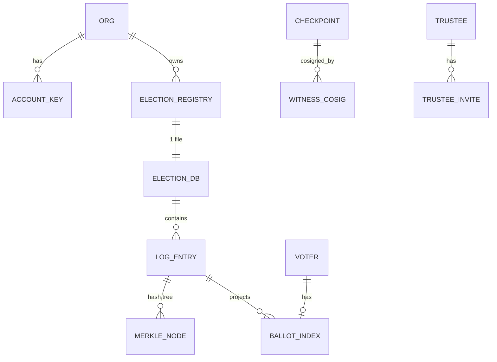

# QV-28 — Data Model and Storage

**Module ID:** `data-storage`
**Status:** Draft
**Owner:** Backend lead (proposed)
**Last reviewed:** 2026-10-21
**Related specs:** QV-ADR-001, 002, 003, 006, 007, 009, 013 · QV-18 (log entries/proofs) · QV-17 (trustees) · QV-16 (crypto objects, opaque here) · QV-09 (API) · QV-06 (privacy lifecycle) · QV-08 · QV-12 (ops) · QV-04

---

## 1. Objective

Define the complete relational schema, isolation model, encryption, migration, backup/restore, retention/redaction and export behaviour for the QuietVote server's embedded database (`node:sqlite`, QV-ADR-003). The server is an **untrusted coordinator and bulletin board** (QV-ADR-001/008): its database must therefore (a) hold nothing whose compromise breaks secrecy or integrity, (b) minimize personal data, (c) make the append-only log tamper-evident to everyone but not require trusting the DB, and (d) be exportable and deletable.

**Governing principle — log is the source of truth.** Everything integrity-relevant is in `log_entry`. Other election tables are **projections** (rebuildable from the log by `qv rebuild-projections`) or **operator data** (invites, contacts, sessions) that carry no integrity weight.

## 2. Scope

### In scope
`node:sqlite` schema & DDL; file layout; per-election isolation; column privacy classes; what the server stores vs never stores; indexes; migrations; backup/restore/DR; at-rest encryption; retention/deletion/redaction; operator export format.

### Out of scope
Cryptographic object encodings (QV-16: stored as opaque `BLOB`); HTTP surface (QV-09); log semantics (QV-18); alternative engines (Postgres) — a storage-port interface is defined (§13) but only SQLite is specified.

## 3. Actors

| Actor | Goal | Outcome |
|---|---|---|
| Server process | Persist and serve | Single-writer per election; WAL |
| Operator (sysadmin) | Run, back up, restore, delete | Procedures §10–§12 |
| Organizer | Export, delete election | Export bundle; scheduled deletion |
| Auditor | Obtain full data | Public bundle via QV-18 §12 |
| Attacker with disk/backup access | Learn secrets | Learns only public data + ciphertext (§5, §9) |

## 4. Requirements

| ID | Requirement | Pri | Acceptance criteria | Ver |
|---|---|---|---|---|
| QV-28-REQ-001 | The server shall use `node:sqlite` (`DatabaseSync`) only; no ORM; all SQL in versioned migration files and prepared statements; all tables `STRICT`. | Must | Lint: no string-concatenated SQL; `PRAGMA table_list` shows strict=1. | T |
| QV-28-REQ-002 | Storage shall be **one SQLite file per election** (`elections/<shard>/<election_id>.sqlite`) plus one `control.sqlite`. No query shall span two election files. | Must | Test: grep for `ATTACH`; code review gate; fuzz cross-election access returns 404. | T/R |
| QV-28-REQ-003 | Every connection shall set `PRAGMA foreign_keys=ON`, `journal_mode=WAL`, `synchronous=FULL` (election DBs) / `NORMAL` (control), `busy_timeout=5000`, `trusted_schema=OFF`, `secure_delete=ON`, `cell_size_check=ON`, `application_id` and `user_version` set. | Must | Startup self-test reads back pragmas. | T |
| QV-28-REQ-004 | `log_entry` shall be append-only and gapless, enforced by DB triggers *in addition to* application logic. UPDATE is limited to the redaction path (§11.3); DELETE is forbidden. | Must | Direct SQL tests: update/delete/gap insert aborts. | T |
| QV-28-REQ-005 | Leaf append, Merkle node update, projection update, event outbox insert and (if due) checkpoint insert shall occur in one transaction (`BEGIN IMMEDIATE`). | Must | Crash-injection (QV-18-REQ-005). | F |
| QV-28-REQ-006 | The server shall never store: ballot plaintext, trustee secret shares/keys/passphrases/bundles, voter private keys, client IP addresses (by default), user-agent strings, device fingerprints, or voter credentials in recoverable form. | Must | Schema review; `qv audit-schema` asserts no column named/typed for these; log/DB scan test. | T/R |
| QV-28-REQ-007 | Every column shall carry a privacy class (P0–P4, §6) in the schema registry (`schema/columns.json`), checked in CI against the DDL; a column without a class fails the build. | Must | CI check. | T |
| QV-28-REQ-008 | Columns of class P2/P3 shall be envelope-encrypted at the application layer (§9) except hashes of high-entropy secrets (P3-hash). | Must | Raw file scan finds no P2 plaintext (test with sentinel emails). | T |
| QV-28-REQ-009 | Each election shall have its own data-encryption key (DEK) wrapped by an instance key-encryption key (KEK); deleting the wrapped DEK shall crypto-erase all P2/P3 data of that election. | Must | After DEK delete, decrypt attempts fail; sentinel unrecoverable. | T |
| QV-28-REQ-010 | Migrations shall be forward-only, checksummed, transactional, preceded by an online backup, and shall never modify existing `log_entry`/`merkle_node`/`checkpoint` rows. A verification of log root before/after is mandatory. | Must | Migration test harness compares roots on golden fixtures for every version. | T |
| QV-28-REQ-011 | A backup and restore procedure shall exist with RPO ≤ 5 min and RTO ≤ 1 h for OPEN elections (§10), using `node:sqlite` `backup()` and independent mirrors; restored data shall pass `qv-verify` before serving. | Must | DR drill in CI with fault injection. | T |
| QV-28-REQ-012 | Backups shall be encrypted (age recipients configured by the operator) before leaving the host; the server shall refuse to start a remote-backup target without encryption configured. | Must | Backup artifact is not valid SQLite header; decrypts with test identity. | T |
| QV-28-REQ-013 | Retention and deletion jobs shall implement §11 exactly, including refusal to delete before QV-18-REQ-031 conditions, and shall emit operator-audit records without PII. | Must | Time-travel tests. | T |
| QV-28-REQ-014 | An organizer-triggered **election export** shall produce the public bundle (QV-18 §12) plus an optional organizer-private operator bundle (§12) from a consistent snapshot, without blocking appends > 100 ms p99. | Must | Load test; bundles verify. | T |
| QV-28-REQ-015 | Opening an ARCHIVED election DB shall be read-only (`readOnly: true`) unless an explicit maintenance command is invoked. | Should | Attempted write fails. | T |
| QV-28-REQ-016 | Disk-space guard: refuse new appends when free space < max(500 MiB, 5× largest expected entry batch) (`507 LOG_FULL`), reads continue. | Must | Fault test. | F |
| QV-28-REQ-017 | `qv rebuild-projections` shall reconstruct all projection tables from `log_entry` and the result shall equal the live projections (bitwise on canonical dump). | Must | CI check after random workloads. | T |
| QV-28-REQ-018 | Storage access shall go through a `Store` port interface (read-model/write-model separation) so another engine can be substituted without changing protocol code. | Could | Interface in code; contract tests. | R |
| QV-28-REQ-019 | The control DB shall hold no election content other than the registry row needed to locate and authorize access. | Must | Schema review. | R |
| QV-28-REQ-020 | `PRAGMA integrity_check` and `qv self-audit` (QV-18-REQ-054) shall run on schedule (default 6 h, quick check hourly) and on start after unclean shutdown. | Should | Corruption test detected. | F |
| QV-28-REQ-021 | The package `engines` field shall be `>=22.16` (module-level `backup()`; Node 22 and 24 both supported and CI-tested, QV-ADR-014), and startup shall assert `sqlite_version()` supports STRICT tables (≥ 3.37). | Must | Startup refuses older runtimes with a clear error. | T |

## 5. What the server stores — and never stores

| Category | Stored | Where | Class | Notes |
|---|---|---|---|---|
| Election manifest & all log entries (incl. ballot ciphertexts, proofs, trustee ceremony messages) | Yes | `log_entry` | P0/P1 | Public by design (QV-18) |
| Voter public keys (roll) | Yes | `voter`, log | P1 | Pseudonymous; per-election keys by default |
| Trustee public keys, labels | Yes | `trustee` | P0 | Manifest is public |
| Organizer public keys & account labels | Yes | `control.account_key` | P1 | Labels optional pseudonyms |
| Invite code **hashes** | Yes | `voter_invite`, `trustee_invite` | P3-hash | Codes themselves not stored |
| Invite contact (email/phone/handle) | Optional, encrypted | `voter_invite.contact_enc` | P2 | Deleted on use/at open (§11) |
| Session tokens (hashed), challenges | Yes, ephemeral | `control.session` | P3-hash | TTL ≤ 12 h |
| Log signing key (private) | Yes, encrypted | `election.log_sk_enc` | P3 | Deleted at ARCHIVED |
| Aggregate state, projections | Yes | projection tables | P0/P4 | Rebuildable |
| Operator audit trail (actions, not people) | Yes | `control.operator_audit` | P4 | No IP, no UA |
| **Never stored** | | | | |
| Ballot plaintext / voter choices | Never | — | — | Server can't decrypt (QV-ADR-004/008) |
| Trustee shares, bundles, passphrases | Never | — | — | QV-17-REQ-030 |
| Voter or trustee private keys | Never | — | — | Client-side only |
| IP addresses, user agents | Never by default | — | — | Optional in-memory buckets only (QV-18 §10); `logging.ip=on` is an explicit operator option, documented as weakening privacy and recorded in `/instance` capabilities |
| Real-name identity / KYC documents | Never | — | — | No mandatory identity (ADR-001) |
| Voter receipts | Never | — | — | Held by voters |
| Analytics/crash reporting identifiers | Never | — | — | ADR-009 |

## 6. Privacy classification scheme

| Class | Meaning | Visible to | At-rest handling |
|---|---|---|---|
| **P0** Public | Published to every observer by design | anyone with read access | plaintext; integrity by log |
| **P1** Pseudonymous-public | Public but identifier-like (keys, key IDs); may be re-identifiable by outside context | anyone with read access | plaintext |
| **P2** Operator-confidential | Not published; may be personal data | operator/organizer (as authorized) | envelope-encrypted; deleted early |
| **P3** Secret | Credential/key material or its hash | server process only | encrypted (P3) or one-way hash (P3-hash) |
| **P4** Operational | Counters, timestamps, non-personal config | operator | plaintext |

Visibility matrix (summary): member sees P0/P1; organizer sees P0/P1 plus P2 for their election (contact for invites they created) ; operator sees P0–P4 incl. decrypting P2 (holds KEK) — at-rest encryption does **not** protect against the operator, only against disk/backup theft (stated to users); observers/mirrors see P0/P1 only.

## 7. File layout and tenancy

```
$QV_DATA/
  control.sqlite                  # control plane
  kek/                            # instance KEK material (0600) or external secret ref
  elections/
    ab/ab3k…26chars.sqlite        # one DB per election (shard = first 2 chars of id)
    ab/ab3k….sqlite-wal / -shm
  backups/                        # encrypted snapshots (optional local)
  exports/                        # generated bundles, auto-expire
```

**Isolation model.**
1. *Physical*: one DB file per election ⇒ no shared tables, no cross-election joins, per-election backup/delete/export, per-election DEK, single writer matching the single sequencer (QV-18).
2. *Logical authorization*: `control.election_registry.org_id` maps election→organization; API checks `account_key.org_id` (QV-09 §3). Voter/trustee/observer access is per election by keys committed in that election's log.
3. *Process*: one server process holds a bounded LRU pool (default 64) of open election connections; one writer connection + N read-only connections per election (WAL).
4. *Hosted multi-tenant additional*: file permission `0600`; optional per-org OS user or container sandbox [Could]; per-org storage quota (`quota_bytes`); noisy-neighbour controls via per-election rate limits (QV-18 §10).
5. Election DB files carry `application_id = 0x51564442` ("QVDB") and `meta.election_id`; opening verifies that the file's election_id equals the registry.

Rationale and rejected alternative: a single shared DB with `election_id` columns was rejected — it makes per-election deletion/crypto-erase/export complex and magnifies SQL-injection/ACL-bug blast radius; the cost is file-handle count (bounded by LRU) and no global transactions (not needed).

## 8. Schema

Conventions: timestamps `INTEGER` unix **milliseconds** UTC (`*_at`); ids `TEXT` lowercase base32 (26 chars = 128-bit) unless noted (`election_id` is the QV-16 32-char lowercase hex, QV-16 §5.6.1); keys/hashes/ciphertexts `BLOB`; enumerations `TEXT` with `CHECK`; booleans `INTEGER CHECK (x IN (0,1))`. `STRICT` tables. Hash lengths enforced by `CHECK (length(x)=32)`. SQLite JSON (`TEXT` holding JSON) only for non-queried payloads.

### 8.1 Control database (`control.sqlite`)

```sql
PRAGMA application_id = 0x51564343;  -- "QVCC"
-- user_version set by migrator

CREATE TABLE schema_migration (
  version     INTEGER PRIMARY KEY,
  name        TEXT    NOT NULL,
  sha256      BLOB    NOT NULL CHECK (length(sha256)=32),
  applied_at  INTEGER NOT NULL,
  app_version TEXT    NOT NULL
) STRICT;

CREATE TABLE instance_meta (          -- P4
  key   TEXT PRIMARY KEY,
  value TEXT NOT NULL
) STRICT;                              -- e.g. instance_id, kek_id, registration_mode, created_at

CREATE TABLE org (                      -- P0 name (public if listed) / P4
  org_id      TEXT PRIMARY KEY CHECK (length(org_id)=26),
  name        TEXT NOT NULL CHECK (length(name) BETWEEN 1 AND 120),
  created_at  INTEGER NOT NULL,
  status      TEXT NOT NULL DEFAULT 'active' CHECK (status IN ('active','suspended','deleted')),
  quota_bytes INTEGER NOT NULL DEFAULT 5368709120,
  deleted_at  INTEGER
) STRICT;

CREATE TABLE account_key (              -- organizer and admin keys; P1
  key_id      TEXT PRIMARY KEY,         -- KeyId(pk) (QV-16), b64u
  org_id      TEXT REFERENCES org(org_id) ON DELETE RESTRICT,   -- NULL for instance admin
  pk          BLOB NOT NULL,
  alg         TEXT NOT NULL,            -- QV-16 suite id, e.g. 'ed25519'
  role        TEXT NOT NULL CHECK (role IN ('org_owner','org_organizer','instance_admin')),
  label       TEXT CHECK (label IS NULL OR length(label)<=80),   -- P2 if personal; encrypted? see note
  created_at  INTEGER NOT NULL,
  revoked_at  INTEGER,
  CHECK ((role='instance_admin') = (org_id IS NULL))
) STRICT;
CREATE INDEX account_key_org ON account_key(org_id) WHERE revoked_at IS NULL;

CREATE TABLE auth_challenge (           -- P3-hash/P4, TTL 120 s
  challenge_id TEXT PRIMARY KEY,
  nonce        BLOB NOT NULL CHECK (length(nonce)=32),
  scope        TEXT NOT NULL,           -- 'org' | 'election:<id>:trustee' | 'election:<id>:voter'
  key_id       TEXT,                    -- if known
  created_at   INTEGER NOT NULL,
  expires_at   INTEGER NOT NULL,
  used_at      INTEGER
) STRICT;
CREATE INDEX auth_challenge_exp ON auth_challenge(expires_at);

CREATE TABLE session (                  -- P3-hash
  token_hash  BLOB PRIMARY KEY CHECK (length(token_hash)=32),   -- SHA-256 of 256-bit token
  key_id      TEXT NOT NULL,
  role        TEXT NOT NULL CHECK (role IN ('organizer','admin','trustee','voter')),
  org_id      TEXT,
  election_id TEXT,
  created_at  INTEGER NOT NULL,
  expires_at  INTEGER NOT NULL,
  revoked_at  INTEGER
) STRICT;
CREATE INDEX session_exp ON session(expires_at);

CREATE TABLE election_registry (        -- P0/P4
  election_id TEXT PRIMARY KEY CHECK (length(election_id)=32 AND election_id NOT GLOB '*[^0-9a-f]*'),
  org_id      TEXT NOT NULL REFERENCES org(org_id) ON DELETE RESTRICT,
  db_path     TEXT NOT NULL UNIQUE,     -- relative to $QV_DATA
  state       TEXT NOT NULL CHECK (state IN ('DRAFT','SETUP','CEREMONY','SETUP_KEYED','READY','OPEN','PAUSED','CLOSED','TALLYING','STALLED','TALLIED','CHALLENGED','AUDIT','ARCHIVED','INVALIDATED','CANCELLED','ABORTED','DELETED','IMPORTED')),
  access      TEXT NOT NULL DEFAULT 'public' CHECK (access IN ('public','link')),
  title       TEXT NOT NULL,            -- mirrors manifest title (P0) for listing
  dek_wrapped BLOB,                     -- P3: DEK wrapped by KEK; NULL after crypto-erase
  kek_id      TEXT,
  created_at  INTEGER NOT NULL,
  opened_at   INTEGER, closed_at INTEGER, audit_close_at INTEGER, archived_at INTEGER,
  delete_after INTEGER,                 -- computed retention horizon (§11)
  deleted_at  INTEGER,
  imported    INTEGER NOT NULL DEFAULT 0 CHECK (imported IN (0,1)),
  bytes_used  INTEGER NOT NULL DEFAULT 0
) STRICT;
CREATE INDEX election_registry_org ON election_registry(org_id, created_at DESC);
CREATE INDEX election_registry_state ON election_registry(state) WHERE state IN ('OPEN','CLOSED','AUDIT');
CREATE INDEX election_registry_delete ON election_registry(delete_after) WHERE deleted_at IS NULL;

CREATE TABLE idempotency (              -- P3-hash/P4, TTL 24 h
  principal   TEXT NOT NULL,            -- key_id or 'anon:<bucket-hash>'
  idem_key    TEXT NOT NULL CHECK (length(idem_key) BETWEEN 8 AND 128),
  method      TEXT NOT NULL,
  path        TEXT NOT NULL,
  req_sha256  BLOB NOT NULL,
  status      INTEGER NOT NULL,
  response    BLOB,                     -- stored response body (bounded 64 KiB; never contains secrets)
  created_at  INTEGER NOT NULL,
  expires_at  INTEGER NOT NULL,
  PRIMARY KEY (principal, idem_key)
) STRICT, WITHOUT ROWID;
CREATE INDEX idempotency_exp ON idempotency(expires_at);

CREATE TABLE job (                      -- exports, imports, deletions, backups; P4
  job_id      TEXT PRIMARY KEY,
  kind        TEXT NOT NULL CHECK (kind IN ('export','import','delete','backup','self_audit','redact','migrate')),
  election_id TEXT,
  state       TEXT NOT NULL CHECK (state IN ('queued','running','done','failed','expired')),
  params      TEXT NOT NULL DEFAULT '{}',     -- JSON, no PII
  result_ref  TEXT,                          -- relative file path under exports/
  error       TEXT,
  created_by  TEXT,                          -- key_id
  created_at  INTEGER NOT NULL, started_at INTEGER, finished_at INTEGER, expires_at INTEGER
) STRICT;
CREATE INDEX job_state ON job(state, created_at);

CREATE TABLE operator_audit (           -- P4; append-only like the election log, but not a Merkle log
  id         INTEGER PRIMARY KEY AUTOINCREMENT,
  ts         INTEGER NOT NULL,
  actor      TEXT NOT NULL,               -- key_id or 'system'
  action     TEXT NOT NULL,               -- 'election.delete','backup.run','restore','migrate','config.change',…
  target     TEXT,
  detail     TEXT NOT NULL DEFAULT '{}'   -- JSON without PII
) STRICT;
CREATE TRIGGER operator_audit_ro_u BEFORE UPDATE ON operator_audit BEGIN SELECT RAISE(ABORT,'append-only'); END;
CREATE TRIGGER operator_audit_ro_d BEFORE DELETE ON operator_audit WHEN OLD.ts > (CAST(strftime('%s','now') AS INTEGER)-31536000)*1000
  BEGIN SELECT RAISE(ABORT,'retained 365 days'); END;

CREATE TABLE webhook (                  -- Could; P2/P3
  webhook_id TEXT PRIMARY KEY, org_id TEXT NOT NULL REFERENCES org(org_id),
  election_id TEXT, url_enc BLOB NOT NULL, secret_enc BLOB NOT NULL,
  events TEXT NOT NULL, created_at INTEGER NOT NULL, disabled_at INTEGER
) STRICT;
```

Note on `account_key.label`: stored plaintext because organizers choose it as a pseudonym and it is shown to co-organizers (P1). The UI warns not to put real names unless desired.

### 8.2 Election database (`<election_id>.sqlite`)

```sql
PRAGMA application_id = 0x51564442;  -- "QVDB"

CREATE TABLE schema_migration (
  version INTEGER PRIMARY KEY, name TEXT NOT NULL,
  sha256 BLOB NOT NULL CHECK (length(sha256)=32),
  applied_at INTEGER NOT NULL, app_version TEXT NOT NULL
) STRICT;

CREATE TABLE meta (key TEXT PRIMARY KEY, value TEXT NOT NULL) STRICT;   -- P4: election_id, created_at, spec_version

CREATE TABLE election (                 -- exactly one row
  election_id   TEXT PRIMARY KEY CHECK (length(election_id)=32 AND election_id NOT GLOB '*[^0-9a-f]*'),
  origin        TEXT NOT NULL UNIQUE,        -- 'quietvote/v1/<election_id>'
  state         TEXT NOT NULL,               -- as registry; derived from log (projection) except DRAFT
  phase_seq     TEXT NOT NULL DEFAULT '{}',  -- JSON: {"manifest":0,"joint_key":14,"roll_commit":17,"open":18,"close":412,...}
  log_pk        BLOB NOT NULL,               -- P0: log public key (also in manifest)
  log_sk_enc    BLOB,                        -- P3: encrypted private key; NULL after ARCHIVED
  access        TEXT NOT NULL DEFAULT 'public' CHECK (access IN ('public','link')),
  read_key_hash BLOB,                        -- P3-hash for access='link'
  tree_size     INTEGER NOT NULL DEFAULT 0,  -- denormalized cache, equals count(log_entry)
  imported      INTEGER NOT NULL DEFAULT 0 CHECK (imported IN (0,1)),
  quarantine    TEXT,                        -- NULL or reason code (QV-18 §14)
  created_at    INTEGER NOT NULL
) STRICT;

-- ============ Source of truth: the log =============
CREATE TABLE log_entry (
  seq          INTEGER PRIMARY KEY,                -- 0-based, gapless (trigger)
  type         TEXT    NOT NULL,                   -- P0 (QV-18 §5.2)
  author       TEXT    NOT NULL,                   -- P1: KeyId (b64u)
  author_nonce BLOB    NOT NULL CHECK (length(author_nonce)=16),
  header       BLOB    NOT NULL,                   -- P0/P1: enc(EntryHeader) = LeafBytes
  leaf_hash    BLOB    NOT NULL CHECK (length(leaf_hash)=32),  -- H(0x00||header)
  body_digest  BLOB    NOT NULL CHECK (length(body_digest)=32),
  body         BLOB,                               -- P0/P1; NULL iff redacted (or not yet pruned in imports)
  body_len     INTEGER NOT NULL,
  received_at  INTEGER NOT NULL,                   -- P4: server clock when sequenced (not hashed)
  redacted_at  INTEGER,
  UNIQUE (author, type, author_nonce),
  UNIQUE (leaf_hash)
) STRICT;
CREATE INDEX log_entry_type ON log_entry(type, seq);
CREATE INDEX log_entry_author ON log_entry(author, type, seq);

CREATE TRIGGER log_entry_gapless BEFORE INSERT ON log_entry
WHEN NEW.seq IS NOT (SELECT COALESCE(MAX(seq)+1,0) FROM log_entry)
BEGIN SELECT RAISE(ABORT,'seq must be max+1'); END;

CREATE TRIGGER log_entry_nodelete BEFORE DELETE ON log_entry
BEGIN SELECT RAISE(ABORT,'log_entry is append-only'); END;

CREATE TRIGGER log_entry_noupdate BEFORE UPDATE ON log_entry
WHEN NEW.seq IS NOT OLD.seq OR NEW.type IS NOT OLD.type OR NEW.author IS NOT OLD.author
  OR NEW.author_nonce IS NOT OLD.author_nonce OR NEW.header IS NOT OLD.header
  OR NEW.leaf_hash IS NOT OLD.leaf_hash OR NEW.body_digest IS NOT OLD.body_digest
  OR NEW.body_len IS NOT OLD.body_len OR NEW.received_at IS NOT OLD.received_at
  OR (NEW.body IS NOT OLD.body AND NEW.body IS NOT NULL)          -- body may only go to NULL
  OR (NEW.body IS NULL AND OLD.body IS NOT NULL AND (SELECT state FROM election) NOT IN ('ARCHIVED','IMPORTED'))
  OR (NEW.body IS NULL AND NEW.redacted_at IS NULL)
BEGIN SELECT RAISE(ABORT,'log_entry immutable (only post-archive redaction allowed)'); END;

CREATE TABLE merkle_node (               -- complete-subtree hashes at level >= 1 (level 0 = log_entry.leaf_hash)
  level INTEGER NOT NULL CHECK (level >= 1),
  idx   INTEGER NOT NULL CHECK (idx >= 0),   -- node covers leaves [idx*2^level, (idx+1)*2^level)
  hash  BLOB NOT NULL CHECK (length(hash)=32),
  PRIMARY KEY (level, idx)
) STRICT, WITHOUT ROWID;                    -- P0 (derived, recomputable)

CREATE TABLE checkpoint (
  tree_size   INTEGER PRIMARY KEY,
  root_hash   BLOB NOT NULL CHECK (length(root_hash)=32),
  note_text   TEXT NOT NULL,                -- verbatim signed note incl. log signature line (P0)
  issued_at   INTEGER NOT NULL,             -- P4
  witnessed   INTEGER NOT NULL DEFAULT 0 CHECK (witnessed IN (0,1)),   -- quorum met (derived cache)
  UNIQUE (root_hash, tree_size)
) STRICT;

CREATE TABLE witness (                      -- from manifest.witness_policy + operator-added mirrors
  witness_name TEXT PRIMARY KEY,
  alg          TEXT NOT NULL CHECK (alg IN ('ed25519','mldsa44')),
  pk           BLOB NOT NULL,
  key_id4      BLOB NOT NULL CHECK (length(key_id4)=4),
  submission_url TEXT,                      -- NULL for pull-only
  in_policy    INTEGER NOT NULL CHECK (in_policy IN (0,1)),
  enabled      INTEGER NOT NULL DEFAULT 1 CHECK (enabled IN (0,1))
) STRICT;                                   -- P0

CREATE TABLE witness_state (
  witness_name TEXT PRIMARY KEY REFERENCES witness(witness_name),
  last_cosigned_size INTEGER NOT NULL DEFAULT 0,
  last_attempt_at INTEGER, last_success_at INTEGER,
  last_status INTEGER, last_error TEXT,
  consecutive_failures INTEGER NOT NULL DEFAULT 0
) STRICT;                                   -- P4

CREATE TABLE witness_cosig (
  tree_size    INTEGER NOT NULL REFERENCES checkpoint(tree_size),
  witness_name TEXT NOT NULL REFERENCES witness(witness_name),
  sig_line     TEXT NOT NULL,               -- full signed-note line (P0)
  cosig_time   INTEGER NOT NULL,            -- cosignature timestamp (seconds)
  received_at  INTEGER NOT NULL,
  PRIMARY KEY (tree_size, witness_name)
) STRICT, WITHOUT ROWID;

-- ============ Projections (rebuildable from log) =============
CREATE TABLE trustee (
  trustee_id  TEXT PRIMARY KEY,             -- slot id from manifest
  label       TEXT NOT NULL,                -- P0 (manifest)
  pk_sign     BLOB,                         -- P0/P1 (set at trustee_accept)
  pk_xport    BLOB,
  status      TEXT NOT NULL CHECK (status IN ('invited','declined','accepted','r1','r2','verified','confirmed','drilled','standby','released','destroyed','disqualified','aborted')),
  accepted_seq INTEGER REFERENCES log_entry(seq),
  disclosure  TEXT                           -- P0 (manifest)
) STRICT;

CREATE TABLE trustee_invite (               -- operator data
  invite_id   TEXT PRIMARY KEY,
  trustee_id  TEXT NOT NULL REFERENCES trustee(trustee_id),
  code_hash   BLOB NOT NULL UNIQUE CHECK (length(code_hash)=32),    -- P3-hash
  contact_enc BLOB,                          -- P2 (optional)
  created_at  INTEGER NOT NULL, expires_at INTEGER NOT NULL, used_at INTEGER, revoked_at INTEGER
) STRICT;

CREATE TABLE voter_invite (                 -- operator data; one row per issued invite
  invite_id   TEXT PRIMARY KEY,
  code_hash   BLOB NOT NULL UNIQUE CHECK (length(code_hash)=32),    -- P3-hash of 128-bit code
  label_enc   BLOB,                          -- P2: organizer's private note (e.g. member name)
  contact_enc BLOB,                          -- P2: delivery address if server-delivered
  state       TEXT NOT NULL CHECK (state IN ('issued','sent','registered','revoked','expired')),
  created_at  INTEGER NOT NULL, expires_at INTEGER,
  registered_at INTEGER                      -- P4; link to voter row deliberately NOT stored (unlinkability)
) STRICT;
CREATE INDEX voter_invite_state ON voter_invite(state);

CREATE TABLE voter (                         -- the roll; projection of registration + roll_commit
  voter_kid   TEXT PRIMARY KEY,              -- P1 KeyId
  pk          BLOB NOT NULL,                 -- P1
  alg         TEXT NOT NULL,
  status      TEXT NOT NULL CHECK (status IN ('pending','approved','rejected','committed')),
  registered_at INTEGER NOT NULL,            -- P4 (rounded to the hour at insert to reduce linkage with invite use)
  roll_index  INTEGER UNIQUE,                -- leaf index in roll Merkle tree after commit
  weight      INTEGER NOT NULL DEFAULT 1     -- QV-ADR-006 phase 2 weighted voting
) STRICT;
```

Unlinkability note: the invite→voter relation is deliberately **not stored**. Registration presents invite code + public key in one request; the server marks the invite `registered` and inserts a voter row in the same transaction, with `registered_at` hour-rounded and no foreign key. An organizer who delivers each invite to a known person *and* observes the order of registrations could still correlate; the doc states this (non-claim); Phase 2 blind tokens (ADR-005) remove it.

```sql
CREATE TABLE ballot_index (                  -- projection: latest valid ballot per voter
  voter_kid   TEXT PRIMARY KEY REFERENCES voter(voter_kid),
  first_seq   INTEGER NOT NULL REFERENCES log_entry(seq),
  latest_seq  INTEGER NOT NULL REFERENCES log_entry(seq),
  ballot_count INTEGER NOT NULL CHECK (ballot_count >= 1)
) STRICT;                                    -- P1 (public participation, Phase 1)
CREATE INDEX ballot_index_latest ON ballot_index(latest_seq);

CREATE TABLE projection_state (              -- ceremony view, aggregate, decryption progress; P0/P4
  key   TEXT PRIMARY KEY,                    -- 'ceremony','aggregate','tally','witness_gate',…
  value TEXT NOT NULL,                       -- JSON
  as_of_seq INTEGER NOT NULL
) STRICT;

CREATE TABLE event (                          -- SSE outbox (QV-09 §9); P0 only
  event_id INTEGER PRIMARY KEY AUTOINCREMENT,
  ts       INTEGER NOT NULL,
  type     TEXT NOT NULL,                     -- 'entry','checkpoint','phase','witness','alert'
  seq      INTEGER,
  data     TEXT NOT NULL                      -- JSON, public data only
) STRICT;

CREATE TABLE gossip_seen (                    -- checkpoints posted by peers; P4, bounded
  fingerprint BLOB PRIMARY KEY CHECK (length(fingerprint)=32),   -- H(note)
  tree_size   INTEGER NOT NULL, root_hash BLOB NOT NULL, received_at INTEGER NOT NULL, consistent INTEGER NOT NULL
) STRICT;
CREATE INDEX gossip_seen_time ON gossip_seen(received_at);

CREATE TABLE redaction (                      -- operator record of body redactions
  seq INTEGER PRIMARY KEY REFERENCES log_entry(seq),
  redacted_at INTEGER NOT NULL, reason TEXT NOT NULL
) STRICT;

CREATE TABLE export_record (
  export_id TEXT PRIMARY KEY, kind TEXT NOT NULL CHECK (kind IN ('public','operator')),
  tree_size INTEGER NOT NULL, root_hash BLOB NOT NULL, sha256 BLOB NOT NULL,
  created_at INTEGER NOT NULL, acknowledged_at INTEGER
) STRICT;
```

### 8.3 Entity-relationship overview



### 8.4 Mapping from candidate entities in the framework (old QV-09 worksheet)

| Framework candidate | Disposition |
|---|---|
| Organization | `org` |
| MemberCredential | `voter` (roll key) + `voter_invite` (organizer-side only) |
| Role | `account_key.role`, `session.role`, log authorization from manifest |
| Proposal / BallotDefinition | manifest `contests` in log entry 0 (no table; parsed on load into `projection_state`) |
| EligibilitySet | `voter` + `roll_commit` entry |
| BallotSubmission | `log_entry(type='ballot')` + `ballot_index` |
| Tally | `tally_aggregate`, `decryption_share`, `tally_result` entries + `projection_state['tally']` |
| AuditArtifact | whole log + `checkpoint` + `witness_cosig` + export bundle |
| Challenge | `log_entry(type='ballot_audit')`; governance challenges (QV-03) are out-of-band notices (`notice`) |
| Event | `event` |

## 9. Encryption at rest

`node:sqlite` has no built-in database encryption (documented API: no key option; SQLCipher not supported — checked Node v22 docs 2026-10-21). Layered approach:

| Layer | Mechanism | Protects against | Required |
|---|---|---|---|
| L0 | Volume encryption (LUKS/dm-crypt, FileVault, BitLocker, encrypted cloud volume) | Stolen disks, discarded hardware | Required for hosted; documented prerequisite; startup check warns if not detectable |
| L1 | Application-level envelope encryption of P2/P3 columns | Backup leaks, SQL-file exfiltration without KEK, partial DB reads | Required |
| L2 | Encrypted backups (age) | Backup theft | Required for off-host |
| L3 | Per-election DEK crypto-erase | Post-retention disclosure | Required |

**Envelope format** (`*_enc` BLOB): `0x01 ‖ nonce(12) ‖ ciphertext ‖ tag(16)`, AEAD = ChaCha20-Poly1305 via `node:crypto` (built-in, avoids new dependency; consistent with QV-ADR-003 minimal-deps; primitive is standard RFC 8439 — not hand-implemented). AAD = `"qvdb/v1" ‖ election_id ‖ table ‖ column ‖ primary-key`. Random 96-bit nonces; per-DEK encryption count bound 2^32 (enforced by counter in `meta`) — rotation of DEK if exceeded.

**Keys.**
- `KEK` (256-bit): instance-level, loaded from `QV_KEK_FILE` (0600) or systemd credential / external secret ref at start; never in the DB. Optional passphrase-wrapping via age (scrypt) with prompt on boot for single-host self-hosters. Rotation: `qv kek rotate` re-wraps all DEKs (control.sqlite only touched).
- `DEK` per election (256-bit random), stored wrapped (`election_registry.dek_wrapped`, AEAD under KEK with AAD=election_id).
- `log_sk_enc`: log signing private key encrypted under the DEK; deleted at ARCHIVED.
- Session tokens, invite codes, read keys: stored only as SHA-256 hashes (inputs are ≥128-bit random so unsalted hashing is sufficient); constant-time comparison.

**Honest scope**: because the operator holds the KEK, L1 does *not* protect P2 data from the operator; it limits blast radius of backup/disk compromise and enables crypto-erase. Public data (P0/P1) is unencrypted by design: it is public.

## 10. Backup, restore, disaster recovery

### 10.1 Backup
- **Method**: `import { backup, DatabaseSync } from 'node:sqlite'` → `await backup(db, destPath)` (module-level function; added v22.16.0, verified 2026-10-21) from a read connection; consistent snapshot without stopping writers (WAL). Minimum Node: 22.16 [QV-28-REQ-021: `engines` field].
- **Schedule** (defaults): control DB hourly; election DBs: `OPEN/CLOSED/AUDIT` every 5 min (RPO), others daily; plus on every phase transition.
- **Pipeline**: snapshot → `PRAGMA integrity_check` → age-encrypt to operator recipient(s) → write to target (local dir, S3-compatible, SFTP). Retention: 7 daily, 4 weekly, 12 monthly (config); never delete the last backup of a non-DELETED election.
- **Preferred DR source: a verified mirror** (QV-18 §9.7). Because the log is public and append-only, a mirror is a *live, independently verified, off-site replica* of all integrity-critical data; it is strictly better than a DB backup for the log (RPO ≈ seconds). Operator data (invites, contacts, accounts) is not mirrored and needs the DB backup.
- Backup must not include `log_sk_enc` for ARCHIVED elections (already null) and should treat KEK as separate secret escrow (operator duty; losing KEK = losing P2/P3 and log signing key; the log itself stays verifiable).

### 10.2 Restore
1. Stop writes (maintenance mode). 2. Decrypt backup. 3. Restore files. 4. Run `qv verify-db` (recompute Merkle root, check signatures/grammar via QV-18 §13) and compare with latest witness/mirror checkpoint (`qv restore-check`). 5. Outcomes:
   - Tree size ≥ latest cosigned size and consistent ⇒ resume.
   - Tree smaller than a witnessed checkpoint ⇒ **quarantine** (QV-18-REQ-053): entries were lost. Recover missing entries from the mirror (`qv mirror-sync --into <db>` appends verified entries in order); if no mirror has them, voters' receipts prove loss → integrity incident; the election cannot continue under the same log key (declared via `notice` can't be appended without consistency; the organizer must cancel/rerun). This is exactly the scenario QV-18 exists to expose.
6. Record `operator_audit(action='restore')`.

### 10.3 DR targets

| Metric | OPEN election | Other |
|---|---|---|
| RPO (log) | ≈ 0 with mirror; ≤ 5 min with backups | ≤ 24 h |
| RPO (operator data) | ≤ 5 min | ≤ 24 h |
| RTO | ≤ 1 h | ≤ 24 h |
| Restore drill | quarterly + before each major election | |

## 11. Retention, deletion, redaction

### 11.1 Retention matrix (defaults; manifest/instance configurable within bounds)

| Data | Class | Retain until | Then |
|---|---|---|---|
| `voter_invite.contact_enc`, `label_enc` | P2 | invite registered/revoked/expired **or** `election_open` (whichever first), +7 d | NULLed (hard overwrite w/ `secure_delete`) |
| `trustee_invite.contact_enc` | P2 | `audit_close` | NULLed |
| `session`, `auth_challenge`, `idempotency` | P3-hash/P4 | TTL (12 h / 2 min / 24 h) | deleted by sweeper every 5 min |
| `gossip_seen`, `event` | P0/P4 | 30 d (event: until ARCHIVED +30 d) | pruned |
| Log (`header`, `leaf_hash`, `merkle_node`, `checkpoint`, `witness_cosig`) | P0/P1 | per org policy; **min**: audit window + export delivered + 30 d (QV-18-REQ-031) | deleted with the election DB file (§11.2) or retained as archive |
| Log `body` for `ballot`, `ballot_audit`, `dkg_*` | P0/P1 | audit window + 365 d (default) | redaction (§11.3) |
| `voter` (roll) | P1 | with log | with election DB |
| `ballot_index` | P1 | with log | with election DB |
| `log_sk_enc` | P3 | ARCHIVED | NULLed |
| `operator_audit` | P4 | 365 d | pruned |
| Backups | all | 12 months monthly series; deletion after election DELETED + 90 d | secure delete of backup objects |
| Registry tombstone (`origin`, final root/size, `deleted_at`, org) | P0 | indefinitely | — |

### 11.2 Election deletion
Triggered by organizer request (`DELETE /elections/{id}`, QV-09) or by retention horizon `delete_after`. Preconditions: state ∈ {ARCHIVED, CANCELLED, ABORTED, IMPORTED}; QV-18-REQ-031 satisfied; a public export exists and `export_record.acknowledged_at` set (or 30-day grace elapsed after notice). Steps (job `delete`): (1) write tombstone to `election_registry` (state DELETED, final root/size kept); (2) delete `dek_wrapped` (crypto-erase) *first*; (3) close connections; (4) overwrite+unlink DB, WAL, SHM (best-effort `shred`-like overwrite; SSD limits documented — crypto-erase is the primary control); (5) enqueue backup purge; (6) `operator_audit`. **Mirrors and exported copies are not recalled** (QV-06: immutable published artifacts may persist); the UI says so before confirming.

### 11.3 Redaction
After ARCHIVED and the body-retention horizon: `UPDATE log_entry SET body=NULL, redacted_at=? WHERE seq IN (...)` (the trigger permits exactly this), insert `redaction` rows, run `VACUUM` (or `PRAGMA secure_delete` already zeroes freed pages; `VACUUM INTO` new file for cleanliness), and regenerate/replace any stored exports. Header-only leaves keep the tree valid (QV-18 §11.2).

### 11.4 Right-to-erasure note
Voter pseudonymous keys appear in the log (P1). The system does not offer erasure of log content before the retention horizon (it would break verifiability); the privacy notice (QV-06) must state this. Personal data in P2 columns can be erased on request earlier (organizer-initiated `DELETE invite`), which crypto-erases that column value by NULLing.

## 12. Export formats

1. **Public bundle** `.qvb` — QV-18 §12 (log, checkpoints, witness policy, redactions). Produced from a snapshot (read transaction); includes `roll` listing? The roll is derivable from `roll_commit`'s referenced entries; if QV-04 requires publishing the voter key list, it is in the log (P1).
2. **Operator bundle** `.qvx` (organizer/operator only; contains P2 in cleartext or age-encrypted to the organizer key): tar with `operator.json` (`format: "qv-operator-export/v1"`), `invites.jsonl` (state, timestamps; contact fields only if the organizer chooses `include_contacts`), `settings.json`, `audit.jsonl` (election-scoped operator_audit), `sha256sums`. **Never includes** P3 (code hashes, token hashes, DEK, log_sk). Purpose: leaving the operator ("exit-friendly").
3. **Control export** (`qv export-org`): org, account keys (public), election registry rows for the org (no DEKs).
4. **Import** (`POST /imports`, CLI): `.qvb` ⇒ election DB marked `imported=1` (state `IMPORTED`, read-only, no `log_sk_enc`, no invites); `.qvx` optional to restore operator data into a *non-imported* migration — not supported for OPEN elections (QV-18 §12 limitation).

Export consistency: snapshot taken inside `BEGIN` (deferred) read transaction on WAL, so writers are not blocked; bundle records `tree_size` and `root` at snapshot.

## 13. Migration strategy

- **Versioning**: `PRAGMA user_version = N` is the schema version; `schema_migration` table records `{version, name, sha256-of-file, applied_at, app_version}`. Application embeds the highest known N per DB kind (control, election).
- **Files**: `migrations/control/NNNN_name.sql`, `migrations/election/NNNN_name.sql`; NNNN contiguous. Checksum of applied files must match the shipped file (tamper/skew detection ⇒ refuse start).
- **Forward-only**: no down-migrations. Rollback = restore pre-migration backup (taken automatically via `backup()` before any migration; kept 30 d).
- **Transactionality**: each migration in `BEGIN EXCLUSIVE … COMMIT`; DDL in SQLite is transactional. Table rewrites use the SQLite-documented 12-step procedure; `PRAGMA foreign_keys=OFF` only inside a guarded migration helper that runs `PRAGMA foreign_key_check` before commit.
- **Expand/contract**: add nullable column/table → ship code that writes both → backfill → ship code reading new → later migration drops old. Required for any change touching a column read by the previous app version, to support rolling upgrade/rollback by one version.
- **Election DBs**: migrated lazily on first open if state is not ARCHIVED/IMPORTED; ARCHIVED DBs are opened with `readOnly: true` and are served via a **compat reader** supporting all historic schema versions of read tables, or upgraded explicitly by `qv migrate-archive` (copies to new file via `VACUUM INTO`, runs migrations, verifies root equality, swaps atomically). OPEN elections are never migrated automatically: the server refuses to upgrade the binary's schema while any election is in OPEN unless `--force-migrate-open`; operators schedule upgrades between elections or run mixed-version-compatible expand-only migrations.
- **Invariants checked after every migration (blocking)**: `log_entry` row count, `MAX(seq)`, SHA-256 over concatenated `leaf_hash` equal before/after; recomputed Merkle root equals last `checkpoint.root_hash`; projections rebuilt and compared (REQ-017).
- **Protocol versioning is separate** from DB schema: entry `v`, bundle `format`, origin `v1`.
- **Testing**: golden DB fixtures for each shipped schema version; upgrade chain test v1→vN; crash-in-the-middle migration test via kill; property test that old-app/new-schema compat holds for one version.

## 14. Indexes — rationale

| Index | Query served |
|---|---|
| `log_entry` PK `seq` | range scans for `GET /log/entries?from&limit`, proofs |
| `log_entry_type(type,seq)` | find manifest/open/close/shares quickly, ballots in range |
| `log_entry_author(author,type,seq)` | per-voter ballot history; trustee entries |
| `UNIQUE(author,type,author_nonce)` | idempotency & replay |
| `UNIQUE(leaf_hash)` | lookup by leaf hash for proofs/receipts |
| `merkle_node(level,idx)` PK | O(log n) proof assembly |
| `checkpoint(tree_size)` PK | checkpoint at size |
| `ballot_index(latest_seq)` | tally ordering and "ballots since" |
| `voter_invite(state)` | sweeps |
| `election_registry(org_id,created_at)` | org dashboards |
| partial `election_registry(state)` | schedulers (close, backup) |
| expiry indexes | sweepers |

Capacity planning: assume ≤ 100 k entries/election, ≈ 10 KiB average ballot → ≈ 1 GiB; `merkle_node` ≈ 2×100 k×(32+~16) B ≈ 10 MB; page size 4096; `PRAGMA mmap_size` 256 MiB; `wal_autocheckpoint` 1000; manual `wal_checkpoint(TRUNCATE)` after bulk phases.

## 15. Privacy classification per column (summary registry)

(Authoritative copy: `schema/columns.json`, CI-checked per REQ-007. Abbreviations: PK = primary key.)

| Table.column | Class | Notes |
|---|---|---|
| org.org_id, name, status, quota | P4 / name P0 if listed | |
| account_key.key_id, pk, alg, role | P1 | |
| account_key.label | P1 (pseudonym) | user warned |
| auth_challenge.* | P3-hash/P4 | nonce is single-use public |
| session.token_hash | P3-hash | |
| session.key_id, role, ids | P1/P4 | |
| election_registry.election_id, org_id, state, title, access | P0/P4 | |
| election_registry.dek_wrapped | P3 | crypto-erase target |
| idempotency.* | P4 (response P4, no secrets) | |
| job.* | P4 | no PII in params |
| operator_audit.* | P4 | no IP |
| webhook.url_enc, secret_enc | P2/P3 | |
| election.log_pk | P0 | |
| election.log_sk_enc | P3 | |
| election.read_key_hash | P3-hash | |
| log_entry.type, seq | P0 | |
| log_entry.author | P1 | |
| log_entry.header, leaf_hash, body_digest | P0 | |
| log_entry.body | P0/P1 | ballot ciphertexts public |
| log_entry.received_at | P4 | not hashed; coarse (rounded to second) |
| merkle_node.*, checkpoint.*, witness*.* | P0 | |
| trustee.label, pks, status | P0 | manifest public |
| trustee_invite.code_hash | P3-hash | |
| trustee_invite.contact_enc | P2 | |
| voter.voter_kid, pk | P1 | |
| voter.registered_at | P4 | hour-rounded |
| voter.weight | P0 | |
| voter_invite.code_hash | P3-hash | |
| voter_invite.label_enc, contact_enc | P2 | |
| voter_invite.state, timestamps | P4 | |
| ballot_index.* | P1 | participation public (Phase 1) |
| event.data | P0 | |
| gossip_seen.* | P4 | |

## 16. Security and abuse cases

| Case | Attacker | Impact | Mitigation | Residual |
|---|---|---|---|---|
| SQL injection | Remote | Data corruption | Prepared statements only; lint; DB triggers; election-file isolation; read-only connections for GET handlers | Single-election blast radius |
| Direct DB tampering by operator | Operator | Alter/drop log rows | Triggers don't stop an admin; QV-18 transparency detects; witnesses/mirrors | Detectable, not preventable |
| Stolen backup | Thief | Learn contacts | L1+L2 encryption; contacts deleted at open | Pre-open window |
| KEK theft | Insider | Decrypt P2/P3, forge log signature | Equivocation checks; KEK in separate store; rotation | Operator trust for P2 |
| Cross-election access bug | App bug | Data leak | File isolation, tests that open only the requested file, registry check on open | Low |
| Resource exhaustion (huge entries/ many elections) | User | DoS | Size caps, quotas, LRU pool, disk guard | Availability |
| WAL growth/long readers | Slow export | Disk fill | Checkpoint policy, export timeouts | Ops |
| Corruption | Hardware | Silent bit rot | `integrity_check`, self-audit root recompute, backups, mirror | Detected |
| Replay of restored old DB | Operator | Rollback | QV-18-REQ-053 | Needs witness/mirror |
| Timing side channel on invites | Network | Guess codes | 128-bit codes, hashed, constant-time compare, rate-limit | None known |

## 17. Interfaces and dependencies

- Upstream: QV-18 (append contract), QV-16 (opaque blobs), QV-17 (trustee projections), QV-04 (roll).
- Downstream: QV-09 handlers use `Store` port (`appendEntry`, `getEntries(from,limit)`, `getProof`, `getCheckpoint`, `registerVoter`, …).
- Engine: `node:sqlite` is **Stability 1.1 (active development)** in Node v22 docs (checked 2026-10-21); API may change between minors → pin Node version, wrap in `Store` adapter (REQ-018), CI matrix on Node 22 LTS latest and pinned minimum (22.16).
- Dependencies: `node:crypto` (ChaCha20-Poly1305), `age` implementation for backups (QV-17 Q2).
- Compatibility: SQLite bundled by Node; `STRICT` tables require SQLite ≥ 3.37 `[VERIFIED: node v22.16.0 deps/sqlite/sqlite3.h = 3.49.1, 2026-10-21]` — startup asserts `sqlite_version()`.

## 18. UX / ops notes

- Organizer UI: storage usage, "export now", "delete election" with preview of what is erased and what persists elsewhere; retention dates visible.
- Operator CLI (`qv-admin`): `status`, `backup run|list|restore`, `verify-db`, `restore-check`, `migrate`, `kek rotate`, `delete-election`, `rebuild-projections`, `self-audit`.
- Monitoring: DB size, WAL size, free disk, last backup age, last self-audit, quarantine flags, migration version; no content metrics.

## 19. Testing and verification

- Unit: DDL/trigger behaviour (append-only, gapless, redaction-only update); envelope encryption round-trip + AAD binding; schema registry class check.
- Integration: concurrent writers stress; crash recovery; migration chain with golden fixtures + root-equality; backup/restore drill; delete/crypto-erase verified by scanning raw file for sentinels.
- Security: injection corpus; cross-election authorization fuzz; confirm no IP/UA persisted (grep DB + logs after traffic with canary headers).
- Performance: 100 k-entry election append p99, proof generation p99 < 20 ms, export during writes.
- Release blockers: REQ-002, 004, 005, 006, 008, 009, 010, 011, 013.

## 20. Constraints and assumptions

- Single host per instance in v1 (SQLite files on local disk; no network filesystems — WAL requires shared memory on one host). HA = warm standby restored from backup/mirror; no active-active.
- Node 22.16+; Linux primary target (Windows/macOS for development).
- Operator keeps KEK safe; losing it loses P2/P3 but not public verifiability.

## 21. Open questions

| # | Question | Owner | Proposed default | Resolution |
|---|---|---|---|---|
| Q1 | Does QV-04 need the roll key list published in the log (vs Merkle root + paths only)? | QV-04 | Publish keys (Phase 1 participation is public anyway) | Pending |
| Q2 | Is `node:sqlite` stable enough (Stability 1.1) or should a `better-sqlite3` fallback be permitted via `Store` port? | Backend lead | Stay with `node:sqlite`; adapter ready | Pending |
| Q3 | Mandatory LUKS check on hosted? | Ops (QV-12) | Warn, not block | Pending |
| Q4 | Default body-redaction horizon (365 d) | Privacy (QV-06) | 365 d | Pending |
| Q5 | Pool size and file-handle limits for hosted | Ops | 64 LRU | Pending |

## 22. Proposed ADRs

- **QV-ADR-P28-1 — One SQLite database per election plus a control DB** (§7).
- **QV-ADR-P28-2 — Log-is-truth; projections rebuildable; DB triggers enforce append-only as defence in depth** (not as a trust basis).
- **QV-ADR-P28-3 — Application-level envelope encryption with built-in `node:crypto` ChaCha20-Poly1305; no SQLCipher dependency.** Reopen if `node:sqlite` gains encryption or if a vetted extension is adopted.
- **QV-ADR-P28-4 — Do not persist the invite↔voter linkage** (unlinkability within server data).

## 23. Approval and change history

| Reviewer | Decision | Date | Notes |
|---|---|---|---|
| Project owner | Pending | — | — |

## 24. References (accessed 2026-10-21)

- Node.js v22 `node:sqlite` documentation — https://nodejs.org/docs/latest-v22.x/api/sqlite.html (fetched: Stability 1.1; `--experimental-sqlite` flag removed v22.13.0; module-level `backup()` added v22.16.0; `DatabaseSync` options `readOnly`, `enableForeignKeyConstraints`; no encryption option).
- SQLite documentation (STRICT tables, WAL, `secure_delete`, `VACUUM INTO`, online backup) — https://sqlite.org `[UNVERIFIED: pages not fetched in this session]`.
- RFC 8439 ChaCha20-Poly1305.
- age format — https://github.com/C2SP/C2SP/blob/main/age.md (fetched).
- QV-18 §§5, 11, 12 for log semantics (this repository).
