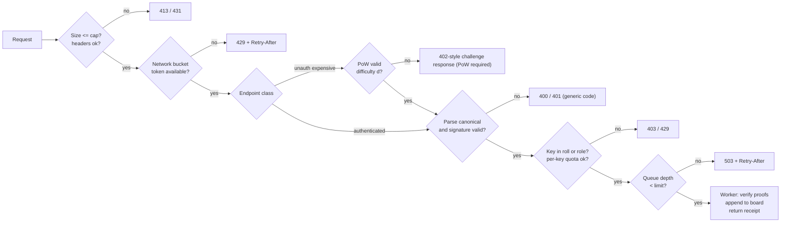

# QV-29 — Abuse and Denial-of-Service Prevention

**Module ID:** `security-privacy` (abuse controls)  
**Status:** Draft  
**Owner:** Security lead (interim: project owner)  
**Last reviewed:** 2026-10-21  
**Related specs:** QV-07 (threat model; REQ-047, 063, 067), QV-03 (governance/roles), QV-04 (eligibility, invitations), QV-05/QV-16 (ballot and proof sizes), QV-06 (privacy), QV-08 (architecture), QV-09 (error codes), QV-10 (UX), QV-12 (operations), QV-13 (accessibility); ADRs QV-ADR-001, 002, 003, 005, 009

## 1. Objective

Keep a QuietVote instance usable by eligible members during an election window and free of spam and harassment, **without** introducing surveillance (no IP logs, no third-party CAPTCHA/anti-fraud services, no device fingerprinting, no mandatory identity). Controls are layered so that the cheapest check runs first, authority derives from keys (QV-07-REQ-061), and every limit is a published parameter that stewards can inspect.

## 2. Scope

### In scope
Proposal spam; ballot flooding; Sybil proposals/registrations; invite-token abuse; harassment through proposal text, notifications, and roster visibility; resource exhaustion (CPU for proof verification, memory, storage, connections, bandwidth); board bloat; moderation workflow and its privacy limits; load-shedding and deadline-protection.

### Out of scope
- Volumetric network DDoS (L3/L4): requires upstream mitigation (R-07 in QV-07); this spec defines what the application does when upstream mitigation is absent or partial.
- Content moderation of third-party discussion platforms the group uses elsewhere.
- Legal takedown handling for a maintainer-hosted instance (QV-12/QV-14).
- Phase 2/3 anonymous credential abuse controls (token-issuance rate limits, nullifier-based double-spend); sketched in §11 only.

## 3. Actors and abuse scenarios

| Actor | Goal | Resource they hold | Main outcome sought |
|---|---|---|---|
| Outsider (unauthenticated) | Exhaust server, enumerate, spam registrations | Bandwidth, many IPs | Downtime, noise |
| Member-attacker | Spam proposals, harass, flood with revotes | One valid roll key | Disruption, nuisance |
| Multi-key insider | Sybil: many pseudonymous members/proposals | Invite tokens, multiple keys | Sway sponsor thresholds, harass, stuff roll |
| Malicious steward | Abuse moderation to silence, or abuse registration approval | Steward key | Censorship, ghost voters (QV-07 AT-2, AT-4) |
| Compromised member key | Ballot flooding within quota | Stolen key | Overwrite/noise |
| Operator | Selective throttling (censorship) | Server | Disenfranchisement (R-08) |

## 4. Design principles

1. **Authenticate cheaply, verify expensively last.** Order: size → framing/parse → signature → roll membership → per-key quota → proof verification (CPU-heavy) → append.
2. **Keys, not people, are rate-limited.** Quotas attach to public keys in the roll or to ephemeral client puzzles. Network-level limiting (the only option for unauthenticated traffic) uses ephemeral in-memory buckets with **no persistence and no logging**.
3. **Proof-of-work is a speed bump, not identity.** PoW shifts cost to attackers for *unauthenticated, expensive* operations; it never gates the voting path for rostered voters except under declared emergency (L3).
4. **Invite tokens + steward approval are the Sybil control** for membership; the roll is the root of eligibility (QV-ADR-005). QuietVote does not and cannot prevent one human holding two keys if the steward admits both; it makes this visible and bounded.
5. **No third-party CAPTCHAs/anti-bot services** (privacy, accessibility, QV-ADR-009).
6. **Every limiter fails open for rostered voters near the deadline within bounds** and extends the window rather than silently dropping ballots (§9).
7. **Moderation is visible, scoped and log-signed**; moderators never gain access to ballots, IPs, or private data beyond what is reported.

## 5. Parameters (defaults and bounds)

All defaults are instance configuration (`abuse.*`), bounded by hard limits compiled into the server so a misconfiguration cannot disable core protections. Election-level parameters appear in the signed manifest where they affect eligibility or counting (so verifiers know the rule).

| Parameter | Default | Hard bound | Scope | Rationale |
|---|---|---|---|---|
| `MAX_BALLOT_BYTES` | 131,072 (128 KiB) | ≤ 256 KiB | server | Typical yes/no ballot < 2 KiB; a 32-option approval ballot ≈ 32 × (2 pts × 32 B + disjunctive proof ≈ 128 B) + range/sum proof + sig ≈ 7–8 KiB *[ESTIMATE]*; cap leaves headroom for 16 contests |
| `MAX_OPTIONS_PER_CONTEST` | 32 | 64 | manifest | Bounds proof count |
| `MAX_CONTESTS_PER_ELECTION` | 16 | 32 | manifest | — |
| `MAX_CONTROL_ENTRY_BYTES` | 16,384 | 32,768 | server | Steward/trustee actions |
| `MAX_BLOB_BYTES` (proposal text etc.) | 262,144 | 1 MiB | server | Text only; no attachments in MVP |
| `PROPOSAL_TEXT_MAX_CHARS` | 20,000 | 50,000 | instance | ~10 pages |
| `maxBallotsPerVoter` (1 + revotes) | 5 | 20 | manifest | Bounds storage (≈ roll × 5 × ≤ 8 KiB) and revote-flood; also bounds revote-suppression games |
| Min interval between accepted ballots from one key | 10 s | ≥ 2 s | server | Prevents hot loops; legit revotes are rare |
| Max accepted-ballot attempts per key per hour (incl. rejected after sig check) | 30 | 120 | server | Cheap-fail abuse by a stolen key |
| Unauthenticated read rate (board, static) per network bucket | 60 req/min, burst 120 | — | edge/server | Mirrors and verifiers may need more → `/export` bulk endpoint with its own limit |
| Unauthenticated write attempts (registration, token redemption, election creation) per bucket | 6/min, burst 12 | — | server | — |
| Concurrent connections per bucket | 20 | — | server | — |
| Request header timeout / body timeout / idle keep-alive | 10 s / 15 s / 5 s | — | server | Slowloris |
| Max total concurrent connections | 4,096 | OS limit | server | — |
| Proof-verification worker threads | `max(1, cores − 1)` | — | server | Keep event loop responsive |
| Verification queue length | 1,000 | 10,000 | server | Beyond this ⇒ 503 + `Retry-After` |
| Per-election board byte budget `maxBoardBytes` | 512 MiB | 4 GiB | manifest | Roll 5,000 × 5 × 8 KiB ≈ 200 MiB + margin |
| Max roll size (MVP supported) | 5,000 | 50,000 | manifest | QV-00 sizing: 30–2,000 primary; stress goal 5,000 |
| Pending join requests per group | 200 | 1,000 | instance | Anti-queue-flood |
| Open proposals per member | 3 | 10 | group policy (QV-03) | — |
| New proposals per member per 24 h | 1 | 5 | group policy | — |
| Cooldown after moderation `REMOVED` proposal | 7 days | 30 | group policy | — |
| Outstanding invite tokens per non-steward inviter | 5 | 25 | group policy | Sybil bound |
| Invite tokens issued per inviter per 30 days | 20 | 100 | group policy | — |
| Token lifetime | 7 days | 30 days | group policy | — |
| Token max uses | 1 | 50 (group "link" mode, steward-only) | group policy | — |

## 6. Mechanisms

### 6.1 Request admission pipeline (all write endpoints)

Responses use the fixed error codes from QV-09 (`E_SIZE`, `E_RATE`, `E_POW_REQUIRED`, `E_SIG`, `E_NOT_ELIGIBLE`, `E_QUOTA`, `E_BUSY`). Error bodies are fixed-size and do not distinguish *why* an authentication failed beyond these classes (no membership oracle; the roll is public in Phase 1 anyway).

### 6.2 Network buckets without IP logging
- A bucket key is `HMAC-SHA-256(k_epoch, ip_prefix)` where `ip_prefix` = IPv4 /24 or IPv6 /56, `k_epoch` is a random 256-bit key held **only in memory**, rotated every 24 h and at process start. Bucket state lives in memory (LRU, max 100k buckets) and is never written to disk, logs, metrics labels, or crash dumps.
- Behind a reverse proxy the real client address is taken from a configured trusted header; behind the Tor onion service all requests share one source ⇒ the bucket is global, so **onion mode replaces per-bucket limits with PoW (§6.3) plus per-key limits** and uses Tor's own onion-service-level DoS defenses where available `[verify Tor version/feature set at deployment time]`.
- Consequence: restart resets limits; accepted. The trade-off (shared-NAT users share a bucket) is documented; the default is generous for that reason.

### 6.3 Proof-of-work (hashcash-style) for unauthenticated expensive operations

**Applies to:** election/group creation on a public instance, invite redemption and join requests, bulk export beyond the read limit, and — only under load level L3 (§9) — ballot submission by rostered voters.

**Protocol.**
1. Client requests `GET /pow/challenge?ctx=<endpoint-class>`; server returns `{ch, d, exp}` where `ch` = 16 random bytes + 8-byte expiry + 1-byte class + 32-byte MAC under a server secret (`HMAC-SHA-256`), `d` = difficulty in leading zero bits, `exp` = expiry (120 s). The challenge is stateless (no per-client memory).
2. Client finds 64-bit `nonce` s.t. `SHA-256("QV-POW-v1" ‖ ch ‖ H(request-body) ‖ nonce)` has ≥ `d` leading zero bits, and sends `X-QV-PoW: ch.nonce`.
3. Server recomputes MAC, expiry, class, and hash; a challenge is **single-use**: a Bloom/seen-set of MAC tags for the validity window (≤ 1M entries, in memory) rejects replays. Binding to the request-body hash prevents transferring solved puzzles to other requests.

**Difficulty schedule** (expected hashes = 2^d; JS `@noble/hashes` SHA-256 ≈ 0.3–1 M hashes/s on a mid-range phone/desktop, WebCrypto async is slower *[ESTIMATE — benchmark in QV-11]*):

| Level | d | Expected hashes | Typical solve time | Used for |
|---|---|---|---|---|
| Base | 18 | 262 k | 0.3–1 s | Join requests, token redemption, bulk export |
| Elevated | 20 | 1.0 M | 1–3 s | Under L1 load; group/election creation default |
| High | 22 | 4.2 M | 4–12 s | Under L2 load |
| Emergency | 24 (cap) | 16.8 M | 15–50 s | L3 only; voters have a "skip with steward-issued voting token" fallback (§6.5) |

Cap at 24 for accessibility/low-power devices (QV-13); never above 24. The solver runs in a Web Worker, shows progress through an `aria-live` region, and is cancellable. An alternate memory-hard puzzle (Argon2id- or Equi-X-style, as used by Tor's onion-service PoW `[from knowledge: Tor 0.4.8; verify]`) **may** replace SHA-256 if GPU/ASIC farms prove a practical bypass; the `v1` tag allows negotiation.

**Honest limits.** PoW does not stop a resourced attacker (cloud GPU), does not distinguish humans from bots, and penalizes slow devices. It exists to make *cheap* mass abuse uneconomical and to give the server a lever under load. It is **not** a Sybil defense.

### 6.4 Invite-token design

**Purpose:** let stewards (and delegated inviters) admit new members' public keys into a group's *pending registrations*, without a central account system and without the server learning identity.

**Token format.** `qvi1-` + Crockford-base32 of 20 random bytes from CSPRNG → 32 characters + checksum (2 chars, CRC-10 over bytes, to catch typos only). Entropy 160 bits. Displayed in groups of 4 (`qvi1-XXXX-XXXX-…`) and as a QR/URL `https://host/join#<token>` (fragment, never sent to the server in a GET; sent only in the POST body). **Rationale:** high entropy removes any need for brute-force throttling beyond resource limits; human-typed short codes are *not* supported because they would require strict online-attack throttling that bucket-based limits cannot guarantee.

**Server storage.** `token_id = SHA-256("QV-INVITE-v1" ‖ token)` (entropy is high, so unsalted hashing suffices); record `{token_id, group_id, role=member, issuer_key, uses_left, expires_at, created_at(minute), label_hash?}`. The plaintext token is never stored or logged; the issuing client displays it once.

**Redemption.**
1. Joiner's client generates an Ed25519 keypair locally (non-extractable if supported; otherwise encrypted at rest with user passphrase) — the server never sees the private key.
2. POST `{token, pubkey, optional display label ≤ 40 chars, PoW}`; server compares `SHA-256` in constant time, checks expiry/uses, decrements `uses_left` atomically (SQLite transaction), and records a **pending registration** `{pubkey, token_id, label, ts(minute)}`.
3. Steward (or auto-approve policy configured per group: `approval = steward | token-issuer | auto`) approves; approval appends a signed `ROSTER_ADD` entry in the *next election's roll build* (QV-04). Pending registrations are **not** voters until included in a sealed manifest's roll (QV-07-REQ-022).
4. Failed redemptions return the same generic `E_TOKEN` for unknown/expired/used tokens (no oracle). More than 10 failed attempts per bucket per hour ⇒ bucket's PoW difficulty +2 for 1 hour.

**Revocation.** Stewards/issuers may revoke unredeemed tokens (signed `TOKEN_REVOKE`); redeemed-but-unapproved registrations can be rejected. Roll entries are removed only by building a new roll for a future election (QV-07-REQ-031).

**Bounds (Sybil control).** Per-inviter outstanding ≤ 5 and ≤ 20 per 30 days for non-stewards (§5); stewards unlimited but each issuance is counted in a public (per group) aggregate counter visible to members: "tokens issued, redeemed, pending". **Group-link mode** (`uses ≤ 50`) is steward-only, requires `approval = steward`, and shows a banner to members.

**Threats and residuals.** Leaked token ⇒ attacker registers a key, but cannot vote unless the steward approves and the key enters a sealed roll: mitigated by roll self-check/visible roll (QV-07-REQ-032) and the pending-queue review UI that shows token issuer and time. Steward collusion creating ghost voters is not preventable cryptographically (QV-07 AT-2/A1): the control is transparency and out-of-band member count.

### 6.5 Voting-path protection and emergency voting token
- Rostered voters' ballot submissions do **not** require PoW at L0–L2; they are protected by signature + roll check + per-key quota (cheap to verify). The expensive step (proof verification) happens only after those pass, so non-members cannot consume it.
- At **L3 (emergency)** the server requires PoW d=20–24 on ballot submission *or* a **steward-issued emergency voting token** (single-use, bound to a roll key: steward signs `(election_id, key, expiry)`; voter submits it in place of PoW). Tokens are generated in bulk by the steward console for members who report problems; each one is a board-visible `EMERGENCY_TOKEN` entry hashed (not content), so abuse is auditable. Rationale: a flooding attacker who holds a valid key cannot exceed per-key quota anyway; L3 exists for attackers with many *stolen* keys or bugs in quota.

### 6.6 Resource exhaustion controls
| Resource | Control | Notes |
|---|---|---|
| CPU (proof verification) | Worker pool (`cores−1`), bounded queue, priority classes, per-key quotas, signature-before-proof ordering, per-ballot size cap (bounds number of proofs) | Benchmark target: sustain ≥ 100 yes/no ballots/s on 2 vCPU *[ESTIMATE — to be measured; ristretto255 operations dominate]* |
| Memory | Streaming JSON parse with limits (max depth 8, max array length by schema); no unbounded caches; LRU bounds on buckets and seen-challenges | Fuzz with decompression bombs: no `Content-Encoding` accepted on requests |
| Storage | `maxBoardBytes`, per-key ballot cap, blob cap, pending-registration cap; SQLite size monitor; refuse appends when disk free < 5% (fail-safe: serve reads, reject writes with `E_BUSY`, alert operator) | Disk full must never corrupt the board: WAL checkpoint + free-space precheck before append |
| Connections | Per-bucket and global caps; timeouts per §5; HTTP/1.1 and HTTP/2 stream limits (max 100 concurrent streams, reject rapid-reset patterns — mitigate "HTTP/2 Rapid Reset" class by limiting stream resets per connection `[verify against Node 22 http2 behavior]`) | — |
| Bandwidth | Cache-Control on static assets; compressed static assets precomputed; board proofs cacheable by (size, root); `/export` served as pre-built tar chunks with ETag | Mirrors reduce origin load |
| Log volume | Fixed-size counters, no per-request logs of abusers; sampling ≤ 1/min for "limit hit" events by class | Prevents log-based DoS and keeps privacy |

## 7. Spam, flooding and Sybil specifics

### 7.1 Ballot flooding
| Variant | Defense | Residual |
|---|---|---|
| Garbage POSTs by outsiders | Size/parse/signature checks; bucket limits; PoW not needed because cost is negligible | Bandwidth only |
| Valid-format ballots signed by non-roll keys | Rejected at roll check (Merkle proof against manifest root) before proof verification | Cheap-check CPU |
| Valid ballots from one stolen key | Per-key min interval 10 s, 30 attempts/h, `maxBallotsPerVoter` = 5; excess rejected (`E_QUOTA`); board stores at most 5 per key | Attacker can burn the victim's quota to block their revote ⇒ **mitigation:** victim's later ballot counts only if admitted; stewards can authorize extra quota per key via `QUOTA_GRANT` entry (+3, max once, logged); residual accepted as R-08-type |
| Mass flood from many stolen keys | Detected by anomaly counters (accepted ballots/min vs historical), L2/L3 escalation, steward notified; extension | Requires key theft at scale: incident IR-14/IR-10 |
| Revote-storming to bloat the board | `maxBoardBytes`, per-key cap | — |

### 7.2 Sybil proposals and registrations
| Variant | Defense | Residual |
|---|---|---|
| One member submitting many proposals | Quotas per key (§5); sponsor requirement (group policy `sponsors ≥ s`, default 0, recommended 2 for groups > 200) | Colluding members |
| Many pseudonymous members created via leaked/open tokens | Token bounds; steward approval; visible counters; roster review | Steward collusion |
| Proposal-ID spamming to create noise in board | Proposals stored as blobs referenced from board only when "submitted for review" by quota-limited keys; drafts remain client-side or in a separate draft area with TTL 30 days and cap 20 per key | — |
| Name/label impersonation of stewards | Labels are cosmetic; UI shows key fingerprint (short, e.g., 4 words from a fixed 2048-word list) next to label; labels cannot duplicate an existing label in the same group (case-fold + Unicode confusables skeleton check) | Out-of-band trust |

### 7.3 Harassment
| Vector | Control | Privacy note |
|---|---|---|
| Abusive proposal text | Text-only, length cap, no HTML/links auto-fetch (no previews → no tracking, no SSRF); links shown as plain text with warning on click; report button; steward moderation (§8) | Reports contain only content hash + reporter key (optional anonymous report to steward via sealed box) |
| Targeting individuals by naming | Group policy supports "no personal names in titles" lint warnings (non-blocking heuristic) — disabled by default, documented as weak | No ML, no external moderation services |
| Notification spam | Notifications are group-level digests only (election open/close/result), opt-in, sent by the system never by members; no @mention or direct messages; email (if enabled) rate-limited: ≤ 3 per member per 24 h, ≤ 100 invitation emails per group per day; recipient addresses not retained after send (only a salted hash for dedupe, 24 h TTL) | Email is optional and off by default (prefers invite links) |
| Doxxing through roster | Roll shows keys and optional labels chosen by the member; no real names unless the group chooses | Member can choose label per group; separate key per group (client default) |
| Retaliation inference | See QV-07 R-06/R-09 | Documented non-claim |
| Persistent harasser | Steward can add key to group blocklist: excluded from future rolls and from proposing; block is a signed visible entry with category (no free text required); appeals via QV-03 | Evasion by new key + token is limited by token approval |

## 8. Moderation without surveillance

**Principles.** (1) Minimum data: moderators see only what was submitted or reported. (2) No tracking identifiers exist to correlate users across groups (keys per group by default). (3) Everything a moderator does is a signed, group-visible entry. (4) Moderation cannot touch ballots, rolls of sealed elections, or board history.

**Roles (aligned with QV-03 matrix).** Reporter (any member), Moderator (steward-delegated key, can `HIDE`), Steward (can `REMOVE`, `BLOCK`), Appeals panel (group-defined; default = steward + 2 randomly selected members by public randomness *[mechanism TBD in QV-03]*).

**Actions.**
| Action | Effect | Reversible | Board representation |
|---|---|---|---|
| `REPORT` | Notifies moderators (digest); counts shown aggregated | n/a | Optional entry; may be an off-board sealed message |
| `HIDE` | Proposal collapsed behind "Hidden by moderator: <category>"; text still available on click | Yes | `MOD_HIDE{content_hash, category}` |
| `REMOVE` | Blob bytes deleted from server; hash and category remain; for proposals referenced by a sealed election manifest, removal is **not permitted** (it would break verifiability) — instead `HIDE` plus a statement | Hash stays | `MOD_REMOVE{content_hash, category}` |
| `BLOCK` | Key excluded from future rolls/proposing | Yes by steward | `MOD_BLOCK{key, category, expires?}` |
| `MUTE` (client-side) | Member hides an author's proposals locally | Yes | None (local only) |

**Categories (fixed list, no free text by default):** spam, harassment, doxxing, illegal content, impersonation, off-topic, other (free text ≤ 280 chars, optional). Published transparency counts per group: number of reports/hides/removes/blocks per category per quarter.

**What moderators never see:** IP addresses (never logged), device data, other groups' activity, ballot or participation data beyond the public board.

**Stewards as the weak point.** Because the steward can silence members, the group can (a) require two moderators to concur for `REMOVE`; (b) view the full signed moderation log; (c) fork/exit with full export (QV-ADR-001). Moderation does not affect the roll of an open election.

## 9. Load levels and deadline protection

| Level | Trigger (any, sustained 30 s) | Actions |
|---|---|---|
| L0 Normal | Verification queue < 25%, p95 submit latency < 1 s | Base parameters |
| L1 Elevated | Queue ≥ 25% or p95 > 1 s or 429 rate > 10% of requests | PoW Elevated for unauth writes; buckets halve; proofs for voters still prioritized |
| L2 High | Queue ≥ 60% or p95 > 3 s or CPU > 90% for 60 s | PoW High (d=22) for unauth writes; static assets served from cache only; board reads rate-limited; operator/steward alert |
| L3 Emergency | Queue ≥ 90% or sustained 503 > 5% | PoW on ballot submit (d=20 → 24 adaptive) or emergency voting token; read-only board served from precomputed snapshots; steward prompted to `PAUSE`/extend (QV-07 IR-14) |

Transitions use hysteresis (return to lower level after 5 min below threshold). Level is published at `/status` (aggregate only).

**Priority order under shedding:** (1) rostered ballot submissions with valid signature, (2) STH/inclusion proofs/receipt retrieval, (3) static client assets, (4) board/export reads, (5) registrations and token redemption, (6) election/group creation.

**Deadline protection.** (a) Close time is absolute UTC and displayed with a countdown; (b) the manifest may define `extension.maxTotal` (default 24 h) and `extension.trigger` (default: if L2/L3 persisted ≥ 15% of the final 2 h, steward *may* extend; `auto` is allowed if declared up-front); (c) extensions are signed board entries (`RESUME` with new close time) and bounded by QV-07 `maxExtension`; (d) the client warns when the server reports L2+ and offers retry with backoff (decorrelated jitter, base 2 s, cap 60 s, max 20 tries) and lets the voter save the encrypted ballot locally (no secrets beyond what would be uploaded; ciphertext + signature only, safe to hold) for later submission or relay via a mirror (QV-07 OQ-1).

## 10. Requirements

| ID | Requirement | Priority | Acceptance criteria | Verification |
|---|---|---|---|---|
| QV-29-REQ-001 | The server **shall** run the admission pipeline of §6.1 in the stated order for every write endpoint; proof verification **shall not** occur before signature and roll checks. | Must | Instrumented test shows zero proof-verifier invocations for requests failing earlier stages (10k fuzz requests) | Test |
| QV-29-REQ-002 | The server **shall** enforce `MAX_BALLOT_BYTES`, `MAX_CONTROL_ENTRY_BYTES`, `MAX_BLOB_BYTES`, header/body timeouts and connection caps of §5 with hard-coded upper bounds. | Must | Oversize/slow-request tests rejected with documented codes; config above hard bound refuses start | Test |
| QV-29-REQ-003 | Network buckets **shall** be keyed by in-memory-HMACed address prefixes with epoch key rotation every 24 h and **shall not** be persisted, logged, or exported in metrics. | Must | Memory-only inspection: grep logs/DB/metrics for IP-derived values (canary IP) finds none; restart resets state | Test/Inspection |
| QV-29-REQ-004 | Unauthenticated write endpoints **shall** enforce per-bucket limits (6/min, burst 12) and the PoW difficulty schedule of §6.3 with stateless MAC-bound, single-use, body-bound challenges expiring in ≤ 120 s. | Must | Replay, cross-body reuse, expiry, and forged-MAC tests fail; difficulty equals schedule for each level | Test |
| QV-29-REQ-005 | PoW difficulty **shall** never exceed 24 bits and the client solver **shall** run in a worker, be cancellable, report progress accessibly, and complete in ≤ 15 s p95 at Elevated on a reference low-end device (to be defined in QV-13). | Must | Benchmark in CI on reference profile; a11y test on `aria-live` announcements | Test |
| QV-29-REQ-006 | Per-key quotas **shall** be enforced: min interval 10 s between accepted ballots, ≤ 30 attempts/h after signature validation, and `maxBallotsPerVoter` (default 5, max 20) per election; exceeded submissions return `E_QUOTA` without proof verification. | Must | Property tests; quota boundary tests; no proof verification on `E_QUOTA` | Test |
| QV-29-REQ-007 | Steward-signed `QUOTA_GRANT` entries (max +3 per key per election, once) **shall** be supported and rendered by verifiers; the verifier **shall** enforce them as part of "valid ballot set". | Should | Verifier output lists grants; exceeding rejected | Test |
| QV-29-REQ-008 | Invite tokens **shall** follow §6.4: 160-bit CSPRNG entropy, stored only as `SHA-256` hashes, single use by default, ≤ 30-day lifetime, constant-time comparison, generic failure code, atomic redemption. | Must | Unit tests incl. race (100 parallel redemptions ⇒ exactly `uses` successes); DB dump contains no plaintext token | Test |
| QV-29-REQ-009 | Pending registrations **shall** not confer voting rights; a key becomes a voter only by inclusion in a sealed manifest's roll. | Must | E2E: pending key cannot vote; included key can | Test |
| QV-29-REQ-010 | Inviter quotas (5 outstanding, 20 per 30 days), pending-queue cap (200), and group-link mode restrictions **shall** be enforced; token counters (issued/redeemed/pending) **shall** be visible to all members of the group. | Should | Quota tests; UI test | Test |
| QV-29-REQ-011 | Proposal quotas (3 open, 1 per 24 h, cooldown 7 days after `REMOVE`) and text limits **shall** be enforced per key, with group-policy overrides within hard bounds. | Must | Policy tests | Test |
| QV-29-REQ-012 | Proposal text **shall** be rendered as inert text (no HTML, no auto-fetched previews, no remote images); links **shall** be displayed as text with an interstitial warning. | Must | XSS/SSRF corpus tests; network capture shows no outbound fetches | Test |
| QV-29-REQ-013 | Notifications **shall** be group-originated digests only, opt-in; the system **shall not** provide member-to-member direct messages or mention notifications; email invitation rate limits per §7.3 apply and recipient addresses **shall** not be persisted beyond send (hash TTL 24 h). | Must | Feature inventory review; rate-limit tests; DB inspection | Review/Test |
| QV-29-REQ-014 | Moderation actions of §8 **shall** be signed, logged in a group-visible moderation log with fixed categories; `REMOVE` **shall** be refused for content hashed into a sealed manifest. | Must | Attempted removal of manifest-referenced blob rejected; log shows entries | Test |
| QV-29-REQ-015 | Moderators and stewards **shall** have no access (UI or API) to IP addresses, device data, or ballot/participation data beyond the public board. | Must | API inventory + authorization tests; log content tests | Test/Review |
| QV-29-REQ-016 | The server **shall** implement load levels L0–L3 with the triggers, hysteresis, and actions of §9, publish aggregate level at `/status`, and apply the stated priority order. | Must | Load tests drive each transition; priority verified by shedding order | Test |
| QV-29-REQ-017 | At L3 the server **shall** accept steward-issued emergency voting tokens as an alternative to PoW for rostered keys; tokens **shall** be single-use, bound to (election, key), expire ≤ 24 h, and be recorded as hashed board entries. | Should | Token tests; replay rejected; audit visible | Test |
| QV-29-REQ-018 | The server **shall** refuse appends when free disk < 5% or the per-election `maxBoardBytes` is reached, without corrupting the board, while continuing to serve reads, and alert the operator. | Must | Fault injection: disk-full during append ⇒ board verifies after recovery | Test |
| QV-29-REQ-019 | Proof verification **shall** run in worker threads with bounded queue (default 1,000) and shed with `E_BUSY` + `Retry-After`; event-loop lag p99 **shall** stay < 100 ms under L2 load. | Must | Load test with event-loop-lag probe | Test |
| QV-29-REQ-020 | The client **shall** implement retry with decorrelated jitter backoff (base 2 s, cap 60 s, ≤ 20 attempts), allow saving the signed ciphertext locally for later submission, and display plain-language status on L2+. | Should | E2E with simulated 503s; UI copy review | Test |
| QV-29-REQ-021 | Deadline-extension policy (`extension.maxTotal`, trigger) **shall** be part of the sealed manifest; extensions **shall** be signed `RESUME` entries within `maxExtension`. | Must | Extension within/outside bounds tests | Test |
| QV-29-REQ-022 | Abuse telemetry **shall** consist solely of aggregate counters by class (no per-key or per-address labels), sampled log lines for limit events at ≤ 1/min/class, and no payload logging. | Must | Log/metrics label audit; canary tests | Test |
| QV-29-REQ-023 | No CAPTCHA, fingerprinting, or third-party anti-abuse service **shall** be used or documented as an option. | Must | Dependency and network-capture review | Review |
| QV-29-REQ-024 | Group labels **shall** be unique per group under a confusables-skeleton comparison, and the UI **shall** always show a key fingerprint next to labels in roll and moderation views. | Should | Unit tests with confusable pairs | Test |
| QV-29-REQ-025 | The abuse-control suite (load, flood, slowloris, oversize, replay, token race, quota) **shall** run in CI nightly and before release (QV-07 SG-2) with published pass thresholds: sustain ≥ 100 valid yes/no ballots/s on 2 vCPU; 0 successful non-roll proof verifications; p99 voter submit < 3 s at L1. | Must | CI report | Test |

## 11. Notes for Phase 2/3 (non-normative)
- Blind-signed token issuance (RFC 9474) must rate-limit issuance per roll key (one token per election) at the registrar; double-spend prevented by token uniqueness at ballot intake. PoW is not applied to token redemption by the ballot channel (to avoid timing links).
- Nullifier-based anonymous eligibility (Phase 3) moves per-key quotas to per-nullifier; flooding with one nullifier is trivially bounded; Sybil resistance shifts entirely to membership-tree admission policy.
- Anonymous channels (Tor) make bucket-based limits useless; rely on per-credential limits and PoW.

## 12. Threats and residual risks

| Case | Attacker | Impact | Mitigation | Residual risk |
|---|---|---|---|---|
| Last-minute flood | Outsider with botnet | Voters locked out | Rate limits, L2/L3, extension, onion/mirror | Volumetric DDoS needs upstream protection (R-07) |
| Key-quota burning | Stolen key | Victim's revote blocked | Quota grant, receipts, visible ballot sequence | Victim may not notice; partial |
| PoW bypass with GPUs | Rich attacker | Spam registrations | Steward approval is the real control | Queue clutter |
| Shared-NAT lockout | Bucket sharing | Legit users throttled | Generous defaults, authenticated paths unaffected | Some friction |
| Steward abuse of moderation | Malicious steward | Silencing | Logged, categories, 2-moderator rule, export/fork | Governance, not technical |
| Token leak | Chat leak | Unauthorized registration | Short expiry, approval queue | Social |
| Slow-device exclusion by PoW | — | Accessibility | Cap 24, workers, steward-issued emergency tokens, no PoW for voters at L0–L2 | Some devices slow at L3 |
| Log-based surveillance via abuse tooling | Operator | Privacy loss | REQ-003, 022 | Operator can modify code (R-01) |

## 13. Interfaces and dependencies
- QV-09: error codes (`E_RATE`, `E_POW_REQUIRED`, `E_QUOTA`, `E_BUSY`, `E_TOKEN`, `E_SIZE`), endpoints `/pow/challenge`, `/status`, control entries `QUOTA_GRANT`, `EMERGENCY_TOKEN`, `MOD_*`, `TOKEN_REVOKE`.
- QV-04: pending registrations → roll build; token semantics.
- QV-03: proposal quotas, sponsor rules, appeals; moderation role matrix.
- QV-08: worker pool, reverse-proxy expectations; QV-12: runbooks for L2/L3 and disk-full; QV-13: PoW accessibility and low-end device profile; QV-10: copy for status and retries.

## 14. Open questions

| Question | Owner | Target | Proposed default |
|---|---|---|---|
| Memory-hard PoW (Equi-X/Argon2id) vs SHA-256 in v1 | Security lead | M3 | SHA-256 v1; revisit after abuse data |
| Appeals panel selection mechanism (public randomness) | QV-03 owner | M2 | Steward + 2 members drawn via manifest-committed randomness (drand-style beacon optional) `[UNVERIFIED design]` |
| Should reports be anonymous to moderators? | UX + security | M2 | Reporter key hidden by default; moderator may request disclosure only for `illegal content` |
| Reference low-end device profile for PoW budget | QV-13 owner | M2 | 2019 mid-range Android, Chrome |
| Default `sponsors` requirement by group size | QV-03 owner | M2 | 0 under 200 members, 2 above |
| Whether to support Tor onion-service PoW integration natively | Operations | M3 | Document, don't implement |

## 15. References (accessed 2026-10-21; items marked K are from knowledge, not re-fetched)
- Back, A., *Hashcash — A Denial of Service Counter-Measure*, 2002 (K).
- Tor Project, onion-service proof-of-work defense (Equi-X), Tor 0.4.8 (K; verify).
- RFC 9474 RSA Blind Signatures: https://www.rfc-editor.org/rfc/rfc9474
- RFC 9113 HTTP/2 and CVE-2023-44487 "HTTP/2 Rapid Reset" (K; verify mitigation in target Node.js version).
- OWASP Automated Threats / API Security Top 10 resource-consumption guidance (K).
- QV-07 §21 for threat-model sources.

## 16. Approval and change history

| Reviewer | Decision | Date | Notes |
|---|---|---|---|
| Project owner | Pending | — | Parameters in §5 |
| Security lead | Pending | — | — |

| Version | Date | Change |
|---|---|---|
| 0.1 | 2026-10-21 | Initial full draft |
