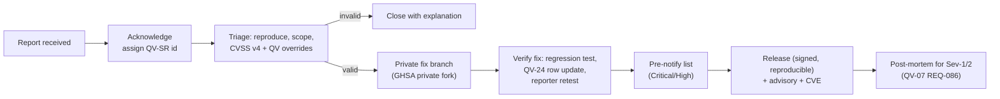

# QV-33 — Vulnerability Disclosure and Response

**Module ID:** `security-privacy` (vulnerability handling)  
**Status:** Draft  
**Owner:** Security lead (interim: project owner)  
**Last reviewed:** 2026-10-21  
**Related specs:** QV-07 (threat model; §15 incident matrix, §13 gates, REQ-087), QV-11 (testing), QV-12 (operations), QV-14 (funding for bounty), QV-24 (traceability), root [`SECURITY.md`](../SECURITY.md); ADR QV-ADR-011 (AGPL-3.0-or-later)

> **Placeholders.** Contact addresses, PGP fingerprint, age recipient, domain and the security.txt URL below are **placeholders** (`.example` domains and `[PLACEHOLDER]` markers). They must be replaced and verified by the project owner before the first public release (checklist §14). Nothing here is legal advice; the safe-harbor text should be reviewed by counsel before relying on it.

## 1. Objective

Provide a clear, humane, enforceable way for researchers, operators, and users to report weaknesses in QuietVote, with predictable response times, coordinated disclosure, public advisories, and CVE handling — consistent with the project's stance of verifiability and honest guarantees. For an e-voting tool, **a vulnerability may affect live elections held by third parties**, so the policy also defines election-aware handling.

## 2. Scope

### 2.1 In scope
| Target | Examples |
|---|---|
| Code in the official repository and released artifacts (server, browser client, CLI/verifier(s), trustee tool, steward console, build scripts, reference deployment config) | Auth bypass of control entries, proof-verification flaws, XSS/CSP bypass, key leakage, log leakage, rollback weaknesses |
| **The protocol and its specification** (QV-16, QV-05) | Soundness flaw in a proof statement, weak domain separation, malleability, Benaloh bypass, unsound DKG, attacks on revote rule |
| Build, release and supply chain | CI misconfiguration enabling artifact tampering, non-reproducibility, dependency confusion, signing-key handling |
| Official maintainer-hosted instances and the project website/docs (when they exist), *testing only the designated staging instance* (§4) | Server misconfiguration on staging, subdomain takeover |
| **Documentation and UI claims** that overstate guarantees relative to the claims register (QV-07 §12) | "Honest guarantees" are a security property (P13); report as category `claims` (Low–Medium) |
| Privacy defects | IP/UA logging in default config, third-party requests, metadata leaks |

### 2.2 Out of scope (not eligible for bounty; still welcome as informational reports unless harassing)
- Self-hosted instances run by third parties (report to that operator; if the issue is in our default config or docs, report to us).
- Elections/groups operated by others — **never test against a live election** (§4).
- Volumetric DDoS; testing that degrades service; brute force of authentication that isn't rate-limited in our code (we have no passwords).
- Social engineering, phishing, or physical attacks on maintainers, operators, trustees, stewards, or voters.
- Issues requiring a compromised voter device/browser, or ≥ t colluding trustees, or a stolen steward key — these are documented non-claims/assumptions (QV-07 N-2, N-3, A-5) **unless** the report shows the software made the compromise easier than documented or fails a stated mitigation.
- Missing security headers without demonstrable impact beyond those in QV-07 REQ-052 (a deviation *from REQ-052* is in scope).
- Theoretical attacks on primitives (discrete log, SHA-2, Ed25519) without a practical weakness in our use; vulnerabilities in third-party libraries (report upstream; tell us if we are affected).
- Known residual risks listed in QV-07 §10 as such, unless the report improves or invalidates the stated mitigation.
- Automated scanner output without a working impact demonstration.
- Spam/abuse-control tuning disagreements (QV-29) unless a bypass of a documented limit.

## 3. Reporting channels

Reports can be made through any of the following; use the first available:

1. **GitHub Private Vulnerability Reporting** on the repository (`Security` tab → "Report a vulnerability"). Preferred; encrypts at rest, tracks status, and lets us request a CVE via GitHub as CNA. `[PLACEHOLDER: enable PVR on the repository before launch]`
2. **E-mail:** `security@quietvote.example` `[PLACEHOLDER]`, encrypted with the PGP key or age recipient below when the report contains exploit details. E-mail is acknowledged by a human, not an auto-responder promising anything.
3. **Self-hosted-operator emergency contact** (for active exploitation of live elections): `emergency@quietvote.example` `[PLACEHOLDER]` — same inbox, paged to on-call.

**Encryption material (placeholders):**
```
PGP key:    [PLACEHOLDER — 4096-bit RSA or Ed25519 key; publish at
             https://quietvote.example/.well-known/pgp-key.txt and in repo at /security/pgp-key.asc]
Fingerprint:[PLACEHOLDER — 40 hex characters]
age:        age1[PLACEHOLDER — recipient public key]   (reporters can use:  age -r <recipient> -a report.md)
Signal/other: none at this time
```
The key fingerprint is also published in `SECURITY.md`, the repo README badge area, and signed release notes; reporters should verify via at least two of those channels. Key rotation: annually and on suspected compromise; old keys remain listed as "retired".

**security.txt (RFC 9116)** — served at `https://<host>/.well-known/security.txt` for every maintainer-operated host and shipped as a template for self-hosters:
```
Contact: https://github.com/[PLACEHOLDER-ORG]/quietvote/security/advisories/new
Contact: mailto:security@quietvote.example
Expires: 2027-10-21T00:00:00.000Z
Encryption: https://quietvote.example/.well-known/pgp-key.txt
Acknowledgments: https://quietvote.example/security/hall-of-fame
Preferred-Languages: en
Canonical: https://quietvote.example/.well-known/security.txt
Policy: https://github.com/[PLACEHOLDER-ORG]/quietvote/blob/main/SECURITY.md
```
RFC 9116 requires `Contact` and `Expires`; `Expires` must be less than a year ahead, and the file should be signed (clearsigned PGP) when possible. CI **shall** fail if `Expires` is within 30 days (QV-07 SG-12). Self-hosted instances ship a `security.txt` that points *to the operator first* and to the project second.

**What to include in a report** (template in `SECURITY.md`): affected version/commit and component; summary; impact in terms of QV-07 properties P1–P15 (e.g., "breaks P3: verifier accepts X"); reproduction steps or PoC; whether live elections are affected; suggested fix; whether and how you wish to be credited; your disclosure timeline preferences.

## 4. Safe harbor

The project commits that, for good-faith security research that follows this policy, it will:

- Not initiate or support legal action against you for the research, including under anti-hacking, copyright (DMCA-style anti-circumvention), or terms-of-service claims **with respect to project-controlled systems and code**, and will state publicly, if asked, that your research was authorized under this policy.
- Work with you to understand and resolve the issue quickly, and credit you if you wish.
- Not use your report as grounds to identify you; you may report pseudonymously or anonymously (use the age/PGP route with a throwaway address). We do not require identity, KYC, tax information (except where payment law forces us — see §10), or acceptance of an NDA.

**Conditions (good-faith research).** You must:
1. Test only against **your own installations**, local test deployments, or the designated **staging instance** (`staging.quietvote.example` `[PLACEHOLDER]`), never against production instances or other organizations' elections. The reference project provides a one-command local stack (`docker compose up`) for this.
2. Avoid privacy violations: do not access, modify, or retain other people's data; if you encounter data unintentionally, stop, do not copy it, and report.
3. Avoid service degradation: no denial-of-service, no volumetric or resource-exhaustion testing outside your own deployment.
4. Not perform social engineering, phishing, or physical attacks.
5. Not extort, threaten, or demand payment as a condition of disclosure; not publicly disclose before the agreed timeline unless §6 allows.
6. Give us a reasonable chance to fix before disclosure (§6).

**Limits.** We cannot bind third parties: self-hosting operators, hosting providers, GitHub, or law enforcement may act independently. Safe harbor does not cover activity on systems we don't control. If a third party initiates legal action against you for research conducted under this policy against our project's own code on your own deployment, we will make it known that you acted in compliance. Approach modeled on the disclose.io core terms (https://disclose.io — consult for template text `[UNVERIFIED current wording]`) and the general coordinated-vulnerability-disclosure practice of ISO/IEC 29147 and 30111 `[K — standards numbers from knowledge; verify]`.

## 5. Severity rubric

### 5.1 Method
Severity is determined by the security team within the triage SLA using **CVSS v4.0** (FIRST; released 1 Nov 2023; https://www.first.org/cvss/specification-document) **Base score** with Threat/Environmental metrics applied where known, **then adjusted by QuietVote overrides** (§5.2) because generic CVSS does not capture election-integrity and secrecy impact. The reporter's proposed vector is considered; disagreements are explained in the advisory. Qualitative bands follow CVSS v4.0: None 0.0; Low 0.1–3.9; Medium 4.0–6.9; High 7.0–8.9; Critical 9.0–10.0.

### 5.2 QuietVote overrides (the **higher** of CVSS band and override applies)
| Condition | Minimum severity |
|---|---|
| Practical way for the operator or any single party (without ≥ t trustees) to decrypt or link individual ballots to voters (breaks P1) | **Critical** |
| Forge or bypass proofs so an invalid/ineligible ballot or false tally passes the verifier(s) (breaks P3/P4) | **Critical** |
| Undetectable (by documented verifiers/witnesses) tally falsification, ballot drop/injection, or board equivocation (breaks P3/P6) | **Critical** |
| Compromise of release signing, reproducible-build integrity, or ability to ship altered artifacts that pass verification (breaks P9) | **Critical** |
| Leak of trustee secret shares, steward/voter private keys, or encryption randomness to the server/network/logs (breaks P1/P8) | **Critical** if reachable in default configuration; else High |
| Election rule/roll/close manipulation after sealing, outside declared amendments (breaks P7) | High |
| Targeted malicious client delivery that is *not detectable* via documented means (R-01 extension beyond the documented residual) | High |
| Bypass of per-key quota or rate limits enabling deadline-time disenfranchisement (P11) | Medium (High if trivially scriptable by outsiders) |
| Default-configuration leakage of IPs/UA/timing to the server logs or third parties (breaks P10) | Medium (High if linkable to ballots) |
| Documentation or UI claim materially exceeding the claims register (P13) | Low–Medium (Medium if affects trust decisions of live elections) |
| Defense-in-depth gaps without demonstrated property break | Low |

### 5.3 Examples
| Example | Result |
|---|---|
| Missing `Referrer-Policy` header on a static page | Low |
| Non-canonical scalar accepted by the verifier but changes no tally | Medium → High if it enables a differential between verifiers |
| Proof verification skipped when a ballot has 33 options | Critical |
| Stored XSS via proposal text that can steal the voter key in browser storage | High (Critical if key is extractable and no user action is needed) |
| Server logs full `X-Forwarded-For` in default mode | Medium |
| Reproducible build differs by embedded timestamp only | Low |

## 6. Response commitments (SLAs)

Clocks are calendar days from **receipt** unless stated. We aim to meet these with volunteer resources; where we cannot, we say so in the thread.

| Stage | Target | Notes |
|---|---|---|
| Acknowledge receipt | ≤ 3 business days (≤ 72 h target) | Human reply with tracking ID `QV-SR-YYYY-NNN` |
| Initial triage and severity assessment | ≤ 7 days | Valid/invalid/needs info; proposed severity |
| Status updates to reporter | Every 14 days until closure; every 3 days for Critical | — |
| Fix or mitigation, **Critical** | ≤ 14 days (target 7) | Workaround published sooner if possible |
| Fix or mitigation, **High** | ≤ 30 days | — |
| Fix or mitigation, **Medium** | ≤ 90 days | Next scheduled release |
| Fix or mitigation, **Low** | Best effort, ≤ 180 days | May be batched |
| Public advisory | On release of the fix; no later than **90 days** after receipt by default | See below |
| Credit and CVE | At advisory | — |

**Default coordinated disclosure deadline: 90 days from receipt.** Extension up to +30 days by agreement when a fix is complex and the reporter consents. **Shorter timelines:** if we confirm active exploitation in the wild, we publish a mitigation/advisory within **7 days** (or as soon as safe). If a vulnerability is already public or being exploited, reporters may disclose without delay but are asked to tell us first. If we miss the SLA without communication, the reporter may disclose after the deadline; we will not object.

**Election-aware handling (QV-07 §15, IR-17).** Before publishing an advisory for a Critical/High issue:
1. Determine whether any **active elections** on instances we know about could be affected. We cannot see third-party instances (by design: no telemetry); therefore we notify via the pre-notification list (below) and public channels.
2. Fixes are never delayed for election calendars, but release notes explicitly say what organizers must do (pause? re-verify with fixed verifier? revote?) using the IR matrix reason codes.
3. Verifiers include a signed "known-bad versions" list (QV-07 §15.3(5)); advisories update it.

**Pre-notification list.** Operators of known deployments and downstream packagers may join `security-announce-private` (membership by request, vetted: runs ≥ 1 instance used for real elections, agrees to confidentiality). They receive fix details up to **5 days** before public advisory for Critical/High. Embargo breaches lead to removal. The list gets PGP-encrypted mail.

## 7. Process



Roles: **Security lead** (triage, coordination), **Crypto lead** (protocol/proof issues), **Release manager** (signing, QV-07 REQ-051), **Comms lead** (advisories). Conflicts of interest (a team member authored the flaw) are disclosed; reports about maintainers are handled by the other maintainers. Embargoed information is kept in the private advisory/security repo; no discussion in public issues or PR titles before release. Regression test with advisory ID is mandatory (QV-07 REQ-008). Every confirmed vulnerability triggers a QV-24 update: the affected requirement/property rows get a failing-then-passing test link.

## 8. Advisory format

Advisories are published as: (1) a GitHub Security Advisory (GHSA), (2) a signed Markdown file `advisories/QV-SA-YYYY-NNN.md` in the repo (detached signature `.asc`/`.minisig`), (3) machine-readable **OSV** JSON (https://ossf.github.io/osv-schema/ `[K — verify]`) and, when we have CVE IDs, CVE JSON 5.x via the CNA workflow, and (4) a note in the release notes. Optionally a CSAF/OpenVEX statement for downstream scanners `[Could]`.

```markdown
# QV-SA-2026-001 — <short title>

- **Severity:** Critical (CVSS v4.0: 9.3 `CVSS:4.0/AV:N/AC:L/AT:N/PR:N/UI:N/VC:H/VI:H/VA:N/SC:N/SI:N/SA:N`; QV override: P3)
- **CVE:** CVE-YYYY-NNNNN (or "requested"/"none: documentation defect")
- **CWE:** CWE-xxx
- **Published:** YYYY-MM-DD · **Reported:** YYYY-MM-DD · **Reporter(s):** <credit or "anonymous">
- **Affected components:** packages/verifier, packages/crypto (versions >=0.3.0 <0.3.4)
- **Fixed versions:** 0.3.4 (hash `sha256:…`; signed release manifest `…`)
- **Protocol versions affected:** `qv-ballot/1` (yes/no)
- **Security properties affected:** P3, P4 (QV-07 §6)
- **Summary:** <what is wrong, plainly>
- **Impact:** <who is affected and how; what an attacker can/cannot do>
- **Impact on active elections:** <affected states; whether results can be re-verified; recommended action: pause / re-verify / revote / no action — IR matrix row IR-n>
- **Who must act:**
  - Voters: …
  - Stewards/organizers: …
  - Trustees: …
  - Operators/self-hosters: upgrade to ≥ 0.3.4, run `qv-verify --reverify-all`
- **Workaround / mitigation:** …
- **Detection:** how to tell whether it was exploited (verifier flags, log patterns, board anomalies)
- **Technical details:** …
- **Timeline (UTC):** reported, triaged, fix developed, pre-notification, release, advisory
- **Credits:** …
- **References:** commit(s), tests (`QV-TST-…`), related advisories
```
*The example above is illustrative; no such advisory exists.*

Numbering: `QV-SA-<year>-<sequence>`. Corrections to advisories are made as dated amendments, never silent edits.

## 9. CVE handling

- **CNA route.** Initially the project does **not** operate its own CVE Numbering Authority; CVE IDs are requested through **GitHub Security Advisories** (GitHub is a CNA) when the advisory is published `[K — GitHub's CNA status per CVE Program; verify]`. If volume or independence demands it, the project may later apply to become a CNA (CVE Program rules require a public disclosure policy such as this one, a contact, and a scope).
- **What gets a CVE:** vulnerabilities in released code, released protocol implementations (including spec flaws that a released version implements), reference deployment configs shipped as defaults, and official artifacts. **Not CVE:** documentation-only claim defects (tracked as advisories without CVE), issues in unreleased `main`, third-party instances' misconfiguration.
- **Granularity:** one CVE per independently fixable root cause (CVE counting rules); related variants in one advisory.
- **Vector and CWE:** CVSS v4.0 vector in the record plus QV override explained in the description; CWE selected by triage.
- **Affected product naming:** `quietvote` package(s) with semver ranges; npm package names as registered `[PLACEHOLDER]`; CPE/purl: `pkg:npm/@quietvote/<pkg>` `[PLACEHOLDER]`.
- **Dependency vulnerabilities:** assessed for reachability; if exploitable through QuietVote, we publish an advisory referencing the upstream CVE; if not, noted in VEX/SBOM.
- **Disputes:** if a reporter and the project disagree on whether an issue merits a CVE, either may use the CVE Program dispute process.

## 10. Bug-bounty plan

**Honest status:** the project has **no budget today**; no cash rewards are offered or implied. This section defines the staged plan so expectations are clear (consistent with QV-07 claim discipline).

| Phase | Trigger | Rewards | Scope additions |
|---|---|---|---|
| B0 (now–beta) | — | Public thanks (hall of fame, advisory credit), signed acknowledgment letter on request; optional swag-free. **No cash.** | All of §2.1 |
| B1 (first funded) | Funding line secured (QV-14), first external reviews (QV-07 R1–R3) done | Discretionary rewards from a ring-fenced fund; tiers below | Server/client/verifier, protocol |
| B2 (`Audited` path) | Public bounty required by QV-07 SG-15 (live ≥ 90 days before the `Audited` label) | Fixed tiers; platform-hosted or self-run | All, incl. reproducible-build breaks | <!-- claims-lint-ignore -->

**Proposed reward bands for B1/B2 (illustrative, contingent on funding; amounts in EUR):**
| Severity | Reward |
|---|---|
| Critical | €2,000 – €10,000 (cryptographic soundness / secrecy break with working PoC: upper band) |
| High | €500 – €2,000 |
| Medium | €100 – €500 |
| Low | €0 – €100 (or credit) |
| Spec-level cryptographic flaw with proof sketch | Treated as Critical/High by impact |

**Rules.** First valid report of an issue gets the reward; duplicates get credit. Reward decisions are made by the security lead + one independent panelist, explained in writing, and appealable once. Payment in fiat or crypto at the reporter's choice; we ask for the minimum information the law requires of us for payment (jurisdiction-dependent; large payments may require tax identification) and clearly say so before payment. **No NDA, no payment-for-silence**: reporters may publish after the coordinated timeline regardless of reward. Researchers who are maintainers or reviewers under paid contract are ineligible for the same finding. Public bounty platform (HackerOne/Bugcrowd/YesWeHack/Intigriti-style) vs. self-run: self-run on GitHub first (lower cost, fewer data collected from researchers); platform adoption reconsidered at B2 `[UNVERIFIED comparative terms]`. Funding sources to explore: sponsor pools, NGO/open-source-security grants, donations earmarked for security (QV-14).

## 11. Requirements

| ID | Requirement | Priority | Acceptance criteria | Verification |
|---|---|---|---|---|
| QV-33-REQ-001 | The repository **shall** contain a root `SECURITY.md` implementing this policy (scope, channels, safe harbor summary, SLAs, key placeholders replaced before first release). | Must | File exists; CI link-check passes; checklist §14 complete before release | Inspection |
| QV-33-REQ-002 | GitHub Private Vulnerability Reporting **shall** be enabled and tested (test report round-trips to the security team). | Must | Test report created and received | Test |
| QV-33-REQ-003 | `security.txt` per RFC 9116 **shall** be served from every maintainer-operated host and shipped as a template for self-hosters; CI **shall** validate syntax and fail if `Expires` < 30 days. | Must | CI validator job; self-host template in repo | Test |
| QV-33-REQ-004 | The project **shall** publish a PGP public key and/or age recipient, with fingerprint in at least three independent places, rotated yearly. | Must | Fingerprint equality check across places in CI | Test |
| QV-33-REQ-005 | The team **shall** meet the SLAs of §6; a quarterly report **shall** list SLA attainment (counts only, no details of unfixed issues). | Must | Report published; ≥ 90% of acknowledgments ≤ 3 business days | Inspection |
| QV-33-REQ-006 | Severity **shall** be assigned using CVSS v4.0 plus the QuietVote overrides of §5.2; the advisory **shall** state both. | Must | Sampled advisories contain both | Inspection |
| QV-33-REQ-007 | Advisories **shall** use the format of §8, be signed, and include impact on active elections and who must act. | Must | Template validated by script; signature verifies | Test |
| QV-33-REQ-008 | Every fixed vulnerability **shall** add a regression test referencing the advisory ID and update the QV-24 matrix rows for the affected requirement/property. | Must | CI check: advisory ID appears in test names and RTM links | Test |
| QV-33-REQ-009 | The release manifest **shall** carry a signed "known-bad versions" list consumed by the verifier (warn on elections run on listed versions). | Should | Verifier test with listed version | Test |
| QV-33-REQ-010 | A pre-notification list process (vetting, confidentiality, ≤ 5 days) **shall** exist before the first `Reviewed` release. | Should | Documented; test mail delivered | Inspection |
| QV-33-REQ-011 | CVEs **shall** be requested for qualifying issues per §9, and OSV records published for npm packages. | Should | Sampled advisories carry IDs | Inspection |
| QV-33-REQ-012 | The safe-harbor text **shall** be reviewed by qualified counsel prior to the first non-experimental label. | Should | Review record | Review |
| QV-33-REQ-013 | Researchers' identities and reports **shall** be treated as confidential by default; no reporter data is shared with third parties; the project **shall not** require identification. | Must | Process review; access control on private repo | Inspection |
| QV-33-REQ-014 | The bounty program **shall not** be advertised as active until Phase B1 conditions are met; claims about rewards **shall** match §10. | Must | Claims-lint rule for "bounty" mentions | Test |
| QV-33-REQ-015 | An annual (and post-Sev-1) exercise of the disclosure process (mock report end-to-end incl. advisory dry-run) **shall** be conducted. | Should | Exercise report | Drill |

## 12. Interfaces and dependencies
Input from QV-07 (severity semantics, IR matrix), QV-11 (regression tests), QV-12 (operator notification), QV-24 (matrix updates), QV-16 (protocol versioning to identify "protocol versions affected"). Output: `SECURITY.md`, `security.txt` template, advisory archive, known-bad list.

## 13. Open questions

| Question | Owner | Target | Proposed default |
|---|---|---|---|
| Who staffs the security inbox (bus factor)? | Project owner | Pre-release | ≥ 2 named people with PGP/age keys |
| Own CNA vs GitHub CNA | Security lead | Post-1.0 | GitHub CNA |
| Counsel review of safe harbor; jurisdiction | Project owner | Pre-`Reviewed` | Seek pro-bono OSS counsel |
| Public bounty platform vs self-run | Security lead | B2 | Self-run |
| Pre-notification list governance | Security lead | M4 | As §6 |
| Reporting path for vulnerabilities in third-party self-hosted instances discovered incidentally | Security lead | M3 | Forward to operator, notify us |

## 14. Pre-release checklist (replace placeholders)
- [ ] Domain and mailbox `security@…` created, two humans monitor.
- [ ] PGP key generated offline, published, fingerprint in `SECURITY.md`, README, release notes.
- [ ] age recipient generated and published.
- [ ] PVR enabled; private advisory fork flow tested.
- [ ] `security.txt` deployed with `Expires` ≤ 1 year; CI check enabled.
- [ ] Staging instance exists for researchers (or local stack documented).
- [ ] Hall-of-fame page and acknowledgments file.
- [ ] Safe-harbor text reviewed.
- [ ] First tabletop of §7 process executed.

## 15. References (accessed 2026-10-21)
- RFC 9116, *A File Format to Aid in Security Vulnerability Disclosure*, April 2022: https://www.rfc-editor.org/rfc/rfc9116
- FIRST, *CVSS v4.0 Specification Document* (released 1 Nov 2023): https://www.first.org/cvss/specification-document
- disclose.io safe harbor templates: https://disclose.io `[not re-fetched; wording unverified]`
- GitHub docs: Privately reporting a security vulnerability; Repository security advisories; CVE requests `[K — verify current UI/process]`
- ISO/IEC 29147:2018 (vulnerability disclosure) and ISO/IEC 30111:2019 (vulnerability handling) `[K — verify]`
- OSV schema: https://ossf.github.io/osv-schema/ `[K]`
- CVE Program CNA Rules: https://www.cve.org/ResourcesSupport/AllResources/CNARules `[K — verify URL and version]`
- QV-07 §21 for e-voting sources.

## 16. Approval and change history

| Reviewer | Decision | Date | Notes |
|---|---|---|---|
| Project owner | Pending | — | Placeholders, bounty phasing |
| Counsel | Pending | — | Safe-harbor wording |

| Version | Date | Change |
|---|---|---|
| 0.1 | 2026-10-21 | Initial full draft |
