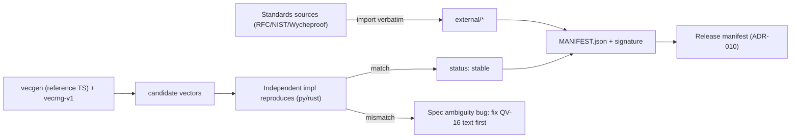

# QV-34 — Test Vectors and Cross-Implementation Conformance

**Module ID:** `assurance-vectors`  
**Status:** Draft  
**Owner:** Assurance lead (proposed); protocol owner (QV-16 author) co-owns vector semantics  
**Last reviewed:** 2026-10-21  
**Related specs:** QV-16 (crypto protocol; ADR-004; defines every byte format referenced here), QV-05, QV-09 (schemas), QV-10 (verifier checks, canary), QV-11 (how vectors gate releases), QV-13 (locale-independent exports); ADR-003, 004, 005, 007, 010, 013

> Placeholder note. QV-16 is written concurrently. This spec references protocol objects **symbolically** (e.g. `ballot`, `manifest`, `ds.tag.cds01`) and fixes the *container, process and coverage*. Where a byte layout is needed, the vector says `encoding_ref: "QV-16 §<name>"`; concrete offsets are filled when QV-16 reaches Review (tracked in §16).

## 1. Objective

Provide a **language-neutral, machine-checkable, reviewable body of known-answer tests (KATs) and negative vectors** such that:
1. A second, independently written implementation (Rust, Python, Go) of the **verifier** — and optionally of the ballot producer and trustee tools — can be proven byte-compatible with the reference TypeScript implementation (ADR-003) without reading its source.
2. Regressions in encoding, domain separation, hashing-to-scalar, proof verification, Merkle logic, or tally arithmetic are caught instantly.
3. The classic attack classes (QV-11 §6) have concrete **must-reject** vectors.
4. Auditors and observers can reproduce every vector from a documented, deterministic process and see which ones come from external standards.

## 2. Scope

### In scope
Vectors for every primitive and protocol step in QV-16; the container format, JSON Schema, directory layout, generation and review process, the conformance runner and adapter protocol, conformance profiles and reporting.

### Out of scope
Random testing (QV-11 property/fuzz tests); performance benchmarking; UI tests; the cryptographic protocol itself (QV-16).

## 3. Actors

| Actor | Goal | Outcome |
|---|---|---|
| Reference implementer | Keep vectors green | CI gate |
| Second implementer (Rust/Python verifier) | Prove compatibility | `conformance-report.json` with profile "verifier-L1" |
| Independent reviewer / auditor | Audit vector provenance | Reproduces generation, compares with RFCs |
| Observer | Choose a trustworthy verifier | Reads published conformance reports of implementations |
| Protocol owner | Evolve protocol | Version bump + vector regeneration under review |

## 4. Requirements

| ID | Requirement | Pri | Acceptance criteria | Verif. |
|---|---|---|---|---|
| QV-34-REQ-001 | Every cryptographic primitive wrapper and every QV-16 protocol step (§7 catalog) shall have ≥ 1 positive and ≥ 1 negative vector. | M | Coverage script maps QV-16 step IDs → vector sets; 100% mapped. | T |
| QV-34-REQ-002 | Vectors shall use the container in §6 and validate against the published JSON Schema (§6.3). | M | CI schema validation. | T |
| QV-34-REQ-003 | Vectors from external standards (RFC 8032, RFC 9496, RFC 9474, RFC 9162, NIST CAVP, Wycheproof, ElectionGuard) shall be imported **verbatim** with source URL, retrieval date and SHA-256 of the source text, tagged `origin: "external"`. | M | Provenance fields non-empty; import script reproducible. | T, R |
| QV-34-REQ-004 | QuietVote-specific vectors shall be generated deterministically from the seed schedule in §8 by the generator in `tools/vecgen/`; re-running the generator on a clean checkout shall produce **zero diff**. | M | CI `vectors:regen-check`. | T |
| QV-34-REQ-005 | Before a QuietVote-specific vector set is marked `stable`, at least one implementation independent of the reference code (different language and different author, using only the spec and RFCs) shall reproduce all expected outputs byte-for-byte. | M | `status` field and `independent_confirmations[]` list; release gate G4 (QV-11). | R |
| QV-34-REQ-006 | The directory shall contain a signed `MANIFEST.json` (SHA-256 of each file, overall Merkle root, protocol version, generator commit) which is part of the signed release manifest (ADR-010). | M | Signature verifies in release job. | T |
| QV-34-REQ-007 | Negative vectors shall specify the **expected error code** from a fixed registry (§9.2) and, for verifier vectors, the **set of failing named checks**. | M | Runner compares exact sets. | T |
| QV-34-REQ-008 | The conformance runner (§10) shall execute any implementation via the adapter protocol (stdin/stdout JSON Lines) and emit `conformance-report.json` (§10.4). | M | Runner passes against reference adapter. | T |
| QV-34-REQ-009 | A **full-election bundle** corpus (valid, plus a mutation corpus of ≥ 1 mutant per field class) shall exist for verifier conformance and for the verifier canary (QV-10-REQ-014). | M | Mutation corpus coverage table (§9.3) complete. | T |
| QV-34-REQ-010 | Vector files shall contain no secrets other than test keys derived from public seeds; production-key-like material is forbidden (secret scanner in CI). | M | CI scan. | T |
| QV-34-REQ-011 | Every protocol version identifier (ADR-013) shall have its own vector tree; old trees are immutable, retained and still run in CI for backward verification. | M | Directory policy check. | T |
| QV-34-REQ-012 | Vectors shall be locale- and platform-independent: UTF-8, LF newlines, lowercase hex, RFC 3339 UTC timestamps, no floats. | M | Schema + lint. | T |
| QV-34-REQ-013 | Randomness injection: production code shall expose a test-only entropy injection point (compiled/flagged out of release builds) so the generator can reproduce ballots deterministically; release build must reject injected entropy (test). | M | Release-build test asserts injection API absent/fails. | T |
| QV-34-REQ-014 | Size limits: any single vector file ≤ 1 MB; the committed corpus ≤ 25 MB; larger scale cases (1,000–10,000 voters) shall be **regenerated on demand** from `{seed, params}` with expected digests stored. | S | CI size check. | T |
| QV-34-REQ-015 | Published conformance report template and badge text shall make **no security claim** ("conforms to QuietVote test vectors v1, profile X"); reports list profile, version, vector tree root, pass counts, failures. | M | Review of badge text. | R |
| QV-34-REQ-016 | Changes to any `stable` vector require an ADR-style change note (`CHANGES.md`) with reviewer sign-off by protocol owner + independent reviewer. | M | Branch protection rule. | R |

## 5. Directory layout

```
test-vectors/
  README.md                       # how to use; license CC0-1.0 for vectors
  MANIFEST.json                   # hashes of all files + root + generator commit; signed (MANIFEST.json.sig)
  schema/
    vector-file.schema.json       # envelope schema (2020-12)
    ops/<op>.schema.json          # per-operation input/output schemas
    error-codes.json              # registry §9.2
    check-ids.json                # verifier check registry §9.1
  v1/                             # protocol version tree (QV-16 identifier, e.g. "qv1")
    external/                     # imported verbatim, one dir per source
      rfc8032-ed25519/
      rfc9496-ristretto255/
      rfc9474-rsabssa/            # Phase 2
      rfc9162-merkle/ (or rfc6962 interop)
      nist-cavp-sha/
      wycheproof/
      electionguard/              # interop reference only (see §12)
    primitives/
      hash/                       # sha256, sha512, tagged-hash, hash-to-scalar
      encoding/                   # crockford-base32, election-id, ballot-code, length-prefix, canonical-json
      ristretto/                  # point/scalar ops, invalid encodings
      ed25519/                    # sign/verify (voter, organizer, log), malleability cases
      rng-kdf/                    # vecrng-v1 derivations
    protocol/
      manifest/                   # canonicalization + hash + signature, language maps, bidi rejection
      election-id/
      elgamal/                    # keygen, encrypt, decrypt, add, scalar-mult
      proofs/
        schnorr-pok/              # proof of knowledge / possession
        cp-dleq/                  # Chaum-Pedersen
        cds-disjunctive/          # 0/1 selection proofs
        contest-limit/            # sum proofs, k-of-n, yes/no, approval
      dkg/                        # pedersen-feldman commitments, shares, complaints, joint key
      ballot/                     # build, sign, serialize, hash, superseding rules
      benaloh/                    # spoiled record, verification, mismatches
      board/                      # leaf/node hash, tree head, inclusion, consistency, STH signature, witness cosign
      tally/                      # aggregation, partial decryption, Lagrange, dlog extraction, result mapping
      rules/                      # quorum, threshold, tie-breaks, latest-ballot-per-voter
      receipt/                    # receipt build + verify
      phase2-blind-token/         # (Phase 2 only; RFC 9474 + QV binding)
    elections/
      tiny-yesno-3v/              # 3 voters, 3 trustees (t=2)
      small-approval-20v/         # 20 voters, 5 trustees (t=3), revotes, spoiled ballots
      kofn-multi-contest-12v/
      edge-ties-quorum/           # tie and quorum boundary cases
      scale/                      # params + seed + expected digests only (1000, 10000 voters)
    mutations/                    # derived from elections/small-approval-20v (see §9.3)
    canary/                       # the verifier "known-bad" sample (§9.4)
  tools/                          # (lives in repo tools/vecgen, not in published tree)
```

Rules: file names `kebab-case`, one **vector set** per file; ids unique within a tree; directories for external vectors carry `SOURCE.md` (URL, retrieval date, license, SHA-256 of original).

## 6. Vector file format

### 6.1 Envelope

```json
{
  "$schema": "https://quietvote.example/schema/vector-file.schema.json",
  "format_version": 1,
  "protocol_version": "qv1",
  "suite": "primitives/hash",
  "operation": "hash.sha256",
  "description": "SHA-256 known answers (FIPS 180-4 / NIST CAVP)",
  "origin": "external",
  "source": { "name": "FIPS 180-4 example", "url": "https://csrc.nist.gov/publications/detail/fips/180/4/final", "retrieved": "2026-10-21", "source_sha256": "<hex>" },
  "status": "stable",
  "generator": { "commit": "<git sha>", "tool": "vecgen@1.0.0", "seed_ref": null },
  "independent_confirmations": [ { "impl": "py-qv-verify 0.1", "author": "…", "date": "…" } ],
  "encoding": { "bytes": "hex-lower", "scalars": "QV-16 §scalar-encoding", "points": "QV-16 §point-encoding", "ints": "decimal-string" },
  "vectors": [
    {
      "id": "sha256-abc",
      "comment": "SHA-256(\"abc\")",
      "input":  { "msg_hex": "616263" },
      "expect": { "ok": true, "output": { "digest_hex": "ba7816bf8f01cfea414140de5dae2223b00361a396177a9cb410ff61f20015ad" } },
      "tags": ["kat", "external"]
    },
    {
      "id": "sha256-empty",
      "input":  { "msg_hex": "" },
      "expect": { "ok": true, "output": { "digest_hex": "e3b0c44298fc1c149afbf4c8996fb92427ae41e4649b934ca495991b7852b855" } },
      "tags": ["kat", "external"]
    }
  ]
}
```

Notes: `"ok": false` entries carry `"error": "<code from registry>"` instead of `output`. `ints` are decimal strings to avoid JSON number precision loss. Hex is lowercase without prefix. No floating-point. `comment` is for humans only and never compared.

### 6.2 Core sample vectors (illustrative; values taken from standards, to be re-verified at import against the cited sources)

Ed25519 (RFC 8032 §7.1 TEST 1; ADR-005 voter/organizer/log signatures):
```json
{ "id": "ed25519-rfc8032-test1", "operation": "ed25519.sign",
  "input":  { "secret_hex": "9d61b19deffd5a60ba844af492ec2cc44449c5697b326919703bac031cae7f60", "msg_hex": "" },
  "expect": { "ok": true, "output": {
    "public_hex": "d75a980182b10ab7d54bfed3c964073a0ee172f3daa62325af021a68f707511a",
    "sig_hex": "e5564300c360ac729086e2cc806e828a84877f1eb8e5d974d873e065224901555fb8821590a33bacc61e39701cf9b46bd25bf5f0595bbe24655141438e7a100b" } } }
```
ristretto255 (RFC 9496 Appendix A: encoding of the generator; identity encodes to 32 zero bytes):
```json
{ "id": "ristretto-base-encoding", "operation": "ristretto.encode_base_mul", "input": { "scalar_hex": "0100000000000000000000000000000000000000000000000000000000000000" },
  "expect": { "ok": true, "output": { "point_hex": "e2f2ae0a6abc4e71a884a961c500515f58e30b6aa582dd8db6a65945e08d2d76" } } }
```
(Scalar shown little-endian per RFC 9496 encoding of scalars `[UNVERIFIED in session; re-confirm vs RFC text on import]`.) Negative example (non-canonical/ invalid ristretto encodings per RFC 9496 Appendix A.2: high bit set, non-canonical field element, negative field element, non-square):
```json
{ "id": "ristretto-bad-noncanonical-field", "operation": "ristretto.decode", "input": { "point_hex": "<RFC 9496 A.2 vector>" }, "expect": { "ok": false, "error": "ERR_POINT_ENCODING" } }
```

### 6.3 JSON Schema (envelope, abbreviated; full file in `schema/`)

```json
{
  "$schema": "https://json-schema.org/draft/2020-12/schema",
  "$id": "https://quietvote.example/schema/vector-file.schema.json",
  "type": "object",
  "required": ["format_version","protocol_version","suite","operation","origin","status","encoding","vectors"],
  "additionalProperties": false,
  "properties": {
    "$schema": { "type": "string" },
    "format_version": { "const": 1 },
    "protocol_version": { "type": "string", "pattern": "^qv[0-9]+$" },
    "suite": { "type": "string", "pattern": "^[a-z0-9/-]+$" },
    "operation": { "type": "string", "pattern": "^[a-z0-9_]+(\\.[a-z0-9_]+)+$" },
    "description": { "type": "string" },
    "origin": { "enum": ["external","quietvote","hybrid"] },
    "source": { "$ref": "#/$defs/source" },
    "status": { "enum": ["draft","candidate","stable","deprecated"] },
    "generator": { "$ref": "#/$defs/generator" },
    "independent_confirmations": { "type": "array", "items": { "$ref": "#/$defs/confirmation" } },
    "encoding": { "type": "object" },
    "vectors": { "type": "array", "minItems": 1, "items": { "$ref": "#/$defs/vector" } }
  },
  "$defs": {
    "hex": { "type": "string", "pattern": "^([0-9a-f]{2})*$" },
    "vector": {
      "type": "object",
      "required": ["id","input","expect"],
      "additionalProperties": false,
      "properties": {
        "id": { "type": "string", "pattern": "^[a-z0-9][a-z0-9._-]*$" },
        "comment": { "type": "string" },
        "input": { "type": "object" },
        "expect": {
          "oneOf": [
            { "type": "object", "required": ["ok","output"], "properties": { "ok": { "const": true }, "output": { "type": "object" } }, "additionalProperties": false },
            { "type": "object", "required": ["ok","error"], "properties": { "ok": { "const": false }, "error": { "$ref": "error-codes.json#/$defs/code" }, "failed_checks": { "type": "array", "items": { "type": "string" } } }, "additionalProperties": false }
          ]
        },
        "tags": { "type": "array", "items": { "type": "string" } },
        "requires": { "type": "array", "items": { "type": "string" }, "description": "profile capabilities needed, e.g. phase2" }
      }
    }
  }
}
```
Per-operation `input`/`output` schemas live in `schema/ops/` and are generated from QV-09/QV-16 type definitions so schema and protocol cannot drift (CI diff).

## 7. Coverage catalog — what has vectors

"Core" = reference + all conformant implementations must pass. "N" = negative vectors (must reject). Operation names are the adapter protocol op ids (§10.2). QV-16 step references are symbolic.

### 7.1 Primitives

| Area | Operations | Positive vectors | Negative / edge vectors | Source |
|---|---|---|---|---|
| SHA-256, SHA-512 | `hash.sha256`, `hash.sha512` | Empty, "abc", 448-bit, 1M 'a' (hash only), block-boundary lengths 55/56/63/64/65 | — | FIPS 180-4 / NIST CAVP (verbatim) |
| Tagged/domain-separated hash | `hash.tagged` | For every tag in QV-16 domain table (`ds.*`): tag, empty, 1-field, multi-field | **Field-boundary ambiguity**: `("ab","c")` vs `("a","bc")` give different digests; max-length field; length-prefix overflow → error; unknown tag → error | Generated |
| Hash-to-scalar | `hash.to_scalar` | Outputs from 64-byte wide reduction; scalars near `l` | Reduction bias test inputs (all-0xFF) | Generated; construction per QV-16 |
| ristretto255 | `ristretto.decode`, `.encode`, `.add`, `.mul`, `.neg`, `.eq`, `.hash_to_group` (if used) | Multiples 0..16 of basepoint, random pairs, identity behavior | RFC 9496 invalid encodings (non-canonical, negative, non-square), wrong length (31/33), identity where non-identity required | RFC 9496 App. A; Wycheproof/other libs `[UNVERIFIED]` |
| Scalars | `scalar.decode`, `.add`, `.mul`, `.inv`, `.neg`, `.reduce` | 0, 1, l−1, random | Non-canonical (≥ l), wrong length | Generated |
| Ed25519 | `ed25519.sign`, `ed25519.verify` | RFC 8032 §7.1 tests 1–5 + SHA(abc) test | Non-canonical S (S ≥ l), small-order public keys and R (strict verification policy per QV-16), wrong lengths, malleated signature, wrong message; **policy: strict (ZIP-215 vs RFC 8032 cofactorless) decided by QV-16; both outcomes listed with `policy` tag** | RFC 8032; Wycheproof Ed25519; "Taming the many EdDSAs" (Chalkias et al.) `[UNVERIFIED]` |
| Encodings | `enc.base32crockford`, `enc.election_id`, `enc.ballot_code`, `enc.lenprefix`, `enc.canon_json` | Known strings, 100-bit truncation, grouping/hyphens, lowercase/uppercase equivalence of input decoding (I/L→1, O→0) | Invalid characters, wrong length, trailing garbage, duplicated keys in JSON, number forms (1.0 vs 1), unicode normalization differences (NFC vs NFD input must hash differently unless canonicalization normalizes — vector fixes the QV-16 rule) | Crockford spec; QV-16 |
| Entropy derivation | `rng.vecrng` | Seeded stream outputs (HKDF-based; §8) | — | Generated |

### 7.2 Protocol steps

| QV-16 step (symbolic) | Operations | Positive | Negative / adversarial |
|---|---|---|---|
| Manifest build/hash/sign | `manifest.canonicalize`, `manifest.hash`, `manifest.verify_sig` | Minimal; multilingual (`en`,`es`,`ar`); max sizes; time zones with offsets; voter-roll Merkle root | Duplicate keys, unknown fields (policy), bidi control chars in labels (rejected, QV-13), invalid BCP 47 tag, `closes_at ≤ opens_at`, `t > n`, quorum > roll, wrong signature, swapped language text (hash changes) |
| Voter roll | `roll.merkle_root`, `roll.inclusion` | 1, 2, 3, 7, 8, 1000 leaves | Leaf/node confusion (second-preimage: internal node presented as leaf), duplicate voter key, unsorted input per rule |
| Election ID | `enc.election_id` | From manifests above | Collision attempt strings (differ only after bit 100 → same display ID; vector documents *expected equal display, different full hash* and the verifier warns) |
| Joint key / DKG | `dkg.commit`, `dkg.share`, `dkg.verify_share`, `dkg.complaint`, `dkg.joint_key` | n=3,t=2; n=5,t=3; n=7,t=4; with one disqualified trustee | Share inconsistent with commitments; commitment vector wrong length; duplicate trustee index; index 0; **rogue-key**: trustee publishes `h − Σ others` (must fail PoK); missing proof-of-possession; t=1 / t=n degenerate; complaint false vs true |
| ElGamal | `eg.keygen`, `eg.encrypt`, `eg.decrypt_known`, `eg.add`, `eg.scale` | 0/1 encryptions with fixed nonces; homomorphic sums to 0..N | Identity `c1` or `c2`, non-group elements, nonce = 0 (rejected), pk = identity |
| Schnorr PoK | `pok.prove`, `pok.verify` | With full statement in challenge | **Frozen Heart**: challenge omitting public key/commitment ⇒ forged proof accepted by a *weak* verifier; our verifier must reject the forged transcript; statement-substitution vectors |
| Chaum–Pedersen (DLEQ) | `cp.prove`, `cp.verify` | Decryption proofs; tally decryption | Wrong base, swapped (u,v), proof for different statement, challenge not recomputed from full statement, response ≥ l |
| CDS disjunctive 0/1 | `cds.prove`, `cds.verify` | Encrypt 0 and encrypt 1 for fixed nonces | Encrypt 2 with simulated proof ⇒ reject; both branches simulated; sub-challenges not summing to hash; swapped branches; proof reused on other ciphertext; **ballot-binding**: proof valid for another voter/election ⇒ reject (election id + voter id in hash) |
| Contest-limit proof | `limit.prove`, `limit.verify` | Yes/No exactly 1; approval ≤ n; k-of-n exactly/at most k; blank allowed per rules | Sum = k+1; sum = −1 mod l edge (negative selection by modulus wrap); undervote when exact required; empty ballot when blank disallowed |
| Ballot build + sign | `ballot.build`, `ballot.hash`, `ballot.sign`, `ballot.verify` | Single and multi-contest; with spoil flag | Missing contest; extra contest; wrong election id; voter not on roll; signature by other key; replay of another voter's ballot (ballot independence — Cortier–Smyth); modified ciphertext keeping signature; field reordering |
| Latest-ballot-per-voter | `rules.latest_ballot` | Revote sequences; same-timestamp tie broken by log index | Out-of-order arrival; superseded after close; two ballots same index |
| Benaloh | `benaloh.spoil_record`, `benaloh.verify_spoiled` | Spoiled record with randomness reveals plaintext; recomputed ciphertext = committed | Wrong randomness; plaintext differs from ciphertext; commitment code mismatch; spoiled record for a cast ballot (code appears as cast) ⇒ flagged; truncated record |
| Board / Merkle | `board.leaf_hash`, `board.node_hash`, `board.root`, `board.inclusion_verify`, `board.consistency_verify`, `board.sth_verify` | Trees of size 1..17, 31, 32, 33, 1000; every leaf's inclusion proof; consistency m→n for all m<n≤17 | Leaf/node domain confusion; proof with wrong length; reordered siblings; consistency proof from non-prefix; STH signature wrong key; tree size regress; **split-view**: two valid STHs same size different roots ⇒ `ERR_EQUIVOCATION`; padded/odd-size trees (RFC 9162 unbalanced rule) |
| Witness cosign | `witness.verify` | k-of-m cosigned STH | Cosign for different root; duplicate witness; unknown witness |
| Tally aggregation | `tally.aggregate` | Homomorphic sum of included ballots | Includes superseded ballot; excludes valid; ballot from outside roll; order-independence property |
| Partial decrypt + proof | `tally.partial`, `tally.partial_verify` | Each trustee i | Wrong trustee share; proof for other ciphertext; index mismatch |
| Combine (Lagrange) | `tally.combine` | Any t-subset yields same plaintext group element; t+1 subsets | Fewer than t; duplicate indices; index 0; subset with one invalid share; **t-1 shares give no info** (property test, not a KAT) |
| Discrete-log extraction | `tally.dlog` | Counts 0..N, max supported bound | Count > bound ⇒ `ERR_TALLY_OVERFLOW` (never wrap); non-integer result (point not in `{g^m}`) ⇒ reject (indicates cheating) |
| Rules evaluation | `rules.evaluate` | Majority, supermajority 2/3 boundary (exact, ±1), quorum boundary, ties with each tie-break | Zero ballots; blank counting; weights (Phase 2) |
| Receipt | `receipt.build`, `receipt.verify` | Included, superseded, with consistency | Tampered proof; receipt for different election; stale STH |
| Phase 2 blind token (flagged `requires: phase2`) | `token.blind`, `.blind_sign`, `.finalize`, `.verify` | RFC 9474 RSABSSA vectors (verbatim) | Reused token (nullifier set), token for other election, wrong salt length |

## 8. Generation process

### 8.1 Determinism
- **Seed schedule.** One master seed per tree: `SEED_v1 = SHA-256("QuietVote test vectors v1")` (public, fixed). Every vector derives its secrets/nonces with `vecrng-v1`: `HKDF-SHA256(salt = SEED_v1, ikm = <vector id utf8>, info = <purpose label>, L = n)` — each secret/nonce is addressed by `(set, vector-id, label)` so adding vectors never changes existing ones. (HKDF per RFC 5869.)
- **Entropy injection** (QV-34-REQ-013): production `random_scalar()` accepts an injected source in test builds only; the injection API is stripped by the build (`--no-test-hooks`) and the release verification test asserts its absence.
- **Clock and ordering.** Timestamps are fixed constants; board logs are generated by an in-memory deterministic board (no real clock).

### 8.2 Pipeline



Steps:
1. **Specify** the operation in QV-16 (inputs/outputs, error behavior). No vector without a spec clause.
2. **Generate** candidates with reference implementation (`status: candidate`).
3. **Cross-check against external**: wherever a standard supplies vectors (RFC 8032/9496/9474/9162 style), import and *also* run through the reference.
4. **Independent reproduction** by a second implementation (QV-34-REQ-005). Any discrepancy is first treated as a **specification ambiguity**; QV-16 is amended, then vectors regenerated.
5. **Adversarial review:** an attack-minded reviewer proposes negative vectors for each operation using the QV-11 §6 attack list (the checklist ID is recorded in each negative vector's `tags`, e.g. `attack:frozen-heart`).
6. **Freeze**: `status: stable`, hashes entered in `MANIFEST.json`, signed by release key(s).
7. **Regeneration check** in CI: runs generator, requires zero diff; also validates schema, uniqueness, and scans for secrets.
8. **Change control** (QV-34-REQ-016): only via PR with `CHANGES.md` entry; new protocol version ⇒ new `vN/` tree.

### 8.3 Interoperability with ElectionGuard (informational)
ElectionGuard publishes a specification (versions 2.1, 2.0, 1.1, 1.0 listed; 2.1 changes challenged-ballot opening to release encryption nonces — search result 2026-10-21, details `[UNVERIFIED]`) and reference implementations. QuietVote does **not** claim ElectionGuard compatibility (different group: ElectionGuard uses a 4096-bit modulus subgroup in spec 1.x/2.0 `[UNVERIFIED]`). We import selected ElectionGuard published vectors only as *design cross-checks* in `external/electionguard/` when the construction coincides (e.g., Chaum–Pedersen structure). Any such import documents the differences.

## 9. Verifier conformance: checks, mutations, canary

### 9.1 Named check registry (`schema/check-ids.json`)
Stable IDs shared with QV-10 verifier UI (QV-10 §6.4 numbers shown map in order):

| # | Check ID | Meaning |
|---|---|---|
| 1 | `chk.manifest.hash` | Manifest hashes to the anchored Election ID / hash |
| 2 | `chk.manifest.sig` | Organizer signature valid; fields valid |
| 3 | `chk.keys.trustees` | Trustee keys, PoKs, DKG transcript, joint key consistent |
| 4 | `chk.board.append_only` | Tree heads consistent; no equivocation |
| 5 | `chk.board.witness` | Required witness cosignatures present/valid (`not_run` if none configured) |
| 6 | `chk.ballots.valid` | Each ballot: on roll, signature, proofs valid, bound to election |
| 7 | `chk.ballots.latest` | Latest-ballot-per-voter rule applied correctly |
| 8 | `chk.tally.aggregate` | Recomputed aggregate equals published aggregate |
| 9 | `chk.tally.decrypt` | ≥ t partial decryption proofs valid; combination correct |
| 10 | `chk.result.rules` | Result follows declared rules (method, threshold, quorum, tie-break) |
| 11 | `chk.benaloh.spoiled` | Spoiled ballots open consistently; none also cast |
| 12 | `chk.receipts.sample` | Provided receipts included (when supplied) |
| 13 | `chk.encoding.canonical` | All objects canonically encoded; no unknown fields |
| 14 | `chk.time.window` | Ballots timestamped within window by board time |

Outputs per check: `pass | fail | not_run`, plus `details[]` of offending entries.

### 9.2 Error code registry (excerpt; `schema/error-codes.json`)
`ERR_POINT_ENCODING`, `ERR_SCALAR_RANGE`, `ERR_LENGTH`, `ERR_DOMAIN_UNKNOWN`, `ERR_SIG_INVALID`, `ERR_PROOF_INVALID`, `ERR_PROOF_STATEMENT`, `ERR_NOT_IN_ROLL`, `ERR_MERKLE_PROOF`, `ERR_EQUIVOCATION`, `ERR_TREE_REGRESS`, `ERR_SHARE_INVALID`, `ERR_THRESHOLD`, `ERR_DUP_INDEX`, `ERR_TALLY_OVERFLOW`, `ERR_TALLY_NONINTEGER`, `ERR_RULES`, `ERR_MANIFEST_FIELD`, `ERR_BIDI_CONTROL`, `ERR_LANG_TAG`, `ERR_CANON`, `ERR_ELECTION_BINDING`, `ERR_SPOILED_AND_CAST`, `ERR_UNSUPPORTED_VERSION`. Implementations may add internal detail but must map to one registry code for conformance.

### 9.3 Mutation corpus (`mutations/`)
Derived mechanically from `elections/small-approval-20v` by the generator. One mutant per cell below, with expected failing checks:

| Mutation class | Example | Expected failing checks |
|---|---|---|
| Manifest field flip | Change `closes_at`; swap a translation | `chk.manifest.hash`, `chk.manifest.sig` |
| Trustee key replace | Joint key altered | `chk.keys.trustees` |
| Drop a ballot from log but keep root | Delete entry n | `chk.board.append_only` |
| Reorder two entries | | `chk.board.append_only` |
| Equivocation | Second STH same size | `chk.board.append_only` (`ERR_EQUIVOCATION`) |
| Ballot ciphertext bit flip | | `chk.ballots.valid`, (`chk.board.append_only` if leaf hash unchanged) |
| Ballot encrypts 2 (forged proof) | | `chk.ballots.valid` |
| Weak-Fiat–Shamir forged proof | Challenge omits statement | `chk.ballots.valid` |
| Replayed ballot under another voter | | `chk.ballots.valid` (binding) |
| Superseded ballot counted | | `chk.ballots.latest`, `chk.tally.aggregate` |
| Valid ballot omitted from tally | | `chk.tally.aggregate` |
| Aggregate altered | | `chk.tally.aggregate` |
| Partial decryption wrong | | `chk.tally.decrypt` |
| Fewer than t partials | | `chk.tally.decrypt` |
| Result flipped (A↔B) | | `chk.result.rules` or `chk.tally.decrypt` |
| Quorum miscounted | | `chk.result.rules` |
| Spoiled ballot also cast | | `chk.benaloh.spoiled` |
| Spoiled record with wrong plaintext | | `chk.benaloh.spoiled` |
| Non-canonical encoding | | `chk.encoding.canonical` |
| Bidi control in option label | | `chk.manifest.sig` / `chk.encoding.canonical` per QV-16 rule |
| Anchor mismatch (wrong Election ID supplied) | | `chk.manifest.hash` (`E-VER-ANCHOR` in UI) |

Property: **no mutant passes all checks** (CI asserts for every mutant at least one expected check fails and that unrelated checks still behave as specified).

### 9.4 Canary (QV-10-REQ-014)
`test-vectors/v1/canary/` contains a small bundle (`canary-election.bundle`) built from `tiny-yesno-3v` with two documented defects (wrong aggregate and a forged CDS proof). Expected report: `chk.ballots.valid` fail, `chk.tally.aggregate` fail, others pass; Election ID of the canary is fixed and printed in QV-10 verifier help. The verifier UI "self-test" runs it and compares to `canary/expected-report.json`; a verifier that returns all-pass on the canary is by definition broken. The canary is distributed with every verifier build and is part of the signed manifest.

## 10. Cross-implementation conformance suite

### 10.1 Profiles

| Profile | Contents | Intended implementers |
|---|---|---|
| **P0-primitives** | Hash, encodings, ristretto, scalars, Ed25519, tagged hash | Any |
| **P1-verifier** | P0 + proofs verify (PoK, CP, CDS, limit), Merkle/STH, ballot verify, tally recompute, rules, receipts, full election verify + mutations + canary | **Second implementation priority (Rust/Python verifier)** |
| **P2-producer** | P1 + ballot build with injected entropy, Benaloh, ballot sign | Alternative voter clients |
| **P3-trustee** | DKG, partial decrypt, combine | Alternative trustee tooling |
| **P4-phase2** | Blind token ops | Phase 2 |

A conformance claim must name the profile and vector tree root (e.g. `P1-verifier @ qv1 root=<hash>`).

### 10.2 Adapter protocol (language-neutral)
The runner (`tools/conformance`, TypeScript, also available as a static binary `[TBD]`) launches the implementation-under-test (IUT) as a subprocess and speaks **JSON Lines over stdin/stdout** (one request per line; one response per line; stderr for logs):

Request: `{"id":"<vector id>","op":"cds.verify","input":{…}}`  
Response: `{"id":"…","ok":true,"output":{…}}` or `{"id":"…","ok":false,"error":"ERR_PROOF_INVALID"}`; unsupported op: `{"ok":false,"error":"ERR_UNSUPPORTED_OP"}` (counted as *not implemented*, allowed outside the claimed profile).  
Handshake: first line from runner `{"hello":"qv-conformance","format_version":1,"protocol_version":"qv1"}`; IUT answers `{"impl":"name","version":"x","protocol_versions":["qv1"],"profiles":["P0","P1"]}`.  
File-based mode for large artifacts (election bundles): `input` contains `{"path":"elections/small-approval-20v/bundle.json"}` relative to the tree root.  
Verifier ops return `{"checks":{"chk.manifest.hash":"pass",…}}`; compared as exact maps.

### 10.3 Comparison semantics
- Byte-exact on hex outputs; exact string on error codes; exact map on check results; `details` is informational and not compared.
- Negative vectors: IUT must **reject** with the registered code; accepting is a failure (security-relevant), rejecting with a different code is a *warning-level mismatch* that the runner reports separately but fails the profile only when the vector is tagged `strict_error`.
- Time/network: none; runner has no network access.

### 10.4 Conformance report (`conformance-report.json`)
```json
{
  "report_version": 1,
  "runner": "qv-conformance 1.0.0",
  "impl": { "name": "py-qv-verify", "version": "0.1.0", "language": "python3.12", "source": "https://…", "build_hash": "…" },
  "vector_tree": { "protocol_version": "qv1", "manifest_root": "<hash>", "manifest_signature_valid": true },
  "profile_claimed": "P1-verifier",
  "results": { "total": 0, "passed": 0, "failed": 0, "not_implemented": 0, "strict_error_mismatch": 0 },
  "failures": [ { "id": "cds-forged-two", "op": "cds.verify", "expected": {"ok": false, "error": "ERR_PROOF_INVALID"}, "actual": {"ok": true} } ],
  "date": "2026-10-21T00:00:00Z"
}
```
Reports of third-party implementations are published in `conformance/reports/` of the repo when submitted by PR (QV-34-REQ-015). The reference project verifies reports by rerunning.

### 10.5 Recommended second implementation
**Python or Rust verifier** (P1) written by a different team from the reference, using only QV-16 + RFCs; recommended libraries: Rust `curve25519-dalek` (ristretto255) `[UNVERIFIED version]`, Python `cryptography` for Ed25519 and a vetted ristretto255 binding or pure-Python from RFC 9496 for the group `[UNVERIFIED availability]`. First milestone: P0 + `chk.manifest.*` + Merkle; second: proofs; third: full election + mutations + canary.

## 11. Data and privacy
Vectors contain only synthetic keys derived from the public seed; marked in each file `"synthetic": true` at suite level. No real election data ever enters the tree; real-election bundles used for debugging stay outside the repository. Reports contain no personal data beyond implementer attribution.

## 12. Security and abuse cases

| Case | Cause | Impact | Mitigation | Residual |
|---|---|---|---|---|
| Vector tree tampered to bless a buggy/malicious implementation | Supply-chain | False conformance | Signed `MANIFEST.json`; hash in release manifest; vectors reproducible from seed | Key compromise |
| Reference and second implementation share a spec misreading | Same author mindset | Shared bug passes | Different authors/languages; external RFC vectors; adversarial review (QV-11 independent review) | Common-mode errors in spec |
| Vectors leak real secrets | Copy-paste | Compromise | Seed-derived only; secret scanner | — |
| Over-fitting: implementation special-cases vectors | Malicious/lazy | Passes tests but is wrong | Property tests/fuzz (QV-11), randomized differential testing between implementations with fresh seeds, private hold-out vectors for independent auditors | Residual |
| Badge misread as security certification | Marketing | Overclaim | QV-34-REQ-015 wording | — |
| Non-determinism creeping in (clocks, maps iteration order) | Dev error | Flaky/regen diff | Regen check in CI; canonical JSON ordering | — |

**Differential testing.** In addition to fixed vectors, QV-11 runs *differential fuzzing*: generate random valid/invalid elections with fresh seeds (seeds logged), run reference and second implementation, compare check maps; any divergence becomes a new vector.

## 13. Interfaces and dependencies
- Upstream: QV-16 (authoritative semantics), QV-09 (schemas), ADR-013 version identifiers.
- Downstream: QV-11 (gates G3–G5, evidence artifacts), QV-10 (check IDs, canary), QV-12 (bundle export compatibility), QV-13 (locale-independence).
- Versioning: `format_version` (container) separate from `protocol_version` (QV-16). Backward compatibility: old `vN` trees remain; a verifier supporting multiple versions runs all.

## 14. Operations
- Vectors are released with each tagged release as `test-vectors-<version>.tar.gz` + signature, and mirrored in the repo; they are CC0-1.0 to encourage reuse (specs CC BY-SA, code AGPL per ADR-011; vector license choice is Q-34-3).
- Maintenance: protocol changes require updating vectors in the same PR; CI blocks if QV-16 step IDs lack coverage.

## 15. Testing and verification
- Self-tests: schema validation, regen diff, coverage mapping, MANIFEST verification, mutant-must-fail, canary expected report, size caps, secret scan.
- Per-release evidence (QV-11 §10): vector tree root, conformance reports (reference + ≥ 1 independent), coverage table.

## 16. Constraints, assumptions and open questions

Constraints: JSON only (no CBOR in v1) for reviewability; vectors reflect QV-16 as of its Review status; ristretto255 points/scalars encodings per RFC 9496 and QV-16.

| Question | Owner | Target | Proposed default |
|---|---|---|---|
| Q-34-1 Ed25519 verification policy (strict/cofactorless vs ZIP-215) | QV-16 author | Protocol freeze | Strict RFC 8032 + reject small-order A and R; vectors carry `policy` tags |
| Q-34-2 Canonical JSON (RFC 8785 JCS) vs custom length-prefixed binary for signed objects | QV-16 author | Protocol freeze | Binary length-prefixed for hashed/signed objects; JSON for exchange with canonicalization vectors |
| Q-34-3 Vector license | Project owner | M2 | CC0-1.0 |
| Q-34-4 Who writes the second implementation and when | Project owner | Before gate G4 | Funded external contributor, Python then Rust |
| Q-34-5 Runner distribution (Node-only vs static binary) | Assurance lead | M3 | Node first |
| Q-34-6 Include ElectionGuard interop vectors | Protocol owner | M3 | Informational only |

## 17. Proposed ADRs

| ID | Proposal | Rationale |
|---|---|---|
| QV-ADR-P34-1 | Vector trees are versioned per protocol version and immutable once stable; generated deterministically from public seed with HKDF address scheme | Reproducibility, auditability |
| QV-ADR-P34-2 | `stable` requires independent reproduction by a second implementation | Eliminates single-implementation spec drift |
| QV-ADR-P34-3 | Verifier ships a signed canary bundle; self-test mandatory in UI | Fake-verifier defence (QV-10) |

## 18. Approval and change history

| Reviewer | Decision | Date | Notes |
|---|---|---|---|
| Project owner | Pending | — | Draft authored 2026-10-21 |

## References (accessed 2026-10-21 unless noted)
- RFC 8032 (EdDSA), RFC 9496 (ristretto255/decaf448), RFC 9474 (RSA Blind Signatures), RFC 9162 (Certificate Transparency v2.0 Merkle trees), RFC 6962, RFC 5869 (HKDF), RFC 3339, RFC 8785 (JCS) — from author knowledge; searches did not return RFC text `[UNVERIFIED in session]`.
- NIST FIPS 180-4 and CAVP SHA vectors `[UNVERIFIED in session]`.
- Project Wycheproof (Google/C2SP) `[UNVERIFIED in session]`.
- Trail of Bits, "The Frozen Heart vulnerability in Girault's proof of knowledge" https://blog.trailofbits.com/2022/04/14/the-frozen-heart-vulnerability-in-giraults-proof-of-knowledge/ (accessed 2026-10-21) — Fiat–Shamir challenge must hash all public statement values and prover commitments.
- Bernhard, Pereira, Warinschi, "How not to Prove Yourself: Pitfalls of the Fiat-Shamir Heuristic and Applications to Helios", ASIACRYPT 2012 — via https://eprint.iacr.org/2016/771 search listing and summary (accessed 2026-10-21).
- Cortier & Smyth, "Attacking and fixing Helios: An analysis of ballot secrecy" https://members.loria.fr/VCortier/files/Publications/b2hd-Helios-CSF11.html (accessed 2026-10-21).
- ElectionGuard specification listing, https://electionguard.vote/spec/ (via search summary; site not fetchable 2026-10-21).
