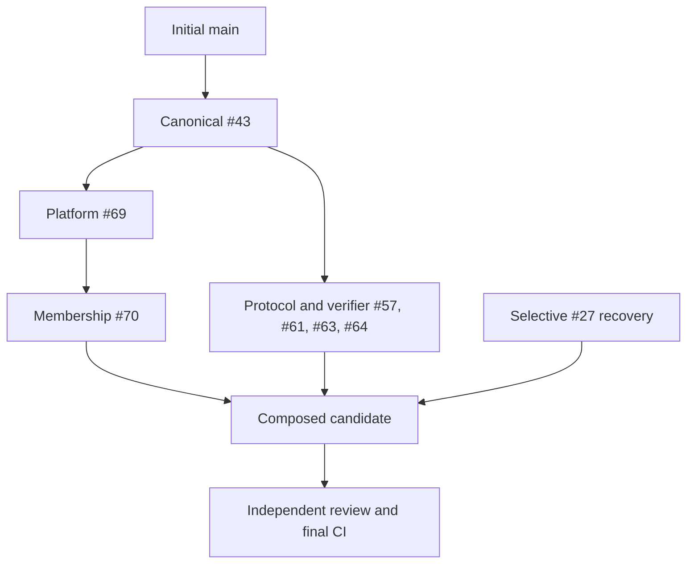

# QuietVote branch inventory

## Scope and immutable baseline

This engineering inventory covers **72 remote branches**, all **70 discovered pull requests**, three additional historical PR head commits, and **479 workflow runs**. Branch pagination returned no second page. Local branch enumeration, complete Git history, merge bases, ancestry, stable patch equivalence, and three-way merge checks were used; the GitHub compare API alone was not sufficient because large file lists are capped.

- Initial `main`: [`019f4e78`](https://github.com/djshellshoxxx/quietvote/commit/019f4e789be2ff38a5fb2d348c3b225cc87cf296).
- Platform qualification candidate, PR #69: [`b239bc5a`](https://github.com/djshellshoxxx/quietvote/commit/b239bc5a53098341ae634aca924dd8ccb8e2e719).
- Pinned-membership candidate, PR #70: [`8b417c6c`](https://github.com/djshellshoxxx/quietvote/commit/8b417c6c8b86a7a9a9454468bf16bec0baa8517b).
- CI inventory was captured at `2026-11-19T07:50:02.849Z`. Results below apply to the named source head, not to a later composition.
- No repository `AGENTS.md` exists in the fetched tree. The current user instruction authorizes implementation and consolidation; historical pause handoffs are retained as history.
- No remote branches were deleted or rewritten by this inventory.

The later consolidation contains **65 original tips**, including main and its
identical alias: **63 tips not already contained in initial main** are now
preserved in candidate ancestry. Seven original tips remain outside ancestry for
the explicit reasons in [CONSOLIDATION_REPORT](CONSOLIDATION_REPORT.md), including
one patch-equivalent replacement and selective reconstruction of #27. All 72
original remote tips remain unchanged; the requested candidate adds a 73rd branch.
This is an ancestry/preservation count, not a count of merged remote PRs or unique
features. The 72 names point to 69 distinct captured head commits; three pairs
are aliases. The three extra historical PR-head snapshots belong to the same 70
PR records, not three additional branches or PRs. Worker branches created during
this operation are separate provenance.

## Findings and integration order

Later continuation sources are separate from the initial 72-branch inventory.
PR #72's backup handoff was preserved in canonical checkpoint `547ea2d` with
original parent `9d3292bf945a283e7ec3b549a603692a902dc0c9`. Concurrent receipt
PR #73 at `1cab4ae130a4c1823b61e369557340ba4ec3842d` is preserved by local merge
`f919d319bd7dd346274e2e0dbbccd973ffd57159`, including its byte-identical historical
handoff. The [R11–R12 disposition](CONTINUATION_R11_R12_20261120.md) records the
retained reviewed adapter and ported election-open acceptance. These sources
do not alter historical branch counts. Live canonical publication and PR status
are recorded in PR #71.

**59 of 72 tips are ancestors of the platform candidate; 60 are ancestors of the membership candidate.** The latter count includes `main` and its identical `claude/quirky-curie-n5pxf5` alias. The remaining 12 tips were individually compared. One is patch-equivalent to a signed replacement, one is canonical merge history with no additional non-merge patch, four contain independent crypto/verifier fixes, one contains mixed historical recovery work, and five are historical or obsolete documentation proposals.

1. Start from the recorded `main` and merge canonical `integration/quietvote-completion` history. Its latest merge commits assemble source parents that are already in the newer platform candidate; preserve ancestry rather than treating `git cherry` alone as tree equivalence.
2. Integrate platform PR #69, which includes #60 lazy integrity, #62 trusted board policy, #65 revote copy, #66 native file URLs, current audit reconciliation, and portability repairs.
3. Integrate authenticated pinned membership and recovery from PR #70. Its exact head already passed the hosted matrix; a new composition still requires fresh qualification.
4. Independently review and integrate #61 (yes/no tie scope), #63 (published decrypter sets), #64 (authenticated marker conflicts), and #57 (nonce hedging and vectors). These cleanly three-way merge with the initial membership candidate, but mergeability is not correctness evidence.
5. Reconstruct only missing #27 behavior against the composed implementation. Its 30 conflict paths include database migrations, runtime recovery, UI, and tests; a blanket merge would reintroduce superseded implementations. Preserve old rejected web-ballot work as evidence, not active code.
6. Add current inventory, unfinished-work, security, consolidation, and verification records. Run independent review and all applicable qualification gates on the final candidate.

### Dependency graph



## Complete branch table

`A/B` is the commit count ahead of/behind the initial main. `Base` is the common ancestor with main. `Unique` counts non-merge patches absent from the membership candidate; merge commits and reconstructed behavior are discussed separately. A contained tip needs no separate source merge after its descendant is integrated. Conflict counts come from `git merge-tree --write-tree --name-only --no-messages` against the initial membership candidate, without changing a checkout.

CI abbreviations are workflow names: **CI** = `ci`, **Visual** = `web pseudo-locale visual checks`, **Claims** = `claims lint`. A historical failed head does not imply its corrected descendant fails. “Not recorded” means no workflow run for that exact SHA in the complete Actions history read; it is not a pass.

| Branch and tip | Base; A/B | Purpose / PR | Completion evidence | Unique changes | CI at exact head | Conflicts | Security consideration | Decision |
| --- | --- | --- | --- | --- | --- | --- | --- | --- |
| `chatgpt/quietvote-ci-action-pin-guard-20261104` [`51851c10`](https://github.com/djshellshoxxx/quietvote/commit/51851c10c5ac33cd89f05f9e0af44fd43b41b930) | [`019f4e78`](https://github.com/djshellshoxxx/quietvote/commit/019f4e789be2ff38a5fb2d348c3b225cc87cf296); 240/0 | fix(ci): detect unpinned step uses in action-pin validator (#28) | Tip contained in #70; implementation inherited by candidate | 0 (contained) | [Claims success](https://github.com/djshellshoxxx/quietvote/actions/runs/41876094101); [CI failure](https://github.com/djshellshoxxx/quietvote/actions/runs/41876093966) | None (ancestor) | Covered by cumulative security review; not individually recertified | Consolidate through descendant; retain source branch |
| `chatgpt/quietvote-s1-02-reverse-spoil-guard-20261114` [`03f2f0c8`](https://github.com/djshellshoxxx/quietvote/commit/03f2f0c888be4a32081cf642a747b6cb1597e178) | [`019f4e78`](https://github.com/djshellshoxxx/quietvote/commit/019f4e789be2ff38a5fb2d348c3b225cc87cf296); 351/0 | fix(server): reject casts reusing previously spoiled ciphertexts (S1-02) (#46) | Tip contained in #70; implementation inherited by candidate | 0 (contained) | [CI failure](https://github.com/djshellshoxxx/quietvote/actions/runs/43685229142); [Visual success](https://github.com/djshellshoxxx/quietvote/actions/runs/43685229122); [Claims success](https://github.com/djshellshoxxx/quietvote/actions/runs/43685229120) | None (ancestor) | Covered by cumulative security review; not individually recertified | Consolidate through descendant; retain source branch |
| `chatgpt/quietvote-trustee-fixture-paths-20261102` [`a2220373`](https://github.com/djshellshoxxx/quietvote/commit/a222037328e3aceed1b8c177002b5dc4652e3339) | [`019f4e78`](https://github.com/djshellshoxxx/quietvote/commit/019f4e789be2ff38a5fb2d348c3b225cc87cf296); 205/0 | test(trustee): use canonical temporary fixture paths (#25) | Tip contained in #70; implementation inherited by candidate | 0 (contained) | [CI failure](https://github.com/djshellshoxxx/quietvote/actions/runs/41556033098) | None (ancestor) | Covered by cumulative security review; not individually recertified | Consolidate through descendant; retain source branch |
| `chatgpt/quietvote-visual-ci-repair-20261102` [`980a5cd7`](https://github.com/djshellshoxxx/quietvote/commit/980a5cd72c9b05bc8ce28a588376462ce85f8206) | [`019f4e78`](https://github.com/djshellshoxxx/quietvote/commit/019f4e789be2ff38a5fb2d348c3b225cc87cf296); 157/0 | Superseded workflow repair (#23) | No unique patch; signed replacement is in candidate | 0 unique; 1 equivalent | [CI success](https://github.com/djshellshoxxx/quietvote/actions/runs/41554657015); [Visual success](https://github.com/djshellshoxxx/quietvote/actions/runs/41554657014) | Clean three-way merge | No new runtime surface | Retain; do not apply twice |
| `chatgpt/quietvote-visual-ci-signed-20261102` [`06e08989`](https://github.com/djshellshoxxx/quietvote/commit/06e089895d94dd1710afd5113fec2a01a235e979) | [`019f4e78`](https://github.com/djshellshoxxx/quietvote/commit/019f4e789be2ff38a5fb2d348c3b225cc87cf296); 157/0 | fix(ci): repair pseudo-locale workflow YAML parsing (#24) | Tip contained in #70; implementation inherited by candidate | 0 (contained) | [CI success](https://github.com/djshellshoxxx/quietvote/actions/runs/41555108679); [Visual success](https://github.com/djshellshoxxx/quietvote/actions/runs/41555108599) | None (ancestor) | Covered by cumulative security review; not individually recertified | Consolidate through descendant; retain source branch |
| `chatgpt/zero-codex/audit-rate-config-20261110` [`0dac28bd`](https://github.com/djshellshoxxx/quietvote/commit/0dac28bd9c0bc11a7bb02d8d6d9b6b5264ae0ae9) | [`019f4e78`](https://github.com/djshellshoxxx/quietvote/commit/019f4e789be2ff38a5fb2d348c3b225cc87cf296); 262/0 | fix(server): reject non-finite rate configuration (randomized audit) (#33) | Tip contained in #70; implementation inherited by candidate | 0 (contained) | [CI failure](https://github.com/djshellshoxxx/quietvote/actions/runs/42929943701); [Visual success](https://github.com/djshellshoxxx/quietvote/actions/runs/42929943634); [Claims success](https://github.com/djshellshoxxx/quietvote/actions/runs/42929943612) | None (ancestor) | Covered by cumulative security review; not individually recertified | Consolidate through descendant; retain source branch |
| `chatgpt/zero-codex/board-reader-lengths-20261110` [`0352bca8`](https://github.com/djshellshoxxx/quietvote/commit/0352bca8c1831d30be030dc1f8f266b761903ef9) | [`019f4e78`](https://github.com/djshellshoxxx/quietvote/commit/019f4e789be2ff38a5fb2d348c3b225cc87cf296); 249/0 | fix(board): validate byte-reader lengths before advancing (#39) | Tip contained in #70; implementation inherited by candidate | 0 (contained) | [CI failure](https://github.com/djshellshoxxx/quietvote/actions/runs/42893390991); [Visual success](https://github.com/djshellshoxxx/quietvote/actions/runs/42893390944); [Claims success](https://github.com/djshellshoxxx/quietvote/actions/runs/42893390920) | None (ancestor) | Covered by cumulative security review; not individually recertified | Consolidate through descendant; retain source branch |
| `chatgpt/zero-codex/crockford-display-grouping-20261110` [`5ca8b530`](https://github.com/djshellshoxxx/quietvote/commit/5ca8b530a06a3124e76c1bc93c0a81fcdd6e934a) | [`019f4e78`](https://github.com/djshellshoxxx/quietvote/commit/019f4e789be2ff38a5fb2d348c3b225cc87cf296); 250/0 | fix(web): bound human-readable code grouping input (#40) | Tip contained in #70; implementation inherited by candidate | 0 (contained) | [Visual success](https://github.com/djshellshoxxx/quietvote/actions/runs/42912042393); [Claims success](https://github.com/djshellshoxxx/quietvote/actions/runs/42912042391); [CI failure](https://github.com/djshellshoxxx/quietvote/actions/runs/42912042384) | None (ancestor) | Covered by cumulative security review; not individually recertified | Consolidate through descendant; retain source branch |
| `chatgpt/zero-codex/docs-wiki-sections-20261110` [`571c9f0d`](https://github.com/djshellshoxxx/quietvote/commit/571c9f0d7c22ba6f047c497817a8609b5389e334) | [`019f4e78`](https://github.com/djshellshoxxx/quietvote/commit/019f4e789be2ff38a5fb2d348c3b225cc87cf296); 281/0 | docs(wiki): separate User Guide and Developer Guide, repair draft status (#34) | Tip contained in #70; implementation inherited by candidate | 0 (contained) | [Claims success](https://github.com/djshellshoxxx/quietvote/actions/runs/42930071657) | None (ancestor) | Covered by cumulative security review; not individually recertified | Consolidate through descendant; retain source branch |
| `chatgpt/zero-codex/election-inspect-counters-20261110` [`1cfc10d9`](https://github.com/djshellshoxxx/quietvote/commit/1cfc10d997e44b6b8b0127cd658851e18621f287) | [`019f4e78`](https://github.com/djshellshoxxx/quietvote/commit/019f4e789be2ff38a5fb2d348c3b225cc87cf296); 249/0 | fix(cli): count prototype-named election log types safely (#41) | Tip contained in #70; implementation inherited by candidate | 0 (contained) | [Visual success](https://github.com/djshellshoxxx/quietvote/actions/runs/42922327531); [Claims success](https://github.com/djshellshoxxx/quietvote/actions/runs/42922327448); [CI failure](https://github.com/djshellshoxxx/quietvote/actions/runs/42922327434) | None (ancestor) | Covered by cumulative security review; not individually recertified | Consolidate through descendant; retain source branch |
| `chatgpt/zero-codex/import-preabort-20261110` [`67683185`](https://github.com/djshellshoxxx/quietvote/commit/67683185aa9d3d218c054f75f291ad24b5a770a4) | [`019f4e78`](https://github.com/djshellshoxxx/quietvote/commit/019f4e789be2ff38a5fb2d348c3b225cc87cf296); 249/0 | fix(server): reject pre-aborted import before archive scan (#35) | Tip contained in #70; implementation inherited by candidate | 0 (contained) | [Visual success](https://github.com/djshellshoxxx/quietvote/actions/runs/42831513298); [Claims success](https://github.com/djshellshoxxx/quietvote/actions/runs/42831513228); [CI failure](https://github.com/djshellshoxxx/quietvote/actions/runs/42831513209) | None (ancestor) | Covered by cumulative security review; not individually recertified | Consolidate through descendant; retain source branch |
| `chatgpt/zero-codex/job-start-recovery-20261110` [`c4a89598`](https://github.com/djshellshoxxx/quietvote/commit/c4a89598058324fab970f99fc9abaabe8f647aa1) | [`019f4e78`](https://github.com/djshellshoxxx/quietvote/commit/019f4e789be2ff38a5fb2d348c3b225cc87cf296); 249/0 | fix(server): contain job-start storage failures without stranding queue (#36) | Tip contained in #70; implementation inherited by candidate | 0 (contained) | [Claims success](https://github.com/djshellshoxxx/quietvote/actions/runs/42853595021); [Visual success](https://github.com/djshellshoxxx/quietvote/actions/runs/42853594938); [CI failure](https://github.com/djshellshoxxx/quietvote/actions/runs/42853594931) | None (ancestor) | Covered by cumulative security review; not individually recertified | Consolidate through descendant; retain source branch |
| `chatgpt/zero-codex/pool-delete-diagnostic-20261110` [`5cf35922`](https://github.com/djshellshoxxx/quietvote/commit/5cf359224f4ae25993c4cc4b30fb659c1d4f0a64) | [`019f4e78`](https://github.com/djshellshoxxx/quietvote/commit/019f4e789be2ff38a5fb2d348c3b225cc87cf296); 249/0 | fix(server): make deletion-state conflict diagnostic match existing policy (#38) | Tip contained in #70; implementation inherited by candidate | 0 (contained) | [Visual success](https://github.com/djshellshoxxx/quietvote/actions/runs/42883444600); [CI failure](https://github.com/djshellshoxxx/quietvote/actions/runs/42883444584); [Claims success](https://github.com/djshellshoxxx/quietvote/actions/runs/42883444570) | None (ancestor) | Covered by cumulative security review; not individually recertified | Consolidate through descendant; retain source branch |
| `chatgpt/zero-codex/seal-worker-lifecycle-20261110` [`11c8ca23`](https://github.com/djshellshoxxx/quietvote/commit/11c8ca23fbc5e70179cfbfc25f51bd71f5adb760) | [`019f4e78`](https://github.com/djshellshoxxx/quietvote/commit/019f4e789be2ff38a5fb2d348c3b225cc87cf296); 249/0 | fix(web): settle sealing Worker failures and release worker resources (#37) | Tip contained in #70; implementation inherited by candidate | 0 (contained) | [Visual success](https://github.com/djshellshoxxx/quietvote/actions/runs/42873736672); [Claims success](https://github.com/djshellshoxxx/quietvote/actions/runs/42873736660); [CI failure](https://github.com/djshellshoxxx/quietvote/actions/runs/42873736644) | None (ancestor) | Covered by cumulative security review; not individually recertified | Consolidate through descendant; retain source branch |
| `chatgpt/zero-codex/verifier-triage-20261110` [`61ddc6dc`](https://github.com/djshellshoxxx/quietvote/commit/61ddc6dcc262d5a53ce5ecfac5347e2416212492) | [`019f4e78`](https://github.com/djshellshoxxx/quietvote/commit/019f4e789be2ff38a5fb2d348c3b225cc87cf296); 265/0 | feat(verifier): read-only mismatch triage without relaxing strict comparator (#32) | Tip contained in #70; implementation inherited by candidate | 0 (contained) | [Visual success](https://github.com/djshellshoxxx/quietvote/actions/runs/42930235536); [Claims success](https://github.com/djshellshoxxx/quietvote/actions/runs/42930235513); [CI failure](https://github.com/djshellshoxxx/quietvote/actions/runs/42930235501) | None (ancestor) | Covered by cumulative security review; not individually recertified | Consolidate through descendant; retain source branch |
| `chatgpt/zero-codex-continuation-spec-20261109` [`d5c79981`](https://github.com/djshellshoxxx/quietvote/commit/d5c79981870646cb79feee75f87bd68333bf5159) | [`019f4e78`](https://github.com/djshellshoxxx/quietvote/commit/019f4e789be2ff38a5fb2d348c3b225cc87cf296); 1/0 | docs: ChatGPT-only zero-Codex continuation for QuietVote (#31) | Tip contained in #70; implementation inherited by candidate | 0 (contained) | Not recorded | None (ancestor) | Covered by cumulative security review; not individually recertified | Consolidate through descendant; retain source branch |
| `checkpoint/quietvote-ordinary-ux-20261024` [`1b531b8f`](https://github.com/djshellshoxxx/quietvote/commit/1b531b8f83eea607de07da847c4044c861964056) | [`019f4e78`](https://github.com/djshellshoxxx/quietvote/commit/019f4e789be2ff38a5fb2d348c3b225cc87cf296); 156/0 | quietvote-ordinary-ux-20261024 | Tip contained in #70; implementation inherited by candidate | 0 (contained) | [.github/workflows/pseudo-locale-visual.yml failure](https://github.com/djshellshoxxx/quietvote/actions/runs/41554600628) | None (ancestor) | Covered by cumulative security review; not individually recertified | Consolidate through descendant; retain source branch |
| `claude/clever-gates-uqd5p1` [`fd23cb3a`](https://github.com/djshellshoxxx/quietvote/commit/fd23cb3a481328a2b6315ae34cc2ee589b31aead) | [`019f4e78`](https://github.com/djshellshoxxx/quietvote/commit/019f4e789be2ff38a5fb2d348c3b225cc87cf296); 506/0 | Nonce-hedging registry change, D-99 record, HTTP fixture repair (#57, #26) | Three non-merge commits; test fixture already reconstructed in platform | 3 unique; 0 equivalent | [Visual success](https://github.com/djshellshoxxx/quietvote/actions/runs/44249688608); [CI success](https://github.com/djshellshoxxx/quietvote/actions/runs/44249688596); [Claims success](https://github.com/djshellshoxxx/quietvote/actions/runs/44249688587) | Clean three-way merge | Changes prover nonces and protocol vectors; security review and parity qualification required | Integrate reviewed crypto/protocol work; retain original history |
| `claude/dazzling-cerf-n8ha3g` [`d75d4a20`](https://github.com/djshellshoxxx/quietvote/commit/d75d4a20c6b92c35ddfcbcdaeb4a1dbf1b7fba1d) | [`69c03fb6`](https://github.com/djshellshoxxx/quietvote/commit/69c03fb6f50c3b6e865946820f878ea8b595e6ce); 35/1 | Complete spec set, security research, plan, and first implementation (#1) | Tip contained in #70; implementation inherited by candidate | 0 (contained) | [CI success](https://github.com/djshellshoxxx/quietvote/actions/runs/39577059754) | None (ancestor) | Covered by cumulative security review; not individually recertified | Consolidate through descendant; retain source branch |
| `claude/docs-screenshots` [`e671fd1d`](https://github.com/djshellshoxxx/quietvote/commit/e671fd1d9d19127ded0e0ea85e16d97d9d1bff2d) | [`019f4e78`](https://github.com/djshellshoxxx/quietvote/commit/019f4e789be2ff38a5fb2d348c3b225cc87cf296); 1/0 | Historical README/spec-index status (#21) | Two obsolete documentation edits; current source has runnable UI and renumbered specs | 1 unique; 0 equivalent | Not recorded | 1 paths | Would restore inaccurate status claims | Retain as historical; exclude stale edits |
| `claude/exciting-hawking-r0evza` [`8d6e0961`](https://github.com/djshellshoxxx/quietvote/commit/8d6e0961be8f57bf3c124e7b979afbb5ed904582) | [`019f4e78`](https://github.com/djshellshoxxx/quietvote/commit/019f4e789be2ff38a5fb2d348c3b225cc87cf296); 369/0 | QuietVote integration (draft, not for main): consolidated #43, PR #42 work, and Haiku lane fixes (#44) | Tip contained in #70; implementation inherited by candidate | 0 (contained) | [CI failure](https://github.com/djshellshoxxx/quietvote/actions/runs/42959937837); [Visual success](https://github.com/djshellshoxxx/quietvote/actions/runs/42959937814); [Claims success](https://github.com/djshellshoxxx/quietvote/actions/runs/42959937760) | None (ancestor) | Covered by cumulative security review; not individually recertified | Consolidate through descendant; retain source branch |
| `claude/haiku-T01-baseline` [`5c63db82`](https://github.com/djshellshoxxx/quietvote/commit/5c63db82979e7ba1647bdddea6dbef432da95177) | [`019f4e78`](https://github.com/djshellshoxxx/quietvote/commit/019f4e789be2ff38a5fb2d348c3b225cc87cf296); 248/0 | docs: haiku baseline qualification receipt (T01) (#45, #53) | Tip contained in #70; implementation inherited by candidate | 0 (contained) | [Claims success](https://github.com/djshellshoxxx/quietvote/actions/runs/43981225732) | None (ancestor) | Covered by cumulative security review; not individually recertified | Consolidate through descendant; retain source branch |
| `claude/laughing-volta-61srfa` [`2aaf0a01`](https://github.com/djshellshoxxx/quietvote/commit/2aaf0a01816afb256a804c23dd45de86eca2a993) | [`019f4e78`](https://github.com/djshellshoxxx/quietvote/commit/019f4e789be2ff38a5fb2d348c3b225cc87cf296); 247/0 | Rollback recovery, export acknowledgment, control reasons, lazy integrity (#27) | Five old mixed-scope commits; many functions superseded; recovery gaps require selective ports | 5 unique; 0 equivalent | [CI failure](https://github.com/djshellshoxxx/quietvote/actions/runs/42938522724); [Visual success](https://github.com/djshellshoxxx/quietvote/actions/runs/42938522664); [Claims success](https://github.com/djshellshoxxx/quietvote/actions/runs/42938522562) | 30 paths | Signing rollback floor and retention/export boundaries remain sensitive | Repair/extract bounded missing features; do not wholesale merge |
| `claude/quietvote-audit-board-cli-1` [`8770aae0`](https://github.com/djshellshoxxx/quietvote/commit/8770aae07e5bb3897e2e64c2bbe14bf01ecc200c) | [`69c03fb6`](https://github.com/djshellshoxxx/quietvote/commit/69c03fb6f50c3b6e865946820f878ea8b595e6ce); 87/1 | fix(board,cli): security audit BC-01..BC-10 + fuzz/mutation tests (#11) | Tip contained in #70; implementation inherited by candidate | 0 (contained) | [CI success](https://github.com/djshellshoxxx/quietvote/actions/runs/39609653118) | None (ancestor) | Covered by cumulative security review; not individually recertified | Consolidate through descendant; retain source branch |
| `claude/quietvote-audit-crypto-protocol-1` [`55aff9ad`](https://github.com/djshellshoxxx/quietvote/commit/55aff9ad1efab30c00eb145a46de3c2daabd6c26) | [`69c03fb6`](https://github.com/djshellshoxxx/quietvote/commit/69c03fb6f50c3b6e865946820f878ea8b595e6ce); 90/1 | fix(crypto,protocol): audit CP-01 re-wrapped spoils, CP-03, CP-04 (#10) | Tip contained in #70; implementation inherited by candidate | 0 (contained) | [CI success](https://github.com/djshellshoxxx/quietvote/actions/runs/39731492932) | None (ancestor) | Covered by cumulative security review; not individually recertified | Consolidate through descendant; retain source branch |
| `claude/quietvote-audit-qa-1` [`563eec86`](https://github.com/djshellshoxxx/quietvote/commit/563eec8659184e32771244088d59acc5035fa798) | [`69c03fb6`](https://github.com/djshellshoxxx/quietvote/commit/69c03fb6f50c3b6e865946820f878ea8b595e6ce); 84/1 | feat(protocol): spoil-share record, collectSpoilShares, private-audit vectors (#6) | Tip contained in #70; implementation inherited by candidate | 0 (contained) | [CI success](https://github.com/djshellshoxxx/quietvote/actions/runs/39704206895) | None (ancestor) | Covered by cumulative security review; not individually recertified | Consolidate through descendant; retain source branch |
| `claude/quietvote-audit-server-1` [`6b320855`](https://github.com/djshellshoxxx/quietvote/commit/6b3208551acdfa45313d85b67a9f4adf3e3f25a8) | [`69c03fb6`](https://github.com/djshellshoxxx/quietvote/commit/69c03fb6f50c3b6e865946820f878ea8b595e6ce); 90/1 | fix(server): security audit SRV-001..007 (#9) | Tip contained in #70; implementation inherited by candidate | 0 (contained) | [CI success](https://github.com/djshellshoxxx/quietvote/actions/runs/39609641660) | None (ancestor) | Covered by cumulative security review; not individually recertified | Consolidate through descendant; retain source branch |
| `claude/quietvote-audit-trustee-1` [`f0973a12`](https://github.com/djshellshoxxx/quietvote/commit/f0973a12b7bcdb81918679079bc3726c66b14c4c) | [`69c03fb6`](https://github.com/djshellshoxxx/quietvote/commit/69c03fb6f50c3b6e865946820f878ea8b595e6ce); 89/1 | fix(trustee): security audit TR-01/TR-02 (spoil relay cast-ciphertext refusal) (#8) | Tip contained in #70; implementation inherited by candidate | 0 (contained) | [CI success](https://github.com/djshellshoxxx/quietvote/actions/runs/39609635949) | None (ancestor) | Covered by cumulative security review; not individually recertified | Consolidate through descendant; retain source branch |
| `claude/quietvote-audit-web-verifier-1` [`e1421698`](https://github.com/djshellshoxxx/quietvote/commit/e1421698626a4defd744a50ed2f9337066793d6e) | [`69c03fb6`](https://github.com/djshellshoxxx/quietvote/commit/69c03fb6f50c3b6e865946820f878ea8b595e6ce); 88/1 | fix(web,verifier): security audit findings WV-1..WV-7 (#7) | Tip contained in #70; implementation inherited by candidate | 0 (contained) | [CI success](https://github.com/djshellshoxxx/quietvote/actions/runs/39609630631) | None (ancestor) | Covered by cumulative security review; not individually recertified | Consolidate through descendant; retain source branch |
| `claude/quietvote-board-cli-1` [`c69473f2`](https://github.com/djshellshoxxx/quietvote/commit/c69473f242c9848847c3e899016c562e51a325e4) | [`69c03fb6`](https://github.com/djshellshoxxx/quietvote/commit/69c03fb6f50c3b6e865946820f878ea8b595e6ce); 65/1 | board grammar fix, CLI check, trustee spoil-decryption relay (#4) | Tip contained in #70; implementation inherited by candidate | 0 (contained) | [CI failure](https://github.com/djshellshoxxx/quietvote/actions/runs/39599187621) | None (ancestor) | Covered by cumulative security review; not individually recertified | Consolidate through descendant; retain source branch |
| `claude/quietvote-ci-gates-1` [`57ba6cd7`](https://github.com/djshellshoxxx/quietvote/commit/57ba6cd779e7621603cd36179887379e942b5e63) | [`69c03fb6`](https://github.com/djshellshoxxx/quietvote/commit/69c03fb6f50c3b6e865946820f878ea8b595e6ce); 84/1 | ci: lockfile lint + npm audit gates (DEP-02), cli verifier dep (DEP-01) (#15) | Tip contained in #70; implementation inherited by candidate | 0 (contained) | [CI success](https://github.com/djshellshoxxx/quietvote/actions/runs/39686221718) | None (ancestor) | Covered by cumulative security review; not individually recertified | Consolidate through descendant; retain source branch |
| `claude/quietvote-cli-spoil-collect-1` [`709729a5`](https://github.com/djshellshoxxx/quietvote/commit/709729a5763c99940d075c3bc8e53b40b2fd95fb) | [`69c03fb6`](https://github.com/djshellshoxxx/quietvote/commit/69c03fb6f50c3b6e865946820f878ea8b595e6ce); 88/1 | feat(cli): qv election spoil-collect (offline trustee spoil-share gathering) (#16) | Tip contained in #70; implementation inherited by candidate | 0 (contained) | [CI success](https://github.com/djshellshoxxx/quietvote/actions/runs/39686443050) | None (ancestor) | Covered by cumulative security review; not individually recertified | Consolidate through descendant; retain source branch |
| `claude/quietvote-complete-1` [`fdc552aa`](https://github.com/djshellshoxxx/quietvote/commit/fdc552aa0fb769116b25223e7d6e75dd70adc913) | [`69c03fb6`](https://github.com/djshellshoxxx/quietvote/commit/69c03fb6f50c3b6e865946820f878ea8b595e6ce); 77/1 | Restore base typecheck/test green; port QV-ADR-015 election-open binding to verifier-py (#12) | Tip contained in #70; implementation inherited by candidate | 0 (contained) | [CI success](https://github.com/djshellshoxxx/quietvote/actions/runs/39601529414) | None (ancestor) | Covered by cumulative security review; not individually recertified | Consolidate through descendant; retain source branch |
| `claude/quietvote-docs-1` [`5341f6f6`](https://github.com/djshellshoxxx/quietvote/commit/5341f6f66d237e0bba6a6d68efcc11ace5c8ac6c) | [`69c03fb6`](https://github.com/djshellshoxxx/quietvote/commit/69c03fb6f50c3b6e865946820f878ea8b595e6ce); 44/1 | docs: fix contradicted citations, claims-lint cleanup, status alignment (#5) | Tip contained in #70; implementation inherited by candidate | 0 (contained) | Not recorded | None (ancestor) | Covered by cumulative security review; not individually recertified | Consolidate through descendant; retain source branch |
| `claude/quietvote-finish-1` [`e56403b6`](https://github.com/djshellshoxxx/quietvote/commit/e56403b6b30f5d438b2f5f04e7fd5b76e8626c6b) | [`69c03fb6`](https://github.com/djshellshoxxx/quietvote/commit/69c03fb6f50c3b6e865946820f878ea8b595e6ce); 70/1 | Finish remaining engineering work (wave 1+) (#3) | Tip contained in #70; implementation inherited by candidate | 0 (contained) | [CI success](https://github.com/djshellshoxxx/quietvote/actions/runs/39603076795) | None (ancestor) | Covered by cumulative security review; not individually recertified | Consolidate through descendant; retain source branch |
| `claude/quietvote-security-fixes-k616wx` [`5382d5f8`](https://github.com/djshellshoxxx/quietvote/commit/5382d5f89226a7464025480c3a6be606da79859a) | [`019f4e78`](https://github.com/djshellshoxxx/quietvote/commit/019f4e789be2ff38a5fb2d348c3b225cc87cf296); 347/0 | quietvote-security-fixes-k616wx | Tip contained in #70; implementation inherited by candidate | 0 (contained) | [Visual success](https://github.com/djshellshoxxx/quietvote/actions/runs/43713705205); [CI failure](https://github.com/djshellshoxxx/quietvote/actions/runs/43713705184); [Claims success](https://github.com/djshellshoxxx/quietvote/actions/runs/43713705177) | None (ancestor) | Covered by cumulative security review; not individually recertified | Consolidate through descendant; retain source branch |
| `claude/quietvote-spoil-wiring-1` [`fe8b75e8`](https://github.com/djshellshoxxx/quietvote/commit/fe8b75e8cf4c3fbdef92500bc80130074c980da2) | [`69c03fb6`](https://github.com/djshellshoxxx/quietvote/commit/69c03fb6f50c3b6e865946820f878ea8b595e6ce); 98/1 | feat(server): trustees-mode spoil shares (QV-ADR-020) wired into tally (#14) | Tip contained in #70; implementation inherited by candidate | 0 (contained) | [CI success](https://github.com/djshellshoxxx/quietvote/actions/runs/39609675631) | None (ancestor) | Covered by cumulative security review; not individually recertified | Consolidate through descendant; retain source branch |
| `claude/quietvote-trustee-hardening-1` [`f0423305`](https://github.com/djshellshoxxx/quietvote/commit/f0423305cb4571b584a7b9454ed774d006663613) | [`69c03fb6`](https://github.com/djshellshoxxx/quietvote/commit/69c03fb6f50c3b6e865946820f878ea8b595e6ce); 90/1 | fix(trustee): TR-03 bundle lock, TR-04 fork refusal at release (#17) | Tip contained in #70; implementation inherited by candidate | 0 (contained) | [CI success](https://github.com/djshellshoxxx/quietvote/actions/runs/39686698805) | None (ancestor) | Covered by cumulative security review; not individually recertified | Consolidate through descendant; retain source branch |
| `claude/quietvote-ui-locale-a11y-sltfb3` [`424110d9`](https://github.com/djshellshoxxx/quietvote/commit/424110d90e23dc443aa4498a4340973d3c8cb8b6) | [`69c03fb6`](https://github.com/djshellshoxxx/quietvote/commit/69c03fb6f50c3b6e865946820f878ea8b595e6ce); 113/1 | web: skip-link focus and long-word wrap fixes, Playwright a11y checks, i18n dynamic-ref resolution (#18) | Tip contained in #70; implementation inherited by candidate | 0 (contained) | [CI success](https://github.com/djshellshoxxx/quietvote/actions/runs/40645865547) | None (ancestor) | Covered by cumulative security review; not individually recertified | Consolidate through descendant; retain source branch |
| `claude/quietvote-web-triage-1` [`e9d4cd34`](https://github.com/djshellshoxxx/quietvote/commit/e9d4cd3416371c2c825ee855c5f84f39c4a53b2d) | [`69c03fb6`](https://github.com/djshellshoxxx/quietvote/commit/69c03fb6f50c3b6e865946820f878ea8b595e6ce); 91/1 | fix(web): second-wave audit W1-W14 (#13) | Tip contained in #70; implementation inherited by candidate | 0 (contained) | [CI success](https://github.com/djshellshoxxx/quietvote/actions/runs/39609668745) | None (ancestor) | Covered by cumulative security review; not individually recertified | Consolidate through descendant; retain source branch |
| `claude/quirky-curie-n5pxf5` [`019f4e78`](https://github.com/djshellshoxxx/quietvote/commit/019f4e789be2ff38a5fb2d348c3b225cc87cf296) | [`019f4e78`](https://github.com/djshellshoxxx/quietvote/commit/019f4e789be2ff38a5fb2d348c3b225cc87cf296); 0/0 | Specification-only baseline | Baseline; not the implemented application | 0 (contained) | Not recorded | None (ancestor) | No runtime at this baseline | Retain baseline history |
| `claude/sharp-archimedes-tu76rh` [`9a03414e`](https://github.com/djshellshoxxx/quietvote/commit/9a03414e0e826db292f9dd5728e4d3d2f0682784) | [`019f4e78`](https://github.com/djshellshoxxx/quietvote/commit/019f4e789be2ff38a5fb2d348c3b225cc87cf296); 503/0 | Historical October audit experiments (#58, #20, #19) | Unique historical experiment records concern old 424110d; current finding tracker supersedes status | 1 unique; 0 equivalent | [Claims success](https://github.com/djshellshoxxx/quietvote/actions/runs/44244964361); [CI success](https://github.com/djshellshoxxx/quietvote/actions/runs/44244964260) | Clean three-way merge | Historical findings are not current vulnerability counts; original DCO absent | Retain exact source; follow historical-source-disposition-20261118.md |
| `claude/tender-maxwell-93ctiw` [`8d6e0961`](https://github.com/djshellshoxxx/quietvote/commit/8d6e0961be8f57bf3c124e7b979afbb5ed904582) | [`019f4e78`](https://github.com/djshellshoxxx/quietvote/commit/019f4e789be2ff38a5fb2d348c3b225cc87cf296); 369/0 | tender-maxwell-93ctiw | Tip contained in #70; implementation inherited by candidate | 0 (contained) | [CI failure](https://github.com/djshellshoxxx/quietvote/actions/runs/42959937837); [Visual success](https://github.com/djshellshoxxx/quietvote/actions/runs/42959937814); [Claims success](https://github.com/djshellshoxxx/quietvote/actions/runs/42959937760) | None (ancestor) | Covered by cumulative security review; not individually recertified | Consolidate through descendant; retain source branch |
| `claude/wonderful-hypatia-9yszin` [`a5c90327`](https://github.com/djshellshoxxx/quietvote/commit/a5c903272c21bbf5f38787eea041ebd90a1f7f85) | [`019f4e78`](https://github.com/djshellshoxxx/quietvote/commit/019f4e789be2ff38a5fb2d348c3b225cc87cf296); 347/0 | Consolidate open zero-codex PRs, add inventory and tooling (paused by owner) (#42) | Tip contained in #70; implementation inherited by candidate | 0 (contained) | [Visual success](https://github.com/djshellshoxxx/quietvote/actions/runs/42939823056); [Claims success](https://github.com/djshellshoxxx/quietvote/actions/runs/42939822991); [CI failure](https://github.com/djshellshoxxx/quietvote/actions/runs/42939822988) | None (ancestor) | Covered by cumulative security review; not individually recertified | Consolidate through descendant; retain source branch |
| `codex/quietvote-board-policy-anchor-20261117` [`6875cd36`](https://github.com/djshellshoxxx/quietvote/commit/6875cd36c65427dbc0b877b356727a396b7f9581) | [`019f4e78`](https://github.com/djshellshoxxx/quietvote/commit/019f4e789be2ff38a5fb2d348c3b225cc87cf296); 503/0 | fix(cli): require a trusted witness policy for VERIFIED boards (#62) | Tip contained in #70; implementation inherited by candidate | 0 (contained) | [Claims success](https://github.com/djshellshoxxx/quietvote/actions/runs/44265471594); [Visual success](https://github.com/djshellshoxxx/quietvote/actions/runs/44265471436); [CI success](https://github.com/djshellshoxxx/quietvote/actions/runs/44265471409) | None (ancestor) | Covered by cumulative security review; not individually recertified | Consolidate through descendant; retain source branch |
| `codex/quietvote-completion-20261116` [`5566c88c`](https://github.com/djshellshoxxx/quietvote/commit/5566c88c5e42d57fc1e50e2539d91aba16f2a30f) | [`019f4e78`](https://github.com/djshellshoxxx/quietvote/commit/019f4e789be2ff38a5fb2d348c3b225cc87cf296); 414/0 | Add offline recovery and extend QuietVote client workflows (#51) | Tip contained in #70; implementation inherited by candidate | 0 (contained) | [Visual success](https://github.com/djshellshoxxx/quietvote/actions/runs/43933265665); [Claims success](https://github.com/djshellshoxxx/quietvote/actions/runs/43933265331); [CI failure](https://github.com/djshellshoxxx/quietvote/actions/runs/43933265287) | None (ancestor) | Covered by cumulative security review; not individually recertified | Consolidate through descendant; retain source branch |
| `codex/quietvote-consolidation-audit-20261104` [`934357fd`](https://github.com/djshellshoxxx/quietvote/commit/934357fd21a4a9e667e253fe00e0c0acab556560) | [`019f4e78`](https://github.com/djshellshoxxx/quietvote/commit/019f4e789be2ff38a5fb2d348c3b225cc87cf296); 1/0 | Audit QuietVote cumulative branches and consolidation sequence (#29) | Tip contained in #70; implementation inherited by candidate | 0 (contained) | Not recorded | None (ancestor) | Covered by cumulative security review; not individually recertified | Consolidate through descendant; retain source branch |
| `codex/quietvote-continue-20261116` [`86f85d52`](https://github.com/djshellshoxxx/quietvote/commit/86f85d52e195cf56d644c8a7af900133e8e9cc3e) | [`019f4e78`](https://github.com/djshellshoxxx/quietvote/commit/019f4e789be2ff38a5fb2d348c3b225cc87cf296); 408/0 | Bound trustee KDF costs and add independent receipt CLI (#49) | Tip contained in #70; implementation inherited by candidate | 0 (contained) | [CI failure](https://github.com/djshellshoxxx/quietvote/actions/runs/43919490568); [Visual success](https://github.com/djshellshoxxx/quietvote/actions/runs/43919490528); [Claims success](https://github.com/djshellshoxxx/quietvote/actions/runs/43919490519) | None (ancestor) | Covered by cumulative security review; not individually recertified | Consolidate through descendant; retain source branch |
| `codex/quietvote-current-audit-20261117` [`7824e617`](https://github.com/djshellshoxxx/quietvote/commit/7824e6178572c61dea133ba7e81d5e1b6a1b3234) | [`019f4e78`](https://github.com/djshellshoxxx/quietvote/commit/019f4e789be2ff38a5fb2d348c3b225cc87cf296); 504/0 | docs: reconcile current branches and historical audit findings (#59) | Tip contained in #70; implementation inherited by candidate | 0 (contained) | [Claims success](https://github.com/djshellshoxxx/quietvote/actions/runs/44274970484) | None (ancestor) | Covered by cumulative security review; not individually recertified | Consolidate through descendant; retain source branch |
| `codex/quietvote-finish-20261116` [`0f98f88e`](https://github.com/djshellshoxxx/quietvote/commit/0f98f88e1cda009c9a42b45dbb6ae9ed36cbbf85) | [`019f4e78`](https://github.com/djshellshoxxx/quietvote/commit/019f4e789be2ff38a5fb2d348c3b225cc87cf296); 410/0 | feat: prepare trustee archives and persist gossip health (#50) | Tip contained in #70; implementation inherited by candidate | 0 (contained) | [Claims success](https://github.com/djshellshoxxx/quietvote/actions/runs/43924742198); [Visual success](https://github.com/djshellshoxxx/quietvote/actions/runs/43924742149); [CI failure](https://github.com/djshellshoxxx/quietvote/actions/runs/43924742064) | None (ancestor) | Covered by cumulative security review; not individually recertified | Consolidate through descendant; retain source branch |
| `codex/quietvote-lazy-integrity-20261117` [`754c586a`](https://github.com/djshellshoxxx/quietvote/commit/754c586aa65735d50514b543a62a5e3c96a4d138) | [`019f4e78`](https://github.com/djshellshoxxx/quietvote/commit/019f4e789be2ff38a5fb2d348c3b225cc87cf296); 503/0 | fix(web): recover integrity-gated lazy modules within build budget (#60) | Tip contained in #70; implementation inherited by candidate | 0 (contained) | [CI failure](https://github.com/djshellshoxxx/quietvote/actions/runs/44263515558); [Claims success](https://github.com/djshellshoxxx/quietvote/actions/runs/44263502711); [Visual success](https://github.com/djshellshoxxx/quietvote/actions/runs/44263502603) | None (ancestor) | Covered by cumulative security review; not individually recertified | Consolidate through descendant; retain source branch |
| `codex/quietvote-marker-equivocation-20261117` [`4b88209a`](https://github.com/djshellshoxxx/quietvote/commit/4b88209afb5a6c8fba1df06e0af8d1c1ac21d15f) | [`019f4e78`](https://github.com/djshellshoxxx/quietvote/commit/019f4e789be2ff38a5fb2d348c3b225cc87cf296); 503/0 | Reject conflicting authenticated election markers (#64) | One unique protocol regression fix | 1 unique; 0 equivalent | [Visual success](https://github.com/djshellshoxxx/quietvote/actions/runs/44267702303); [Claims success](https://github.com/djshellshoxxx/quietvote/actions/runs/44267702274); [CI failure](https://github.com/djshellshoxxx/quietvote/actions/runs/44267702258) | Clean three-way merge | Election-state acceptance boundary; cross-verifier parity review required | Integrate after independent review and targeted tests |
| `codex/quietvote-milestone-20261109` [`ab84f161`](https://github.com/djshellshoxxx/quietvote/commit/ab84f16136184cb1fa0fa67b41e113424e134ba8) | [`019f4e78`](https://github.com/djshellshoxxx/quietvote/commit/019f4e789be2ff38a5fb2d348c3b225cc87cf296); 247/0 | QuietVote: import availability, cooperative verification and recovery checkpoint (#30) | Tip contained in #70; implementation inherited by candidate | 0 (contained) | [CI failure](https://github.com/djshellshoxxx/quietvote/actions/runs/42614540993); [Claims success](https://github.com/djshellshoxxx/quietvote/actions/runs/42614540965); [Visual success](https://github.com/djshellshoxxx/quietvote/actions/runs/42614540959) | None (ancestor) | Covered by cumulative security review; not individually recertified | Consolidate through descendant; retain source branch |
| `codex/quietvote-pinned-membership-20261118` [`8b417c6c`](https://github.com/djshellshoxxx/quietvote/commit/8b417c6c8b86a7a9a9454468bf16bec0baa8517b) | [`019f4e78`](https://github.com/djshellshoxxx/quietvote/commit/019f4e789be2ff38a5fb2d348c3b225cc87cf296); 511/0 | Implement authenticated pinned membership and recovery (#70) | Tip contained in #70; implementation inherited by candidate | 0 (contained) | [Visual success](https://github.com/djshellshoxxx/quietvote/actions/runs/44468835878); [Claims success](https://github.com/djshellshoxxx/quietvote/actions/runs/44468835856); [CI success](https://github.com/djshellshoxxx/quietvote/actions/runs/44468835854) | None (ancestor) | Covered by cumulative security review; not individually recertified | Consolidate through descendant; retain source branch |
| `codex/quietvote-platform-consolidation-20261118` [`b239bc5a`](https://github.com/djshellshoxxx/quietvote/commit/b239bc5a53098341ae634aca924dd8ccb8e2e719) | [`019f4e78`](https://github.com/djshellshoxxx/quietvote/commit/019f4e789be2ff38a5fb2d348c3b225cc87cf296); 509/0 | Consolidate web and CLI fixes with Windows portability repairs (#69) | Tip contained in #70; implementation inherited by candidate | 0 (contained) | [CI failure](https://github.com/djshellshoxxx/quietvote/actions/runs/44294076403); [Claims success](https://github.com/djshellshoxxx/quietvote/actions/runs/44294066086); [Visual success](https://github.com/djshellshoxxx/quietvote/actions/runs/44294066076) | None (ancestor) | Covered by cumulative security review; not individually recertified | Consolidate through descendant; retain source branch |
| `codex/quietvote-python-decrypter-validation-20261117` [`0042967a`](https://github.com/djshellshoxxx/quietvote/commit/0042967a76ef871d01f3726d1ff9331293e9a255) | [`019f4e78`](https://github.com/djshellshoxxx/quietvote/commit/019f4e789be2ff38a5fb2d348c3b225cc87cf296); 503/0 | Reject false published Python decrypter sets (#63) | One unique verifier regression fix | 1 unique; 0 equivalent | [Claims success](https://github.com/djshellshoxxx/quietvote/actions/runs/44265671624); [CI failure](https://github.com/djshellshoxxx/quietvote/actions/runs/44265671528) | Clean three-way merge | Tally evidence acceptance boundary | Integrate after independent review and parity tests |
| `codex/quietvote-python-tie-validation-20261117` [`04171611`](https://github.com/djshellshoxxx/quietvote/commit/04171611e8c8d836ede49c30f0c6f0acc9d0da05) | [`019f4e78`](https://github.com/djshellshoxxx/quietvote/commit/019f4e789be2ff38a5fb2d348c3b225cc87cf296); 503/0 | Restrict status-quo ties to yes/no contests (#61) | One unique verifier regression fix | 1 unique; 0 equivalent | [Claims success](https://github.com/djshellshoxxx/quietvote/actions/runs/44263619759); [CI success](https://github.com/djshellshoxxx/quietvote/actions/runs/44263619713) | Clean three-way merge | Tally semantics must match TypeScript verifier | Integrate after independent review and parity tests |
| `codex/quietvote-resume-20261116` [`153ac6b2`](https://github.com/djshellshoxxx/quietvote/commit/153ac6b2d066d4c4ed9b912ab3193477115eb872) | [`019f4e78`](https://github.com/djshellshoxxx/quietvote/commit/019f4e789be2ff38a5fb2d348c3b225cc87cf296); 403/0 | Continue QuietVote consolidation, security repairs and online operations (#47) | Tip contained in #70; implementation inherited by candidate | 0 (contained) | [CI failure](https://github.com/djshellshoxxx/quietvote/actions/runs/43838356180); [Visual success](https://github.com/djshellshoxxx/quietvote/actions/runs/43838356120); [Claims success](https://github.com/djshellshoxxx/quietvote/actions/runs/43838356096) | None (ancestor) | Covered by cumulative security review; not individually recertified | Consolidate through descendant; retain source branch |
| `codex/quietvote-reviewed-milestones-20261116` [`66dcfafa`](https://github.com/djshellshoxxx/quietvote/commit/66dcfafa885bdbd82cae808c33cebe0d7f8a21ab) | [`019f4e78`](https://github.com/djshellshoxxx/quietvote/commit/019f4e789be2ff38a5fb2d348c3b225cc87cf296); 494/0 | Consolidate reviewed author pins, Python verifier parity, and signed-governance milestones (#55) | Tip contained in #70; implementation inherited by candidate | 0 (contained) | [CI failure](https://github.com/djshellshoxxx/quietvote/actions/runs/43983217985); [Visual success](https://github.com/djshellshoxxx/quietvote/actions/runs/43983217948); [Claims success](https://github.com/djshellshoxxx/quietvote/actions/runs/43983217947) | None (ancestor) | Covered by cumulative security review; not individually recertified | Consolidate through descendant; retain source branch |
| `codex/quietvote-revote-copy-20261117` [`0653163a`](https://github.com/djshellshoxxx/quietvote/commit/0653163a3cee2b230398a572723a028c0dda6d7d) | [`019f4e78`](https://github.com/djshellshoxxx/quietvote/commit/019f4e789be2ff38a5fb2d348c3b225cc87cf296); 504/0 | fix(web): qualify revote privacy guarantees by election rules (#65) | Tip contained in #70; implementation inherited by candidate | 0 (contained) | [CI failure](https://github.com/djshellshoxxx/quietvote/actions/runs/44268847279); [Claims success](https://github.com/djshellshoxxx/quietvote/actions/runs/44268847231); [Visual success](https://github.com/djshellshoxxx/quietvote/actions/runs/44268847218) | None (ancestor) | Covered by cumulative security review; not individually recertified | Consolidate through descendant; retain source branch |
| `codex/quietvote-teams-20261116` [`c6a4df56`](https://github.com/djshellshoxxx/quietvote/commit/c6a4df56351f560656377729df3a33192fe940b9) | [`019f4e78`](https://github.com/djshellshoxxx/quietvote/commit/019f4e789be2ff38a5fb2d348c3b225cc87cf296); 492/0 | Complete election workflows, durable recovery and evidence verification (#52) | Tip contained in #70; implementation inherited by candidate | 0 (contained) | [CI success](https://github.com/djshellshoxxx/quietvote/actions/runs/43982203881); [Visual success](https://github.com/djshellshoxxx/quietvote/actions/runs/43982203773); [Claims success](https://github.com/djshellshoxxx/quietvote/actions/runs/43982203752) | None (ancestor) | Covered by cumulative security review; not individually recertified | Consolidate through descendant; retain source branch |
| `codex/quietvote-trustee-acceptance-20261116` [`bc32cb27`](https://github.com/djshellshoxxx/quietvote/commit/bc32cb2752bb07d133deb408ee5a8ee69a731c8e) | [`019f4e78`](https://github.com/djshellshoxxx/quietvote/commit/019f4e789be2ff38a5fb2d348c3b225cc87cf296); 406/0 | feat(trustee): export saved ceremony and tally outputs for online relay (#48) | Tip contained in #70; implementation inherited by candidate | 0 (contained) | [CI failure](https://github.com/djshellshoxxx/quietvote/actions/runs/43886757833); [Visual success](https://github.com/djshellshoxxx/quietvote/actions/runs/43886757685); [Claims success](https://github.com/djshellshoxxx/quietvote/actions/runs/43886757572) | None (ancestor) | Covered by cumulative security review; not individually recertified | Consolidate through descendant; retain source branch |
| `codex/quietvote-web-checks-20261117` [`ae17bd0c`](https://github.com/djshellshoxxx/quietvote/commit/ae17bd0c2a33427a77b2d71673ed55787c463c6c) | [`019f4e78`](https://github.com/djshellshoxxx/quietvote/commit/019f4e789be2ff38a5fb2d348c3b225cc87cf296); 504/0 | test(web): preserve file URLs and match production app encoding (#66) | Tip contained in #70; implementation inherited by candidate | 0 (contained) | [CI failure](https://github.com/djshellshoxxx/quietvote/actions/runs/44271792772); [Claims success](https://github.com/djshellshoxxx/quietvote/actions/runs/44271713706); [Visual success](https://github.com/djshellshoxxx/quietvote/actions/runs/44271713642) | None (ancestor) | Covered by cumulative security review; not individually recertified | Consolidate through descendant; retain source branch |
| `docs/readme-and-wiki` [`29313c36`](https://github.com/djshellshoxxx/quietvote/commit/29313c369aeda4f1ab2503ca3437c5bd22025a09) | [`69c03fb6`](https://github.com/djshellshoxxx/quietvote/commit/69c03fb6f50c3b6e865946820f878ea8b595e6ce); 1/1 | Historical specification-only wiki draft (#2) | Six old documentation files; current wiki/ supersedes docs/wiki/ | 1 unique; 0 equivalent | Not recorded | Clean three-way merge | Outdated model/status claims; no runtime implementation | Retain source; exclude obsolete parallel wiki |
| `integration/qualified-stack-20261116` [`c6a4df56`](https://github.com/djshellshoxxx/quietvote/commit/c6a4df56351f560656377729df3a33192fe940b9) | [`019f4e78`](https://github.com/djshellshoxxx/quietvote/commit/019f4e789be2ff38a5fb2d348c3b225cc87cf296); 492/0 | Consolidate the reviewed historical implementation stack into integration (#54) | Tip contained in #70; implementation inherited by candidate | 0 (contained) | [CI success](https://github.com/djshellshoxxx/quietvote/actions/runs/43982203881); [Visual success](https://github.com/djshellshoxxx/quietvote/actions/runs/43982203773); [Claims success](https://github.com/djshellshoxxx/quietvote/actions/runs/43982203752) | None (ancestor) | Covered by cumulative security review; not individually recertified | Consolidate through descendant; retain source branch |
| `integration/quietvote-completion` [`810e7375`](https://github.com/djshellshoxxx/quietvote/commit/810e7375ef3697a88fe903840f33494453e6777e) | [`019f4e78`](https://github.com/djshellshoxxx/quietvote/commit/019f4e789be2ff38a5fb2d348c3b225cc87cf296); 507/0 | Canonical cumulative prototype and reviewed repairs (#43) | Five merge commits absent from candidate history; no unique non-merge patch; source parents retained | 0 unique; 0 equivalent | [Visual success](https://github.com/djshellshoxxx/quietvote/actions/runs/44295196810); [CI failure](https://github.com/djshellshoxxx/quietvote/actions/runs/44295196701); [Claims success](https://github.com/djshellshoxxx/quietvote/actions/runs/44295196675) | Clean three-way merge | Cumulative security-sensitive code; current full review required | Merge canonical ancestry before platform and membership stack |
| `integration/quietvote-consolidated-20261030` [`aae414e6`](https://github.com/djshellshoxxx/quietvote/commit/aae414e6f303d277cf1c5f79d7e2a34c47c45f42) | [`019f4e78`](https://github.com/djshellshoxxx/quietvote/commit/019f4e789be2ff38a5fb2d348c3b225cc87cf296); 203/0 | Consolidate QuietVote prototype and retain protocol review blockers (#22) | Tip contained in #70; implementation inherited by candidate | 0 (contained) | [CI failure](https://github.com/djshellshoxxx/quietvote/actions/runs/41174023355) | None (ancestor) | Covered by cumulative security review; not individually recertified | Consolidate through descendant; retain source branch |
| `integration/quietvote-reviewed-20261117` [`8686e625`](https://github.com/djshellshoxxx/quietvote/commit/8686e625270826bc0776596a1bbaf434832f4afd) | [`019f4e78`](https://github.com/djshellshoxxx/quietvote/commit/019f4e789be2ff38a5fb2d348c3b225cc87cf296); 500/0 | Consolidate reviewed QuietVote work and recover historical repairs (#56) | Tip contained in #70; implementation inherited by candidate | 0 (contained) | [Visual success](https://github.com/djshellshoxxx/quietvote/actions/runs/44227868290); [Claims success](https://github.com/djshellshoxxx/quietvote/actions/runs/44227868158); [CI success](https://github.com/djshellshoxxx/quietvote/actions/runs/44227868083) | None (ancestor) | Covered by cumulative security review; not individually recertified | Consolidate through descendant; retain source branch |
| `main` [`019f4e78`](https://github.com/djshellshoxxx/quietvote/commit/019f4e789be2ff38a5fb2d348c3b225cc87cf296) | [`019f4e78`](https://github.com/djshellshoxxx/quietvote/commit/019f4e789be2ff38a5fb2d348c3b225cc87cf296); 0/0 | Specification-only baseline | Baseline; not the implemented application | 0 (contained) | Not recorded | None (ancestor) | No runtime at this baseline | Retain baseline history |
| `nodata/affectionate-archimedes-0pr6w5` [`3350a1a4`](https://github.com/djshellshoxxx/quietvote/commit/3350a1a4566eda73d6cfb331956bc05c9841518c) | [`019f4e78`](https://github.com/djshellshoxxx/quietvote/commit/019f4e789be2ff38a5fb2d348c3b225cc87cf296); 8/0 | Alternate draft specifications on obsolete main (#67) | Eight unique draft commits; 20 files; conflicting requirement IDs and policies | 8 unique; 0 equivalent | Not recorded | 17 paths | 30 identifier collisions; incompatible membership/revote/privacy contracts; original DCO absent | Retain proposal source; exclude active-spec replacement |
| `nodata/trusting-bohr-vnoa7n` [`c2196a9c`](https://github.com/djshellshoxxx/quietvote/commit/c2196a9c3ce48314a079c8ba8c1636ca2b142189) | [`019f4e78`](https://github.com/djshellshoxxx/quietvote/commit/019f4e789be2ff38a5fb2d348c3b225cc87cf296); 1/0 | Old README/index status synchronization (#68) | One commit whose applicable README correction is already present; old spec IDs obsolete | 1 unique; 0 equivalent | Not recorded | 2 paths | Would restore inaccurate spec mapping | Retain source; superseded |
| `planning/future-cli-specs-20261110` [`85a7d3e0`](https://github.com/djshellshoxxx/quietvote/commit/85a7d3e0a898adec0fba9b07ef492ff5d5c5ed20) | [`019f4e78`](https://github.com/djshellshoxxx/quietvote/commit/019f4e789be2ff38a5fb2d348c3b225cc87cf296); 1/0 | future-cli-specs-20261110 | Tip contained in #70; implementation inherited by candidate | 0 (contained) | Not recorded | None (ancestor) | Covered by cumulative security review; not individually recertified | Consolidate through descendant; retain source branch |

## Historical PR heads no longer equal to their branch tip

These original source heads remain reachable in the fetched repository and are ancestors of the membership candidate. Reusing a branch name later did not erase them. All other PR head SHAs are represented by the branch table.

| PR | Original head | Preserved in #70 |
| --- | --- | --- |
| #20 | [`2a02bd32`](https://github.com/djshellshoxxx/quietvote/commit/2a02bd3249f3c988ef5afd8e9559fa13a959bdef) | Yes |
| #26 | [`761da0a4`](https://github.com/djshellshoxxx/quietvote/commit/761da0a45c538aa2232ee5511eb84e3fc1ca4e21) | Yes |
| #19 | [`31f2a085`](https://github.com/djshellshoxxx/quietvote/commit/31f2a085348b37357f54b70d6de07d2466ed17ac) | Yes |

## Residual source and conflict details

### PR #27 selective recovery

Original source commits are `13b86c22f973aee91453090b2ec5bcff104e8804`, `07fd61c83c89dd220403fe8df5dab4b3533b79de`, `b2f043e0b9e648d3c85503ee40ccf4b6f0278c83`, `80c3a17d59cd2c9d87d9afef7a82684a818aa9c3`, and `2aaf0a01816afb256a804c23dd45de86eca2a993`.

- `b2f043e` lazy-integrity behavior has a later repaired implementation in #60/#69. The archived W15 bundle remains source provenance; its former size/browser failure is not the current candidate result.
- `13b86c2` provides source for rollback anchoring and control-reason restrictions. Current code must preserve newer database migration history, recovery floors, and verification semantics when porting it.
- `07fd61c` contains historical public export/acknowledgment and server changes. Current authenticated registration, signed requests, expiry handling, and rate-limit code must be compared individually; original wholesale code is not accepted.
- `80c3a17` contains traceability and documentation work, with known partial implementation in later descendants. Current specifications and traceability behavior take precedence over obsolete copies.
- `2aaf0a0` preserves a previously rejected web-ballot patch. Its mere presence in a source branch does not make that patch mergeable.

Current implementation and blockers belong in [UNFINISHED_WORK.md](UNFINISHED_WORK.md), [SECURITY_REVIEW.md](SECURITY_REVIEW.md), and [CONSOLIDATION_REPORT.md](CONSOLIDATION_REPORT.md); this initial-source inventory does not predeclare their completion.

### Historical documentation proposals

The [existing historical disposition](../reports/historical-source-disposition-20261118.md) records exact source links and clause-level reasons for preserving #58 and #67 without importing their obsolete status, requirement numbering, or unaccepted policies. #67 conflicts in 17 files and has 30 identifier collisions with active specifications. #68 conflicts in two files and adds no applicable unique correction. `claude/docs-screenshots` describes the specification-only state; `docs/readme-and-wiki` predates the active `wiki/` documentation. Keep all source branches intact.

### Exact conflict paths

**`claude/docs-screenshots`:** `README.md`.

**`claude/laughing-volta-61srfa`:** `MAINTAINERS.md`, `docs/LICENSE-NOTE.md`, `docs/RELEASE-KEYS.md`, `docs/audit/2026-10-28/B3-quietvote-web.md`, `docs/errata/spec-errata-log.md`, `docs/reports/security-review-2026-10-21.md`, `docs/research/outstanding-research.md`, `docs/research/ui-security-ux.md`, `packages/board/NOTES.md`, `packages/board/src/log.ts`, `packages/server/NOTES.md`, `packages/server/src/app.ts`, `packages/server/src/controldb.ts`, `packages/server/src/election.ts`, `packages/server/src/electiondb.ts`, `packages/server/src/env.ts`, `packages/server/src/ext-routes.ts`, `packages/server/src/pool.ts`, `packages/server/test/admin.test.ts`, `packages/server/test/audit.test.ts`, `packages/web/NOTES.md`, `packages/web/e2e/verifier.ts`, `packages/web/src/api/client.ts`, `packages/web/src/build/site.ts`, `packages/web/src/ui/app.ts`, `packages/web/src/util/pinned-preload.ts`, `packages/web/test/lazy.test.ts`, `packages/web/test/pinned-preload.test.ts`, `scripts/trace.mjs`, `scripts/trace.test.mjs`.

**`nodata/affectionate-archimedes-0pr6w5`:** `docs/00-project-charter.md`, `docs/01-capability-map.md`, `docs/02-product-requirements.md`, `docs/03-governance-and-policy.md`, `docs/04-identity-eligibility.md`, `docs/05-ballot-protocol.md`, `docs/06-privacy-data-lifecycle.md`, `docs/07-threat-model-security.md`, `docs/08-architecture-deployment.md`, `docs/09-api-data-contracts.md`, `docs/10-user-experience.md`, `docs/11-testing-assurance.md`, `docs/12-operations-administration.md`, `docs/13-accessibility-localization.md`, `docs/14-business-sustainability.md`, `docs/15-cryptography-and-technical-design.md`, `docs/SPEC-INDEX.md`.

**`nodata/trusting-bohr-vnoa7n`:** `README.md`, `docs/SPEC-INDEX.md`.

## Reproduction commands

```sh
git for-each-ref --format="%(refname:short) %(objectname)" refs/remotes/origin
git merge-base origin/main <branch-tip>
git rev-list --left-right --count <branch-tip>...origin/main
git merge-base --is-ancestor <branch-tip> 8b417c6c8b86a7a9a9454468bf16bec0baa8517b
git cherry 8b417c6c8b86a7a9a9454468bf16bec0baa8517b <branch-tip>
git merge-tree --write-tree --name-only --no-messages 8b417c6c8b86a7a9a9454468bf16bec0baa8517b <branch-tip>
```

GitHub evidence came from paginated repository branches, all pull requests, and all workflow runs. Repository reads and source analysis do not establish human/CODEOWNER approval, DCO attestations, production qualification, or final merge status. Final exact-head results and live PR disposition are recorded separately in [FINAL_VERIFICATION.md](FINAL_VERIFICATION.md).
