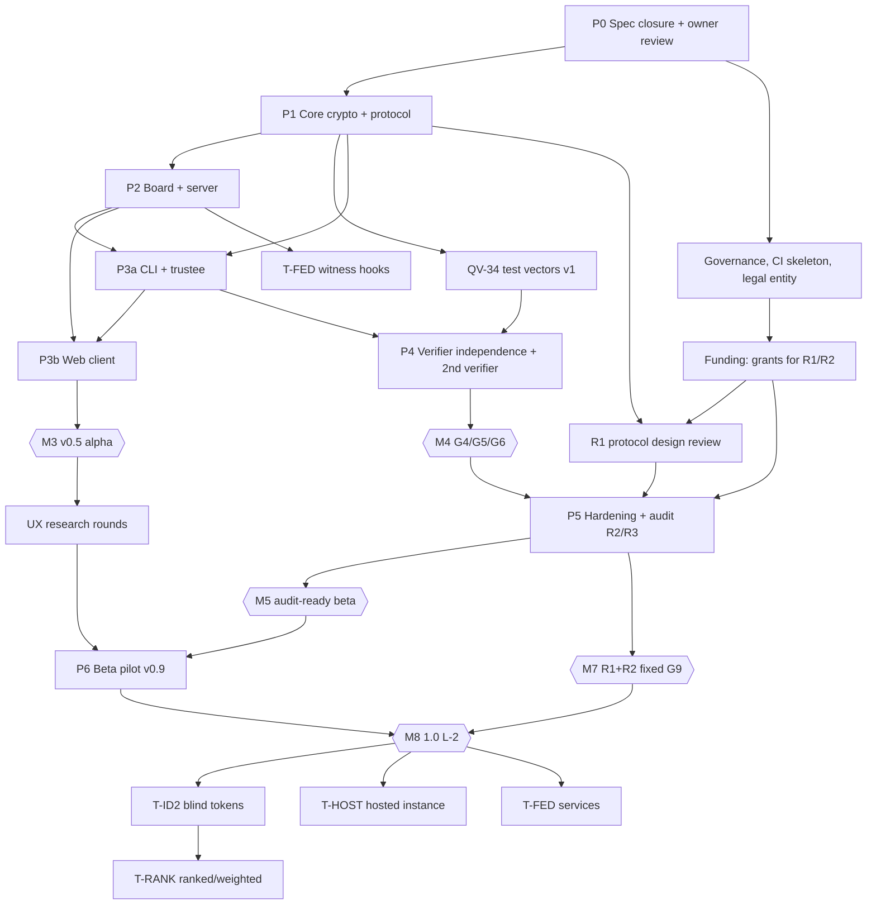

# QV-22 — Roadmap

**Status:** Draft · **Date:** 2026-10-21 · **Owner:** Program planner (project owner approves)
**Inputs:** QV-00 (success gates S1–S14), QV-02 §6/§10 (MVP, release criteria R1–R10), QV-11 §9/§11 (reviews R1–R9, gates G1–G14, assurance ladder L-0…L-3), QV-14 §7 (build first, monetise later), QV-27 §7 (release management), ADR-001…013.
**Companions:** [BACKLOG](BACKLOG.md) (QV-23) · [RISK-REGISTER](RISK-REGISTER.md) · [OPEN-DECISIONS](OPEN-DECISIONS.md) · [NEXT-STEPS](NEXT-STEPS.md)

> Planning ranges are estimates, not commitments. Unit: PW = person-week of focused work. Assumed team for the base plan: **2 full-time-equivalent engineers + 0.5 protocol/crypto lead + 0.5 UX/a11y + 0.25 ops/release + volunteers**. Calendar durations scale roughly inversely with team size, but the critical path (spec freeze → crypto review → audit) has fixed external waits. `[ASSUMPTION]` items are called out; nothing here is a funding or staffing commitment.

## 1. Where we are (2026-10-21)

| Area | State |
|---|---|
| Specs | QV-00…QV-34 mostly **Draft**/Framework; none **Approved**; ADR-001…013 provisional; no owner review recorded |
| Code | Monorepo scaffold (8 packages, strict TS, npm workspaces). `crypto`: SHA-256/hash helper + Ed25519 sign/verify + 1 smoke test. `board`: Merkle tree (RFC 9162-style), inclusion/consistency verify, checkpoint (signed-note) + witness policy, entry header/type model, byte helpers, errors — **no tests yet**. `protocol`, `server`, `web`, `cli`, `trustee`, `verifier`: empty `index.ts` stubs |
| Assurance | Below L-0: no CI, no vectors (`test-vectors/` empty), no release process |
| Assurance level target | L-0 (Experimental) at v0.5/v0.9; L-1 Beta; L-2 at 1.0; L-3 post-1.0 |

## 2. Phases

Each phase has an **exit gate** expressed in QV-11 gates (G1–G14), QV-11 §11.2 assurance level, QV-00 success gates (S1–S14) and QV-02 §10 release criteria (R1–R10).

| Phase | Name | Calendar (indicative, from 2026-11) | Effort (PW) | Goal | Assurance level at exit |
|---|---|---|---|---|---|
| **P0** | Spec closure and owner review | Nov–Dec 2026 (6–8 wk) | 14–22 | Close open decisions, freeze QV-16 wire formats (v0), approve MVP specs, set up governance, CI skeleton | — (pre-L-0) |
| **P1** | Core crypto + protocol | Dec 2026–Mar 2027 (10–14 wk) | 30–45 | `crypto`, `protocol` packages complete; QV-34 vectors v1; property tests; design review R1 submitted | L-0 *library* (G1, G3 partial) |
| **P2** | Board + server | Feb–May 2027 (10–14 wk, overlaps P1) | 28–42 | Append-only board, storage, API (QV-09), election lifecycle (QV-03), abuse controls, self-host package alpha | L-0 (G1, G2, G11) |
| **P3** | Clients: CLI, trustee, web | Apr–Aug 2027 (14–20 wk) | 45–70 | Voter/organizer web client, trustee tool, CLI voter+auditor, UX tests, a11y/i18n baseline, reproducible client build | L-0 (G1–G3, G8, G11–G14) = **v0.5 alpha** |
| **P4** | Verifier independence + second verifier | Jun–Sep 2027 (8–12 wk, overlaps P3) | 14–24 | Reference verifier + verifier page; independent second implementation (different team/language) passing all vectors; CI cross-check | **L-1 gate G4/G5 achieved** |
| **P5** | Hardening, external crypto review, audit | Aug 2027–Jan 2028 (16–24 wk incl. external waits) | 30–50 internal + R1/R2/R3/R8 external | R1 protocol review (can start earlier, see §4), fuzz/mutation, attack matrix, R2 implementation audit, R3 pentest, fixes and re-test, bounty prep | **L-1 Beta → L-2 when G9 met** |
| **P6** | Beta pilot with first target group | Oct 2027–Mar 2028 (overlaps P5 tail; 12–20 wk) | 20–35 | ≥1 real external election (v0.9), then 3–5 pilots; ops drills; UX/comprehension study | L-1 (v0.9); claims stay "experimental/beta" until G9 |
| **P7** | 1.0 | ≈ Q2–Q3 2028 | 12–20 | G1–G14 incl. G9, R4 supply-chain review, R5 a11y audit, S1/S3/S4 evidence, signed/reproducible release | **L-2** (L-3 after 1y bounty + ≥3 observed elections) |

Total to 1.0 (internal engineering + product): **~190–310 PW**, plus external reviews (QV-11 §9.2: roughly $190k–$440k; minimum credible package $130k–$280k) `[ASSUMPTION: market estimates]`. Calendar: **~18–24 months** from now with the assumed team; **~12–15 months** is possible only with ≥4 FTE engineers *and* funded audit slots booked early.

### Later tracks (after 1.0; not on critical path)

| Track | Starts | Scope | Gate to ship |
|---|---|---|---|
| **T-ID2** Phase 2 identity: blind-signed single-use tokens (RFC 9474), unlinkable ballots | Research spike during P5; build after 1.0 (≈ M24+) | QV-04 §10, ADR-005, QV-16 Phase 2 | Own R1-style design review + implementation audit; new ATK-05x rows; QV-20 REQ-040 sign-off |
| **T-ID3** Phase 3 identity: ZK Merkle membership + nullifiers | Research only (QV-21) | prototype + review | No claims until reviewed; research track |
| **T-RANK** Ranked choice / Schulze, weighted, delegation | After T-ID2 design stable | QV-20 Phase 2, pairwise-matrix homomorphic tally | Review sign-off per method |
| **T-FED** Federation/witness network, mirrors, P2P research | Witness hooks in P2; services after 1.0 | QV-32, QV-18, ADR-007 | Public witness operator(s) funded; witness protocol interop |
| **T-HOST** Maintainer-hosted instance | After 1.0 and QV-14 §7 rule | QV-12, QV-14, QV-25 | See §5 hosting preconditions |
| **T-PQ** Post-quantum / everlasting privacy research | Ongoing research | ADR-013, QV-21 | No product change without review |

## 3. Milestones and exit criteria

| MS | Name | Target | Exit criteria (all required) | Gates / ladder / success |
|---|---|---|---|---|
| **M0** | Specs approved (MVP set) | 2026-12 | Owner review recorded in decision log for ADR-001…013; QV-00, 02, 03, 04, 05, 07, 08, 09, 16, 18, 20 moved to Review→Approved or explicitly deferred; open-decision list (OPEN-DECISIONS.md) "by M0" items closed; traceability IDs stable | R5 start; QV-11 R1 RFP issued |
| **M1** | Protocol freeze v0 + vectors | 2027-03 | QV-16 wire formats frozen (v0); `crypto` + `protocol` packages feature-complete; QV-34 vector set v1 published with signed MANIFEST; L0–L3 tests green in CI; coverage floors; property tests INV-* implemented; R1 review engaged | G1, G3 (partial: reference only); L-0 library |
| **M2** | Board + server alpha | 2027-05 | Board persists/serves log, STH + inclusion/consistency; full election lifecycle on server; ballot validation; rate limits; `node:sqlite` wrapped behind `BoardStore`; end-to-end election via CLI scripts; self-host quickstart v0 | G1, G2, G11; S10 (no IPs), S12 server side |
| **M3** | v0.5 alpha — end-to-end clients | 2027-08 | Web voter/organizer flow, trustee tool (CLI first), CLI voter/auditor, Benaloh audit in web+CLI; reproducible client build by 2 builders; S8 trial run; usability round 1 (n≥10); first friendly-group dry run | G1–G3, G8, G11–G14; S5/S6 first read; **L-0 shipped (tagged v0.5)** |
| **M4** | Independent verifier + attack matrix | 2027-09 | Second verifier (different language/team) passes 100% vectors and verifies reference election bundles; §6 attack matrix 100% implemented or exempted; mutation ≥ 90% on crypto/protocol/verifier; fuzz clean | **G4, G5, G6**; S1 (≥2 verifier impls); S2 (≥10,000 randomized property elections) |
| **M5** | Audit-ready beta | 2027-10 | Feature-complete Phase 1; code freeze for audit; chaos suite CH-01…CH-31 pass; backup/restore/upgrade drills; R2 and R3 engaged; bounty policy published | **G10**; **L-1 Beta** |
| **M6** | v0.9 pilot (first external group) | 2027-11 | ≥1 external group completes a real election; 100% tally independently verified; S2, S5, S6, S8, S10, S12 met; R1–R10 of QV-02 §10 at "v0.9" column; claims review passed | QV-02 §10 v0.9 column; L-1; S5/S6/S8/S10/S12 |
| **M7** | Review complete | 2028-01…03 | R1 + R2 reports published, all High/Critical fixed and re-tested (R8); R3 pentest done | **G9**; S3; **L-2** eligible |
| **M8** | 1.0 | 2028-Q2/Q3 | All G1–G14; R4 supply-chain, R5 a11y audit, R6 UX study complete; S1, S3, S4 (≥5 external groups, ≥3 with ≥100 voters, within 6 months of v0.9), S9, S11, S13 met; signed release with 2-of-3 maintainer signatures | QV-02 §10 v1.0 column; **L-2** |
| **M9** | Hardened (post-1.0) | +12 months | One year bounty without open Critical; ≥3 real elections with independent observers; R3 annual repeat | **L-3**; S14 |

Note on the ladder: **no external statement exceeds the assurance level reached** (QV-11 §11.2, ADR-001 principle 6). Copy and UI banners switch only when the gating evidence is in the release dossier.

## 4. Dependency graph

## 5. "Build first, monetise later" track (QV-14 §7)

| Stage | Aligns with | Funding | Gate before moving on |
|---|---|---|---|
| 0 Spec & prototype | P0–P3 (now → ≈M6 months) | Volunteer + seed grant/donations; fiscal host chosen (QV-OQ-14-1) | Public specs; friendly-group dry-run (M3) |
| 1 Pilot | P6 (M6–M12 of QV-14 clock) | Grants, donations, small bounties; interview 10 pilot orgs for willingness to pay (QV-OQ-14-3) | No security claims; clearly "experimental" |
| 2 Audit | P5 (earmarked grant) | Grant for R1/R2/R3 (≈ $130k–$280k minimum package) | Audit published; findings fixed (G9) |
| 3 Supported release | P7 | Paid support contracts (C), then hosted beta (D) capped | SLA only on paid contracts; transparency report |
| 4 Phase 2 features | T-ID2/T-RANK | Grants + C/D revenue | Review sign-off per feature |
| 5 Governance maturity | post-1.0 | Mixed, single funder ≤ 40% | Succession plan live |

**Hosting preconditions (hard rule, QV-14 §7):** do not start hosted offering until (a) audit published, (b) export/exit tested by an external group, (c) legal review of operator exposure complete (QV-25), (d) on-call capacity exists (QV-12). No token, no chain (ADR-012). Revenue never changes verification or default privacy (QV-14 §3).

Monetisation-adjacent tasks in the backlog are therefore scheduled as: fiscal host and funding applications **early** (they gate audits), pricing validation interviews **during pilot**, support contracts **at 1.0**, hosted **after M8**.

## 6. Critical path

Longest dependency chain to 1.0 (M8):

1. **P0** owner review + decisions (6–8 wk) →
2. **QV-16 freeze + vectors v1** (M1, protocol lead is single point; 10–14 wk) →
3. **R1 design review** (funded + scheduled; 3–5 wk review + 4–8 wk lead time; can overlap P2) →
4. **Board/server → CLI/trustee → web** (P2→P3, 24–34 wk with some overlap) →
5. **Second verifier** passing vectors (G4) →
6. **Feature freeze → R2 implementation audit** (4–6 wk work + 6–12 wk queue) → fix → **R8 re-test** →
7. **Pilot v0.9 → S4 evidence** (≥5 groups within 6 months) →
8. **1.0 with R4/R5** (G9, G12).

Floating (non-critical but dangerous if ignored): funding for R1/R2 (**gating, must start in P0**), fiscal host/legal entity, recruiting the independent-verifier author (R7), pilot-group recruitment (long lead; start at M2), counsel engagement (QV-25: AGPL/DCO, GDPR roles, export controls), Tor profile testing, a11y expertise.

**Top schedule risks:** protocol lead single point of failure; reviewer availability (book 3–6 months ahead); funding delay; pilot recruitment. See [RISK-REGISTER](RISK-REGISTER.md).

## 7. Parallel workstreams (staffing view)

| Stream | P0 | P1 | P2 | P3 | P4 | P5 | P6 | P7 |
|---|---|---|---|---|---|---|---|---|
| Spec / protocol lead | freeze | vectors | support | support | spec fixes | review Qs | — | — |
| Crypto/protocol eng | — | build | support | trustee | verifier A | fixes | — | — |
| Board/server eng | — | board | build | — | — | hardening | ops | — |
| Client eng | — | — | API client | build | verifier page | fixes | pilot fixes | polish |
| Independent verifier author | recruit | — | — | — | build | — | — | — |
| UX/a11y/i18n | research plan | — | — | rounds 1–2 | — | — | study | R5/R6 |
| Release/ops | CI skeleton | CI/supply chain | packaging | repro builds | — | drills | pilots | signing |
| Legal/community | entity, counsel | DCO/CoC | — | — | — | bounty safe harbor | LOIs | launch |

## 8. Review cadence

- Weekly: backlog triage; risk register top-5; test/CI health.
- Per milestone: update this roadmap, gate evidence dossier (QV-11 §10), decision log, SPEC-INDEX status.
- Any change to QV-16 wire formats or new voting method re-triggers design review (QV-11 §9.1).
