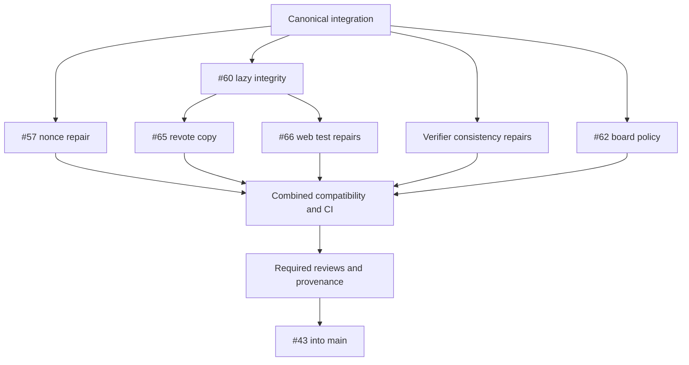

# QuietVote current branch and audit reconciliation — 2026-11-17

This record is an AI-assisted engineering recheck, not an external security audit, formal approving review, or production/election qualification. The date in this title uses the session's Pacific date; source discovery occurred on November 18 UTC. No deployment or release is authorized by this record.

## Execution outcome

This execution opened **six focused product-repair PRs (#60–65), one focused web-test repair PR (#66), and this evidence PR (#59)**. It completed independent source reviews, source-bound regression runs, the historical-finding reconciliation and a detached combined verification. PR #57 is now ready for the required formal review. The final combined web suite passes **338/338** with the unchanged size limits, and the combined production JavaScript measures **200,345 gzip bytes** against the strict **204,800-byte** cap.

**Consolidation has not reached main.** Main and canonical integration remain unchanged; no remote merge occurred. Required formal reviews are absent, #58 still lacks its original author's DCO, and expanded CI has actual Windows failures. The report distinguishes implemented candidates, passing checks, failed checks and unavailable qualification throughout. The [structured validation receipt](consolidation-current-validation-20261117.json) records source/tree mappings, commands, result excerpts, hashes and retained failed attempts.

## Exact source baseline

| Reference | Exact SHA | Current disposition |
|---|---|---|
| `main` | `019f4e789be2ff38a5fb2d348c3b225cc87cf296` | Unchanged; final integration requires reviews |
| Canonical `integration/quietvote-completion`, PR #43 | `72bccc6ac7881f0e6b7c21e1c111ee8f34b95a54` | 502 commits ahead of main; zero behind |
| Nonce hardening, PR #57 | `fd23cb3a481328a2b6315ae34cc2ee589b31aead` | Ready for formal review; source-reviewed/tested, required approvals absent |
| Historical audit handoff, PR #58 | `9a03414e0e826db292f9dd5728e4d3d2f0682784` | Useful historical evidence; author DCO missing |
| Historical recovery, PR #27 | `2aaf0a01816afb256a804c23dd45de86eca2a993` | Selective ports only; do not merge wholesale |

## All original branches and pull requests accounted for

The [machine-readable branch matrix](consolidation-current-branches-20261117.json) covers all **60 branches** found at the initial live snapshot, all **58 historical PRs**, exact SHAs, main/canonical ahead-behind counts, ancestry, patch equivalence and source-specific dispositions. There were four open PRs, eight merged PRs and 46 closed without merging. No tags were found. The [final remote snapshot](consolidation-remote-snapshot-20261117.md), with [structured refs/checks](consolidation-remote-snapshot-20261117.json), accounts for **68 branches and 66 PRs** after this execution's eight additions: 12 open, eight merged and 46 closed without merging. All original 60 branch heads are unchanged and no branch was deleted. The snapshot precedes this report's final publication and explicitly identifies its earlier #59 documentation head.

Fifty-four current branch tips are exact ancestors of canonical integration. The six noncontained tips are:

| Source | PR | Ahead / behind canonical | Disposition |
|---|---:|---:|---|
| `claude/clever-gates-uqd5p1` | 57 | 4 / 0 | Review-gated nonce repair; also contains QV-ADR-029 and a test-only HTTP fix |
| `claude/sharp-archimedes-tu76rh` | 58 | 1 / 0 | Historical audit evidence; preserve provenance and resolve DCO |
| `claude/laughing-volta-61srfa` | 27 | 9 / 264 | Five unique patches include residual recovery; selectively port current contracts |
| `chatgpt/quietvote-visual-ci-repair-20261102` | 23 | 1 / 346 | Patch-equivalent signed replacement already integrated; trees match |
| `claude/docs-screenshots` | 21 | 1 / 502 | Obsolete documentation; preserve closed PR/source |
| `docs/readme-and-wiki` | 2 | 1 / 503 | Obsolete documentation; current wiki supersedes it |

The maximum integration sequence is: review and provenance gates for #57/#58; compatible narrow #27 recovery ports; combined verification; canonical #43 review and main integration. The reviewed source inventory does not justify remerging old branches or closing the residual #27 checklist.

## Current findings, with historical evidence preserved

The [current finding matrix](consolidation-current-findings-20261117.json) accounts for **all 72 exact identifiers** in PR #58's extract: 22 crypto/verifier entries, 18 server/board/trustee entries, and 32 web entries. Each row distinguishes current source inspection, executed regressions and unresolved scope. The original historical severity and confirmation records are retained. Accounting for a finding does not mean that it was fixed or that its original experiment was repeated.

The original 56-confirmed/16-pending counts concern `424110d90e23dc443aa4498a4340973d3c8cb8b6`. They are not counts of current vulnerabilities. The supplementary [KNOWN catalogue review](consolidation-known-findings-20261117.md), with its [structured rows](consolidation-known-findings-20261117.json), now accounts for all 33 reconstructed historical rows. These overlap the 72-row extract and each other; they are not 33 additional independent vulnerabilities. At the canonical baseline, 24 narrow mechanisms are classified fixed, five partial, two reproduced using existing evidence, and two unverified construction/API-surface items. Source inspection, reused execution evidence and unperformed experiments remain explicitly distinguished. This is not a claim of 24 fresh independent security closures.

Current, concrete residuals include the already-published control-record freshness issue, the runtime rollback anchor absent from ordinary startup, catalog-only public control reasons, further verifier validation parity, paused-state display, and incomplete governance workflows. Raw replacement of an election DB remains distinct from the protected offline-restore procedure, which already checks independently supplied public/private floors.

The [nonce review](consolidation-nonce-review-20261117.md) records a synthetic comparison of canonical and #57 source. The known failed-randomness issue remains on canonical and is repaired in the reviewed #57 candidate. Verification equations and wire schemas are unchanged in that delta. No private test keys or reproduction scripts are included here.

The [web recheck](consolidation-web-recheck-20261117.md) covers each B3 finding. It identifies 27 repaired historical mechanisms and five partially repaired mechanisms, with 55 selected current tests passing. Static dependency integrity is distinguished from the separate lazy-module/worker coverage limits. Browser cases inspected in that review were not rerun there.

## Source-specific verification

On exact PR #57 head `fd23cb3`: crypto 101/101, protocol 373/373, verifier 38/38, Python 222/222, TypeScript vectors 423/423, Python vectors 285/285, and strict shared report comparison 27/27 passed. The comparison explicitly excludes board append-only, witness and receipt-sample checks. The two vector runners count different things and their totals are not matching corpus sizes. Vector expectation comparison found no removed rows or changed acceptance/result expectations and three new nonce-registry rows.

Live hosted #57 checks were read: [main CI](https://github.com/djshellshoxxx/quietvote/actions/runs/44249688596), [visual checks](https://github.com/djshellshoxxx/quietvote/actions/runs/44249688608), and [claims/docs](https://github.com/djshellshoxxx/quietvote/actions/runs/44249688587) all passed. Main CI includes Node 22/24 Linux tests and the required browser journey job; it is not a current Windows/macOS qualification.

On canonical `72bccc6`, root typecheck, dependency-boundary checks, lockfile lint and traceability structure passed. Boundary checking retains two declared D-97 deviations; traceability reports coverage links, not full conformance. Selected server/trustee regression groups passed. An initial highly concurrent local run had process/timing failures; rerunning the two affected files serially passed 17/17 without source, timeout or assertion changes. The original failed result is not represented as a pass. Two additional synthetic local experiments rechecked the previously public control-replay and raw-DB-rollback mechanisms; these were observations of defects, not passing release gates.

## Exact approval and provenance blockers

`docs/30-engineering-standards.md` section 10 and QV-30-REQ-018 require two approvals, including a security reviewer, for cryptographic/protocol/vector changes. Both #43 and #57 had zero review submissions at discovery. #43 itself changes cryptographic/protocol code, so excluding #57 does not remove this gate. The code-owner and maintainer records remain placeholders. Source review by an implementation-independent agent does not supply a designated security-reviewer approval.

PR #58's sole commit has no author-matching `Signed-off-by:` trailer. `CONTRIBUTING.md` requires the DCO and states that reviewers must check it manually. This execution does not retroactively attest on its author's behalf, rewrite source history, or reauthor that historical evidence to conceal the gap.

The branch API reported `protected: false` for main and the branch collection. Rulesets returned an empty list; the dedicated branch-protection request returned 403. These observations do not grant permission to bypass the written review rules or establish that the planned repository controls are configured.

The [independent report/provenance review](consolidation-report-review-20261117.md) matched all five original report blobs, all 72 historical records and all 60 branches' ancestry calculations. It also checked the intermediate-branch policy: section 9.2 explicitly names main's one-approval minimum, but section 1 expects second-person review of every merged change and section 13 item 5 requires CODEOWNER approvals without a branch qualifier. This execution does not treat the integration branch as an exemption or represent AI review as a formal CODEOWNER approval. No merge is justified merely by absent enforcement.

The [final report-delta review](consolidation-final-report-review-20261117.md), with its [structured receipt](consolidation-final-report-review-20261117.json), found no blocking factual correction at local `e354d605a6c8e624f2e0fc72e53d91db6c94aa53`. It verified all seven published candidate tree/parent bindings, the preserved 72-row and 33-row baselines, 37 embedded log-hash references, the two-test-only final composition delta, and the recorded CI/review limits. The original canonical validation file remains byte-identical; this execution uses the separate current-validation filename. The publication follow-up adds only this review evidence and its link.

## Core work and continuation order

1. Obtain the required formal/security review for the ready nonce candidate and the protocol/validation candidates. Preserve exact-head CI and vector evidence; agent review cannot supply those approvals.
2. Resolve the expanded Windows qualification failures without relaxing recovery or cleanup assertions. W15's current hosted browser journey and production-build jobs passed, and the combined bundle fits the unchanged cap; the complete platform matrix is not green.
3. Review and integrate the implemented verifier, board-anchor, revote-copy and web-test repairs in dependency order. Keep other unratified numeric/schema bounds explicit and retain candidate-only status until the canonical ref actually changes.
4. Implement D-99 under QV-ADR-029, which is already recorded as accepted in `66b2cbe96ea6ce823a7f646662516b29a1170751` on #57. The runtime work is still absent; do not ask to reapprove that same decision. The [core handoff](consolidation-core-handoff-20261117.md) identifies the missing authenticated membership input, separate membership/registration persistence, legacy attachment and backup-floor contracts.
5. Complete runtime rollback anchors, recorded export acknowledgement/deletion gates, and compatible control reason/freshness handling in additive migrations and coordinated verifiers.
6. Complete governed manifest/ratification binding, immutable proposals, group membership/recovery/revocation, disputes/remedies and finality.
7. Complete remaining platform, accessibility, protocol and operational qualification. Maintain the experimental prototype status throughout.

## Implemented candidates and integration dependencies

The following focused repairs have been implemented and published. Their source is not present on canonical merely because these PRs exist. Required hosted CI and formal approvals remain separate from the recorded local and independent source checks.

| PR | Exact published head | Change | Local and independent evidence |
|---|---|---|---|
| [60](https://github.com/djshellshoxxx/quietvote/pull/60) | `754c586aa65735d50514b543a62a5e3c96a4d138` | W15 lazy-module integrity gate; app-only UTF-8 build output | 338 web tests; 16 focused implementation tests and 16 independent reviewer tests; i18n/typecheck/build pass; 200,263 gzip bytes |
| [61](https://github.com/djshellshoxxx/quietvote/pull/61) | `04171611e8c8d836ede49c30f0c6f0acc9d0da05` | Python M7 status-quo restricted to yes/no contests | 225 Python tests; 282 Python vector cases; 48 existing TS manifest tests; independent 4-test regression and baseline comparison |
| [62](https://github.com/djshellshoxxx/quietvote/pull/62) | `6875cd36c65427dbc0b877b356727a396b7f9581` | Approved BC-02 standalone board witness-policy trust classification | 115 full CLI tests, including the real-clock executable election; 10 independent focused tests; typecheck pass |
| [63](https://github.com/djshellshoxxx/quietvote/pull/63) | `0042967a76ef871d01f3726d1ff9331293e9a255` | Python P11 false published decrypter list is fatal | 223 Python tests; 282 vector cases; independent 2-test regression with six mismatch subcases; normative clarification reviewed |
| [64](https://github.com/djshellshoxxx/quietvote/pull/64) | `4b88209afb5a6c8fba1df06e0af8d1c1ac21d15f` | P10 authenticated election-open/close conflicts are fatal in both verifiers | 377 protocol and 225 Python tests; independent 11 TS and 15 Python tests; full root typecheck passed after dependency refresh |
| [65](https://github.com/djshellshoxxx/quietvote/pull/65) | `0653163a3cee2b230398a572723a028c0dda6d7d` | B3-14 revote guarantees depend on election permission and the voting window | 37 focused tests; two COPY generation tests; actual DOM checks for one-ballot/revote manifests; build 200,274 gzip bytes |
| [66](https://github.com/djshellshoxxx/quietvote/pull/66) | `ae17bd0c2a33427a77b2d71673ed55787c463c6c` | Preserve file URLs in a web test and match its app build to production UTF-8 | Four focused tests, independently repeated; two test files only; production build/asset sizes identical to #60 |

The [W15 independent review](consolidation-w15-current-review-20261117.md) includes the exact reviewed trees and the browser qualification limit. Its first port fit canonical at 204,798 bytes but failed the combination with #57 at 204,817 bytes. The app-only UTF-8 follow-up leaves worker and standalone verifier bytes unchanged, preserves 10,897 decoded string literals in the comparison, and brings the combined tree `76afd6a75484d460ee2d123632f591fd71ff2b66` to **200,281 bytes**, below the unchanged strict 204,800-byte ceiling. The combined build's seven lazy tests passed. This is combination evidence, not a merge or a browser pass.

The [P11 independent review](consolidation-p11-review-20261117.md) distinguishes the runtime-tested local parent from its documentation-only follow-up. All published candidate trees were compared with the locally tested trees, and author-matching DCO trailers were read back before publishing refs. No historical author's missing sign-off was supplied on their behalf.

The [P10 independent review](consolidation-p10-review-20261117.md) confirms that authentication precedes body comparison. Identical authenticated markers remain nonfatal; conflicting authenticated bodies fail `chk.time.window` with fatal `E_MARKERS` and stop dependent ballot/tally/result processing. Invalid signatures cannot select a marker or manufacture a conflict. P11 separately makes a published decrypter-list mismatch fatal `E_DEC_PROOF` after reconstructing the valid decrypter set; its existing dependent-check gate withholds results. Neither repair changes the proof equations, wire schema or vector expectations.

The [revote-copy review](consolidation-revote-copy-review-20261117.md) exercises the actual app DOM for signed max-per-voter 1 and 8 fixtures. It preserves the manifest-selected specific note and the empty native-review maps. Mocked unlocking and transport make this DOM evidence, not browser/casting/KDF or native-translation qualification. The larger-quota `REVOTE_LIMIT` error-copy issue remains separate. The [web-test review](consolidation-web-checks-review-20261117.md) verifies that #66 preserves assertions and both strict size limits. PRs #65 and #66 target #60. Incorporate the reviewed #66 follow-up into that dependency before final combined qualification; #65 should then be retargeted to canonical after #60 merges. The old ASCII comparison is not a valid reason to raise the cap or describe #65's standalone CI as passing before it actually runs with the corrected test.

## Combined verification and retained failures

The local composition starts from exact #57 and applies the six product repairs. Its first head is `6f7d4daddc667bf0b1b4cd0dc1099c0813599968`, tree `9fe4efb1753f9ffbbe94aa8379663654aa722a15`. The [independent combined source review](consolidation-combined-review-20261117.md) matched all seven applied component deltas by patch ID and exact added/removed lines. Thirty-one non-overlapping final file blobs match their source heads, and 12 protected scopes, including crypto, vectors, schemas, scripts, workflows and dependencies, match reviewed #57. Shared P10/P11 changes retain both guards.

That first combined web run completed **337 passes and one failure**. `app-precompile.test.ts` measured an independent ASCII app build at **204,903 bytes**, while production's app graph explicitly uses UTF-8 and measures **200,345 bytes**. #66 aligns only that test graph's encoding with production, and also repairs the independently observed Windows fixture path bug. No cap, assertion, timeout, deterministic-byte comparison, catalog-parity check, worker setting or production code was relaxed.

Applying the two test-only changes produced final local head **`cf53e694483ccb45466b19f27cf8c642800b6c85`**, tree **`316c490b46a2062556360c3c0201f1a1c6ae105c`**. Its entire difference from the first composition is the two named web test files; all production source, Python tests, vectors and other tests remain identical. Receipts remain attached to the commit actually executed, rather than relabeling earlier runs as final-head executions.

An independent [public-input reconstruction](consolidation-public-composition-20261117.md) checked out published #57 and cherry-picked the seven published #60–66 commits into a new detached local worktree. All eight input SHAs matched live remote heads, no conflict or manual resolution occurred, and its final tree is exactly `316c490b46a2062556360c3c0201f1a1c6ae105c`. This makes the tested source reproducible from published inputs even though no redundant remote combined branch was created. The reconstruction itself reran no tests.

| Check | Exact executed source | Result |
|---|---|---|
| Full Python suite, `python3 -I -m unittest` from `verifier-py` | `6f7d4da` | **232/232 passed** |
| TS conformance, `npm run vectors:check` | `6f7d4da` | **423/423 passed**, no unrun files |
| Python vector sweep | `6f7d4da` | **285/285 passed**, zero unsupported cases; 79 hashes match |
| Strict shared verifier comparison | `6f7d4da` | **27/27 agree**, no report differences; three capability exclusions remain explicit |
| Production build | `6f7d4da` | Build `a5bdf07e2d70`; **200,345** total and **98,974** entry gzip bytes |
| Full root TypeScript check | `cf53e69` | **Passed** |
| Existing i18n check | `cf53e69` | **Passed**, unchanged 360/21/1/1/1 reference counts |
| Full web suite with serial test scheduling | `cf53e69` | **338/338 passed**, zero failed/skipped/cancelled |

The production result transfers to the final composition by byte-identical production/build source, not a claimed new build execution. The combined checks above are not described as a complete all-workspace, all-platform or browser run on that detached tree. The full CLI 115-test and protocol 377-test runs remain tied to their individual repair commits. Every candidate's hosted CI is a separate record; passing candidate browser checks do not automatically qualify the combination.

Earlier process terminations and an interrupted dependency install remain in the [validation receipt](consolidation-current-validation-20261117.json). The final npm typecheck launcher also encountered `ENOSPC` before the compiler because the home filesystem was full; invoking the unchanged compiler and giving child npm commands a writable task-local cache succeeded. No root cause is inferred for earlier killed processes merely from a later successful retry. The actual `337/338` size assertion failure is preserved independently of those environmental failures.

## Hosted CI and Windows qualification

The [remote snapshot](consolidation-remote-snapshot-20261117.md) binds all observations to exact PR heads and run/job IDs. At its 09:01 UTC observation, #60's full Node 22/24, Linux/macOS/Windows run [44263515558](https://github.com/djshellshoxxx/quietvote/actions/runs/44263515558) had **11 successful, three failed, two running and 11 queued jobs**. The three failed jobs were Windows server+web on Node 22 and 24, and CLI+board on Node 22. The matrix is not passing even though its run-level API status is unfinished.

At #60's exact head, production browser journeys/CSP/automated accessibility, pseudo-locale visual checks, typecheck/supply-chain gates and vectors/Python/production build **passed**. These are fresh candidate checks, rather than older canonical browser results. The smaller run canceled after requesting the full matrix is recorded as canceled, not failed. PR #66 also requests the full matrix; its 27 jobs were queued at the snapshot, which supplies no passing result.

The [Windows triage](consolidation-windows-ci-triage-20261117.md) records all 16 failures in the first Windows server/web job and exact source provenance. The one web path defect is repaired in #66. Two server tests assume graceful JavaScript cleanup after `child.kill('SIGTERM')`, which is not the Windows shutdown behavior documented by Node. One HTTP reset occurs at the exact export request changed by #57's fresh-connection repair; Windows confirmation remains needed. **Twelve recovery failures remain substantive and unresolved.**

The leading recovery hypothesis is inconsistent native/non-native path canonicalization before strict registry/file/database identity checks. The actual resolved paths and swallowed errors were not in the log, so this is not presented as a confirmed root cause. Rejection of damaged storage passed; several tests failed after the original storage was restored. Preserve the registry, regular-file, canonical-path and database-identity guards while diagnosing recovery. The later Windows CLI failure is another process-exit assertion in the real executable journey; the board suite itself passed 78/78 in that job. No skipped test or relaxed expected exit is counted as a repair.

The untouched failing source files at #60 match canonical. That establishes provenance, not harmlessness or proof that a historical Windows job failed. Main's API has no returned checks at its current SHA; the report does not infer that it was never tested. New PRs with pending jobs remain pending even when their local suites pass.

## Security residuals and feature completion

The matrices preserve original severities and distinguish source inspection from executed reproduction. Selected current boundaries requiring continued work are:

| Finding or capability | Current evidence and disposition |
|---|---|
| CP-02/C3 nonce derivation | Known failed-randomness mechanism reproduced on canonical and repaired by the reviewed #57 candidate. Canonical remains affected until approved integration. |
| B1-08 manifest validation | M7 is repaired in #61; the preserved corpus still has other documented scope/spec and validation differences. Do not copy unratified numeric limits simply to force parity. |
| P10/P11 and standalone BC-02 | Focused approved/specification-backed repairs are in #64/#63/#62 with negative controls. Their historical canonical rows remain unchanged until merge. |
| B2-05 control freshness, historical Medium | Current synthetic HTTP evidence confirms replay of an older authenticated control record. Freshness sequencing and compatible historical replay semantics remain unfinished. |
| B2-07 runtime rollback, historical Medium | Protected offline restore checks external floors; direct replacement of an older election DB still reproduces rollback/fork behavior. Runtime startup/append high-water enforcement remains absent. |
| B2-16 public reasons, historical Low | Logging allowlist/minute rounding is repaired, while new control reasons still accept bounded free text. The approved catalog-only generation/admission work remains. |
| B3-06 state/freshness, historical Medium | Existing refusal copy is repaired, but authenticated pause/freshness state is not fully integrated into the web controller. A phase label alone cannot establish freshness. |
| Worker integrity, storage fallback and asynchronous UX | W15 extends lazy chart/locale coverage, not worker integrity. Session-only storage recovery and the recorded cancellation/unwired-flow boundaries remain incomplete. |
| Vector/release evidence and construction limits | Candidate vector metadata remains unsigned; DKG last-mover/abort assumptions, complete mutation coverage, deterministic RNG export surface and secret-lifetime discipline retain their recorded limits. No new impact is asserted for unperformed experiments. |

The [core implementation handoff](consolidation-core-handoff-20261117.md) gives source-backed continuation contracts for D-99, runtime rollback anchors, export acknowledgment/deletion gates, compatible control reasons and B3-06. It explicitly distinguishes an accepted decision from missing runtime integration. D-99 requires an authenticated full pinned-list input, separate membership and registration persistence, immutable legacy attachment, canonical full-roll access, and backup-floor treatment. Existing registered-voter rows cannot stand in for missing members.

Historical recovery migrations are unsuitable for wholesale reuse. Current election migration 9 and control migration 7 must retain their old bytes/checksums; additive work must coordinate subsequent version allocation so separate recovery features do not both claim the same next migration. Recorded export acknowledgment is distinct from download completion, and deletion must obey the retention and recovery conditions in the approved contract. New control reason admission must preserve old signed record bytes and verifier readability.

Governed manifest/ratification binding, immutable proposal lifecycle, membership rotation/recovery/revocation, disputes/remedies/finality, and independent operational/protocol/accessibility qualification remain unfinished. The handoff records concrete acceptance tests and dependencies; it is not presented as implemented functionality or an arbitrary completion percentage.

## Final main status and continuation gate

Main and canonical integration remain at their initial SHAs. No merge, deployment, release, remote branch deletion or shared-history rewrite has occurred in this execution. Source branches and original audit evidence are preserved. The repaired candidates are reviewable work, not a declaration that all essential workflows are implemented.

All 12 open PRs had zero formal review submissions at the final remote snapshot. #57 is ready for that review; the other 11 remain drafts. No security-reviewer-group approval was obtained, and the documented CODEOWNER/security gates were not treated as optional because GitHub reports a merge as technically possible. #58 remains provenance-blocked, and #27 retains unique unfinished recovery work and its older verifier-report CI failure. Neither PR was closed as redundant.

The remaining merge sequence is concrete: complete exact-head qualification and required formal review of the focused candidates, integrate them into the existing canonical branch in dependency order, rerun the complete required suite on the resulting canonical head, and review #43 for main. Excluding #57 does not remove the cryptographic/protocol review requirements already present in #43. QuietVote remains an experimental prototype without independent production/election qualification. Automated browser/accessibility success does not replace manual assistive-technology, native-language or operational acceptance.
