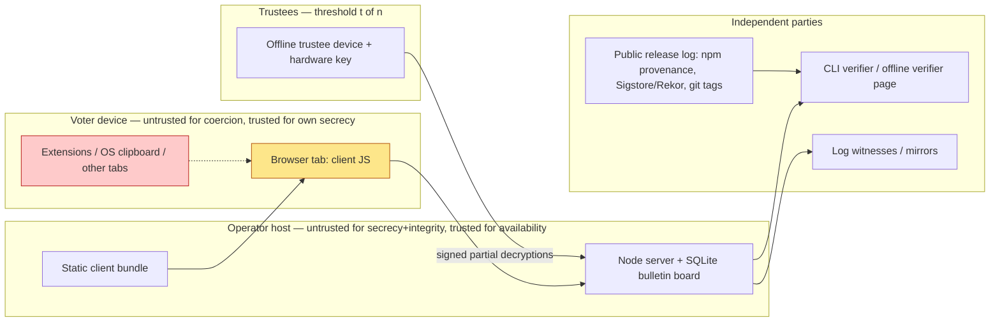
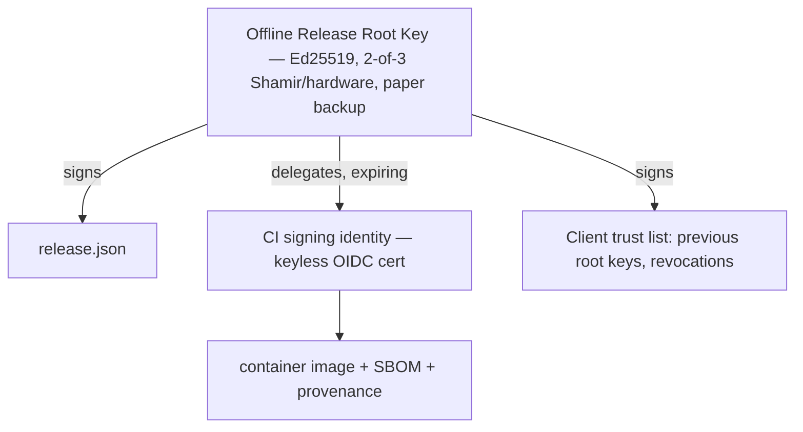

# R-02 — Application & Platform Security Research

**Module ID:** `research-application-platform-security`
**Status:** Draft
**Owner:** Security engineering (research author: Claude research agent, for project owner)
**Last reviewed:** 2026-10-21
**Related specs:** QV-07 (threat model), QV-08 (architecture/deployment), QV-09 (API), QV-11 (testing/assurance), QV-12 (operations), QV-06 (privacy/data lifecycle), QV-05/QV-16 (ballot protocol); baseline ADRs QV-ADR-001..013 (esp. 003, 008, 009, 010, 013).

**Evidence convention.** Facts marked **[V]** were checked against a primary or high-quality source during this session (2026-10-21); sources are in section 18. Facts marked **[B]** come from the author's background knowledge and were *not* re-verified this session; they are mostly stable (RFCs, long-published incidents) but must be re-checked before being quoted in a spec. **[UNVERIFIED]** means a claim that was seen only in a single secondary source or could not be confirmed. Search tooling in this session returned several noisy/secondary results; where a primary page could not be fetched (owasp.org, slsa.dev, MDN, coe.int were unreachable from the sandbox), this is stated.

---

## 0. Executive summary (what an implementer must internalise)

1. **The browser client is the trust root of voter secrecy, and the operator serves it.** ADR-010 is right that this is the weakest link. No web mitigation (SRI, CSP, service workers, Trusted Types) can stop an operator who serves the HTML itself from serving malicious JS to a *targeted* voter. The mitigations that actually change the trust model are: (a) *verifiability by independent clients* (CLI verifier, Benaloh audit with a second device, offline verifier page), (b) *transparency for the client code* (reproducible builds + signed release manifest + a public log of served bundle hashes that anyone can monitor), and (c) *optionally an installable, signed, non-operator-delivered client* (Isolated Web App / signed bundle, native/CLI voter). Everything else is defence-in-depth against third parties (XSS, MITM, extensions), not against the operator. Specs must say so.
2. **Supply chain is the most probable real-world compromise path** for a 2026 Node/npm project: 2025 saw at least two large npm campaigns (chalk/debug account takeover, 8 Sep 2025; Shai-Hulud worm, Sep and Nov 2025) [V]. The crypto dependency set is deliberately tiny (`@noble/*`); the *build and dev toolchain* (esbuild, test runners, linters) is where the exposure is. Controls: lockfile + `npm ci`, scripts disabled, release-age cooldown, vendoring/pinning of the crypto packages by hash, trusted publishing/provenance for our own releases, reproducible builds, SBOM.
3. **Runtime facts that change ADR-003 (see Proposed ADR QV-ADR-P-R02-1):** Node.js 22 entered *Maintenance LTS* on 2025-10-21 and reaches EOL 2027-04-30; Node 24 is LTS (maintenance from 2026-10-20) and Node 26 becomes LTS on 2026-10-28 [V, nodejs/Release schedule.json]. `node:sqlite` is still **Stability 1.1 (Active development / release-candidate)** in the Node 22 docs [V]. A 2026 HTTP request-smuggling advisory (CVE-2026-58044) is reported as affecting Node ≤22.23.1 [V—secondary]; latest 22.x seen was v22.23.3 [V—single tool read]. The project should pin to a *specific* patched LTS and plan the 24/26 move before v1.
4. **JavaScript cannot give hard guarantees on constant time or zeroization.** `@noble/curves` itself says so: it targets algorithmic constant time, scalar-blinds some paths, but *does not blind non-base-point multiplication by a secret scalar on cofactored Edwards curves (ed25519/ed448)* — which includes ristretto255 decryption-share computation `x·C1` — and "BigInts and hex strings cannot be zeroized" [V]. Consequence for QuietVote: **trustee secret-key operations must not run in a browser tab or on the server**; they run in an offline, single-purpose trustee tool on a dedicated device (section 7), and voter-side encryption touches only *ephemeral randomness* and public keys (secrecy impact bounded).
5. **ASVS 5.0.0 (May 2025) is the verification target**: Level 2 for the whole system, selected Level 3 items for the verifier, release pipeline, trustee tooling and crypto handling (section 10). OWASP Top 10:2025 now has **A03 Software Supply Chain Failures** and SSRF folded into A01 Broken Access Control [V—secondary summaries].
6. **No claim of VVSG/CoE/OSCE compliance.** QuietVote targets voluntary-organisation decisions (README). These instruments are used as *benchmarks* to harvest requirements (software independence, E2E-verifiability, observer access, audit trails), not as certification targets (section 12).

---

## 1. Scope, assumptions, trust boundaries

### In scope
Security controls for (i) the browser client and its delivery, (ii) the self-hosted Node server, (iii) the build/release pipeline and dependencies, (iv) trustee/admin key handling on devices, (v) logging/updates, (vi) mapping to ASVS/Top 10/CWE and benchmark standards, (vii) fuzzing/property testing.

### Out of scope
Protocol cryptography (QV-16/ADR-004), legal certification, physical election security, voter-device malware defence beyond what the protocol provides (ADR-008 non-claim).

### Trust boundaries (applies throughout)



Because ADR-001/008 make the operator untrusted for secrecy/integrity, **server hardening protects availability, voter privacy against third parties, and operator liability — not election integrity**, which must come from verifiability (QV-16/QV-07). Specs should avoid the anti-pattern of "we hardened the server, so results are trustworthy".

---

## 2. Browser-delivered cryptography

### 2.1 The problem (precisely stated)
The code that encrypts a ballot is downloaded from a party (the operator) outside the voter's trust base. A malicious or coerced operator, a compromised CDN/host, a TLS-terminating middlebox with a rogue CA, or an attacker with deploy access can serve a client that (a) leaks the plaintext vote, (b) encrypts a different vote than shown, or (c) leaks the randomness so the ciphertext can be decrypted later. Known fundamental limits: web delivery is per-request, so a *targeted* attack (serve evil JS only to voter X) is invisible unless the served code is *publicly logged* and the voter/third parties compare what they received. This is the same class of problem discussed for WhatsApp Web/Signal/ProtonMail/Helios "browser crypto" (Helios and Belenios both ship browser clients and mitigate via Benaloh/cast-or-audit and independent verifiers [B]).

### 2.2 What each mitigation does and does *not* do

| Mitigation | Defends against | Does not defend against | Verdict for QuietVote |
|---|---|---|---|
| **TLS + HSTS (preload optional)** | Network MITM, downgrade | Malicious operator, operator-side compromise | Must. ASVS V12.1.1, V12.2.1, V3.4.1 |
| **Subresource Integrity (SRI)** on `<script>`/`<link>` | A *separately hosted* asset being changed without the HTML changing (CDN compromise) | Anything where the HTML (which carries the hash) is itself served by the attacker; SRI on same-origin assets adds little | Use as defence-in-depth, with all assets same-origin (ADR-009). ASVS V3.6.1 (L3) only mandates it when assets are hosted externally [V]. The *real* value: a published hash of `index.html` + the bundle that third parties compare (below). |
| **CSP (strict, hash/nonce-based, no `unsafe-inline`/`unsafe-eval`)** | XSS-injected script, data exfil to third-party origins (`connect-src 'self'`), plugin/`<base>` abuse, framing | Operator serving different HTML+CSP; extensions (content scripts bypass page CSP) | Must. ASVS V3.4.3 (L2), V3.4.6, V3.4.7 (L3) [V] |
| **Trusted Types** (`require-trusted-types-for 'script'; trusted-types qv-default`) | DOM-XSS sinks (`innerHTML`, `eval`, `script.src`, etc.) by forcing a policy | Server-side XSS in HTML, operator malice | Should→Must for our own client (we control all sinks; trivial to adopt: no `innerHTML` at all). Baseline "newly available" Feb 2026 (Chrome 83+, Safari 26, Firefox 148 per secondary sources) [V—secondary]; ship as progressive enhancement, plus lint rule banning sinks. |
| **COOP `same-origin` (+ COEP `require-corp`, CORP)** | Cross-window references (`window.opener`), XS-Leaks, Spectre-class cross-origin reads; enables cross-origin isolation (`SharedArrayBuffer`) | Not an integrity control | Must set COOP (ASVS V3.4.8, L3 [V]); COEP/CORP only if we need isolation (e.g. WASM threads for proofs) — default off to keep simple. |
| **Service-worker pinning / "trust on first use" shell** | A *later* malicious page load: the SW serves cached, hash-checked assets, and can refuse updates that don't match a signed manifest | Malicious *first* load; a SW whose own script is replaced (browsers re-fetch SW script on navigation, ≥ every 24 h; `updateViaCache:'none'`), so pinning is only as strong as the update check inside the SW; SW registration is lost if storage cleared; SW is a second persistent XSS foothold | Should (optional "verified shell" mode). Design: SW verifies each asset against `release-manifest.json` signed by the release key (Ed25519) embedded in the *first* load and published out-of-band; on mismatch, it refuses to run and shows a hash for manual comparison. Treat as UX aid, not a security boundary. [B—design pattern; cf. WEBCAT/"Meta Code Verify" lines of work, [UNVERIFIED]] |
| **Isolated Web Apps (IWA) / Signed Web Bundles** | Operator-independent delivery: app code arrives as a `.swbn` signed with the developer's key; origin = `isolated-app://<key-derived-id>`; strict CSP, COOP/COEP forced; updates only via signed update manifest | Chromium-only, requires installation, enterprise-policy-oriented in practice, "trust of signing keys" check noted as **not yet implemented** in a Chromium design doc snapshot (crbug 40239530) [V—dated]; Integrity Block v2 shipped ~M128 [V—2024]; not available on Firefox/Safari | Could (Phase 2+). Worth a prototype as the "pinned client" of ADR-010; do not depend on it. Re-verify status (chromestatus) before committing. |
| **Browser-extension or desktop/CLI voter client** | Removes web-delivery trust entirely (code reviewed/reproducible/signed once, installed from a store or git) | Extension stores add their own trust; extension permissions are a large attack surface | Should: a CLI voter client (`qv vote`) alongside the browser client; same codebase compiled for Node. |
| **Reproducible build + published hashes + transparency of served bundle** | Operator quietly modifying the client for everyone; lets anyone rebuild from tag and compare | Targeted serving (unless clients/monitors compare what *they* received) | Must for release artifacts (ADR-010). Add **bundle transparency**: client hash is part of the election manifest and the Merkle log (ADR-007), and `/.well-known/qv-client.json` serves hash; monitors fetch from multiple vantage points (incl. Tor) and alert on divergence. |
| **Benaloh cast-or-audit + independent verifier** | Wrong-encryption / vote-substitution by a malicious client, *even if the client is arbitrarily evil on the audit path* — provided the audit is done by an *independently obtained* verifier | Client that detects audit vs. cast (it must not be able to — commitment-before-challenge ordering is what prevents it); leaking the plaintext vote on cast path (secrecy), which cannot be detected | Must (ADR-004). Only mitigation that gives *cryptographic* detection of integrity attacks by a malicious delivered client. State clearly: **secrecy of the vote against a malicious client is not protected.** |

### 2.3 Design decisions proposed
- **D1.** Same-origin only; zero third-party fonts/scripts/analytics (ADR-009, ASVS V3.4.3, V14.2.3). Static client built to a single `app.<hash>.js` + `index.html`; the HTML embeds `<script src integrity="sha384-…" crossorigin="anonymous">` and CSP `script-src 'self'` **plus hash** of any inline bootstrap (no inline otherwise).
- **D2.** Release manifest `release.json` (version, git commit, file list with SHA-256/SHA-384, SBOM digest, build-env digest) signed with the offline release key (section 6). Served at `/.well-known/qv-release.json`; the same hash is anchored in the election manifest.
- **D3.** "Verifier page" (ADR-010) = a *separate* static HTML bundle, ideally distributed in the release archive and runnable from `file://` or a different origin; it never talks to the operator except to download the public log. Its hash is published in the release manifest and by ≥2 independent parties.
- **D4.** Recommended voter flow includes "second device audit": the Benaloh audit option must show a QR/hex of the audited ballot data that can be pasted into the independent verifier. UX in QV-10.
- **D5.** Secrets in the client: the only secrets are (a) ballot encryption randomness, (b) the voter's Ed25519 signing key (Phase 1). Voter keys are derived/stored such that the user can export them; they must **not** be stored in `localStorage`; prefer non-extractable WebCrypto keys where the curve is supported, else hold in memory and offer encrypted export (see 2.5).

### 2.4 WebCrypto vs. noble in JavaScript

| Aspect | WebCrypto (`crypto.subtle`) | `@noble/curves`, `@noble/hashes` |
|---|---|---|
| Implementation | Native browser code (BoringSSL/NSS/CoreCrypto) | Pure JS (BigInt, typed arrays) |
| Constant-time | Generally better (native), not guaranteed per spec | "Algorithmic" constant time only; JIT/GC make true CT infeasible; dudect-style tests found no distinguishable timing for base-point mult. and random-point mult. on Weierstrass curves, but **not** blinded for secret-scalar mult. on cofactored Edwards curves [V] |
| Non-extractable keys | Yes (`extractable:false`) — key material not readable by JS, mitigates XSS key theft | No — secrets live in JS memory |
| Curve support | Ed25519/X25519 now in all engines (Chrome 137 May 2025; Firefox 129/130; Safari 17+/X25519 later; sources disagree on exact versions) [V—secondary]. **No ristretto255, no CDS/Chaum–Pedersen primitives, no point arithmetic** | ristretto255 (RFC 9496), hash-to-curve (RFC 9380), OPRF, FROST suites [V]. |
| Audits | Browser-vendor review | Cure53 (Sep 2024, v1.6.0), Trail of Bits (Feb 2023 v0.7.3; and Aug 2026 v2.3.0 per project README), Kudelski (2023) [V — project README via fetch tool] |
| Side effects | Async-only; promise-based | Sync API; deterministic; testable with vectors |

**Decision (consistent with ADR-003/004):** use noble for all group arithmetic and proofs (WebCrypto cannot do it); use WebCrypto for (a) CSPRNG (`crypto.getRandomValues`) — *the only* randomness source, (b) SHA-2/HKDF/AES-GCM where needed and (c) optionally Ed25519 voter signatures with non-extractable keys when available (feature-detect; fall back to noble). Never `Math.random`. Wrap randomness in a single module so tests can inject deterministic RNGs only in test builds (build-time flag, asserted absent in release by test).

**Noble v2 notes [V]:** v2 is ESM-only and requires Node ≥ 20.19; ristretto255 exported from `@noble/curves/ed25519.js`; releases are via tokenless GitHub CI with Trusted Publishing and npm provenance; one runtime dependency (`@noble/hashes`); commits PGP-signed. QuietVote should pin exact versions (no caret), verify provenance at install (`npm audit signatures`), and vendor-by-hash (section 5).

### 2.5 Constant-time, memory and zeroization limits in JS
- **Constant time:** JS engines may specialise/optimise on values; BigInt ops are variable-time by implementation; the library mitigates with fixed operation sequences, data-oblivious table scans and scalar blinding `s + r·n` (random 128-bit r) on cofactor-1 curves and base-point mult. [V]. Residual: Edwards secret-scalar × arbitrary point (e.g. trustee `x·C1`, Schnorr/ElGamal decryption share, voter signature on Ed25519 uses base-point so fine).
  - *Application-level mitigation:* trustee tooling shall compute shares offline on a dedicated, non-shared machine (so no co-resident timing adversary); optionally apply caller-side blinding `x' = x + r·ℓ` (ℓ = group order; valid on prime-order ristretto elements) with fresh random r per operation, *only if* unit tests confirm the library does not reduce the scalar mod ℓ first [UNVERIFIED — must be tested; do not invent crypto: this is standard scalar blinding, cf. Coron CHES'99 [B]].
  - Comparisons of secrets/MACs: use `crypto.timingSafeEqual` on server (Node) and noble's `equalBytes`/constant-time helpers in client. ASVS V11.2.4 (L3) [V].
- **Zeroization:** only `Uint8Array.fill(0)` is possible and not guaranteed (GC may have copied; JIT; swap) ; BigInt and strings are immutable and cannot be wiped [V]. Therefore: (1) keep secrets as `Uint8Array` as long as possible, convert to BigInt only inside the primitive, (2) don't put secrets in strings/JSON/DOM/URL/console, (3) zero buffers on completion as best-effort and document that this is *hygiene, not a guarantee*, (4) for long-lived secrets, rely on process isolation and short lifetime rather than wiping (trustee tool runs, decrypts, exits; machine is powered off/wiped per ceremony), (5) disable core dumps/swap on trustee/server (`LimitCORE=0`, encrypted or no swap), (6) ASVS V11.7.2 (L3) "minimise data exposed during processing" [V].
- **WASM:** gives no better CT or zeroization guarantee in practice; not recommended for MVP (noble authors recommend low-level languages for absolute security [V]). A Rust/`ristretto`-based CLI trustee tool is a *Could* hardening step (R-02-Q4).

### 2.6 Extensions, clipboard, and the voter device
- **Extensions with host permissions can read/modify page DOM and keystrokes, bypassing page CSP** (content scripts run in an isolated world but see the DOM). Mitigation is impossible from the page; document as ADR-008 non-claim (compromised voter device). Recommend: private/guest browser profile guidance, and the second-device audit.
- **Clipboard:** treat as hostile. Never auto-copy secrets; if the user copies a recovery key/receipt, use explicit user gesture + `navigator.clipboard.writeText`; warn that clipboard managers/cloud sync can capture it; prefer file download or QR display; *clipboard hijackers* (the chalk/debug payload rewrote crypto addresses via hooked network/wallet APIs [V]) motivate showing receipt/verification codes in a form the user compares on a second device. Don't read clipboard (`readText`) except on explicit paste into verifier.
- **Autofill/password managers and `autocomplete`:** mark secret inputs `autocomplete="off"`, `spellcheck=false`; do not log them; do not use `<input type=text>` for secrets visible to screen sharing.
- **Browser storage:** ASVS V14.3.3 forbids sensitive data in browser storage except session tokens (L2) [V]. For voter keys use an explicit encrypted-export model (age/scrypt passphrase) and keep in memory; if persistence required, IndexedDB with non-extractable CryptoKey when supported.
- **Back/forward cache and caching:** `Cache-Control: no-store` for any page containing receipts/ballot data (ASVS V14.3.2 [V]).
- **Side channels in UI:** no analytics, no error telemetry with ballot content; CSP report endpoint must never receive full URLs with fragments containing secrets (strip query/fragment).

---

## 3. XSS, CSRF, clickjacking and related web-app attacks

| Threat | Controls (QuietVote-specific) | ASVS 5.0 [V] |
|---|---|---|
| **Stored/reflected/DOM XSS** (e.g. malicious proposal titles, voter names, markdown descriptions) | Treat *all* election content as plain text; render only via `textContent`; if Markdown is needed, restricted subset parsed to a typed AST and rendered by createElement (no HTML pass-through); Trusted Types enforcing; CSP strict; server sets `Content-Type` correctly + `nosniff`. Unicode: normalise/limit bidi controls (Trojan Source-style spoofing of option labels) and zero-width chars in names/options. | V1.2.1–1.2.3, V3.2.1–3.2.2 (L1), V3.4.3–3.4.4, V3.2.3 DOM clobbering (L3) |
| **CSRF** | API is token-based (signed ballots, Ed25519 over canonical bytes; no ambient cookie authority for ballot cast), so CSRF applies mainly to admin/organiser sessions. Admin: `__Host-` cookie, `SameSite=Strict`, `HttpOnly`, `Secure`; double-submit or per-session CSRF token; verify `Origin`/`Sec-Fetch-Site`; state-changing methods only POST/PUT/DELETE; JSON-only content-type with strict parsing. | V3.3.1–3.3.4, V3.5.1–3.5.3 (L1), V7 (sessions) |
| **Clickjacking / UI redress** | `Content-Security-Policy: frame-ancestors 'none'` on every response (X-Frame-Options obsolete per ASVS); the vote-confirm UI also requires a deliberate typed/two-step action (QV-10). | V3.4.6 (L2) |
| **Open redirect / URL-based XSS** | No redirect parameters; absolute allowlist; `Referrer-Policy: no-referrer`. | V3.4.5, V15.3.2 |
| **CORS misconfiguration** | Default: no CORS (same-origin client). If public read API for verifiers must be cross-origin, `Access-Control-Allow-Origin: *` only for *public, unauthenticated* log endpoints, never with credentials. | V3.4.2 |
| **Prototype pollution / mass assignment / type confusion** (Node JSON bodies) | Parse with schema validator that rejects unknown keys; `Object.create(null)`/`Map` for dictionaries; `__proto__`/`constructor` keys rejected; strict equality. | V15.3.3, V15.3.5, V15.3.6 |
| **Injection into logs, CSV/exports** | Encode log fields; CSV export prefixes `=,+,-,@` cells (tally/participation exports to spreadsheets). | V16.4.1, V1.2.10 (L3) |
| **postMessage / window.opener** | Client does not use `postMessage`; if embedding verifier, validate `event.origin`. COOP same-origin. | V3.5.5, V3.4.8 |
| **Cache poisoning / web cache deception** | `Cache-Control: no-store` for dynamic/authenticated; immutable long-cache only on hashed static assets; `Vary` correct. | V14.2.5, V14.3.2 |
| **Subdomain takeover / cookie scope** | Host admin UI and public client on separate origins if cookies are used; `__Host-` prefix. | V3.5.4, V3.3.3 |

Reference header set (served by the Node server, not by an unverified reverse proxy; the proxy must not strip):

```
Strict-Transport-Security: max-age=63072000; includeSubDomains   (add preload only after owner decision)
Content-Security-Policy: default-src 'none'; script-src 'self' 'sha384-<bootstrap>'; style-src 'self';
  connect-src 'self'; img-src 'self' data:; font-src 'self'; base-uri 'none'; object-src 'none';
  form-action 'self'; frame-ancestors 'none'; require-trusted-types-for 'script';
  trusted-types qv-ui; report-uri /csp-report   (report-to optionally)
Cross-Origin-Opener-Policy: same-origin
Cross-Origin-Resource-Policy: same-origin
X-Content-Type-Options: nosniff
Referrer-Policy: no-referrer
Permissions-Policy: camera=(), microphone=(), geolocation=(), payment=(), usb=(), clipboard-read=()
Cache-Control: no-store            (dynamic); static hashed assets: public, max-age=31536000, immutable
```
Note: `style-src 'self'` forbids inline `style=` attributes; the client must use classes/CSSOM. Tor onion deployment: HSTS is moot (onion is not TLS) — rely on onion service auth; drop `Strict-Transport-Security` and TLS-only CSP expectations there.

---

## 4. Server hardening — self-hosted Node service with `node:sqlite`

### 4.1 Runtime and platform
- **Pin Node to a patched LTS** and track security releases: Node 22 = Maintenance LTS (since 2025-10-21), EOL 2027-04-30; Node 24 = LTS, maintenance from 2026-10-20, EOL 2028-04-30; Node 26 LTS from 2026-10-28, EOL 2029-04-30 [V—schedule.json]. A July 2026 security release addressed an HTTP desync/request-smuggling issue (CVE-2026-58044) reportedly affecting ≤22.23.1/≤24.18.0/≤26.5.0 [V—secondary aggregator]; earlier undici duplicate Content-Length fix (CVE-2026-1525) [V—secondary]. → **QV-ADR-P-R02-1**: use Node 24 LTS (or 26 once LTS) for new builds; keep 22 only if pinned to ≥ 22.23.2/latest with a documented upgrade date. CI matrix tests all supported majors.
- **Do not expose Node directly.** Terminate TLS in Node *or* in a minimal reverse proxy (Caddy/nginx) with request smuggling-safe configuration (ASVS V4.2.1 L2 [V]); if proxy used, only trusted `X-Forwarded-*` from the proxy (V4.1.3, V15.3.4).
- **Node permission model (`--permission`, `--allow-fs-read`, `--allow-fs-write`, no `--allow-child-process`, no `--allow-addons`, no `--allow-worker`)** can sandbox the process inside the OS sandbox; Node docs caveat it is not a security boundary against malicious code and has gaps (e.g. pre-opened file descriptors) [V—nightly docs]; its stability status is Stability 2 and stable since v22.13.0 [VERIFIED: nodejs.org permissions docs (Stability 2), 2026-10-21]. Use as defence-in-depth against dependency compromise *in addition to* systemd/container confinement.

### 4.2 `node:sqlite` specifics
Stability 1.1 (Active development) in Node 22; no longer behind a flag since v22.13.0; added v22.5.0 [V]. Controls:
1. **Parameterised statements only** (`db.prepare("… ?")`); `exec()` only for static DDL/migrations; lint rule banning template-string SQL (ASVS V1.2.4 L1 [V]).
2. **`allowExtension: false` (default)** — never enable `loadExtension` [V]. `enableDoubleQuotedStringLiterals: false`; `enableForeignKeyConstraints: true` [V].
3. **PRAGMAs at open:** `journal_mode=WAL`, `synchronous=FULL` (ballot durability: a ballot acknowledged must survive power loss), `foreign_keys=ON`, `trusted_schema=OFF`, `busy_timeout`, `secure_delete=ON` (for any table holding transient secrets), `cell_size_check=ON`; `PRAGMA integrity_check` + `foreign_key_check` on boot and by a scheduled job.
4. **Append-only discipline:** bulletin-board tables enforced by triggers (`BEFORE UPDATE/DELETE → RAISE(ABORT)`), Merkle-log row hash chain; the DB user cannot be a different principal in SQLite, so the real guarantee comes from the *client-verifiable log* not from the DB (ADR-007). The DB file perms 0600, owner = service user, on its own dir.
5. **Bugs to watch:** secondary sources report a NUL-truncation issue in the `node:sqlite` TEXT decoder in several 2026 releases, and a stale-iterator statement-reuse CVE (CVE-2026-58041) affecting 22.x/24.x/26.x [UNVERIFIED—secondary]. Mitigations: reject NUL bytes in all text inputs at the validation layer; store protocol blobs as `BLOB` (binary, canonical), not TEXT; do not reuse statement iterators across resets; track Node security releases. Fuzz DB layer with embedded NULs and invalid UTF-8.
6. **Single-writer model:** one process owns the file; use `BEGIN IMMEDIATE` transactions; backups via `VACUUM INTO` or SQLite online backup, encrypted (age) before leaving the host.
7. **Consideration:** if `node:sqlite` stability (1.1) is unacceptable for v1, the fallback is `better-sqlite3` (native addon, larger supply-chain surface) — **rejected by ADR-003's minimal-dependency criterion** unless owner decides otherwise. Record as Open Question R-02-Q1.

### 4.3 Rate limiting, request limits, DoS, ballot flooding
Because Phase 1 has *signed ballots from a committed voter roll*, flooding is bounded by roll size × revote policy; Phase 2/3 (blind tokens / nullifiers) shift the bound to token issuance and proof verification cost.

| Control | Parameter (default; configurable) | Rationale / ASVS |
|---|---|---|
| Max request body | 64 KiB for ballot-cast, 1 MiB for manifest upload; reject others with 413 *before* parsing; enforce via `content-length` check **and** streaming counter (chunked bodies) | V15.2.2, V2.4.1, V13.1.2 |
| Header limits | `maxHeaderSize` default 16 KiB; `headersTimeout`, `requestTimeout=10 s`, `keepAliveTimeout=5 s`, `maxRequestsPerSocket` set; `server.maxConnections` | Slowloris; V13.2.6 |
| Pre-verification cost cap | Verify cheap checks first: size → schema → election open? → voter-key in roll (Merkle path or hash set) → *then* signature → *then* ZK proofs (expensive CDS verification). Worker-thread pool for proof verification with bounded queue (reject with 503 + `Retry-After` when full). | Algorithmic-complexity DoS (CWE-400/770) |
| Rate limiting | Token bucket per (IP-or-onion-circuit-bucket, election, endpoint): e.g. 10 req/s burst 30 for reads; 6 casts/min per voter key; global concurrency cap for proof verification. Because logs keep no IPs (ADR-009), keep counters in memory with salted-hash IP prefix (rotating key, ≤ 1 h) | V2.4.1 (L2) |
| Proof-of-work / stamps | Optional hashcash-style puzzle on *unauthenticated* mass endpoints (token issuance) when under attack, as in Tor onion-service PoW defence [B]; no CAPTCHA (privacy/accessibility, ADR-001) | V2.4.2 (L3) |
| Storage quota | Per-election max ballots = roll size × (revote cap R, default 5); per-voter record cap; DB size alarm | Ballot flooding |
| Revote cap | Latest valid ballot counts (ADR-005) but server rejects > R submissions per voter; each stored ballot is in the log → cap bounds log growth | |
| Idle/slow connections | Close after 10 s of no progress on request body; HTTP/2 rapid-reset (CVE-2023-44487) mitigations come from patched Node; limit `maxSessionMemory`/`maxConcurrentStreams` | V4.2.x |
| Backpressure | `server.close` graceful, readiness endpoint separate from public API | |

### 4.4 Input validation, SSRF, path traversal, deserialization
- **Canonical parsing:** all protocol messages are canonical binary/JSON per QV-09/QV-16 with strict schema (length-prefixed fields, fixed sizes for group elements = 32 bytes ristretto255, reject non-canonical encodings via noble `fromBytes`/`fromHex` validation). Reject duplicate JSON keys (Node's `JSON.parse` takes the last — differential parsing risk between server, verifier and client: use a strict parser/canonicaliser such as RFC 8785 JCS if JSON is signed [B]). Signatures cover **bytes**, never re-serialised objects.
- **Deserialization:** JSON only; no `eval`, `vm`, `new Function`, `node:v8.deserialize`/`structuredClone` from network, YAML with custom tags, or `require()` of user-controlled paths (ASVS V1.5.2 L2 [V]).
- **SSRF:** the server shall make **no outbound requests derived from user input** (no webhooks/URL fetches/avatars/link previews). Optional outbound features (OpenTimestamps/witness cosigning, email notifications) use a fixed allowlist of hosts with DNS-pin + block private/link-local/loopback/metadata ranges (169.254.169.254), `redirect: 'error'`, timeouts, size caps (ASVS V1.3.6 L2, V13.2.4–13.2.5, V15.3.2). OWASP folded SSRF into A01 in the 2025 Top 10 [V—secondary]. Egress is default-deny at firewall/systemd level (`IPAddressDeny=any` + allowlist).
- **Path traversal:** no user-controlled filesystem paths at all; static files served from an in-memory map built at startup from the signed release manifest (so there is no `fs` access with request-derived strings); export files named by server-generated IDs (CWE-22; ASVS V5.3.2 L1, V5.3.3 L3 [V]). Reject `%2e`, `\`, NUL, absolute paths if any path-ish string exists.
- **Archive/exports:** if import of a zip/tar election bundle is offered, enforce uncompressed size/file count caps and no path components (zip slip) (ASVS V5.2.3 [V], V5.3.3).
- **HTTP method/verb and smuggling hygiene:** only needed methods, reject `Transfer-Encoding` + `Content-Length` together, no HTTP/1.0 pipelining quirks, ASVS V4.1.4, V4.2.x.
- **Error handling:** generic error bodies with stable machine codes (QV-09), no stack traces (V16.5.1), global `unhandledRejection`/`uncaughtException` handlers that log and exit non-zero to let systemd restart in a clean state (V16.5.4 L3 suggests last-resort handler that keeps the process available—reconcile: fail *closed* on integrity errors; see Open Question R-02-Q5).

### 4.5 TLS configuration
- **TLS 1.3 preferred, 1.2 allowed** (ASVS V12.1.1 L1; V12.1.2 L2/L3 cipher suites with forward secrecy) [V]. Disable TLS ≤1.1, compression, renegotiation; ECDHE only; Mozilla "intermediate" profile as baseline [B]; OCSP stapling (V12.1.4, L3), ECH when stack supports (V12.1.5 L3, [V]).
- Publicly trusted certs (V12.2.2): ACME (Let's Encrypt) with CAA record; short-lived certs; private key 0600, in `LoadCredential=`/tmpfs, never in the repo or image.
- Certificate transparency monitoring of the operator domain (operators and participants can watch for rogue issuance) — directly relevant to the browser-delivery MITM case.
- HSTS ≥ 1 year (V3.4.1 L1) once stable; consider preload only with owner approval since it is hard to undo.
- Node as TLS terminator: `minVersion:'TLSv1.2'`, `ciphers` default for TLS1.3, `honorCipherOrder`, `ALPNProtocols`, session tickets rotated or disabled (forward secrecy), `secureOptions` NO_RENEGOTIATION.
- Tor onion service (v3, optionally with client authorization for private elections): first-class target (ADR-009); the same Node app listens on a UNIX socket/loopback.

### 4.6 systemd sandboxing (reference unit)
```ini
[Service]
User=qv
DynamicUser=no
ExecStart=/usr/bin/node --permission --allow-fs-read=/opt/quietvote --allow-fs-write=/var/lib/quietvote /opt/quietvote/server.js
NoNewPrivileges=yes
CapabilityBoundingSet=            # none; bind to 443 via socket activation or reverse proxy
AmbientCapabilities=
ProtectSystem=strict
ReadWritePaths=/var/lib/quietvote
ProtectHome=yes
PrivateTmp=yes
PrivateDevices=yes
PrivateUsers=yes
ProtectKernelTunables=yes
ProtectKernelModules=yes
ProtectKernelLogs=yes
ProtectControlGroups=yes
ProtectClock=yes
ProtectHostname=yes
ProtectProc=invisible
ProcSubset=pid
RestrictNamespaces=yes
RestrictRealtime=yes
RestrictSUIDSGID=yes
LockPersonality=yes
MemoryDenyWriteExecute=no        # V8 JIT requires W+X; document this exception
SystemCallArchitectures=native
SystemCallFilter=@system-service
SystemCallFilter=~@privileged @resources @mount @debug @cpu-emulation @obsolete
RestrictAddressFamilies=AF_INET AF_INET6 AF_UNIX
IPAddressDeny=any
IPAddressAllow=localhost
LimitCORE=0
LimitNOFILE=4096
MemoryMax=1G
TasksMax=256
UMask=0077
Restart=on-failure
```
Validate with `systemd-analyze security quietvote.service` (target exposure score ≤ 2.0 "OK"; record score in release notes) [B]. `MemoryDenyWriteExecute` must stay off for V8 [B—known].

### 4.7 Container hardening (if used)
- Base: distroless or minimal Debian/Alpine **pinned by digest**; multi-stage build; production stage has only `node` + built artefacts (no npm, no shell if feasible).
- Run as non-root numeric UID, `--read-only` rootfs, `tmpfs` for /tmp, `--cap-drop=ALL`, `--security-opt=no-new-privileges`, default seccomp profile (or custom), AppArmor/SELinux, `--pids-limit`, memory/CPU limits, no `--privileged`, no docker socket, user namespace remap/rootless Podman preferred.
- Image is built reproducibly in CI, signed with cosign (section 6), SBOM attached as attestation; deployment verifies signature + digest, not a tag.
- Secrets via files/`--secret`/credentials, not env vars or image layers (ASVS V13.3.1 [V]).
- Healthcheck separate from public API; network policy default-deny egress.

### 4.8 Misc server controls
- No default credentials, no debug endpoints, no directory listing, no `.git` in artefact, TRACE disabled (V13.4.x [V]); no Server/X-Powered-By headers (V13.4.6 L3).
- Time: NTP/chrony (UTC) — election open/close times are enforced by server clock; log time-skew; manifest includes explicit times and the log timestamp is witnessed (ADR-007).
- Admin/organiser authentication: WebAuthn/passkeys or Ed25519 key signatures preferred (ASVS V6; no passwords by default per ADR-001); sessions via `__Host-` cookie (V7); re-auth for destructive actions.
- Backups: encrypted with `age` to ≥2 recipients; restore drills (QV-12).

---

## 5. Software supply chain

### 5.1 Threat catalogue (with verified history)

| Incident | What happened | Lesson for QuietVote |
|---|---|---|
| **event-stream / flatmap-stream (Nov 2018)** [B] | Maintainer handed repo to a stranger; malicious dependency `flatmap-stream` added; payload targeted Copay Bitcoin wallets | Maintainer transfer = trust transfer; crypto/wallet-adjacent apps are targeted; review *transitive* diffs. |
| **ua-parser-js (Oct 2021)** [B] | Maintainer's npm account hijacked; malicious versions (miner + credential stealer) published | Account takeover of popular package; pin + cooldown. |
| **xz/liblzma backdoor CVE-2024-3094 (disclosed 29 Mar 2024, CVSS 10.0)** [V] | Multi-year social-engineering by "Jia Tan" (contributor from 2021, maintainer 2022); backdoor in release tarballs (not in git) targeting sshd via systemd; found by Andres Freund | Release tarball ≠ git source; *build-time* injection; reproducible builds and reviewing artefacts vs. source matters; single burnt-out maintainers. |
| **chalk/debug + 16 other packages (8 Sep 2025)** [V] | Phishing (2FA bypassed) of maintainer "Qix"; 18 packages, >2 B weekly downloads; browser payload hooking network/wallet APIs to rewrite crypto recipients; live ≈2 h | Directly relevant: **the payload ran in the browser** and swapped transaction recipients—exactly the class of attack on a ballot client. Our client bundle must have a near-empty dependency tree and a cooldown on updates. |
| **Shai-Hulud (mid/late Sep 2025)** [V] | Self-replicating npm worm: stole tokens/cloud secrets, republished victim's other packages; wave 1 ≈ Sept 15–23 (e.g. @ctrl/tinycolor and many others) | Developer/CI credentials are the target; `postinstall` is the execution vector. |
| **Shai-Hulud 2.0 "Second Coming" (21–24 Nov 2025)** [V] | 600–800+ packages, >25,000 GitHub repos; `preinstall` script; credential exfiltration (GitHub, AWS, GCP, Azure); destructive fallback reported | Disable lifecycle scripts; don't install on machines that hold secrets; secrets absent from CI install step. |

Event counts differ by source (Invicti 600–800 pkgs; Seceon 700+, >100 M downloads; Check Point: ~775 GitHub tokens, 373 AWS creds in a ~20 k repo sample) — quote as ranges.

### 5.2 npm ecosystem state (verified)
- GitHub revoked **all npm classic tokens (Dec 2025)**; `npm login` yields 2-hour session tokens; granular tokens limited to 90 days and 2FA by default; **trusted publishing via OIDC** (GitHub Actions, GitLab CI) replaces long-lived tokens and emits provenance automatically; TOTP for new 2FA setups being disabled → WebAuthn/passkeys [V]. Later restrictions on bypass-2FA tokens (dates 2026-07-31 / Jan 2027) appear in a *single* secondary source [UNVERIFIED].
- pnpm 11 reportedly makes `minimumReleaseAge` default 1440 min (1 day); Yarn 4.10 and npm v11.10 have equivalent settings per one secondary article [V—secondary; verify against each tool's docs]. Cooldowns defeat attacks removed within hours (chalk/debug ≈ 2 h) but not long-dwell compromises.
- Lifecycle scripts are *not* disabled by default in npm; pnpm 10's "scripts disabled" default could not be confirmed [UNVERIFIED]. Do not rely on defaults: set explicitly.

### 5.3 Controls
**Dependency policy**
1. **Zero-dependency preference**: runtime deps = `@noble/curves`, `@noble/hashes` (+ transitive `@noble/hashes` only); dev deps: esbuild, TypeScript, (optionally) a linter. Release criterion: `npm ls --all --omit=dev` count ≤ N (set N = 5 at v1). Any new runtime dep requires an ADR-lite (what/why/alternative/maintainer-bus-factor/audit).
2. **Exact pins + lockfile** (`save-exact=true`; `package-lock.json` committed; `npm ci` only; CI fails if lockfile drifts); lockfile integrity hashes (sha512) are the basis for reproducibility. Lockfile changes require code-owner review and an automated diff of added/removed packages, `resolved` hosts (must all be registry.npmjs.org — catches dependency confusion / git-URL substitution; ASVS V15.2.4 L3 [V]).
3. **Scripts off**: `ignore-scripts=true` in `.npmrc`; explicit allowlist (e.g. esbuild's binary download/validation) via audited exceptions; run installs in a throwaway, secret-free, network-restricted container.
4. **Cooldown**: adopt `min-release-age`/`minimumReleaseAge` ≥ 7 days for third-party updates (security patches bypass via explicit reviewed override); automated PRs (Renovate/Dependabot) grouped and gated by humans.
5. **Provenance verification**: `npm audit signatures` in CI (verifies registry signatures and provenance attestations where present); require provenance for noble packages (they publish with Trusted Publishing and provenance [V]); alert when a package *loses* provenance between versions.
6. **Vendoring for the crypto core**: `vendor/noble/` containing the exact published tarball contents (or a `git subtree` of the signed tag), with a `VENDOR.lock` listing upstream version, tarball sha512, git tag commit, PGP-signature check result, and diff-against-npm check; CI verifies hash. This removes npm at build time from the crypto path and makes review (and replacement) tractable. Updates are deliberate PRs reviewed against upstream diff. (Trade-off: lose automatic advisory matching → add the vendored packages to SBOM and a manual advisory watch.)
7. **Audit reports ("noble")**: keep `docs/audits/noble/` index linking the audit reports with scope and **which version was audited vs. which we ship** [V per README via fetch]:
   - Trail of Bits — `@noble/curves` v2.3.0, Aug 2026, scope "everything" (OpenAI "Patch the Planet"). 
   - Cure53 — v1.6.0, Sep 2024 (ed25519, ed448, bls12-381, bn254, hash-to-curve, low-level); earlier Cure53 reports on noble-hashes (Jan 2022, 0 vulns) and secp256k1 (2021).
   - Kudelski — v1.2.0, Sep 2023 (scure-starknet etc.). Trail of Bits — v0.7.3, Feb 2023.
   - Self-run AI-assisted audits since Apr 2026 (not independent).
   Since noble v2 postdates several audits, **pin to a version covered (or diff-reviewed against) the latest audit**, and put ristretto255 specifically on the independent-review scope list for QV-11 — the README notes the non-blinded Edwards limitation applies to ristretto points multiplied by long-lived secrets [V]. Note: the ToB Aug-2026 audit claim comes from a single fetch of the project README; confirm against the report PDF [UNVERIFIED until confirmed]. A search-result claim of "ToB audit of noble-curves" via a blog was secondhand; use the README/audit PDFs only.
8. **SBOM**: generate CycloneDX 1.6 (or SPDX 2.3/3.0) from the lockfile at build (e.g. `@cyclonedx/cyclonedx-npm`) and attach as a signed attestation to each release; ASVS V15.1.2 (L2) requires an SBOM [V]. VEX statements for known-non-exploitable advisories.
9. **Vulnerability management**: documented remediation timeframes (V15.1.1 L1/V15.2.1 L1 [V]): critical ≤ 7 days, high ≤ 30 days; `npm audit` + OSV-Scanner in CI (fail on high with known fix); OpenSSF Scorecard on our repo.
10. **CI hardening** (GitHub Actions as reference): pin third-party actions by full commit SHA; `permissions: contents: read` default; separate *build* job (no secrets) from *publish* job (OIDC only); no `pull_request_target` with checkout of PR code; protected tags/branches, signed commits/tags (SSH or gitsign), required reviews (2 maintainers for crypto paths, CODEOWNERS), Environment protection for the release job requiring manual approval; hardened runner egress (StepSecurity Harden-Runner or equivalent) [B]; short-lived tokens only; secret scanning + push protection.
11. **Maintainer hygiene**: hardware-key (WebAuthn) 2FA on GitHub/npm/domain registrar/DNS; no TOTP/SMS; phishing-resistant is the lesson of chalk/debug (TOTP was phished) [V]. Separate machine/profile for release.
12. **Reproducible builds**: build in a pinned container image (by digest), `SOURCE_DATE_EPOCH` fixed to commit time, esbuild with deterministic options (no timestamps, sorted inputs, `--metafile`), no network at build step after `npm ci`, normalised tar (sorted, owner 0, mtime fixed, gzip `-n`). Two independent CI providers (or a maintainer machine) must produce identical SHA-256 before release; a `make repro` script + a published "rebuilder" attestation (cf. Reproducible Builds project, `in-toto`) [B].
13. **SLSA**: target **Build L3** for release artefacts: provenance generated by the hosted build platform and unforgeable by the build steps (use `slsa-github-generator` or GitHub Artifact Attestations), isolated builds. SLSA v1.x Build track: L1 = provenance exists; L2 = signed provenance from hosted platform; L3 = hardened build platform [V—spec snippets via search; v1.2 also exists]. SLSA says nothing about source-review (Source track in draft); add our own two-person-review rule. Verify consumers can check provenance (`slsa-verifier`/`gh attestation verify`).
14. **Dependencies in the browser**: the client bundle contains only app code + noble; `esbuild --bundle --minify=false`? (readable bundle aids audit—Should keep unminified or ship source maps in the release archive) ; `--legal-comments`, no dynamic `import()` from URLs; bundle size budget (e.g., ≤ 300 KiB) so review is feasible.

### 5.4 Detecting a malicious update (practical)
Diff the *published tarball* against the git tag at upgrade (`npm pack` → compare; tools: `npm diff`, `diffoscope`); check for new `install` scripts, new network/`child_process`/`eval` use, obfuscated blobs, new maintainers, provenance disappearance; Socket/Phylum-style scanners as *advisory* signals only.

---

## 6. Build/release signing and key management

### 6.1 What is signed
| Artefact | Signature | Verifier |
|---|---|---|
| Git tags / release commits | SSH or GPG signature by release maintainers (≥2 for crypto paths, ADR-011 DCO for contributions) | `git verify-tag` |
| Release manifest (`release.json`: file hashes, SBOM digest, build provenance digest, min-supported-protocol) | **Offline Ed25519 release key** (minisign/age-style format or `cosign sign-blob` with a hardware-backed key) | Client SW (optional), CLI verifier, operators |
| Tarball/`npm` package (`@quietvote/*`) | npm provenance via trusted publishing (OIDC) [V] | `npm audit signatures` |
| Container image | cosign **keyless** (Fulcio cert bound to the CI OIDC identity, logged in Rekor) *and* an offline key signature for the "root of trust" release | `cosign verify --certificate-identity … --certificate-oidc-issuer …` |
| SBOM, SLSA provenance | in-toto attestations (DSSE) attached via cosign | `cosign verify-attestation`, `slsa-verifier` |
| Election manifest | Organiser/trustee keys (QV-16) — separate PKI from the software release key | CLI verifier |

**Sigstore/cosign facts [V]:** cosign v3.0 requires the standardised *bundle* format (`--bundle`), supports trusted-root/signing-config, stores container signatures as OCI referrers; older `--output-signature/--output-certificate` removed; cosign v4 expected to remove remaining deprecated flags. Pin cosign by checksum in CI; use bundle verification offline (bundle carries the Rekor inclusion proof) so verifiers don't depend on Sigstore availability.

### 6.2 Key hierarchy

- **Root key**: generated on an air-gapped machine; stored on ≥2 hardware tokens (YubiKey/NitroKey/Ledger-class) in separate custody + paper/metal backup of a Shamir split (SLIP-39 or `age`-encrypted shares) — see section 7. Rotates every 2 years or on custodian change; **rotation is signed by the old key** (TUF-style root rotation) [B].
- **Threshold signing**: for a project that is "no gatekeeper", prefer *k-of-n maintainer signatures* on the release manifest (TUF thresholds or multi-sig manifest) over a single key — a verifier requires ≥2 valid signatures from the trusted-maintainers list. This is publishing multiple standard Ed25519 signatures, not new cryptography.
- **TUF/Uptane-style metadata** [B]: roles root/targets/snapshot/timestamp give rollback/freeze/mix-and-match protection for update channels; use `go-tuf`/`python-tuf`-compatible metadata or a minimal subset (signed manifest + monotonically increasing version + expiry) — section 9.
- **Revocation**: published `revoked-keys.json` signed by the root; clients/verifiers refuse manifests signed by revoked keys; short manifest validity (`expires` ≤ 90 days) forces freshness (anti-freeze).
- **Transparency**: every release manifest appended to a public append-only log (Sigstore Rekor, or QuietVote's own Merkle log + third-party witness) so a targeted malicious release is detectable.

ASVS: V11.1.1 key lifecycle policy (L2), V11.1.2 cryptographic inventory (L2), V13.3.1–13.3.4 secrets management (L2/L3), V15.2.x [V].

---

## 7. Secrets and trustee key handling on devices

Context: ADR-004 uses t-of-n threshold decryption with a Pedersen/Feldman verifiable DKG; trustees hold secret shares for the *election lifetime*; ADR-013 requires share destruction after the audit window.

### 7.1 Trustee device model (tiers)
| Tier | Setup | Resists | Cost | Use |
|---|---|---|---|---|
| **T1 — Dedicated live-USB (Tails/Debian live) air-gapped laptop, `qv-trustee` CLI from signed release, share stored age-encrypted on a hardware-token-backed key** | Offline; media verified by hash/signature; no persistent storage except encrypted share file on a USB stick | Remote malware, supply-chain via online tools, most side-channels from co-tenants | Medium | Default for serious elections |
| **T2 — Normal laptop with hardened OS, encrypted disk, hardware token (FIDO2/PIV) unlock** | Online; CLI tool | Casual theft, phishing | Low | Low-stakes elections; documented weaker |
| **T3 — Hardware-resident share (smartcard/HSM)** | Requires decryption-share computation inside the token — **ristretto255 scalar mult. is not supported by common tokens** → not feasible in MVP | Key extraction | High | Research track (R-02-Q4) |
| **Browser-only trustee** | **Not supported** (no zeroization/CT guarantees, extension risk) | — | — | Prohibit for secret-share holders; allowed for *public* roles (verifier) |

### 7.2 Ceremony outline (to be specified in QV-12/QV-16)
1. **Preparation:** publish ceremony script + software hash + participants' public keys ≥7 days ahead; each trustee obtains the release independently, verifies signatures (section 6), rebuilds reproducibly if capable.
2. **DKG:** run per QV-16; each trustee's tool prints a *transcript hash* and the *public key share + proof of knowledge* (verifiable). Everyone records the hash from two devices; any observer can verify the transcript from the public log.
3. **Share storage:** share = ristretto255 scalar (32 B). Export format: `age` file encrypted to (a) trustee's hardware-backed identity (e.g. `age-plugin-yubikey`) and (b) an offline passphrase recipient (scrypt) in a sealed envelope — age is a published, audited-in-practice design (X25519/ChaCha20-Poly1305, HKDF; spec C2SP age) [B]. Do **not** invent a custom encryption scheme.
4. **Backup/recovery of a trustee's share:** optional Shamir split of the trustee's own share (SSS over a prime field, e.g. SLIP-0039 or `ssss`-like with authenticated shares) to M-of-N personal custodians — documented as increasing attack surface; prefer redundancy via *threshold* parameters (t-of-n with spare trustees) over share backups. Use only vetted implementations (SLIP-0039 reference) [B].
5. **Tally:** trustee tool is given the *signed* encrypted tally (hash verified against the public log); computes the partial decryption + Chaum–Pedersen proof; outputs a signed message (trustee's Ed25519 key, on hardware token) to a USB stick/QR for transfer to the coordinator; the share never leaves the machine.
6. **Destruction:** after the audit window (ADR-013), trustee runs `qv-trustee destroy`, overwrites storage (best-effort; SSD wear-levelling makes overwrite unreliable → use full-disk-encrypted media and destroy the key, i.e. crypto-erase, plus physical destruction for high stakes) and signs a *destruction attestation* published to the log. The honest guarantee: attestations are self-asserted; nothing proves destruction (document as a non-claim).
7. **Observer access:** ceremony is recordable (video) and the transcript verifiable independently (cf. OSCE emphasis on observer access [V], section 12).

### 7.3 Organiser/admin keys and voter keys
- Organiser signing key: hardware token (FIDO2 + PIV/OpenPGP-card Ed25519) preferred; a software-key fallback is `age`/scrypt-encrypted file.
- Voter keys (Phase 1): generated in the client; export encrypted (scrypt/Argon2id passphrase via `age`-compatible format) or QR; recovery is the voter's responsibility (ADR-001). Provide a "key reuse across elections is discouraged" notice because it links participation (privacy).
- Server-held secrets: only the TLS key, session/CSRF secret and (if used) email SMTP credential; **no ballot decryption material ever** — a release criterion tested by a startup assertion that the config contains no trustee share material and by static analysis for key-type imports.
- Secret storage on server: systemd `LoadCredentialEncrypted=`/`SetCredentialEncrypted=` (TPM2-bound) or tmpfs file; not env vars (visible in `/proc/<pid>/environ` to same-UID, crash dumps) (ASVS V13.3.1–13.3.2 [V]).
- Memory: disable swap or encrypt it; `LimitCORE=0`; `vm.mmap_min_addr`; consider `mlock` unavailable from Node — note as limitation.

### 7.4 Hardware keys
Prefer FIDO2/WebAuthn for authentication and Ed25519 signing via OpenPGP card/PIV (YubiKey 5 supports Ed25519 in OpenPGP applet from firmware 5.2.3 [B—verify]) or a signing-only HSM. Note: hardware tokens usually cannot perform ristretto255 scalar multiplication for the DKG/decryption (see T3), so they protect *authentication and signing*, and *encrypt-at-rest* of the share, not the share operation itself.

---

## 8. Secure logging

Goals: operational/security forensics **without** creating a voter-linkage or timing side channel (ADR-009: no IPs by default).

- **Never log:** ballot ciphertext contents beyond hash/ID, plaintext anything, keys/shares/tokens, passphrases, full request bodies, IPs/User-Agents (default), cookies, Authorization headers (ASVS V16.2.5 L2, V14.1–14.2 [V]).
- **Do log (structured JSON, UTC, monotonic seq):** `ts`, `event` (stable taxonomy), `election_id`, `request_id` (random, per request, not derived from IP), `outcome`, `error_code`, `bytes_in`, rate-limit decisions (bucket id, not identity), admin actions with admin key fingerprint, config changes, DB integrity-check results, Merkle tree head publications, TLS handshake failures (V16.3.1–16.3.4 L2 [V]).
- **Timing correlation:** ballot-cast logs rounded to 1-minute buckets *or* batched in the log to prevent correlating an IP-visible network event with a specific ballot ordering; cast order in the bulletin board is already public, so do not add finer-grained private timestamps than the public log offers [design inference].
- **Integrity:** append-only; hash-chained log lines (each entry includes hash of previous) with the head periodically published (e.g., daily in the transparency log) — tamper-evident (ASVS V16.4.2). Off-host shipping to a separate system (V16.4.3) via authenticated TLS/syslog-over-TLS or journald → remote; operator untrusted for integrity so logs are *not* an integrity trust anchor for the election.
- **Log injection:** encode/escape newline and control chars; JSON encoder only (V16.4.1).
- **Retention:** 30 days operational default; security events 1 year; configurable; deletion documented (QV-06). Access control: root + `qv-ops` group only.
- **Audit log vs. diagnostic log:** separate streams; audit log schema is versioned and part of the API spec; privacy review required for each new event type (add to PR template).
- **Error handling:** generic client errors, detail only in logs (V16.5.1 [V]); never include user-provided blobs in error text.
- **Alerting:** consistency failures (Merkle fork), signature-verification failure spikes, DB integrity failures, clock skew > 2 s, rate-limit saturation, unexpected process restarts.

---

## 9. Secure update

Three surfaces: (a) **server software** update, (b) **client bundle** update, (c) **verifier/CLI** update.

1. **Server (operator pulls):** update from a signed `release.json` (threshold-signed, section 6), version monotonic (anti-rollback, stored in DB), expiry (anti-freeze); package verified before activation; staged install side-by-side (`/opt/quietvote/releases/<ver>`), `current` symlink swap, automatic rollback on failed health check; **DB migrations are forward-only with backup + verified restore**; schema version is part of the log header. No auto-update *during an open election* (frozen by policy; security hotfixes require operator confirmation). Operators can pin forever (exit-friendly, ADR-001).
2. **Client bundle:** immutable, content-addressed assets (`app.<sha256>.js`); election manifest records the *expected client hash* (so a voter knows what they should be running) — changing the client mid-election requires organiser signature on a manifest amendment, and the log shows it. Service worker (optional) refuses unsigned updates (section 2.2).
3. **Verifier/CLI:** distributed via git tag + signed binaries/tarballs + npm with provenance; self-update **off** by default (`qv self-check` prints latest signed version; user-initiated). Min-version checking with downgrade protection is Should.
4. **Protocol agility (ADR-013):** versioned protocol identifiers; unknown versions rejected, not downgraded; the manifest pins the suite so an attacker can't force a weaker one (downgrade attack CWE-757).
5. **Update-channel attacks to design against** [B]: rollback, freeze, mix-and-match, endless-data, malicious mirror, compromised signing key (→ threshold + revocation), compromised build (→ reproducible + provenance), dependency confusion. TUF's threat model is the checklist.
6. **Emergency revoke / kill-switch**: published signed `advisory.json` that CLI/verifier display; **not** a remote-disable of elections (would violate ADR-001).
7. **ASVS:** V15.1.1/15.2.1 timeframes, V15.2.3 no test code in prod, V13.3 secrets, V11.2.2 crypto agility [V].

---

## 10. OWASP mappings

### 10.1 ASVS 5.0.0 — structure and levels [V]
ASVS 5.0.0 released May 2025 (Global AppSec EU Barcelona); 17 chapters; per the 5.0.0 CSV (V1–V16 read, V17 last): V1 Encoding and Sanitization; V2 Validation and Business Logic; V3 Web Frontend Security; V4 API and Web Service; V5 File Handling; V6 Authentication; V7 Session Management; V8 Authorization; V9 Self-contained Tokens; V10 OAuth and OIDC; V11 Cryptography; V12 Secure Communication; V13 Configuration; V14 Data Protection; V15 Secure Coding and Architecture; V16 Security Logging and Error Handling; V17 (final chapter, not read in this session — believed WebRTC [UNVERIFIED]). Visible counts (V1–V15, V16 partial): ≈325 requirements (L1 70, L2 169, L3 86). Requirement IDs use `V<chapter>.<section>.<item>`. **Target levels:** L2 for everything in scope; L3 for the CLI verifier, release pipeline, trustee tool and crypto handling where noted.

Chapter applicability to QuietVote:
| Chapter | Applicable? | Notes |
|---|---|---|
| V1 Encoding/Sanitization | Yes | Output encoding, SQL parameterisation, deserialization |
| V2 Validation/Business logic | Yes | Anti-automation (V2.4), business-logic limits on revotes/ballot rate |
| V3 Web Frontend | Yes | CSP, headers, cookies, CSRF, DOM |
| V4 API/Web Service | Yes | HTTP structure, smuggling, methods; WebSocket only if used |
| V5 File Handling | Limited | Exports/imports/archives |
| V6 Authentication | Partial | Admin/organiser auth; voter auth = keys (QV-04); ASVS assumes password/MFA/passkeys — map key-based voter signature as "cryptographic authenticator" |
| V7 Session | Admin only | |
| V8 Authorization | Yes | Role/object-level (organiser vs voter vs observer); ballot access by election |
| V9 Tokens | If JWT/blind tokens | Phase 2 blind-signature tokens are *not* JWT; apply spirit: audience, expiry, replay |
| V10 OAuth/OIDC | No (unless SSO added) | |
| V11 Cryptography | Yes — central | |
| V12 Secure Communication | Yes | |
| V13 Configuration | Yes | |
| V14 Data Protection | Yes | |
| V15 Secure Coding/Architecture | Yes | Supply chain, SBOM, dependency, prototype pollution |
| V16 Logging/Error | Yes | |

### 10.2 OWASP Top 10:2025 mapping [V—secondary summaries; owasp.org unreachable from sandbox]
Final list presented at Global AppSec USA (Nov 2025): A01 Broken Access Control (now includes SSRF), A02 Security Misconfiguration [B/position uncertain], **A03 Software Supply Chain Failures (new; replaces Vulnerable and Outdated Components)**, … , **A10 Mishandling of Exceptional Conditions (new)**. Only A01, A03 and A10 ordering/names were confirmed this session; positions of the others must be taken from owasp.org/Top10/2025 before the table is finalised [UNVERIFIED].

| Top 10 theme | QuietVote concern | Where handled |
|---|---|---|
| Broken Access Control (incl. SSRF) | Organiser-only operations, observer read access, per-election isolation, no outbound fetch | §4.4, ASVS V8, V13.2.4 |
| Security Misconfiguration | Headers, TLS, systemd/container, debug off | §3, §4 |
| Software Supply Chain Failures | npm worms, build compromise, update channel | §5, §6, §9 |
| Cryptographic Failures | Non-canonical encodings, bad RNG, nonce reuse, FS challenges lacking context | §2.4–2.5, QV-16, V11 |
| Injection | SQLi, XSS, log/CSV injection | §3, §4.2 |
| Insecure Design | Trust model, web-delivery problem, honest non-claims | §0, §2, ADR-008 |
| Authentication Failures | Admin/WebAuthn, voter key handling | V6/V7 |
| Software or Data Integrity Failures | Unsigned updates, unsafe deserialization, log tampering | §6, §9, ADR-007 |
| Security Logging & Alerting Failures | Logging without privacy leakage; alerts on consistency failure | §8 |
| Mishandling of Exceptional Conditions | Fail-closed on integrity errors, DoS via parser errors | §4.4, V16.5 |

### 10.3 CWE shortlist for voting apps
2025 CWE Top 25 (MITRE, Dec 2025; 39,080 CVE records): #1 CWE-79 XSS, #2 CWE-89 SQLi, #3 CWE-352 CSRF, #4 CWE-862 Missing Authorization, #5 CWE-787 Out-of-bounds Write; path traversal (CWE-22) also in the top 10 [V]. For QuietVote's threat model, prioritise:

| CWE | Title | Why it matters here |
|---|---|---|
| 79 | XSS | Client compromise = vote theft/substitution |
| 352 | CSRF | Admin actions |
| 862 / 863 / 639 | Missing/incorrect authorization, IDOR | Election/ballot object access |
| 89 | SQL injection | `node:sqlite` misuse |
| 22 | Path traversal | Static serving/exports |
| 918 | SSRF | Witness/notification fetch |
| 502 | Deserialization of untrusted data | Imports |
| 1321 | Prototype pollution | JSON in Node |
| 400 / 770 / 1333 | Resource exhaustion, unbounded allocation, ReDoS | Ballot flooding, proof-verification cost |
| 345 / 347 / 354 | Insufficient/improper verification of data authenticity / signature / integrity check | Signature & proof verification, update manifests |
| 295 / 297 | Improper certificate validation | Outbound TLS |
| 327 / 328 / 330 / 331 / 338 | Broken/risky crypto, weak hash, insufficient randomness/entropy, weak PRNG | `Math.random`, nonce reuse |
| 208 / 203 | Observable timing / information exposure by discrepancy | Secret-dependent timing; error-message oracles |
| 200 / 201 / 532 | Info exposure, sensitive info in logs | Ballot privacy |
| 311 / 312 / 319 | Missing encryption of sensitive data (storage/transit) | Backups, TLS |
| 321 / 798 / 259 | Hard-coded keys/credentials | Dev keys in repo |
| 494 | Download of code without integrity check | Update channel, client delivery |
| 829 / 1357 / 1104 | Inclusion of functionality from untrusted control sphere; reliance on insufficiently trustworthy component; unmaintained components | npm deps, CDN |
| 506 / 912 | Embedded malicious code / hidden functionality | xz-style backdoors |
| 444 | HTTP request smuggling | Proxy/Node desync |
| 601 | Open redirect | |
| 1021 | Clickjacking (improper restriction of rendered UI layers) | Confirm screen |
| 367 | TOCTOU | "Latest ballot wins" races; one-vote-per-token double-spend |
| 362 | Race condition | Concurrent casts/tally closure |
| 757 | Downgrade (algorithm negotiation) | Protocol versioning |
| 1390 | Weak authentication | Admin |
| 778 / 117 / 223 / 532 | Insufficient logging; log neutralisation; omission of security-relevant info | |
Voting-specific, no CWE exists: ballot-stuffing via roll manipulation, equivocation of the bulletin board, coercion/vote-selling — covered by protocol and QV-07, not CWEs. CWE IDs above are from the author's memory of the catalogue [B]; confirm titles against cwe.mitre.org before putting them in requirements.

---

## 11. Fuzzing and property-based testing

| Target | Technique | Tooling / approach | Oracle |
|---|---|---|---|
| **Parsers** (ballot, manifest, proofs, group elements, JSON canonicalisation) | Coverage-guided fuzzing; structure-aware (grammar) fuzzing | `jazzer.js` (libFuzzer for Node) [B]; `fast-check` with `fc.record` arbitraries for structure-aware generation; corpora from valid vectors + mutation | No crash/hang/OOM; reject invalid with defined error code; **parse∘serialize identity** and "non-canonical input never accepted" |
| **Proof verification** | Property tests | `fast-check` | Completeness (honest prover always verifies); soundness negative tests (random/mutated proof ⇒ reject; swapped statement ⇒ reject); **domain-separation** (proof for election A rejected in election B); malleability (flip any byte ⇒ reject) |
| **Homomorphic tally** | Property | `fast-check` + model | Decrypt(Σ enc(vᵢ)) = Σ vᵢ; order-independence; threshold: any t-subset yields same result, any (t-1)-subset yields rejected/incorrect; ballot with invalid proof excluded |
| **Threshold/DKG** | Property + fault injection | simulated trustees; dropping/duplicating/forging messages | Complaint mechanism yields same qualified set at all honest parties; final pk = product of dealt shares |
| **Differential testing** | Cross-implementation | server verifier vs. CLI verifier vs. browser verifier vs. independent reimplementation (e.g. Python reference built from the spec by a *different* author) | Identical accept/reject on millions of generated + mutated inputs; **known-answer tests** from RFC 9496 ristretto255 vectors, RFC 9380 hash-to-curve vectors, Wycheproof-style edge vectors [B] |
| **State machine** (election lifecycle, revote, close) | Model-based testing | `fast-check` commands/`fc.commands` | Invariants: ≤ 1 counted ballot per voter; tally = f(log); no ballot accepted after close; log append-only; Merkle consistency proofs verify |
| **Merkle log** | Property | | inclusion & consistency proofs valid for random trees/sizes; any single-leaf mutation detected; RFC 9162 test vectors [B] |
| **HTTP surface** | Protocol fuzz/DAST | `schemathesis`/OpenAPI-based fuzzing; OWASP ZAP baseline; `h2spec` for HTTP/2; raw smuggling probes (`smuggler`, manual) | No 5xx on fuzzed input; consistent limits (413/431/429); no desync with the chosen proxy |
| **SQLite layer** | Fuzz | random strings with NUL, invalid UTF-8, huge values, surrogate pairs | No exception leakage; no truncation; round-trip equality for BLOBs |
| **Crypto side channels** | Statistical timing | `dudect`-style harness (as noble uses) on our wrappers (Node `process.hrtime.bigint`), many samples; **only as regression smoke test**, not proof | No significant t-statistic for fixed-vs-random inputs on secret-dependent functions |
| **Browser** | E2E + security | Playwright; CSP violation tests (inject script ⇒ blocked, report); Trusted Types violation tests; axe for a11y interplay | |
| **Supply chain** | Policy tests | CI test that `npm ls --omit=dev` ⊆ allowlist; lockfile `resolved` hosts; no `install` scripts; reproducible-build diff job | |
| **Memory/regex DoS** | Static + fuzz | `safe-regex`/`recheck` on all regexes; timeouts | |
Also: SAST (CodeQL JS/TS, Semgrep with custom rules banning `innerHTML`, `eval`, template-literal SQL, `Math.random`, `child_process`), secret scanning, mutation testing (Stryker) on the verifier for test-suite strength. Cross-reference QV-11. Continuous fuzzing: OSS-Fuzz is unsuitable for non-C/Java; run nightly CI fuzz budget (e.g., 30 min per target) and store corpora.

---

## 12. Reference benchmarks: voting standards

QuietVote does **not** claim compliance with any of these (README: not targeting governmental elections or certified settings). They serve as requirement sources.

### 12.1 US EAC VVSG 2.0 [V]
- Adopted by the EAC on **10 Feb 2021**; **15 principles, 56 guidelines**; auditability principle tied to **software independence** (undetected software error cannot cause an undetectable change in the result), achievable via voter-verifiable paper records *or an approved end-to-end verifiable protocol*; EAC/NIST began an E2E protocol evaluation process in March 2022; VVSG 2.0 adds cybersecurity measures (air gap, software integrity checks, MFA, access control, secure updates). A 2025 CRS note says a draft VVSG 2.1 would require E2E systems to produce voter-verifiable paper records, and only a handful of systems were certified/in test [V—secondary]. Effective-date/transition specifics were not obtained [UNVERIFIED].
- **Harvest for QuietVote:** treat *software independence* as the core design test for the MVP: is it true that an undetected bug in server or client code cannot change the result undetected? With E2E-verifiability + Benaloh audits + universal verification, **integrity is software-independent for ballots that were audited/checked by honest parties, but secrecy is not**, and the browser client remains a software-dependence for *secrecy*. State this in QV-07/QV-11. Also adopt: integrity checks of installed software (§6/§9), documented secure update, access control and MFA for operators (§4.8), audit logs (§8), no network in tally device (trustee air gap, §7).
- The ElectionGuard lineage (ADR-004): public verifier specs exist; a third-party tooling note says an official implementation had inconsistencies with the spec [UNVERIFIED]; QuietVote should therefore publish an unambiguous verifier spec with test vectors and an independent re-implementation (§11).

### 12.2 NIST
- VVSG 2.0 itself is developed with NIST (Technical Guidelines Development Committee) [V]. Directly useful NIST documents (not fetched this session; cite from memory, verify): **SP 800-218 SSDF v1.1** (secure development practices) [B], **SP 800-57** key management (also referenced by ASVS V11.1.1 [V]), **SP 800-63-4** digital identity (for admin auth) [B], **SP 800-161r1** supply-chain risk management [B], **SP 800-190** container security [B], **SP 800-52r2** TLS guidelines [B], **NIST IR 7711**-style "security best practices for the EAC" [UNVERIFIED], **SP 1500-100** voting-system requirements historical [UNVERIFIED]. NIST says classical ECC/RSA are to be deprecated by 2030 and disallowed after 2035 (as quoted in the noble README for NIST IR 8547) [V—secondary quote]; matches ADR-013 research track.

### 12.3 Council of Europe Recommendation CM/Rec(2017)5 on standards for e-voting [V]
Adopted by the Committee of Ministers' Deputies at their 1289th meeting on **14 June 2017**; replaces Rec(2004)11; accompanied by implementation guidelines and an explanatory memorandum; described by CoE as the only existing international standard on e-voting; strengthens **secrecy** and **auditability/verifiability**; defines remote e-voting as casting outside polling premises [V]. The article-level standards (e.g. universal suffrage, equal suffrage, free suffrage, secret suffrage, transparency, verifiability and accountability, reliability and security; certification; observation) could not be fetched (rm.coe.int unreachable) — treat numbering as [UNVERIFIED] and re-extract from the PDF before mapping requirements. Principle-level relevance:
  - *Secret suffrage:* system must not allow linking vote to voter — compare Phase 1 "participation visible, choices private" (ADR-005) and ADR-008 non-claims.
  - *Verifiability:* voters can verify their vote was cast as intended and recorded as cast, and the result is correctly counted — matches Benaloh + inclusion proofs + universal verification.
  - *Transparency/observation:* observers must be able to monitor; matches public log + CLI verifier.
  - *Certification/audit:* independent examination of the system and of source code; matches QV-11 independent review and open source (AGPL).
  - *Reliability/security:* risk assessment, availability, incident response (QV-12).

### 12.4 OSCE/ODIHR [V]
- *Handbook for the Observation of New Voting Technologies* (launched 1 Oct 2013 in Warsaw; ISBN 978-92-9234-869-4) and a 2024 successor *Handbook for the Observation of Information and Communication Technologies (ICT) in Elections* [V—secondary]. Themes: observer access and transparency, verification, Internet-voting observation, need for technical expertise.
- **Harvest:** provide observer-grade tooling (read-only public mirror, verifier CLI, documentation of what an observer can and cannot verify), source & build transparency, ceremony observability (§7.2), published audit/test results.

### 12.5 Cross-benchmark requirement themes → QuietVote controls
| Theme | VVSG 2.0 | CoE 2017 | OSCE/ODIHR | QuietVote control |
|---|---|---|---|---|
| Independent verifiability / software independence | Yes | Verifiability | Verification | E2E verifiable log + CLI verifier (QV-16) |
| Secrecy | Yes | Secret suffrage | Ballot secrecy | Threshold decryption, honest non-claims (ADR-008) |
| Auditability/observation | Audit trail | Transparency | Observer access | Merkle log, mirrors, witnesses |
| Source/system examination | Testing & certification | Certification | Technical expertise | Open source, reproducible builds, third-party audit |
| Security of software lifecycle | Integrity checks, secure update | Reliability & security | Cybersecurity | §5, §6, §9 |
| Availability | Yes | Reliability | | Rate limits, backups, ops runbooks |

---

## 13. Security and abuse cases (spec-template §6)

| Case | Attacker/cause | Impact | Mitigation | Residual risk |
|---|---|---|---|---|
| Malicious client served to targeted voter | Operator/host compromise | Vote leak/substitution | Bundle transparency, Benaloh audit w/ independent verifier, pinned client (IWA/CLI) | **Secrecy leak on cast path undetectable**; targeted attack only detectable if some audited |
| npm worm in dev toolchain | Shai-Hulud-class | Token theft, malicious release | Scripts off, cooldown, vendored noble, OIDC publish, secret-free build container, reproducible builds | Zero-day in esbuild/Node itself |
| Maintainer account takeover | Phishing | Malicious release | WebAuthn, 2-person release, threshold-signed manifest, provenance | Both maintainers compromised |
| Ballot flood / DoS | Network attacker, rogue voter | Availability loss | §4.3 limits, cost-ordered verification, worker pool | Volumetric DDoS needs upstream protection |
| Proof-verification CPU exhaustion | Crafted valid-looking proofs | Availability | Cheap-first checks, roll membership gate before ZK verification, bounded queue | Authorised voter flooding up to cap R |
| SQLite DB tampering by operator | Insider | Dropped/reordered ballots | Merkle log with signed heads, receipts, witnesses (ADR-007) | Equivocation to isolated victims unless witnessed |
| Trustee device compromised | Malware, theft | Early decryption (needs t) | Air-gap tier T1, hardware-wrapped share, threshold t≥2 across independent custodians | Collusion/compromise ≥ t |
| Timing side channel on trustee | Co-resident process | Share leak | Offline dedicated device, blinding | Library non-blinded Edwards mult. [V] |
| Update rollback/freeze | MITM or mirror | Old vulnerable version | Monotonic version, expiry, signed manifest | Offline operators who never update |
| Log-based deanonymisation | Operator/insider | Participation/timing linkage | No IP logging, bucketed timestamps | Network observers (Tor recommended) |
| Clipboard/extension capture | Voter-device malware | Vote/key theft | Documented non-claim; second-device audit | Not defended |
| Dependency confusion/typosquat | Registry attacker | Malicious package | Exact pins, scoped names, `resolved` host check, allowlist | New transitive dep slip-through |
| Prototype pollution / parser differential | Malformed JSON | Auth bypass, verifier mismatch | Strict schema, canonical bytes, differential fuzzing | |

---

## 14. Requirements (security controls; priority Must/Should/Could)

ID scheme `QV-R02-REQ-nnn` (research-derived; specs should adopt or re-ID). "Spec target" = where the requirement should live. ASVS refs verified [V] unless marked.

| ID | Requirement | Pri | Acceptance criteria | Verification | ASVS 5.0 | Spec |
|---|---|---|---|---|---|---|
| QV-R02-REQ-001 | The client shall load no third-party resources (scripts, fonts, styles, images, analytics) at runtime. | Must | Browser test with all non-origin requests blocked passes; CSP `default-src 'none'` + explicit `'self'` directives; zero CSP violations in E2E | E2E, CSP report tests | V3.4.3, V14.2.3 | QV-08/10 |
| QV-R02-REQ-002 | The server shall send CSP with `object-src 'none'`, `base-uri 'none'`, `frame-ancestors 'none'`, hash/nonce-based `script-src`, no `unsafe-inline`/`unsafe-eval`, and a violation reporting endpoint. | Must | Header test on all responses; scanner (Mozilla Observatory/`csp-evaluator`) no high findings | Automated header test | V3.4.3, V3.4.6, V3.4.7(L3) | QV-08/09 |
| QV-R02-REQ-003 | The client shall use Trusted Types enforcement (`require-trusted-types-for 'script'`) and shall contain no direct use of HTML-injection sinks. | Should | Lint rule forbids `innerHTML/outerHTML/insertAdjacentHTML/document.write/eval/new Function`; violation tests in Chromium, Firefox, Safari | Lint + E2E | V3.2.2, V1.2.1–1.2.3 | QV-10 |
| QV-R02-REQ-004 | All dynamic text (titles, names, options) shall be rendered as text, never HTML; bidi/control characters shall be rejected or neutralised. | Must | Fuzz corpus of XSS and bidi payloads renders inert | E2E + unit | V3.2.2, V1.2.1 | QV-10 |
| QV-R02-REQ-005 | The server shall send HSTS (≥1 year), `X-Content-Type-Options: nosniff`, `Referrer-Policy`, COOP `same-origin`, `Permissions-Policy`, and correct `Cache-Control` (no-store for dynamic). | Must | Header test | Automated | V3.4.1, V3.4.4, V3.4.5, V3.4.8(L3), V14.3.2 | QV-08 |
| QV-R02-REQ-006 | Admin sessions shall use `__Host-` `Secure` `HttpOnly` `SameSite=Strict` cookies, CSRF protection, and re-authentication for destructive actions. | Must | Cookie attribute test; cross-origin POST rejected | Integration | V3.3.1–3.3.4, V3.5.1–3.5.3, V7 | QV-04/09 |
| QV-R02-REQ-007 | Client static assets shall be same-origin, content-hashed, and listed in a signed release manifest; the index shall carry SRI hashes. | Must | Rebuilding yields identical hashes; tamper test fails integrity | Repro build job | V3.6.1(L3), V15.2.3 | QV-08 |
| QV-R02-REQ-008 | The election manifest shall record the expected client bundle hash; changing it mid-election shall require an organiser-signed amendment appended to the public log. | Should | Amendment w/o signature rejected; log shows amendment | Integration | V11.6.1, V4.1.5 | QV-05/09 |
| QV-R02-REQ-009 | The client shall support a cast-or-audit (Benaloh) flow whose audit output verifies in the independent CLI verifier. | Must | Audit data of N random ballots verified by CLI = 100% pass; tamper encryption ⇒ detected | E2E + adversarial test client | (protocol, QV-16) | QV-16 |
| QV-R02-REQ-010 | The project shall publish a standalone offline verifier (CLI and static HTML) whose hashes are in the release manifest and published to ≥2 independent channels. | Must | Verifier runs with no network and verifies a sample election | Release checklist | V11.2.1 | QV-11 |
| QV-R02-REQ-011 | All randomness shall come from `crypto.getRandomValues`/`node:crypto` via one wrapper; `Math.random` shall not appear in the codebase. | Must | Lint/grep CI gate; test-only RNG injection absent in release bundle | Static analysis | V11.5.1 | QV-16 |
| QV-R02-REQ-012 | Secret comparisons shall be constant-time (`crypto.timingSafeEqual` / noble equivalents). | Must | Lint rule banning `===` on secret types; unit tests | Static + review | V11.2.4(L3) | QV-16 |
| QV-R02-REQ-013 | Trustee secret-share operations shall run only in the offline trustee tool, never in a browser or the server; the server shall refuse to start if configured with share material. | Must | Startup assertion test; code-search for share APIs in server/client packages | Test + review | V11.7.2(L3), V13.3.3(L3) | QV-16/12 |
| QV-R02-REQ-014 | The trustee tool shall zero buffers best-effort, keep secrets as `Uint8Array` until primitive entry, never log or stringify them, and document zeroization as non-guaranteed. | Should | Code review checklist; test that logs contain no share bytes (canary) | Review + test | V11.7.2, V16.2.5 | QV-16/12 |
| QV-R02-REQ-015 | Trustee share files shall be encrypted with `age` (hardware-backed or passphrase recipient) and never stored in plaintext. | Must | File format test; plaintext canary absent | Test | V13.3.1, V11.3.2 | QV-12 |
| QV-R02-REQ-016 | A written key ceremony (generation, share distribution, tally, destruction attestation) shall exist and be exercised in a rehearsal before any non-test election. | Must | Rehearsal log with transcript hashes verified by an observer | Ceremony audit | V11.1.1 | QV-12 |
| QV-R02-REQ-017 | Server SQL shall use only prepared statements with bound parameters; `loadExtension` shall be disabled; NUL bytes shall be rejected in text inputs; protocol blobs shall be BLOB columns. | Must | Static rule; fuzz with NUL/UTF-8; `allowExtension:false` assertion | Lint + fuzz | V1.2.4 | QV-08/09 |
| QV-R02-REQ-018 | Request body size, header size, request/idle timeouts and connection counts shall be bounded as per §4.3 defaults and configurable. | Must | Oversize body ⇒ 413 without full buffering; slowloris test closes in ≤10 s | DAST | V2.4.1, V13.1.2, V15.2.2 | QV-09 |
| QV-R02-REQ-019 | Ballot verification shall order checks cheap→expensive and cap concurrent proof verification with a bounded queue (503 + Retry-After when full). | Must | Load test: flood of invalid proofs does not starve valid casts beyond defined SLO | Load test | V2.4.1, V15.1.3 | QV-09 |
| QV-R02-REQ-020 | The server shall make no outbound requests derived from user input; any optional outbound feature shall use host allowlist, private-range blocking, no redirects, size/time caps. | Must | SSRF test suite (metadata IP, DNS rebinding, redirect) all blocked | DAST | V1.3.6, V13.2.4–5, V15.3.2 | QV-08 |
| QV-R02-REQ-021 | The server shall serve static files from an in-memory table built from the signed manifest, with no filesystem path derived from request input. | Must | Traversal payloads yield 404; code review | Fuzz + review | V5.3.2, V5.3.3(L3) | QV-08 |
| QV-R02-REQ-022 | Protocol messages shall be parsed by a strict canonical parser (no duplicate keys, unknown fields rejected, non-canonical group encodings rejected); signatures shall cover canonical bytes. | Must | Differential fuzz parity across server/CLI/browser | Fuzz | V1.5.2, V2.2 (validation), V11.6.1 | QV-09/16 |
| QV-R02-REQ-023 | TLS shall allow only 1.2/1.3 with forward-secret AEAD suites, publicly trusted certs, ACME automation, CAA record; HSTS enabled. | Must | `testssl.sh`/`sslyze` grade A, no TLS ≤1.1 | Scan | V12.1.1, V12.1.2, V12.2.1, V12.2.2 | QV-08 |
| QV-R02-REQ-024 | The service unit shall apply the systemd hardening profile of §4.6 and score ≤ 2.0 in `systemd-analyze security`. | Should | Score recorded in release notes | CI on VM | V15.2.5(L3), V13.2.2 | QV-08/12 |
| QV-R02-REQ-025 | Container images (if offered) shall be non-root, read-only rootfs, cap-drop ALL, digest-pinned base, signed, with SBOM attestation. | Should | Policy test with `conftest`/Trivy config; cosign verify passes | CI | V15.2.5, V13.3.1 | QV-08 |
| QV-R02-REQ-026 | Runtime shall be a currently supported Node LTS pinned to a patched version; CI shall fail on a Node version with known unpatched advisories. | Must | CI check against nodejs release schedule + advisories | CI | V15.1.1, V15.2.1 | QV-08 |
| QV-R02-REQ-027 | Dependencies shall be exact-pinned with a committed lockfile; installs use `npm ci --ignore-scripts`; lockfile `resolved` hosts restricted to the registry. | Must | CI gate; new install script ⇒ fail | CI | V15.2.4(L3), V15.1.2 | QV-08/11 |
| QV-R02-REQ-028 | `@noble/*` shall be vendored/pinned by hash with `VENDOR.lock` and verified against npm provenance and upstream tag; the pinned version shall have documented audit coverage. | Must | CI hash check; audit index present | CI + review | V11.2.1, V15.1.4 | QV-11 |
| QV-R02-REQ-029 | A CycloneDX or SPDX SBOM shall be produced per release and attached as a signed attestation. | Must | SBOM validates; `cosign verify-attestation` passes | CI | V15.1.2 | QV-08/11 |
| QV-R02-REQ-030 | Releases shall be reproducible: two independent builders produce identical SHA-256 for all artefacts before publishing. | Must | `make repro` diff empty; rebuilder attestation | CI + manual | V15.2.3 | QV-08/11 |
| QV-R02-REQ-031 | Release pipeline shall reach SLSA Build L3 (hosted, isolated, signed provenance) and publish provenance with each artefact; npm packages published only via trusted publishing with provenance. | Should | `slsa-verifier`/`gh attestation verify` pass; no long-lived npm token exists | CI | V15.2.4 | QV-11 |
| QV-R02-REQ-032 | CI shall pin third-party actions by commit SHA, use least-privilege `permissions`, isolate secrets from the build job, require approval for the release environment, and enforce 2-person review for crypto paths. | Must | Policy-as-code check (`zizmor`/`actionlint`/scorecard) | CI | V13.3.2 | QV-11/12 |
| QV-R02-REQ-033 | Release manifests shall be signed by ≥2 of the declared maintainer keys (threshold), include version, expiry ≤ 90 days and file hashes, and be appended to a public transparency log. | Should | Verifier rejects 1-of-n, expired, or rolled-back manifests | Unit/integration | V11.1.1, V11.6.1 | QV-08/12 |
| QV-R02-REQ-034 | Maintainer, registry, and domain accounts shall use phishing-resistant MFA (WebAuthn); TOTP/SMS shall not be sufficient. | Must | Org policy evidence | Audit | V6 (spirit) | QV-12 |
| QV-R02-REQ-035 | Updates shall be signed, version-monotonic, staged with automatic rollback, forward-only migrations with verified backup; no auto-update during an open election. | Must | Rollback/freeze/mix tests; migration restore drill | Integration | V15.1.1, V13.4 | QV-12 |
| QV-R02-REQ-036 | Logs shall exclude IPs/UA by default, ballot content, keys, tokens and request bodies; be structured, UTC, injection-safe, hash-chained, and shipped off-host. | Must | Canary-secret test; log-lint; chain verification | Test | V16.2.1–16.2.5, V16.4.1–16.4.3 | QV-06/12 |
| QV-R02-REQ-037 | Security events (auth failures, authorization failures, validation/anti-automation bypass attempts, TLS failures, consistency failures) shall be logged and alertable. | Must | Event taxonomy tests; alert fire test | Integration | V16.3.1–16.3.4 | QV-12 |
| QV-R02-REQ-038 | Errors shall be generic externally with stable codes; integrity-violating errors shall fail closed; a last-resort handler shall restart the process cleanly. | Must | Error response snapshot tests; chaos test | Test | V16.5.1–16.5.4 | QV-09 |
| QV-R02-REQ-039 | Parsers, verifiers, tally and Merkle code shall be covered by property-based tests and continuous fuzzing, with differential tests across ≥2 independent implementations. | Must | Fuzz CI job; differential pass; RFC test vectors | CI | V11.2.1 | QV-11 |
| QV-R02-REQ-040 | The CLI verifier shall meet ASVS L3 for V11, V15 and V1 (its attack surface is adversarial files). | Should | Self-assessment checklist with evidence | Review | V11.x, V15.x | QV-11 |
| QV-R02-REQ-041 | A voter-side native/CLI client shall be offered alongside the browser client. | Could | CLI can cast + audit on test election | E2E | — | QV-10 |
| QV-R02-REQ-042 | An Isolated Web App / signed-bundle distribution of the client shall be prototyped and assessed. | Could | Prototype report with browser support matrix | Research | V3 (spirit) | QV-08 |
| QV-R02-REQ-043 | Service-worker "verified shell" mode (optional) shall verify assets against the signed manifest and fail closed. | Could | Tamper test refuses to run | E2E | — | QV-10 |
| QV-R02-REQ-044 | Public documentation shall state web-delivery residual risk and secrecy non-claims in plain language next to the vote UI. | Must | UX review sign-off | Review | — | QV-10 / ADR-008 |
| QV-R02-REQ-045 | Cryptographic inventory (algorithms, key types, lifetimes, libraries, versions, audit status) shall be maintained and reviewed every release; protocol versions are explicit. | Must | Inventory present and diffed per release | Review | V11.1.2, V11.2.2 | QV-16/11 |
| QV-R02-REQ-046 | Backups shall be encrypted (age) to ≥2 recipients and restores rehearsed quarterly. | Should | Restore drill report | Ops | V14.2.4 | QV-12 |
| QV-R02-REQ-047 | Production images/hosts shall exclude test code, dev tooling, debug endpoints, `.git`; TRACE disabled; no version banners. | Must | Config scan | CI/DAST | V13.4.1–13.4.5, V15.2.3 | QV-08 |
| QV-R02-REQ-048 | Revoting/ballot-count caps and storage quotas per election shall be enforced and documented. | Must | Over-cap ballot rejected, log unaffected | Integration | V2.4.1, V15.1.3 | QV-05/09 |

---

## 15. Implementer checklist (condensed; tick before v0.1 / before v1.0)

**Before first code**
- [ ] Decide Node LTS target (QV-ADR-P-R02-1); pin exact patch; add to CI matrix with advisory gate.
- [ ] Create repo security baseline: SECURITY.md, CODEOWNERS (2 reviewers for `packages/crypto`, `packages/verifier`, `.github/`), branch/tag protection, signed commits/tags, secret scanning + push protection, Dependabot/Renovate with cooldown.
- [ ] `.npmrc`: `ignore-scripts=true`, `save-exact=true`, `audit-level=high`, `min-release-age` (or tool equivalent) ≥ 7d, registry pinned; `npm ci` in CI.
- [ ] Vendor/pin noble with `VENDOR.lock`; write `docs/audits/noble/INDEX.md` (audit, scope, version).
- [ ] ESLint/Semgrep rules: no `innerHTML`/`eval`/`Function`/`Math.random`/template SQL/`child_process`/`===` on secrets.
- [ ] Define strict canonical encoding + parser (single implementation reused by server, CLI, browser) and test vectors.

**Client**
- [ ] Single hashed bundle, SRI, strict CSP, Trusted Types, COOP, no third-party; unminified or source-mapped bundle in release.
- [ ] No secrets in storage; encrypted export for voter key; clipboard only on user gesture; no analytics/telemetry.
- [ ] Benaloh audit UI + second-device export; plain-language residual-risk notice.
- [ ] Reproducible build, release manifest, bundle hash in election manifest.

**Server**
- [ ] Prepared statements, WAL + `synchronous=FULL`, integrity-check on boot, append-only triggers, 0600 perms.
- [ ] Limits (body/header/timeouts/connections/rate/revote cap), worker pool for proof verification, cost-ordered validation.
- [ ] TLS profile, ACME, CAA, CT monitoring, HSTS; headers set from app code.
- [ ] No outbound from user input; egress default-deny; static files from signed in-memory map.
- [ ] systemd profile and/or container profile; `systemd-analyze security` score recorded; secrets via credentials; `LimitCORE=0`.
- [ ] Logging per §8 with canary-secret tests; hash-chained logs shipped off-host.

**Release/ops**
- [ ] CI: SHA-pinned actions, least-priv tokens, build/publish split, OIDC trusted publishing, provenance, SBOM, cosign (bundle format), SLSA L3 target, reproducibility check by second builder.
- [ ] Offline release root key ceremony; threshold-signed manifests with expiry; revocation file; transparency log entry.
- [ ] Signed update flow with rollback/freeze protection; staged install; migration backup/restore drill.
- [ ] Phishing-resistant MFA on all maintainer/registry/DNS accounts.

**Trustees**
- [ ] Offline trustee tool on live OS; `age` + hardware-token-wrapped share; ceremony script, rehearsal, transcript hash; destruction attestation; written non-claims.

**Assurance**
- [ ] Fuzz + property suites (§11) with RFC vectors; differential verifier; ASVS L2 self-assessment spreadsheet + L3 items; independent cryptographic and application-security review (QV-11) before any non-experimental claim.

---

## 16. Prioritized control list (Must / Should) with ASVS refs

**Must (blocking for any real election)**
1. Strict CSP + same-origin only + no third-party resources — V3.4.3, V3.4.6, V14.2.3
2. Output-safe rendering (textContent, no HTML sinks) — V1.2.1–1.2.3, V3.2.2
3. Security headers (HSTS, nosniff, Referrer-Policy, COOP) — V3.4.1, V3.4.4, V3.4.5, V3.4.8
4. Cookie/CSRF controls for admin — V3.3.x, V3.5.x, V7
5. Parameterised SQL; extension loading off — V1.2.4
6. Strict canonical parsing; safe deserialization — V1.5.2, V2.x
7. Size/time/rate limits; cost-ordered verification; revote caps — V2.4.1, V13.1.2, V15.2.2
8. SSRF denial, path-traversal-free static serving — V1.3.6, V5.3.2, V13.2.4–5
9. TLS 1.2/1.3 only, trusted certs, HSTS — V12.1.1, V12.2.1–2
10. CSPRNG only; constant-time compares — V11.5.1, V11.2.4
11. Trustee secrets offline; age-encrypted shares; ceremony — V11.1.1, V13.3.1–3
12. Exact pins + lockfile + scripts off + registry-only sources — V15.2.4, V15.1.2
13. Vendored/pinned noble with audit index — V11.2.1, V15.1.1
14. SBOM + reproducible builds + signed release manifest — V15.1.2, V15.2.3
15. CI hardening + phishing-resistant MFA + 2-person review — V13.3.2, V6 (spirit)
16. Secure logging (no IP, no secrets, injection-safe, off-host) — V16.2.x, V16.4.x
17. Security-event logging and alerting — V16.3.x
18. Generic errors; fail-closed on integrity errors — V16.5.x
19. Supported Node LTS, patched; remediation SLAs — V15.1.1, V15.2.1
20. Signed, monotonic, staged updates with rollback — V15.x, V13.4
21. Benaloh audit + independent offline verifier; plain-language residual-risk notice — protocol (QV-16), V11.2.1
22. Fuzz/property/differential testing — V11.2.1

**Should**
23. Trusted Types enforcement — V3.2.2
24. systemd hardening profile and container hardening — V15.2.5, V13.2.2
25. SLSA Build L3 + provenance verification — V15.2.4
26. Threshold-signed, expiring, transparency-logged manifests — V11.1.1
27. Encrypted, rehearsed backups — V14.2.4
28. L3 targets for verifier/trustee tool — V11.x, V15.x
29. Cryptographic inventory + agility — V11.1.2, V11.2.2
30. Hash-chained log with published heads — V16.4.2
31. Hardware-key signing for organisers and maintainers — V11.6.1
32. DAST/h2spec/ZAP baseline in CI — V4.x

**Could**
33. IWA/signed bundle client prototype; CLI voter; SW verified shell; Rust trustee tool; PoW on token issuance (V2.4.2, L3); ECH and OCSP stapling (V12.1.4–5, L3).

---

## 17. Proposed ADRs

### QV-ADR-P-R02-1 — Runtime target: move baseline from Node 22 to the newest LTS before v1
- **Status:** Proposed. **Context:** ADR-003 names Node 22 LTS. As of 2026-10-21 Node 22 is in Maintenance (since 2025-10-21; EOL 2027-04-30), Node 24 LTS enters maintenance 2026-10-20 (EOL 2028-04-30), Node 26 becomes LTS 2026-10-28 (EOL 2029-04-30) [V]. `node:sqlite` still labelled Stability 1.1 on 22.x [V]; Node 22 had 2026 HTTP smuggling/desync advisories [V—secondary]. **Decision:** develop on Node 24 LTS now, re-baseline to Node 26 LTS when its first security-patched LTS release exists; support matrix = current LTS + previous LTS; pin exact patch; CI fails on EOL or advisory-affected versions. **Alternatives:** stay on 22 (EOL within 6 months of expected v1); use `better-sqlite3` (supply-chain cost). **Consequences:** `node:sqlite` API must be wrapped behind a storage interface so a backend swap is possible. **Review trigger:** `node:sqlite` stability changes, or a critical advisory.

### QV-ADR-P-R02-2 — Vendor and hash-pin the cryptographic dependencies
- **Status:** Proposed. **Decision:** `@noble/curves` and `@noble/hashes` are vendored in-repo (verbatim published tarball contents) with `VENDOR.lock`; updates via reviewed PRs with upstream diff and audit-coverage note. **Alternative:** rely on lockfile only (rejected for crypto core: npm account takeover class of attack, §5.1). **Consequence:** manual advisory tracking.

### QV-ADR-P-R02-3 — Trustees run offline CLI tooling only; browser-resident secret shares prohibited
- **Status:** Proposed. **Rationale:** §2.5 (no CT/zeroization in JS; non-blinded Edwards secret-scalar mult. [V]), §7. Affects ADR-004 operational model, QV-16/QV-12.

### QV-ADR-P-R02-4 — Threshold-signed, expiring, transparency-logged release manifests
- **Status:** Proposed. **Rationale:** §6; extends ADR-010 "signed release manifest" from a single key to k-of-n maintainers + expiry + log. **Alternative:** single release key (SPOF; rejected for crypto-libertarian "no single gatekeeper" stance, ADR-001).

### QV-ADR-P-R02-5 — ASVS 5.0.0 L2 baseline with named L3 items as the application-security acceptance standard
- **Status:** Proposed. Cross-ref QV-11 acceptance criteria.

---

## 18. Open questions

| # | Question | Owner | Proposed default |
|---|---|---|---|
| R-02-Q1 | Accept `node:sqlite` (Stability 1.1) for v1, or require `better-sqlite3`? | Architecture | Accept with storage interface + migration tests; revisit at Node 26 LTS |
| R-02-Q2 | Which transparency log for releases: Sigstore Rekor, own Merkle log, or both? | Release eng | Both; Rekor via cosign bundles, own log for manifests |
| R-02-Q3 | Mandate reproducible builds from two independent builders at v1, or v1.1? | Release eng | v1 for client + verifier; server image v1.1 |
| R-02-Q4 | Rust (or other memory-safe, CT-oriented) trustee tool instead of JS? | Crypto lead | Post-MVP research; JS offline tool for MVP with documented limits |
| R-02-Q5 | V16.5.4 (L3) says keep process available after unhandled exceptions; we want fail-closed on integrity errors. Which rule wins? | Security | Fail closed for integrity paths; restart via supervisor for others |
| R-02-Q6 | HSTS preload for the project-run instance? | Owner | No for default; yes optional for maintainer-hosted |
| R-02-Q7 | Service-worker verified shell: ship in v1? | UX/Sec | No; prototype only |
| R-02-Q8 | Exact CoE Rec(2017)5 standard numbers and OWASP Top 10:2025 positions A02, A04–A09 | Research | Extract from primary PDFs/pages (blocked in this session) |
| R-02-Q9 | Confirm Node `--permission` stability status in the chosen LTS | Security | Use only if documented stable; otherwise rely on systemd |
| R-02-Q10 | Confirm ToB Aug-2026 noble-curves v2.3.0 audit by reading the report | Crypto lead | Block v1 crypto sign-off until confirmed |

---

## 19. References (accessed 2026-10-21 unless noted)

Verified primary or direct fetches **[V-primary]**; others are search-result summaries **[V-secondary]**.

1. OWASP ASVS 5.0.0 data (CSV, v5.0.0 tag), raw.githubusercontent.com/OWASP/ASVS/v5.0.0/5.0/docs_en/OWASP_Application_Security_Verification_Standard_5.0.0_en.csv — [V-primary] (requirement IDs/levels in §3–§16). README: raw.githubusercontent.com/OWASP/ASVS/master/README.md (version 5.0.0, May 2025, Global AppSec EU Barcelona).
2. OWASP Top 10:2025 — owasp.org/Top10/2025 (unreachable from sandbox); The Register 2025-11-11 https://www.theregister.com/2025/11/11/new_owasp_top_ten_broken/ ; Fastly https://www.fastly.com/blog/new-2025-owasp-top-10-list-what-changed-what-you-need-to-know — [V-secondary].
3. Node.js release schedule — https://raw.githubusercontent.com/nodejs/Release/main/schedule.json ; https://nodejs.org/en/about/previous-releases — [V-primary].
4. Node.js v22 `node:sqlite` docs — https://nodejs.org/docs/latest-v22.x/api/sqlite.html — [V-primary].
5. CVE-2026-58044 (Node HTTP desync) — https://www.herodevs.com/vulnerability-directory/cve-2026-58044 ; https://cvefeed.io/vuln/detail/CVE-2026-58044 — [V-secondary]. node:sqlite CVE-2026-58041 — https://tuxcare.com/cve-tracker/cve/details/cve-2026-58041/ — [UNVERIFIED].
6. `@noble/curves` README (audits, constant-time caveats, supply chain) — https://github.com/paulmillr/noble-curves ; Cure53 reports https://cure53.de/audit-report_noble-crypto-libs.pdf , https://cure53.de/pentest-report_hashing-libs.pdf , https://cure53.de/pentest-report_noble-lib.pdf ; https://paulmillr.com/noble/ — [V-primary for README; reports not opened].
7. Shai-Hulud: Check Point https://blog.checkpoint.com/research/shai-hulud-2-0-inside-the-second-coming-the-most-aggressive-npm-supply-chain-attack-of-2025/ ; Rapid7 https://www.rapid7.com/db/vulnerabilities/sca-sha1-hulud-campaign/ ; CybelAngel https://cybelangel.com/blog/the-shai-hulud-malware-attack-on-npm-supply-chain-flash-report/ ; Invicti https://www.invicti.com/blog/web-security/shai-hulud-2-worm-supply-chain-attack-on-npm-dependencies — [V-secondary].
8. chalk/debug compromise (8 Sep 2025): Wiz https://www.wiz.io/blog/widespread-npm-supply-chain-attack-breaking-down-impact-scope-across-debug-chalk ; Sonatype https://www.sonatype.com/blog/npm-chalk-and-debug-packages-hit-in-software-supply-chain-attack — [V-secondary].
9. xz backdoor CVE-2024-3094 — https://en.wikipedia.org/wiki/XZ_Utils_backdoor ; https://thehackernews.com/2024/03/urgent-secret-backdoor-found-in-xz.html — [V-secondary]. event-stream (2018) and ua-parser-js (2021): not verified this session [B].
10. npm token/auth changes — https://github.blog/changelog/2025-12-09-npm-classic-tokens-revoked-session-based-auth-and-cli-token-management-now-available/ ; https://github.blog/changelog/2025-09-29-strengthening-npm-security-important-changes-to-authentication-and-token-management/ — [V-secondary via search snippets]. Later token-bypass dates: Akeyless article — [UNVERIFIED].
11. pnpm/Yarn/npm release-age gates — https://lilting.ch/en/articles/pnpm-11-minimum-release-age-default-shai-hulud-defense ; https://pnpm.io/npmrc — [V-secondary].
12. SLSA specification — https://slsa.dev/spec/v1.1/levels , https://slsa.dev/spec/v1.2/build-track-basics — [V-secondary snippets].
13. Sigstore cosign v3 — https://blog.sigstore.dev/cosign-3-0-available/ — [V-secondary snippets].
14. Isolated Web Apps — https://developer.chrome.com/docs/iwa/introduction ; Chromium design doc https://chromium.googlesource.com/chromium/src/+/a3dafb8/docs/webapps/isolated_web_apps.md ; Intent to Ship https://groups.google.com/a/chromium.org/g/blink-dev/c/iMfYonTs414/m/tgT7z51CBAAJ — [V-secondary, dated].
15. Trusted Types — MDN https://developer.mozilla.org/en-US/docs/Web/HTTP/Headers/Content-Security-Policy/require-trusted-types-for ; web.dev Baseline digest Feb 2026 https://web.dev/blog/baseline-digest-feb-2026 ; Sauce Labs browser updates https://docs.saucelabs.com/web-apps/quarterly-browser-updates/ — [V-secondary; sources conflict on Firefox/Safari versions].
16. WebCrypto Ed25519/X25519 — https://blog.ipfs.tech/2025-08-ed25519/ ; https://blogs.igalia.com/jfernandez/?p=1913 — [V-secondary; version numbers disagree].
17. VVSG 2.0 — EAC https://www.eac.gov/sites/default/files/2025-07/VVSG_Comparison_FINAL.pdf ; https://www.eac.gov/voting-equipment/end-end-e2e-protocol-evaluation-process ; CRS IN12590 https://www.everycrsreport.com/files/2025-08-04_IN12590_3938770535cff208248ead3ee337230c7ebca9de.html ; Verified Voting https://verifiedvoting.org/verified-voting-public-comments-on-vvsg-2-0-for-2023-annual-review/ — [V-secondary].
18. Council of Europe CM/Rec(2017)5 — https://www.coe.int/en/web/portal/-/council-of-europe-adopts-new-recommendation-on-standards-for-e-voting ; text https://rm.coe.int/168071bc84 (not fetched; sandbox DNS) — [V-secondary].
19. OSCE/ODIHR Handbook for the Observation of New Voting Technologies — https://www.osce.org/odihr/elections/106011 ; https://www2.osce.org/files/f/documents/0/6/104939.pdf — [V-secondary].
20. CWE Top 25 (2025) — https://cwe.mitre.org/top25/archive/2025/2025_cwe_top25.html ; https://securityweek.com/mitre-releases-2025-list-of-top-25-most-dangerous-software-vulnerabilities/ — [V-secondary].
21. ElectionGuard/Helios/Belenios verifiability context — https://arxiv.org/pdf/2602.12398 ; https://pypi.org/project/electionguard-verify ; https://eprint.iacr.org/2020/1477 — [V-secondary].
22. Standards cited from background [B], to be verified when adopted: RFC 9496 (ristretto255), RFC 9380 (hash-to-curve), RFC 9162 (CT v2), RFC 9474 (blind RSA, ADR-005), RFC 8785 (JCS), C2SP age spec, W3C SRI, W3C CSP3, W3C Trusted Types, TUF specification, NIST SP 800-57/-218/-52r2/-63-4/-161r1/-190, SLIP-0039, in-toto/DSSE, CycloneDX 1.6, SPDX, Mozilla TLS config guidelines.

## 20. Approval and change history

| Reviewer | Decision | Date | Notes |
|---|---|---|---|
| Project owner | Pending | — | Draft research; Proposed ADRs QV-ADR-P-R02-1..5 awaiting review |
